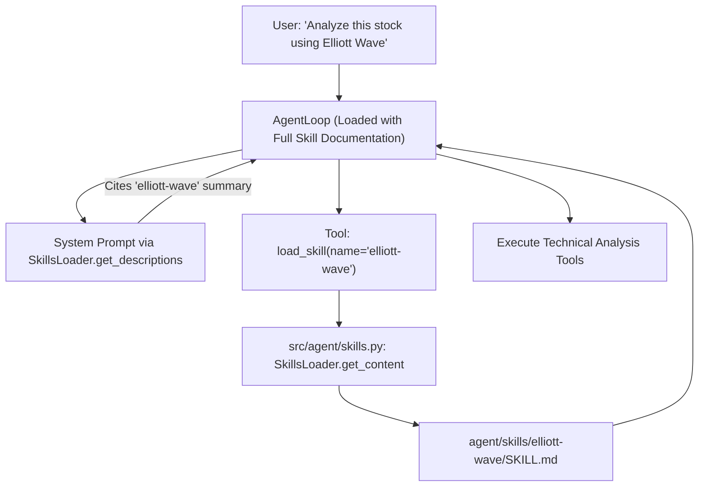
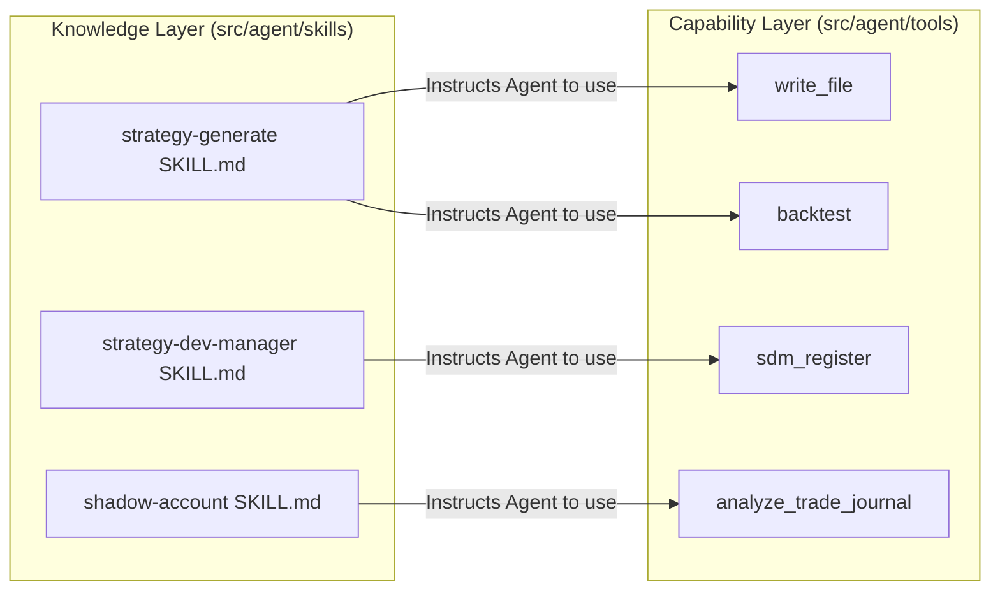

<!-- source: DeepWiki mcp.deepwiki.com · repo HKUDS/Vibe-Trading · page 3 Skills System (87+ Specialist Skills) · fetched 2026-11-09 -->

# Skills System (87+ Specialist Skills)

Relevant source files

The following files were used as context for generating this wiki page:

- [agent/cli/ui/rail.py](agent/cli/ui/rail.py)
- [agent/src/agent/frontmatter.py](agent/src/agent/frontmatter.py)
- [agent/src/agent/memory.py](agent/src/agent/memory.py)
- [agent/src/agent/skills.py](agent/src/agent/skills.py)
- [agent/src/memory/__init__.py](agent/src/memory/__init__.py)
- [agent/src/tools/load_skill_tool.py](agent/src/tools/load_skill_tool.py)
- [agent/src/tools/redaction.py](agent/src/tools/redaction.py)
- [agent/src/tools/skill_writer_tool.py](agent/src/tools/skill_writer_tool.py)
- [agent/tests/test_cli_rail_dashboard.py](agent/tests/test_cli_rail_dashboard.py)
- [agent/tests/test_load_skill_allowlist.py](agent/tests/test_load_skill_allowlist.py)
- [agent/tests/test_redaction.py](agent/tests/test_redaction.py)
- [agent/tests/test_redaction_channel_and_provider_tokens.py](agent/tests/test_redaction_channel_and_provider_tokens.py)
- [agent/tests/test_redaction_cookie_headers.py](agent/tests/test_redaction_cookie_headers.py)
- [agent/tests/test_redaction_shared.py](agent/tests/test_redaction_shared.py)
- [agent/tests/test_skill_writer_tools.py](agent/tests/test_skill_writer_tools.py)
- [agent/tests/test_skills.py](agent/tests/test_skills.py)
- [agent/tests/test_swarm_m4_e2e.py](agent/tests/test_swarm_m4_e2e.py)
- [agent/tests/test_swarm_m5_trust_model.py](agent/tests/test_swarm_m5_trust_model.py)
- [agent/tests/test_swarm_output_contract.py](agent/tests/test_swarm_output_contract.py)
- [agent/tests/test_swarm_retry_artifact_isolation.py](agent/tests/test_swarm_retry_artifact_isolation.py)
- [agent/tests/test_swarm_tool_run_dir.py](agent/tests/test_swarm_tool_run_dir.py)
- [agent/tests/test_swarm_worker_content_filter.py](agent/tests/test_swarm_worker_content_filter.py)
- [agent/tests/test_swarm_worker_tool_result_truncation.py](agent/tests/test_swarm_worker_tool_result_truncation.py)
- [agent/tests/test_trade_journal_fiat_pairs_not_crypto.py](agent/tests/test_trade_journal_fiat_pairs_not_crypto.py)

The Skills System is a progressive disclosure architecture designed to empower the ReAct agent with specialized financial knowledge without overwhelming the LLM's context window. While the agent possesses atomic tools (e.g., `write_file`, `backtest`), it relies on **Skills** to understand *how* to apply those tools across 87+ distinct financial domains, ranging from Smart Money Concepts (SMC) to Alpha Zoo factor benchmarking and Strategy Development Management (SDM) [agent/src/agent/skills.py:100-192](), [agent/src/tools/skill_writer_tool.py:81-197]().

---

## Skills Architecture

The system operates on a "Just-in-Time" documentation loading principle. Rather than injecting all 87+ comprehensive markdown manuals into every prompt, the agent receives a categorized list of one-line summaries via `SkillsLoader.get_descriptions()` [agent/src/agent/skills.py:143-164](). When a task demands specialized domain knowledge, the agent invokes the `load_skill` tool to fetch the full documentation body on demand [agent/src/agent/skills.py:166-191]().

### SkillsLoader and SKILL.md
The `SkillsLoader` class scans the bundled `agent/skills/` directory and the user-defined skills directory (`~/.vibe-trading/skills/user/`) [agent/src/agent/skills.py:107-136](). Each skill resides in its own subdirectory containing a `SKILL.md` file featuring YAML frontmatter for metadata (`name`, `description`, `category`) [agent/src/agent/skills.py:22-95](). User-created or patched skills take precedence by being loaded first, allowing seamless mid-session overrides [agent/src/agent/skills.py:120-136]().

| Component | Class / File Entity | Role |
|:---|:---|:---|
| **Loader** | `SkillsLoader` | Discovers, parses, and organizes skill modules from disk [agent/src/agent/skills.py:100-136]() |
| **Data Structure** | `Skill` | Encapsulates metadata, frontmatter, body text, and supporting asset loading [agent/src/agent/skills.py:22-60]() |
| **Writer Tools** | `SaveSkillTool`, `PatchSkillTool` | Enables the agent to create and modify custom skills dynamically [agent/src/tools/skill_writer_tool.py:81-197]() |
| **Runtime Tool** | `load_skill` | Fetches full SKILL.md content into the agent context on demand [agent/src/agent/skills.py:166-191]() |

**Natural Language to Code Entity Space: Skill Loading Flow**

Sources: [agent/src/agent/skills.py:22-191](), [agent/src/tools/skill_writer_tool.py:81-197]()

---

## User-Created Skills and Dynamic Expansion

The platform supports dynamic skill creation and modification during agent execution via `SaveSkillTool` and `PatchSkillTool` [agent/src/tools/skill_writer_tool.py:81-197](). User skills are saved under `USER_SKILLS_DIR` (`~/.vibe-trading/skills/user/`) [agent/src/agent/skills.py:97](), complete with support for auxiliary subdirectories (`references/`, `templates/`, `examples/`, `assets/`) [agent/src/tools/skill_writer_tool.py:1-10](). When a skill is saved or patched, `SkillsLoader` performs fallback checks on disk to ensure mid-session newly created skills are instantly addressable [agent/src/agent/skills.py:181-187]().

Sources: [agent/src/agent/skills.py:97-187](), [agent/src/tools/skill_writer_tool.py:1-197]()

---

## Skill Categories

Skills are grouped into core categories to assist the agent in navigating its available methodologies. Below is an overview of the primary skill groupings, linking to detailed child documentation.

### 3.1 Data Source Skills
Covers data-acquisition integration guides and fallback routing protocols for institutional and retail feeds, including Tushare, YFinance, AKShare, OKX, CCXT, MootDX, Eastmoney, SEC EDGAR, and QVeris [agent/src/agent/skills.py:138-140]().
- **Details:** See [Data Source Skills](#3.1).

Sources: [agent/src/agent/skills.py:138-140]()

### 3.2 Strategy and Backtesting Skills
Guides strategy generation frameworks, backtest diagnostics, execution models, performance attribution, Pine Script v6 translation, and VNPY export guidelines [agent/src/agent/skills.py:138-140]().
- **Details:** See [Strategy and Backtesting Skills](#3.2).

Sources: [agent/src/agent/skills.py:138-140]()

### 3.3 Technical Analysis Skills
Provides mathematical definitions, chart patterns, and trading logic for technical-basic, candlestick patterns, Elliott Wave theory, Harmonic patterns, Ichimoku Kinko Hyo, Smart Money Concepts (SMC), Chanlun, and minute-level analysis [agent/src/agent/skills.py:138-140]().
- **Details:** See [Technical Analysis Skills](#3.3).

Sources: [agent/src/agent/skills.py:138-140]()

### 3.4 Quantitative and Factor Research Skills
Focuses on alpha research, multi-factor modeling, machine learning strategies, quantitative statistics, correlation analysis, pair trading, statistical arbitrage, and volatility modeling [agent/src/agent/skills.py:138-140]().
- **Details:** See [Quantitative and Factor Research Skills](#3.4).

Sources: [agent/src/agent/skills.py:138-140]()

### 3.5 Fundamental, Macro, and Commodity Analysis Skills
Outlines financial statement breakdown, fundamental filtering, valuation modeling (DCF), earnings forecasting, global macro analysis, sector rotation, asset allocation, geopolitical risk, and commodity supply-demand frameworks [agent/src/agent/skills.py:138-140]().
- **Details:** See [Fundamental, Macro, and Commodity Analysis Skills](#3.5).

Sources: [agent/src/agent/skills.py:138-140]()

### 3.6 Crypto and DeFi Skills
Covers crypto derivatives, DeFi yield strategies, on-chain analytics, liquidation heatmaps, stablecoin flows, token unlock/treasury tracking, perpetual funding basis, and social media intelligence [agent/src/agent/skills.py:138-140]().
- **Details:** See [Crypto and DeFi Skills](#3.6).

Sources: [agent/src/agent/skills.py:138-140]()

### 3.7 Options, Fixed Income, and Specialty Skills
Encompasses options strategies/payoffs, hedging mechanics, convertible bonds, credit analysis, ETF analysis, market flows, corporate events, sentiment analysis, document/web readers, report generation, and the Strategy Development Manager (SDM) [agent/src/agent/skills.py:138-140]().
- **Details:** See [Options, Fixed Income, and Specialty Skills](#3.7).

Sources: [agent/src/agent/skills.py:138-140]()

### 3.8 Value Investing and Deep Research Skills
Focuses on institutional research rigor, deep company series, thesis tracking, management deep dives, private company research, bottleneck hunting, and investor lenses backed by `report_audit` and `financial_rigor` tools [agent/src/agent/skills.py:138-140]().
- **Details:** See [Value Investing and Deep Research Skills](#3.8).

Sources: [agent/src/agent/skills.py:138-140]()

---

## Interaction Logic: Tools vs. Skills

The architecture enforces a strict separation between **capabilities** (Tools) and **methodological knowledge** (Skills). Tools provide the atomic execution interface (e.g., file writing, executing backtests, querying APIs), whereas Skills provide the domain guidance on *how* and *when* to sequence those tools effectively.

**Natural Language to Code Entity Space: Capability vs. Knowledge**

Sources: [agent/src/agent/skills.py:22-191](), [agent/src/tools/skill_writer_tool.py:81-197]()

---

