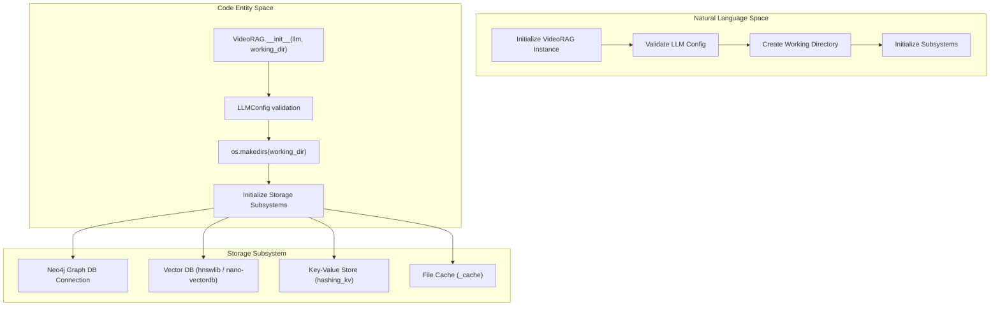
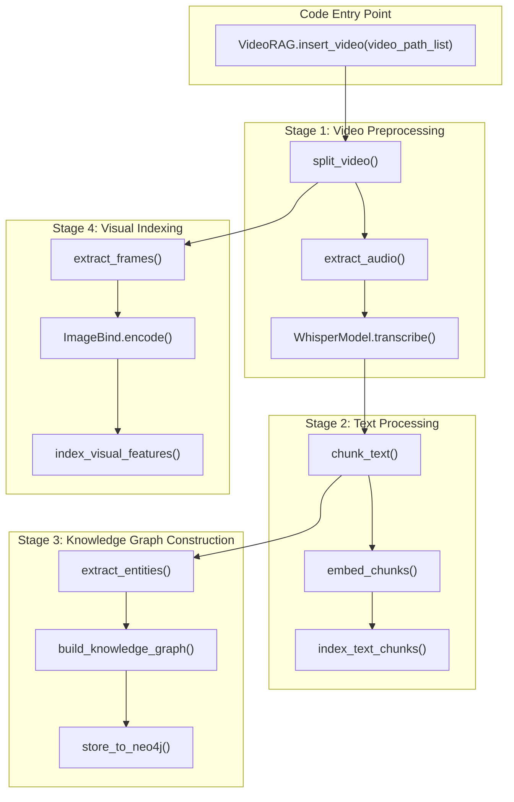

<!-- source: DeepWiki mcp.deepwiki.com · repo HKUDS/VideoRAG · page 4.1 VideoRAG Class · fetched 2026-11-09 -->

# VideoRAG Class

<details>
<summary>Relevant source files</summary>

The following files were used as context for generating this wiki page:

- [VideoRAG-algorithm/README.md](VideoRAG-algorithm/README.md)
- [VideoRAG-algorithm/examples/process_videos_deepseek.py](VideoRAG-algorithm/examples/process_videos_deepseek.py)
- [VideoRAG-algorithm/examples/query_videos_deepseek.py](VideoRAG-algorithm/examples/query_videos_deepseek.py)

</details>


## Purpose and Scope

This document provides a comprehensive technical reference for the `VideoRAG` class, which serves as the primary programmatic interface to the VideoRAG framework (`VideoRAG-algorithm/README.md:13-19` [VideoRAG-algorithm/README.md:13-19]()). The `VideoRAG` class orchestrates video processing, knowledge graph construction, vector indexing, and multi-modal retrieval operations.

For information about query methods and query parameters, see [Query Methods and Parameters](#4.2). For LLM configuration options, see [LLM Configuration Options](#5.1). For architectural context, see [VideoRAG Framework](#3).

Sources: `VideoRAG-algorithm/README.md:13-19` [VideoRAG-algorithm/README.md:13-19]()

---

## Class Overview

The `VideoRAG` class is the main entry point for all VideoRAG operations. It encapsulates the complete video processing and retrieval pipeline, providing a simplified interface for:

- **Video Ingestion**: Processing and indexing video files via `insert_video()` [VideoRAG-algorithm/README.md:165-165]()
- **Knowledge Extraction**: Building multi-modal knowledge graphs from video content
- **Query Processing**: Answering questions based on indexed video content using `query()` [VideoRAG-algorithm/examples/query_videos_deepseek.py:33-33]()
- **State Management**: Maintaining working directories and persistent storage in `working_dir` [VideoRAG-algorithm/README.md:164-164]()

The class is designed to be instantiated once per working directory, with all video content and indexes stored within that directory.

### Key Characteristics

| Characteristic | Description |
|---------------|-------------|
| **Stateful** | Maintains persistent storage in `working_dir` [VideoRAG-algorithm/README.md:164-164]() |
| **Multiprocessing-Aware** | Requires `multiprocessing.set_start_method('spawn')` [VideoRAG-algorithm/README.md:156-156]() |
| **GPU-Optimized** | Designed for single GPU usage (24GB VRAM recommended) [VideoRAG-algorithm/README.md:40-40]() |
| **Asynchronous** | Supports batch processing and async LLM calls |

Sources: `VideoRAG-algorithm/README.md:40-166` [VideoRAG-algorithm/README.md:40-166]()

---

## Class Constructor

### VideoRAG Initialization

```python
VideoRAG(llm: LLMConfig, working_dir: str)
```
*(Defined in the core package and initialized in scripts like `VideoRAG-algorithm/README.md:164-164` [VideoRAG-algorithm/README.md:164-164]())*

The constructor initializes the `VideoRAG` instance with LLM configuration and a working directory for persistent storage.

#### Constructor Parameters

| Parameter | Type | Required | Description |
|-----------|------|----------|-------------|
| `llm` | `LLMConfig` | Yes | LLM configuration object specifying model providers, embeddings, and API settings (`videorag._llm`). See [LLM Configuration Options](#5.1) for available configurations. |
| `working_dir` | `str` | Yes | Path to directory where `VideoRAG` stores all persistent data including knowledge graphs, vector indexes, video segments, and metadata [VideoRAG-algorithm/README.md:164-164](). |

#### Initialization Workflow

Title: VideoRAG Initialization Flow and Code Entities



Sources: `VideoRAG-algorithm/README.md:139-166` [VideoRAG-algorithm/README.md:139-166](), `VideoRAG-algorithm/examples/process_videos_deepseek.py:27-27` [VideoRAG-algorithm/examples/process_videos_deepseek.py:27-27]()

---

## insert_video Method

The `insert_video` method is the primary interface for processing and indexing video content into the VideoRAG system [VideoRAG-algorithm/README.md:165-165]().

### Method Signature

```python
videorag.insert_video(video_path_list: List[str])
```
*(Referenced in `VideoRAG-algorithm/README.md:165-165` [VideoRAG-algorithm/README.md:165-165]())*

### Parameters

| Parameter | Type | Required | Description |
|-----------|------|----------|-------------|
| `video_path_list` | `List[str]` | Yes | List of file paths to video files. Supports common formats (`.mp4`, `.mkv`, etc.). No length limit on the list or individual video duration [VideoRAG-algorithm/README.md:158-163](). |

### Processing Pipeline

Title: Video Processing and Insertion Pipeline



Sources: `VideoRAG-algorithm/README.md:139-166` [VideoRAG-algorithm/README.md:139-166](), `VideoRAG-algorithm/examples/process_videos_deepseek.py:22-30` [VideoRAG-algorithm/examples/process_videos_deepseek.py:22-30]()

### Processing Stages Detail

#### Stage 1: Video Preprocessing
- **Video Splitting**: Segments raw video into clips using `split_video()` stored in `_cache/`.
- **Audio Extraction**: Extracts audio tracks via `extract_audio()` [VideoRAG-algorithm/README.md:75-75]().
- **Speech Recognition**: Transcribes speech using `faster_whisper` (`WhisperModel`) to obtain timestamped text [VideoRAG-algorithm/README.md:83-83]().

#### Stage 2: Text Processing
- **Text Chunking**: Splits transcripts into semantic units via `chunk_text()`.
- **Embedding Generation**: Generates dense vectors using text embedding configuration from `LLMConfig`.
- **Vector Indexing**: Stores text embeddings in vector databases (`hnswlib` or `nano-vectordb`) [VideoRAG-algorithm/README.md:83-83]().

#### Stage 3: Knowledge Graph Construction
- **Entity Extraction**: Uses LLM (`best_model_func`) to extract domain entities and relations.
- **Graph Building**: Constructs a multi-modal knowledge graph via `build_knowledge_graph()`.
- **Persistence**: Persists graph structures into Neo4j [VideoRAG-algorithm/README.md:83-83]().

#### Stage 4: Visual Indexing
- **Frame Extraction**: Samples key frames from video segments (`extract_frames()`).
- **Visual Encoding**: Embeds visual frames using `ImageBind` (`imagebind_huge.pth`) [VideoRAG-algorithm/README.md:105-108]().
- **Visual Indexing**: Stores visual features in the vector storage subsystem [VideoRAG-algorithm/README.md:83-83]().

Sources: `VideoRAG-algorithm/README.md:74-89` [VideoRAG-algorithm/README.md:74-89]()

---

## Working Directory Structure

Upon initializing `VideoRAG` and running `insert_video()`, the specified `working_dir` maintains the following structure:

```
working_dir/
├── _cache/
│   ├── video_segments/       # Split video clips
│   └── audio_files/          # Extracted audio
├── graph_db/
│   ├── neo4j_data/           # Knowledge graph storage
│   └── entity_mappings/      # Entity ID mappings
├── vectors/
│   ├── text_chunks.index     # Text embeddings (hnswlib)
│   ├── entities.index        # Entity embeddings
│   └── visual_features.index # Visual embeddings
└── metadata/
    ├── chunks.json           # Text chunk metadata
    ├── timestamps.json       # Video timestamp mappings
    └── video_manifest.json   # Video file registry
```

Sources: `VideoRAG-algorithm/README.md:112-129` [VideoRAG-algorithm/README.md:112-129]()

---

## Usage Examples

### Basic Video Processing

```python
import multiprocessing
from videorag._llm import openai_4o_mini_config
from videorag import VideoRAG

if __name__ == '__main__':
    multiprocessing.set_start_method('spawn')
    
    video_paths = [
        'movies/Iron-Man.mp4',
        'movies/Spider-Man.mkv',
    ]
    
    videorag = VideoRAG(
        llm=openai_4o_mini_config,
        working_dir="./videorag-workdir"
    )
    
    videorag.insert_video(video_path_list=video_paths)
```
*(Example adapted from `VideoRAG-algorithm/README.md:139-166` [VideoRAG-algorithm/README.md:139-166]())*

### Using Alternative LLM Provider (DeepSeek)

```python
import os
import multiprocessing
from videorag._llm import deepseek_bge_config
from videorag import VideoRAG

os.environ["DEEPSEEK_API_KEY"] = "sk-*******"
os.environ["SILICONFLOW_API_KEY"] = "sk-******"

if __name__ == '__main__':
    multiprocessing.set_start_method('spawn')
    
    video_paths = [
        '/home/zy/VideoRAG/sample.mp4',
    ]
    
    videorag = VideoRAG(
        llm=deepseek_bge_config,
        working_dir="./videorag-workdir"
    )
    
    videorag.insert_video(video_path_list=video_paths)
```
*(Example from `VideoRAG-algorithm/examples/process_videos_deepseek.py:1-30` [VideoRAG-algorithm/examples/process_videos_deepseek.py:1-30]())*

Sources: `VideoRAG-algorithm/README.md:139-166` [VideoRAG-algorithm/README.md:139-166](), `VideoRAG-algorithm/examples/process_videos_deepseek.py:1-30` [VideoRAG-algorithm/examples/process_videos_deepseek.py:1-30]()

---

