# Page: Overview

# Overview

<details>
<summary>Relevant source files</summary>

The following files were used as context for generating this wiki page:

- [README.md](README.md)
- [VideoRAG-algorithm/README.md](VideoRAG-algorithm/README.md)
- [cover.png](cover.png)

</details>


## Purpose and Scope

This document provides a high-level introduction to the VideoRAG repository, which contains two integrated systems: **Vimo Desktop Application** and the **VideoRAG Framework**. The VideoRAG system enables intelligent interaction with videos through retrieval-augmented generation (RAG), capable of processing extremely long-context videos (up to hundreds of hours) by combining graph-based knowledge indexing with hierarchical multimodal encoding.

For detailed information on specific components:
- **Vimo Desktop Application** architecture and usage: see [Vimo Desktop Application](#2)
- **VideoRAG Framework** algorithm and implementation: see [VideoRAG Framework](#3)
- **API reference** for programmatic access: see [Core API Reference](#4)
- **LLM provider configuration**: see [LLM Integration](#5)

Sources: [README.md:1-71](), [VideoRAG-algorithm/README.md:1-50]()

## Repository Layout

For details, see [Repository Layout](#1.1). The repository is organized into two primary top-level components: `Vimo-desktop/` (hosting the Electron and React client along with the Flask python backend) and `VideoRAG-algorithm/` (housing the core algorithm implementation, evaluation benchmarks, and notebooks).

```
VideoRAG/
├── Vimo-desktop/              # Electron-based desktop application
│   ├── src/                   # React frontend source code
│   ├── electron/              # Electron main process
│   └── python_backend/        # Flask API server (videorag_api.py)
└── VideoRAG-algorithm/        # Core VideoRAG framework
    ├── videorag.py            # Main VideoRAG class
    ├── reproduce/             # Benchmark evaluation scripts
    └── models/                # Model configurations
```

Sources: [README.md:1-71](), [VideoRAG-algorithm/README.md:112-130]()

## System Architecture at a Glance

For details, see [System Architecture at a Glance](#1.2). The VideoRAG system consists of three architectural layers: a user-facing frontend, a Python backend service layer, and a persistent storage layer.

```mermaid
graph TB
    subgraph "FrontendLayer"
        ElectronApp["electron/main.ts"]
        ReactUI["src/"]
        InitWizard["src/pages/InitialWizard.tsx"]
        ChatInterface["src/pages/VideoChat.tsx"]
    end
    
    subgraph "BackendServiceLayer"
        FlaskAPI["python_backend/videorag_api.py"]
        VideoRAGClass["VideoRAG"]
        
        subgraph "ProcessingPipeline"
            VideoSplitter["split_video"]
            AudioExtractor["audio extraction"]
            WhisperASR["Whisper ASR"]
        end
        
        subgraph "IndexingSystem"
            KGBuilder["Knowledge Graph Builder"]
            VectorIndexer["Vector Indexer"]
        end
        
        subgraph "QuerySystem"
            MultiModalRetriever["Multi-Modal Retriever"]
            QueryMethod["VideoRAG.query"]
        end
    end
    
    subgraph "StorageLayer"
        Neo4jDB["Neo4j Database"]
        VectorDB["hnswlib/nano-vectordb"]
        FileCache["_cache/ directory"]
        KVStore["Key-Value Store"]
    end
    
    subgraph "ExternalServices"
        OpenAI["OpenAI API"]
        DashScope["DashScope API"]
        Ollama["Ollama"]
    end
    
    subgraph "MLModels"
        ImageBind["ImageBind"]
        WhisperModel["faster-distil-whisper"]
        MiniCPM["MiniCPM-V-2_6"]
    end
    
    ElectronApp --> ReactUI
    ReactUI --> InitWizard
    ReactUI --> ChatInterface
    ElectronApp --> FlaskAPI
    
    FlaskAPI --> VideoRAGClass
    VideoRAGClass --> VideoSplitter
    VideoRAGClass --> AudioExtractor
    VideoRAGClass --> WhisperASR
    VideoRAGClass --> KGBuilder
    VideoRAGClass --> VectorIndexer
    VideoRAGClass --> MultiModalRetriever
    VideoRAGClass --> QueryMethod
    
    VideoSplitter --> FileCache
    AudioExtractor --> FileCache
    WhisperASR --> KVStore
    KGBuilder --> Neo4jDB
    VectorIndexer --> VectorDB
    MultiModalRetriever --> VectorDB
    MultiModalRetriever --> Neo4jDB
    
    VideoRAGClass --> ImageBind
    VideoRAGClass --> WhisperModel
    VideoRAGClass --> MiniCPM
    VideoRAGClass --> OpenAI
    VideoRAGClass --> DashScope
    VideoRAGClass --> Ollama
```

Sources: [README.md:1-71](), [VideoRAG-algorithm/README.md:31-90]()

---

# Page: Repository Layout

# Repository Layout

<details>
<summary>Relevant source files</summary>

The following files were used as context for generating this wiki page:

- [README.md](README.md)
- [Vimo-desktop/README.md](Vimo-desktop/README.md)

</details>


## Purpose and Scope

This document maps the top-level directory structure and subdirectories of the VideoRAG repository (`https://github.com/HKUDS/VideoRAG`), distinguishing between the desktop application component (`Vimo-desktop/`) and the core algorithmic framework (`VideoRAG-algorithm/`). It details the organization of source files, backend bridges, and the duplicated `videorag` package utilized by the Python backend server.

Sources: [README.md:1-71](), [Vimo-desktop/README.md:1-134]()

---

## Top-Level Directory Structure

The repository is divided into two primary root components:
1. `Vimo-desktop/`: Contains the Electron-based desktop frontend, renderer components, and the bundled `python_backend/` service wrapper [Vimo-desktop/README.md:19-38]().
2. `VideoRAG-algorithm/`: Houses the standalone core algorithmic implementation of VideoRAG, including graph-indexing modules, benchmark datasets, and evaluation scripts [README.md:26-71]().

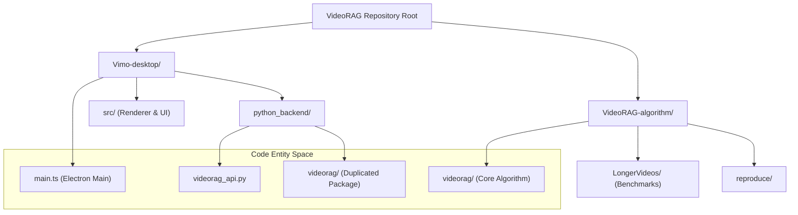
*Figure 1: High-level repository component layout bridging top-level folders to primary code entities.*

Sources: [README.md:26-71](), [Vimo-desktop/README.md:19-134]()

---

## Vimo Desktop Architecture (`Vimo-desktop/`)

The `Vimo-desktop/` directory implements the Electron client application, providing desktop-native window management, local file handling, and IPC routing to the underlying Python services [Vimo-desktop/README.md:21-38](). 

Key structural aspects include:
- **Electron Main Process (`main.ts`)**: Initializes application lifecycle events and manages native window contexts.
- **Renderer Process (`src/`)**: Built using React, managing user-facing views such as the chat interface, settings, and drag-and-drop upload managers.
- **Python Backend Wrapper (`python_backend/`)**: Hosts the Flask-based API bridge responsible for executing VideoRAG tasks locally [Vimo-desktop/README.md:102-105]().

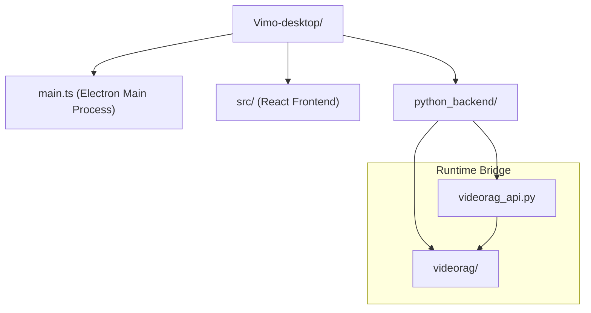
*Figure 2: Vimo desktop structural breakdown mapping desktop components to execution scripts.*

Sources: [Vimo-desktop/README.md:70-117]()

---

## Python Backend Bridge and Package Duplication (`python_backend/`)

To support self-contained desktop execution, `Vimo-desktop/python_backend/` bundles a dedicated Python API server (`videorag_api.py`) along with an embedded copy of the `videorag` package [Vimo-desktop/README.md:102-105](). 

- **`videorag_api.py`**: Acts as the Flask/IPC bridge endpoint exposing video insertion and query execution routes to the Electron frontend.
- **Embedded `videorag/` Package**: A localized copy of the core processing engine optimized to run within the conda environment (`vimo`) established during desktop setup [Vimo-desktop/README.md:75-97]().

Sources: [Vimo-desktop/README.md:70-117]()

---

## VideoRAG Algorithm Package Layout (`VideoRAG-algorithm/`)

The `VideoRAG-algorithm/` directory contains the core research implementation and modular components of the framework [README.md:26-71](). 

- **`videorag/`**: The primary algorithmic package containing modules for dual-channel graph construction, multi-modal context encoding, and the six-stage query pipeline.
- **`LongerVideos/`**: Benchmark datasets and evaluation artifacts consisting of long-form video content [README.md:55-58]().
- **`reproduce/`**: Quantitative evaluation scripts and comparative winrate testing utilities.

Sources: [README.md:26-71]()

---

# Page: System Architecture at a Glance

# System Architecture at a Glance

<details>
<summary>Relevant source files</summary>

The following files were used as context for generating this wiki page:

- [README.md](README.md)
- [Vimo-desktop/src/main/main.ts](Vimo-desktop/src/main/main.ts)

</details>


## Purpose and Scope
This document provides a comprehensive end-to-end technical summary of the VideoRAG (Vimo Desktop) system architecture. It details the interaction boundaries between the Electron-based frontend (`Vimo-desktop`), the Python backend bridge (`python_backend/videorag_api.py`), and the core `VideoRAG` algorithmic engine. For deeper dives into individual subsystems, refer to the relevant architectural and API reference pages.

Sources: [README.md:1-71](), [Vimo-desktop/src/main/main.ts:1-50]()

---

## Three-Tier System Architecture

The Vimo system operates across a three-tier architecture that bridges desktop UI components with high-performance video retrieval and graph-driven indexing algorithms.

1. **Frontend Tier (Electron Renderer & Main)**: Built with web technologies inside an Electron container, managing user interactions, drag-and-drop ingestion, chat states, and local settings.
2. **IPC & Bridge Tier**: The Electron main process (`[Vimo-desktop/src/main/main.ts:23-29]()`) coordinates native OS operations, file verification, and communicates with the Python backend via local HTTP/API bridges.
3. **Backend & Engine Tier (`VideoRAG-algorithm`)**: Executes the heavy-lifting video preprocessing, multimodal embeddings, knowledge graph construction, and multi-stage query retrieval pipelines.

### Diagram: End-to-End Architecture & Code Entity Mapping
```mermaid
graph TD
    subgraph Frontend["Electron Renderer Space"]
        UI[""Vimo UI & Renderer Components""]
    end

    subgraph MainProcess["Electron Main Process"]
        Main[""main.ts (app.whenReady)""]
        FileH[""file-handlers.ts""]
        ChatH[""chat-session-handlers.ts""]
        VraH[""videorag-handlers.ts""]
        Settings[""settings.ts""]
    end

    subgraph PythonBridge["Python Backend Bridge"]
        API[""python_backend/videorag_api.py""]
    end

    subgraph CoreEngine["VideoRAG Algorithm Engine"]
        Engine[""VideoRAG Class / Indexing & Retrieval""]
        DB[""Neo4j & Vector DB (hnswlib)""]
    end

    UI -->|""IPC Invoke""| Main
    Main --> FileH
    Main --> ChatH
    Main --> VraH
    Main --> Settings
    VraH -->|""HTTP / RPC""| API
    API --> Engine
    Engine --> DB
```
Sources: [Vimo-desktop/src/main/main.ts:1-49]()

---

## Electron Main Process and IPC Integration

The application lifecycle begins in the Electron main entry point (`[Vimo-desktop/src/main/main.ts:16-39]`), where hardware acceleration is disabled (`[Vimo-desktop/src/main/main.ts:13]()`) to stabilize GPU rendering across diverse host systems. Upon readiness, the main process registers critical Inter-Process Communication (IPC) handlers and initializes the main window (`[Vimo-desktop/src/main/main.ts:24-34]()`):

* `registerFileHandlers()`: Manages local file selection and path resolutions.
* `registerSettingsHandlers()`: Persists user configuration and API keys.
* `registerChatSessionHandlers()`: Manages conversational history and session states.
* `setupVideoRAGHandlers()`: Coordinates backend startup, shutdown, and inference requests.
* `registerModelHandlers()`: Verifies local assets such as `imagebind_huge.pth` and handles fallback downloads (`[Vimo-desktop/src/main/main.ts:56-189]()`).

Cleanup routines ensure background services terminate gracefully upon application exit via `stopVideoRAGService()` (`[Vimo-desktop/src/main/main.ts:46-49]()`).

Sources: [Vimo-desktop/src/main/main.ts:1-189]()

---

## Data Flow and Request Lifecycle

When a user submits a query or drops a video file into Vimo, requests traverse through the desktop bridge into the core Python engine. 

### Diagram: Request Lifecycle Sequence
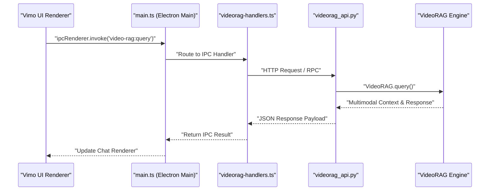
Sources: [Vimo-desktop/src/main/main.ts:1-35]()

---

# Page: Vimo Desktop Application

# Vimo Desktop Application

<details>
<summary>Relevant source files</summary>

The following files were used as context for generating this wiki page:

- [Vimo-desktop/README.md](Vimo-desktop/README.md)
- [Vimo-desktop/package.json](Vimo-desktop/package.json)

</details>


## Purpose and Scope

This document provides a high-level overview of the Vimo Desktop Application, an Electron-based cross-platform client that serves as the user-facing interface for the VideoRAG system [Vimo-desktop/README.md:19-22](). It covers the application's overall architecture, technology stack, and its integration with the Python backend [Vimo-desktop/README.md:70-105]().

As a parent page, this section introduces key operational areas. For detailed implementation specifics, refer to the child pages:
- For setup guides and environment requirements, see [Installation and Setup](#2.1).
- For UI layouts, component structures, and user features, see [User Interface and Features](#2.2).
- For settings, API keys, and model downloads, see [Configuration Management](#2.3).
- For Electron process management and IPC handlers, see [Electron Main Process and IPC](#2.4).
- For the Python Flask API bridge and bundled wrapper, see [Python Backend Bridge](#2.5).

**Sources:** [Vimo-desktop/README.md:1-134](), [Vimo-desktop/package.json:1-56]()

---

## Architecture Overview

Vimo Desktop implements a hybrid architecture combining an Electron frontend (`Vimo-desktop/`) with a Python backend service (`python_backend/`) [Vimo-desktop/README.md:70-118](). The frontend handles user interactions and window control through `main.ts` and React views, while the backend Flask server (`videorag_api.py`) coordinates video processing and AI model inference [Vimo-desktop/README.md:100-105]().

### High-Level System Architecture

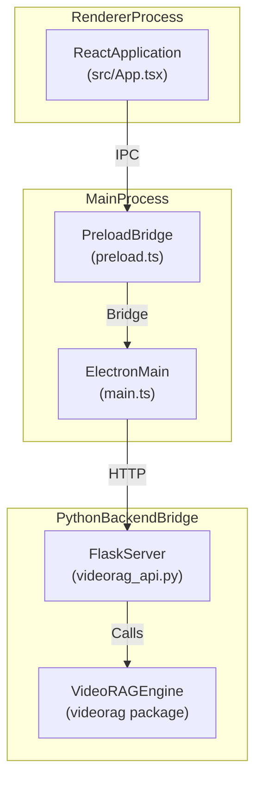

**Sources:** [Vimo-desktop/README.md:70-118](), [Vimo-desktop/package.json:1-15]()

---

## Natural Language to Code Entity Mapping

To bridge natural language concepts to concrete code components within the Vimo desktop and backend ecosystem, the following mappings link user-facing features to their respective codebase entities:

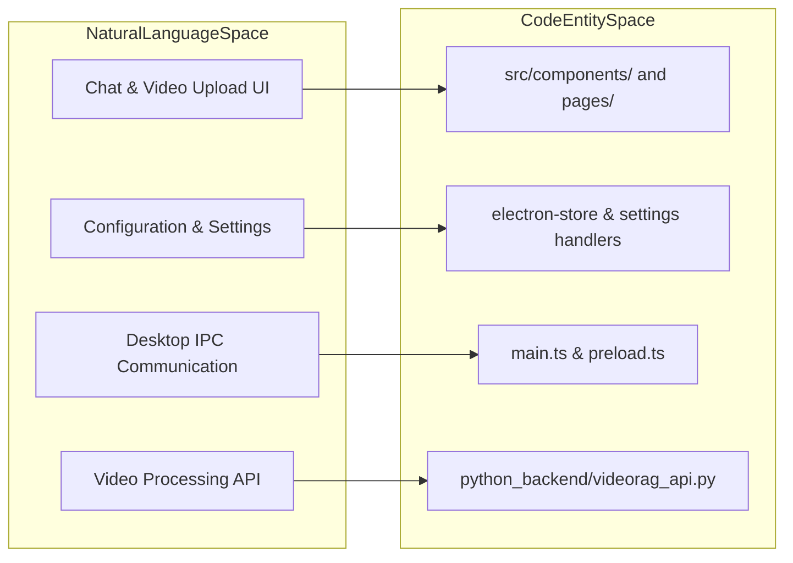

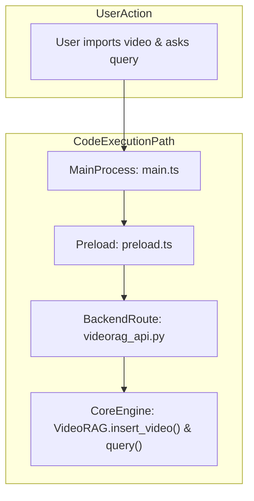

**Sources:** [Vimo-desktop/README.md:70-118](), [Vimo-desktop/package.json:1-56]()

---

## Sub-Topic Summaries

### Installation and Setup
Vimo Desktop requires a Node.js runtime environment (>=20.x) for the Electron frontend [Vimo-desktop/package.json:53-55]() and a Python 3.11 environment for the backend service [Vimo-desktop/README.md:75-76](). Users install dependencies via `pnpm` [Vimo-desktop/README.md:113]() and configure deep learning libraries such as PyTorch, MoviePy, and ImageBind [Vimo-desktop/README.md:78-96]().
For details, see [Installation and Setup](#2.1).

### User Interface and Features
The Vimo renderer is built with React 18, Vite, and Tailwind CSS [Vimo-desktop/package.json:1-52](), providing drag-and-drop video upload, multi-video workspace analysis, and an interactive chat interface. State is managed via custom hooks and React context providers.
For details, see [User Interface and Features](#2.2).

### Configuration Management
Vimo features settings persistence using `electron-store` [Vimo-desktop/package.json:14]() to manage API keys, storage directories, and model configurations. An initialization wizard guides new users through setting up required parameters before launching the main application window.
For details, see [Configuration Management](#2.3).

### Electron Main Process and IPC
The Electron main process (`main.ts`) manages application windows, life cycle events, and secure inter-process communication (IPC) via `preload.ts` [Vimo-desktop/README.md:62-118](). Dedicated IPC handlers manage file dialogues, session states, and communication with the local backend server.
For details, see [Electron Main Process and IPC](#2.4).

### Python Backend Bridge
The Python backend bridge (`python_backend/videorag_api.py`) wraps the core `videorag` package into a Flask REST API server listening on port 5000. It translates incoming desktop requests into video parsing, knowledge graph construction, and retrieval tasks.
For details, see [Python Backend Bridge](#2.5).

**Sources:** [Vimo-desktop/README.md:1-134](), [Vimo-desktop/package.json:1-56]()

---

# Page: Installation and Setup

# Installation and Setup

<details>
<summary>Relevant source files</summary>

The following files were used as context for generating this wiki page:

- [Vimo-desktop/README.md](Vimo-desktop/README.md)
- [Vimo-desktop/package.json](Vimo-desktop/package.json)

</details>


This document provides installation instructions for the Vimo Desktop Application, including system requirements, downloading the packaged application, and setting up the development environment from source code. Vimo requires both a Python backend service (`videorag_api.py`) and an Electron-based frontend application (`Vimo-desktop/`).

For installation of the core VideoRAG framework as a standalone library, see page 3 (VideoRAG Framework).

## System Requirements

Vimo Desktop has been tested on macOS with Apple M1 chips and requires GPU acceleration for video processing. The application architecture separates the frontend (Electron) from the backend (Python VideoRAG server).

### Hardware Requirements

| Component | Requirement | Notes |
|-----------|-------------|-------|
| **GPU** | NVIDIA RTX 3090 (24GB) or equivalent | For processing hundreds of hours of video |
| **RAM** | 32GB minimum | Recommended for smooth operation |
| **Storage** | 50GB+ free space | For models, video cache, and databases |
| **OS** | macOS (Apple Silicon tested) | Windows and Linux support planned |

### Software Prerequisites

- **Python**: Version 3.11
- **CUDA**: Compatible installation for PyTorch (GPU version)
- **Node.js**: For frontend development (if running from source)
- **pnpm**: Package manager for frontend dependencies (`Vimo-desktop/package.json`)

Sources: [Vimo-desktop/README.md:68](), [Vimo-desktop/package.json:54]()

## Installation Options

Vimo Desktop offers two installation methods: downloading a packaged application or running from source code. The packaged application simplifies deployment by embedding all required components.

**Vimo Installation Architecture**
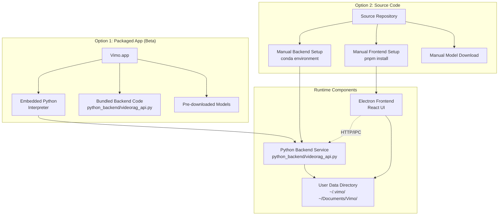

Sources: [Vimo-desktop/README.md:46-61](), [Vimo-desktop/README.md:99-105]()

### Option 1: Download Vimo App (Beta Release)

The packaged Vimo application provides a single-file installation experience with all dependencies bundled.

**Availability Status:**

| Platform | Status | Notes |
|----------|--------|-------|
| macOS (Apple Silicon) | **Beta** - Coming Soon | First release target |
| Windows | Planned | Future release |
| Linux | Planned | Future release |

The packaged version will include:
- Embedded Python backend environment
- Pre-bundled VideoRAG API server (`python_backend/videorag_api.py`)
- Downloaded model checkpoints (ImageBind, Whisper, MiniCPM-V)
- Self-contained Electron frontend (`Vimo-desktop/`)

Sources: [Vimo-desktop/README.md:48-58](), [Vimo-desktop/README.md:99-105]()

### Option 2: Run from Source Code

Running Vimo from source requires manual setup of both backend and frontend components. This option is recommended for developers or users who want to customize the application.

> **Important**: The backend service must be running before launching the frontend application.

Sources: [Vimo-desktop/README.md:64-68]()

#### Step 1: Backend Service Setup

The Python backend runs the VideoRAG API server on port 5000 and handles all video processing operations.

**Create Conda Environment**
```bash
conda create --name vimo python=3.11
conda activate vimo
```

**Install Backend Dependencies**

The backend dependencies are organized into functional categories (`Vimo-desktop/README.md`):

```bash
# Core numerical and deep learning libraries
pip install numpy==1.26.4 torch==2.1.2 torchvision==0.16.2 torchaudio==2.1.2

# Video processing utilities
pip install moviepy==1.0.3
pip install git+https://github.com/Re-bin/pytorchvideo.git@58f50da4e4b7bf0b17b1211dc6b283ba42e522df
pip install --no-deps git+https://github.com/facebookresearch/ImageBind.git@3fcf5c9039de97f6ff5528ee4a9dce903c5979b3

# Multi-modal and vision libraries
pip install timm ftfy regex einops fvcore eva-decord==0.6.1 iopath matplotlib types-regex cartopy

# Audio processing and vector databases
pip install neo4j hnswlib xxhash nano-vectordb

# Language models and utilities
pip install tiktoken openai tenacity dashscope

# Web server and utilities
pip install flask psutil flask_cors setproctitle
```

**Backend Dependency Architecture**
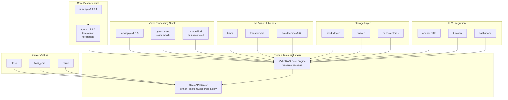

Sources: [Vimo-desktop/README.md:74-97]()

**Start Backend Service**

Navigate to the Python backend directory and start the VideoRAG API server:

```bash
cd python_backend
python videorag_api.py
```

The server will start on `http://localhost:5000` and provide endpoints for video ingestion (`/process_video`), querying (`/query`), and data management.

**Backend Service Communication Flow**
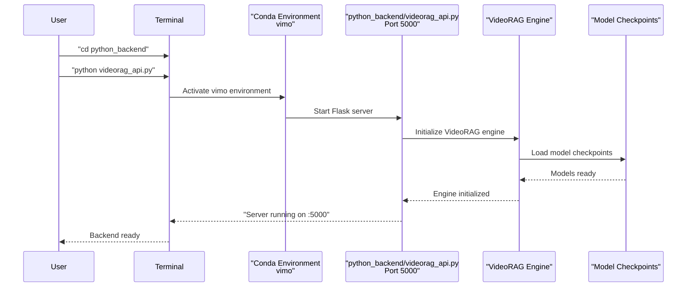

Sources: [Vimo-desktop/README.md:99-105]()

#### Step 2: Frontend Application Setup

The frontend is an Electron application built with React and managed using `pnpm` (`Vimo-desktop/package.json`).

**Install Frontend Dependencies**

From the project root or `Vimo-desktop` directory:

```bash
pnpm install
```

**Start Development Server**

```bash
pnpm dev
```

This command runs `electron-vite dev --watch` (`Vimo-desktop/package.json`), launching the Vite development server and the Electron application window.

**Frontend Startup Flow**
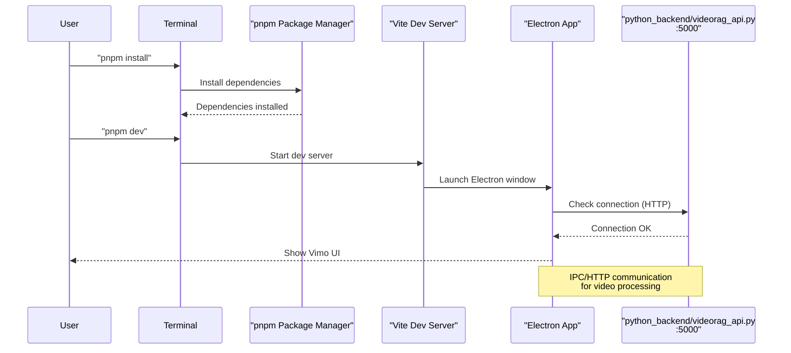

Sources: [Vimo-desktop/package.json:10](), [Vimo-desktop/README.md:107-117]()

## Initial Configuration

After launching Vimo for the first time, the application will guide you through an initialization wizard to configure necessary settings.

### Initialization Wizard Steps

The initialization wizard manages the following configuration:

1. **Storage Directory Selection**: Choose where Vimo stores processed video data
2. **Model Download**: Download ImageBind model checkpoints (~4.6GB)
3. **API Key Configuration**: Set up LLM provider credentials
4. **Database Initialization**: Create Neo4j graph database and vector indices

**Initialization Wizard Flow**
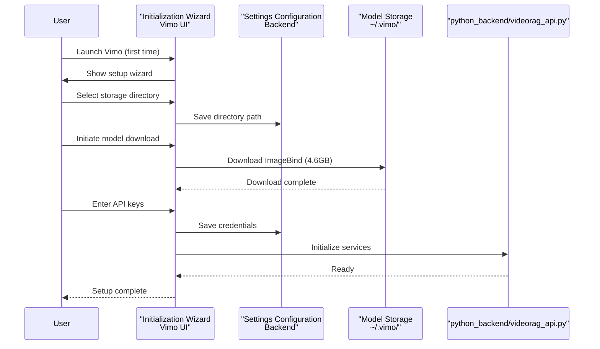

### Configuration Files and Directories

Vimo creates and manages several directories for configuration and data storage:

| Directory | Purpose | Typical Location |
|-----------|---------|------------------|
| `~/.vimo/` | Application configuration, API keys | User home directory |
| `~/Documents/Vimo/` | Working directory for videos | User documents |
| `~/Documents/Vimo/_cache/` | Video segments and audio cache | Working directory |
| Neo4j database | Knowledge graph storage | Working directory |
| Vector DB files | HNSWLIB and nano-vectordb indices | Working directory |

**Vimo Data Storage Architecture**
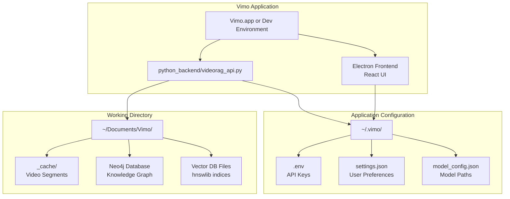

Sources: [Vimo-desktop/README.md:119]()

### API Key Configuration

Vimo supports multiple LLM providers. Configure at least one provider during the initialization wizard:

**Supported LLM Providers:**

| Provider | Required Key | Configuration Location |
|----------|--------------|------------------------|
| OpenAI | `OPENAI_API_KEY` | Settings page or `.env` |
| Azure OpenAI | `AZURE_OPENAI_API_KEY` | Settings page or `.env` |
| DashScope (Alibaba) | `DASHSCOPE_API_KEY` | Settings page or `.env` |
| Ollama | Local installation | No key required |

Sources: [Vimo-desktop/README.md:74-97]()

## Important Notes and Limitations

### Current Version Constraints

**File Path Stability (Beta Version)**

> ⚠️ **Warning**: In the current beta version, avoid moving or renaming video files after importing them into Vimo. Changing the file path may disrupt Vimo's ability to access the video (`Vimo-desktop/README.md`).

Sources: [Vimo-desktop/README.md:119]()

## Installation Verification

### Basic Functionality Test

After installation, verify the Python backend setup with a test script:

```python
import warnings
import multiprocessing
warnings.filterwarnings("ignore")

# Test imports
from videorag import VideoRAG, QueryParam
from videorag._llm import openai_4o_mini_config

if __name__ == '__main__':
    multiprocessing.set_start_method('spawn')
    videorag = VideoRAG(llm=openai_4o_mini_config, working_dir="./test-workdir")
    print("VideoRAG successfully initialized!")
```

Sources: [Vimo-desktop/README.md:68-97]()

Sources: [Vimo-desktop/README.md:46-119](), [Vimo-desktop/package.json:1-55]()

---

# Page: User Interface and Features

# User Interface and Features

<details>
<summary>Relevant source files</summary>

The following files were used as context for generating this wiki page:

- [Vimo-desktop/src/renderer/index.html](Vimo-desktop/src/renderer/index.html)
- [Vimo-desktop/src/renderer/src/components/InitializationWizard.tsx](Vimo-desktop/src/renderer/src/components/InitializationWizard.tsx)
- [Vimo-desktop/src/renderer/src/pages/settings/index.tsx](Vimo-desktop/src/renderer/src/pages/settings/index.tsx)

</details>


This document provides a technical breakdown of the user interface and client-side renderer architecture for the Vimo Desktop application (`Vimo-desktop/`). It details the React renderer structure (pages, components, contexts, hooks), core user-facing features (drag-and-drop video upload, conversational chat interface, multi-video analysis, and export capabilities), and how the renderer interacts with the Electron main process and backend APIs through IPC.

---

## Renderer Structure

The Vimo Desktop renderer process is built using React and TypeScript, hosted inside an Electron web container (`Vimo-desktop/src/renderer/index.html:1-36`). The application is structured around modular pages, reusable UI components, React contexts, and custom hooks that manage client-side state and bridge operations to the Electron main process via `window.api`.

### Pages and Components
- **`InitializationWizard` (`Vimo-desktop/src/renderer/src/components/InitializationWizard.tsx:22-210`)**: Guides first-time users through directory configuration (`storeDirectory`), model verification/download (`imagebindStatus`), and API key provisioning (`apiKeySettings`).
- **`Settings` (`Vimo-desktop/src/renderer/src/pages/settings/index.tsx:42-214`)**: Manages application-wide runtime configurations, including OpenAI base URLs, API keys (`openaiApiKey`, `dashscopeApiKey`), model selectors (`processingModel`, `analysisModel`, `captionModel`, `asrModel`), and local model storage directories.

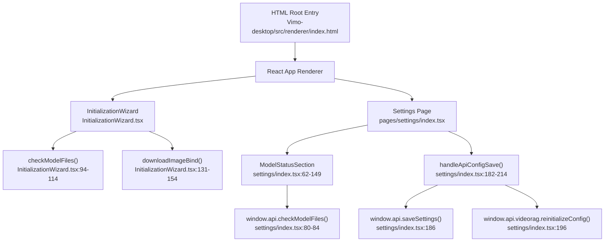

**Diagram: Renderer Component Hierarchy and Initialization Flow**

**Sources:** `Vimo-desktop/src/renderer/index.html:1-36`, `Vimo-desktop/src/renderer/src/components/InitializationWizard.tsx:1-210`, `Vimo-desktop/src/renderer/src/pages/settings/index.tsx:1-214`

---

## Core User Features

### Drag-and-Drop Video Upload
The video ingestion interface accepts raw container formats (MP4, MKV, AVI, MOV) via drag-and-drop actions. Once dropped, the file path is transmitted to the backend bridge, triggering video segmentation, audio extraction via Whisper ASR, knowledge graph extraction, and vector index construction.

### Conversational Interface
The chat interface provides natural language interaction over indexed video content. Users input queries which pass through a multi-stage retrieval pipeline. Responses render primary answer text alongside precise timestamp references (`MM:SS`), confidence metrics, and extracted keyframe thumbnails. Clicking a timestamp reference invokes the integrated video player to seek and play the specific segment.

### Multi-Video Session Management
Vimo supports parallel indexing of multiple videos within a single working directory (`storeDirectory`). The underlying Neo4j knowledge graph manages cross-video entity relationships, enabling comparative queries, multi-document synthesis, and cross-reference retrieval.

### Export Capabilities
The export subsystem formats conversation history, timestamped video references, and model-generated captions into structured JSON, tabular CSV, or human-readable Markdown files saved to user-selected locations.

**Sources:** `Vimo-desktop/src/renderer/src/components/InitializationWizard.tsx:32-154`, `Vimo-desktop/src/renderer/src/pages/settings/index.tsx:62-149`

---

## Natural Language Space to Code Entity Space: Initialization and Configuration

The following diagram bridges user-facing configuration workflows (Natural Language Space) to their corresponding React component handlers and IPC API bindings (Code Entity Space).

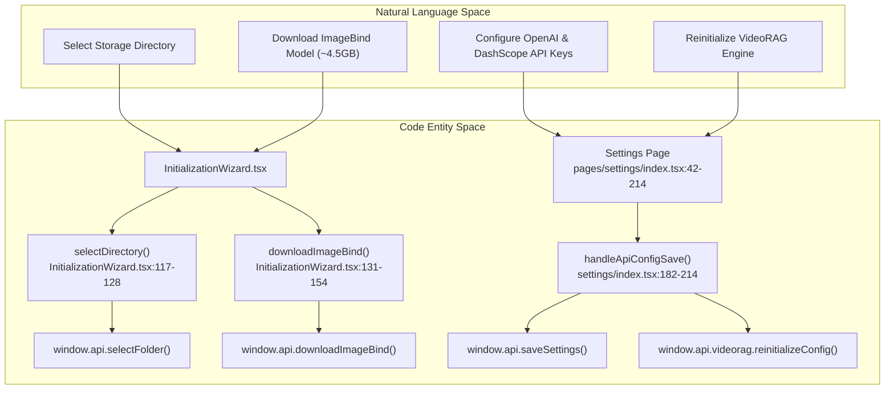

**Diagram: Mapping UI Configuration Actions to IPC Code Entities**

**Sources:** `Vimo-desktop/src/renderer/src/components/InitializationWizard.tsx:117-154`, `Vimo-desktop/src/renderer/src/pages/settings/index.tsx:182-214`

---

## State Management and IPC Bridge

The React renderer communicates with the Electron main process via asynchronous IPC wrappers exposed on the global `window.api` interface.

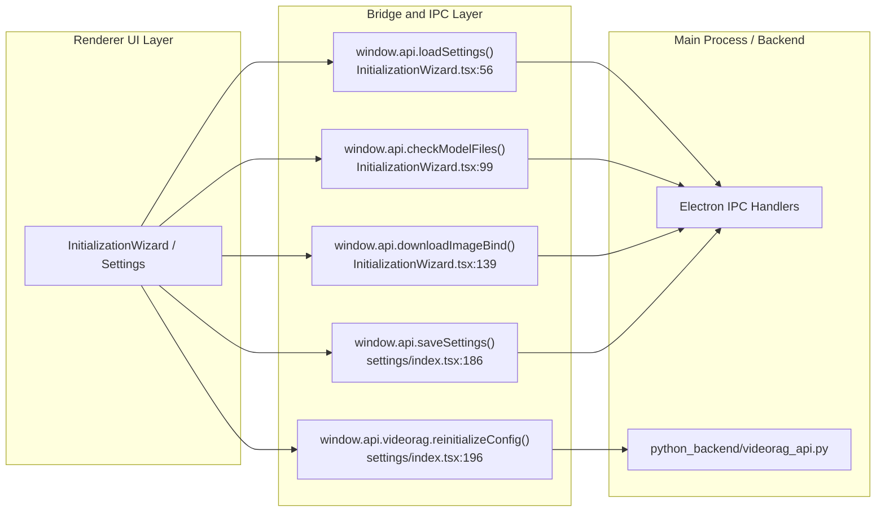

**Diagram: Renderer-to-Backend IPC Data Flow**

**Sources:** `Vimo-desktop/src/renderer/src/components/InitializationWizard.tsx:52-154`, `Vimo-desktop/src/renderer/src/pages/settings/index.tsx:158-214`

---

# Page: Configuration Management

# Configuration Management

<details>
<summary>Relevant source files</summary>

The following files were used as context for generating this wiki page:

- [Vimo-desktop/src/renderer/src/components/InitializationWizard.tsx](Vimo-desktop/src/renderer/src/components/InitializationWizard.tsx)
- [Vimo-desktop/src/renderer/src/pages/settings/index.tsx](Vimo-desktop/src/renderer/src/pages/settings/index.tsx)

</details>


## Purpose and Scope

This document details how the Vimo Desktop application manages configuration data, covering the first-time setup via the `InitializationWizard` component [Vimo-desktop/src/renderer/src/components/InitializationWizard.tsx:22-29](), ongoing configuration management via the `Settings` page component [Vimo-desktop/src/renderer/src/pages/settings/index.tsx:42-53](), API key provisioning, storage directory selection, and the asynchronous ImageBind model download pipeline.

For information on how the UI consumes these configurations, see [User Interface and Features](#2.2). For details on backend initialization, see [Python Backend Bridge](#2.5).

---

## Configuration Architecture Overview

The configuration system bridges the React-based renderer process with Electron's main process via secure IPC wrappers (`window.api`), persisting settings to the local file system and re-initializing the Python `VideoRAG` engine when parameters change.

### Diagram: Natural Language Space to Code Entity Space — Configuration Pipeline

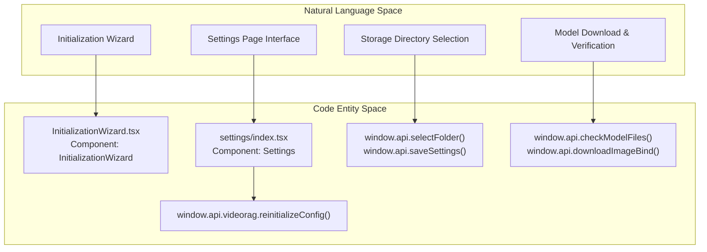

**Configuration Pipeline Code Mapping**
Sources: [Vimo-desktop/src/renderer/src/components/InitializationWizard.tsx:22-154](), [Vimo-desktop/src/renderer/src/pages/settings/index.tsx:42-196]()

---

## Configuration Schema and State Interface

Both the `InitializationWizard` and `Settings` components interact with a unified configuration schema defined by `SettingsState` [Vimo-desktop/src/renderer/src/pages/settings/index.tsx:23-40]() and local state structures [Vimo-desktop/src/renderer/src/components/InitializationWizard.tsx:40-48]().

| Field Name | Type | Description | Default / Source |
| :--- | :--- | :--- | :--- |
| `openaiBaseUrl` | string | OpenAI-compatible API endpoint | `https://api.openai.com/v1` [Vimo-desktop/src/renderer/src/components/InitializationWizard.tsx:41]() |
| `openaiApiKey` | string | API key for OpenAI models | User-provided [Vimo-desktop/src/renderer/src/components/InitializationWizard.tsx:42]() |
| `processingModel` | string | Model used for high-volume preprocessing | `gpt-4o-mini` [Vimo-desktop/src/renderer/src/components/InitializationWizard.tsx:43]() |
| `analysisModel` | string | Model used for fine-grained analysis | `gpt-4o-mini` [Vimo-desktop/src/renderer/src/components/InitializationWizard.tsx:44]() |
| `dashscopeApiKey` | string | Alibaba DashScope API key | User-provided [Vimo-desktop/src/renderer/src/components/InitializationWizard.tsx:45]() |
| `captionModel` | string | Vision/captioning model identifier | `qwen-vl-plus-latest` [Vimo-desktop/src/renderer/src/components/InitializationWizard.tsx:46]() |
| `asrModel` | string | Speech recognition model identifier | `paraformer-realtime-v2` [Vimo-desktop/src/renderer/src/components/InitializationWizard.tsx:47]() |
| `storeDirectory` | string | Local path for storing models and cache | User-selected folder [Vimo-desktop/src/renderer/src/components/InitializationWizard.tsx:33]() |
| `imagebindInstalled` | boolean | ImageBind model installation boolean | Checked via `checkModelFiles()` [Vimo-desktop/src/renderer/src/pages/settings/index.tsx:39]() |

Sources: [Vimo-desktop/src/renderer/src/components/InitializationWizard.tsx:40-48](), [Vimo-desktop/src/renderer/src/pages/settings/index.tsx:23-40]()

---

## Initialization Wizard Implementation

The `InitializationWizard` component manages first-time setup across four discrete steps: Directory selection (`step: 1`), Models (`step: 2`), API Keys (`step: 3`), and Complete (`step: 4`) [Vimo-desktop/src/renderer/src/components/InitializationWizard.tsx:24-29]().

### Diagram: Natural Language Space to Code Entity Space — Wizard Execution Flow

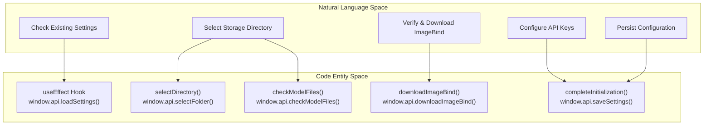

**Initialization Wizard Code Mapping**
Sources: [Vimo-desktop/src/renderer/src/components/InitializationWizard.tsx:52-154](), [Vimo-desktop/src/renderer/src/components/InitializationWizard.tsx:202-215]()

### Step-by-Step Logic
1. **Directory Selection (`step 1`)**: Invokes `selectDirectory()`, calling `window.api.selectFolder()` [Vimo-desktop/src/renderer/src/components/InitializationWizard.tsx:117-128](). Automatically triggers `checkModelFiles(result.path)` to detect pre-existing models [Vimo-desktop/src/renderer/src/components/InitializationWizard.tsx:123]().
2. **Model Download (`step 2`)**: Manages `imagebindStatus` (`'pending' | 'downloading' | 'completed' | 'error'`) [Vimo-desktop/src/renderer/src/components/InitializationWizard.tsx:34](). Progress events are received via `window.api.onDownloadProgress()` [Vimo-desktop/src/renderer/src/components/InitializationWizard.tsx:85]().
3. **API Keys (`step 3`)**: Updates local `apiKeySettings` state via `handleApiKeyChange()` [Vimo-desktop/src/renderer/src/components/InitializationWizard.tsx:193-198]().
4. **Completion (`step 4`)**: Combines directory, model status, and API settings into a payload passed to `window.api.saveSettings()` [Vimo-desktop/src/renderer/src/components/InitializationWizard.tsx:205-210]().

Sources: [Vimo-desktop/src/renderer/src/components/InitializationWizard.tsx:32-210]()

---

## Settings Page and Backend Reinitialization

The `Settings` component (`settings/index.tsx`) allows users to inspect and modify settings post-initialization [Vimo-desktop/src/renderer/src/pages/settings/index.tsx:42-53]().

### Save and Reinitialization Workflow
When users update their configuration in the settings UI, `handleApiConfigSave()` executes a two-phase update [Vimo-desktop/src/renderer/src/pages/settings/index.tsx:182-208]():
1. **Save Settings**: Calls `window.api.saveSettings(settings)` to write updated configurations to persistent storage [Vimo-desktop/src/renderer/src/pages/settings/index.tsx:186]().
2. **Backend Reinitialization**: Calls `window.api.videorag.reinitializeConfig()` to instruct the Python backend bridge to reload configuration without restarting the entire desktop process [Vimo-desktop/src/renderer/src/pages/settings/index.tsx:196]().
3. **Event Dispatched**: Dispatches a custom `storage-config-updated` event if the `storeDirectory` changed [Vimo-desktop/src/renderer/src/pages/settings/index.tsx:211-216]().

```typescript
// Example from settings/index.tsx saving configuration
const handleApiConfigSave = async () => {
  setApiConfigStatus('saving');
  try {
    const saveResult = await window.api.saveSettings(settings);
    if (!saveResult.success) {
      setApiConfigStatus('error');
      setTimeout(() => setApiConfigStatus('idle'), 2000);
      return;
    }
    const initResult = await window.api.videorag.reinitializeConfig();
    setApiConfigStatus('saved');
  } catch (initError) {
    setApiConfigStatus('saved');
  }
};
```

Sources: [Vimo-desktop/src/renderer/src/pages/settings/index.tsx:182-208]()

---

## Model Status Verification Component

The `ModelStatusSection` sub-component nested within the settings page checks if required model assets (such as ImageBind) are present in the designated `storeDirectory` [Vimo-desktop/src/renderer/src/pages/settings/index.tsx:62-149]().

- **Status Checking**: Calls `window.api.checkModelFiles(storeDirectory)` whenever `storeDirectory` updates [Vimo-desktop/src/renderer/src/pages/settings/index.tsx:71-93]().
- **UI States**: Displays visual feedback including loading spinner, green checkmark for ready state, or red cross if files are missing [Vimo-desktop/src/renderer/src/pages/settings/index.tsx:118-124]().

Sources: [Vimo-desktop/src/renderer/src/pages/settings/index.tsx:62-149]()

---

Sources: [Vimo-desktop/src/renderer/src/components/InitializationWizard.tsx:1-210](), [Vimo-desktop/src/renderer/src/pages/settings/index.tsx:1-214]()

---

# Page: Electron Main Process and IPC

# Electron Main Process and IPC

<details>
<summary>Relevant source files</summary>

The following files were used as context for generating this wiki page:

- [Vimo-desktop/src/main/main.ts](Vimo-desktop/src/main/main.ts)
- [Vimo-desktop/src/renderer/src/components/InitializationWizard.tsx](Vimo-desktop/src/renderer/src/components/InitializationWizard.tsx)
- [Vimo-desktop/src/renderer/src/pages/settings/index.tsx](Vimo-desktop/src/renderer/src/pages/settings/index.tsx)

</details>


## Purpose and Scope

This page documents the Electron main process implementation, window management routines, and Inter-Process Communication (IPC) handlers for the Vimo Desktop Application. The main process (`main.ts`) acts as the secure bridge between the web-based renderer frontend and native system resources, file systems, and the underlying Python VideoRAG backend service.

Sources: `[Vimo-desktop/src/main/main.ts:1-49]()`

---

## Main Process Lifecycle and Initialization

The entry point for the desktop application's main process is `[Vimo-desktop/src/main/main.ts:1]`. Upon startup, the application disables hardware acceleration to prevent GPU crashes on Linux and specific environments (`[Vimo-desktop/src/main/main.ts:13]()`), configures the application user model ID (`[Vimo-desktop/src/main/main.ts:17]()`), and sets up window shortcut watchers (`[Vimo-desktop/src/main/main.ts:19-21]()`).

When `app.whenReady()` resolves, the main process registers all IPC handler modules and instantiates the primary application window:

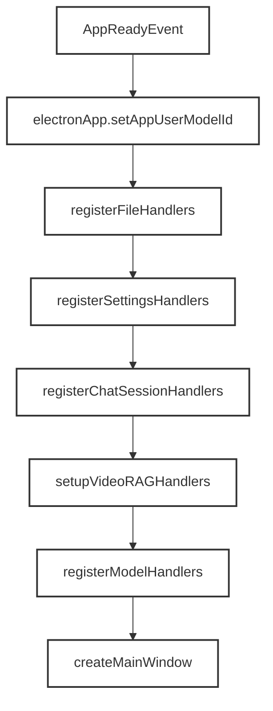
*Figure: Main process initialization flow mapping bootstrap events to handler registration functions.*

Sources: `[Vimo-desktop/src/main/main.ts:16-39]()`

---

## Window Management

Window management is isolated within the window helper module `[Vimo-desktop/src/main/handlers/window]()`. The `createMainWindow()` function handles window creation, security policies (such as context isolation and preload script configuration), and loading the renderer bundle or development URL.

```mermaid
graph TD
    sub13["createMainWindow"] --> sub14["BrowserWindow.create"]
    sub14 --> sub15["LoadRendererContent"]
    sub15 --> sub16["SetupWindowShortcuts"]

    classDef default fill:#fff,stroke:#333,stroke-width:2px;
```
*Figure: Window creation and lifecycle management.*

Sources: `[Vimo-desktop/src/main/main.ts:5]`, `[Vimo-desktop/src/main/main.ts:34]()`

---

## IPC Handler Subsystems

The Vimo application organizes its IPC routing into distinct functional modules called via `ipcMain.handle()` and `ipcMain.on()`.

### 1. File Handlers (`file-handlers.ts`)
Managed by `[Vimo-desktop/src/main/handlers/file-handlers.ts]`, these handlers expose native file system dialogs and file operations to the renderer. This includes selecting local video files, opening storage directories (`[Vimo-desktop/src/renderer/src/components/InitializationWizard.tsx:117-128]()`), and streaming file metadata.

### 2. Settings Handlers (`settings.ts`)
Managed by `[Vimo-desktop/src/main/handlers/settings]`, these routines persist and retrieve user configurations—such as API keys (`openaiApiKey`, `dashscopeApiKey`), endpoint base URLs, and selected model identifiers—to local configuration files (`[Vimo-desktop/src/renderer/src/pages/settings/index.tsx:153-172]()`).

### 3. Chat Session Handlers (`chat-session-handlers.ts`)
Implemented in `[Vimo-desktop/src/main/handlers/chat-session-handlers]`, these handlers manage chat history persistence, conversation state retrieval, and session creation for multi-video interactive dialogues.

### 4. VideoRAG Handlers and Python Bridge (`videorag-handlers.ts`)
Initialized via `setupVideoRAGHandlers()` (`[Vimo-desktop/src/main/main.ts:6]()`), this module manages the lifecycle of the bundled Python backend service (`python_backend/videorag_api.py`), spawning the child process, monitoring health endpoints, proxying video ingestion requests, and ensuring clean termination via `stopVideoRAGService()` upon application quit (`[Vimo-desktop/src/main/main.ts:47-49]()`).

### 5. Model Management Handlers
Model-related handlers reside directly inside `[Vimo-desktop/src/main/main.ts:56-189]()`. They provide two core IPC channels:
*   `check-model-files`: Asynchronously verifies the presence of model weights like `imagebind_huge.pth` inside the designated `storeDirectory` (`[Vimo-desktop/src/main/main.ts:58-75]()`).
*   `download-imagebind`: Streams the ImageBind model weights from remote sources (`https://dl.fbaipublicfiles.com/imagebind/imagebind_huge.pth`) directly to the local storage directory with real-time download progress broadcasting to the renderer (`[Vimo-desktop/src/main/main.ts:78-188]()`).

```mermaid
graph TD
    sub17["RendererInitializationWizard"] -->| "window.api.downloadImageBind" | sub18["ipcMainHandleDownloadImagebind"]
    sub18 --> sub19["HttpsGetModelStream"]
    sub19 -->| "event.sender.send('download-progress')" | sub20["RendererProgressEventListener"]
    sub18 --> sub21["FileSystemWriteImagebindHugePth"]

    classDef default fill:#fff,stroke:#333,stroke-width:2px;
```
*Figure: IPC execution flow for ImageBind model verification and streaming download.*

Sources: `[Vimo-desktop/src/main/main.ts:1-189]`, `[Vimo-desktop/src/renderer/src/components/InitializationWizard.tsx:52-154]`, `[Vimo-desktop/src/renderer/src/pages/settings/index.tsx:71-149]()`

---

## Complete IPC Architecture & Data Flow

The following diagram bridges the natural language concepts of frontend user actions with the precise code entities and IPC channels implemented across the Electron main and renderer processes.

```mermaid
graph TD
    sub22["UserActionSelectDirectory"] -->| "window.api.selectFolder" | sub23["registerFileHandlers"]
    sub24["UserActionCheckModels"] -->| "window.api.checkModelFiles" | sub25["check-model-files"]
    sub26["UserActionDownloadModel"] -->| "window.api.downloadImageBind" | sub27["download-imagebind"]
    sub28["UserActionSaveSettings"] -->| "window.api.saveSettings" | sub29["registerSettingsHandlers"]
    sub30["UserActionInitVideoRAG"] -->| "window.api.videorag.reinitializeConfig" | sub31["setupVideoRAGHandlers"]
    sub32["UserActionQuitApp"] -->| "app.on('before-quit')" | sub33["stopVideoRAGService"]

    classDef default fill:#fff,stroke:#333,stroke-width:2px;
```
*Figure: Code Entity mapping for IPC channels bridging renderer requests to main process handlers.*

Sources: `[Vimo-desktop/src/main/main.ts:1-49]`, `[Vimo-desktop/src/main/main.ts:56-189]`, `[Vimo-desktop/src/renderer/src/components/InitializationWizard.tsx:75-154]`, `[Vimo-desktop/src/renderer/src/pages/settings/index.tsx:182-214]()`

---

# Page: Python Backend Bridge

# Python Backend Bridge

<details>
<summary>Relevant source files</summary>

The following files were used as context for generating this wiki page:

- [Vimo-desktop/python_backend/videorag/_llm.py](Vimo-desktop/python_backend/videorag/_llm.py)
- [Vimo-desktop/src/main/main.ts](Vimo-desktop/src/main/main.ts)

</details>


The Python Backend Bridge serves as the crucial integration layer between the Electron-based Vimo desktop application and the Python-based VideoRAG algorithmic engine. Located under `Vimo-desktop/python_backend/`, this subsystem packages a modified version of the `videorag` package alongside an API service (`videorag_api.py`) that handles video processing requests, knowledge graph construction, and multi-modal query execution initiated from the desktop UI.

---

## 1. Architecture and Component Overview

The desktop application manages local execution of Python scripts and interacts with them via standard input/output streams or local HTTP endpoints managed through Electron IPC handlers. The backend bridge encapsulates environment configuration, model initialization, and asynchronous LLM wrappers tailored for desktop deployments.

### Natural Language Space to Code Entity Space Mapping

```mermaid
graph TD
    UserAction["User Interaction in Vimo UI"] --> ElectronMain["Electron Main Process (Vimo-desktop/src/main/main.ts)"]
    ElectronMain --> IPCHandlers["IPC Handlers (setupVideoRAGHandlers)"]
    IPCHandlers --> PythonBridge["Python Backend Bridge (Vimo-desktop/python_backend)"]
    PythonBridge --> VideoRAGAPI["API Service (videorag_api.py)"]
    VideoRAGAPI --> LLMCore["LLM & Embedding Engine (_llm.py)"]
    LLMCore --> AsyncClients["Async Clients (AsyncOpenAI / AsyncAzureOpenAI)"]

    style UserAction fill:#none,stroke:#333,stroke-width:2px
    style ElectronMain fill:#none,stroke:#333,stroke-width:2px
    style IPCHandlers fill:#none,stroke:#333,stroke-width:2px
    style PythonBridge fill:#none,stroke:#333,stroke-width:2px
    style VideoRAGAPI fill:#none,stroke:#333,stroke-width:2px
    style LLMCore fill:#none,stroke:#333,stroke-width:2px
    style AsyncClients fill:#none,stroke:#333,stroke-width:2px
```
*Sources: [Vimo-desktop/src/main/main.ts:1-189](), [Vimo-desktop/python_backend/videorag/_llm.py:1-190]()*

---

## 2. Bundled `videorag` Package Structure

The bundled `videorag` package within `Vimo-desktop/python_backend/videorag/` differs from the standalone `VideoRAG-algorithm` repository by embedding runtime adjustments optimized for local desktop execution, desktop storage paths, and integrated client factories.

### Core Modules and Configuration

The `_llm.py` module defines client instance initializers and the core configuration dataclass `LLMConfig` [Vimo-desktop/python_backend/videorag/_llm.py:40-72](). Global asynchronous clients for OpenAI and DashScope are lazily instantiated using runtime configuration parameters:

* `get_openai_async_client_instance(global_config)`: Initializes and caches an `AsyncOpenAI` client using `openai_api_key` and `openai_base_url` [Vimo-desktop/python_backend/videorag/_llm.py:21-28]().
* `get_dashscope_async_client_instance(global_config)`: Initializes and caches an `AsyncOpenAI` client configured for Ali DashScope endpoints [Vimo-desktop/python_backend/videorag/_llm.py:30-37]().

```mermaid
graph TD
    ConfigInput["Global Configuration Dictionary"] --> ClientFactory["Client Factory Functions"]
    ClientFactory --> OpenAIClient["get_openai_async_client_instance()"]
    ClientFactory --> DashScopeClient["get_dashscope_async_client_instance()"]
    OpenAIClient --> OpenAIAPI["AsyncOpenAI Client"]
    DashScopeClient --> DashScopeAPI["AsyncOpenAI DashScope Client"]
    
    LLMConfigStruct["class LLMConfig"] --> PostInit["__post_init__()"]
    PostInit --> EmbeddingWrap["wrap_embedding_func_with_attrs()"]
    PostInit --> ModelFuncs["Model Callbacks (best, cheap, caption)"]

    style ConfigInput fill:#none,stroke:#333,stroke-width:2px
    style ClientFactory fill:#none,stroke:#333,stroke-width:2px
    style OpenAIClient fill:#none,stroke:#333,stroke-width:2px
    style DashScopeClient fill:#none,stroke:#333,stroke-width:2px
    style OpenAIAPI fill:#none,stroke:#333,stroke-width:2px
    style DashScopeAPI fill:#none,stroke:#333,stroke-width:2px
    style LLMConfigStruct fill:#none,stroke:#333,stroke-width:2px
    style PostInit fill:#none,stroke:#333,stroke-width:2px
    style EmbeddingWrap fill:#none,stroke:#333,stroke-width:2px
    style ModelFuncs fill:#none,stroke:#333,stroke-width:2px
```
*Sources: [Vimo-desktop/python_backend/videorag/_llm.py:18-91]()*

---

## 3. Key Functions and Execution Flow

The backend bridge provides robust wrappers featuring caching and retry logic to handle unstable local network conditions or API rate limits.

### Caching and Retry Decorators

The module `_llm.py` applies exponential backoff retries via `tenacity` for transient network errors and rate-limiting responses (`RateLimitError`, `APIConnectionError`) [Vimo-desktop/python_backend/videorag/_llm.py:6-11](), [Vimo-desktop/python_backend/videorag/_llm.py:93-97]()]:

* `openai_complete_if_cache`: Intercepts completion calls, computes an argument hash via `compute_args_hash`, checks local key-value storage (`hashing_kv`), and caches successful LLM responses [Vimo-desktop/python_backend/videorag/_llm.py:98-131]().
* `openai_embedding`: Handles batch embedding generation with `AsyncOpenAI.embeddings.create` [Vimo-desktop/python_backend/videorag/_llm.py:148-156]().
* `dashscope_caption_complete`: Manages multimodal vision completions for video captioning tasks using DashScope models [Vimo-desktop/python_backend/videorag/_llm.py:163-182]().

| Function Name | Target API / Purpose | Retry / Caching Behavior |
| :--- | :--- | :--- |
| `openai_complete_if_cache` | `openai_async_client.chat.completions.create` | Retries up to 5 times with exponential backoff (min 4s, max 10s); checks/updates `hashing_kv` cache [Vimo-desktop/python_backend/videorag/_llm.py:93-131]() |
| `openai_embedding` | `openai_async_client.embeddings.create` | Retries up to 5 times on connection/rate-limit errors [Vimo-desktop/python_backend/videorag/_llm.py:148-156]() |
| `dashscope_caption_complete` | DashScope multimodal chat completions | Retries up to 5 times for vision-based video captioning [Vimo-desktop/python_backend/videorag/_llm.py:163-182]() |

*Sources: [Vimo-desktop/python_backend/videorag/_llm.py:6-182]()*

---

## 4. Desktop Integration & Model Management

The Electron main process manages model dependencies (such as the `imagebind_huge.pth` weights) directly through IPC event listeners registered in `Vimo-desktop/src/main/main.ts` [Vimo-desktop/src/main/main.ts:56-189](). 

* `check-model-files`: Validates local existence of model files under the selected storage directory [Vimo-desktop/src/main/main.ts:58-75]().
* `download-imagebind`: Streams model weights from remote sources (`https://dl.fbaipublicfiles.com/imagebind/imagebind_huge.pth`) with progress broadcasting (`download-progress`) and automatic cleanup routines on failure or timeout [Vimo-desktop/src/main/main.ts:78-188]().

Sources: [Vimo-desktop/src/main/main.ts:56-189](), [Vimo-desktop/python_backend/videorag/_llm.py:1-190]()

---

# Page: VideoRAG Framework

# VideoRAG Framework

<details>
<summary>Relevant source files</summary>

The following files were used as context for generating this wiki page:

- [VideoRAG-algorithm/README.md](VideoRAG-algorithm/README.md)
- [VideoRAG-algorithm/videorag/_llm.py](VideoRAG-algorithm/videorag/_llm.py)
- [VideoRAG-algorithm/videorag/_op.py](VideoRAG-algorithm/videorag/_op.py)

</details>


This page provides an overview of the VideoRAG framework, the core algorithmic engine that powers video understanding in this repository. VideoRAG is a retrieval-augmented generation (RAG) system designed to process and understand extremely long-context videos, spanning from minutes to hundreds of hours on a single NVIDIA RTX 3090 GPU (24GB) [VideoRAG-algorithm/README.md:19-40]().

For information about the desktop application that provides a user interface for VideoRAG, see [Vimo Desktop Application](#2). 

For detailed information about specific subsystems, see the child pages:
- [Dual-Channel Architecture](#3.1) — Detailed explanation of VideoRAG's dual-channel architecture: graph-driven knowledge indexing and hierarchical multimodal context encoding
- [Video Processing Pipeline](#3.2) — Document the video preprocessing workflow including video segmentation, audio extraction, speech-to-text transcription using Whisper, and frame extraction
- [Knowledge Graph Construction](#3.3) — Explain how VideoRAG extracts entities and relationships from video content, builds multi-modal knowledge graphs, and stores them in Neo4j
- [Query Processing](#3.4) — Document the six-stage query pipeline including naive retrieval, entity-based retrieval, visual retrieval, filtering, captioning, and response generation
- [Storage Subsystem](#3.5) — Explain the multi-modal storage architecture including Neo4j graph database, vector databases (hnswlib/nano-vectordb), and key-value stores

Sources: [VideoRAG-algorithm/README.md:1-40]()

## System Architecture Overview

The VideoRAG framework combines graph-driven textual knowledge grounding with hierarchical multimodal context encoding to handle hundreds of hours of video content efficiently [VideoRAG-algorithm/README.md:31-38](). The main programmatic interface is provided by the `VideoRAG` class (`videorag/__init__.py`), which orchestrates video ingestion, indexing, and multi-stage query execution [VideoRAG-algorithm/README.md:139-197]().

```mermaid
graph TB
    subgraph "VideoRAG-algorithm/videorag"
        classVideoRAG["VideoRAG()"]
        funcInsert["insert_video()"]
        funcQuery["query()"]
        funcLoad["load_caption_model()"]
    end
    
    subgraph "Video Processing & Graph"
        moduleVideoutil["_videoutil"]
        moduleSplit["split_video()"]
        moduleAsr["asr.py: WhisperModel"]
        moduleOp["_op.py: get_chunks()"]
    end
    
    subgraph "Storage Backends"
        storeGraph["BaseGraphStorage (Neo4j)"]
        storeVector["BaseVectorStorage (hnswlib/nano-vectordb)"]
        storeKV["BaseKVStorage (hashing_kv)"]
    end

    classVideoRAG --> funcInsert
    classVideoRAG --> funcQuery
    classVideoRAG --> funcLoad
    
    funcInsert --> moduleVideoutil
    moduleVideoutil --> moduleSplit
    moduleVideoutil --> moduleAsr
    funcInsert --> moduleOp
    
    funcInsert --> storeGraph
    funcInsert --> storeVector
    funcInsert --> storeKV
    
    funcQuery --> storeGraph
    funcQuery --> storeVector
    funcQuery --> storeKV
```
**Diagram: Bridging Natural Language Concepts to Code Entities (`VideoRAG` class and storage methods)**

Sources: [VideoRAG-algorithm/README.md:139-197](), [VideoRAG-algorithm/videorag/_op.py:1-29]()

## Core Subsystems

### 1. Dual-Channel Architecture

VideoRAG introduces a dual-channel design that synergistically integrates graph-driven textual knowledge grounding for modeling cross-video semantic relationships with hierarchical multimodal context encoding to preserve spatiotemporal visual patterns [VideoRAG-algorithm/README.md:37](). This structure optimizes retrieval efficiency via adaptive multimodal fusion mechanisms [VideoRAG-algorithm/README.md:37]().

For detailed information, see [Dual-Channel Architecture](#3.1).

Sources: [VideoRAG-algorithm/README.md:31-38]()

### 2. Video Processing Pipeline

The video processing pipeline handles raw video files by performing video segmentation, audio extraction via MoviePy, speech-to-text transcription using `WhisperModel` (`videorag/_videoutil/asr.py`), and frame extraction [VideoRAG-algorithm/README.md:74-87](). Videos are split into manageable segments to generate rough captions and visual feature embeddings using ImageBind [VideoRAG-algorithm/README.md:75-80]().

For detailed information, see [Video Processing Pipeline](#3.2).

Sources: [VideoRAG-algorithm/README.md:74-89]()

### 3. Knowledge Graph Construction

After preprocessing, VideoRAG extracts entities and relationships from video content using asynchronous LLM processing (`_op.py`) and constructs multi-modal knowledge graphs persisted in Neo4j (`BaseGraphStorage`) [VideoRAG-algorithm/README.md:42-43](). This graph structure enables 1-hop neighbor traversal and entity-based segment discovery [VideoRAG-algorithm/README.md:37]().

For detailed information, see [Knowledge Graph Construction](#3.3).

Sources: [VideoRAG-algorithm/README.md:37-43](), [VideoRAG-algorithm/videorag/_op.py:181-204]()

### 4. Query Processing

Query execution relies on a robust six-stage pipeline configured via `QueryParam` (`videorag/base.py`) [VideoRAG-algorithm/README.md:188-196](). The stages include naive text retrieval, entity-based retrieval, visual retrieval, segment filtering, fine-grained captioning with MiniCPM-V, and final response generation [VideoRAG-algorithm/README.md:168-197]().

```mermaid
graph LR
    subgraph "QueryPipeline"
        QP["QueryParam(mode=videorag)"] --> S1["naive_retrieval()"]
        QP --> S2["entity_based_retrieval()"]
        QP --> S3["visual_retrieval()"]
        
        S1 & S2 & S3 --> S4["segment_filtering()"]
        S4 --> S5["fine_grained_captioning()"]
        S5 --> S6["response_generation()"]
    end
```
**Diagram: Code Entity Mapping for Query Execution (`QueryParam` and retrieval stages)**

For detailed information, see [Query Processing](#3.4).

Sources: [VideoRAG-algorithm/README.md:168-197](), [VideoRAG-algorithm/videorag/base.py:28]()

### 5. Storage Subsystem

VideoRAG implements a multi-modal storage architecture comprising Neo4j for graph storage (`BaseGraphStorage`), vector databases (`hnswlib` and `nano-vectordb` via `BaseVectorStorage`), and key-value stores (`BaseKVStorage`) for caching and document chunks [VideoRAG-algorithm/README.md:83](). All persistent state is managed within the specified `working_dir` directory [VideoRAG-algorithm/README.md:164]().

For detailed information, see [Storage Subsystem](#3.5).

Sources: [VideoRAG-algorithm/README.md:83-89](), [VideoRAG-algorithm/videorag/base.py:21-29]()

---

# Page: Dual-Channel Architecture

# Dual-Channel Architecture

<details>
<summary>Relevant source files</summary>

The following files were used as context for generating this wiki page:

- [VideoRAG-algorithm/README.md](VideoRAG-algorithm/README.md)
- [VideoRAG-algorithm/videorag/_llm.py](VideoRAG-algorithm/videorag/_llm.py)
- [VideoRAG-algorithm/videorag/_op.py](VideoRAG-algorithm/videorag/_op.py)

</details>


The dual-channel architecture is the core technical innovation of VideoRAG, enabling processing of extreme long-context videos (hundreds of hours) by decomposing video understanding into two complementary processing streams that operate in parallel and are unified during retrieval.

For the overall VideoRAG framework, see [VideoRAG Framework](#3). For video preprocessing, see [Video Processing Pipeline](#3.2). For graph construction details, see [Knowledge Graph Construction](#3.3). For query processing, see [Query Processing](#3.4).

## Overview

The architecture consists of:

1. **Channel 1: Graph-Driven Knowledge Indexing** - Extracts speech via `WhisperModel`, identifies entities/relations via LLM, constructs knowledge graphs in `Neo4j`, enabling cross-video semantic reasoning
2. **Channel 2: Hierarchical Visual Context Encoding** - Encodes visual frames via `ImageBind`, generates scene descriptions via `MiniCPM-V`, preserves spatiotemporal patterns in hierarchical indexes

Both channels produce vector embeddings stored in `hnswlib` indexes. During query processing, an adaptive fusion mechanism weights each channel based on query characteristics, combining graph-based retrieval with visual similarity search.

Sources: [VideoRAG-algorithm/README.md:36-37]()

## Architecture Overview

**Dual-Channel Processing Flow with Code Components**
```mermaid
graph TB
    subgraph Input["Input: insert_video()"]
        VideoFiles["video_path_list"]
    end
    
    subgraph Preprocessing["videorag/_videoutil/"]
        VideoFiles --> SplitVideo["split_video()<br/>_video_preprocessor.py"]
        SplitVideo --> ExtractAudio["extract_audio()<br/>_video_preprocessor.py"]
        SplitVideo --> VisualFrames["Frame Extraction<br/>decord library"]
    end
    
    subgraph Channel1["Channel 1: Graph Knowledge"]
        ExtractAudio --> WhisperASR["WhisperModel<br/>videorag/_videoutil/asr.py"]
        WhisperASR --> Transcripts["Transcript chunks"]
        Transcripts --> LLMExtract["LLM entity extraction<br/>videorag/_llm.py"]
        LLMExtract --> Neo4jDB["Neo4j Database<br/>Entity/Relation storage"]
        Neo4jDB --> EntityEmbed["Entity embeddings<br/>hnswlib index"]
    end
    
    subgraph Channel2["Channel 2: Visual Context"]
        VisualFrames --> ImageBind["ImageBind model<br/>.checkpoints/imagebind_huge.pth"]
        VisualFrames --> MiniCPM["MiniCPM-V model<br/>MiniCPM-V-2_6-int4/"]
        ImageBind --> VisualEmbed["Visual embeddings<br/>hnswlib index"]
        MiniCPM --> Captions["Scene captions"]
    end
    
    subgraph Storage["Storage Layer"]
        EntityEmbed --> HNSWLIB["hnswlib indexes<br/>vdb_entities.index"]
        VisualEmbed --> HNSWLIB2["hnswlib indexes<br/>vdb_chunks.index"]
        Transcripts --> KVStore["nano_vectordb<br/>key-value store"]
        Captions --> KVStore
    end
    
    subgraph Retrieval["query() method"]
        UserQuery["query string"] --> AdaptiveFusion["Adaptive fusion<br/>6-stage pipeline"]
        HNSWLIB --> AdaptiveFusion
        HNSWLIB2 --> AdaptiveFusion
        Neo4jDB --> AdaptiveFusion
        KVStore --> AdaptiveFusion
        AdaptiveFusion --> Response["Generated response"]
    end
```

Sources: [VideoRAG-algorithm/README.md:139-196]()

## Channel 1: Graph-Driven Knowledge Indexing

Channel 1 constructs structured knowledge representations from video speech content, enabling semantic reasoning across videos.

### Processing Pipeline

**Graph Channel Implementation Flow**
```mermaid
graph TD
    subgraph ASR["Speech Recognition"]
        AudioFiles["segment_*.wav files"] --> WhisperInit["WhisperModel.__init__()<br/>videorag/_videoutil/asr.py"]
        WhisperInit --> WhisperInfer["transcribe() method<br/>faster-distil-whisper-large-v3/"]
        WhisperInfer --> TranscriptOut["Transcript text per segment"]
    end
    
    subgraph Chunking["Text Chunking"]
        TranscriptOut --> ChunkFunc["chunking_by_token_size()<br/>VideoRAG-algorithm/videorag/_op.py"]
        ChunkFunc --> TextChunks["Text chunks<br/>stored in nano_vectordb"]
    end
    
    subgraph EntityExtraction["Entity Extraction via LLM"]
        TextChunks --> LLMConfig["LLMConfig<br/>VideoRAG-algorithm/videorag/_llm.py"]
        LLMConfig --> EntityPrompt["Entity extraction prompt<br/>VideoRAG-algorithm/videorag/prompt.py"]
        EntityPrompt --> ExtractEntities["extract_entities() call<br/>returns entity/relation JSON"]
    end
    
    subgraph GraphStorage["Neo4j Graph Construction"]
        ExtractEntities --> Neo4jDriver["neo4j.GraphDatabase.driver()"]
        Neo4jDriver --> CreateNodes["CREATE (entity:Entity) nodes"]
        Neo4jDriver --> CreateEdges["CREATE (e1)-[:RELATION]->(e2)"]
        CreateNodes --> GraphDB["Neo4j Database<br/>cross-video entity linking"]
        CreateEdges --> GraphDB
    end
    
    subgraph Indexing["Vector Indexing"]
        ExtractEntities --> EntityEmbed["embedding_func<br/>from LLMConfig"]
        EntityEmbed --> HNSWIndex["hnswlib.Index()<br/>vdb_entities.index file"]
        GraphDB --> Traversal["1-hop graph traversal<br/>during retrieval"]
    end
```

### Key Implementation Details

| Component | File/Class | Configuration |
|-----------|------------|---------------|
| **ASR Model** | [VideoRAG-algorithm/videorag/_videoutil/asr.py]() `WhisperModel` | Model path: `faster-distil-whisper-large-v3/` |
| **LLM Provider** | [VideoRAG-algorithm/videorag/_llm.py]() `LLMConfig` | Defaults: `openai_4o_mini_config`, configurable via `ollama_config`, `deepseek_config` |
| **Graph Database** | `neo4j` driver | Connection configured in `VideoRAG.__init__()` |
| **Entity Embeddings** | `hnswlib.Index` | Stored in `vdb_entities.index`, dimensionality from `embedding_dim` |
| **Entity Storage** | `nano_vectordb.NanoVectorDB` | Key-value store for entity descriptions |

The graph structure enables cross-video reasoning: entities extracted from different videos are linked if they share semantic similarity (measured via embedding distance). During retrieval, 1-hop graph traversal expands entity-based results to include related entities.

Sources: [VideoRAG-algorithm/README.md:83-84](), [VideoRAG-algorithm/README.md:139-166]()

## Channel 2: Hierarchical Visual Context Encoding

Channel 2 preserves spatiotemporal visual patterns that cannot be captured through text alone, maintaining visual coherence across long video sequences.

### Processing Architecture

**Visual Context Encoding Implementation**
```mermaid
graph TD
    subgraph FrameExtraction["Frame Extraction"]
        VideoSegments["segment_*.mp4 files"] --> DecordLoader["decord.VideoReader<br/>eva-decord library"]
        DecordLoader --> SampledFrames["Sampled frames<br/>temporal sampling strategy"]
    end
    
    subgraph ImageBindEncoding["ImageBind Multi-Modal Encoding"]
        SampledFrames --> ImageBindModel["ImageBindModel.load()<br/>.checkpoints/imagebind_huge.pth"]
        ImageBindModel --> ImageBindEmbed["data.load_and_transform_vision_data()"]
        ImageBindEmbed --> VisualVectors["1024-dim visual embeddings<br/>spatiotemporal features"]
    end
    
    subgraph MiniCPMCaptioning["MiniCPM-V Scene Captioning"]
        SampledFrames --> MiniCPMLoad["MiniCPMV model<br/>MiniCPM-V-2_6-int4/"]
        MiniCPMLoad --> CaptionGen["model.chat() with image input<br/>keyword-guided captioning"]
        CaptionGen --> SceneCaptions["Scene descriptions<br/>rough + fine-grained"]
    end
    
    subgraph HierarchicalStorage["Hierarchical Storage"]
        VisualVectors --> ChunkIndex["hnswlib.Index<br/>vdb_chunks.index"]
        VisualVectors --> VideoIndex["hnswlib.Index<br/>vdb_videos.index"]
        SceneCaptions --> CaptionKV["nano_vectordb<br/>caption metadata"]
    end
    
    subgraph RetrievalIntegration["Retrieval Integration"]
        ChunkIndex --> ChunkRetrieval["Naive chunk retrieval<br/>Stage 1"]
        VideoIndex --> VisualRetrieval["Direct visual retrieval<br/>Stage 3"]
        CaptionKV --> Filtering["Segment filtering<br/>Stage 4"]
    end
```

### Multi-Modal Model Integration

| Model | Files/Classes | Purpose |
|-------|--------------|---------|
| **ImageBind** | Checkpoint: `.checkpoints/imagebind_huge.pth`<br/>Import: `--no-deps git+https://github.com/facebookresearch/ImageBind.git` | Generates 1024-dim multi-modal embeddings binding visual and textual semantics |
| **MiniCPM-V** | Model dir: `MiniCPM-V-2_6-int4/`<br/>Loading: `transformers.AutoModel.from_pretrained()` | Produces vision-language captions, both rough (during indexing) and fine-grained (during retrieval Stage 5) |
| **PyTorchVideo** | Custom fork: `git+https://github.com/facebookresearch/pytorchvideo.git`<br/>Used via `decord` | Handles efficient video frame decoding |

The hierarchical structure is achieved through two-level indexing:
1. **Chunk-level**: Individual video segments indexed via `vdb_chunks.index` (fine-grained retrieval)
2. **Video-level**: Entire video representations indexed via `vdb_videos.index` (coarse-grained retrieval)

This hierarchy enables efficient retrieval across videos of any length by first identifying relevant videos, then drilling down to specific segments.

Sources: [VideoRAG-algorithm/README.md:77-80](), [VideoRAG-algorithm/README.md:99-109]()

## Adaptive Fusion and Retrieval

The dual channels converge during query processing through a 6-stage retrieval pipeline that adaptively weights each channel based on query characteristics.

**6-Stage Retrieval Pipeline Coordinating Both Channels**
```mermaid
graph TB
    subgraph Input["VideoRAG.query() Entry Point"]
        QueryStr["query: str"]
        QueryParam["param: QueryParam<br/>mode='videorag'"]
    end
    
    subgraph Stage1["Stage 1: Naive Text Retrieval"]
        QueryStr --> EmbedQuery1["embedding_func(query)"]
        EmbedQuery1 --> SearchChunks["vdb_chunks.query()<br/>hnswlib search"]
        SearchChunks --> ChunkResults["Top-k text chunks<br/>from Channel 1 transcripts"]
    end
    
    subgraph Stage2["Stage 2: Entity-Based Retrieval"]
        QueryStr --> RefineEntity["LLM refine for entities<br/>VideoRAG-algorithm/videorag/prompt.py"]
        RefineEntity --> SearchEntity["vdb_entities.query()<br/>hnswlib search"]
        SearchEntity --> EntityResults["Entity matches"]
        EntityResults --> Neo4jTraversal["Neo4j 1-hop traversal<br/>MATCH (e)-[r]-(neighbor)"]
        Neo4jTraversal --> EntitySegments["Segments from Channel 1 graph"]
    end
    
    subgraph Stage3["Stage 3: Visual Retrieval"]
        QueryStr --> RefineVisual["LLM refine for visual<br/>VideoRAG-algorithm/videorag/prompt.py"]
        RefineVisual --> SearchVisual["vdb_videos.query()<br/>hnswlib search"]
        SearchVisual --> VisualSegments["Segments from Channel 2 embeddings"]
    end
    
    subgraph Stage4["Stage 4: Segment Filtering"]
        ChunkResults --> Union["Union all segments"]
        EntitySegments --> Union
        VisualSegments --> Union
        Union --> LLMFilter["LLM filter by relevance<br/>using rough captions"]
        LLMFilter --> FilteredSegments["Filtered relevant segments"]
    end
    
    subgraph Stage5["Stage 5: Fine-Grained Captioning"]
        FilteredSegments --> ExtractKeywords["LLM extract keywords"]
        ExtractKeywords --> MiniCPMCaption["MiniCPM-V.chat()<br/>keyword-guided caption"]
        MiniCPMCaption --> DetailedCaptions["Detailed segment descriptions"]
    end
    
    subgraph Stage6["Stage 6: Response Generation"]
        ChunkResults --> CombineContext["Combine contexts"]
        DetailedCaptions --> CombineContext
        CombineContext --> FormatCSV["Format as CSV table<br/>timestamps + content"]
        FormatCSV --> FinalLLM["LLM generate answer<br/>with video references"]
        FinalLLM --> Response["Final response string"]
    end
```

### Adaptive Weighting Mechanism

The system balances channels based on query and content characteristics:

| Stage | Channel 1 Contribution | Channel 2 Contribution | Adaptive Factor |
|-------|----------------------|----------------------|-----------------|
| **Stage 1** | Text chunks from transcripts | - | Query semantic similarity |
| **Stage 2** | Entity graph traversal | - | Entity density in query |
| **Stage 3** | - | Visual similarity search | Visual keyword presence |
| **Stage 4** | Rough captions (text) | Rough captions (visual) | Combined relevance scoring |
| **Stage 5** | - | Fine-grained visual captions | Keyword-guided generation |
| **Stage 6** | Text chunks | Visual captions | Unified context assembly |

The `QueryParam.mode` setting controls pipeline behavior:
- `mode="videorag"`: Full 6-stage pipeline with both channels
- `mode="naive"`: Stage 1 only (text-based baseline)
- `mode="hybrid"`: Adaptive stage selection based on query

Sources: [VideoRAG-algorithm/README.md:45-46](), [VideoRAG-algorithm/README.md:188-196]()

## Implementation Details

The dual-channel architecture is implemented through the core `VideoRAG` class and its supporting components.

**Core Implementation Structure**
```mermaid
classDiagram
    class VideoRAG {
        +insert_video(video_path_list)
        +query(query, param)
        +load_caption_model()
        -graph_channel: GraphChannel
        -hierarchical_channel: HierarchicalChannel
        -retrieval_fusion: AdaptiveFusion
    }
    
    class GraphChannel {
        +process_audio_track()
        +extract_knowledge_graph()
        +generate_graph_embeddings()
        -neo4j_driver: Neo4jDriver
        -whisper_model: WhisperModel
    }
    
    class HierarchicalChannel {
        +process_visual_frames()
        +encode_hierarchical_context()
        +preserve_long_context()
        -minicpm_model: MiniCPMModel
        -imagebind_model: ImageBindModel
    }
    
    class AdaptiveFusion {
        +coordinate_channels()
        +adaptive_retrieval()
        +generate_response()
        -hnswlib_index: HNSWLIBIndex
    }
    
    VideoRAG --> GraphChannel
    VideoRAG --> HierarchicalChannel
    VideoRAG --> AdaptiveFusion
```

Sources: [VideoRAG-algorithm/README.md:151-166](), [VideoRAG-algorithm/README.md:182-196]()

### Performance Characteristics

The dual-channel architecture achieves exceptional performance metrics:

- **Scalability**: Process 100+ hours on single RTX 3090 GPU
- **Efficiency**: Structured indexing reduces memory footprint by orders of magnitude
- **Accuracy**: Outperforms existing methods on LongerVideos benchmark
- **Responsiveness**: Sub-second query response times for most queries

Sources: [VideoRAG-algorithm/README.md:39-41](), [VideoRAG-algorithm/README.md:121-124]()

Sources: [VideoRAG-algorithm/README.md:36-196](), [VideoRAG-algorithm/videorag/_op.py:35-120](), [VideoRAG-algorithm/videorag/_llm.py:44-84]()

---

# Page: Video Processing Pipeline

# Video Processing Pipeline

<details>
<summary>Relevant source files</summary>

The following files were used as context for generating this wiki page:

- [VideoRAG-algorithm/videorag/_videoutil/asr.py](VideoRAG-algorithm/videorag/_videoutil/asr.py)
- [VideoRAG-algorithm/videorag/_videoutil/split.py](VideoRAG-algorithm/videorag/_videoutil/split.py)

</details>


This document covers the video preprocessing stage of the VideoRAG framework, which handles video segmentation, audio extraction, and speech-to-text processing. The pipeline transforms raw video files into structured, timestamped segments with corresponding transcripts that can be indexed by the dual-channel architecture.

For information about how these processed segments are used in knowledge construction, see page 3.3 (Knowledge Graph Construction). For details about the overall VideoRAG architecture, see page 3.1 (Dual-Channel Architecture).

## Pipeline Overview

The video processing pipeline consists of three main stages that convert raw video files into structured, searchable content. The pipeline is designed to handle extremely long videos efficiently by breaking them into manageable segments while preserving temporal context.

### Pipeline Flow Diagram

```mermaid
flowchart TD
    RawVideo["Raw Video Files"] --> SplitVideo["split_video()"]
    SplitVideo --> VideoSegments["Video Segment Metadata"]
    SplitVideo --> AudioSegments["Audio Segments (.mp3)"]
    SplitVideo --> FrameTimes["Frame Time Calculations"]
    
    VideoSegments --> SavingProcess["saving_video_segments()"]
    SavingProcess --> CachedSegments["Cached Video Files (.mp4)"]
    
    AudioSegments --> ASRProcess["speech_to_text()"]
    ASRProcess --> Transcripts["Timestamped Transcripts"]
    
    FrameTimes --> FrameExtraction["Frame Extraction for ImageBind"]
    FrameExtraction --> VisualFeatures["Visual Features per Segment"]
    
    subgraph CacheStructure["Cache Structure: working_dir/_cache/video_name/"]
        AudioFiles["timestamp-index-start-end.mp3"]
        VideoFiles["timestamp-index-start-end.mp4"]
    end
    
    subgraph OutputStructures["Output Data Structures"]
        SegmentIndex["segment_index2name: dict"]
        TimesInfo["segment_times_info: dict with frame_times & timestamps"]
        TranscriptDict["transcripts: dict with timestamped text"]
    end
    
    SavingProcess --> CacheStructure
    ASRProcess --> TranscriptDict
    SplitVideo --> SegmentIndex
    SplitVideo --> TimesInfo
    
    SegmentIndex --> KnowledgeGraph["Knowledge Graph Construction"]
    TimesInfo --> VisualIndexing["Hierarchical Visual Context"]
    Transcripts --> TextIndexing["Graph-Driven Knowledge"]
    VisualFeatures --> VisualIndexing
```

Sources: [VideoRAG-algorithm/videorag/_videoutil/split.py:10-80](), [VideoRAG-algorithm/videorag/_videoutil/asr.py:8-30]()

## Video Segmentation Process

The `split_video()` function [VideoRAG-algorithm/videorag/_videoutil/split.py:10-59]() serves as the entry point for video processing, handling the segmentation of input videos into fixed-length chunks while extracting audio streams.

### Core Segmentation Logic

| Parameter | Type | Purpose |
|-----------|------|---------|
| `video_path` | str | Path to input video file |
| `working_dir` | str | Base directory for cache storage |
| `segment_length` | int | Duration of each segment in seconds |
| `num_frames_per_segment` | int | Number of frames to extract per segment |
| `audio_output_format` | str | Audio format (default: 'mp3') |

The segmentation process creates two key data structures:

- **`segment_index2name`**: Dictionary mapping segment indices (as strings) to unique filename identifiers
- **`segment_times_info`**: Dictionary containing `frame_times` (numpy array of frame timestamps) and `timestamp` tuple (start, end) for each segment

These structures are returned by `split_video()` [VideoRAG-algorithm/videorag/_videoutil/split.py:59]() and used throughout the VideoRAG pipeline for indexing and retrieval operations.

### Segmentation Algorithm

```mermaid
flowchart TD
    VideoInput["VideoFileClip(video_path)"] --> Duration["Calculate total_video_length"]
    Duration --> StartTimes["Generate start_times list"]
    StartTimes --> MergeCheck{"Last segment < 5s?"}
    
    MergeCheck -->|Yes| MergeLast["Merge with previous segment"]
    MergeCheck -->|No| ProcessSegments["Process all segments"]
    MergeLast --> ProcessSegments
    
    ProcessSegments --> SegmentLoop["For each start time"]
    SegmentLoop --> CreateSubclip["subvideo = video.subclip(start, end)"]
    CreateSubclip --> FrameTimes["Calculate frame_times with np.linspace"]
    FrameTimes --> ExtractAudio["subaudio.write_audiofile()"]
    ExtractAudio --> IndexIncrement["segment_index += 1"]
    IndexIncrement --> SegmentLoop
    
    ExtractAudio --> CacheStructure["video_segment_cache_path"]
```

Sources: [VideoRAG-algorithm/videorag/_videoutil/split.py:26-58]()

### File Naming Convention

The system generates unique identifiers for each segment using the pattern:
`{unique_timestamp}-{segment_index}-{start_time}-{end_time}`

Where `unique_timestamp` is created using `int(time.time() * 1000)` [VideoRAG-algorithm/videorag/_videoutil/split.py:17]() to ensure uniqueness across processing sessions. This naming convention allows the system to identify segment temporal boundaries directly from the filename.

## Audio Extraction and Processing

Audio extraction occurs simultaneously with video segmentation, creating MP3 files for each segment that will be processed by the speech recognition system [VideoRAG-algorithm/videorag/_videoutil/split.py:48-55]().

### Audio Processing Details

The audio extraction process handles edge cases such as videos without audio tracks, logging warnings when audio extraction fails [VideoRAG-algorithm/videorag/_videoutil/split.py:54-55]().

```mermaid
flowchart LR
    VideoSegment["Video Segment"] --> ExtractAudio["subvideo.audio"]
    ExtractAudio --> WriteMP3["write_audiofile()"]
    WriteMP3 --> MP3File["segment_name.mp3"]
    
    ExtractAudio -->|Exception| LogWarning["Log: No audio track"]
    LogWarning --> SkipAudio["Continue without audio"]
```

Sources: [VideoRAG-algorithm/videorag/_videoutil/split.py:48-56]()

## Speech Recognition Pipeline

The `speech_to_text()` function [VideoRAG-algorithm/videorag/_videoutil/asr.py:8-30]() processes the extracted audio segments using the Faster Whisper model to generate timestamped transcripts.

### ASR Configuration

The speech recognition system uses the `faster-distil-whisper-large-v3` model loaded from the local directory structure via `WhisperModel("./faster-distil-whisper-large-v3")` [VideoRAG-algorithm/videorag/_videoutil/asr.py:9](). The system is configured to suppress verbose logging [VideoRAG-algorithm/videorag/_videoutil/asr.py:10]().

### Transcript Processing

```mermaid
flowchart TD
    WhisperModel["WhisperModel('./faster-distil-whisper-large-v3')"] --> ModelLoad["Set logging level to WARNING"]
    ModelLoad --> ProcessSegments["For each segment_index2name"]
    
    ProcessSegments --> CheckAudio{"Audio file exists?"}
    CheckAudio -->|No| EmptyTranscript["transcripts[index] = ''"]
    CheckAudio -->|Yes| Transcribe["model.transcribe(audio_file)"]
    
    Transcribe --> ProcessResults["Process segments and info"]
    ProcessResults --> FormatOutput["Format: '[%.2fs -> %.2fs] %s'"]
    FormatOutput --> StoreTranscript["transcripts[index] = result"]
    
    EmptyTranscript --> NextSegment["Next segment"]
    StoreTranscript --> NextSegment
    NextSegment --> ProcessSegments
    
    ProcessSegments --> ReturnTranscripts["Return transcripts{}"]
```

Sources: [VideoRAG-algorithm/videorag/_videoutil/asr.py:8-30]()

### Transcript Format

Each transcript entry in the `transcripts` dictionary contains timestamped text in the format generated by the Whisper model:
```
[start_time -> end_time] transcribed_text
```

Example output:
```
[0.00s -> 3.50s] Welcome to this video tutorial.
[3.50s -> 7.20s] Today we'll be discussing machine learning.
```

**Important**: The transcript timing is relative to the individual segment, not the original video timeline. To obtain the absolute timestamp in the full video, add the segment's start time from `segment_times_info[index]["timestamp"][0]`.

## Cache Management and File Structure

The video processing pipeline creates a structured cache system within the working directory to manage processed segments efficiently.

### Directory Structure

```mermaid
graph TD
    WorkingDir["working_dir/"] --> CacheRoot["_cache/"]
    CacheRoot --> VideoNameDir["video_name/"]
    VideoNameDir --> AudioFiles["*.mp3 files"]
    VideoNameDir --> VideoFiles["*.mp4 files"]
    
    subgraph "File Examples"
        AudioExample["1234567890-0-0-60.mp3"]
        VideoExample["1234567890-0-0-60.mp4"]
    end
    
    AudioFiles --> AudioExample
    VideoFiles --> VideoExample
```

The cache directory is recreated for each video processing session [VideoRAG-algorithm/videorag/_videoutil/split.py:19-22](), ensuring clean state between runs.

### Parallel Video Saving

The `saving_video_segments()` function [VideoRAG-algorithm/videorag/_videoutil/split.py:61-80]() operates as a separate process to save video segments to disk without blocking the main processing pipeline. This function includes error handling through a queue-based mechanism [VideoRAG-algorithm/videorag/_videoutil/split.py:67-79]().

Sources: [VideoRAG-algorithm/videorag/_videoutil/split.py:61-80](), [VideoRAG-algorithm/videorag/_videoutil/asr.py:12-28]()

## Integration with VideoRAG Framework

The video processing pipeline produces structured outputs that integrate directly with the VideoRAG dual-channel architecture. The processed segments and transcripts feed into both the graph-driven knowledge indexing and hierarchical context encoding channels.

The pipeline's output format ensures compatibility with the multi-modal embedding and knowledge graph construction processes described in subsequent framework components.

Sources: [VideoRAG-algorithm/videorag/_videoutil/split.py:1-80](), [VideoRAG-algorithm/videorag/_videoutil/asr.py:1-30]()

---

# Page: Knowledge Graph Construction

# Knowledge Graph Construction

<details>
<summary>Relevant source files</summary>

The following files were used as context for generating this wiki page:

- [VideoRAG-algorithm/videorag/_llm.py](VideoRAG-algorithm/videorag/_llm.py)
- [VideoRAG-algorithm/videorag/_op.py](VideoRAG-algorithm/videorag/_op.py)

</details>


## Purpose and Scope

This page documents the knowledge graph construction subsystem within VideoRAG, which transforms unstructured video transcripts and segments into a structured, queryable knowledge graph. The knowledge graph serves as one of the two primary channels in VideoRAG's dual-channel architecture (for the other channel, see [Dual-Channel Architecture](#3.1)).

The construction process extracts entities and relationships from text chunks using LLM-based extraction, then stores them in a Neo4j graph database with corresponding vector embeddings for semantic retrieval. This structured representation enables cross-video semantic relationship modeling and supports entity-based retrieval during query processing (see [Query Processing](#3.4) for retrieval mechanisms).

## Knowledge Graph Construction Pipeline

The knowledge graph is built from text chunks that have been generated from video segment transcripts. The pipeline consists of four main stages: entity extraction, relationship extraction, node merging, and graph storage.

### Pipeline Architecture

```mermaid
graph TB
    subgraph "Input"
        CHUNKS["Text Chunks<br/>(from ASR transcripts)"]
    end
    
    subgraph "Entity Extraction Stage"
        EXTRACT["extract_entities()<br/>_op.py:356-484"]
        PROMPT["Entity Extraction Prompt<br/>PROMPTS['entity_extraction']"]
        LLM_BEST["LLM Best Model<br/>(gpt-4o / deepseek-chat)"]
        
        EXTRACT --> PROMPT
        PROMPT --> LLM_BEST
    end
    
    subgraph "Gleaning Stage"
        CONTINUE["Continue Prompt<br/>PROMPTS['entiti_continue_extraction']"]
        IFLOOP["If Loop Prompt<br/>PROMPTS['entiti_if_loop_extraction']"]
        GLEAN_LLM["LLM Best Model"]
        
        LLM_BEST --> CONTINUE
        CONTINUE --> GLEAN_LLM
        GLEAN_LLM --> IFLOOP
        IFLOOP -->|"yes"| CONTINUE
        IFLOOP -->|"no"| PARSE
    end
    
    subgraph "Parsing Stage"
        PARSE["Parse LLM Response"]
        SINGLE_ENT["_handle_single_entity_extraction()<br/>_op.py:208-226"]
        SINGLE_REL["_handle_single_relationship_extraction()<br/>_op.py:229-249"]
        
        PARSE --> SINGLE_ENT
        PARSE --> SINGLE_REL
    end
    
    subgraph "Merging Stage"
        MERGE_NODES["_merge_nodes_then_upsert()<br/>_op.py:252-296"]
        MERGE_EDGES["_merge_edges_then_upsert()<br/>_op.py:299-353"]
        SUMMARY["_handle_entity_relation_summary()<br/>_op.py:181-205"]
        
        SINGLE_ENT --> MERGE_NODES
        SINGLE_REL --> MERGE_EDGES
        MERGE_NODES --> SUMMARY
        MERGE_EDGES --> SUMMARY
    end
    
    subgraph "Storage Stage"
        NEO4J["Neo4j Graph Database<br/>BaseGraphStorage"]
        ENTITY_VDB["Entity Vector Database<br/>BaseVectorStorage"]
        
        MERGE_NODES --> NEO4J
        MERGE_EDGES --> NEO4J
        MERGE_NODES --> ENTITY_VDB
    end
    
    CHUNKS --> EXTRACT
```

**Sources:** [VideoRAG-algorithm/videorag/_op.py:356-484](), [VideoRAG-algorithm/videorag/_op.py:208-226](), [VideoRAG-algorithm/videorag/_op.py:229-249](), [VideoRAG-algorithm/videorag/_op.py:252-296](), [VideoRAG-algorithm/videorag/_op.py:299-353]()

### Data Flow and Async Processing

The knowledge graph construction is designed for high-throughput parallel processing using Python's `asyncio` framework. The `extract_entities` function processes all chunks concurrently, limited only by the LLM provider's rate limits and the configured `best_model_max_async` parameter.

```mermaid
graph LR
    subgraph "Parallel Processing"
        C1["Chunk 1"]
        C2["Chunk 2"]
        C3["Chunk 3"]
        CN["Chunk N"]
    end
    
    subgraph "Async Extraction"
        PE1["_process_single_content()"]
        PE2["_process_single_content()"]
        PE3["_process_single_content()"]
        PEN["_process_single_content()"]
    end
    
    subgraph "Aggregation"
        AGG["asyncio.gather()"]
        NODES["maybe_nodes<br/>defaultdict(list)"]
        EDGES["maybe_edges<br/>defaultdict(list)"]
    end
    
    subgraph "Parallel Merging"
        MN1["_merge_nodes_then_upsert()"]
        MN2["_merge_nodes_then_upsert()"]
        ME1["_merge_edges_then_upsert()"]
        ME2["_merge_edges_then_upsert()"]
    end
    
    C1 --> PE1
    C2 --> PE2
    C3 --> PE3
    CN --> PEN
    
    PE1 --> AGG
    PE2 --> AGG
    PE3 --> AGG
    PEN --> AGG
    
    AGG --> NODES
    AGG --> EDGES
    
    NODES --> MN1
    NODES --> MN2
    EDGES --> ME1
    EDGES --> ME2
```

**Sources:** [VideoRAG-algorithm/videorag/_op.py:447-470]()

## Entity and Relationship Extraction

### LLM-Based Extraction Process

The extraction process uses a structured prompt format with specific delimiters to guide the LLM in generating parseable output. The system employs a "gleaning" technique—multiple iterative passes over the same content to extract additional entities that may have been missed in the first pass.

**Key Configuration Parameters:**

| Parameter | Location | Purpose |
|-----------|----------|---------|
| `entity_extract_max_gleaning` | `global_config` | Maximum number of gleaning iterations per chunk (default: typically 1-2) |
| `DEFAULT_TUPLE_DELIMITER` | `PROMPTS` | Separates fields within entity/relationship records |
| `DEFAULT_RECORD_DELIMITER` | `PROMPTS` | Separates multiple entity/relationship records |
| `DEFAULT_COMPLETION_DELIMITER` | `PROMPTS` | Marks the end of extraction output |
| `DEFAULT_ENTITY_TYPES` | `PROMPTS` | Expected entity type categories |

**Sources:** [VideoRAG-algorithm/videorag/_op.py:363-376](), [VideoRAG-algorithm/videorag/prompt.py]()

### Entity Extraction Record Format

When the LLM extracts entities, it produces records in the following format:

```
("entity"<TUPLE_DELIMITER><ENTITY_NAME><TUPLE_DELIMITER><ENTITY_TYPE><TUPLE_DELIMITER><ENTITY_DESCRIPTION>)
```

The `_handle_single_entity_extraction` function parses these records:

```mermaid
graph TB
    INPUT["LLM Output Record<br/>'entity,ENTITY_NAME,ENTITY_TYPE,description'"]
    
    subgraph "Validation"
        CHECK1{"record_attributes[0]<br/>== 'entity'?"}
        CHECK2{"len(record_attributes)<br/>>= 4?"}
        CHECK3{"entity_name.strip()<br/>!= ''?"}
    end
    
    subgraph "Field Extraction"
        NAME["entity_name = clean_str(record_attributes[1].upper())"]
        TYPE["entity_type = clean_str(record_attributes[2].upper())"]
        DESC["entity_description = clean_str(record_attributes[3])"]
        SOURCE["entity_source_id = chunk_key"]
    end
    
    subgraph "Output"
        DICT["dict(<br/>entity_name,<br/>entity_type,<br/>description,<br/>source_id<br/>)"]
    end
    
    INPUT --> CHECK1
    CHECK1 -->|"no"| RETURN_NONE["return None"]
    CHECK1 -->|"yes"| CHECK2
    CHECK2 -->|"no"| RETURN_NONE
    CHECK2 -->|"yes"| NAME
    NAME --> CHECK3
    CHECK3 -->|"no"| RETURN_NONE
    CHECK3 -->|"yes"| TYPE
    TYPE --> DESC
    DESC --> SOURCE
    SOURCE --> DICT
```

**Sources:** [VideoRAG-algorithm/videorag/_op.py:208-226]()

### Relationship Extraction Record Format

Relationships follow a similar structure:

```
("relationship"<TUPLE_DELIMITER><SOURCE_ENTITY><TUPLE_DELIMITER><TARGET_ENTITY><TUPLE_DELIMITER><DESCRIPTION><TUPLE_DELIMITER><WEIGHT>)
```

The `_handle_single_relationship_extraction` function parses these:

| Field | Processing | Purpose |
|-------|------------|---------|
| `record_attributes[0]` | Must equal `"relationship"` | Record type identifier |
| `record_attributes[1]` | `clean_str(...).upper()` → `source` | Source entity name (normalized to uppercase) |
| `record_attributes[2]` | `clean_str(...).upper()` → `target` | Target entity name (normalized to uppercase) |
| `record_attributes[3]` | `clean_str(...)` → `edge_description` | Relationship description |
| `record_attributes[-1]` | `float(...)` if regex match, else `1.0` → `weight` | Relationship strength |
| `chunk_key` | Passed as context → `edge_source_id` | Source chunk reference |

**Sources:** [VideoRAG-algorithm/videorag/_op.py:229-249]()

### Gleaning: Iterative Extraction

The gleaning process performs multiple extraction passes to capture entities and relationships that might be missed in a single pass:

```mermaid
sequenceDiagram
    participant System
    participant LLM
    participant History
    
    Note over System,History: Initial Extraction
    System->>LLM: entity_extract_prompt + content
    LLM->>System: initial_result
    System->>History: Store (prompt, initial_result)
    
    Note over System,History: Gleaning Loop (max N times)
    loop for now_glean_index in range(entity_extract_max_gleaning)
        System->>LLM: continue_prompt + history
        LLM->>System: glean_result
        System->>History: Append (continue_prompt, glean_result)
        System->>System: final_result += glean_result
        
        alt now_glean_index == max - 1
            Note over System: Break (reached max)
        else Check if should continue
            System->>LLM: if_loop_prompt + history
            LLM->>System: "yes" or "no"
            alt if_loop_result != "yes"
                Note over System: Break (no more entities)
            end
        end
    end
    
    Note over System: Parse final_result into entities & relationships
```

**Sources:** [VideoRAG-algorithm/videorag/_op.py:389-403]()

## Node and Edge Merging

### Entity Node Merging Strategy

Multiple extraction passes and overlapping chunks may produce duplicate entities. The `_merge_nodes_then_upsert` function handles deduplication and aggregation:

**Entity Merge Logic:**

```mermaid
graph TB
    subgraph "Input"
        NEW_NODES["New Entity Data<br/>(from current extraction)"]
        EXISTING["Existing Node<br/>(from knowledge_graph_inst.get_node())"]
    end
    
    subgraph "Field Aggregation"
        TYPE_AGG["Entity Type Selection<br/>Counter + sort by frequency<br/>→ Most common type wins"]
        DESC_AGG["Description Aggregation<br/>Join with GRAPH_FIELD_SEP<br/>→ All unique descriptions"]
        SOURCE_AGG["Source ID Aggregation<br/>Join with GRAPH_FIELD_SEP<br/>→ All unique chunk IDs"]
    end
    
    subgraph "Description Length Check"
        CHECK_LEN{"len(description_tokens)<br/>> summary_max_tokens?"}
        SUMMARIZE["_handle_entity_relation_summary()<br/>LLM summarizes to max length"]
        KEEP["Keep full description"]
    end
    
    subgraph "Output"
        UPSERT["knowledge_graph_inst.upsert_node()<br/>entity_name, node_data"]
    end
    
    NEW_NODES --> TYPE_AGG
    EXISTING --> TYPE_AGG
    
    NEW_NODES --> DESC_AGG
    EXISTING --> DESC_AGG
    
    NEW_NODES --> SOURCE_AGG
    EXISTING --> SOURCE_AGG
    
    DESC_AGG --> CHECK_LEN
    CHECK_LEN -->|"yes"| SUMMARIZE
    CHECK_LEN -->|"no"| KEEP
    
    TYPE_AGG --> UPSERT
    SUMMARIZE --> UPSERT
    KEEP --> UPSERT
    SOURCE_AGG --> UPSERT
```

**Sources:** [VideoRAG-algorithm/videorag/_op.py:252-296](), [VideoRAG-algorithm/videorag/_op.py:268-282]()

### Relationship Edge Merging Strategy

Relationships between entities are merged with weight accumulation and description aggregation:

**Edge Merge Logic:**

| Field | Merge Strategy | Rationale |
|-------|----------------|-----------|
| `weight` | `sum(all_weights)` | Accumulate evidence strength across mentions |
| `description` | `GRAPH_FIELD_SEP.join(sorted(set(...)))` | Keep all unique descriptions |
| `source_id` | `GRAPH_FIELD_SEP.join(set(...))` | Track all source chunks |
| `order` | `min(all_orders)` | Preserve earliest mention order |

**Automatic Node Creation:**

If either the source or target entity doesn't exist in the graph, the system automatically creates placeholder nodes with type `"UNKNOWN"`:

**Sources:** [VideoRAG-algorithm/videorag/_op.py:299-353](), [VideoRAG-algorithm/videorag/_op.py:328-337]()

### Description Summarization

When entity or relationship descriptions exceed the maximum token limit, they are summarized using the cheap LLM model:

```mermaid
graph LR
    DESC["Aggregated Description"]
    
    subgraph "Length Check"
        TOKENIZE["encode_string_by_tiktoken()"]
        CHECK{"len(tokens) <<br/>summary_max_tokens?"}
    end
    
    subgraph "Summarization"
        TRUNCATE["Truncate to llm_max_tokens"]
        PROMPT["PROMPTS['summarize_entity_descriptions']"]
        LLM_CHEAP["cheap_model_func"]
        SUMMARY["Summarized Description"]
    end
    
    SKIP["Return Original<br/>(no summary needed)"]
    
    DESC --> TOKENIZE
    TOKENIZE --> CHECK
    CHECK -->|"no"| SKIP
    CHECK -->|"yes"| TRUNCATE
    TRUNCATE --> PROMPT
    PROMPT --> LLM_CHEAP
    LLM_CHEAP --> SUMMARY
```

**Configuration Parameters:**
- `entity_summary_to_max_tokens`: Target length for summaries (from `global_config`)
- `cheap_model_max_token_size`: Maximum input tokens for cheap model (from `llm` config)
- `tiktoken_model_name`: Tokenizer model name (from `global_config`)

**Sources:** [VideoRAG-algorithm/videorag/_op.py:181-205]()

## Graph Storage Architecture

### Storage Components

The knowledge graph uses a multi-tier storage architecture combining Neo4j for graph structure and vector databases for semantic search:

```mermaid
graph TB
    subgraph "Graph Storage Layer"
        NEO4J["Neo4j Database<br/>BaseGraphStorage Implementation"]
        
        subgraph "Node Operations"
            UPSERT_NODE["upsert_node(entity_name, node_data)"]
            GET_NODE["get_node(entity_name)"]
            HAS_NODE["has_node(entity_name)"]
            GET_EDGES["get_node_edges(entity_name)"]
        end
        
        subgraph "Edge Operations"
            UPSERT_EDGE["upsert_edge(src_id, tgt_id, edge_data)"]
            GET_EDGE["get_edge(src_id, tgt_id)"]
            HAS_EDGE["has_edge(src_id, tgt_id)"]
        end
    end
    
    subgraph "Vector Storage Layer"
        ENTITY_VDB["Entity Vector Database<br/>BaseVectorStorage"]
        
        subgraph "Vector Operations"
            EMBED["Compute embedding:<br/>entity_name + description"]
            UPSERT_VEC["upsert(data_for_vdb)"]
            QUERY["query(text, top_k)"]
        end
    end
    
    subgraph "Data Schema"
        NODE_DATA["Node Data:<br/>- entity_name (key)<br/>- entity_type<br/>- description<br/>- source_id"]
        EDGE_DATA["Edge Data:<br/>- src_id, tgt_id (key)<br/>- weight<br/>- description<br/>- source_id<br/>- order"]
        VEC_DATA["Vector Data:<br/>- id: hash(entity_name)<br/>- content: name + desc<br/>- entity_name"]
    end
    
    NEO4J --> UPSERT_NODE
    NEO4J --> GET_NODE
    NEO4J --> HAS_NODE
    NEO4J --> GET_EDGES
    NEO4J --> UPSERT_EDGE
    NEO4J --> GET_EDGE
    NEO4J --> HAS_EDGE
    
    ENTITY_VDB --> EMBED
    ENTITY_VDB --> UPSERT_VEC
    ENTITY_VDB --> QUERY
    
    UPSERT_NODE -.stores.-> NODE_DATA
    UPSERT_EDGE -.stores.-> EDGE_DATA
    UPSERT_VEC -.stores.-> VEC_DATA
```

**Sources:** [VideoRAG-algorithm/videorag/_op.py:356-484](), [VideoRAG-algorithm/videorag/_op.py:475-483](), [VideoRAG-algorithm/videorag/base.py]()

### Entity Vector Database Integration

After nodes are merged and upserted to Neo4j, their embeddings are computed and stored in a vector database for semantic retrieval.

**Key Design Decisions:**

1. **Content Composition**: Entity name and description are concatenated for embedding to capture both identity and semantics
2. **Hash ID Generation**: `compute_mdhash_id` creates deterministic IDs with `"ent-"` prefix for deduplication
3. **Metadata Preservation**: Original `entity_name` stored separately for retrieval mapping back to graph nodes

**Sources:** [VideoRAG-algorithm/videorag/_op.py:476-483]()

## Data Schemas and Field Semantics

### Node Schema

| Field | Type | Description | Example |
|-------|------|-------------|---------|
| `entity_name` | `str` | Normalized entity identifier (UPPERCASE) | `"IMAGEBIND MODEL"` |
| `entity_type` | `str` | Category of entity | `"TECHNOLOGY"`, `"PERSON"`, `"ORGANIZATION"` |
| `description` | `str` | Aggregated descriptions (GRAPH_FIELD_SEP-separated if multiple) | `"A multi-modal AI model"` |
| `source_id` | `str` | Chunk IDs where entity appears (GRAPH_FIELD_SEP-separated) | `"chunk-abc123<GRAPH_FIELD_SEP>chunk-def456"` |

### Edge Schema

| Field | Type | Description | Example |
|-------|------|-------------|---------|
| `src_id` | `str` | Source entity name | `"VIDEORAG FRAMEWORK"` |
| `tgt_id` | `str` | Target entity name | `"IMAGEBIND MODEL"` |
| `weight` | `float` | Accumulated relationship strength | `3.0` (mentioned 3 times) |
| `description` | `str` | Aggregated relationship descriptions | `"uses for embeddings"` |
| `source_id` | `str` | Chunk IDs where relationship appears | `"chunk-abc123"` |
| `order` | `int` | Earliest mention order (optional) | `1` |

**Sources:** [VideoRAG-algorithm/videorag/_op.py:286-293](), [VideoRAG-algorithm/videorag/_op.py:341-346]()

## Integration with Query Processing

The constructed knowledge graph serves as a key component in VideoRAG's entity-based retrieval mechanism. During query processing:

1. **Entity Retrieval**: User query is embedded and matched against `entity_vdb` to find relevant entities
2. **Graph Traversal**: Retrieved entities' neighbors are explored via `get_node_edges()` to find related entities
3. **Text Unit Resolution**: Entity `source_id` fields map back to original text chunks and video segments
4. **Ranking**: Graph structure (relation counts) influences chunk relevance scoring

```mermaid
graph LR
    QUERY["User Query"]
    
    subgraph "Entity-Based Retrieval"
        EMB["Embed Query"]
        SEARCH["entity_vdb.query()<br/>top_k entities"]
        NODES["Retrieved Entity Nodes"]
    end
    
    subgraph "Graph Traversal"
        EDGES["knowledge_graph_inst.get_node_edges()"]
        NEIGHBORS["1-hop Neighbor Entities"]
        NEIGHBOR_DATA["get_node() for neighbors"]
    end
    
    subgraph "Chunk Resolution"
        SOURCE_IDS["Extract source_id fields"]
        CHUNKS["text_chunks_db.get_by_id()"]
        SEGMENTS["Map to video segments"]
    end
    
    QUERY --> EMB
    EMB --> SEARCH
    SEARCH --> NODES
    NODES --> EDGES
    EDGES --> NEIGHBORS
    NEIGHBORS --> NEIGHBOR_DATA
    NODES --> SOURCE_IDS
    NEIGHBOR_DATA --> SOURCE_IDS
    SOURCE_IDS --> CHUNKS
    CHUNKS --> SEGMENTS
```

**Sources:** [VideoRAG-algorithm/videorag/_op.py:487-545]()

## Performance Considerations

### Async Concurrency Limits

The knowledge graph construction is rate-limited by LLM provider constraints via `best_model_max_async` and `cheap_model_max_async`, configured in `LLMConfig` [VideoRAG-algorithm/videorag/_llm.py:157-176]().

### Caching Strategy

To avoid redundant LLM calls, the system implements a caching layer using `hashing_kv` and `compute_args_hash` in `openai_complete_if_cache` [VideoRAG-algorithm/videorag/_llm.py:92-120]().

**Sources:** [VideoRAG-algorithm/videorag/_llm.py:92-120](), [VideoRAG-algorithm/videorag/_llm.py:157-176]()

---

# Page: Query Processing

# Query Processing

<details>
<summary>Relevant source files</summary>

The following files were used as context for generating this wiki page:

- [VideoRAG-algorithm/videorag/_llm.py](VideoRAG-algorithm/videorag/_llm.py)
- [VideoRAG-algorithm/videorag/_op.py](VideoRAG-algorithm/videorag/_op.py)

</details>


This document details the query processing subsystem of the VideoRAG framework. It defines how natural language queries are ingested and transformed through a six-stage pipeline comprising naive retrieval, entity-based retrieval, visual retrieval, filtering, captioning, and final response generation.

For details on the underlying multi-modal retrieval mechanisms, see [Basic Video Processing](#6.1). For details about LLM integration and response generation, see [LLM Integration](#5).

## The Six-Stage Query Pipeline

The VideoRAG system processes user queries via a sequential six-stage pipeline implemented across core algorithm modules. The pipeline bridges natural language query strings to underlying code entities such as `VideoRAG.query()`, `QueryParam`, vector indices (`BaseVectorStorage`), graph stores (`BaseGraphStorage`), caption utilities (`retrieved_segment_caption`), and LLM completion functions (`best_model_func`).

```mermaid
flowchart TD
    NLQuery["Natural Language Query"] --> Stage1["1. Naive Retrieval<br/>VideoRAG-algorithm/videorag/base.py"]
    Stage1 --> Stage2["2. Entity-Based Retrieval<br/>VideoRAG-algorithm/videorag/_op.py"]
    Stage2 --> Stage3["3. Visual Retrieval<br/>VideoRAG-algorithm/videorag/base.py"]
    Stage3 --> Stage4["4. Filtering & Thresholding<br/>VideoRAG-algorithm/videorag/_llm.py"]
    Stage4 --> Stage5["5. Captioning & Refinement<br/>VideoRAG-algorithm/videorag/_videoutil.py"]
    Stage5 --> Stage6["6. Response Generation<br/>VideoRAG-algorithm/videorag/_llm.py"]
    Stage6 --> FinalResponse["Final Answer Output"]
```

**Six-Stage Query Pipeline Architecture**

Sources: [VideoRAG-algorithm/videorag/_op.py:1-33](), [VideoRAG-algorithm/videorag/_llm.py:44-121]()

---

### Stage 1: Naive Retrieval
The pipeline begins by analyzing the raw query string and extracting baseline text chunks or tokens using standard splitting mechanisms (`chunking_by_token_size` or `chunking_by_seperators` in `[VideoRAG-algorithm/videorag/_op.py:35-155]()`). This provides an initial set of candidate text segments from the underlying key-value stores (`BaseKVStorage`).

Sources: [VideoRAG-algorithm/videorag/_op.py:35-155](), [VideoRAG-algorithm/videorag/base.py:21-29]()

---

### Stage 2: Entity-Based Retrieval
Using the graph-driven channel, the system queries the knowledge graph (Neo4j) via graph storage abstractions (`BaseGraphStorage`) to extract relevant entities, relationships, and multi-hop neighbor descriptions. Summarization helpers (`_handle_entity_relation_summary` in `[VideoRAG-algorithm/videorag/_op.py:181-204]()`) condense descriptions using the cheap model function (`cheap_model_func`) when token sizes exceed thresholds.

Sources: [VideoRAG-algorithm/videorag/_op.py:181-204](), [VideoRAG-algorithm/videorag/base.py:21-29]()

---

### Stage 3: Visual Retrieval
Parallel or subsequent vector searches execute against multi-modal vector embeddings stored in HNSWLIB or NanoVectorDB (`BaseVectorStorage`). This retrieves video segment IDs, visual frame embeddings, and spatial-temporal features corresponding to the query semantics.

Sources: [VideoRAG-algorithm/videorag/base.py:21-29]()

---

### Stage 4: Filtering and Pruning
Retrieved candidates from both graph and vector search are filtered based on relevance thresholds (such as `query_better_than_threshold` defined in `LLMConfig` at `[VideoRAG-algorithm/videorag/_llm.py:44-64]()`). Low-scoring contexts are pruned to maintain high signal-to-noise ratios before downstream context assembly.

Sources: [VideoRAG-algorithm/videorag/_llm.py:44-64]()

---

### Stage 5: Captioning Integration
The filtered segment IDs trigger visual captioning routines (`retrieved_segment_caption` from `[VideoRAG-algorithm/videorag/_videoutil.py:32-33]()`). The system ensures the caption model is loaded via `load_caption_model()` to synthesize detailed visual descriptions for the matched video frames.

Sources: [VideoRAG-algorithm/videorag/_videoutil.py:32-33]()

---

### Stage 6: Response Generation
The assembled context—incorporating text chunks, graph summaries, and visual captions—is bundled into prompt templates and passed to the LLM completion runner (`openai_complete_if_cache` in `[VideoRAG-algorithm/videorag/_llm.py:91-121]()`). Caching via `hashing_kv` and retry logic (`tenacity` decorators) ensure reliable response output.

Sources: [VideoRAG-algorithm/videorag/_llm.py:7-121]()

---

## QueryParam Configuration and Code Entity Mapping

The `QueryParam` class configures query execution parameters. The following diagram bridges natural language configuration concepts to their exact code symbols in the repository.

```mermaid
classDiagram
    class NaturalLanguageQuerySpace {
        <<Concept>>
        +String query_string
        +Boolean exclude_references
        +String execution_mode
    }
    
    class CodeEntitySpace {
        +class QueryParam
        +method VideoRAG_query
        +function openai_complete_if_cache
        +function _handle_entity_relation_summary
    }
    
    class QueryParam {
        +string mode
        +boolean wo_reference
        +__init__(mode, wo_reference)
    }
    
    NaturalLanguageQuerySpace --> CodeEntitySpace : "maps to"
    QueryParam --> CodeEntitySpace : "instantiated in"
```

**Natural Language to Code Entity Space Mapping**

| Parameter | Type | Code Symbol / Reference | Default |
|-----------|------|-------------------------|---------|
| `mode` | string | `QueryParam.mode` | `"videorag"` |
| `wo_reference` | boolean | `QueryParam.wo_reference` | `False` |

Sources: [VideoRAG-algorithm/videorag/base.py:28-29](), [VideoRAG-algorithm/videorag/_llm.py:91-121]()

---

## Execution Sequence and Subsystem Integration

The sequence below illustrates how `VideoRAG.query()` coordinates text chunking, graph search, visual retrieval, and LLM response generation.

```mermaid
sequenceDiagram
    participant User as "UserQuery"
    participant VideoRAGAPI as "VideoRAG.query()"
    participant OpModule as "_op.py:_handle_entity_relation_summary"
    participant LLMCache as "_llm.py:openai_complete_if_cache"
    
    User->>VideoRAGAPI: "query(query_string, param)"
    VideoRAGAPI->>OpModule: "Summarize entities & retrieve chunks"
    OpModule-->>VideoRAGAPI: "Filtered text and graph context"
    VideoRAGAPI->>LLMCache: "openai_complete_if_cache(model, prompt, hashing_kv)"
    LLMCache-->>VideoRAGAPI: "Cached or freshly generated completion"
    VideoRAGAPI-->>User: "Final response string"
```

**Query Execution Sequence Diagram**

Sources: [VideoRAG-algorithm/videorag/_op.py:181-204](), [VideoRAG-algorithm/videorag/_llm.py:91-121]()

---

# Page: Storage Subsystem

# Storage Subsystem

<details>
<summary>Relevant source files</summary>

The following files were used as context for generating this wiki page:

- [VideoRAG-algorithm/README.md](VideoRAG-algorithm/README.md)
- [VideoRAG-algorithm/videorag/_llm.py](VideoRAG-algorithm/videorag/_llm.py)
- [VideoRAG-algorithm/videorag/_op.py](VideoRAG-algorithm/videorag/_op.py)

</details>


## Purpose and Scope

This document describes VideoRAG's multi-modal storage architecture, which manages three distinct types of data: structured knowledge graphs (entities and relationships), high-dimensional vector embeddings (for semantic search), and key-value pairs (for text chunks and metadata). The storage subsystem is designed to support efficient retrieval across textual, visual, and graph-based modalities during query processing.

For information about how data is ingested and indexed into these storage systems, see [Video Processing Pipeline](#3.2) and [Knowledge Graph Construction](#3.3). For details on how these storage systems are queried during retrieval, see [Query Processing](#3.4).

---

## Multi-Modal Storage Architecture

VideoRAG employs a three-tier storage architecture where each tier is optimized for different access patterns and data characteristics:

```mermaid
graph TB
    subgraph "Input Layer"
        VIDEO["Video Segments<br/>+ Transcripts"]
        ENTITIES["Extracted Entities<br/>+ Relations"]
        CHUNKS["Text Chunks"]
    end
    
    subgraph "Storage Layer"
        NEO4J["Neo4j Graph Database<br/>BaseGraphStorage"]
        ENTITY_VDB["Entity Vector DB<br/>BaseVectorStorage"]
        CHUNK_VDB["Chunk Vector DB<br/>BaseVectorStorage"]
        VISUAL_VDB["Visual Feature VDB<br/>BaseVectorStorage"]
        TEXT_KV["Text Chunks KV Store<br/>BaseKVStorage[TextChunkSchema]"]
        VIDEO_KV["Video Path KV Store<br/>BaseKVStorage"]
        SEGMENT_KV["Video Segments KV Store<br/>BaseKVStorage"]
        CACHE_KV["LLM Cache KV Store<br/>BaseKVStorage"]
    end
    
    subgraph "File System"
        VIDEO_CACHE["_cache/<br/>Video Segments (.mp4)"]
        AUDIO_CACHE["_cache/<br/>Audio Files (.wav)"]
        MODELS["Model Storage<br/>ImageBind, Whisper, MiniCPM"]
    end
    
    VIDEO --> VIDEO_CACHE
    VIDEO --> AUDIO_CACHE
    VIDEO --> SEGMENT_KV
    VIDEO --> VIDEO_KV
    
    CHUNKS --> TEXT_KV
    CHUNKS --> CHUNK_VDB
    
    ENTITIES --> NEO4J
    ENTITIES --> ENTITY_VDB
    
    VIDEO_CACHE --> VISUAL_VDB
    
    NEO4J -.graph traversal.-> TEXT_KV
    ENTITY_VDB -.entity lookup.-> NEO4J
    CHUNK_VDB -.chunk lookup.-> TEXT_KV
    VISUAL_VDB -.segment lookup.-> SEGMENT_KV
    
    style NEO4J fill:#fff,stroke:#333,stroke-width:2px
    style ENTITY_VDB fill:#fff,stroke:#333,stroke-width:2px
    style CHUNK_VDB fill:#fff,stroke:#333,stroke-width:2px
    style VISUAL_VDB fill:#fff,stroke:#333,stroke-width:2px
    style TEXT_KV fill:#fff,stroke:#333,stroke-width:2px
```

**Storage Tier Responsibilities:**

| Storage Type | Implementation | Data Stored | Query Pattern | Use Case |
|--------------|----------------|-------------|---------------|----------|
| Graph Database | Neo4j | Entities, Relationships | Graph traversal, 1-hop neighbors | Entity-based retrieval, relationship inference |
| Vector Database | hnswlib / nano-vectordb | Text embeddings, Visual features, Entity embeddings | Approximate nearest neighbor (ANN) | Semantic similarity search |
| Key-Value Store | JSON files / In-memory dict | Text chunks, Video paths, Segment metadata | Direct ID lookup | Chunk content retrieval, metadata access |
| File System | Local disk | Video segments, Audio files, Model checkpoints | Path-based access | Raw media storage, model loading |

Sources: [VideoRAG-algorithm/videorag/_op.py:356-484](), [VideoRAG-algorithm/README.md:183-189]()

---

## Neo4j Graph Storage

### Graph Schema and Node Types

The knowledge graph stored in Neo4j represents entities and their relationships extracted from video transcripts. Each node represents an entity, and each edge represents a relationship between entities.

```mermaid
graph LR
    subgraph "Neo4j Knowledge Graph Schema"
        E1["Entity Node<br/>entity_name: str<br/>entity_type: str<br/>description: str<br/>source_id: str"]
        E2["Entity Node<br/>entity_name: str<br/>entity_type: str<br/>description: str<br/>source_id: str"]
        
        E1 -->|"Relationship Edge<br/>weight: float<br/>description: str<br/>source_id: str<br/>order: int"| E2
    end
    
    subgraph "Node Operations - BaseGraphStorage"
        UPSERT_NODE["upsert_node(entity_name, node_data)"]
        GET_NODE["get_node(entity_name)"]
        HAS_NODE["has_node(entity_name)"]
    end
    
    subgraph "Edge Operations - BaseGraphStorage"
        UPSERT_EDGE["upsert_edge(src_id, tgt_id, edge_data)"]
        GET_EDGE["get_edge(src_id, tgt_id)"]
        HAS_EDGE["has_edge(src_id, tgt_id)"]
        GET_NODE_EDGES["get_node_edges(entity_name)"]
    end
    
    E1 -.implements.-> UPSERT_NODE
    E1 -.implements.-> GET_NODE
    E2 -.implements.-> UPSERT_EDGE
```

**Node Schema (`node_data` dictionary):**
- `entity_name` (str): Unique identifier, uppercase normalized
- `entity_type` (str): Category from `DEFAULT_ENTITY_TYPES` (e.g., "PERSON", "ORGANIZATION", "LOCATION", "EVENT", "CONCEPT")
- `description` (str): Concatenated descriptions from multiple mentions, separated by `GRAPH_FIELD_SEP`
- `source_id` (str): Concatenated chunk IDs where entity appears, separated by `GRAPH_FIELD_SEP`

**Edge Schema (`edge_data` dictionary):**
- `weight` (float): Cumulative weight from multiple extractions (default 1.0 per extraction)
- `description` (str): Concatenated relationship descriptions, separated by `GRAPH_FIELD_SEP`
- `source_id` (str): Concatenated chunk IDs where relationship appears
- `order` (int): Relationship proximity/importance (lower is more important)

Sources: [VideoRAG-algorithm/videorag/_op.py:252-296](), [VideoRAG-algorithm/videorag/_op.py:299-354]()

### Entity and Relationship Merging

When multiple chunks mention the same entity or relationship, VideoRAG merges them to create comprehensive descriptions:

```mermaid
sequenceDiagram
    participant Extractor as Entity Extraction
    participant Merger as _merge_nodes_then_upsert
    participant Summary as _handle_entity_relation_summary
    participant Neo4j as Neo4j Graph Storage
    
    Extractor->>Merger: entity_name + nodes_data[]
    
    Note over Merger: Aggregate from new nodes_data
    Merger->>Neo4j: get_node(entity_name)
    Neo4j-->>Merger: already_node (if exists)
    
    Note over Merger: Merge entity_type by majority vote<br/>Concatenate descriptions with GRAPH_FIELD_SEP<br/>Merge source_ids
    
    Merger->>Summary: entity_name + full_description
    Note over Summary: Check token count<br/>If > summary_max_tokens, call LLM
    Summary-->>Merger: summarized_description
    
    Merger->>Neo4j: upsert_node(entity_name, merged_data)
    Neo4j-->>Merger: Success
    
    Merger-->>Extractor: node_data with entity_name
```

**Merging Logic:**
1. **Entity Type Selection**: Most frequent type across all extractions (Counter-based voting)
2. **Description Consolidation**: Unique descriptions joined by `GRAPH_FIELD_SEP` (`<SEP>`)
3. **Source ID Aggregation**: All chunk IDs where entity mentioned
4. **LLM Summarization**: If concatenated description exceeds `entity_summary_to_max_tokens`, use LLM to summarize

The same merging logic applies to edges, with weight accumulation across multiple extractions.

Sources: [VideoRAG-algorithm/videorag/_op.py:252-296](), [VideoRAG-algorithm/videorag/_op.py:181-205]()

### Graph Traversal for Retrieval

During entity-based retrieval, VideoRAG performs 1-hop graph traversal to find related segments:

```mermaid
graph TB
    START["Retrieved Entities<br/>from entity_vdb.query()"]
    
    subgraph "Graph Traversal - _find_most_related_segments_from_entities"
        GET_EDGES["get_node_edges()<br/>for each entity"]
        COLLECT["Collect all 1-hop neighbors"]
        GET_NEIGHBOR_DATA["get_node() for neighbors"]
        EXTRACT_CHUNKS["Extract source_id chunks<br/>from neighbors"]
        RANK["Rank chunks by<br/>relation_counts"]
    end
    
    subgraph "Chunk Retrieval"
        CHUNK_LOOKUP["text_chunks_db.get_by_id()<br/>for each chunk_id"]
        EXTRACT_SEGMENTS["Extract video_segment_id<br/>from each chunk"]
    end
    
    START --> GET_EDGES
    GET_EDGES --> COLLECT
    COLLECT --> GET_NEIGHBOR_DATA
    GET_NEIGHBOR_DATA --> EXTRACT_CHUNKS
    EXTRACT_CHUNKS --> RANK
    RANK --> CHUNK_LOOKUP
    CHUNK_LOOKUP --> EXTRACT_SEGMENTS
    
    EXTRACT_SEGMENTS --> RESULT["Set of video_segment_ids"]
```

**Relation Count Calculation:**
For each text chunk, `relation_counts` is the number of 1-hop neighbor entities that also mention this chunk in their `source_id`. This measures how central the chunk is to the retrieved entity cluster.

Sources: [VideoRAG-algorithm/videorag/_op.py:487-545]()

---

## Vector Storage Subsystem

### Vector Database Implementations

VideoRAG supports two vector database backends, both implementing the `BaseVectorStorage` interface:

| Implementation | Library | Index Type | Characteristics | Use Case |
|----------------|---------|------------|-----------------|----------|
| `HNSWVectorStorage` | hnswlib | HNSW (Hierarchical Navigable Small World) | Fast approximate search, memory-efficient | Production deployments with large datasets |
| `NanoVectorDB` | nano-vectordb | Flat index with optional HNSW | Simple, pure Python, easy to debug | Development, small-scale testing |

Both implementations persist to disk and support the same query interface.

```mermaid
graph TB
    subgraph "BaseVectorStorage Interface"
        UPSERT["upsert(data: dict[str, dict])"]
        QUERY["query(query: str, top_k: int)<br/>Returns: list[dict]"]
        QUERY_EMBED["query_embed(query_embed: ndarray, top_k: int)"]
    end
    
    subgraph "Three Vector DB Instances"
        ENTITY_VDB["entities_vdb<br/>Stores: entity_name + description<br/>Key: compute_mdhash_id(entity_name, 'ent-')"]
        CHUNK_VDB["chunks_vdb<br/>Stores: chunk content<br/>Key: compute_mdhash_id(content, 'chunk-')"]
        VISUAL_VDB["video_segment_feature_vdb<br/>Stores: visual features from ImageBind<br/>Key: video_segment_id"]
    end
    
    subgraph "Embedding Generation"
        TEXT_EMBED["embedding_func<br/>(text-embedding-3-small)"]
        VISUAL_EMBED["ImageBind Model<br/>(video frame features)"]
    end
    
    TEXT_EMBED --> ENTITY_VDB
    TEXT_EMBED --> CHUNK_VDB
    VISUAL_EMBED --> VISUAL_VDB
    
    ENTITY_VDB -.implements.-> UPSERT
    CHUNK_VDB -.implements.-> QUERY
    VISUAL_VDB -.implements.-> QUERY_EMBED
```

Sources: [VideoRAG-algorithm/videorag/_op.py:475-483](), [VideoRAG-algorithm/videorag/_op.py:597-599]()

### Entity Vector Storage

Entity vectors enable semantic search over extracted entities using their names and descriptions:

**Data Format:**
```python
data_for_vdb = {
    compute_mdhash_id(dp["entity_name"], prefix="ent-"): {
        "content": dp["entity_name"] + dp["description"],
        "entity_name": dp["entity_name"],
    }
    for dp in all_entities_data
}
```

**Query Flow:**
1. User query refined by LLM via `query_rewrite_for_entity_retrieval` prompt
2. Refined query embedded using `embedding_func`
3. `entities_vdb.query(refined_query, top_k)` returns top-k entities
4. Entity names used to look up nodes in Neo4j for graph traversal

Sources: [VideoRAG-algorithm/videorag/_op.py:475-483](), [VideoRAG-algorithm/videorag/_op.py:613-621]()

### Text Chunk Vector Storage

Chunk vectors enable naive semantic retrieval over text content:

**Data Format:**
Chunks are created by `chunking_by_video_segments()` which groups consecutive video segments into chunks up to `max_token_size`:

```python
{
    "tokens": len(chunk_token),
    "content": chunk.strip(),
    "chunk_order_index": chunk_order_index,
    "video_segment_id": chunk_segment_ids,  # list of segment IDs
}
```

**Storage Structure:**
- Key: `compute_mdhash_id(chunk["content"], prefix="chunk-")`
- Indexed content: `chunk["content"]` (full text)
- Metadata stored in parallel in `text_chunks_db` (KV store)

**Query Flow:**
1. User query directly embedded (no refinement for naive retrieval)
2. `chunks_vdb.query(query, top_k)` returns top-k chunk IDs
3. `text_chunks_db.get_by_ids(chunk_ids)` retrieves full chunk metadata
4. Chunks truncated to `naive_max_token_for_text_unit` before context assembly

Sources: [VideoRAG-algorithm/videorag/_op.py:68-120](), [VideoRAG-algorithm/videorag/_op.py:597-612]()

### Visual Feature Vector Storage

Visual vectors enable cross-modal retrieval from text queries to video segments:

**Feature Extraction:**
Visual features are extracted using the ImageBind multi-modal model, which embeds video frames into the same semantic space as text:

```mermaid
sequenceDiagram
    participant Segments as Video Segments
    participant ImageBind as ImageBind Model
    participant VDB as video_segment_feature_vdb
    
    Note over Segments: Each segment is 2-second clip
    Segments->>ImageBind: Extract middle frame
    ImageBind->>ImageBind: Encode frame to embedding
    ImageBind-->>VDB: Store embedding with segment_id
    
    Note over VDB: Query Phase
    
    participant Query as User Query (text)
    participant LLM as query_rewrite_for_visual_retrieval
    participant Embed as embedding_func
    
    Query->>LLM: Refine query for visual content
    LLM-->>Embed: Refined visual query (text)
    Embed->>VDB: Text embedding (cross-modal)
    VDB-->>Segments: Top-k segment IDs
```

**Data Format:**
- Key: `f"{video_name}_{segment_index}"` (e.g., `"video1_042"`)
- Value: ImageBind embedding (ndarray)

**Query Flow:**
1. Query refined by `query_rewrite_for_visual_retrieval` prompt (emphasizes visual aspects)
2. Refined text query embedded using `embedding_func` 
3. Text embedding queries visual feature space (cross-modal retrieval via ImageBind's shared space)
4. Returns segment IDs ranked by visual similarity

Sources: [VideoRAG-algorithm/videorag/_op.py:613-640]()

---

## Key-Value Storage Subsystem

### Storage Interface and Schemas

The `BaseKVStorage[T]` interface provides typed key-value storage with batch operations:

```mermaid
classDiagram
    class BaseKVStorage~T~ {
        +upsert(data: dict[str, T])
        +get_by_id(id: str) T
        +get_by_ids(ids: list[str]) list[T]
        +filter_keys(filter_func: callable) list[str]
        +index_done_callback()
    }
    
    class TextChunkSchema {
        +tokens: int
        +content: str
        +chunk_order_index: int
        +video_segment_id: list[str]
    }
    
    class VideoSegmentSchema {
        +content: str (transcript)
        +start_time: float
        +end_time: float
        +video_path: str
    }
    
    BaseKVStorage~TextChunkSchema~ --> TextChunkSchema
    BaseKVStorage~VideoSegmentSchema~ --> VideoSegmentSchema
    
    note for BaseKVStorage "Implementations:<br/>- JSON file backed<br/>- In-memory dict"
```

Sources: [VideoRAG-algorithm/videorag/base.py]() (implied from usage patterns)

### Text Chunks Storage

The `text_chunks_db` stores chunk metadata indexed by MD5 hash of content:

**Schema (`TextChunkSchema`):**
- `tokens` (int): Token count for the chunk
- `content` (str): Full text content of the chunk
- `chunk_order_index` (int): Sequential order within video
- `video_segment_id` (list[str]): List of segment IDs that comprise this chunk

**Key Generation:**
```python
chunk_id = compute_mdhash_id(chunk["content"], prefix="chunk-")
```

**Usage Pattern:**
1. **Write**: During video ingestion, chunks created by `get_chunks()` are stored
2. **Read**: During retrieval, chunk IDs from vector search are batched via `get_by_ids()`
3. **Lookup**: Chunks map to video segments for final caption generation

Sources: [VideoRAG-algorithm/videorag/_op.py:158-179](), [VideoRAG-algorithm/videorag/_op.py:602-603]()

### Video Path and Segment Storage

Two additional KV stores manage video file locations and segment metadata:

**`video_path_db`**: Maps video names to file paths
- Key: `video_name` (e.g., `"lecture_01"`)
- Value: Absolute path to video file (e.g., `"/path/to/lecture_01.mp4"`)

**`video_segments`**: Stores segment-level metadata
- Key: `f"{video_name}_{segment_index}"` (e.g., `"lecture_01_042"`)
- Value: `VideoSegmentSchema` with transcript, timestamps, and video path

```mermaid
graph LR
    QUERY["Query returns<br/>segment IDs"]
    
    SEGMENTS["video_segments[segment_id]<br/>→ VideoSegmentSchema"]
    
    PATH["video_path_db[video_name]<br/>→ /path/to/video.mp4"]
    
    CAPTION["retrieved_segment_caption()<br/>Generate fine-grained caption"]
    
    QUERY --> SEGMENTS
    SEGMENTS --> PATH
    PATH --> CAPTION
    
    SEGMENTS --> TRANSCRIPT["transcript text"]
    PATH --> VIDEO_FILE["Load video file"]
    
    TRANSCRIPT --> CAPTION
    VIDEO_FILE --> CAPTION
```

Sources: [VideoRAG-algorithm/videorag/_op.py:31-33]() (imported function), [VideoRAG-algorithm/videorag/_op.py:640-650]()

### LLM Response Cache

The `hashing_kv` storage caches LLM responses to avoid redundant API calls:

**Cache Key:**
```python
args_hash = compute_args_hash(model_name, messages)
```
Where `messages` is the full conversation history including system prompt, user prompt, and any history.

**Cache Value:**
```python
{
    "return": response_text,
    "model": model_name
}
```

**Usage in LLM Functions:**
```python
if hashing_kv is not None and use_cache:
    if_cache_return = await hashing_kv.get_by_id(args_hash)
    if if_cache_return is not None and if_cache_return["return"] is not None:
        return if_cache_return["return"]  # Cache hit
```

After LLM call completes, result is stored:
```python
await hashing_kv.upsert({args_hash: {"return": response, "model": model}})
await hashing_kv.index_done_callback()
```

This cache is used across all LLM providers (OpenAI, Azure, Ollama, DeepSeek) via the `*_complete_if_cache()` wrapper functions.

Sources: [VideoRAG-algorithm/videorag/_llm.py:94-120](), [VideoRAG-algorithm/videorag/_llm.py:205-239](), [VideoRAG-algorithm/videorag/_llm.py:304-341]()

---

## File System Storage

### Video Cache Directory Structure

The `_cache/` directory stores processed video segments and extracted audio:

```
working_dir/
├── _cache/
│   ├── {video_name}_segment_000.mp4
│   ├── {video_name}_segment_001.mp4
│   ├── ...
│   ├── {video_name}_audio.wav
│   └── {video_name}_audio_000.wav  (chunked for Whisper)
├── {database_name}.json  (KV storage)
├── {database_name}_vdb/  (Vector DB files)
└── graph_db/  (Neo4j data directory)
```

**Video Segment Naming:**
- Format: `{video_name}_segment_{index:03d}.mp4`
- Each segment is approximately 2 seconds (configurable)
- Created by `split_video()` during video processing

**Audio File Naming:**
- Original audio: `{video_name}_audio.wav`
- Chunked for Whisper: `{video_name}_audio_{chunk_index:03d}.wav`
- Whisper processes in 30-second chunks with overlap

Sources: [VideoRAG-algorithm/videorag/_videoutil.py]() (implied from usage), [README.md:90-91]()

### Model Checkpoint Storage

Pre-trained models are stored separately from working directories:

| Model | Storage Location | Size | Purpose |
|-------|------------------|------|---------|
| ImageBind | `~/.cache/torch/hub/` or custom | 4.6 GB | Multi-modal embeddings (text/video alignment) |
| Whisper (faster-distil-whisper-large-v3) | HuggingFace cache | ~1.5 GB | Speech-to-text transcription |
| MiniCPM-V-2_6-int4 | Model directory | ~4 GB | Vision-language model for captioning |

**Model Loading Pattern:**
Models are loaded once at VideoRAG initialization and kept in memory:
```python
# Implied from usage patterns
imagebind_model = load_imagebind_model()
whisper_model = load_whisper_model()
caption_model, caption_tokenizer = load_minicpm_model()
```

Sources: [README.md:79-96](), [Vimo-desktop/README.md:79-96]()

---

## Storage Initialization and Configuration

### Configuration Parameters

Storage subsystem configuration is managed through the `global_config` dictionary:

```python
global_config = {
    "working_dir": "./videorag_cache",  # Base directory for all storage
    "entity_summary_to_max_tokens": 500,  # When to trigger LLM summarization
    "llm": {
        "best_model_func": async_llm_function,
        "cheap_model_func": async_llm_function,
        "best_model_max_token_size": 32768,
        "cheap_model_max_token_size": 32768,
    },
    "tiktoken_model_name": "gpt-4o",
    # ... embedding and other configs
}
```

Sources: [VideoRAG-algorithm/videorag/_llm.py:44-69]()

### Storage Component Initialization

```mermaid
sequenceDiagram
    participant VideoRAG as VideoRAG.__init__()
    participant Config as global_config
    participant Storage as Storage Backends
    
    VideoRAG->>Config: working_dir parameter
    
    VideoRAG->>Storage: Initialize Neo4j connection
    Note over Storage: Connect to graph_db/ subdirectory
    
    VideoRAG->>Storage: Initialize entity_vdb
    Note over Storage: Create entities_vdb/ directory<br/>Load or create HNSW index
    
    VideoRAG->>Storage: Initialize chunks_vdb
    Note over Storage: Create chunks_vdb/ directory
    
    VideoRAG->>Storage: Initialize video_segment_feature_vdb
    Note over Storage: Create video_features_vdb/ directory
    
    VideoRAG->>Storage: Initialize text_chunks_db (KV)
    Note over Storage: Load text_chunks.json if exists
    
    VideoRAG->>Storage: Initialize video_path_db (KV)
    Note over Storage: Load video_paths.json if exists
    
    VideoRAG->>Storage: Initialize video_segments (KV)
    Note over Storage: Load video_segments.json if exists
    
    VideoRAG->>Storage: Initialize hashing_kv (LLM cache)
    Note over Storage: Load llm_cache.json if exists
```

**Directory Layout After Initialization:**
```
working_dir/
├── graph_db/           (Neo4j database)
├── entities_vdb/       (Entity vectors)
├── chunks_vdb/         (Chunk vectors)
├── video_features_vdb/ (Visual vectors)
├── text_chunks.json    (Chunk metadata)
├── video_paths.json    (Video file paths)
├── video_segments.json (Segment metadata)
├── llm_cache.json      (LLM response cache)
└── _cache/             (Video segments, audio)
```

Sources: [VideoRAG-algorithm/videorag/_op.py:356-484]() (implied from storage usage)

---

## Data Persistence and Synchronization

### Write-Ahead Pattern

All storage operations follow a write-ahead pattern where data is first written to persistent storage before being marked as indexed:

```mermaid
sequenceDiagram
    participant Op as Operation (e.g., extract_entities)
    participant VDB as Vector Database
    participant Neo4j as Neo4j Graph
    participant KV as KV Storage
    
    Note over Op: Batch processing entities/chunks
    
    Op->>Neo4j: upsert_node() for each entity
    Note over Neo4j: Write to disk immediately
    
    Op->>VDB: upsert(data_batch)
    Note over VDB: Write to index file
    
    Op->>KV: upsert(metadata_batch)
    Note over KV: Write to JSON file
    
    Op->>VDB: index_done_callback()
    Note over VDB: Flush buffers, sync to disk
    
    Op->>KV: index_done_callback()
    Note over KV: Flush and sync JSON
```

**Crash Recovery:**
All storage backends persist to disk immediately on write. If VideoRAG crashes during processing:
1. Neo4j transactions are atomic (commit or rollback)
2. Vector DB index files are synced after each batch
3. KV stores write complete JSON files atomically
4. On restart, VideoRAG checks for existing data and resumes or skips already processed content

Sources: [VideoRAG-algorithm/videorag/_op.py:446-484]()

### Concurrent Access Patterns

VideoRAG uses asyncio for concurrent storage access with rate limiting:

```python
# LLM calls are wrapped with semaphore to limit concurrency
use_llm_func = wrap_with_semaphore(raw_llm_func, max_async=16)

# Batch processing with asyncio.gather
results = await asyncio.gather(
    *[_process_single_content(chunk) for chunk in ordered_chunks]
)
```

**Storage-Level Concurrency:**
- **Neo4j**: Thread-safe, handles concurrent reads/writes internally
- **Vector DBs**: Single-writer, multiple-reader pattern (HNSW index)
- **KV Stores**: File-level locking via atomic writes
- **File System**: No concurrent writes to same segment

Sources: [VideoRAG-algorithm/videorag/_op.py:447-450](), [VideoRAG-algorithm/videorag/_llm.py:52-83]()

---

## Storage Performance Characteristics

### Query Latency Profile

| Storage Type | Operation | Typical Latency | Bottleneck |
|--------------|-----------|-----------------|------------|
| Neo4j | `get_node()` | <10ms | Network (if remote) or disk I/O |
| Neo4j | `get_node_edges()` + 1-hop traversal | 50-200ms | Number of edges, data locality |
| Vector DB (HNSW) | `query()` top-k=10 | 10-50ms | Index size, dimensionality |
| Vector DB (HNSW) | `query()` top-k=100 | 50-200ms | Index size, ef_search parameter |
| KV Store | `get_by_id()` | <5ms | Deserialization (JSON parsing) |
| KV Store | `get_by_ids()` batch | 10-100ms | Batch size, JSON file size |
| File System | Load video segment | 50-200ms | Disk I/O, codec decompression |

**Optimization Strategies:**
1. **Batch Operations**: `get_by_ids()` instead of multiple `get_by_id()` calls
2. **Early Filtering**: Rank chunks by `relation_counts` before full lookup
3. **Token Truncation**: Limit context size with `truncate_list_by_token_size()`
4. **LLM Cache**: Avoid redundant expensive API calls via `hashing_kv`

Sources: [VideoRAG-algorithm/videorag/_op.py:487-545](), [VideoRAG-algorithm/videorag/_op.py:604-612]()

### Storage Size Estimates

For a typical long-form video (2 hours):

| Component | Estimated Size | Notes |
|-----------|----------------|-------|
| Video segments (2s each) | ~500 MB | H.264 compressed, 1080p |
| Audio files | ~100 MB | 16kHz WAV |
| Text chunks (KV) | ~5 MB | JSON with transcripts |
| Video segment metadata (KV) | ~2 MB | JSON with timestamps |
| Chunk vectors (1536-dim) | ~30 MB | 5000 chunks × 1536 × 4 bytes |
| Entity vectors (1536-dim) | ~2 MB | 300 entities × 1536 × 4 bytes |
| Visual feature vectors | ~50 MB | 3600 segments × 1024-dim × 4 bytes |
| Neo4j graph | ~10 MB | 300 entities, 500 relationships |
| LLM cache | ~50 MB | Cached responses |
| **Total** | **~750 MB** | Per 2-hour video |

For the LongerVideos benchmark (134.6 hours total), full storage requirements are approximately 50 GB.

Sources: [VideoRAG-algorithm/README.md:144-154]()

---

# Page: Core API Reference

# Core API Reference

<details>
<summary>Relevant source files</summary>

The following files were used as context for generating this wiki page:

- [VideoRAG-algorithm/README.md](VideoRAG-algorithm/README.md)

</details>


The Core API Reference serves as the primary programmatic interface to the VideoRAG framework, exposing high-level classes and methods for video ingestion, knowledge graph construction, and multi-modal querying. The API abstracts complex underlying subsystems—such as Whisper ASR transcription [VideoRAG-algorithm/README.md:83](), MiniCPM-V captioning [VideoRAG-algorithm/README.md:100](), Neo4j graph indexing [VideoRAG-algorithm/README.md:83](), and HNSW vector storage [VideoRAG-algorithm/README.md:83]()—into simple Pythonic method calls.

Sources: [VideoRAG-algorithm/README.md:139-197]()

## Architecture and Component Mapping

The following diagram maps natural language capabilities to code entities within the repository, illustrating how user-facing concepts correspond to programmatic classes and methods.

```mermaid
graph TB
    subgraph "NaturalLanguageSpace"
        VideoIngestion["Video Ingestion And Indexing"]
        ModelLoading["Visual Model Initialization"]
        MultiModalQuery["Multi-Modal Video Querying"]
    end

    subgraph "CodeEntitySpace"
        VideoRAGClass["VideoRAG.__init__"]
        InsertVideo["VideoRAG.insert_video"]
        LoadCaption["VideoRAG.load_caption_model"]
        QueryMethod["VideoRAG.query"]
        QueryParamClass["QueryParam"]
    end

    VideoIngestion --> InsertVideo
    ModelLoading --> LoadCaption
    ModelLoading --> VideoRAGClass
    MultiModalQuery --> QueryMethod
    MultiModalQuery --> QueryParamClass
```

Sources: [VideoRAG-algorithm/README.md:151-197]()

## 4.1. VideoRAG Class

The `VideoRAG` class acts as the central orchestrator for all video processing, indexing, and storage operations within the system. Initialized with an `LLMConfig` provider and a local working directory path, it configures graph storage, vector indices, and model execution environments. Videos are ingested via the `insert_video` method, which executes segmentation, audio extraction, transcription, visual analysis, and graph construction.

For comprehensive details on constructor parameters, storage directory structures, and the `insert_video` ingestion pipeline, see [VideoRAG Class](#4.1).

Sources: [VideoRAG-algorithm/README.md:164-166]()

## 4.2. Query Methods and Parameters

Query execution is managed through the `query` method combined with the `QueryParam` configuration class. Users specify retrieval behaviors, such as toggling video clip reference inclusion via `wo_reference`, and submit natural language prompts to retrieve synthesized answers grounded in multi-modal video content.

For detailed documentation on query modes, configuration parameters, and the multi-stage retrieval pipeline, see [Query Methods and Parameters](#4.2).

Sources: [VideoRAG-algorithm/README.md:188-197]()

The mapping between user query configuration concepts and code objects is structured as follows:

```mermaid
graph LR
    subgraph "NaturalLanguageSpace"
        QueryExecution["Execute Natural Language Query"]
        ReferenceControl["Toggle Video Clip References"]
    end

    subgraph "CodeEntitySpace"
        QueryFunc["VideoRAG.query"]
        ParamClass["QueryParam"]
        RefFlag["QueryParam.wo_reference"]
    end

    QueryExecution --> QueryFunc
    ReferenceControl --> ParamClass
    ParamClass --> RefFlag
```

Sources: [VideoRAG-algorithm/README.md:188-192]()

---

# Page: VideoRAG Class

# VideoRAG Class

<details>
<summary>Relevant source files</summary>

The following files were used as context for generating this wiki page:

- [VideoRAG-algorithm/README.md](VideoRAG-algorithm/README.md)
- [VideoRAG-algorithm/examples/process_videos_deepseek.py](VideoRAG-algorithm/examples/process_videos_deepseek.py)
- [VideoRAG-algorithm/examples/query_videos_deepseek.py](VideoRAG-algorithm/examples/query_videos_deepseek.py)

</details>


## Purpose and Scope

This document provides a comprehensive technical reference for the `VideoRAG` class, which serves as the primary programmatic interface to the VideoRAG framework (`VideoRAG-algorithm/README.md:13-19` [VideoRAG-algorithm/README.md:13-19]()). The `VideoRAG` class orchestrates video processing, knowledge graph construction, vector indexing, and multi-modal retrieval operations.

For information about query methods and query parameters, see [Query Methods and Parameters](#4.2). For LLM configuration options, see [LLM Configuration Options](#5.1). For architectural context, see [VideoRAG Framework](#3).

Sources: `VideoRAG-algorithm/README.md:13-19` [VideoRAG-algorithm/README.md:13-19]()

---

## Class Overview

The `VideoRAG` class is the main entry point for all VideoRAG operations. It encapsulates the complete video processing and retrieval pipeline, providing a simplified interface for:

- **Video Ingestion**: Processing and indexing video files via `insert_video()` [VideoRAG-algorithm/README.md:165-165]()
- **Knowledge Extraction**: Building multi-modal knowledge graphs from video content
- **Query Processing**: Answering questions based on indexed video content using `query()` [VideoRAG-algorithm/examples/query_videos_deepseek.py:33-33]()
- **State Management**: Maintaining working directories and persistent storage in `working_dir` [VideoRAG-algorithm/README.md:164-164]()

The class is designed to be instantiated once per working directory, with all video content and indexes stored within that directory.

### Key Characteristics

| Characteristic | Description |
|---------------|-------------|
| **Stateful** | Maintains persistent storage in `working_dir` [VideoRAG-algorithm/README.md:164-164]() |
| **Multiprocessing-Aware** | Requires `multiprocessing.set_start_method('spawn')` [VideoRAG-algorithm/README.md:156-156]() |
| **GPU-Optimized** | Designed for single GPU usage (24GB VRAM recommended) [VideoRAG-algorithm/README.md:40-40]() |
| **Asynchronous** | Supports batch processing and async LLM calls |

Sources: `VideoRAG-algorithm/README.md:40-166` [VideoRAG-algorithm/README.md:40-166]()

---

## Class Constructor

### VideoRAG Initialization

```python
VideoRAG(llm: LLMConfig, working_dir: str)
```
*(Defined in the core package and initialized in scripts like `VideoRAG-algorithm/README.md:164-164` [VideoRAG-algorithm/README.md:164-164]())*

The constructor initializes the `VideoRAG` instance with LLM configuration and a working directory for persistent storage.

#### Constructor Parameters

| Parameter | Type | Required | Description |
|-----------|------|----------|-------------|
| `llm` | `LLMConfig` | Yes | LLM configuration object specifying model providers, embeddings, and API settings (`videorag._llm`). See [LLM Configuration Options](#5.1) for available configurations. |
| `working_dir` | `str` | Yes | Path to directory where `VideoRAG` stores all persistent data including knowledge graphs, vector indexes, video segments, and metadata [VideoRAG-algorithm/README.md:164-164](). |

#### Initialization Workflow

Title: VideoRAG Initialization Flow and Code Entities

```mermaid
graph TB
    subgraph "Natural Language Space"
        A["Initialize VideoRAG Instance"] --> B["Validate LLM Config"]
        B --> C["Create Working Directory"]
        C --> D["Initialize Subsystems"]
    end

    subgraph "Code Entity Space"
        INIT["VideoRAG.__init__(llm, working_dir)"] --> VALIDATE["LLMConfig validation"]
        VALIDATE --> MKDIR["os.makedirs(working_dir)"]
        MKDIR --> STORAGE["Initialize Storage Subsystems"]
    end

    subgraph "Storage Subsystem"
        NEO4J["Neo4j Graph DB Connection"]
        VECTOR["Vector DB (hnswlib / nano-vectordb)"]
        KV["Key-Value Store (hashing_kv)"]
        CACHE["File Cache (_cache)"]
    end

    STORAGE --> NEO4J
    STORAGE --> VECTOR
    STORAGE --> KV
    STORAGE --> CACHE
```

Sources: `VideoRAG-algorithm/README.md:139-166` [VideoRAG-algorithm/README.md:139-166](), `VideoRAG-algorithm/examples/process_videos_deepseek.py:27-27` [VideoRAG-algorithm/examples/process_videos_deepseek.py:27-27]()

---

## insert_video Method

The `insert_video` method is the primary interface for processing and indexing video content into the VideoRAG system [VideoRAG-algorithm/README.md:165-165]().

### Method Signature

```python
videorag.insert_video(video_path_list: List[str])
```
*(Referenced in `VideoRAG-algorithm/README.md:165-165` [VideoRAG-algorithm/README.md:165-165]())*

### Parameters

| Parameter | Type | Required | Description |
|-----------|------|----------|-------------|
| `video_path_list` | `List[str]` | Yes | List of file paths to video files. Supports common formats (`.mp4`, `.mkv`, etc.). No length limit on the list or individual video duration [VideoRAG-algorithm/README.md:158-163](). |

### Processing Pipeline

Title: Video Processing and Insertion Pipeline

```mermaid
graph TB
    subgraph "Code Entry Point"
        START["VideoRAG.insert_video(video_path_list)"]
    end

    subgraph "Stage 1: Video Preprocessing"
        SPLIT["split_video()"]
        EXTRACT_AUDIO["extract_audio()"]
        ASR["WhisperModel.transcribe()"]
    end

    subgraph "Stage 2: Text Processing"
        CHUNK["chunk_text()"]
        EMBED_TEXT["embed_chunks()"]
        INDEX_TEXT["index_text_chunks()"]
    end

    subgraph "Stage 3: Knowledge Graph Construction"
        EXTRACT_ENT["extract_entities()"]
        BUILD_GRAPH["build_knowledge_graph()"]
        STORE_GRAPH["store_to_neo4j()"]
    end

    subgraph "Stage 4: Visual Indexing"
        EXTRACT_FRAMES["extract_frames()"]
        IMAGEBIND["ImageBind.encode()"]
        INDEX_VISUAL["index_visual_features()"]
    end

    START --> SPLIT
    SPLIT --> EXTRACT_AUDIO
    EXTRACT_AUDIO --> ASR
    ASR --> CHUNK
    
    CHUNK --> EMBED_TEXT
    EMBED_TEXT --> INDEX_TEXT
    
    CHUNK --> EXTRACT_ENT
    EXTRACT_ENT --> BUILD_GRAPH
    BUILD_GRAPH --> STORE_GRAPH
    
    SPLIT --> EXTRACT_FRAMES
    EXTRACT_FRAMES --> IMAGEBIND
    IMAGEBIND --> INDEX_VISUAL
```

Sources: `VideoRAG-algorithm/README.md:139-166` [VideoRAG-algorithm/README.md:139-166](), `VideoRAG-algorithm/examples/process_videos_deepseek.py:22-30` [VideoRAG-algorithm/examples/process_videos_deepseek.py:22-30]()

### Processing Stages Detail

#### Stage 1: Video Preprocessing
- **Video Splitting**: Segments raw video into clips using `split_video()` stored in `_cache/`.
- **Audio Extraction**: Extracts audio tracks via `extract_audio()` [VideoRAG-algorithm/README.md:75-75]().
- **Speech Recognition**: Transcribes speech using `faster_whisper` (`WhisperModel`) to obtain timestamped text [VideoRAG-algorithm/README.md:83-83]().

#### Stage 2: Text Processing
- **Text Chunking**: Splits transcripts into semantic units via `chunk_text()`.
- **Embedding Generation**: Generates dense vectors using text embedding configuration from `LLMConfig`.
- **Vector Indexing**: Stores text embeddings in vector databases (`hnswlib` or `nano-vectordb`) [VideoRAG-algorithm/README.md:83-83]().

#### Stage 3: Knowledge Graph Construction
- **Entity Extraction**: Uses LLM (`best_model_func`) to extract domain entities and relations.
- **Graph Building**: Constructs a multi-modal knowledge graph via `build_knowledge_graph()`.
- **Persistence**: Persists graph structures into Neo4j [VideoRAG-algorithm/README.md:83-83]().

#### Stage 4: Visual Indexing
- **Frame Extraction**: Samples key frames from video segments (`extract_frames()`).
- **Visual Encoding**: Embeds visual frames using `ImageBind` (`imagebind_huge.pth`) [VideoRAG-algorithm/README.md:105-108]().
- **Visual Indexing**: Stores visual features in the vector storage subsystem [VideoRAG-algorithm/README.md:83-83]().

Sources: `VideoRAG-algorithm/README.md:74-89` [VideoRAG-algorithm/README.md:74-89]()

---

## Working Directory Structure

Upon initializing `VideoRAG` and running `insert_video()`, the specified `working_dir` maintains the following structure:

```
working_dir/
├── _cache/
│   ├── video_segments/       # Split video clips
│   └── audio_files/          # Extracted audio
├── graph_db/
│   ├── neo4j_data/           # Knowledge graph storage
│   └── entity_mappings/      # Entity ID mappings
├── vectors/
│   ├── text_chunks.index     # Text embeddings (hnswlib)
│   ├── entities.index        # Entity embeddings
│   └── visual_features.index # Visual embeddings
└── metadata/
    ├── chunks.json           # Text chunk metadata
    ├── timestamps.json       # Video timestamp mappings
    └── video_manifest.json   # Video file registry
```

Sources: `VideoRAG-algorithm/README.md:112-129` [VideoRAG-algorithm/README.md:112-129]()

---

## Usage Examples

### Basic Video Processing

```python
import multiprocessing
from videorag._llm import openai_4o_mini_config
from videorag import VideoRAG

if __name__ == '__main__':
    multiprocessing.set_start_method('spawn')
    
    video_paths = [
        'movies/Iron-Man.mp4',
        'movies/Spider-Man.mkv',
    ]
    
    videorag = VideoRAG(
        llm=openai_4o_mini_config,
        working_dir="./videorag-workdir"
    )
    
    videorag.insert_video(video_path_list=video_paths)
```
*(Example adapted from `VideoRAG-algorithm/README.md:139-166` [VideoRAG-algorithm/README.md:139-166]())*

### Using Alternative LLM Provider (DeepSeek)

```python
import os
import multiprocessing
from videorag._llm import deepseek_bge_config
from videorag import VideoRAG

os.environ["DEEPSEEK_API_KEY"] = "sk-*******"
os.environ["SILICONFLOW_API_KEY"] = "sk-******"

if __name__ == '__main__':
    multiprocessing.set_start_method('spawn')
    
    video_paths = [
        '/home/zy/VideoRAG/sample.mp4',
    ]
    
    videorag = VideoRAG(
        llm=deepseek_bge_config,
        working_dir="./videorag-workdir"
    )
    
    videorag.insert_video(video_path_list=video_paths)
```
*(Example from `VideoRAG-algorithm/examples/process_videos_deepseek.py:1-30` [VideoRAG-algorithm/examples/process_videos_deepseek.py:1-30]())*

Sources: `VideoRAG-algorithm/README.md:139-166` [VideoRAG-algorithm/README.md:139-166](), `VideoRAG-algorithm/examples/process_videos_deepseek.py:1-30` [VideoRAG-algorithm/examples/process_videos_deepseek.py:1-30]()

---

# Page: Query Methods and Parameters

# Query Methods and Parameters

<details>
<summary>Relevant source files</summary>

The following files were used as context for generating this wiki page:

- [VideoRAG-algorithm/examples/process_videos_deepseek.py](VideoRAG-algorithm/examples/process_videos_deepseek.py)
- [VideoRAG-algorithm/examples/query_videos_deepseek.py](VideoRAG-algorithm/examples/query_videos_deepseek.py)
- [VideoRAG-algorithm/videorag/_llm.py](VideoRAG-algorithm/videorag/_llm.py)
- [VideoRAG-algorithm/videorag/_op.py](VideoRAG-algorithm/videorag/_op.py)

</details>


## Purpose and Scope

This page documents the query interface of the VideoRAG system, including the `query()` method, the `QueryParam` configuration class, and the configuration options governing query execution and retrieval. For information about `VideoRAG` class initialization and video insertion, see [VideoRAG Class](#4.1). For details about LLM configurations used during query processing, see [LLM Configuration Options](#5.1).

Sources: [VideoRAG-algorithm/videorag/_op.py:1-34](), [VideoRAG-algorithm/examples/query_videos_deepseek.py:14-33]()

## Overview

The VideoRAG query interface provides programmatic entry points for interacting with indexed video corpora. The system supports two primary retrieval modes configurable via `QueryParam`:
- **`videorag`**: The standard 6-stage hybrid retrieval pipeline combining naive text chunking, graph-based entity retrieval, and visual feature search for comprehensive open-ended queries.
- **`multiple_choice`**: A specialized execution path designed for evaluating multiple-choice questions with strict JSON response formatting.

Sources: [VideoRAG-algorithm/videorag/_op.py:580-926](), [VideoRAG-algorithm/examples/query_videos_deepseek.py:24-26]()

## Query Method Signature

The public querying interface is exposed via the `query` method on the `VideoRAG` class:

```python
response = videorag.query(query: str, param: QueryParam) -> Union[str, dict]
```

**Parameters:**
- `query`: A natural language string representing the user prompt or question.
- `param`: An instance of `QueryParam` specifying execution parameters, mode, thresholds, and formatting preferences.

**Returns:** Either a formatted natural language string response (with or without video segment citations) or a structured dictionary for multiple-choice tasks.

Sources: [VideoRAG-algorithm/videorag/_op.py:580-744](), [VideoRAG-algorithm/examples/query_videos_deepseek.py:33-36]()

## QueryParam Configuration Class

The `QueryParam` class (defined in `base.py` and utilized across query execution paths) controls the internal behavior of the retrieval pipeline:

### Core Parameters

| Parameter | Type | Default | Description |
|-----------|------|---------|-------------|
| `mode` | `str` | `"videorag"` | Selects between `"videorag"` and `"multiple_choice"` execution flows. |
| `top_k` | `int` | `60` | Number of top vector candidates retrieved during vector database queries. |
| `naive_max_token_for_text_unit` | `int` | `12000` | Maximum token ceiling allocated for naive text chunk retrieval context. |
| `wo_reference` | `bool` | `False` | When set to `True`, omits video segment timestamp citations from the generated response. |
| `response_type` | `str` | `"Multiple Paragraphs"` | Specifies formatting style (e.g., `"Multiple Paragraphs"`, `"Single Paragraph"`). |

### Usage Example

```python
from videorag import QueryParam

param = QueryParam(mode="videorag")
param.wo_reference = True
response = videorag.query(query="What is the main topic?", param=param)
```

Sources: [VideoRAG-algorithm/videorag/_op.py:28](), [VideoRAG-algorithm/examples/query_videos_deepseek.py:24-26]()

## Query Execution Flow

The following diagram bridges natural language inputs to code entities by showing how `VideoRAG.query()` routes execution based on `QueryParam.mode`:

```mermaid
graph TB
    subgraph "Natural Language Space"
        UserQuery["User Natural Language Query"]
        UserParam["Query Parameters Config"]
    end

    subgraph "Code Entity Space"
        QueryRouter["VideoRAG.query()"]
        ModeCheck{"QueryParam.mode"}
        VideoRAGQuery["videorag_query()"]
        MultiChoiceQuery["videorag_query_multiple_choice()"]
        LLMComplete["openai_complete_if_cache()"]
    end

    UserQuery -->|"query: str"| QueryRouter
    UserParam -->|"param: QueryParam"| QueryRouter
    QueryRouter --> ModeCheck
    ModeCheck -->|"== 'videorag'"| VideoRAGQuery
    ModeCheck -->|"== 'multiple_choice'"| MultiChoiceQuery
    VideoRAGQuery -->|"use_model_func()"| LLMComplete
    MultiChoiceQuery -->|"use_model_func(use_cache=False)"| LLMComplete
```

Sources: [VideoRAG-algorithm/videorag/_op.py:580-926](), [VideoRAG-algorithm/videorag/_llm.py:91-120]()

## Query Pipeline Stages

The core query logic processes inputs through a 6-stage hybrid retrieval pipeline. The diagram below maps these operational stages to their underlying code implementations:

```mermaid
graph LR
    subgraph "Stage 1: Naive Retrieval"
        S1["chunks_vdb.query()"]
    end

    subgraph "Stage 2: Entity Retrieval"
        S2A["_refine_entity_retrieval_query()"]
        S2B["entities_vdb.query()"]
        S2C["_find_most_related_segments_from_entities()"]
    end

    subgraph "Stage 3: Visual Retrieval"
        S3A["_refine_visual_retrieval_query()"]
        S3B["video_segment_feature_vdb.query()"]
    end

    subgraph "Stage 4: Filtering"
        S4["_filter_single_segment()"]
    end

    subgraph "Stage 5: Captioning"
        S5A["_extract_keywords_query()"]
        S5B["retrieved_segment_caption()"]
    end

    subgraph "Stage 6: Generation"
        S6["use_model_func()"]
    end

    S1 --> S2A
    S2A --> S2B
    S2B --> S2C
    S1 --> S3A
    S3A --> S3B
    S2C --> S4
    S3B --> S4
    S4 --> S5A
    S5A --> S5B
    S5B --> S6
```

Sources: [VideoRAG-algorithm/videorag/_op.py:487-744]()

## Detailed Parameter Behavior

### mode Parameter
- **`"videorag"`**: Invokes `videorag_query()` [VideoRAG-algorithm/videorag/_op.py:580]() utilizing open-ended prompt structures with optional timestamp citations.
- **`"multiple_choice"`**: Invokes `videorag_query_multiple_choice()` [VideoRAG-algorithm/videorag/_op.py:746]() which forces JSON compliance (`{"Answer": "...", "Explanation": "..."}`).

### top_k Parameter
Controls maximum items fetched from `chunks_vdb` [VideoRAG-algorithm/videorag/_op.py:598]() and `entities_vdb` [VideoRAG-algorithm/videorag/_op.py:619](), directly impacting recall and asynchronous filtering loads.

### naive_max_token_for_text_unit Parameter
Passes limits to `truncate_list_by_token_size()` [VideoRAG-algorithm/videorag/_op.py:604]() to keep naive chunk context under token bounds.

### wo_reference Parameter
Toggles between `PROMPTS["videorag_response"]` and `PROMPTS["videorag_response_wo_reference"]` to control citation injection.

Sources: [VideoRAG-algorithm/videorag/_op.py:28-30](), [VideoRAG-algorithm/videorag/_op.py:580-926]()

## Query Function Implementations

### videorag_query Function
The primary execution method orchestrating text chunk retrieval, entity graph lookups, visual feature search, single-segment filtering, and localized caption generation before final LLM synthesis [VideoRAG-algorithm/videorag/_op.py:580-744]().

### videorag_query_multiple_choice Function
A specialized pathway that bypasses caching (`use_cache=False`), intercepts empty chunk sets by returning `"No Content"` [VideoRAG-algorithm/videorag/_op.py:769](), and enforces structured JSON decoding via validation loops [VideoRAG-algorithm/videorag/_op.py:914-925]().

Sources: [VideoRAG-algorithm/videorag/_op.py:580-926]()

## Helper Functions for Query Processing

### Query Refinement and Entity Traversal
- `_refine_entity_retrieval_query()` [VideoRAG-algorithm/videorag/_op.py:547](): Rewrites natural language queries for entity databases.
- `_refine_visual_retrieval_query()` [VideoRAG-algorithm/videorag/_op.py:558](): Reformulates queries for visual feature alignment.
- `_find_most_related_segments_from_entities()` [VideoRAG-algorithm/videorag/_op.py:487](): Traverses Neo4j graph nodes and edges via `knowledge_graph_inst` to score and rank video segments connected to target entities.

Sources: [VideoRAG-algorithm/videorag/_op.py:487-578]()

## Response Generation

The final generation phase builds a composite system prompt incorporating `retreived_video_context` and `retreived_chunk_context`, format specifications (`response_type`), and structural templates from `PROMPTS` [VideoRAG-algorithm/videorag/_op.py:730-743]().

Sources: [VideoRAG-algorithm/videorag/_op.py:30](), [VideoRAG-algorithm/videorag/_op.py:730-743]()

---

# Page: LLM Integration

# LLM Integration

<details>
<summary>Relevant source files</summary>

The following files were used as context for generating this wiki page:

- [VideoRAG-algorithm/videorag/_llm.py](VideoRAG-algorithm/videorag/_llm.py)
- [VideoRAG-algorithm/videorag/_op.py](VideoRAG-algorithm/videorag/_op.py)

</details>


## Purpose and Scope

This document provides a high-level overview of how VideoRAG integrates with various Large Language Model (LLM) providers to handle multimodal video understanding, knowledge graph extraction, query refinement, segment filtering, and response generation. LLMs are invoked across multiple stages of the algorithm pipeline via standardized callable wrappers `[VideoRAG-algorithm/videorag/_llm.py:44-83]`, `[VideoRAG-algorithm/videorag/_op.py:181-204]()`.

As a parent page, this document outlines the core architecture and concepts. For deep technical details, refer to the child pages:
- For specific dataclasses and provider presets, see [LLM Configuration Options](#5.1).
- For caching layers and retry resilience, see [Caching and Retry Mechanisms](#5.2).

Sources: `[VideoRAG-algorithm/videorag/_llm.py:44-83]`, `[VideoRAG-algorithm/videorag/_op.py:181-204]()`

---

## 5.1 LLM Configuration Options

VideoRAG unifies all embedding and completion model parameters using the `LLMConfig` dataclass `[VideoRAG-algorithm/videorag/_llm.py:44-84]`. This design separates high-tier reasoning models (`best_model_func`) from cost-effective routine models (`cheap_model_func`) and embedding functions (`embedding_func`) `[VideoRAG-algorithm/videorag/_llm.py:66-68]`.

Pre-configured options exist for multiple providers including OpenAI (`openai_config`), Azure OpenAI, Ollama, and DeepSeek `[VideoRAG-algorithm/videorag/_llm.py:157-176]()`.

Diagram: LLM Configuration Mapping to Code Entities
```mermaid
graph TB
    subgraph "NaturalLanguageSpace"
    Config["UnifiedLLMConfiguration"]
    BestModel["BestModelForReasoning"]
    CheapModel["CheapModelForRoutineTasks"]
    end

    subgraph "CodeEntitySpace"
    LLMConfigDataclass["LLMConfig VideoRAG-algorithm/videorag/_llm.py:44-84"]
    BestModelFunc["best_model_func VideoRAG-algorithm/videorag/_llm.py:67"]
    CheapModelFunc["cheap_model_func VideoRAG-algorithm/videorag/_llm.py:68"]
    OpenAIConfig["openai_config VideoRAG-algorithm/videorag/_llm.py:157-176"]
    end

    Config --> LLMConfigDataclass
    BestModel --> BestModelFunc
    CheapModel --> CheapModelFunc
    LLMConfigDataclass --> OpenAIConfig
```

For detailed configuration parameters, initialization logic, and custom provider setup, see [LLM Configuration Options](#5.1).

Sources: `[VideoRAG-algorithm/videorag/_llm.py:44-84]`, `[VideoRAG-algorithm/videorag/_llm.py:157-176]()`

---

## 5.2 Caching and Retry Mechanisms

To optimize performance and minimize API costs, VideoRAG implements a caching layer using argument hashing (`compute_args_hash`) stored in `BaseKVStorage` (`hashing_kv`) `[VideoRAG-algorithm/videorag/_llm.py:91-120]()`. Furthermore, all network calls are protected by robust retry policies using `tenacity` with exponential backoff to handle transient rate limits (`RateLimitError`) and connection errors (`APIConnectionError`) `[VideoRAG-algorithm/videorag/_llm.py:86-90]()`.

Diagram: Caching and Retry Flow to Code Entities
```mermaid
graph TB
    subgraph "NaturalLanguageSpace"
    Request["LLMCompletionRequest"]
    CacheCheck["CacheLookupByHash"]
    RetryPolicy["ExponentialBackoffRetry"]
    end

    subgraph "CodeEntitySpace"
    CompleteFunc["openai_complete_if_cache VideoRAG-algorithm/videorag/_llm.py:91-120"]
    HashKV["hashing_kv BaseKVStorage VideoRAG-algorithm/videorag/_llm.py:95"]
    RetryDec["retry tenacity VideoRAG-algorithm/videorag/_llm.py:86-90"]
    AsyncClient["AsyncOpenAI VideoRAG-algorithm/videorag/_llm.py:23-27"]
    end

    Request --> CompleteFunc
    CacheCheck --> HashKV
    RetryPolicy --> RetryDec
    CompleteFunc --> HashKV
    CompleteFunc --> RetryDec
    RetryDec --> AsyncClient
```

For complete implementation details on cache storage backends, hash computation, and retry tuning, see [Caching and Retry Mechanisms](#5.2).

Sources: `[VideoRAG-algorithm/videorag/_llm.py:23-120]()`

---

# Page: LLM Configuration Options

# LLM Configuration Options

<details>
<summary>Relevant source files</summary>

The following files were used as context for generating this wiki page:

- [VideoRAG-algorithm/videorag/_llm.py](VideoRAG-algorithm/videorag/_llm.py)
- [VideoRAG-algorithm/videorag/_op.py](VideoRAG-algorithm/videorag/_op.py)
- [Vimo-desktop/python_backend/videorag/_llm.py](Vimo-desktop/python_backend/videorag/_llm.py)

</details>


This document details the Language Model (`LLM`) configuration options available in the VideoRAG framework, mapping high-level provider concepts to underlying code implementations such as `LLMConfig` dataclasses, provider client singletons, and caching/retry decorators.

Sources: [VideoRAG-algorithm/videorag/_llm.py:44-84](), [Vimo-desktop/python_backend/videorag/_llm.py:41-90]()

## Overview of LLM Configuration in VideoRAG

VideoRAG employs a unified configuration structure managed through the `LLMConfig` dataclass [VideoRAG-algorithm/videorag/_llm.py:44-84](). This structure decouples pipeline logic from specific model providers by abstracting embedding, primary inference ("best model"), efficient preprocessing ("cheap model"), and visual reasoning ("caption model") capabilities.

```mermaid
graph TB
    subgraph "NaturalLanguageSpace"
        A["OpenAIProvider"] --> B["OpenAIStandardConfig"]
        C["LocalModelProvider"] --> D["OllamaConfig"]
        E["CloudAPIs"] --> F["DeepSeekConfig"]
    end
    
    subgraph "CodeEntitySpace"
        B --> G["openai_config<br/>VideoRAG-algorithm/videorag/_llm.py"]
        D --> H["ollama_config<br/>VideoRAG-algorithm/videorag/_llm.py"]
        F --> I["deepseek_bge_config<br/>VideoRAG-algorithm/videorag/_llm.py"]
        G --> J["LLMConfig<br/>VideoRAG-algorithm/videorag/_llm.py:44-84"]
        H --> J
        I --> J
    end

    style A fill:#f9f9f9
    style B fill:#f9f9f9
    style C fill:#f9f9f9
    style D fill:#f9f9f9
    style E fill:#f9f9f9
    style F fill:#f9f9f9
    style G fill:#f9f9f9
    style H fill:#f9f9f9
    style I fill:#f9f9f9
    style J fill:#f9f9f9
```

**Diagram: Bridging Natural Language Names to Code Entities for LLM Configs**

Sources: [VideoRAG-algorithm/videorag/_llm.py:44-84](), [VideoRAG-algorithm/videorag/_llm.py:157-176](), [VideoRAG-algorithm/videorag/_llm.py:381-397](), [VideoRAG-algorithm/videorag/_llm.py:491-509]()

## LLMConfig Structure

The core configuration class `LLMConfig` defines raw embedding and completion functions, token sizing limits, and concurrency configurations [VideoRAG-algorithm/videorag/_llm.py:44-84](). The Vimo-desktop variant extends this by adding `caption_model` parameters [Vimo-desktop/python_backend/videorag/_llm.py:41-90]().

```mermaid
classDiagram
    class LLMConfig {
        +callable embedding_func_raw
        +str embedding_model_name
        +int embedding_dim
        +int embedding_max_token_size
        +int embedding_batch_num
        +int embedding_func_max_async
        +float query_better_than_threshold
        +callable best_model_func_raw
        +str best_model_name
        +int best_model_max_token_size
        +int best_model_max_async
        +callable cheap_model_func_raw
        +str cheap_model_name
        +int cheap_model_max_token_size
        +int cheap_model_max_async
        +__post_init__()
    }

    class VimoLLMConfig {
        +callable caption_model_func_raw
        +str caption_model_name
        +int caption_model_max_async
        +__post_init__()
    }

    LLMConfig <|-- VimoLLMConfig : "extends"
```

**Diagram: Class Hierarchy for LLM Configurations**

Sources: [VideoRAG-algorithm/videorag/_llm.py:44-84](), [Vimo-desktop/python_backend/videorag/_llm.py:41-90]()

### Post-Initialization Processing

During instantiation, `LLMConfig.__post_init__` executes wrapping logic via `wrap_embedding_func_with_attrs` and binds lambda functions to streamline model calls [VideoRAG-algorithm/videorag/_llm.py:71-83]().

```mermaid
flowchart TB
    subgraph "InitializationFlow"
        A["LLMConfig.__post_init__"] --> B["wrap_embedding_func_with_attrs()"]
        B --> C["self.embedding_func"]
        A --> D["lambda prompt, *args, **kwargs"]
        D --> E["self.best_model_func"]
        A --> F["lambda prompt, *args, **kwargs"]
        F --> G["self.cheap_model_func"]
    end

    style A fill:#f9f9f9
    style B fill:#f9f9f9
    style C fill:#f9f9f9
    style D fill:#f9f9f9
    style E fill:#f9f9f9
    style F fill:#f9f9f9
    style G fill:#f9f9f9
```

**Diagram: Post-Initialization Function Binding Flow**

Sources: [VideoRAG-algorithm/videorag/_llm.py:71-83](), [Vimo-desktop/python_backend/videorag/_llm.py:73-90]()

## Provider-Specific Configurations

### OpenAI Configuration
Standard OpenAI configurations use `gpt-4o` for primary tasks and `gpt-4o-mini` for fast/cheap tasks, utilizing `text-embedding-3-small` for vector embeddings [VideoRAG-algorithm/videorag/_llm.py:157-197](). They route requests through `openai_complete_if_cache` [VideoRAG-algorithm/videorag/_llm.py:91-120]().

Sources: [VideoRAG-algorithm/videorag/_llm.py:91-197]()

### Azure OpenAI Configuration
Azure OpenAI configurations map model parameters to Azure deployment names, calling `azure_openai_complete_if_cache` and leveraging `get_azure_openai_async_client_instance()` [VideoRAG-algorithm/videorag/_llm.py:30-34](), [VideoRAG-algorithm/videorag/_llm.py:200-298]().

Sources: [VideoRAG-algorithm/videorag/_llm.py:30-34](), [VideoRAG-algorithm/videorag/_llm.py:200-298]()

### Ollama Configuration
Local inference via Ollama utilizes `gemma2:latest` and `olmo2`, with `nomic-embed-text` providing 768-dimensional embeddings [VideoRAG-algorithm/videorag/_llm.py:381-397](). Concurrency parameters are strictly throttled (`*_max_async = 1`, `embedding_batch_num = 1`).

Sources: [VideoRAG-algorithm/videorag/_llm.py:36-41](), [VideoRAG-algorithm/videorag/_llm.py:381-397]()

### DeepSeek Configuration
DeepSeek leverages `deepseek-chat` for completions alongside `BAAI/bge-m3` via SiliconFlow for 1024-dimensional embeddings, using `httpx.AsyncClient` directly [VideoRAG-algorithm/videorag/_llm.py:399-488]().

Sources: [VideoRAG-algorithm/videorag/_llm.py:399-488](), [VideoRAG-algorithm/videorag/_llm.py:491-509]()

## LLM Request Flow & Caching

LLM completion functions check cache storage (`hashing_kv`) prior to making remote API calls, utilizing `tenacity`-based retry logic for handling transient connection errors and rate limits [VideoRAG-algorithm/videorag/_llm.py:86-120]().

```mermaid
sequenceDiagram
    participant Caller as "Client Code"
    participant Cache as "BaseKVStorage (hashing_kv)"
    participant Retry as "@retry Decorator"
    participant Provider as "AsyncOpenAI / LLM API"

    Caller->>Cache: "compute_args_hash(model, messages)"
    Cache-->>Caller: "Cached response if present"
    alt Cache Miss
        Caller->>Retry: "openai_complete_if_cache()"
        Retry->>Provider: "chat.completions.create()"
        Provider-->>Retry: "API Response / Error"
        alt RateLimitError / APIConnectionError
            Note over Retry,Provider: "Exponential backoff retry"
            Retry->>Provider: "Retry request"
        end
        Provider-->>Retry: "Success payload"
        Retry->>Cache: "upsert(args_hash, response)"
        Cache-->>Caller: "Return content string"
    end
```

**Diagram: Request Execution Flow with Caching and Retry Logic**

Sources: [VideoRAG-algorithm/videorag/_llm.py:86-120](), [Vimo-desktop/python_backend/videorag/_llm.py:93-131]()

## Global Client Singletons

To manage connection overhead, VideoRAG implements global asynchronous client accessor functions.

```mermaid
flowchart TB
    subgraph "CodeEntitySpace"
        A["get_openai_async_client_instance()"] --> B["global_openai_async_client"]
        C["get_azure_openai_async_client_instance()"] --> D["global_azure_openai_async_client"]
        E["get_ollama_async_client_instance()"] --> F["global_ollama_client"]
    end

    style A fill:#f9f9f9
    style B fill:#f9f9f9
    style C fill:#f9f9f9
    style D fill:#f9f9f9
    style E fill:#f9f9f9
    style F fill:#f9f9f9
```

**Diagram: Global Client Accessor Functions and Singletons**

Sources: [VideoRAG-algorithm/videorag/_llm.py:19-41]()

---

# Page: Caching and Retry Mechanisms

# Caching and Retry Mechanisms

<details>
<summary>Relevant source files</summary>

The following files were used as context for generating this wiki page:

- [VideoRAG-algorithm/videorag/_llm.py](VideoRAG-algorithm/videorag/_llm.py)
- [VideoRAG-algorithm/videorag/_op.py](VideoRAG-algorithm/videorag/_op.py)

</details>


## Purpose and Scope

This document details the caching and retry mechanisms implemented in the VideoRAG system to ensure reliable and efficient interactions with external LLM providers. The caching layer (`hashing_kv`) reduces redundant API calls and processing costs, while the retry mechanism handles transient failures such as rate limits and connection errors via exponential backoff.

For related information about LLM configuration options and provider setup, see [LLM Configuration Options](#5.1). For general API usage patterns, see [Core API Reference](#4).

**Sources**: [VideoRAG-algorithm/videorag/_llm.py:1-201]()

---

## Overview

VideoRAG implements two complementary reliability mechanisms within its LLM wrapper layer:

1. **Response Caching**: Hash-based key-value storage (`hashing_kv`) that caches LLM responses to avoid redundant API calls.
2. **Automatic Retry**: Exponential backoff retry logic (`tenacity.retry`) that handles transient failures from rate limiting (`RateLimitError`) and connection errors (`APIConnectionError`).

These mechanisms operate transparently across supported LLM providers and are integrated into every LLM completion function throughout the pipeline.

**Sources**: [VideoRAG-algorithm/videorag/_llm.py:86-120]()

---

## Retry Mechanism Architecture

### Retry Decorator Configuration

All LLM completion and embedding functions are decorated with the `@retry` decorator from the `tenacity` library, specifying stop conditions, exponential wait intervals, and specific exception types.

```python
@retry(
    stop=stop_after_attempt(5),
    wait=wait_exponential(multiplier=1, min=4, max=10),
    retry=retry_if_exception_type((RateLimitError, APIConnectionError)),
)
async def openai_complete_if_cache(...):
    ...
```

| Parameter | Value | Purpose |
|-----------|-------|---------|
| `stop_after_attempt` | 3 - 5 attempts | Maximum retry attempts before raising an exception |
| `wait_exponential` | multiplier=1, min=4s, max=10s | Exponential backoff wait time between retries |
| `retry_if_exception_type` | `RateLimitError`, `APIConnectionError` | Restricts retries to transient connection/rate limit faults |

### Retry and Cache Flow Diagram

The following diagram bridges natural language operational steps to the underlying Python functions (`openai_complete_if_cache`, `compute_args_hash`, `hashing_kv.get_by_id`, `openai_async_client.chat.completions.create`) in `VideoRAG-algorithm/videorag/_llm.py`:

```mermaid
flowchart TD
    Start["LLM Function Called"] --> CheckCache{"Cache Available?"}
    CheckCache -->|Yes| CacheLookup["Compute args_hash<br/>Check hashing_kv.get_by_id"]
    CheckCache -->|No| APICall["Make API Call"]
    
    CacheLookup --> CacheHit{"Cache Hit?"}
    CacheHit -->|Yes| ReturnCached["Return Cached Response"]
    CacheHit -->|No| APICall
    
    APICall --> TryAPI["openai_async_client.chat.completions.create"]
    TryAPI --> Success{"Success?"}
    
    Success -->|Yes| SaveCache["hashing_kv.upsert"]
    SaveCache --> ReturnNew["Return Response"]
    
    Success -->|No| CheckError{"Error Type?"}
    CheckError -->|RateLimitError / APIConnectionError| CheckRetries{"Attempts < Max?"}
    CheckError -->|Other Error| Fail["Raise Exception"]
    
    CheckRetries -->|Yes| WaitBackoff["Exponential Backoff<br/>Wait 4s to 10s"]
    CheckRetries -->|No| Fail
    
    WaitBackoff --> TryAPI
    
    ReturnCached --> End["Complete"]
    ReturnNew --> End
    Fail --> End
```

**Sources**: [VideoRAG-algorithm/videorag/_llm.py:86-120]()

---

## Caching Mechanism Architecture

### Cache Key Generation

Cache keys are computed using `compute_args_hash`, generating a deterministic hash from the model name and constructed messages list (including system prompts, history, and the user prompt).

```python
args_hash = compute_args_hash(model, messages)
```

If `hashing_kv` is provided and `use_cache=True`, the system checks for an existing record before invoking the external API client.

**Sources**: [VideoRAG-algorithm/videorag/_llm.py:104-110]()

### Cache Storage Structure

```mermaid
graph TB
    subgraph "Cache Key-Value Entity Space"
        Key["args_hash<br/>(MD5 of model + messages)"]
        Storage["BaseKVStorage<br/>(hashing_kv)"]
        Value["Cache Record Object"]
        
        Value --> ReturnField["return: str<br/>(LLM response content)"]
        Value --> ModelField["model: str<br/>(model name)"]
    end
    
    subgraph "Operations in _llm.py"
        GetOp["hashing_kv.get_by_id(args_hash)"]
        UpsertOp["hashing_kv.upsert(...)"]
        CallbackOp["hashing_kv.index_done_callback()"]
    end
    
    Key --> GetOp
    GetOp --> Storage
    Storage --> Value
    Value --> UpsertOp
    UpsertOp --> CallbackOp
```

**Sources**: [VideoRAG-algorithm/videorag/_llm.py:104-120]()

---

## Integration with LLM Functions

### Completion Function Mapping

All high-level completion functions delegate to `openai_complete_if_cache` or provider-equivalent cached wrappers:

```mermaid
flowchart LR
    subgraph "Natural Language Space"
        GPT4["GPT-4o Completion Request"]
        GPTMini["GPT-4o-Mini Completion Request"]
    end

    subgraph "Code Entity Space (_llm.py)"
        GPT4Func["gpt_4o_complete"] --> CompleteCache["openai_complete_if_cache"]
        GPTMiniFunc["gpt_4o_mini_complete"] --> CompleteCache
        CompleteCache --> HashCheck["compute_args_hash"]
        HashCheck --> StorageAccess["hashing_kv"]
        HashCheck --> APIClient["openai_async_client"]
    end

    GPT4 --> GPT4Func
    GPTMini --> GPTMiniFunc
```

**Sources**: [VideoRAG-algorithm/videorag/_llm.py:91-143]()

---

## Performance Considerations

1. **Cost and Latency Reduction**: Cache hits return immediately without incurring model usage costs or network round-trip delays.
2. **Rate Limit Mitigation**: Caching frequent entity descriptions and query refiners reduces total outbound requests, protecting against quota exhaustion.
3. **Retry Overhead Trade-off**: Exponential backoff adds up to ~22 seconds of delay across maximum retries in exchange for system resilience against transient network blips.

**Sources**: [VideoRAG-algorithm/videorag/_llm.py:86-90]()

---

# Page: Usage Examples

# Usage Examples

<details>
<summary>Relevant source files</summary>

The following files were used as context for generating this wiki page:

- [VideoRAG-algorithm/examples/process_videos_deepseek.py](VideoRAG-algorithm/examples/process_videos_deepseek.py)
- [VideoRAG-algorithm/examples/query_videos_deepseek.py](VideoRAG-algorithm/examples/query_videos_deepseek.py)

</details>


This page provides an overview of practical usage examples for the VideoRAG framework, illustrating how to process, index, and query video content using the core programmatic interface. The system exposes a primary `VideoRAG` class that manages video preprocessing, knowledge graph construction, vector indexing, and retrieval-augmented generation [VideoRAG-algorithm/README.md:139-197]().

This is a parent overview page. For deep technical details, step-by-step guides, and provider-specific configurations, please refer to the child pages:
- [Basic Video Processing](#6.1) — Detailed setup, video ingestion, and querying workflow.
- [Using Alternative LLM Providers](#6.2) — Configuration examples for DeepSeek, Ollama, and Azure OpenAI.
- [Benchmark Evaluation](#6.3) — Guide to the LongerVideos dataset and evaluation scripts.

Sources: [VideoRAG-algorithm/README.md:139-197]()

## Core API Usage Pattern

The primary interaction with the framework revolves around instantiating the `VideoRAG` class, populating the index via `insert_video()`, and executing queries using `query()` [VideoRAG-algorithm/README.md:139-197]().

```mermaid
sequenceDiagram
    participant User
    participant VideoRAGClass as "VideoRAG class (videorag/__init__.py)"
    participant InsertVideoMethod as "insert_video() (videorag/__init__.py)"
    participant QueryMethod as "query() (videorag/__init__.py)"
    
    User->>VideoRAGClass: "VideoRAG(llm=LLMConfig, working_dir=str)"
    activate VideoRAGClass
    VideoRAGClass-->>User: "videorag instance"
    
    User->>InsertVideoMethod: "videorag.insert_video(video_path_list)"
    activate InsertVideoMethod
    InsertVideoMethod-->>User: "Indexing complete"
    deactivate InsertVideoMethod
    
    User->>QueryMethod: "videorag.query(query=str, param=QueryParam)"
    activate QueryMethod
    QueryMethod-->>User: "Response string"
    deactivate QueryMethod
    deactivate VideoRAGClass
```
*Sources: [VideoRAG-algorithm/README.md:139-197]()*

```mermaid
graph TB
    subgraph "Natural Language Space"
        VideoIndexing["Video Ingestion & Indexing"]
        VideoQuery["Multi-Stage Querying"]
        ProviderConfig["Model Configuration"]
        Benchmarking["Performance Benchmarking"]
    end

    subgraph "Code Entity Space"
        VideoRAGClass["VideoRAG class<br/>(videorag/__init__.py)"]
        InsertVideo["insert_video()<br/>(videorag/__init__.py)"]
        Query["query()<br/>(videorag/__init__.py)"]
        LoadCaption["load_caption_model()<br/>(videorag/__init__.py)"]
        LLMConfig["LLMConfig<br/>(videorag/_llm.py)"]
        QueryParam["QueryParam<br/>(videorag/__init__.py)"]
    end

    VideoIndexing --> VideoRAGClass
    VideoIndexing --> InsertVideo
    VideoQuery --> Query
    VideoQuery --> QueryParam
    VideoQuery --> LoadCaption
    ProviderConfig --> LLMConfig
    Benchmarking --> VideoRAGClass

*Sources: [VideoRAG-algorithm/README.md:139-197](), [VideoRAG-algorithm/README.md:286-303]()*

## 6.1 Basic Video Processing

VideoRAG ingests raw video files, extracts audio and visual features, constructs knowledge graphs, and builds vector indexes to support retrieval-augmented generation. Basic video processing involves setting up the environment, initializing the `VideoRAG` class with a provider configuration (such as OpenAI), inserting video files into a designated working directory, and running queries using `QueryParam`.

For step-by-step instructions, environment setup, video insertion examples, and basic querying workflows, see [Basic Video Processing](#6.1).

*Sources: [VideoRAG-algorithm/README.md:139-197]()*

## 6.2 Using Alternative LLM Providers

Beyond standard OpenAI configurations, VideoRAG supports integration with alternative large language model and embedding providers, including DeepSeek, Ollama for local offline execution, and Azure OpenAI. Each provider is configured via `LLMConfig` parameters specifying embedding functions, model names, and API endpoints.

For detailed examples of configuring and running VideoRAG with DeepSeek, Ollama, and other providers, see [Using Alternative LLM Providers](#6.2).

*Sources: [VideoRAG-algorithm/examples/process_videos_deepseek.py:1-30](), [VideoRAG-algorithm/README.md:281-309]()*

## 6.3 Benchmark Evaluation

To evaluate system performance on extreme long-context videos, VideoRAG includes support for the LongerVideos benchmark dataset. The evaluation suite provides scripts for dataset preparation, batch processing collections, and performing quantitative scoring and win-rate comparisons against baseline systems like NaiveRAG, GraphRAG, and LightRAG.

For detailed instructions on running benchmark collections, executing evaluation scripts in `reproduce/`, and reproducing research results, see [Benchmark Evaluation](#6.3).

*Sources: [VideoRAG-algorithm/README.md:204-279]()*

---

# Page: Basic Video Processing

# Basic Video Processing

<details>
<summary>Relevant source files</summary>

The following files were used as context for generating this wiki page:

- [VideoRAG-algorithm/README.md](VideoRAG-algorithm/README.md)
- [VideoRAG-algorithm/examples/process_videos_deepseek.py](VideoRAG-algorithm/examples/process_videos_deepseek.py)
- [VideoRAG-algorithm/examples/query_videos_deepseek.py](VideoRAG-algorithm/examples/query_videos_deepseek.py)

</details>


This page provides a step-by-step guide for processing videos and running queries using the VideoRAG framework. It demonstrates the complete workflow from environment setup through video insertion to query execution using the `VideoRAG` class.

For query processing architecture details, see page 3.4. For LLM configuration options, see page 5.1. For alternative LLM providers, see page 6.2.

## Prerequisites

Before processing videos with VideoRAG, ensure the following requirements are met:

**Environment Requirements:**
- Python 3.11 conda environment
- VideoRAG dependencies installed ([VideoRAG-algorithm/README.md:55-89]())
- Model checkpoints downloaded: `MiniCPM-V-2_6-int4`, `faster-distil-whisper-large-v3`, `imagebind_huge.pth`

**API Access:**
- API key for chosen LLM provider (OpenAI, DeepSeek, Azure OpenAI, or Ollama)
- Environment variable configuration for API authentication

**Hardware:**
- NVIDIA GPU with 24GB VRAM recommended (e.g., RTX 3090) for processing
- Sufficient disk space for video segments and model weights

**Video Files:**
- Supported formats: `.mp4`, `.mkv`, and other common video formats
- No strict length limitations (system designed for hundreds of hours)

The framework supports multiple LLM providers with different API key requirements:
- **OpenAI**: `OPENAI_API_KEY` [VideoRAG-algorithm/README.md:149]()
- **DeepSeek**: `DEEPSEEK_API_KEY` and `SILICONFLOW_API_KEY` [VideoRAG-algorithm/examples/process_videos_deepseek.py:9-11]()
- **Azure OpenAI**: Azure-specific credentials
- **Ollama**: Local deployment, no API key required

Sources: [VideoRAG-algorithm/README.md:51-129](), [VideoRAG-algorithm/examples/process_videos_deepseek.py:1-30]()

## Video Insertion Workflow

### Video Insertion Process Flow

```mermaid
graph TD
    SetupEnv["os.environ['OPENAI_API_KEY']"]
    SuppressWarnings["warnings.filterwarnings('ignore')"]
    ImportModules["from videorag import VideoRAG, QueryParam<br/>from videorag._llm import openai_4o_mini_config"]
    SetSpawn["multiprocessing.set_start_method('spawn')"]
    PrepareVideoPaths["video_paths = ['movies/Iron-Man.mp4', ...]"]
    InitVideoRAG["videorag = VideoRAG(llm=openai_4o_mini_config, working_dir='./videorag-workdir')"]
    CallInsert["videorag.insert_video(video_path_list=video_paths)"]
    
    subgraph "Code Entity Space"
        SplitVideo["Video Splitter:<br/>split_video()"]
        ExtractAudio["Audio Extraction:<br/>extract_audio()"]
        WhisperASR["Speech-to-Text:<br/>WhisperModel"]
        BuildKG["Knowledge Graph Builder:<br/>Entity extraction + Neo4j"]
        VectorIndex["Vector Indexing:<br/>Text chunks + Visual features"]
    end
    
    SetupEnv --> SuppressWarnings
    SuppressWarnings --> ImportModules
    ImportModules --> SetSpawn
    SetSpawn --> PrepareVideoPaths
    PrepareVideoPaths --> InitVideoRAG
    InitVideoRAG --> CallInsert
    CallInsert --> SplitVideo
    SplitVideo --> ExtractAudio
    ExtractAudio --> WhisperASR
    WhisperASR --> BuildKG
    BuildKG --> VectorIndex
```
Sources: [VideoRAG-algorithm/README.md:138-166]()

**Video Insertion Implementation:**

The `insert_video()` method triggers a multi-stage processing pipeline that extracts, indexes, and stores video content:

**Step 1: Environment Setup**
```python
os.environ["OPENAI_API_KEY"] = "your-key-here"
warnings.filterwarnings("ignore")
logging.getLogger("httpx").setLevel(logging.WARNING)
```
[VideoRAG-algorithm/README.md:142-146]()

**Step 2: Module Import and Multiprocessing Configuration**
```python
from videorag._llm import openai_4o_mini_config
from videorag import VideoRAG, QueryParam

if __name__ == '__main__':
    multiprocessing.set_start_method('spawn')
```
The `set_start_method('spawn')` call is required for cross-platform compatibility and GPU processing. [VideoRAG-algorithm/README.md:151-156]()

**Step 3: Video Path Preparation**
```python
video_paths = [
    'movies/Iron-Man.mp4',
    'movies/Spider-Man.mkv',
]
```
The `video_paths` list accepts multiple video files with no length restrictions. [VideoRAG-algorithm/README.md:158-163]()

**Step 4: VideoRAG Initialization**
```python
videorag = VideoRAG(llm=openai_4o_mini_config, working_dir=f"./videorag-workdir")
```
[VideoRAG-algorithm/README.md:164]()

**Step 5: Video Processing Execution**
```python
videorag.insert_video(video_path_list=video_paths)
```
This method triggers the internal processing pipeline including video splitting, audio extraction, ASR transcription, entity extraction, and multi-modal indexing. [VideoRAG-algorithm/README.md:165]()

### VideoRAG Class Constructor Parameters

| Parameter | Type | Purpose | Example Value |
|-----------|------|---------|---------------|
| `llm` | `LLMConfig` | LLM provider configuration | `openai_4o_mini_config` |
| `working_dir` | `str` | Directory for index storage | `"./videorag-workdir"` |

### insert_video() Method Parameters

| Parameter | Type | Purpose | Notes |
|-----------|------|---------|-------|
| `video_path_list` | `List[str]` | List of video file paths | Supports `.mp4`, `.mkv`, etc. |

### Internal Processing Components

During `insert_video()` execution, the following components are invoked:

| Component | File/Module | Purpose |
|-----------|-------------|---------|
| Video Splitter | `videorag._videoutil` | Segments videos into chunks |
| Audio Extractor | `videorag._videoutil` | Extracts audio tracks |
| `WhisperModel` | `videorag._videoutil.asr` | Converts speech to text |
| Knowledge Graph Builder | `videorag._storage` | Extracts entities and relationships |
| Vector Indexer | `videorag._storage` | Creates embeddings for retrieval |

Sources: [VideoRAG-algorithm/README.md:138-166](), [VideoRAG-algorithm/examples/process_videos_deepseek.py:1-30]()

## Querying Workflow

### Query Execution Process Flow

```mermaid
graph TD
    SetupEnv["os.environ['OPENAI_API_KEY']"]
    ImportModules["from videorag import VideoRAG, QueryParam<br/>from videorag._llm import openai_4o_mini_config"]
    SetSpawn["multiprocessing.set_start_method('spawn')"]
    DefineQuery["query = 'What is the relationship between...'"]
    CreateParam["QueryParam(mode='videorag')"]
    ConfigReference["param.wo_reference = True"]
    InitVideoRAG["VideoRAG(llm=openai_4o_mini_config, working_dir='./videorag-workdir')"]
    LoadCaption["videorag.load_caption_model(debug=False)"]
    ExecuteQuery["videorag.query(query=query, param=param)"]
    
    subgraph "Internal Query Pipeline (6 Stages)"
        Stage1["Stage 1: Naive text retrieval<br/>Query text chunks vector DB"]
        Stage2["Stage 2: Entity-based retrieval<br/>LLM refine + graph traversal"]
        Stage3["Stage 3: Visual retrieval<br/>ImageBind similarity search"]
        Stage4["Stage 4: Segment filtering<br/>LLM-based relevance scoring"]
        Stage5["Stage 5: Fine-grained captioning<br/>MiniCPM-V generates captions"]
        Stage6["Stage 6: Response generation<br/>LLM synthesizes final answer"]
    end
    
    SetupEnv --> ImportModules
    ImportModules --> SetSpawn
    SetSpawn --> DefineQuery
    DefineQuery --> CreateParam
    CreateParam --> ConfigReference
    ConfigReference --> InitVideoRAG
    InitVideoRAG --> LoadCaption
    LoadCaption --> ExecuteQuery
    ExecuteQuery --> Stage1
    Stage1 --> Stage2
    Stage2 --> Stage3
    Stage3 --> Stage4
    Stage4 --> Stage5
    Stage5 --> Stage6
```
Sources: [VideoRAG-algorithm/README.md:168-197]()

**Query Implementation:**

**Step 1: Environment and Module Setup**
```python
os.environ["OPENAI_API_KEY"] = "your-key-here"
from videorag._llm import openai_4o_mini_config
from videorag import VideoRAG, QueryParam

if __name__ == '__main__':
    multiprocessing.set_start_method('spawn')
```
[VideoRAG-algorithm/README.md:170-185]()

**Step 2: Define Query String**
```python
query = 'What is the relationship between Iron Man and Spider-Man? How do they meet, and how does Iron Man help Spider-Man?'
```
Natural language queries can reference multiple videos and ask complex cross-video questions. [VideoRAG-algorithm/README.md:188]()

**Step 3: Configure Query Parameters**
```python
param = QueryParam(mode="videorag")
param.wo_reference = True  # Set to False to include video segment timestamps
```
[VideoRAG-algorithm/README.md:189-191]()

**Step 4: Initialize VideoRAG Instance**
```python
videorag = VideoRAG(llm=openai_4o_mini_config, working_dir=f"./videorag-workdir")
```
The `working_dir` must match the directory used during `insert_video()`. [VideoRAG-algorithm/README.md:193]()

**Step 5: Load Caption Model**
```python
videorag.load_caption_model(debug=False)
```
This loads the `MiniCPM-V-2_6-int4` model for fine-grained video captioning. [VideoRAG-algorithm/README.md:194]()

**Step 6: Execute Query**
```python
response = videorag.query(query=query, param=param)
print(response)
```
[VideoRAG-algorithm/README.md:195-196]()

### QueryParam Class Configuration

| Attribute | Type | Purpose | Values |
|-----------|------|---------|--------|
| `mode` | `str` | Query processing mode | `"videorag"`, `"naive"`, `"local"`, `"global"` |
| `wo_reference` | `bool` | Include video segment references | `True` (exclude), `False` (include) |

**Reference Inclusion Behavior:**
- `wo_reference=True`: Returns plain text answer without timestamps
- `wo_reference=False`: Returns answer with video segment references (file names and timestamps)

### load_caption_model() Method

| Parameter | Type | Purpose | Default |
|-----------|------|---------|---------|
| `debug` | `bool` | Enable debug logging | `False` |

This method must be called before executing queries to load the vision-language model used in Stage 5 of the query pipeline.

### query() Method Signature

```python
def query(self, query: str, param: QueryParam) -> str:
    """
    Execute query against indexed videos.
    
    Args:
        query: Natural language question
        param: QueryParam instance with configuration
        
    Returns:
        String response with answer (and optional references)
    """
```

Sources: [VideoRAG-algorithm/README.md:168-197](), [VideoRAG-algorithm/examples/query_videos_deepseek.py:1-36]()

## Complete Usage Example

### Full Video Processing and Query Session

This example demonstrates a complete workflow using the OpenAI LLM provider:

**Video Insertion Script:**
```python
import os
import logging
import warnings
import multiprocessing

warnings.filterwarnings("ignore")
logging.getLogger("httpx").setLevel(logging.WARNING)

os.environ["OPENAI_API_KEY"] = "sk-your-key-here"

from videorag._llm import openai_4o_mini_config
from videorag import VideoRAG, QueryParam

if __name__ == '__main__':
    multiprocessing.set_start_method('spawn')
    
    video_paths = [
        'movies/Iron-Man.mp4',
        'movies/Spider-Man.mkv',
    ]
    
    videorag = VideoRAG(
        llm=openai_4o_mini_config,
        working_dir="./videorag-workdir"
    )
    
    videorag.insert_video(video_path_list=video_paths)
```
[VideoRAG-algorithm/README.md:139-166]()

**Query Script:**
```python
import os
import logging
import warnings
import multiprocessing

warnings.filterwarnings("ignore")
logging.getLogger("httpx").setLevel(logging.WARNING)

os.environ["OPENAI_API_KEY"] = "sk-your-key-here"

from videorag._llm import openai_4o_mini_config
from videorag import VideoRAG, QueryParam

if __name__ == '__main__':
    multiprocessing.set_start_method('spawn')
    
    query = 'What is the relationship between Iron Man and Spider-Man? How do they meet, and how does Iron Man help Spider-Man?'
    
    param = QueryParam(mode="videorag")
    param.wo_reference = True
    
    videorag = VideoRAG(
        llm=openai_4o_mini_config,
        working_dir="./videorag-workdir"
    )
    
    videorag.load_caption_model(debug=False)
    response = videorag.query(query=query, param=param)
    
    print(response)
```
[VideoRAG-algorithm/README.md:168-197]()

### Alternative: DeepSeek Provider Example

For users preferring DeepSeek with BGE embeddings:

**Video Insertion:**
```python
os.environ["DEEPSEEK_API_KEY"] = "sk-*******"
os.environ["SILICONFLOW_API_KEY"] = "sk-******"

from videorag._llm import deepseek_bge_config
from videorag import VideoRAG

videorag = VideoRAG(llm=deepseek_bge_config, working_dir="./videorag-workdir")
videorag.insert_video(video_path_list=video_paths)
```
[VideoRAG-algorithm/examples/process_videos_deepseek.py:9-30]()

**Query Execution:**
```python
query = '请描述两个视频的主要内容是什么？'  # Chinese language support
param = QueryParam(mode="videorag")
param.wo_reference = True

videorag = VideoRAG(llm=deepseek_bge_config, working_dir="./videorag-workdir")
videorag.load_caption_model(debug=False)
response = videorag.query(query=query, param=param)
```
[VideoRAG-algorithm/examples/query_videos_deepseek.py:21-36]()

**Language Support Note:** VideoRAG has been primarily tested with English content. For multilingual video processing, modify the `WhisperModel` configuration in `videorag._videoutil.asr` module. See [faster-whisper documentation](https://github.com/systran/faster-whisper) for language-specific ASR settings. [VideoRAG-algorithm/README.md:135-137]()

Sources: [VideoRAG-algorithm/README.md:132-197](), [VideoRAG-algorithm/examples/process_videos_deepseek.py:1-30](), [VideoRAG-algorithm/examples/query_videos_deepseek.py:1-36]()

## Complete Basic Usage Example

### Video Processing Session

A complete video processing workflow requires maintaining consistency between insertion and querying phases. The `working_dir` parameter must remain identical across both operations to ensure proper index loading.

**Critical Configuration Requirements:**

- Multiprocessing method must be set to `'spawn'` before any VideoRAG operations
- Environment variables for API access must be configured before importing VideoRAG modules  
- The same `working_dir` path must be used for both `insert_video()` and subsequent `query()` operations
- Caption model loading via `load_caption_model()` is required before executing queries

### Error Prevention

Common configuration issues include:
- Mismatched `working_dir` paths between insertion and querying sessions
- Missing multiprocessing configuration causing process spawning failures
- Undefined environment variables leading to API authentication errors
- Attempting queries without loading the caption model

Sources: [VideoRAG-algorithm/examples/process_videos_deepseek.py:1-30](), [VideoRAG-algorithm/examples/query_videos_deepseek.py:1-36]()

---

# Page: Using Alternative LLM Providers

# Using Alternative LLM Providers

<details>
<summary>Relevant source files</summary>

The following files were used as context for generating this wiki page:

- [VideoRAG-algorithm/examples/process_videos_deepseek.py](VideoRAG-algorithm/examples/process_videos_deepseek.py)
- [VideoRAG-algorithm/examples/query_videos_deepseek.py](VideoRAG-algorithm/examples/query_videos_deepseek.py)
- [VideoRAG-algorithm/videorag/_llm.py](VideoRAG-algorithm/videorag/_llm.py)
- [VideoRAG-algorithm/videorag/_op.py](VideoRAG-algorithm/videorag/_op.py)

</details>


## Purpose and Scope

This document provides practical examples for configuring VideoRAG with alternative Large Language Model (LLM) providers beyond the default OpenAI setup. It demonstrates how to set up and use DeepSeek, Ollama (for local inference), and Azure OpenAI as LLM backends for video processing and querying tasks by leveraging the `LLMConfig` dataclass defined in `VideoRAG-algorithm/videorag/_llm.py` [VideoRAG-algorithm/videorag/_llm.py:44-84]().

## Supported LLM Providers

VideoRAG supports multiple LLM providers through its flexible `LLMConfig` interface (`[VideoRAG-algorithm/videorag/_llm.py:44-84]()`). The following table summarizes the currently available provider configurations:

| Provider | Config Variable | Embedding Model | Best Model | Cheap Model | Deployment Type |
|----------|----------------|-----------------|------------|-------------|-----------------|
| OpenAI | `openai_4o_mini_config` [VideoRAG-algorithm/videorag/_llm.py:178-197]() | text-embedding-3-small | gpt-4o | gpt-4o-mini | Cloud API |
| DeepSeek | `deepseek_bge_config` [VideoRAG-algorithm/examples/process_videos_deepseek.py:13-13]() | bge-m3 (SiliconFlow) | deepseek-chat | deepseek-chat | Cloud API |
| Ollama | `ollama_config` [VideoRAG-algorithm/videorag/_llm.py:36-41]() | nomic-embed-text | gemma2:latest | olmo2 | Local |
| Azure OpenAI | `azure_openai_config` [VideoRAG-algorithm/videorag/_llm.py:30-34]() | text-embedding-3-small | gpt-4o | gpt-4o-mini | Cloud API (Private) |

Sources: [VideoRAG-algorithm/videorag/_llm.py:30-84](), [VideoRAG-algorithm/examples/process_videos_deepseek.py:13-13]()

## Provider Configuration Flow

The following diagram illustrates how VideoRAG initializes with different LLM providers and how the configuration flows through `LLMConfig` [VideoRAG-algorithm/videorag/_llm.py:44-84]() to client instances like `get_openai_async_client_instance` [VideoRAG-algorithm/videorag/_llm.py:23-27](), `get_azure_openai_async_client_instance` [VideoRAG-algorithm/videorag/_llm.py:30-34](), and `get_ollama_async_client_instance` [VideoRAG-algorithm/videorag/_llm.py:36-41]():

Title: Provider Configuration Flow
```mermaid
graph TB
    ENV_VARS["EnvironmentVariables"]
    
    subgraph "videorag._llm module"
        OPENAI_CONFIG["openai_4o_mini_config"]
        DEEPSEEK_CONFIG["deepseek_bge_config"]
        OLLAMA_CONFIG["ollama_config"]
        AZURE_CONFIG["azure_openai_config"]
        LLM_CONFIG["LLMConfig"]
    end
    
    USER_SCRIPT["UserScript"]
    VIDEORAG_INIT["VideoRAG.__init__"]
    
    subgraph "VideoRAG Internal Components"
        EMBEDDING_FUNC["embedding_func"]
        BEST_MODEL["best_model_func"]
        CHEAP_MODEL["cheap_model_func"]
    end
    
    subgraph "External Services"
        OPENAI_API["OpenAIAPI"]
        DEEPSEEK_API["DeepSeekAPI"]
        SILICON_API["SiliconFlowAPI"]
        OLLAMA_LOCAL["OllamaLocalServer"]
        AZURE_API["AzureOpenAIEndpoint"]
    end
    
    ENV_VARS --> USER_SCRIPT
    USER_SCRIPT --> OPENAI_CONFIG
    USER_SCRIPT --> DEEPSEEK_CONFIG
    USER_SCRIPT --> OLLAMA_CONFIG
    USER_SCRIPT --> AZURE_CONFIG
    
    OPENAI_CONFIG --> LLM_CONFIG
    DEEPSEEK_CONFIG --> LLM_CONFIG
    OLLAMA_CONFIG --> LLM_CONFIG
    AZURE_CONFIG --> LLM_CONFIG
    
    LLM_CONFIG --> VIDEORAG_INIT
    
    VIDEORAG_INIT --> EMBEDDING_FUNC
    VIDEORAG_INIT --> BEST_MODEL
    VIDEORAG_INIT --> CHEAP_MODEL
    
    EMBEDDING_FUNC --> OPENAI_API
    EMBEDDING_FUNC --> SILICON_API
    EMBEDDING_FUNC --> OLLAMA_LOCAL
    EMBEDDING_FUNC --> AZURE_API
    
    BEST_MODEL --> OPENAI_API
    BEST_MODEL --> DEEPSEEK_API
    BEST_MODEL --> OLLAMA_LOCAL
    BEST_MODEL --> AZURE_API
    
    CHEAP_MODEL --> OPENAI_API
    CHEAP_MODEL --> DEEPSEEK_API
    CHEAP_MODEL --> OLLAMA_LOCAL
    CHEAP_MODEL --> AZURE_API
```
Sources: [VideoRAG-algorithm/videorag/_llm.py:23-84](), [VideoRAG-algorithm/examples/process_videos_deepseek.py:9-14]()

## Using DeepSeek with SiliconFlow Embeddings

DeepSeek is a cost-effective alternative to OpenAI, offering competitive performance for reasoning and text generation tasks. The `deepseek_bge_config` configuration uses SiliconFlow for embeddings and DeepSeek for LLM completion tasks (`[VideoRAG-algorithm/examples/process_videos_deepseek.py:9-14]`).

### Environment Setup

Configure the required API keys before initializing `VideoRAG` (`[VideoRAG-algorithm/examples/process_videos_deepseek.py:9-11]()`):

```python
import os
os.environ["DEEPSEEK_API_KEY"] = "sk-*******"
os.environ["SILICONFLOW_API_KEY"] = "sk-*******"
```

### Video Processing with DeepSeek

The following example (`[VideoRAG-algorithm/examples/process_videos_deepseek.py:17-30]()`) demonstrates processing videos with DeepSeek configuration:

```python
import warnings
import logging
import multiprocessing

warnings.filterwarnings("ignore")
logging.getLogger("httpx").setLevel(logging.WARNING)

from videorag._llm import deepseek_bge_config
from videorag import VideoRAG, QueryParam

if __name__ == '__main__':
    multiprocessing.set_start_method('spawn')
    
    video_paths = [
        '/home/zy/VideoRAG/fc6207139422fa5f030113b7d79efe5e.mp4',
    ]
    
    videorag = VideoRAG(llm=deepseek_bge_config, working_dir="./videorag-workdir")
    videorag.insert_video(video_path_list=video_paths)
```

Sources: [VideoRAG-algorithm/examples/process_videos_deepseek.py:1-30]()

### Querying with DeepSeek

After processing, query the videos using `VideoRAG.query` (`[VideoRAG-algorithm/examples/query_videos_deepseek.py:17-36]()`):

```python
if __name__ == '__main__':
    multiprocessing.set_start_method('spawn')
    
    query = '请描述两个视频的主要内容是什么？'
    param = QueryParam(mode="videorag")
    param.wo_reference = True
    
    videorag = VideoRAG(llm=deepseek_bge_config, working_dir="./videorag-workdir")
    videorag.load_caption_model(debug=False)
    
    response = videorag.query(query=query, param=param)
    print(response)
```

Sources: [VideoRAG-algorithm/examples/query_videos_deepseek.py:1-36]()

## Using Ollama for Local Inference

Ollama enables fully local inference without cloud API dependencies via `get_ollama_async_client_instance` (`[VideoRAG-algorithm/videorag/_llm.py:36-41]()`).

### Ollama Configuration Structure

The `ollama_config` utilizes `LLMConfig` (`[VideoRAG-algorithm/videorag/_llm.py:44-84]()`) with local client bindings:

```python
ollama_config = LLMConfig(
    embedding_func_raw = ollama_embedding,
    embedding_model_name = "nomic-embed-text",
    embedding_dim = 768,
    embedding_max_token_size=8192,
    embedding_batch_num = 1,
    embedding_func_max_async = 1,
    query_better_than_threshold = 0.2,
    best_model_func_raw = ollama_complete,
    best_model_name = "gemma2:latest",
    best_model_max_token_size = 32768,
    best_model_max_async = 1,
    cheap_model_func_raw = ollama_mini_complete,
    cheap_model_name = "olmo2",
    cheap_model_max_token_size = 32768,
    cheap_model_max_async = 1
)
```

Sources: [VideoRAG-algorithm/videorag/_llm.py:36-84]()

### Prerequisites

Before using Ollama, ensure the Ollama server is running locally and the required models are pulled:

```bash
ollama pull nomic-embed-text
ollama pull gemma2:latest
ollama pull olmo2
curl http://localhost:11434/api/tags
```

Sources: [VideoRAG-algorithm/videorag/_llm.py:36-41]()

## Using Azure OpenAI

Azure OpenAI provides enterprise-grade security and compliance for OpenAI models via `get_azure_openai_async_client_instance` (`[VideoRAG-algorithm/videorag/_llm.py:30-34]()`).

### Environment Setup

```python
import os
os.environ["AZURE_OPENAI_API_KEY"] = "your-azure-api-key"
os.environ["AZURE_OPENAI_ENDPOINT"] = "https://your-resource.openai.azure.com/"
os.environ["AZURE_OPENAI_API_VERSION"] = "2024-02-15-preview"
```

Sources: [VideoRAG-algorithm/videorag/_llm.py:30-34]()

## LLM Provider Lifecycle During Query Processing

The following sequence diagram illustrates how `best_model_func_raw`, `cheap_model_func_raw`, and `embedding_func_raw` are invoked during query execution (`[VideoRAG-algorithm/videorag/_op.py]`):

Title: LLM Provider Query Lifecycle
```mermaid
sequenceDiagram
    participant User
    participant VideoRAG
    participant EmbedFunc as "embedding_func"
    participant CheapModel as "cheap_model_func"
    participant BestModel as "best_model_func"
    participant VectorDB as "BaseVectorStorage"
    participant Neo4j as "BaseGraphStorage"
    
    User->>VideoRAG: query(question, param)
    
    rect rgb(240, 240, 240)
    Note over VideoRAG,VectorDB: Stage 1: Naive Text Retrieval
    VideoRAG->>EmbedFunc: Embed query text
    EmbedFunc-->>VideoRAG: query_embedding
    VideoRAG->>VectorDB: query()
    VectorDB-->>VideoRAG: top_k_chunks
    end
    
    rect rgb(240, 240, 240)
    Note over VideoRAG,Neo4j: Stage 2: Entity-Based Retrieval
    VideoRAG->>CheapModel: cheap_model_func()
    CheapModel-->>VideoRAG: entity_keywords
    VideoRAG->>EmbedFunc: Embed entity keywords
    EmbedFunc-->>VideoRAG: entity_embeddings
    VideoRAG->>VectorDB: query()
    VectorDB-->>VideoRAG: matched_entities
    VideoRAG->>Neo4j: query()
    Neo4j-->>VideoRAG: related_segments
    end
    
    rect rgb(240, 240, 240)
    Note over VideoRAG,BestModel: Stage 6: Response Generation
    VideoRAG->>BestModel: best_model_func()
    BestModel-->>VideoRAG: response_with_references
    end
    
    VideoRAG-->>User: Final answer + timestamps
```
Sources: [VideoRAG-algorithm/videorag/_llm.py:44-84](), [VideoRAG-algorithm/videorag/_op.py:1-204]()

## Configuration Code Entity Mapping

The following diagram bridges user configuration options with concrete symbols in `videorag/_llm.py`:

Title: Configuration Code Entity Mapping
```mermaid
graph LR
    subgraph "User Configuration Space"
        USER_CONFIG["ProviderSelection"]
        USER_ENV["EnvironmentVariables"]
    end
    
    subgraph "videorag._llm module"
        LLM_CONFIG["LLMConfig"]
        OPENAI_CFG["openai_4o_mini_config"]
        DEEPSEEK_CFG["deepseek_bge_config"]
        OLLAMA_CFG["ollama_config"]
        AZURE_CFG["azure_openai_config"]
        
        EMBED_FUNCS["embedding_func_raw"]
        MODEL_FUNCS["best_model_func_raw / cheap_model_func_raw"]
    end
    
    subgraph "VideoRAG Class"
        INIT["VideoRAG.__init__"]
    end
    
    USER_CONFIG --> OPENAI_CFG
    USER_CONFIG --> DEEPSEEK_CFG
    USER_CONFIG --> OLLAMA_CFG
    USER_CONFIG --> AZURE_CFG
    
    USER_ENV --> OPENAI_CFG
    USER_ENV --> DEEPSEEK_CFG
    USER_ENV --> OLLAMA_CFG
    USER_ENV --> AZURE_CFG
    
    OPENAI_CFG --> LLM_CONFIG
    DEEPSEEK_CFG --> LLM_CONFIG
    OLLAMA_CFG --> LLM_CONFIG
    AZURE_CFG --> LLM_CONFIG
    
    LLM_CONFIG --> EMBED_FUNCS
    LLM_CONFIG --> MODEL_FUNCS
    
    LLM_CONFIG --> INIT
```
Sources: [VideoRAG-algorithm/videorag/_llm.py:44-84](), [VideoRAG-algorithm/examples/process_videos_deepseek.py:13-29]()

---

# Page: Benchmark Evaluation

# Benchmark Evaluation

<details>
<summary>Relevant source files</summary>

The following files were used as context for generating this wiki page:

- [README.md](README.md)
- [VideoRAG-algorithm/README.md](VideoRAG-algorithm/README.md)

</details>


This page documents the evaluation methodology for VideoRAG using the LongerVideos benchmark dataset. It covers the benchmark structure, data preparation procedures, execution of VideoRAG on benchmark videos, and the two evaluation approaches: win-rate comparison and quantitative scoring.

For information on basic video processing with VideoRAG, see [Basic Video Processing](#6.1). For details on the query processing pipeline being evaluated, see [Query Processing](#3.4).

---

## LongerVideos Benchmark Dataset

The LongerVideos benchmark is specifically designed to evaluate video understanding systems on extremely long-context videos. The benchmark contains open-access YouTube videos organized into collections, with associated queries testing various aspects of video comprehension.

### Dataset Structure

The benchmark is organized hierarchically with video collections, individual videos, and evaluation queries:

```mermaid
graph TB
    subgraph "LongerVideos Benchmark"
        DATASET["longervideos/dataset.json"]
        
        subgraph "Collection Types"
            LECTURE["Lecture Collections<br/>12 collections<br/>135 videos<br/>~64.3 hours"]
            DOC["Documentary Collections<br/>5 collections<br/>12 videos<br/>~28.5 hours"]
            ENT["Entertainment Collections<br/>5 collections<br/>17 videos<br/>~41.9 hours"]
        end
        
        subgraph "Per Collection"
            VIDEOS["Video List<br/>YouTube URLs"]
            QUERIES["Query Set<br/>Open-ended questions"]
            META["Metadata<br/>Duration, type"]
        end
        
        subgraph "Downloaded Data"
            PREP["prepare_data.py"]
            DOWNLOAD["download.sh"]
            VIDEO_FILES["Video Files<br/>.mp4/.mkv"]
            FOLDERS["Collection Folders"]
        end
    end
    
    DATASET --> LECTURE
    DATASET --> DOC
    DATASET --> ENT
    
    LECTURE --> VIDEOS
    DOC --> VIDEOS
    ENT --> VIDEOS
    
    VIDEOS --> QUERIES
    VIDEOS --> META
    
    PREP --> FOLDERS
    DOWNLOAD --> VIDEO_FILES
    FOLDERS --> VIDEO_FILES
    
    style DATASET fill:#f0f0f0
    style PREP fill:#e1f5ff
    style DOWNLOAD fill:#e1f5ff
```

**Dataset Statistics**

The following table summarizes the LongerVideos benchmark composition:

| Video Type | Collections | Videos | Queries | Avg. Queries/Collection | Total Duration |
|------------|------------:|-------:|--------:|------------------------:|---------------:|
| Lecture | 12 | 135 | 376 | 31.3 | ~64.3 hours |
| Documentary | 5 | 12 | 114 | 22.8 | ~28.5 hours |
| Entertainment | 5 | 17 | 112 | 22.4 | ~41.9 hours |
| **Total** | **22** | **164** | **602** | **27.4** | **~134.6 hours** |

The dataset JSON file [VideoRAG-algorithm/README.md:201-209]() contains the complete specification of video URLs and queries for each collection.

**Sources:** [VideoRAG-algorithm/README.md:201-209]()

---

## Data Preparation

Before running evaluations, the benchmark videos must be downloaded and organized into the correct directory structure.

### Preparation Steps

The data preparation process involves two main scripts:

1. **Create Collection Folders**: The `prepare_data.py` script creates the directory structure for organizing videos by collection.

2. **Download Videos**: The `download.sh` script retrieves videos from YouTube URLs specified in the dataset JSON.

```mermaid
sequenceDiagram
    participant User
    participant PrepScript as "prepare_data.py"
    participant DatasetJSON as "dataset.json"
    participant DownloadScript as "download.sh"
    participant YouTube
    participant FileSystem as "File System"
    
    User->>PrepScript: Execute preparation
    PrepScript->>DatasetJSON: Read collection structure
    PrepScript->>FileSystem: Create collection folders
    PrepScript-->>User: Folders created
    
    User->>DownloadScript: Execute download
    DownloadScript->>DatasetJSON: Read video URLs
    loop For each video
        DownloadScript->>YouTube: Download video
        YouTube-->>DownloadScript: Video file
        DownloadScript->>FileSystem: Save to collection folder
    end
    DownloadScript-->>User: Download complete
    
    Note over FileSystem: Collection structure ready<br/>for VideoRAG processing
```

### Execution Commands

Navigate to the benchmark directory and execute the preparation scripts:

```bash
cd longervideos
python prepare_data.py  # Create collection folders
sh download.sh          # Download videos from YouTube
```

After execution, the directory structure will contain organized video files grouped by collection type and specific collection name.

**Sources:** [VideoRAG-algorithm/README.md:211-219]()

---

## Running VideoRAG on Benchmark Collections

Once the benchmark data is prepared, VideoRAG can be executed on individual collections to process videos and generate answers to the benchmark queries.

### Benchmark Processing Script

The `videorag_longervideos.py` script is the primary entry point for running VideoRAG on benchmark collections. It handles:

- Loading the specified collection's videos
- Processing videos through the VideoRAG pipeline
- Executing queries from the dataset
- Saving responses for evaluation

```mermaid
graph LR
    subgraph "Input"
        COLLECTION["Collection Name<br/>e.g. '4-rag-lecture'"]
        CUDA["GPU Device ID<br/>e.g. '--cuda 0'"]
        DATASET["dataset.json"]
    end
    
    subgraph "videorag_longervideos.py"
        PARSE["Parse Arguments"]
        LOAD["Load Collection<br/>Videos + Queries"]
        INIT["Initialize VideoRAG<br/>with openai_4o_mini_config"]
        INSERT["videorag.insert_video()"]
        QUERY_LOOP["For each query:<br/>videorag.query()"]
        SAVE["Save Responses"]
    end
    
    subgraph "Output"
        ANSWERS["Answer Files<br/>JSON/CSV format"]
        WORKDIR["videorag-workdir/<br/>Processed data"]
    end
    
    COLLECTION --> PARSE
    CUDA --> PARSE
    DATASET --> LOAD
    
    PARSE --> LOAD
    LOAD --> INIT
    INIT --> INSERT
    INSERT --> QUERY_LOOP
    QUERY_LOOP --> SAVE
    
    SAVE --> ANSWERS
    INSERT --> WORKDIR
    
    style PARSE fill:#f0f0f0
    style INSERT fill:#ffe1f5
    style QUERY_LOOP fill:#e1ffe1
```

### Execution Command

To run VideoRAG on a specific benchmark collection:

```bash
# Set OpenAI API key in videorag_longervideos.py
python videorag_longervideos.py --collection 4-rag-lecture --cuda 0
```

**Parameters:**
- `--collection`: Collection name from the dataset (e.g., "4-rag-lecture", "documentary-1")
- `--cuda`: GPU device ID for computation (default: 0)

The script will:
1. Load all videos in the specified collection
2. Process them using the VideoRAG pipeline (see [Query Processing](#3.4))
3. Answer all queries associated with the collection
4. Save responses for subsequent evaluation

**Sources:** [VideoRAG-algorithm/README.md:221-226]()

---

## Evaluation Methodologies

VideoRAG provides two complementary evaluation approaches: win-rate comparison for relative performance assessment and quantitative scoring for absolute performance measurement. Both methods use batch processing via the OpenAI API for consistency and reproducibility.

### Pre-computed Answers

For reproducibility, the repository provides pre-computed answers from all evaluated methods, including VideoRAG, NaiveRAG, GraphRAG, and LightRAG. These can be downloaded for evaluation:

```bash
cd reproduce
wget https://archive.org/download/videorag/all_answers.zip
unzip all_answers
```

The pre-computed answers enable researchers to reproduce evaluation results without re-running all baseline methods.

**Sources:** [VideoRAG-algorithm/README.md:230-238]()

---

## Win-Rate Comparison

Win-rate comparison evaluates VideoRAG against RAG-based baselines (NaiveRAG, GraphRAG, LightRAG) by having an LLM judge which method produces better answers for each query.

### Evaluation Pipeline

```mermaid
graph TB
    subgraph "Input Phase"
        ANSWERS_DIR["all_answers/<br/>Method responses"]
        DATASET["dataset.json<br/>Queries"]
    end
    
    subgraph "Step 1: Upload - batch_winrate_eval_upload.py"
        PREP_BATCH["Prepare Batch Requests"]
        FORMAT["Format comparison prompts<br/>Method A vs Method B"]
        UPLOAD["Upload to OpenAI<br/>Batch API"]
        BATCH_ID["Obtain batch_id"]
    end
    
    subgraph "Step 2: Download - batch_winrate_eval_download.py"
        CHECK["Check batch status"]
        GET_OUTPUT_ID["Get output_file_id"]
        DOWNLOAD["Download results"]
        RAW_RESULTS["Raw evaluation results"]
    end
    
    subgraph "Step 3: Parse - batch_winrate_eval_parse.py"
        PARSE["Parse JSON responses"]
        EXTRACT["Extract win/loss/tie"]
        PARSED["Parsed results file"]
    end
    
    subgraph "Step 4: Calculate - batch_winrate_eval_calculate.py"
        AGGREGATE["Aggregate by method"]
        COMPUTE["Compute win rates"]
        REPORT["Generate report<br/>Win rate percentages"]
    end
    
    ANSWERS_DIR --> PREP_BATCH
    DATASET --> PREP_BATCH
    PREP_BATCH --> FORMAT
    FORMAT --> UPLOAD
    UPLOAD --> BATCH_ID
    
    BATCH_ID --> CHECK
    CHECK --> GET_OUTPUT_ID
    GET_OUTPUT_ID --> DOWNLOAD
    DOWNLOAD --> RAW_RESULTS
    
    RAW_RESULTS --> PARSE
    PARSE --> EXTRACT
    EXTRACT --> PARSED
    
    PARSED --> AGGREGATE
    AGGREGATE --> COMPUTE
    COMPUTE --> REPORT
    
    style UPLOAD fill:#e1f5ff
    style DOWNLOAD fill:#ffe1f5
    style PARSE fill:#fff4e1
    style COMPUTE fill:#e1ffe1
```

### Execution Steps

The win-rate evaluation requires four sequential scripts:

**Step 1: Upload Batch Requests**

```bash
cd reproduce/winrate_comparison
# Configure OpenAI API key in the script
python batch_winrate_eval_upload.py
```

This script creates pairwise comparison prompts for all method combinations and uploads them to OpenAI's Batch API. The Batch API is used for cost-effective large-scale evaluations.

**Step 2: Download Results**

```bash
python batch_winrate_eval_download.py
```

This script must be run twice:
1. First execution: Retrieve the `output_file_id` after batch processing completes
2. Second execution: Download the actual evaluation results using the `output_file_id`

Configure the `batch_id` and `output_file_id` in the script between runs.

**Step 3: Parse Results**

```bash
python batch_winrate_eval_parse.py
```

Parses the raw JSON responses from the OpenAI Batch API, extracting win/loss/tie judgments for each comparison. Configure the `output_file_id` in the script.

**Step 4: Calculate Win Rates**

```bash
python batch_winrate_eval_calculate.py
```

Aggregates parsed results and computes win rates for each method. Configure the parsed result filename in the script. Outputs final win-rate percentages showing relative performance.

**Sources:** [VideoRAG-algorithm/README.md:240-259]()

---

## Quantitative Comparison

Quantitative comparison extends win-rate evaluation by assigning 5-point scores to responses, enabling absolute performance measurement. This methodology uses NaiveRAG as a baseline reference for consistent scoring.

### Scoring Methodology

```mermaid
graph TB
    subgraph "Scoring Framework"
        BASELINE["NaiveRAG Response<br/>(Baseline)"]
        METHOD["Method Response<br/>(VideoRAG/GraphRAG/etc)"]
        QUERY["Original Query"]
        
        subgraph "LLM Judge Scoring"
            COMPARE["Compare to Baseline"]
            CRITERIA["Evaluation Criteria:<br/>- Accuracy<br/>- Completeness<br/>- Relevance<br/>- Detail"]
            SCORE["Assign Score 1-5"]
        end
    end
    
    subgraph "Score Scale"
        S1["1: Much worse than baseline"]
        S2["2: Worse than baseline"]
        S3["3: Similar to baseline"]
        S4["4: Better than baseline"]
        S5["5: Much better than baseline"]
    end
    
    BASELINE --> COMPARE
    METHOD --> COMPARE
    QUERY --> COMPARE
    COMPARE --> CRITERIA
    CRITERIA --> SCORE
    
    SCORE -.-> S1
    SCORE -.-> S2
    SCORE -.-> S3
    SCORE -.-> S4
    SCORE -.-> S5
    
    style COMPARE fill:#f0f0f0
    style SCORE fill:#e1ffe1
```

### Execution Steps

The quantitative evaluation follows a similar four-step process:

**Step 1: Upload Batch Requests**

```bash
cd reproduce/quantitative_comparison
# Configure OpenAI API key in the script
python batch_quant_eval_upload.py
```

Prepares scoring requests comparing each method's response to the NaiveRAG baseline and uploads to OpenAI Batch API.

**Step 2: Download Results**

```bash
python batch_quant_eval_download.py
```

Run twice to obtain the `output_file_id` and then download the scored results. Configure `batch_id` and `output_file_id` in the script between runs.

**Step 3: Parse Results**

```bash
python batch_quant_eval_parse.py
```

Extracts numeric scores (1-5) from the LLM judge responses. Configure the `output_file_id` in the script.

**Step 4: Calculate Aggregate Scores**

```bash
python batch_quant_eval_calculate.py
```

Computes mean scores, standard deviations, and other statistics for each method across all queries. Configure the parsed result filename in the script. Outputs quantitative performance metrics.

**Sources:** [VideoRAG-algorithm/README.md:261-279]()

---

## Evaluation Architecture Overview

The complete evaluation system integrates multiple components for comprehensive performance assessment:

```mermaid
graph TB
    subgraph "Benchmark Data Layer"
        VIDEOS["Video Collections<br/>longervideos/"]
        QUERIES["Query Set<br/>dataset.json"]
    end
    
    subgraph "Method Execution Layer"
        VIDEORAG["VideoRAG<br/>videorag_longervideos.py"]
        NAIVERAG["NaiveRAG<br/>nano-graphrag based"]
        GRAPHRAG["GraphRAG<br/>nano-graphrag based"]
        LIGHTRAG["LightRAG<br/>nano-graphrag based"]
    end
    
    subgraph "Response Storage"
        ALL_ANSWERS["all_answers/<br/>Pre-computed responses"]
    end
    
    subgraph "Evaluation Pipeline"
        WINRATE["Win-Rate Evaluation<br/>reproduce/winrate_comparison/"]
        QUANT["Quantitative Evaluation<br/>reproduce/quantitative_comparison/"]
    end
    
    subgraph "OpenAI Services"
        BATCH_API["Batch API<br/>Cost-effective evaluation"]
        GPT4["GPT-4 Judge<br/>Response comparison"]
    end
    
    subgraph "Output"
        WINRATE_RESULTS["Win-Rate Percentages"]
        QUANT_RESULTS["5-Point Scores<br/>Mean/StdDev"]
        REPORT["Performance Report"]
    end
    
    VIDEOS --> VIDEORAG
    VIDEOS --> NAIVERAG
    VIDEOS --> GRAPHRAG
    VIDEOS --> LIGHTRAG
    
    QUERIES --> VIDEORAG
    QUERIES --> NAIVERAG
    QUERIES --> GRAPHRAG
    QUERIES --> LIGHTRAG
    
    VIDEORAG --> ALL_ANSWERS
    NAIVERAG --> ALL_ANSWERS
    GRAPHRAG --> ALL_ANSWERS
    LIGHTRAG --> ALL_ANSWERS
    
    ALL_ANSWERS --> WINRATE
    ALL_ANSWERS --> QUANT
    
    WINRATE --> BATCH_API
    QUANT --> BATCH_API
    BATCH_API --> GPT4
    
    GPT4 --> WINRATE_RESULTS
    GPT4 --> QUANT_RESULTS
    
    WINRATE_RESULTS --> REPORT
    QUANT_RESULTS --> REPORT
    
    style ALL_ANSWERS fill:#f0f0f0
    style BATCH_API fill:#e1f5ff
    style REPORT fill:#e1ffe1
```

**Key Design Principles:**

1. **Fair Comparison**: All RAG baselines (NaiveRAG, GraphRAG, LightRAG) are implemented using the `nano-graphrag` library, ensuring consistent infrastructure across methods. This is explicitly mentioned in [VideoRAG-algorithm/README.md:230]().

2. **Batch Processing**: The evaluation uses OpenAI's Batch API for cost-effective large-scale evaluation, requiring asynchronous submission and retrieval of results.

3. **Reproducibility**: Pre-computed answers enable reproducible evaluation without re-running computationally expensive video processing pipelines.

4. **Dual Metrics**: Win-rate provides relative performance comparison, while quantitative scoring provides absolute performance measurement on a standardized scale.

**Sources:** [VideoRAG-algorithm/README.md:199-279]()

---

## Configuration Requirements

### API Keys

All evaluation scripts require OpenAI API keys for LLM-based evaluation. The API key must be configured in each script:

- Win-rate scripts: Configure in `batch_winrate_eval_upload.py`
- Quantitative scripts: Configure in `batch_quant_eval_upload.py`
- Benchmark execution: Configure in `videorag_longervideos.py`

### Batch API Identifiers

The evaluation process generates identifiers that must be manually transferred between scripts:

- `batch_id`: Generated by upload scripts, required for download scripts
- `output_file_id`: Retrieved by first download run, required for second download run and parsing

These manual configuration steps ensure users understand the asynchronous batch processing workflow.

**Sources:** [VideoRAG-algorithm/README.md:224-278]()

---

## Summary

The benchmark evaluation system provides comprehensive assessment of VideoRAG's performance on extremely long-context videos. The LongerVideos benchmark spans 134+ hours across 164 videos with 602 queries, testing understanding of lectures, documentaries, and entertainment content. The dual evaluation methodology—win-rate comparison for relative performance and quantitative scoring for absolute measurement—enables thorough analysis using GPT-4 as a judge. The pre-computed answers and structured evaluation scripts facilitate reproducible research and comparison with baseline RAG methods.

---

# Page: Licensing

# Licensing

<details>
<summary>Relevant source files</summary>

The following files were used as context for generating this wiki page:

- [LICENSE](LICENSE)
- [VideoRAG-algorithm/LICENSE](VideoRAG-algorithm/LICENSE)
- [Vimo-desktop/LICENSE](Vimo-desktop/LICENSE)

</details>


## Purpose and Scope

This document explains the dual licensing model used by the VideoRAG project, which includes both the `Vimo-desktop` application and `VideoRAG-algorithm` framework. The licensing structure separates the MIT-licensed framework architecture from the third-party models integrated in the current implementation, which carry their own licensing restrictions. Understanding this distinction is critical for determining your usage rights, particularly for commercial applications.

Sources: [LICENSE:1-140](), [VideoRAG-algorithm/LICENSE:1-140](), [Vimo-desktop/LICENSE:1-140]()

---

## Dual Licensing Structure Overview

The VideoRAG project employs a two-part licensing structure that distinguishes between the framework's architectural concepts and the specific model implementations across directories:

Title: Dual Licensing Architecture Map
```mermaid
graph TB
    PROJECT["VideoRAGRepository"]
    
    subgraph PART1["Part1FrameworkArchitecture"]
        MIT_ARCH["MITLicensedComponents"]
        ARCH_DESIGN["SystemArchitectureAndDesign"]
        ARCH_INTERFACES["FrameworkInterfacesAndAbstractions"]
        ARCH_STRUCT["CoreOrganizationalStructure"]
        ARCH_DOCS["DocumentationAndConcepts"]
    end
    
    subgraph PART2["Part2CurrentImplementation"]
        IMPL["ImplementationWithModels"]
        VIMO_COMP["VimoDesktopComponent Vimo-desktop/"]
        VIDEORAG_COMP["VideoRAGAlgorithmComponent VideoRAG-algorithm/"]
        MODELS["ThirdPartyModels"]
    end
    
    PROJECT --> PART1
    PROJECT --> PART2
    
    MIT_ARCH --> ARCH_DESIGN
    MIT_ARCH --> ARCH_INTERFACES
    MIT_ARCH --> ARCH_STRUCT
    MIT_ARCH --> ARCH_DOCS
    
    IMPL --> VIMO_COMP
    IMPL --> VIDEORAG_COMP
    IMPL --> MODELS
    
    VIMO_COMP --> IMAGEBIND_V["ImageBindModel"]
    VIDEORAG_COMP --> IMAGEBIND_A["ImageBindModel"]
    VIDEORAG_COMP --> MINICPM["MiniCPMModel"]
    
    IMAGEBIND_V --> NC_RESTRICT_V["NonCommercialOnly"]
    IMAGEBIND_A --> NC_RESTRICT_A["NonCommercialOnly"]
    MINICPM --> COMM_OK["CommercialPermitted"]
```

Sources: [LICENSE:1-140](), [VideoRAG-algorithm/LICENSE:1-140](), [Vimo-desktop/LICENSE:1-140]()

---

## Part 1: MIT-Licensed Framework Architecture

### What is Covered by the MIT License

The following components are licensed under the MIT License and can be used without restriction, including for commercial purposes:

| Component | Description | File References |
|-----------|-------------|-----------------|
| **System Architecture** | Overall design patterns, dual-channel architecture concepts, query pipeline design | All architectural decisions |
| **Framework Interfaces** | Abstract base classes, API contracts, extension points | Core interface definitions |
| **Organizational Structure** | Directory layout (`Vimo-desktop/`, `VideoRAG-algorithm/`), separation of concerns | Project structure |
| **Documentation** | All conceptual documentation, methodology descriptions, design rationale | README, wiki pages |

The MIT License text appears in [LICENSE:14-41]() and grants unrestricted rights to use, copy, modify, merge, publish, distribute, sublicense, and sell the software.

Sources: [LICENSE:13-41](), [VideoRAG-algorithm/LICENSE:13-41](), [Vimo-desktop/LICENSE:13-41]()

---

## Part 2: Third-Party Model Integrations

### Model Dependencies and Their Licenses

The current codebase includes hardcoded integrations with specific third-party models, each with its own license:

Title: Model Dependency Mapping
```mermaid
graph LR
    subgraph VIMO["Vimo-desktop/"]
        VIMO_CODE["VimoImplementation"]
        VIMO_IB["ImageBindIntegration"]
    end
    
    subgraph VIDEORAG["VideoRAG-algorithm/"]
        VR_CODE["VideoRAGImplementation"]
        VR_IB["ImageBindIntegration"]
        VR_CPM["MiniCPMIntegration"]
    end
    
    subgraph LICENSES["LicenseTypes"]
        LIC_MIT["MITLicense CommercialOK"]
        LIC_NC["CC-BY-NC-SA-4.0 NonCommercialOnly"]
        LIC_APACHE["Apache2.0 CommercialOK"]
    end
    
    VIMO_CODE --> VIMO_IB
    VIMO_IB --> LIC_NC
    
    VR_CODE --> VR_IB
    VR_CODE --> VR_CPM
    VR_IB --> LIC_NC
    VR_CPM --> LIC_APACHE
    
    COMPLETE["CompleteSystemAsIs"] --> LIC_NC
```

#### ImageBind Model
- **License:** Attribution-NonCommercial-ShareAlike 4.0 International (CC BY-NC-SA 4.0) [LICENSE:62-62]()
- **Usage Restriction:** NonCommercial use only [LICENSE:63-63]()
- **Repository:** https://github.com/facebookresearch/ImageBind [LICENSE:64-64]()
- **Used By:** Both `Vimo-desktop/` and `VideoRAG-algorithm/` components [LICENSE:52-56]()

#### MiniCPM Model
- **License:** Apache License 2.0 [LICENSE:67-67]()
- **Usage Restriction:** Commercial use permitted [LICENSE:68-68]()
- **Repository:** https://github.com/OpenBMB/MiniCPM [LICENSE:69-69]()
- **Used By:** `VideoRAG-algorithm/` component only [LICENSE:55-57]()

Sources: [LICENSE:45-70](), [VideoRAG-algorithm/LICENSE:45-70](), [Vimo-desktop/LICENSE:45-70]()

---

## Component-Specific Model Usage

### Vimo-desktop Component
The `Vimo-desktop/` application integrates ImageBind (CC BY-NC-SA 4.0) for multi-modal embedding generation. Consequently, the component as-is is restricted to non-commercial use [LICENSE:52-53, 85-86]().

### VideoRAG-algorithm Component
The `VideoRAG-algorithm/` framework integrates ImageBind (CC BY-NC-SA 4.0) and MiniCPM (Apache 2.0). Because ImageBind is present, the component as-is is restricted to non-commercial use [LICENSE:55-57, 88-89]().

Sources: [LICENSE:50-58](), [VideoRAG-algorithm/LICENSE:50-58](), [Vimo-desktop/LICENSE:50-58]()

---

## Usage Scenarios and Applicable License Terms

Your usage rights depend on how you use the project:

1. **Framework Architecture Only:** If you use only the architectural concepts, designs, and framework structure without the current model implementations, the **MIT License** applies [LICENSE:77-80]().
2. **Current Implementation As-Is:** If you use the complete codebase with integrated ImageBind and MiniCPM models, **NonCommercial use only** applies due to ImageBind [LICENSE:82-92]().
3. **Modified Implementation:** If you replace the third-party models with alternatives, license terms depend on the new models chosen while the framework architecture remains under the MIT License [LICENSE:94-97]().

Sources: [LICENSE:73-97](), [VideoRAG-algorithm/LICENSE:73-97](), [Vimo-desktop/LICENSE:73-97]()

---

## Commercial Use Guidance

Title: Commercial Use Decision Flow
```mermaid
graph TB
    START["WantToUseVideoRAGCommercially"]
    
    QUESTION1["DoYouNeedExactCurrentImplementation"]
    QUESTION2["CanYouReplaceImageBind"]
    QUESTION3["HaveCommercialFriendlyAlternatives"]
    
    OPTION1["Option1 FrameworkArchitectureOnly"]
    OPTION2["Option2 ReplaceImageBind"]
    OPTION3["Option3 LicenseImageBindCommercially"]
    
    IMPL1["ImplementOwnModelsCommercialLicenses"]
    IMPL2["IntegrateOpenCLIPOrSimilar"]
    IMPL3["ContactFacebookResearchForCommercialLicense"]
    
    RESULT_OK["CommercialUsePermitted"]
    RESULT_MAYBE["DependsOnLicenseTerms"]
    
    START --> QUESTION1
    
    QUESTION1 -->|No| OPTION1
    QUESTION1 -->|Yes| QUESTION2
    
    QUESTION2 -->|Yes| OPTION2
    QUESTION2 -->|No| OPTION3
    
    OPTION1 --> IMPL1
    OPTION2 --> QUESTION3
    OPTION3 --> IMPL3
    
    IMPL1 --> RESULT_OK
    
    QUESTION3 -->|Yes| IMPL2
    QUESTION3 -->|No| OPTION3
    
    IMPL2 --> RESULT_MAYBE
    IMPL3 --> RESULT_MAYBE
```

Sources: [LICENSE:101-112](), [VideoRAG-algorithm/LICENSE:101-112](), [Vimo-desktop/LICENSE:101-112]()

---

## Model Replaceability Design Principle

The system is designed to be model-agnostic [LICENSE:118-120](), allowing third-party models to be swapped out without altering core pipeline abstractions.

Sources: [LICENSE:118-120](), [VideoRAG-algorithm/LICENSE:118-120](), [Vimo-desktop/LICENSE:118-120]()

---

## Important Disclaimers and Legal Notes

- **Model Replaceability:** Frameworks are designed to be model-agnostic [LICENSE:118-120]().
- **Responsibility:** Users are responsible for understanding and complying with applicable licenses [LICENSE:122-123]().
- **Current State:** Reflects implementation status as of 2025.09.09 [LICENSE:125-127, 140]().
- **Legal Advice:** Informational only, not legal advice [LICENSE:129-130]().

Sources: [LICENSE:116-130](), [VideoRAG-algorithm/LICENSE:116-130](), [Vimo-desktop/LICENSE:116-130]()

---

## Contact and License Updates

For questions regarding licenses or updates, consult the project repository at https://github.com/HKUDS/VideoRAG [LICENSE:134-140]().

Sources: [LICENSE:134-140](), [VideoRAG-algorithm/LICENSE:134-140](), [Vimo-desktop/LICENSE:134-140]()

---

# Page: Glossary

# Glossary

<details>
<summary>Relevant source files</summary>

The following files were used as context for generating this wiki page:

- [README.md](README.md)
- [VideoRAG-algorithm/videorag/_llm.py](VideoRAG-algorithm/videorag/_llm.py)
- [VideoRAG-algorithm/videorag/_op.py](VideoRAG-algorithm/videorag/_op.py)
- [VideoRAG-algorithm/videorag/_videoutil/asr.py](VideoRAG-algorithm/videorag/_videoutil/asr.py)
- [VideoRAG-algorithm/videorag/_videoutil/split.py](VideoRAG-algorithm/videorag/_videoutil/split.py)
- [Vimo-desktop/src/renderer/src/components/InitializationWizard.tsx](Vimo-desktop/src/renderer/src/components/InitializationWizard.tsx)
- [Vimo-desktop/src/renderer/src/pages/settings/index.tsx](Vimo-desktop/src/renderer/src/pages/settings/index.tsx)

</details>


## Purpose and Scope
This page defines codebase-specific terms, architectural jargon, abbreviations, and domain concepts utilized across the VideoRAG repository. It links high-level natural language descriptions directly to their concrete implementations and code entities within the codebase (`VideoRAG-algorithm/` and `Vimo-desktop/`).

---

## Core Concepts and Code Entity Mapping

### VideoRAG Framework & Engine
The foundational retrieval-augmented generation engine designed for extreme long-context video comprehension. It combines multi-modal context encoding with graph-driven knowledge indexing.
- **Code Entities**: Defined in the core package `VideoRAG-algorithm/videorag/` [README.md:28-28]().

### Vimo Desktop Application
The Electron-based cross-platform desktop application providing an intuitive user interface, drag-and-drop video upload, settings wizard, and IPC integration with the Python backend bridge.
- **Code Entities**: Located in `Vimo-desktop/` [README.md:7-8]().

### Dual-Channel Architecture
An architectural paradigm in VideoRAG that splits video understanding into two channels: graph-driven knowledge indexing (entities, relationships, and global summaries) and hierarchical multimodal context encoding (captions, transcriptions, and visual tokens).
- **Code Entities**: Implemented across indexing operators in `VideoRAG-algorithm/videorag/_op.py:181-204]()`.

### ImageBind
A foundational multi-modal embedding model utilized by VideoRAG and managed via the Vimo Desktop setup wizard to map images, video, text, and audio into a shared embedding space.
- **Code Entities**: Checked and downloaded via `Vimo-desktop/src/renderer/src/components/InitializationWizard.tsx:93-114]()` and `Vimo-desktop/src/renderer/src/pages/settings/index.tsx:71-89]()`.

### ASR (Automatic Speech Recognition)
The subsystem responsible for extracting audio tracks from video segments and transcribing spoken content into timestamped text transcripts using Whisper.
- **Code Entities**: Implemented in `VideoRAG-algorithm/videorag/_videoutil/asr.py:8-29]()`.

### Video Segmentation (`split_video`)
The preprocessing phase that slices a raw video file into discrete chronological segments and extracts corresponding video frames, timestamps, and audio tracks.
- **Code Entities**: Implemented in `VideoRAG-algorithm/videorag/_videoutil/split.py:10-59]()`.

### Token Chunking (`chunking_by_video_segments`)
A chunking strategy that respects video segment boundaries while ensuring generated text chunks do not exceed configured token limits (`max_token_size`).
- **Code Entities**: Implemented in `VideoRAG-algorithm/videorag/_op.py:68-119]()`.

### LLM Configuration (`LLMConfig`)
A centralized dataclass managing model endpoints, embedding functions, execution limits, and concurrency settings for language models (such as GPT-4o, DeepSeek, or Ollama).
- **Code Entities**: Defined in `VideoRAG-algorithm/videorag/_llm.py:45-69]()`.

### Caching Layer (`openai_complete_if_cache`)
A persistence and hashing layer that intercepts LLM calls, computes argument hashes, and checks key-value storage (`hashing_kv`) to avoid redundant API requests.
- **Code Entities**: Implemented in `VideoRAG-algorithm/videorag/_llm.py:91-120]()`.

---

## System-to-Code Mapping Diagrams

### Diagram 1: Video Processing and Indexing Pipeline
Bridges natural language pipeline concepts (Video Splitting, Speech Recognition, Chunking) to exact codebase functions and modules.

```mermaid
graph TD
    A["RawVideoInput"] --> B["SplitVideoModule"]
    B --> C["split_video in split.py"]
    C --> D["SpeechRecognitionModule"]
    D --> E["speech_to_text in asr.py"]
    C --> F["SegmentCacheManager"]
    E --> G["TokenChunkingModule"]
    G --> H["chunking_by_video_segments in _op.py"]
    H --> I["VectorAndGraphIndexing"]
```
Sources: `VideoRAG-algorithm/videorag/_videoutil/split.py:10-59]`, `VideoRAG-algorithm/videorag/_videoutil/asr.py:8-29]`, `VideoRAG-algorithm/videorag/_op.py:68-119]`

---

### Diagram 2: LLM Integration and Caching Architecture
Bridges natural language configuration and caching concepts to their respective classes and wrapper functions.

```mermaid
graph TD
    A["UserQueryOrPrompt"] --> B["LLMConfig Dataclass"]
    B --> C["LLMConfig in _llm.py"]
    C --> D["CompletionDispatcher"]
    D --> E["openai_complete_if_cache in _llm.py"]
    E --> F["ArgumentHashingKV"]
    F --> G["BaseKVStorage"]
    E --> H["AsyncOpenAIClient"]
```
Sources: `VideoRAG-algorithm/videorag/_llm.py:45-69]`, `VideoRAG-algorithm/videorag/_llm.py:91-120]`, `VideoRAG-algorithm/videorag/base.py`