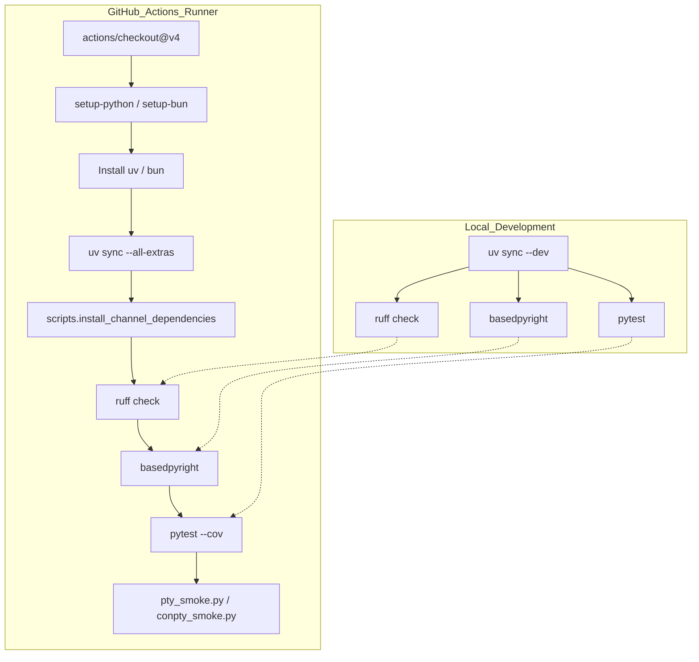
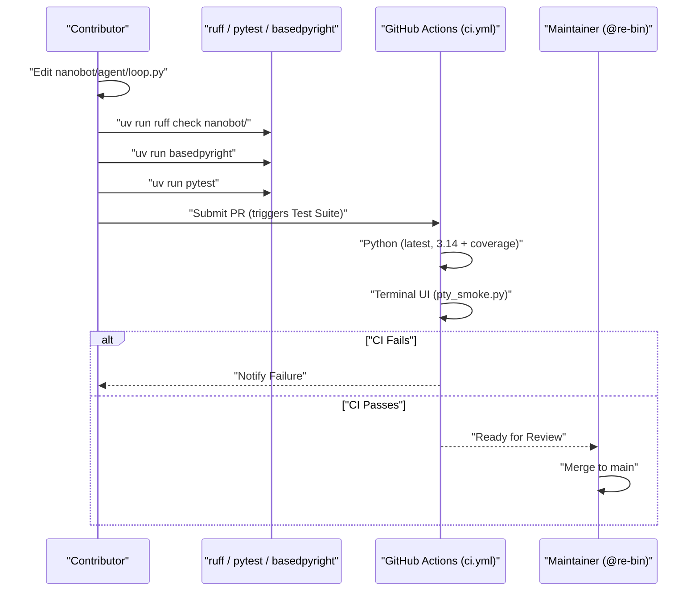

<!-- source: DeepWiki mcp.deepwiki.com · repo HKUDS/nanobot · page 12.2 CI/CD & Contributing · fetched 2026-11-09 -->

# CI/CD & Contributing

<details>
<summary>Relevant source files</summary>

The following files were used as context for generating this wiki page:

- [.github/workflows/ci.yml](.github/workflows/ci.yml)
- [.github/workflows/tui-release.yml](.github/workflows/tui-release.yml)
- [CONTRIBUTING.md](CONTRIBUTING.md)
- [docker-compose.bwrap.yml](docker-compose.bwrap.yml)
- [docker-compose.yml](docker-compose.yml)
- [docs/deployment.md](docs/deployment.md)
- [docs/releasing.md](docs/releasing.md)
- [docs/websocket.md](docs/websocket.md)
- [nanobot/__init__.py](nanobot/__init__.py)
- [pyproject.toml](pyproject.toml)
- [scripts/build_tui_wheels.py](scripts/build_tui_wheels.py)
- [tests/cli/test_tui_release_packaging.py](tests/cli/test_tui_release_packaging.py)
- [tests/cli/test_tui_wheels.py](tests/cli/test_tui_wheels.py)
- [tui/RELINKING.md](tui/RELINKING.md)
- [tui/bun.lock](tui/bun.lock)
- [tui/package.json](tui/package.json)
- [tui/scripts/build.ts](tui/scripts/build.ts)
- [tui/scripts/package-release.py](tui/scripts/package-release.py)
- [tui/scripts/prepare-target.ts](tui/scripts/prepare-target.ts)

</details>


This page details the development lifecycle of the `nanobot` project, including the automated testing pipelines, the contribution guidelines, and the technical standards for code quality.

## GitHub Actions CI Pipeline

The `nanobot` repository utilizes GitHub Actions to ensure code stability across multiple Python environments and platforms. The CI suite is triggered on every push and pull request to the `main` branch, excluding documentation and internal agent configuration changes [[.github/workflows/ci.yml:3-30]]().

### Workflow Jobs

The `Test Suite` workflow consists of three primary jobs: `changes` for path filtering, `test` for the Python backend, `webui` for the React frontend, and `tui` for the Terminal UI [[.github/workflows/ci.yml:39,75,158,190]]().

#### 1. Change Detection (`changes`)
This job determines if Python-specific tests are required by analyzing the git diff between the base and head SHAs [[.github/workflows/ci.yml:39-73]](). It skips Python tests if only `webui/`, `docs/`, or channel-specific WebUI assets were modified [[.github/workflows/ci.yml:69-71]]().

#### 2. Python Backend (`test`)
This job targets multiple operating systems (`ubuntu-latest` and `windows-latest`) and executes a matrix build across Python versions 3.11 and 3.14 [[.github/workflows/ci.yml:76-97]]().

*   **Dependency Management**: Uses `astral-sh/setup-uv@v4` to install `uv` [[.github/workflows/ci.yml:111-112]](). It syncs all project dependencies, including all optional extras and development tools, using `uv sync --all-extras --dev` [[.github/workflows/ci.yml:118-119]]().
*   **Channel Dependencies**: Since channel requirements live in manifests rather than `uv.lock`, a dedicated script `scripts.install_channel_dependencies` is run with the `--all-channels` flag to ensure all platform-specific SDKs are present for testing [[.github/workflows/ci.yml:121-122]]().
*   **System Dependencies**: On Linux, it installs `libolm-dev` and `build-essential` to support encrypted communication protocols (e.g., Matrix E2EE) [[.github/workflows/ci.yml:114-116]]().
*   **Linting & Type Checking**: Runs `ruff check` on the `nanobot` package, tests, and `conftest.py` [[.github/workflows/ci.yml:129-131]](). It also enforces strict type checking using `basedpyright` [[.github/workflows/ci.yml:133-135]]().
*   **Testing & Coverage**: Executes `pytest` with coverage reporting on the latest Python version [[.github/workflows/ci.yml:137-143]](). Windows process compatibility is tested separately using `tests/tools/test_exec_platform.py` to avoid xdist console sharing issues [[.github/workflows/ci.yml:99-101,151-156]]().

#### 3. Frontend (`webui`)
This job validates the React-based WebUI using the `Bun` runtime (version 1.3.6) [[.github/workflows/ci.yml:158-168]]().
*   **Workflow**: Performs `bun install --frozen-lockfile`, `bun run lint`, `bun run test:coverage`, and `bun run build` [[.github/workflows/ci.yml:174-188]](). It also verifies the `npm` lockfile integrity via a dry-run [[.github/workflows/ci.yml:170-172]]().

#### 4. Terminal UI (`tui`)
This job ensures the TypeScript-based TUI functions correctly on Linux and Windows [[.github/workflows/ci.yml:190-201]]().
*   **Smoke Tests**: Beyond standard `bun run test`, it executes a `pty_smoke.py` on Linux and a `conpty_smoke.py` on Windows using `pywinpty` to verify real terminal interaction [[.github/workflows/ci.yml:223-240]]().

**CI Pipeline Architecture**

Sources: [[.github/workflows/ci.yml:1-244]](), [[CONTRIBUTING.md:60-90]]()

## Contributing Guidelines

The project follows a "calm and humane" design philosophy, prioritizing simplicity, clarity, and decoupling over complex abstractions [[CONTRIBUTING.md:5-11,102-111]]().

### Contribution Flow

Maintainers include [@re-bin](https://github.com/re-bin) (Project Lead) and [@chengyongru](https://github.com/chengyongru) [[CONTRIBUTING.md:17-20]]().

1.  **Scope**: PRs are welcome for features, bug fixes, documentation, and refactoring [[CONTRIBUTING.md:26-34]]().
2.  **Branching**: Contributors should create topic branches from a synced `main` branch using `git switch -c your-topic-branch` [[CONTRIBUTING.md:40-46]]().
3.  **Local Setup**:
    ```bash
    git clone https://github.com/HKUDS/nanobot.git
    cd nanobot
    pip install -e ".[dev]"  # Install with dev dependencies
    pytest                   # Run tests
    ruff check nanobot/      # Lint code
    ```
    Sources: [[CONTRIBUTING.md:60-73]]()

### Code Entity Mapping: Development Workflow
This diagram maps the natural language contribution process to specific code entities and commands.


Sources: [[CONTRIBUTING.md:38-55]](), [[.github/workflows/ci.yml:1-30]](), [[CONTRIBUTING.md:81-90]]()

## Release Packaging & TUI Distribution

A stable install must never combine Python from one version with a TUI from another [[CONTRIBUTING.md:141-142]]().

### Release Contract
1.  **Tagging**: Set package version and publish GitHub release tag (`vX.Y.Z`) [[CONTRIBUTING.md:144]](). The version is read from `pyproject.toml` and `nanobot/__init__.py` [[docs/releasing.md:12]]().
2.  **TUI Build**: Manually trigger the `Publish Terminal UI` workflow (`tui-release.yml`) for the exact tag [[CONTRIBUTING.md:146]](), [[.github/workflows/tui-release.yml:4-14]](). This workflow builds the TUI for various targets like `darwin-arm64`, `linux-x64`, and `win32-x64` [[.github/workflows/tui-release.yml:28-33]]().
3.  **Compliance**: Maintainers must confirm that notices, source offers, and relinking materials were reviewed via the `compliance_reviewed` input [[.github/workflows/tui-release.yml:10-14,21]](). The `tui/RELINKING.md` file details the corresponding source for the TUI and its dependencies like Bun and OpenTUI [[tui/RELINKING.md:1-35]]().
4.  **Artifacts**: The TUI is distributed as platform-specific archives (e.g., `darwin-arm64`, `linux-x64`, `win32-x64`) containing the executable, licenses, and a checksum manifest [[.github/workflows/tui-release.yml:28-33]](), [[CONTRIBUTING.md:150-154]](). The `tui/scripts/package-release.py` script is responsible for creating these archives [[.github/workflows/tui-release.yml:81]]().
5.  **PyPI**: Once TUI assets are verified on the GitHub release, the Python package is published to PyPI [[CONTRIBUTING.md:147-148]](). The `scripts/build_tui_wheels.py` script is used to bundle the native TUI binaries into platform-specific Python wheels for PyPI distribution [[docs/releasing.md:73-78]]().

Sources: [[CONTRIBUTING.md:139-161]](), [[.github/workflows/tui-release.yml:1-97]](), [[tui/RELINKING.md:1-35]](), [[docs/releasing.md:12,73-78]]()

### TUI Release Workflow
```mermaid
graph TD
    A[Maintainer Triggers "Publish Terminal UI" Workflow] --> B{compliance_reviewed: true?};
    B -- No --> C[Workflow Aborted];
    B -- Yes --> D[Checkout Tagged Release: vX.Y.Z];
    D --> E[Set up Bun 1.3.13];
    E --> F[tui/bun install --frozen-lockfile];
    F --> G{For each target: darwin-arm64, darwin-x64, linux-arm64, linux-x64, win32-x64};
    G --> H[tui/bun scripts/prepare-target.ts <target>];
    H --> I[tui/bun run build -- <target>];
    I -- if darwin-* --> J[Ad-hoc sign macOS executable];
    J --> K[tui/bun scripts/release-notices.ts <target>];
    K --> L[tui/python3 scripts/package-release.py <target>];
    L --> M[Upload nanobot-tui-<target>.zip and .sha256 to GitHub Release];
    M --> N[All targets processed];
    N --> O[Maintainer Publishes Python Wheels to PyPI];

    subgraph "TUI Build Steps (tui)"
        H
        I
        J
        K
        L
    end
```
Sources: [[.github/workflows/tui-release.yml:1-97]](), [[tui/package.json:8]](), [[tui/bun.lock:1-64]](), [[tui/scripts/build.ts]](), [[tui/scripts/prepare-target.ts]](), [[tui/scripts/package-release.py]]()

## Technical Standards

### Code Style & Linting
The project targets Python 3.11+ [[CONTRIBUTING.md:115]]().
- **Line Length**: 100 characters, enforced by `ruff` [[CONTRIBUTING.md:114]]().
- **Linting**: Enforced via `ruff` with rules `E`, `F`, `I`, `N`, and `W` (E501 ignored) [[CONTRIBUTING.md:116]](). The `pyproject.toml` specifies these `ruff` settings [[pyproject.toml:164-170]]().
- **Type Checking**: Strict type checking with `basedpyright` is required [[CONTRIBUTING.md:81-90]](). The `pyproject.toml` configures `basedpyright` to include the `nanobot` directory and exclude `tests` [[pyproject.toml:172-176]]().
- **Async**: Uses `asyncio` throughout; tests use `asyncio_mode = "auto"` [[CONTRIBUTING.md:117]](). This is configured in `pytest.ini_options` [[pyproject.toml:178-179]]().

### Deployment & Docker
For production deployment, the project provides a `Dockerfile` and `docker-compose.yml` [[docs/deployment.md:59]]().
- **Non-Root User**: The container runs as user `nanobot` (UID 1000) [[docs/deployment.md:63]]().
- **Capabilities**: `docker-compose.yml` drops all capabilities and adds only `CHOWN`, `SETGID`, and `SETUID` for entrypoint ownership fixes [[docker-compose.yml:9-15]]().
- **Security**: Containers use `no-new-privileges:true` [[docker-compose.yml:19]]().
- **Bubblewrap**: For enhanced sandboxing, `docker-compose.bwrap.yml` enables `SYS_ADMIN` for `bwrap` support [[docker-compose.bwrap.yml]]().

Sources: [[CONTRIBUTING.md:112-123]](), [[docs/deployment.md:59-91]](), [[docker-compose.yml:1-63]](), [[pyproject.toml:164-179]]()

---

