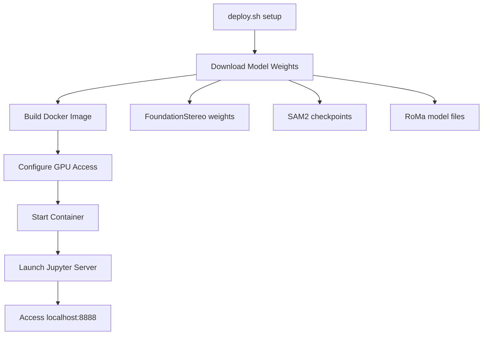
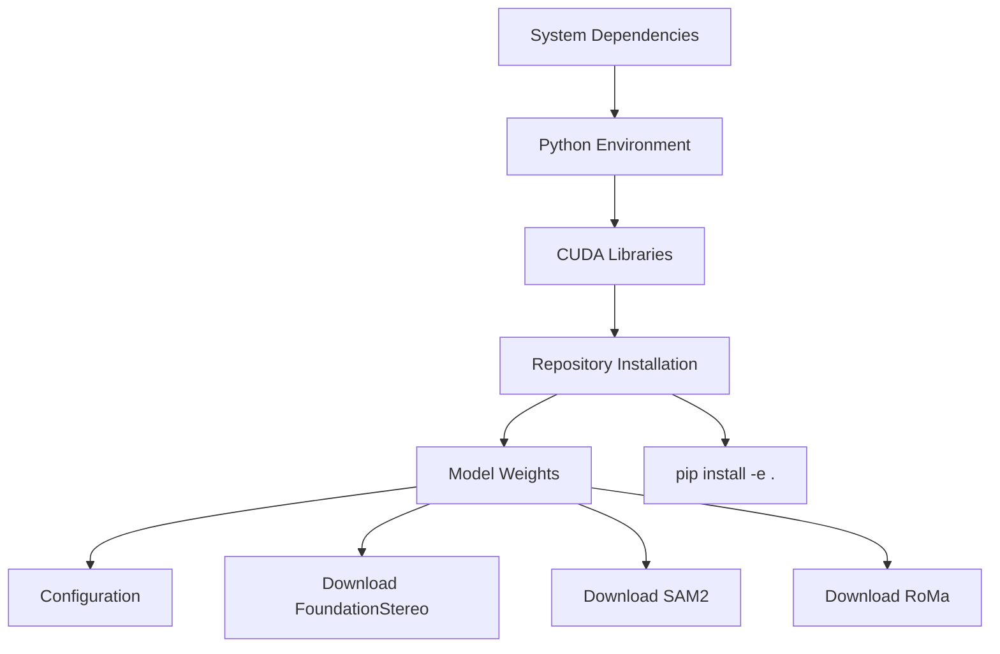
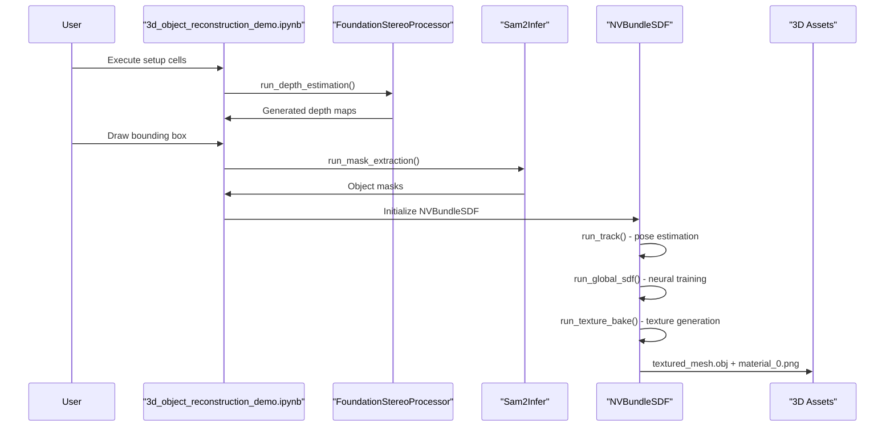
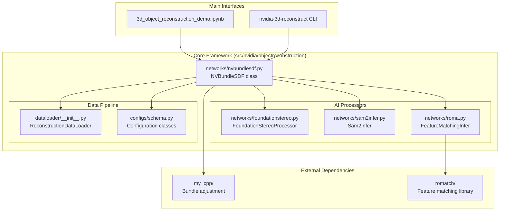
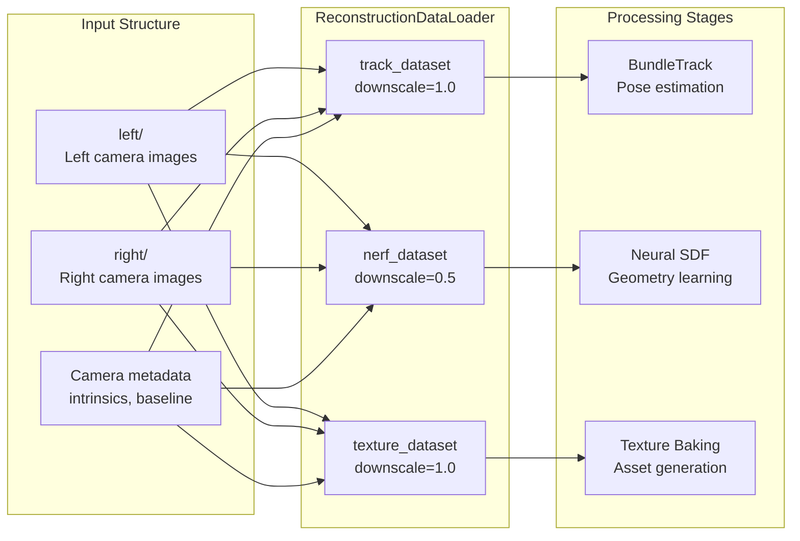
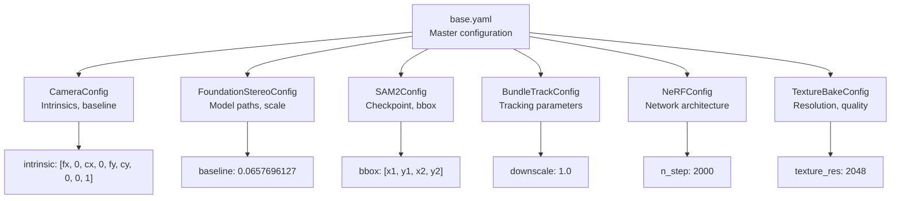

<!-- source: DeepWiki mcp.deepwiki.com · repo NVIDIA/3DObjectReconstruction · page 2 Getting Started · fetched 2026-10-26 -->

# Getting Started

<details>
<summary>Relevant source files</summary>

The following files were used as context for generating this wiki page:

- [README.md](README.md)
- [notebooks/3d_object_reconstruction_demo.ipynb](notebooks/3d_object_reconstruction_demo.ipynb)

</details>


This document provides step-by-step instructions for installing, configuring, and running your first 3D object reconstruction using the NVIDIA 3D Object Reconstruction workflow. It covers system requirements, installation methods, and guides you through the complete process from stereo input to textured 3D assets.

For detailed information about the AI components and neural rendering techniques, see [Core Pipeline](#3). For configuration parameters and customization options, see [Configuration Management](#5).

## System Requirements

The 3D reconstruction workflow has specific hardware and software requirements due to its GPU-intensive AI models and neural rendering components.

### Hardware Requirements

| Component | Minimum Specification | Recommended |
|-----------|----------------------|-------------|
| **GPU** | NVIDIA GPU with 24GB VRAM, Compute Capability 7.0+ | RTX A6000, RTX 4090, or better |
| **CPU** | 8-core x86_64 processor | 16+ cores |
| **RAM** | 32GB system memory | 64GB+ |
| **Storage** | 100GB free space | 500GB+ SSD |

### Software Requirements

| Component | Version | Purpose |
|-----------|---------|---------|
| **Operating System** | Ubuntu 22.04+ (Linux x86_64) | Host environment |
| **Docker Engine** | 28.0.4+ | Container orchestration |
| **Docker Compose** | 1.29.2+ | Multi-container deployment |
| **NVIDIA Drivers** | 535+ | GPU acceleration |
| **NVIDIA Container Toolkit** | Latest | GPU access in containers |

Sources: [README.md:236-261](), [notebooks/3d_object_reconstruction_demo.ipynb:38-46]()

## Installation Methods

The workflow provides two primary installation approaches: Docker Compose for quick setup and development, or manual installation for advanced users.

### Docker Compose Setup (Recommended)

The Docker Compose method provides automated setup with all dependencies pre-configured.



**Setup and Launch Process**
Sources: [README.md:182-196]()

#### Initial Setup

```bash
# Clone repository
git clone <repository-url>
cd 3d-object-reconstruction

# One-command setup: downloads weights, builds container
./deploy/compose/deploy.sh setup

# Start container and Jupyter server
./deploy/compose/deploy.sh start
```

The `deploy.sh` script automates the complete setup process, including model weight downloads and Docker image construction. After successful setup, the Jupyter notebook server becomes available at `http://localhost:8888`.

Sources: [README.md:184-196]()

### Manual Installation

For development or custom deployment scenarios, manual installation provides greater control over the environment setup.



**Manual Installation Steps**
Sources: Inferred from Docker setup and Python package structure

#### Prerequisites Installation

```bash
# Install system dependencies
sudo apt update
sudo apt install -y python3.10 python3-pip git

# Install NVIDIA Container Toolkit
distribution=$(. /etc/os-release;echo $ID$VERSION_ID)
curl -s -L https://nvidia.github.io/nvidia-docker/gpgkey | sudo apt-key add -
curl -s -L https://nvidia.github.io/nvidia-docker/$distribution/nvidia-docker.list | sudo tee /etc/apt/sources.list.d/nvidia-docker.list
sudo apt update && sudo apt install -y nvidia-container-toolkit
```

#### Python Environment Setup

```bash
# Create virtual environment
python3.10 -m venv venv
source venv/bin/activate

# Install the package
pip install -e .

# Download model weights (manual process)
mkdir -p data/weights/foundationstereo/
mkdir -p data/weights/sam2/
mkdir -p data/weights/roma/
```

Sources: Inferred from container configuration and Python requirements

## Quick Start Workflow

The fastest way to experience the complete 3D reconstruction pipeline is through the interactive Jupyter notebook tutorial.

### Access the Interactive Tutorial

Once your Docker container is running:

1. **Open Browser**: Navigate to `http://localhost:8888`
2. **Open Notebook**: Select `notebooks/3d_object_reconstruction_demo.ipynb`
3. **Follow Instructions**: Execute cells sequentially for guided reconstruction

### Sample Data Processing

The included sample dataset demonstrates reconstruction of a retail item with complex geometry and varied surface materials.



**Interactive Workflow Components**
Sources: [notebooks/3d_object_reconstruction_demo.ipynb:52-874]()

### Expected Processing Times

Processing times for 36 stereo frames at 4K resolution using RTX A6000:

| Pipeline Stage | Duration | Key Components |
|----------------|----------|----------------|
| **Setup** | 1-2 minutes | Extension compilation, package installation |
| **FoundationStereo** | 1-2 minutes | `run_depth_estimation()` |
| **SAM2 Segmentation** | 25 seconds | `run_mask_extraction()` |
| **Pose Tracking** | 3-4 minutes | `NVBundleSDF.run_track()` |
| **SDF Training** | 3-4 minutes | `NVBundleSDF.run_global_sdf()` |
| **Texture Baking** | 22-23 minutes | `NVBundleSDF.run_texture_bake()` |
| **Total Pipeline** | **31-32 minutes** | End-to-end processing |

Sources: [notebooks/3d_object_reconstruction_demo.ipynb:176-196]()

## Understanding the Pipeline Architecture

The reconstruction workflow integrates multiple AI models through the `NVBundleSDF` orchestration framework.

### Core Components and File Structure



**Framework Architecture**
Sources: [notebooks/3d_object_reconstruction_demo.ipynb:240-241](), [src/nvidia/objectreconstruction/]()

### Data Processing Pipeline

The `ReconstructionDataLoader` handles multi-scale data loading for different processing stages.



**Multi-Scale Data Loading**
Sources: [notebooks/3d_object_reconstruction_demo.ipynb:634-656]()

### Configuration Management

The workflow uses hierarchical YAML configuration with typed schemas defined in `configs/schema.py`.



**Configuration Hierarchy**
Sources: [notebooks/3d_object_reconstruction_demo.ipynb:276-325](), [data/configs/base.yaml]()

## Command Line Interface

For automated processing and batch workflows, the CLI provides programmatic access to the reconstruction pipeline.

### Basic Usage

```bash
# Display help and available options
nvidia-3d-reconstruct --help

# Basic reconstruction with sample data
nvidia-3d-reconstruct \
    --config /workspace/3d-object-reconstruction/data/configs/base.yaml \
    --data-path /workspace/3d-object-reconstruction/data/samples/retail_item/ \
    --output-path /workspace/3d-object-reconstruction/data/output/my_reconstruction \
    --verbose
```

### CLI Parameters

| Parameter | Description | Example |
|-----------|-------------|---------|
| `--config` | Path to YAML configuration file | `data/configs/base.yaml` |
| `--data-path` | Input stereo data directory | `data/samples/retail_item/` |
| `--output-path` | Output directory for results | `data/output/reconstruction/` |
| `--verbose` | Enable detailed logging | Flag option |
| `--version` | Show version information | Flag option |

Sources: [README.md:327-350]()

## Expected Outputs

Successful reconstruction generates multiple asset files and intermediate results.

### Generated Files

| File | Description | Format |
|------|-------------|--------|
| `textured_mesh.obj` | Complete 3D mesh with UV mapping | Wavefront OBJ |
| `material_0.png` | High-resolution texture map | PNG image |
| `keyframes.yml` | Optimized camera poses | YAML metadata |
| `depth/` | Dense depth maps | PNG depth images |
| `masks/` | Object segmentation masks | PNG binary masks |

### Asset Integration

The generated assets are compatible with:
- **Isaac Sim**: For robotics simulation and synthetic data generation
- **Omniverse**: For collaborative 3D workflows and USD conversion
- **Game Engines**: Direct import of OBJ meshes with textures
- **CAD Software**: Standard mesh format support

Sources: [notebooks/3d_object_reconstruction_demo.ipynb:806-816]()

## Troubleshooting Common Issues

### Weight Download Problems

If FoundationStereo weight download fails:

```bash
# Manual weight download location
mkdir -p data/weights/foundationstereo/
# Download from: https://github.com/NVlabs/FoundationStereo
# Place weights in the above directory

# Retry setup
./deploy/compose/deploy.sh setup
```

### Docker Container Issues

For container startup problems:

```bash
# Clean up orphaned containers
cd deploy/compose
docker-compose down --remove-orphans
docker container prune -f

# Restart Docker service
sudo systemctl restart docker

# Retry setup
./deploy.sh setup
```

### GPU Memory Issues

Reduce memory usage in configuration:

```yaml
# Lower memory requirements
nerf:
  batch_size: 16  # Reduce from default 32
foundation_stereo:
  scale: 0.2      # Reduce from default 0.3
```

Sources: [README.md:406-525]()

## Next Steps

After completing your first reconstruction:

1. **Experiment with Parameters**: Modify configuration values to optimize results for your specific use case
2. **Process Custom Data**: Prepare your own stereo datasets following the data organization guidelines
3. **Explore Advanced Features**: Learn about the individual AI components and their configuration options
4. **Integration Planning**: Understand how to integrate generated assets into your target applications

For detailed configuration options, see [Configuration Management](#5). For in-depth understanding of the AI pipeline, see [Core Pipeline](#3).

Sources: [notebooks/3d_object_reconstruction_demo.ipynb:792-849]()

---

