# Page: Overview

# Overview

<details>
<summary>Relevant source files</summary>

The following files were used as context for generating this wiki page:

- [.gitignore](.gitignore)
- [README.md](README.md)
- [doc/AMGX_Reference.pdf](doc/AMGX_Reference.pdf)

</details>


This document provides a high-level introduction to the AMGX library: its purpose, architecture, and core capabilities. For specific implementation details, refer to the component-specific pages such as [Solver Framework](#3.1), [Matrix System](#2.1), [Distributed Computing](#2.4), and [C API](#4.1).

## Purpose and Scope

AMGX (Algebraic Multigrid Solver) is a GPU-accelerated library for solving large sparse linear systems of the form **Ax = b** that commonly arise in scientific computing and engineering simulations. The library provides a collection of iterative solvers, multigrid preconditioners, and smoothers optimized for NVIDIA GPUs, with support for both single-GPU and distributed multi-GPU configurations.

**Sources:** [README.md:1-26]()

## What is AMGX

AMGX targets the computationally intensive linear solver portion of implicit unstructured simulations. Rather than providing a complete simulation framework, AMGX focuses exclusively on solving linear systems efficiently on GPU hardware. The library abstracts GPU parallelism and multi-GPU scaling behind a simple C API, allowing applications written in C, C++, Python, Julia, or through PETSc integration to leverage GPU acceleration without managing CUDA details directly.

The library's core value proposition is threefold:

1. **GPU Acceleration**: All solver operations execute on NVIDIA GPUs using optimized CUDA kernels and cuSPARSE/cuBLAS primitives
2. **Flexible Composition**: JSON-based configuration system allows nested solvers, preconditioners, and smoothers to be composed arbitrarily
3. **Distributed Scaling**: MPI-based parallelism enables scaling across multiple GPUs and compute nodes

**Sources:** [README.md:1-19]()

## Key Capabilities

The following table summarizes AMGX's primary features:

| Category | Capabilities |
|----------|-------------|
| **Precision Support** | FP32, FP64, mixed precision; limited complex datatype support |
| **Problem Types** | Scalar systems, coupled block systems (block CSR format) |
| **AMG Methods** | Classical (Ruge-Stuben), Unsmoothed Aggregation |
| **Krylov Solvers** | CG, PCG, BiCGSTAB, GMRES, FGMRES |
| **Smoothers** | Jacobi, Block Jacobi, Gauss-Seidel, DILU, Chebyshev Polynomial |
| **Direct Solvers** | Dense LU (via cuSOLVER), used for coarse grids |
| **Eigensolvers** | ARNOLDI, LANCZOS, LOBPCG, PageRank |
| **Distributed Computing** | MPI-based multi-GPU/multi-node with halo exchange |
| **Configuration** | JSON parameter files with extensive tuning options |
| **API** | C API with opaque handles; bindings for Python, Julia, PETSc |
| **Platforms** | Linux, Windows; requires CUDA-capable GPU (Compute Capability ≥ 3.0) |

**Sources:** [README.md:8-19](), [README.md:41-45]()

## System Architecture

AMGX is structured as a layered system where each layer builds upon the capabilities of lower layers. The following diagram illustrates the major architectural layers and their relationships:

**Diagram: AMGX Layered Architecture**

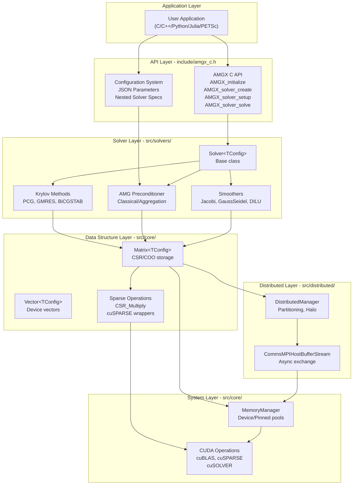

**Sources:** [README.md:3-4](), High-level diagrams (Diagram 1, Diagram 2)

### Layer Descriptions

**Application Layer**: User code interfaces with AMGX through the C API defined in [include/amgx_c.h](). The API uses opaque handles (`AMGX_solver_handle`, `AMGX_matrix_handle`, etc.) to hide implementation complexity. See [API Design and Object Model](#4.1.1) for details.

**API Layer**: The [include/amgx_c.h]() header exposes initialization (`AMGX_initialize`), configuration (`AMGX_config_create`), matrix upload (`AMGX_matrix_upload_all`), solver lifecycle (`AMGX_solver_create`, `AMGX_solver_setup`, `AMGX_solver_solve`), and cleanup functions. Configuration is specified via JSON files located in [src/configs/]() or constructed programmatically. See [Configuration System](#4.2) for JSON format details.

**Solver Layer**: All solver implementations inherit from `Solver<TConfig>` base class defined in the [src/solvers/]() directory. This includes Krylov methods (PCG, GMRES, BiCGSTAB in respective files), the `AMG` class hierarchy for multigrid preconditioning, and various smoothers. See [Solver Framework](#3.1) and [Algebraic Multigrid](#3.2).

**Data Structure Layer**: The `Matrix<TConfig>` class in [src/core/]() provides CSR and COO sparse matrix storage with block structure support. `Vector<TConfig>` handles device-resident vectors. Sparse operations leverage `CSR_Multiply` for matrix-matrix products and cuSPARSE wrappers for matrix-vector multiplication. See [Matrix System](#2.1).

**Distributed Layer**: `DistributedManager` and `DistributedArranger` classes in [src/distributed/]() handle matrix partitioning, neighbor discovery, and halo region management. `CommsMPIHostBufferStream` implements asynchronous MPI communication patterns. See [Distributed Computing](#2.4).

**System Layer**: `MemoryManager` singleton provides pooled allocation for both pinned host memory and device memory to reduce allocation overhead. CUDA operations integrate cuBLAS, cuSPARSE, and cuSOLVER libraries. See [Memory Management](#2.3).

## Core Components

The following diagram maps AMGX's primary C++ classes and their relationships, showing how code entities interact at runtime:

**Diagram: Core Component Relationships**

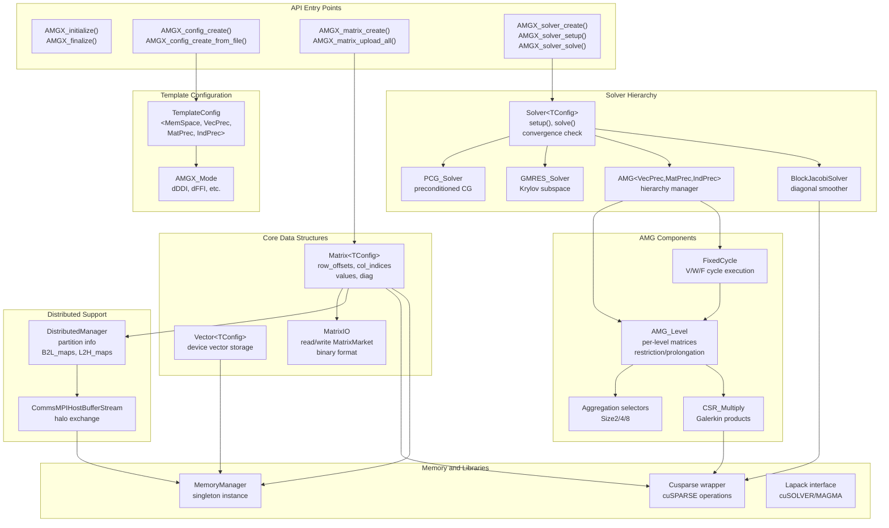

**Sources:** High-level diagrams (Diagram 2), [README.md:3-19]()

### Component Responsibilities

**Matrix<TConfig>**: Stores sparse matrices in CSR (Compressed Sparse Row) or COO (Coordinate) format with support for block structures. Provides matrix operations including analysis (symmetry detection, diagonal dominance), I/O (MatrixMarket and binary formats), and distributed setup. Located in [src/core/]().

**Solver<TConfig>**: Abstract base class defining the solver interface with `setup()` and `solve()` methods. Concrete implementations include Krylov methods (PCG, GMRES, BiCGSTAB), smoothers (Jacobi, Gauss-Seidel, DILU), and the AMG multigrid hierarchy. All solvers inherit convergence checking and residual computation logic. See [Solvers](#3).

**AMG and AMG_Level**: The `AMG` class manages the multigrid hierarchy by creating `AMG_Level` objects for each coarsening level. Each level stores the system matrix, restriction/prolongation operators, and level-specific vectors. `FixedCycle` orchestrates V, W, or F cycles through the hierarchy. See [AMG Hierarchy and Cycles](#3.2.1).

**DistributedManager**: Maintains partition information for distributed matrices, including neighbor lists, boundary-to-local (B2L) maps, and local-to-halo (L2H) maps. Coordinates matrix renumbering to separate interior and boundary rows for latency hiding. See [Distributed Manager](#2.4.1).

**CommsMPIHostBufferStream**: Implements asynchronous MPI communication using pinned host buffers. Handles vector and matrix halo exchange by gathering boundary data to host, performing non-blocking MPI sends/receives, and scattering received data to device halo regions. See [MPI Communication](#2.4.2).

**MemoryManager**: Singleton providing memory pools for both pinned host memory and device memory. Reduces allocation overhead by reusing pre-allocated buffers. Supports asynchronous operations via CUDA streams. See [Memory Management](#2.3).

## Template-Based Type System

AMGX uses C++ templates extensively to generate specialized code for different precision and memory configurations. The `TemplateConfig<MemSpace, VecPrec, MatPrec, IndPrec>` class encapsulates four template parameters:

| Parameter | Options | Purpose |
|-----------|---------|---------|
| `MemSpace` | `AMGX_host`, `AMGX_device` | Specifies host or device memory |
| `VecPrec` | `float`, `double`, `complex<float>`, `complex<double>`, `int`, `int64`, `bool` | Vector element precision |
| `MatPrec` | `float`, `double`, `complex<float>`, `complex<double>` | Matrix element precision |
| `IndPrec` | `int`, `int64` | Matrix index precision (32 or 64-bit) |

The C API uses an `AMGX_Mode` enumeration that encodes all four parameters into a single integer value (e.g., `dDDI` for device memory, double vector precision, double matrix precision, int indices). At runtime, mode dispatch macros (`AMGX_FORALL_BUILDS`, `AMGX_CASE_LINE`) route API calls to the appropriate template instantiation. This design provides compile-time optimization while maintaining runtime flexibility. See [Mode System and Template Dispatch](#4.1.2) for implementation details.

**Sources:** High-level diagrams (Diagram 6), [README.md:9-10]()

## Build Artifacts and Usage

The build system (see [Build System](#1.3)) produces the following artifacts:

| Artifact | Type | Purpose |
|----------|------|---------|
| `libamgx.a` | Static library | Link-time inclusion of AMGX functionality |
| `libamgxsh.so` (Linux) / `amgxsh.dll` (Windows) | Shared library | Runtime dynamic linking |
| `amgx_capi` | Example executable | Single-GPU usage demonstration |
| `amgx_mpi_capi` | Example executable | Multi-GPU/MPI usage demonstration |
| `amgx_tests_launcher` | Test executable | Regression test suite |

Example libraries are located in [examples/]() and demonstrate typical API usage patterns. The [examples/matrix.mtx]() file provides a sample input matrix in MatrixMarket format. Pre-configured solver setups are available in [src/configs/]() with names like `FGMRES_AGGREGATION.json`, `PCG_CLASSICAL_JACOBI.json`, etc.

**Typical single-GPU workflow:**
```bash
./amgx_capi -m matrix.mtx -c ../src/configs/FGMRES_AGGREGATION.json
```

**Typical multi-GPU workflow:**
```bash
mpirun -n 4 ./amgx_mpi_capi -m matrix.mtx -c ../src/configs/PCG_AGGREGATION.json
```

For detailed programming examples, see [Basic Examples](#4.3.1) and [MPI Examples](#4.3.2).

**Sources:** [README.md:52-60](), [README.md:83-86](), [README.md:89-186]()

## Dependencies and Requirements

AMGX requires the following dependencies:

**Required:**
- **CUDA Toolkit** ≥ 12.0 (provides cuBLAS, cuSPARSE, cuSOLVER, CUDA Runtime)
- **CMake** ≥ 3.18 (build system; 3.22+ recommended with NVIDIA HPC SDK)
- **C++11-compliant compiler** (GCC ≥ 4.8, MSVC ≥ 14.0)
- **NVIDIA GPU** with Compute Capability ≥ 3.0

**Optional:**
- **MPI implementation** (OpenMPI, MPICH) for distributed multi-GPU support
- **Intel MKL** for accelerated eigensolver operations
- **MAGMA** for additional LAPACK/eigensolver acceleration
- **RapidJSON** (header-only, bundled with AMGX) for JSON parsing

The build can be configured to produce a non-MPI single-GPU library by setting `CMAKE_NO_MPI=ON`, resulting in a smaller library that does not require MPI installation. See [Build Configuration](#5.1) for detailed CMake options and [Build System](#1.3) for build instructions.

**Sources:** [README.md:41-70]()

## External Bindings and Integration

AMGX provides a C API designed for integration with applications in multiple languages:

| Language/Framework | Repository | Maintainer |
|--------------------|------------|------------|
| **Python** | [pyamgx](https://github.com/shwina/pyamgx) | @shwina |
| **Julia** | [AMGX.jl](https://github.com/JuliaGPU/AMGX.jl) | JuliaGPU community |
| **PETSc** | [AmgXWrapper](https://github.com/barbagroup/AmgXWrapper) | @piyueh, barbagroup |

These bindings wrap the C API with language-specific idioms and memory management patterns. The PETSc wrapper allows existing PETSc applications to use AMGX as a solver/preconditioner without code modifications. See [External Bindings](#4.4) for integration details.

**Sources:** [README.md:195-200]()

## Additional Resources

- **API Reference**: [doc/AMGX_Reference.pdf]() provides complete API documentation
- **Solver Configurations**: [src/configs/]() contains pre-tuned JSON configurations for common problem types
- **Test Suite**: [src/tests/]() provides regression tests and validation
- **CI Pipeline**: [ci/]() contains containerized build and test infrastructure

For algorithm details and research background, see the white papers and case studies linked in [README.md:21-25]().

**Sources:** [README.md:188-207]()

---

# Page: System Architecture

# System Architecture

<details>
<summary>Relevant source files</summary>

The following files were used as context for generating this wiki page:

- [.gitignore](.gitignore)
- [CMakeLists.txt](CMakeLists.txt)
- [README.md](README.md)
- [doc/AMGX_Reference.pdf](doc/AMGX_Reference.pdf)
- [examples/CMakeLists.txt](examples/CMakeLists.txt)
- [examples/amgx_mpi_capi.c](examples/amgx_mpi_capi.c)
- [examples/amgx_mpi_poisson7.c](examples/amgx_mpi_poisson7.c)
- [examples/eigen_examples/CMakeLists.txt](examples/eigen_examples/CMakeLists.txt)
- [include/amgx_c.h](include/amgx_c.h)
- [src/CMakeLists.txt](src/CMakeLists.txt)
- [src/amgx_c.cu](src/amgx_c.cu)
- [src/matrix_analysis.cu](src/matrix_analysis.cu)

</details>


## Overview

This document provides a comprehensive overview of the AMGX (Algebraic MultiGrid) library's architecture and its core components. AMGX is a highly optimized GPU-accelerated solver framework designed for large sparse linear systems, featuring a flexible composition system for solvers, preconditioners, and smoothers.

The architecture documentation focuses on how the main components interact with each other, the memory management systems, the API layer, and distributed computing capabilities. For specific information about solver implementations, see [Solvers](#3) and for API usage details, see [API and Integration](#4).

## High-Level Architecture

The AMGX system follows a layered architecture with clear separation between the API surface, core solver components, and resource management infrastructure.

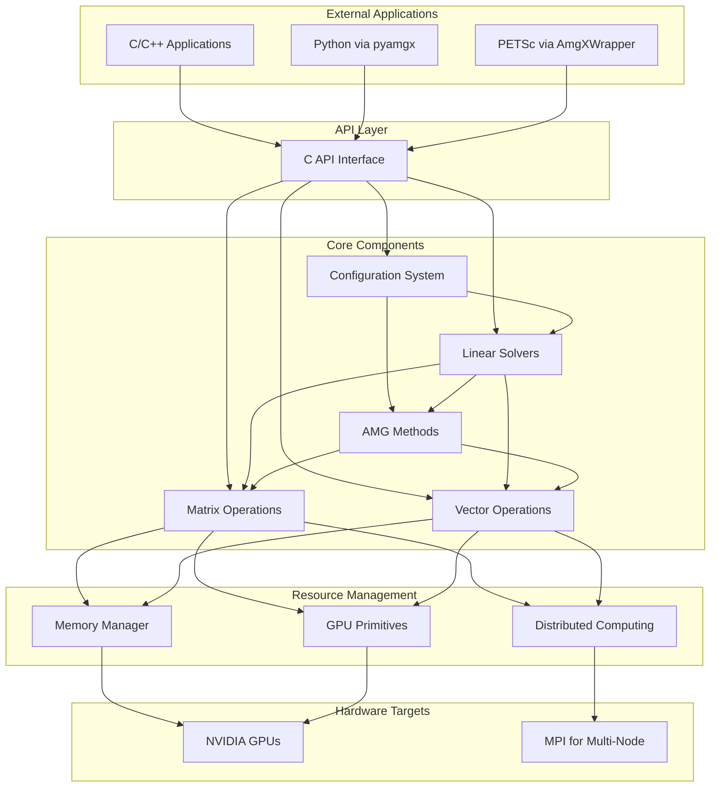

Sources: [include/amgx_c.h:104-124](), [src/amgx_c.cu:12-41](), [README.md:1-25]()

## Component Architecture

### Handle System and Resource Management

AMGX uses opaque handles to manage resources and maintain state between API calls. These handles are defined in the C API and map to C++ objects internally.

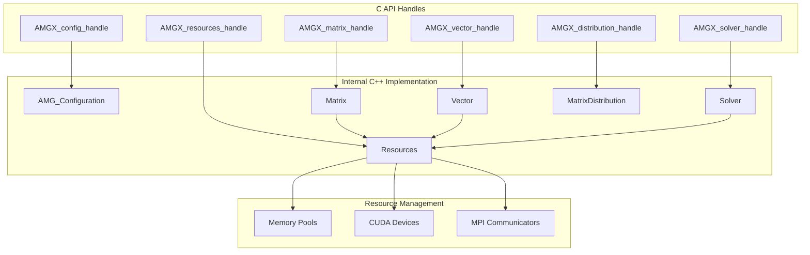

Sources: [include/amgx_c.h:104-124](), [src/amgx_c.cu:639-644]()

### Mode System and Template Configuration

AMGX employs a templated mode system that allows for different precision combinations for matrices, vectors, and indices:

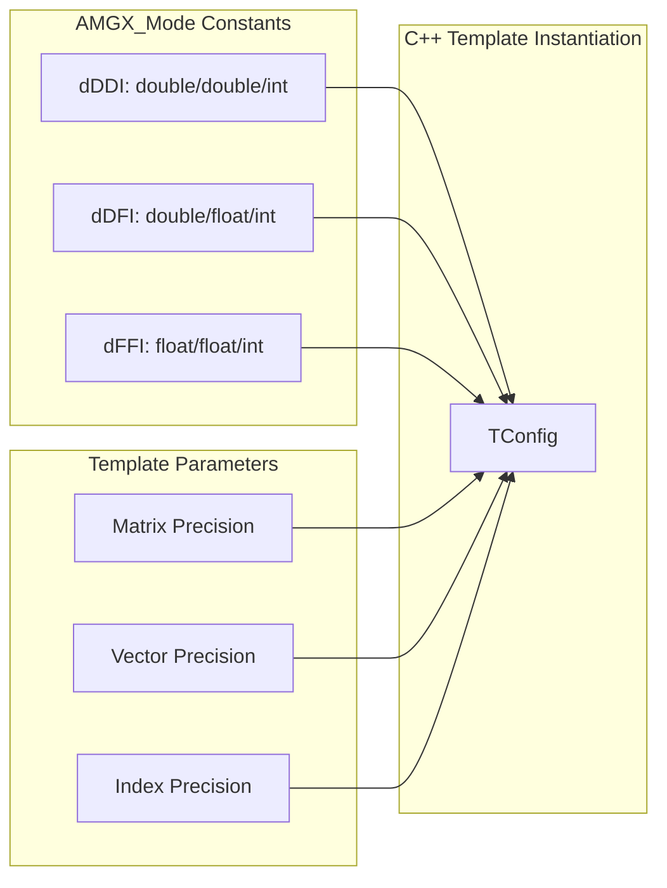

Sources: [src/amgx_c.cu:52-69](), [src/amgx_c.cu:642-643]()

## C API Architecture

The C API serves as the primary interface for external applications to interact with AMGX. It provides a set of functions categorized by their purpose.

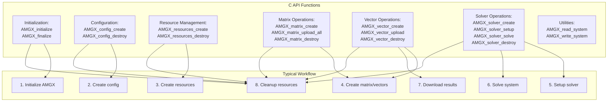

Sources: [include/amgx_c.h:146-605](), [examples/amgx_mpi_poisson7.c:92-369](), [examples/amgx_mpi_capi.c:93-432]()

## Memory Management System

AMGX employs a sophisticated memory management system that handles both host and device memory allocation efficiently.

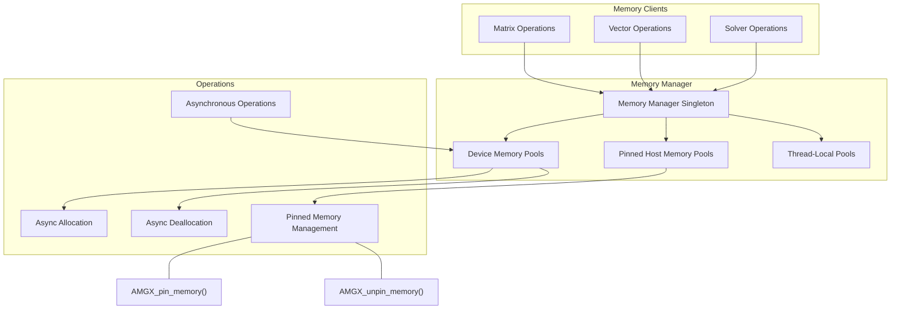

Sources: [include/amgx_c.h:178-183](), [src/amgx_c.cu:72-126]()

## Distributed Computing Architecture

AMGX supports distributed memory parallel computing using MPI for multi-node and multi-GPU execution.

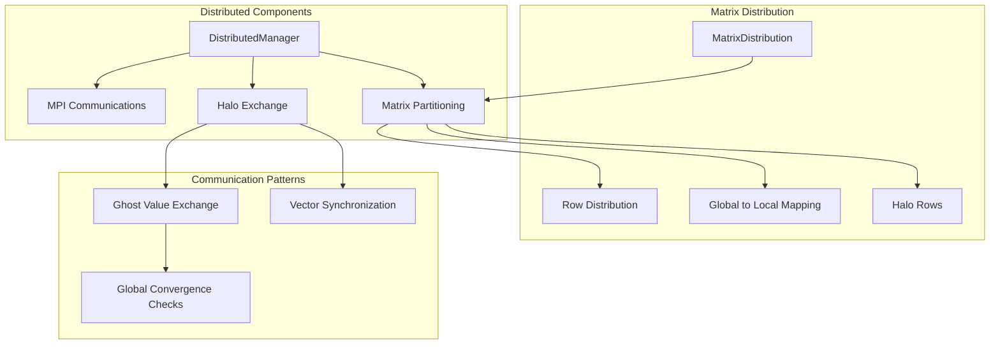

Sources: [src/amgx_c.cu:158-207](), [src/amgx_c.cu:476-635](), [examples/amgx_mpi_poisson7.c:105-129]()

## Matrix Operations and Data Structures

AMGX provides optimized matrix operations that leverage GPU parallelism for sparse linear algebra.

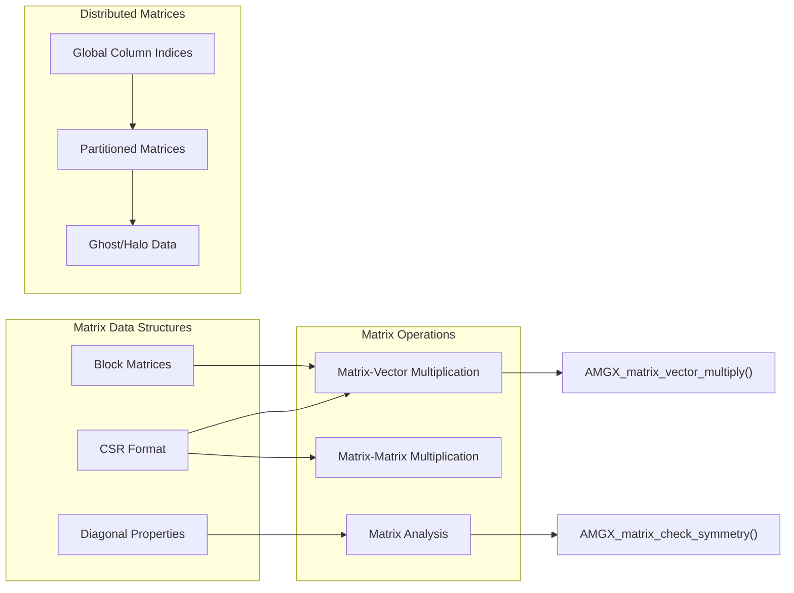

Sources: [src/amgx_c.cu:844-896](), [src/matrix_analysis.cu:20-272](), [include/amgx_c.h:262-334]()

## Solver Composition Architecture

AMGX provides a flexible solver composition system that allows for nested solvers and preconditioners.

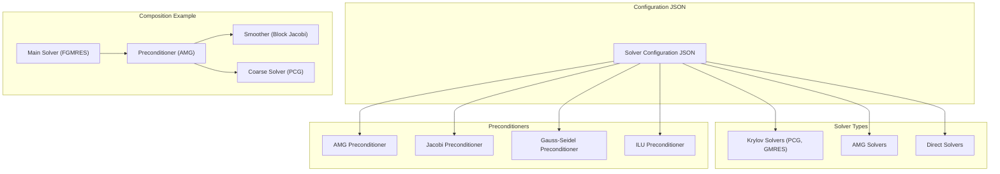

Sources: [README.md:11-16](), [examples/amgx_mpi_capi.c:207-228](), [examples/amgx_mpi_poisson7.c:207-242]()

## Initialization and Setup Flow

The following diagram illustrates the typical initialization and setup flow for using AMGX:

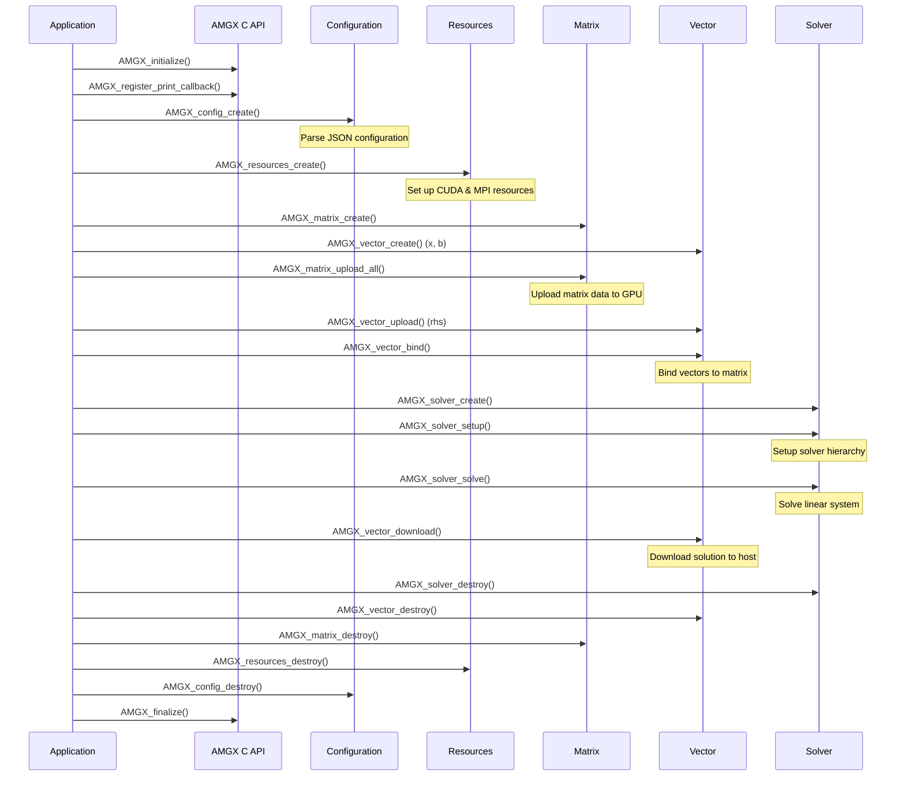

Sources: [examples/amgx_mpi_poisson7.c:158-368](), [examples/amgx_mpi_capi.c:160-430](), [include/amgx_c.h:146-170]()

## Multi-Node Distributed Execution

AMGX supports distributed-memory parallel execution with efficient communication patterns:

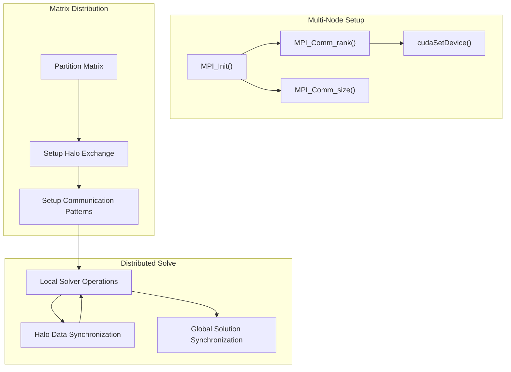

Sources: [examples/amgx_mpi_poisson7.c:119-129](), [examples/amgx_mpi_capi.c:121-133](), [src/amgx_c.cu:158-207]()

## Configuration System

AMGX uses a flexible configuration system based on JSON to define solver behavior:

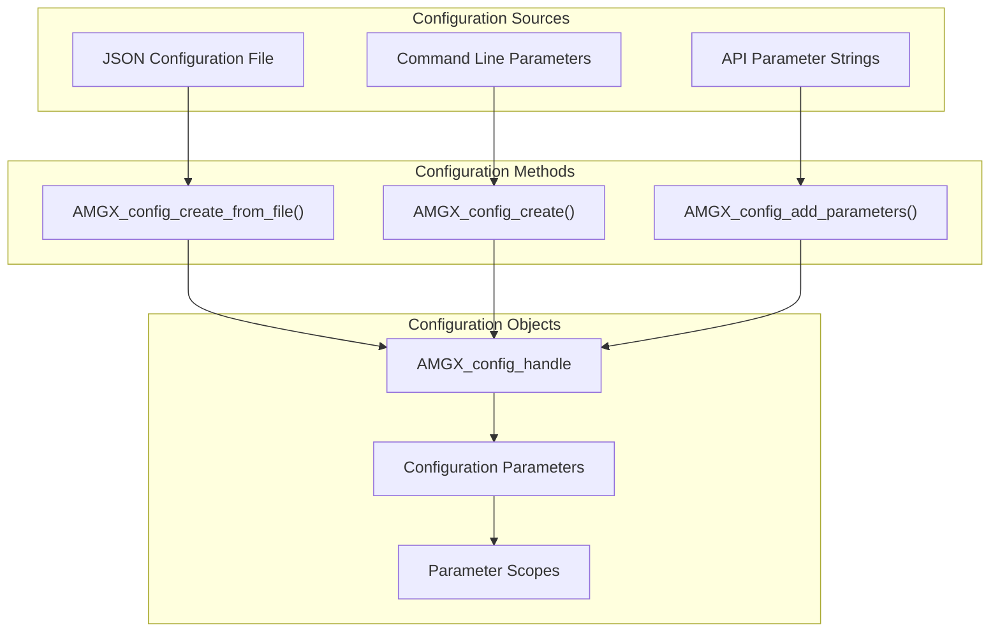

Sources: [include/amgx_c.h:192-215](), [examples/amgx_mpi_poisson7.c:207-228](), [examples/amgx_mpi_capi.c:207-228]()

## Resources and Device Management

AMGX resources encapsulate the hardware resources and their management:

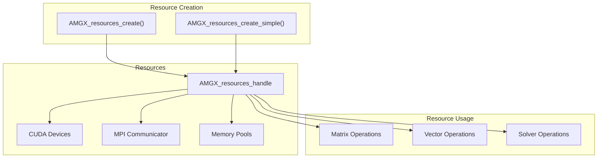

Sources: [include/amgx_c.h:217-230](), [src/amgx_c.cu:72-126](), [examples/amgx_mpi_poisson7.c:238]()

## Key Data Structures

| Component | C Handle | Internal Implementation | Description |
|-----------|----------|-------------------------|-------------|
| Configuration | `AMGX_config_handle` | `AMG_Configuration` | Stores solver parameters and configuration |
| Resources | `AMGX_resources_handle` | `Resources` | Manages CUDA devices, MPI communicators, and memory pools |
| Matrix | `AMGX_matrix_handle` | `Matrix<TConfig>` | Represents sparse matrices in CSR format with block structure |
| Vector | `AMGX_vector_handle` | `Vector<TConfig>` | Represents dense vectors with optional block structure |
| Solver | `AMGX_solver_handle` | `AMG_Solver<TConfig>` | Implements linear solver algorithms |
| Distribution | `AMGX_distribution_handle` | `MatrixDistribution` | Controls how matrices are distributed across processes |

Sources: [include/amgx_c.h:104-124](), [src/amgx_c.cu:639-644]()

## Error Handling

AMGX provides two modes of error handling:

1. **Return Code System**: Functions return `AMGX_RC` error codes that can be checked
2. **Exception Handling**: Internal exception handling can be enabled via configuration

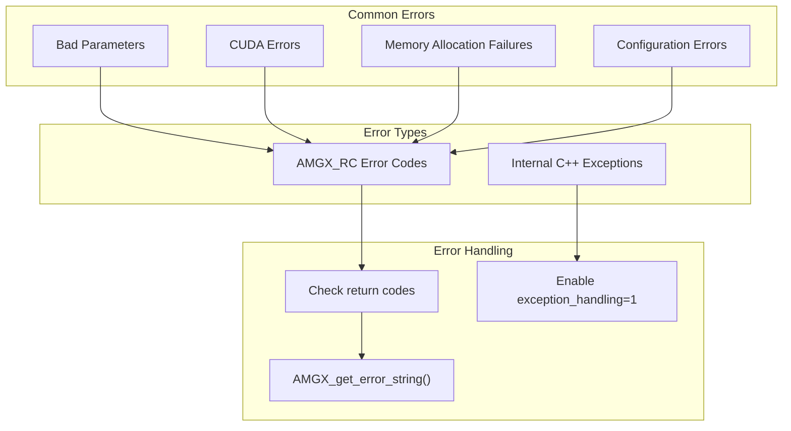

Sources: [include/amgx_c.h:48-69](), [include/amgx_c.h:127-144](), [examples/amgx_mpi_poisson7.c:236]()

---

# Page: Version History

# Version History

<details>
<summary>Relevant source files</summary>

The following files were used as context for generating this wiki page:

- [CHANGELOG](CHANGELOG)
- [src/distributed/comms_mpi_hostbuffer_stream.cu](src/distributed/comms_mpi_hostbuffer_stream.cu)

</details>


## Purpose and Scope

This page documents version changes, CUDA compatibility updates, and feature evolution across AMGX releases. Each version entry includes tested configurations, key code changes, and API modifications. For build system details and dependencies, see [Build System](#1.3).

## Current Version

The current version of AMGX is 2.5.0, as defined in the source code.

Sources:
- [ReleaseVersion.txt:1-2]()
- [src/version.cu:1-6]()

## Version Timeline

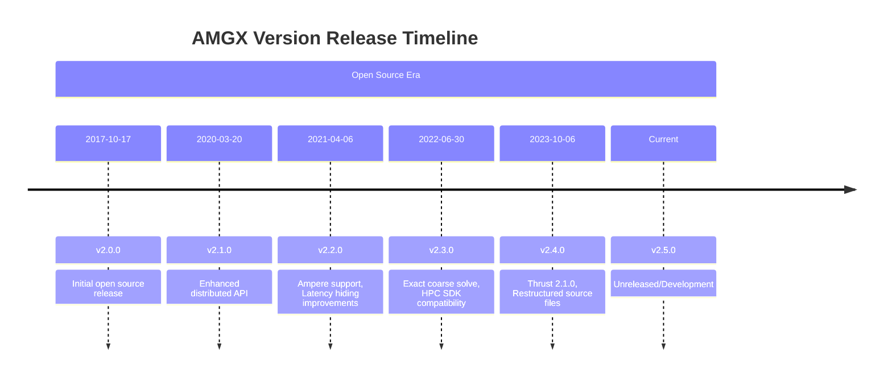

Sources:
- [CHANGELOG:4-118]()

## Version Details

### v2.4.0 (2023-10-06)

#### Major Code Changes
- **Source restructuring**: Removed plugin feature, reorganized all source files
- **Memory management**: Replaced custom `MemoryManager` implementation with `cudaMallocAsync` (when `USE_CUDAMALLOCASYNC` is defined)
- **Synchronization fixes**: Fixed multiple synchronization issues in GPU kernels for sm_70+ architectures
- **Thrust integration**: Upgraded to Thrust 2.1.0, added as submodule, wrapped in namespace to avoid shared library conflicts
- **SpMV optimization**: Changed `Cusparse` wrapper to use `CUSPARSE_CSRMV_ALG1` algorithm
- **Small matrix optimization**: Added single-kernel csrmv implementation invoked when local matrix rows < 3 × SM count

#### API Additions
- `AMGX_matrix_check_symmetry()`: Tests if matrix is structurally or completely symmetric
- `DISABLE_EXCEPTION_HANDLING`: Compile-time flag to improve debugging experience
- `rel_div_tolerance`: Configuration parameter for divergence detection

#### Bug Fixes
- Partition reordering for `block_size > 1`
- Grid sizing in exact coarse solve
- SIGFPE when initial norm is zero
- `use_sum_stopping_criteria` flag behavior

#### Tested Configurations
- **OS**: Ubuntu 20.04, Ubuntu 22.04
- **Compilers**: NVHPC 23.7, GCC 9.4.0, GCC 12.1
- **MPI**: OpenMPI 4.0.x
- **CUDA**: 11.2, 11.8, 12.2
- **GPUs**: A100, H100

Sources:
- [CHANGELOG:5-45]()

### v2.3.0 (2022-06-30)

This version focused on build system improvements and performance optimizations.

#### Major Changes
- Increased minimum CMake version to 3.18 and adapted to use CUDA as a language
- Made it possible to compile with HPC SDK
- Improved performance of `compute_values_kernel` by ~1.3x
- Optimized block tuning for aggressive coarsening

#### New Features
- Added exact coarse solve, accessible via the "exact_coarse_solve" flag
- Fixed multiple bugs including cuSPARSE handle deletion issues

#### Tested Configurations
- Ubuntu 20.04, Ubuntu 18.04
- gcc 7.4.0, gcc 9.3.0
- OpenMPI 4.0.x
- CUDA 11.0, 11.2
- Windows 10 with Visual Studio 2019 and MS MPI v10.1.2

Sources:
- [CHANGELOG:49-76]()

### v2.2.0 (2021-04-06)

This release included important distributed computing and hardware support updates.

#### Major Changes
- GPU Direct support fixes (improved results and performance)
- Latency hiding improvements and bug fixes
- Performance tuning for Volta GPUs in aggregation and classical setup phase
- Gauss-Siedel performance improvements on Volta and newer architectures
- Added Ampere architecture support
- Various community-requested bug fixes and enhancements

#### Tested Configurations
- Ubuntu 20.04, Ubuntu 18.04
- gcc 7.4.0, gcc 9.3.0
- OpenMPI 4.0.x
- CUDA 10.2, 11.0, 11.2
- Windows 10 with Visual Studio 2019 and MS MPI v10.1.2

Sources:
- [CHANGELOG:79-101]()

### v2.1.0 (2020-03-20)

This minor update focused on distributed computing capabilities.

#### Major Changes
- Added new API for providing distributed matrix partitioning information
- New approach works when partitions own continuous rows in a matrix
- Added example implementation for the new API
- General distributed code improvements

Sources:
- [CHANGELOG:104-112]()

### v2.0.0 (2017-10-17)

The initial open source release of AMGX.

Sources:
- [CHANGELOG:114-118]()

## Supported GPU Architectures Over Time

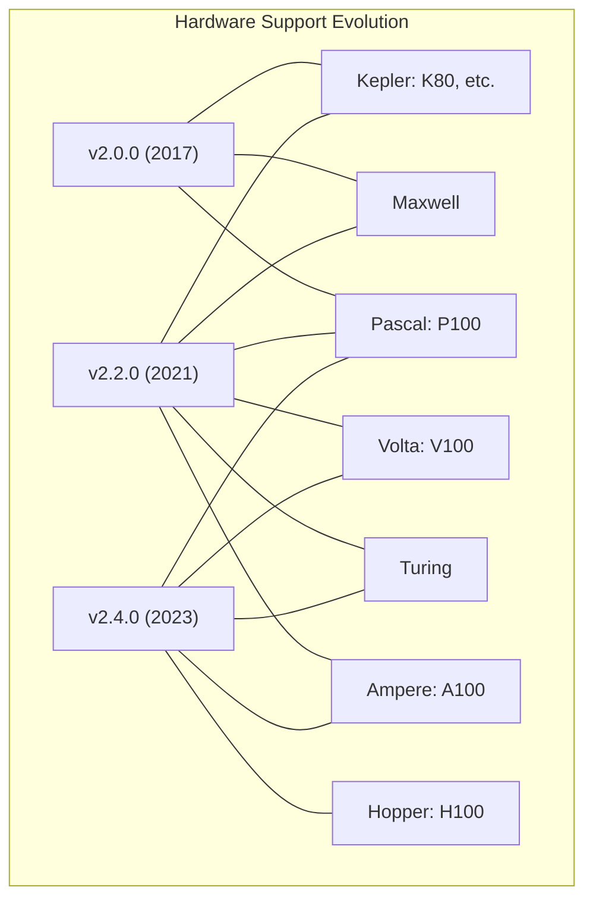

Sources:
- [CHANGELOG:36-44]()
- [CHANGELOG:63-74]()
- [CHANGELOG:91-99]()

## Key Feature Evolution

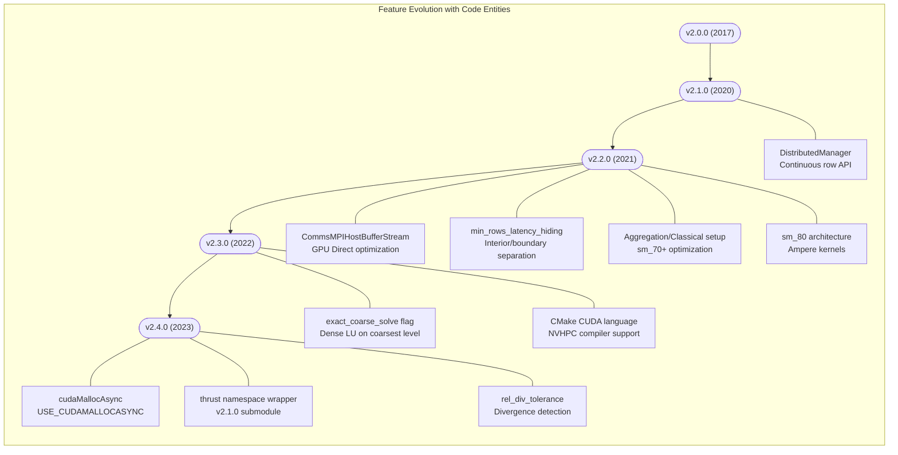

Sources:
- [CHANGELOG:4-118]()
- [src/distributed/comms_mpi_hostbuffer_stream.cu:1-1616]()

## CUDA Version Support Table

The table below shows the CUDA versions tested and supported with each AMGX version.

| AMGX Version | Minimum CUDA | Maximum CUDA | Tested CUDA Versions |
|--------------|--------------|--------------|----------------------|
| v2.0.0 | - | - | Not specified |
| v2.1.0 | - | - | Not specified |
| v2.2.0 | - | 11.2 | 10.2, 11.0, 11.2 |
| v2.3.0 | - | 11.2 | 11.0, 11.2 |
| v2.4.0 | 11.2 | 12.2 | 11.2, 11.8, 12.2 |

Sources:
- [CHANGELOG:36-44]()
- [CHANGELOG:63-74]()
- [CHANGELOG:91-99]()

## Code Entity Changes by Version

This section maps high-level features to specific code entities affected in each version.

### v2.4.0 Code Entity Mapping

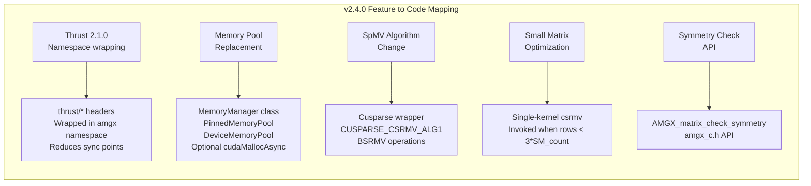

### v2.2.0 Distributed Computing Changes

Key files affected by latency hiding and GPU Direct improvements:

| Feature | Code Entity | File/Location |
|---------|-------------|---------------|
| Latency Hiding | `CommsMPIHostBufferStream::do_exchange_halo_async()` | `comms_mpi_hostbuffer_stream.cu` |
| Interior/Boundary | `min_rows_latency_hiding` threshold | Communication module |
| GPU Direct | `exchange_halo_wait()`, `do_exchange_halo_async()` | `comms_mpi_hostbuffer_stream.cu` |
| Halo Exchange | `MPI_Waitall()`, `MPI_Isend()`, `MPI_Irecv()` | MPI communication patterns |

Sources:
- [CHANGELOG:11-35]()
- [CHANGELOG:83-88]()
- [src/distributed/comms_mpi_hostbuffer_stream.cu:633-686]()

## Compiler Support Evolution

| AMGX Version | Linux Compilers | Windows Compilers | HPC SDK Support |
|--------------|-----------------|-------------------|-----------------|
| v2.0.0 | - | - | No |
| v2.1.0 | - | - | No |
| v2.2.0 | gcc 7.4.0, gcc 9.3.0 | MSVC 19.28 (VS 2019) | No |
| v2.3.0 | gcc 7.4.0, gcc 9.3.0 | MSVC 19.28 (VS 2019) | Yes |
| v2.4.0 | GCC 9.4.0, GCC 12.1, NVHPC 23.7 | Limited testing | Yes (NVHPC 23.7) |

Sources:
- [CHANGELOG:36-44]()
- [CHANGELOG:63-74]()
- [CHANGELOG:91-99]()

## Significant API Additions

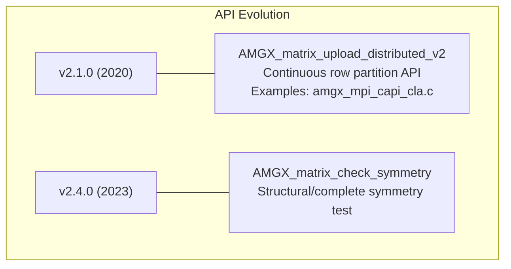

Key C API additions by version:

| Version | API Function | Purpose | Example |
|---------|-------------|---------|---------|
| v2.1.0 | New distributed partition API | Simplified partition specification for continuous rows | `amgx_mpi_capi_cla.c` |
| v2.4.0 | `AMGX_matrix_check_symmetry` | Matrix symmetry validation | Structural or value-based symmetry check |

Sources:
- [CHANGELOG:108-111]()
- [CHANGELOG:34]()

## Memory Management Evolution

AMGX memory management system evolved from custom pooling to CUDA stream-ordered memory allocation:

```mermaid
flowchart TD
    subgraph "Memory Management Implementation"
        v2_0["v2.0.0-v2.3.0"]
        v2_4["v2.4.0+"]
        
        CustomPool["Custom Memory Pool<br>MemoryManager singleton<br>PinnedMemoryPool<br>DeviceMemoryPool"]
        CudaAsync["cudaMallocAsync<br>Stream-ordered allocation<br>USE_CUDAMALLOCASYNC flag"]
        
        v2_0 --> CustomPool
        v2_4 --> CudaAsync
        
        CustomPool -->|"Optional replacement<br>for performance"| CudaAsync
    end
```

Key code entities:
- `MemoryManager`: Singleton managing custom memory pools (pre-v2.4.0)
- `PinnedMemoryPool`: Host pinned memory allocation
- `DeviceMemoryPool`: Device memory allocation
- `cudaMallocAsync`: CUDA stream-ordered memory allocation (v2.4.0+ optional)
- `USE_CUDAMALLOCASYNC`: Compile flag to enable new allocator

Sources:
- [CHANGELOG:14]()

## Notes on Windows Support

While AMGX does support building on Windows, testing on Windows has been limited across all versions. Windows support is generally considered experimental compared to the more thoroughly tested Linux environments.

Sources:
- [CHANGELOG:45-46]()
- [CHANGELOG:74-76]()
- [CHANGELOG:96-99]()

---

# Page: Build System

# Build System

<details>
<summary>Relevant source files</summary>

The following files were used as context for generating this wiki page:

- [CMakeLists.txt](CMakeLists.txt)
- [examples/CMakeLists.txt](examples/CMakeLists.txt)
- [examples/eigen_examples/CMakeLists.txt](examples/eigen_examples/CMakeLists.txt)
- [src/CMakeLists.txt](src/CMakeLists.txt)

</details>


## Overview

The AMGX (Algebraic MultiGrid Accelerated) build system is based on CMake and provides support for building the AMGX libraries, examples, and test frameworks on various platforms with different compilers and CUDA versions. This document explains the build process, dependencies, configuration options, and build outputs.

For information on the overall system architecture, see [System Architecture](#1.1).

Sources: [CMakeLists.txt:27-31]()

## Prerequisites

### Required Software

To build AMGX from source, you need:

| Requirement | Minimum Version | Notes |
|-------------|-----------------|-------|
| CMake | 3.18 | Required for configuring the build |
| CUDA Toolkit | 11.0 | GPU programming framework |
| C++ Compiler | Compatible with CUDA | GCC, Clang, or MSVC |
| MPI (Optional) | - | For distributed computing capabilities |

Sources: [CMakeLists.txt:27-49](), [CMakeLists.txt:125-141]()

### Supported CUDA Architectures

AMGX supports different GPU architectures depending on the CUDA version:

| CUDA Version | Supported Architectures |
|--------------|-------------------------|
| CUDA 12.x+ | SM 70 (Volta), SM 80 (Ampere), SM 90 (Hopper) |
| CUDA 11.x | SM 70 (Volta), SM 80 (Ampere) |

Sources: [CMakeLists.txt:193-205]()

## Build System Structure

The AMGX build system is organized hierarchically, with the main CMakeLists.txt delegating to subsidiary build scripts.

```mermaid
graph TD
    subgraph "Build Configuration"
        MainCMake["Main CMakeLists.txt"]
        SrcCMake["src/CMakeLists.txt"]
        ExamplesCMake["examples/CMakeLists.txt"]
        EigenCMake["examples/eigen_examples/CMakeLists.txt"]
    end
    
    subgraph "Build Outputs"
        StaticLib["amgx - Static Library"]
        SharedLib["amgxsh - Shared Library"]
        Examples["Example Executables"]
        Tests["Unit Tests"]
    end
    
    subgraph "Dependencies"
        CUDA["CUDA Toolkit"]
        Thrust["Thrust Library"]
        MPI["MPI (Optional)"]
        CMake["CMake"]
    end
    
    MainCMake --> SrcCMake
    MainCMake --> ExamplesCMake
    ExamplesCMake --> EigenCMake
    
    MainCMake --> StaticLib
    MainCMake --> SharedLib
    ExamplesCMake --> Examples
    SrcCMake --> Tests
    
    CUDA --> MainCMake
    Thrust --> MainCMake
    MPI --> MainCMake
    CMake --> MainCMake
```

Sources: [CMakeLists.txt:238-289](), [src/CMakeLists.txt:5-13](), [examples/CMakeLists.txt:5-113]()

## Build Configurations

AMGX supports multiple build configurations:

| Configuration | Description | Compiler Flags |
|---------------|-------------|----------------|
| Debug | Debug build with symbols | `-g -G` for CUDA code |
| Release | Optimized build | `-DNDEBUG` |
| Profile | Performance profiling | Same as Release with `-DPROFILE` |
| RelWithTraces | Release with debug symbols | `-g -DNDEBUG` |

Sources: [CMakeLists.txt:42-47](), [CMakeLists.txt:151-159]()

## Build Process

### Basic Build Steps

```mermaid
flowchart TD
    subgraph "Build Process"
        Clone["Clone Repository"]
        CreateBuild["Create Build Directory"]
        ConfigCMake["Configure with CMake"]
        BuildLib["Build Libraries"]
        BuildExamples["Build Examples"]
        RunTests["Run Tests (Optional)"]
        Install["Install (Optional)"]
    end
    
    Clone --> CreateBuild
    CreateBuild --> ConfigCMake
    ConfigCMake --> BuildLib
    BuildLib --> BuildExamples
    BuildExamples --> RunTests
    RunTests --> Install
    
    subgraph "CMake Configuration Options"
        BuildType["CMAKE_BUILD_TYPE"]
        InstallPrefix["CMAKE_INSTALL_PREFIX"]
        CudaArch["CUDA_ARCH"]
        NoMPI["CMAKE_NO_MPI"]
        NoRPATH["AMGX_NO_RPATH"]
    end
    
    BuildType --> ConfigCMake
    InstallPrefix --> ConfigCMake
    CudaArch --> ConfigCMake
    NoMPI --> ConfigCMake
    NoRPATH --> ConfigCMake
```

Sources: [CMakeLists.txt:37-106](), [CMakeLists.txt:207-224](), [ci/test.sh:8-27]()

### Command Line Instructions

To build AMGX from source:

```
# Clone the repository
git clone https://github.com/NVIDIA/AMGX.git
cd AMGX

# Create a build directory
mkdir build
cd build

# Configure
cmake .. -DCMAKE_BUILD_TYPE=Release

# Build
make -j8

# Run tests (optional)
./tests/amgx_tests_launcher

# Install (optional)
make install
```

Sources: [ci/test.sh:8-27]()

## Build Options

| Option | Description | Default | 
|--------|-------------|---------|
| `CMAKE_BUILD_TYPE` | Build configuration | Release |
| `CMAKE_INSTALL_PREFIX` | Installation directory | `..` |
| `CUDA_ARCH` | Target CUDA architectures | Depends on CUDA version |
| `CMAKE_NO_MPI` | Disable MPI support | false |
| `AMGX_NO_RPATH` | Disable RPATH in built binaries | false |
| `AMGX_INCLUDE_EXTERNAL` | Include external 3rd party libraries | true |

Sources: [CMakeLists.txt:42-47](), [CMakeLists.txt:87-106](), [CMakeLists.txt:118-141](), [CMakeLists.txt:207-224]()

## Build Outputs

The build system produces several outputs:

```mermaid
graph LR
    subgraph "Build Outputs"
        Static["amgx (Static Library)"]
        Shared["amgxsh (Shared Library)"]
        Tests["amgx_tests_launcher"]
        Examples["Example Applications"]
    end
    
    subgraph "Examples"
        API["amgx_capi"]
        Poisson["generate_poisson"]
        MPI["MPI Examples"]
        Eigen["Eigensolver Examples"]
    end
    
    subgraph "Configs"
        AMGConfigs["AMG Configuration Files"]
        EigenConfigs["Eigensolver Configuration Files"]
    end
    
    Static --> Examples
    Shared --> Examples
    Shared --> Tests
    
    Examples --> API
    Examples --> Poisson
    Examples --> MPI
    Examples --> Eigen
    
    AMGConfigs --> Tests
    EigenConfigs --> Eigen
```

Sources: [CMakeLists.txt:248-251](), [src/CMakeLists.txt:18-41](), [examples/CMakeLists.txt:18-105]()

### Libraries

- **Static Library**: `libamgx.a` (Unix) or `amgx.lib` (Windows)
- **Shared Library**: `libamgxsh.so` (Unix) or `amgxsh.dll` (Windows)

Sources: [CMakeLists.txt:248-271]()

### Examples

The build generates several example applications demonstrating AMGX usage:

| Example | Description |
|---------|-------------|
| `amgx_capi` | Basic C API usage example |
| `generate_poisson` | Generates and solves a Poisson problem |
| `amgx_mpi_capi` | MPI-enabled example (if MPI is enabled) |
| `eigensolver` | Example using AMGX eigensolvers |

Sources: [examples/CMakeLists.txt:18-39](), [examples/CMakeLists.txt:47-107](), [examples/eigen_examples/CMakeLists.txt:18-54]()

### Configuration Files

The build system installs various JSON configuration files for different solver types:

- Aggregation configurations
- Krylov solvers (CG, GMRES, etc.)
- Classical AMG cycle configurations
- Eigensolver configurations

These configuration files are installed to `lib/configs/` and `lib/configs/eigen_configs/`.

Sources: [src/CMakeLists.txt:64-109]()

## Installation

The `make install` command installs:

1. Header files to `${CMAKE_INSTALL_PREFIX}/include`
2. Libraries to `${CMAKE_INSTALL_PREFIX}/lib`
3. Configuration files to `${CMAKE_INSTALL_PREFIX}/lib/configs`
4. Examples to `${CMAKE_INSTALL_PREFIX}/lib/examples`

By default, `CMAKE_INSTALL_PREFIX` is set to `..` (parent directory of the build directory).

Sources: [CMakeLists.txt:87-106](), [CMakeLists.txt:278-284](), [src/CMakeLists.txt:67-109](), [examples/CMakeLists.txt:110-113]()

## Continuous Integration

AMGX has a continuous integration (CI) system that automates building and testing on different platforms.

```mermaid
flowchart TD
    subgraph "CI Process"
        Start["CI Trigger"]
        BuildContainers["Build Docker Containers"]
        BuildAMGX["Build AMGX in Container"]
        RunTests["Run Tests"]
        Report["Report Results"]
    end
    
    Start --> BuildContainers
    BuildContainers --> BuildAMGX
    BuildAMGX --> RunTests
    RunTests --> Report
    
    subgraph "Container Environments"
        Ubuntu18_GNU7["Ubuntu 18.04 + GCC 7 + CUDA 10.2"]
        Ubuntu18_GNU8["Ubuntu 18.04 + GCC 8 + CUDA 11.0"]
        Ubuntu18_LLVM9["Ubuntu 18.04 + LLVM 9 + CUDA 11.0"]
    end
    
    BuildContainers --> Ubuntu18_GNU7
    BuildContainers --> Ubuntu18_GNU8
    BuildContainers --> Ubuntu18_LLVM9
    
    Ubuntu18_GNU7 --> BuildAMGX
    Ubuntu18_GNU8 --> BuildAMGX
    Ubuntu18_LLVM9 --> BuildAMGX
```

The CI process can be controlled via environment variables:

| Variable | Description | Default |
|----------|-------------|---------|
| `AMGX_CI_CONTAINERS` | List of containers to test | All containers |
| `AMGX_CI_KEEP_BUILD` | Preserve build directories | 0 (clean build) |

Sources: [ci/README.md:7-37](), [ci/run.sh:8-55](), [ci/test.sh:8-27](), [ci/containers/x86_64-ubuntu18.04-gnu7-cuda10.2.py:5-39](), [ci/containers/x86_64-ubuntu18.04-gnu8-cuda11.0.py:5-39](), [ci/containers/x86_64-ubuntu18.04-llvm9-cuda11.0.py:5-43]()

## Troubleshooting

Common build issues and their solutions:

1. **In-place builds**: AMGX disallows in-place builds. Always create a separate build directory.
   
   ```
   Error: In-place builds are not supported. Please create a separate build directory
   ```

2. **Unsupported CUDA architecture**: Make sure the specified CUDA architecture is supported by your CUDA version.

3. **Missing MPI**: If MPI is not found, MPI-dependent examples will not be built unless forced by `CMAKE_NO_MPI`.

Sources: [CMakeLists.txt:36-39](), [CMakeLists.txt:193-217](), [CMakeLists.txt:125-141]()

---

# Page: Core Components

# Core Components

<details>
<summary>Relevant source files</summary>

The following files were used as context for generating this wiki page:

- [include/reorder_partition.h](include/reorder_partition.h)
- [src/amgx_cusparse.cu](src/amgx_cusparse.cu)
- [src/distributed/distributed_arranger.cu](src/distributed/distributed_arranger.cu)
- [src/distributed/distributed_manager.cu](src/distributed/distributed_manager.cu)
- [src/matrix.cu](src/matrix.cu)
- [src/matrix_io.cu](src/matrix_io.cu)
- [src/readers.cu](src/readers.cu)
- [src/solvers/gauss_seidel_solver.cu](src/solvers/gauss_seidel_solver.cu)
- [src/solvers/multicolor_dilu_solver.cu](src/solvers/multicolor_dilu_solver.cu)

</details>


This page provides an overview of the fundamental data structures and operations that form the foundation of AMGX. The core components are organized into four main subsystems:

- **Matrix System** ([§2.1](#2.1)): Sparse matrix storage, I/O, and operations
- **Vector Operations** ([§2.2](#2.2)): Dense vector storage and manipulation
- **Memory Management** ([§2.3](#2.3)): Custom memory pools and allocation strategies
- **Distributed Computing** ([§2.4](#2.4)): Multi-GPU partitioning and communication

All core components are templated on `TConfig` (TemplateConfig), which specifies memory space (host/device), precision types (float/double/complex), and index types (int/int64). This allows the same code to work across different configurations. See [Mode System and Template Dispatch](#4.1.2) for details on how these templates are exposed through the C API.

For information about solvers that use these components, see [Solvers](#3).

## Template Configuration System

All core components in AMGX use the `TemplateConfig<MemSpace, VecPrec, MatPrec, IndPrec>` type to enable compile-time specialization:

| Template Parameter | Options | Purpose |
|-------------------|---------|---------|
| `MemSpace` | `AMGX_host`, `AMGX_device` | CPU or GPU memory |
| `VecPrec` | `AMGX_vecFloat`, `AMGX_vecDouble`, `AMGX_vecComplex`, `AMGX_vecDoubleComplex`, `AMGX_vecInt`, `AMGX_vecInt64`, `AMGX_vecBool` | Vector element precision |
| `MatPrec` | `AMGX_matFloat`, `AMGX_matDouble`, `AMGX_matComplex`, `AMGX_matDoubleComplex` | Matrix element precision |
| `IndPrec` | `AMGX_indInt`, `AMGX_indInt64` | Matrix index type |

This design allows the library to generate optimized code for each combination at compile time, while exposing a uniform C API at runtime through template dispatch macros (`AMGX_FORALL_BUILDS`, `AMGX_CASE_LINE`).

Sources: [src/matrix.cu:213-228](), [src/amgx_cusparse.cu:48-102]()

## Matrix System Overview

The `Matrix<TConfig>` class provides sparse matrix storage and operations. Matrices can be stored in CSR (Compressed Sparse Row) or COO (Coordinate) format, with optional separate diagonal storage for efficiency.

**Core Matrix Data Structures**

```mermaid
graph TB
    subgraph Matrix["Matrix&lt;TConfig&gt;"]
        Props["Matrix Properties<br/>props (bitfield)"]
        Storage["Storage Arrays"]
        Manager["DistributedManager*<br/>manager"]
    end
    
    subgraph StorageArrays["Storage Arrays (IVector/MVector)"]
        RowOffsets["row_offsets<br/>(CSR format)"]
        RowIndices["row_indices<br/>(COO format)"]
        ColIndices["col_indices"]
        Values["values"]
        Diag["diag<br/>(diagonal indices)"]
    end
    
    subgraph Properties["Matrix Properties (props)"]
        CSR["CSR"]
        COO["COO"]
        DIAG["DIAG"]
        COLORING["COLORING"]
    end
    
    Props --> CSR
    Props --> COO
    Props --> DIAG
    Props --> COLORING
    
    Storage --> RowOffsets
    Storage --> RowIndices
    Storage --> ColIndices
    Storage --> Values
    Storage --> Diag
    
    Manager --> DistManager["DistributedManager<br/>partition info,<br/>halo management"]
```

Sources: [src/matrix.cu:35-127](), [src/matrix.cu:213-228]()

**Key Matrix Members and Methods:**

| Member/Method | Type | Purpose |
|--------------|------|---------|
| `row_offsets` | `IVector` | CSR row pointers (size: num_rows+1) |
| `col_indices` | `IVector` | Column indices for each non-zero |
| `values` | `MVector` | Matrix values (includes block structure) |
| `diag` | `IVector` | Indices of diagonal elements |
| `manager` | `DistributedManager*` | Handles distributed partitioning and halo exchange |
| `apply(v, res, view)` | method | Matrix-vector multiplication (SpMV) |
| `computeDiagonal()` | method | Extract diagonal indices |
| `get_block_dimx()`, `get_block_dimy()` | methods | Get block dimensions |
| `hasProps(prop)` | method | Check if matrix has property (CSR/COO/DIAG/etc) |

The matrix system supports:
- **Block matrices**: Block dimensions specified by `block_dimx` and `block_dimy`
- **Format properties**: CSR, COO, DIAG stored as bitflags in `props`
- **Distributed matrices**: Optional `manager` pointer for multi-GPU support
- **Matrix coloring**: Stored in `MatrixColoring` object for parallel algorithms

See [Matrix System](#2.1) for detailed documentation of storage formats, I/O, and sparse operations.

Sources: [src/matrix.cu:35-127](), [src/matrix.cu:460-458]()

## Sparse Matrix Operations

Sparse matrix-vector multiplication (SpMV) is a critical operation performed through the `Cusparse` class, which wraps cuSPARSE library calls and implements latency hiding for distributed matrices.

**Cusparse Class: SpMV with Latency Hiding**

```mermaid
graph TB
    subgraph CusparseClass["Cusparse (Singleton)"]
        Handle["cusparseHandle_t<br/>m_handle"]
        DetFlag["bool<br/>m_determinism_flag"]
        Bsrmv["bsrmv()<br/>Block-sparse MV"]
    end
    
    subgraph LatencyHiding["Latency Hiding Strategy"]
        Split["Split computation:<br/>INTERIOR vs BOUNDARY"]
        Interior["Compute interior rows<br/>(no halo dependencies)"]
        Halo["Exchange halo<br/>manager-&gt;exchange_halo_split_*()"]
        Boundary["Compute boundary rows<br/>(need halo data)"]
    end
    
    subgraph Operations["bsrmv() Operation"]
        CheckView["Check view<br/>(INTERIOR/OWNED/ALL)"]
        CheckHalo["Check if distributed<br/>!is_matrix_singleGPU()"]
        Internal["bsrmv_internal()<br/>actual SpMV kernel"]
    end
    
    Bsrmv --> CheckView
    CheckView --> CheckHalo
    CheckHalo -->|Distributed| Split
    CheckHalo -->|Single GPU| Internal
    
    Split --> Interior
    Interior --> Halo
    Halo --> Boundary
```

Sources: [src/amgx_cusparse.cu:48-102](), [src/amgx_cusparse.cu:534-600]()

**Key Cusparse Methods:**

| Method | Purpose | Key Features |
|--------|---------|--------------|
| `bsrmv(alpha, A, x, beta, y, view)` | Block-sparse matrix-vector multiply | Supports CSR/DIAG formats, latency hiding, views (INTERIOR/BOUNDARY/OWNED) |
| `bsrmv_internal()` | Internal SpMV kernel dispatch | Calls cuSPARSE routines or custom kernels based on problem size |
| `get_instance()` | Get singleton instance | Thread-safe singleton pattern |

The `bsrmv()` method implements **latency hiding** for distributed matrices:
1. Initiate halo exchange: `manager->exchange_halo_split_gather(x)`
2. Compute interior rows (no dependencies on halo): `bsrmv_internal(..., INTERIOR, ...)`
3. Wait for halo exchange completion: `manager->exchange_halo_split_finish(x)`
4. Compute boundary rows (depend on halo): `bsrmv_internal(..., BOUNDARY, ...)`

This overlaps communication with computation to reduce distributed overhead.

For details on matrix storage, I/O, and SpGEMM operations, see [Matrix System](#2.1).

Sources: [src/amgx_cusparse.cu:75-102](), [src/amgx_cusparse.cu:1026-1103]()

## Vector Operations Overview

The `Vector<TConfig>` class provides dense vector storage and operations. Vectors support block dimensions and distributed storage with halo regions.

**Key Vector Features:**

| Feature | Description |
|---------|-------------|
| Template type | `Vector<TemplateConfig<MemSpace, VecPrec, MatPrec, IndPrec>>` |
| Block dimensions | `block_dimx`, `block_dimy` for block-structured data |
| Dirty bit | `dirtybit` flag indicating if halo data needs refresh |
| Tag | `tag` for tracking communication operations |
| Upload/Download | Methods for host-device data transfer |

Vectors integrate with the distributed system through:
- **Halo exchange**: Managed by `DistributedManager::exchange_halo_v2()`
- **Boundary communication**: Separate interior/boundary handling
- **Reordering**: Support for renumbering based on partition layout

See [Vector Operations](#2.2) for detailed documentation.

Sources: [src/matrix.cu:215-227](), [src/amgx_cusparse.cu:75-102]()

## Memory Management Overview

AMGX implements custom memory pools to reduce allocation overhead. Memory management is handled through a singleton `MemoryManager` that manages separate pools for device (GPU) and pinned host memory.

**Memory Pool Hierarchy:**

| Pool Type | Purpose | Key Methods |
|-----------|---------|-------------|
| `MemoryPool` (base) | Abstract pool interface | `allocate()`, `free()`, `add_memory()`, `free_all()` |
| `DeviceMemoryPool` | GPU memory pooling | Wraps `cudaMallocAsync`/`cudaFreeAsync` |
| `PinnedMemoryPool` | Pinned host memory | Wraps `cudaMallocHost`/`cudaFreeHost` |

**Key Features:**
- **Pool reuse**: Maintains free lists to avoid repeated allocations
- **Async operations**: Supports stream-ordered memory operations
- **Dynamic expansion**: Pools grow automatically when needed
- **Thread-local pools**: Reduces contention in multi-threaded scenarios
- **Memory scaling**: Can allocate larger chunks than requested (`m_alloc_scaling_factor`)

The memory system is transparent to user code—AMGX components use standard CUDA allocation functions, which are internally routed through the pool system when enabled.

See [Memory Management](#2.3) for detailed documentation of pool implementation, configuration options, and workspace management.

Sources: [src/amgx_cusparse.cu:1076-1101]()

## Distributed Computing Overview

AMGX supports multi-GPU distributed computing through the `DistributedManager<TConfig>` class, which handles matrix partitioning, halo region management, and inter-process communication.

**DistributedManager Architecture**

```mermaid
graph TB
    subgraph DistManager["DistributedManager&lt;TConfig&gt;"]
        Neighbors["neighbors<br/>vector&lt;int&gt;"]
        HaloOffsets["halo_offsets<br/>per-neighbor offsets"]
        B2LMaps["B2L_maps<br/>boundary-to-local maps"]
        L2HMaps["L2H_maps<br/>local-to-halo maps"]
        Comms["Comms object<br/>(MPI wrapper)"]
    end
    
    subgraph Partitioning["Matrix Partitioning"]
        Interior["Interior rows<br/>(no halo deps)"]
        Boundary["Boundary rows<br/>(need halo)"]
        Halo["Halo rows<br/>(owned by neighbors)"]
    end
    
    subgraph Communication["Communication Operations"]
        ExchangeHalo["exchange_halo_v2(vec)<br/>full halo exchange"]
        SplitGather["exchange_halo_split_gather()<br/>initiate async"]
        SplitFinish["exchange_halo_split_finish()<br/>wait for completion"]
        AddFromHalo["add_from_halo_v2()<br/>accumulate contributions"]
    end
    
    DistManager --> Neighbors
    DistManager --> HaloOffsets
    DistManager --> B2LMaps
    DistManager --> L2HMaps
    DistManager --> Comms
    
    Neighbors --> Partitioning
    B2LMaps --> Communication
    L2HMaps --> Communication
    Comms --> ExchangeHalo
    Comms --> SplitGather
    Comms --> SplitFinish
```

Sources: [src/distributed/distributed_manager.cu:782-854](), [src/distributed/distributed_manager.cu:856-866]()

**Key Distributed Concepts:**

| Concept | Description |
|---------|-------------|
| **Interior rows** | Rows with no dependencies on halo data; can be computed first |
| **Boundary rows** | Rows that reference halo columns; require communication |
| **Halo rows** | Ghost rows owned by neighbor ranks; stored locally for computation |
| **B2L maps** | Boundary-to-local index mappings for each neighbor |
| **L2H maps** | Local-to-halo index mappings for packing send buffers |
| **Halo offsets** | Per-neighbor offsets in halo storage arrays |

**Communication Patterns:**

1. **Vector exchange**: `exchange_halo_v2(x)` - exchange vector halo before SpMV
2. **Matrix exchange**: Transfer matrix structure during hierarchy construction
3. **Latency hiding**: Split computation (interior first, then boundary) while exchanging halo
4. **Aggregation exchange**: Accumulate coarse-grid residuals from neighbors

The distributed system integrates with:
- **Matrix operations**: `Cusparse::bsrmv()` automatically triggers halo exchange
- **Solvers**: AMG cycles exchange data at each level
- **Aggregation**: Coarsening creates distributed coarse matrices with new partitioning

See [Distributed Computing](#2.4) for detailed documentation of partitioning strategies, MPI communication, and the distributed arranger system.

Sources: [src/distributed/distributed_manager.cu:1-43](), [src/distributed/distributed_arranger.cu:52-103]()

## Matrix I/O System

AMGX provides matrix I/O through the `MatrixIO<TConfig>` class, which uses a registration system for different file formats.

**MatrixIO Class:**

| Method | Purpose |
|--------|---------|
| `readSystem(fname, A, b, x, cfg, props, rank_rows)` | Read matrix and vectors from file |
| `writeSystem(fname, A, b, x)` | Write matrix and vectors to file |
| `registerReader(key, func)` | Register a reader function for a format |
| `registerWriter(key, func)` | Register a writer function for a format |

**Supported Formats:**
- **MatrixMarket**: Text format (`.mtx` files) with header metadata
- **Binary**: Compact binary format for faster I/O
- **Custom formats**: Extensible through registration system

**Key Features:**
- Support for complex-valued matrices
- Distributed reading (via `rank_rows` parameter)
- Optional RHS vector (`b`) and solution vector (`x`)
- Block matrix support with block dimensions in header
- Properties control: read size only, read full matrix, etc.

Example header from MatrixMarket file:
```
%%MatrixMarket matrix coordinate real general
%%NVAMG 2 2 diagonal rhs solution
num_rows num_cols num_nonzeros
```

See [Matrix Storage and I/O](#2.1.1) for detailed file format specifications and examples.

Sources: [src/matrix_io.cu:34-90](), [src/matrix_io.cu:407-489](), [src/readers.cu:53-106]()

## Relationship Between Core Components

```mermaid
graph TD
    subgraph "Core Components"
        Matrix["Matrix<T_Config>"]
        Vector["Vector<T_Config>"]
        MemMgr["Memory Manager"]
        DevProps["Device Properties"]
        MatIO["Matrix I/O System"]
    end
    
    subgraph "Memory Resources"
        DevPool["Device Memory Pools"]
        PinPool["Pinned Memory Pools"]
        CUDA["CUDA Memory Functions"]
    end
    
    subgraph "Matrix Operations"
        SpMV["Matrix-Vector Multiply"]
        Setup["Matrix Setup"]
        Convert["Format Conversion"]
    end
    
    Matrix --> MemMgr
    Vector --> MemMgr
    Matrix --> SpMV
    Matrix --> Setup
    Matrix --> Convert
    
    MemMgr --> DevPool
    MemMgr --> PinPool
    MemMgr --> CUDA
    
    DevProps --> Matrix
    DevProps --> MemMgr
    
    MatIO --> Matrix
    MatIO --> Vector
    
    SpMV --> Vector
```

Sources: [src/matrix.cu:214-227](), [src/global_thread_handle.cu:422-537](), [src/matrix.cu:747-810]()

The core components of AMGX work together to provide an efficient foundation for GPU-accelerated linear solvers:

- **Matrix and Vector classes** provide the primary data structures
- **Memory Manager** optimizes memory usage across all components
- **Device Properties** informs optimizations throughout the system
- **Matrix I/O** provides data input/output capabilities

These components form the foundation upon which the solver algorithms in AMGX are built, enabling high-performance GPU-accelerated linear system solutions.

---

# Page: Matrix System

# Matrix System

<details>
<summary>Relevant source files</summary>

The following files were used as context for generating this wiki page:

- [src/distributed/distributed_arranger.cu](src/distributed/distributed_arranger.cu)
- [src/matrix.cu](src/matrix.cu)
- [src/matrix_io.cu](src/matrix_io.cu)
- [src/readers.cu](src/readers.cu)
- [src/solvers/multicolor_dilu_solver.cu](src/solvers/multicolor_dilu_solver.cu)

</details>


This page documents the core `Matrix` class in AMGX, which represents sparse matrices in various formats optimized for GPU computation. The matrix system supports CSR and COO formats, block structures, distributed storage across multiple GPUs, and properties like coloring for parallel solvers. For detailed information about matrix storage formats and I/O, see [Matrix Storage and I/O](#2.1.1). For sparse matrix operations like SpMV, see [Sparse Matrix Operations](#2.1.2). For matrix-matrix multiplication, see [CSR Multiplication](#2.1.3).

## Matrix Class Overview

The `Matrix<TConfig>` template class is the central data structure for sparse matrices in AMGX. It is parameterized by `TConfig`, which specifies memory space (host/device), vector precision, matrix precision, and index precision through the `TemplateConfig` system (see [Mode System and Template Dispatch](#4.1.2) for details).

### Matrix Template Structure

```
Matrix<TemplateConfig<AMGX_device, t_vecPrec, t_matPrec, t_indPrec>>
```

Where:
- **Memory Space**: `AMGX_host` or `AMGX_device`
- **Vector Precision**: Float, double, complex types
- **Matrix Precision**: Float, double, complex types  
- **Index Precision**: 32-bit or 64-bit integers

The `Matrix` class inherits from `MatrixBase<TConfig>` which provides core functionality, while device-specific specializations add GPU-optimized operations.

**Title: Matrix Class Hierarchy and Key Members**

```mermaid
graph TB
    subgraph "Matrix<TConfig> Class Structure"
        Matrix["Matrix&lt;TConfig&gt;"] --> Base["MatrixBase&lt;TConfig&gt;"]
        Matrix --> Specialization["Device/Host Specializations"]
        
        Base --> Storage["Storage Arrays"]
        Base --> Props["Properties System"]
        Base --> Dims["Dimensions & Block Info"]
        Base --> Distributed["Distributed Manager"]
        
        Storage --> RowOffsets["row_offsets: IVector"]
        Storage --> ColIndices["col_indices: IVector"]
        Storage --> RowIndices["row_indices: IVector"]
        Storage --> Values["values: MVector"]
        Storage --> Diag["diag: IVector"]
        
        Props --> Flags["props: unsigned int"]
        Props --> HasProps["hasProps()"]
        Props --> AddProps["addProps()"]
        Props --> DelProps["delProps()"]
        
        Dims --> NumRows["num_rows"]
        Dims --> NumCols["num_cols"]
        Dims --> NumNz["num_nz"]
        Dims --> BlockDimX["block_dimx"]
        Dims --> BlockDimY["block_dimy"]
        
        Distributed --> Manager["manager: DistributedManager*"]
    end
```

Sources: [src/matrix.cu:213-228](), [include/matrix.h]()

### Matrix Properties and Formats

Matrix properties are stored as bit flags in the `props` field. The main format properties are:

| Property | Flag | Description |
|----------|------|-------------|
| CSR | `CSR` | Compressed Sparse Row format - stores row offsets and column indices |
| COO | `COO` | Coordinate format - stores row and column indices for each entry |
| DIAG | `DIAG` | Separate diagonal storage for improved solver efficiency |
| COLORING | `COLORING` | Matrix has been colored for parallel processing |

Additional properties track matrix state:
- Block structures with `block_dimx` and `block_dimy`
- Initialization state via `m_initialized` flag
- Column reordering state via `m_cols_reordered_by_color`
- Distributed storage state via attached `DistributedManager`

Properties are manipulated using:
- `hasProps(flag, props)` - Check if property is set
- `addProps(flag)` - Add a property
- `delProps(flag)` - Remove a property

Sources: [src/matrix.cu:462-695](), [src/matrix.cu:701-743]()

## Sparse Storage Formats

AMGX matrices store sparse data in one of two primary formats: CSR (Compressed Sparse Row) or COO (Coordinate). Both formats can optionally store diagonal elements separately via the `DIAG` property.

**Title: Matrix Storage Format Comparison**

| Format | Arrays Used | Typical Use Case | Conversion Cost |
|--------|-------------|------------------|-----------------|
| CSR | `row_offsets`, `col_indices`, `values` | SpMV, iterative solvers, most operations | O(nnz) from COO |
| COO | `row_indices`, `col_indices`, `values` | Matrix assembly, format conversion | O(nnz) from CSR |
| DIAG | Additional diagonal storage in `values` | Improved solver convergence | O(nrows) overhead |

### CSR Format Storage

The CSR format compresses row information for efficient row-based access:

- `row_offsets[i]` to `row_offsets[i+1]` defines the range of non-zeros in row `i`
- `col_indices[k]` stores the column index of the k-th non-zero
- `values[k]` stores the value of the k-th non-zero
- Size: `num_rows+1` for row_offsets, `num_nz` for col_indices and values

**Title: CSR Format Data Layout**

```mermaid
graph TB
    subgraph "CSR Example: 4x4 Matrix with 8 Non-zeros"
        Matrix["Matrix:<br/>5  0  1  0<br/>0  2  0  3<br/>4  0  8  9<br/>0  0  0  7"]
        
        RowOff["row_offsets[5]:<br/>[0, 2, 4, 7, 8]"]
        ColInd["col_indices[8]:<br/>[0, 2, 1, 3, 0, 2, 3, 3]"]
        Vals["values[8]:<br/>[5, 1, 2, 3, 4, 8, 9, 7]"]
        
        Matrix --> RowOff
        Matrix --> ColInd
        Matrix --> Vals
    end
    
    subgraph "Row Access Pattern"
        R0["Row 0: offset[0]=0 to offset[1]=2"]
        R1["Row 1: offset[1]=2 to offset[2]=4"]
        R2["Row 2: offset[2]=4 to offset[3]=7"]
        R3["Row 3: offset[3]=7 to offset[4]=8"]
    end
```

Sources: [src/matrix.cu:31-58](), [src/matrix.cu:60-78]()

### COO Format Storage

The COO format explicitly stores row indices for each non-zero:

- `row_indices[k]` stores the row index of the k-th non-zero
- `col_indices[k]` stores the column index of the k-th non-zero
- `values[k]` stores the value of the k-th non-zero
- Size: `num_nz` for all three arrays

COO format is useful during matrix construction and for format conversions. Conversion between COO and CSR is performed by the `computeRowOffsets()` and `computeRowIndices()` kernels.

### Block Matrix Storage

Block matrices store dense blocks for each structural non-zero:

- `block_dimx` and `block_dimy` define block dimensions
- `values` array size is `num_nz * block_dimx * block_dimy` (plus diagonal if `DIAG` is set)
- Blocks stored in row-major order within the values array
- Total matrix dimensions: `num_rows * block_dimx` by `num_cols * block_dimy`

Block storage improves arithmetic intensity and memory bandwidth utilization for systems with naturally blocked structure (e.g., multi-component PDEs).

**Title: Block Matrix Storage Layout**

```mermaid
graph LR
    subgraph "Block Matrix Structure"
        BlkMatrix["2x2 Block Matrix<br/>Each block is 2x2"]
        
        BlkMatrix --> Struct["Structural non-zeros: 4"]
        BlkMatrix --> Values["values array: 4*2*2 = 16 entries"]
        
        Struct --> B00["Block(0,0):<br/>4 values"]
        Struct --> B01["Block(0,1):<br/>4 values"]
        Struct --> B10["Block(1,0):<br/>4 values"]
        Struct --> B11["Block(1,1):<br/>4 values"]
    end
```

Sources: [src/matrix.cu:462-695](), [src/matrix.cu:701-743]()

### Diagonal Separation

When the `DIAG` property is set, diagonal elements are stored separately at the end of the `values` array:

- Off-diagonal entries: `values[0]` to `values[num_nz * block_size - 1]`
- Diagonal entries: `values[num_nz * block_size]` to `values[(num_nz + num_rows) * block_size - 1]`
- `diag[i]` stores the offset where row `i`'s diagonal begins in the values array
- `m_diag_end_offsets[i]` stores the end offset

This separation enables more efficient diagonal operations in iterative solvers and can improve convergence characteristics. The `computeDiagonal()` method computes the `diag` array for CSR matrices, or sets it directly for COO format with the `DIAG` property.

Sources: [src/matrix.cu:988-1058](), [src/matrix.cu:80-99](), [src/matrix.cu:101-126]()

## Matrix Dimensions and Indexing

The `Matrix` class tracks several dimension-related fields:

| Field | Description | Typical Access |
|-------|-------------|----------------|
| `num_rows` | Number of block rows | `get_num_rows()` |
| `num_cols` | Number of block columns | `get_num_cols()` |
| `num_nz` | Number of structural non-zeros | `get_num_nz()` |
| `block_dimx` | Block row dimension | `get_block_dimx()` |
| `block_dimy` | Block column dimension | `get_block_dimy()` |
| `block_size` | `block_dimx * block_dimy` | `get_block_size()` |

For scalar matrices, both block dimensions are 1. The actual matrix dimensions in terms of scalar entries are `num_rows * block_dimx` by `num_cols * block_dimy`.

### Index Spaces

AMGX uses different index spaces depending on context:

- **Block indices**: Index into structural rows/columns (`0` to `num_rows-1`, `0` to `num_cols-1`)
- **Scalar indices**: Index into actual matrix entries (`0` to `num_rows*block_dimx-1`)
- **Non-zero indices**: Index into `col_indices` and `values` arrays (`0` to `num_nz-1`)
- **Value indices**: Index into `values` array for block entries (`0` to `num_nz*block_size-1`)

For distributed matrices, additional global indexing is used (see [Distributed Manager](#2.4.1) for details).

Sources: [src/matrix.cu:701-743]()

## Matrix Operations

The `Matrix` class provides several key operations for matrix manipulation and computation.

### Core Matrix Methods

| Method | Purpose | Location |
|--------|---------|----------|
| `apply(v, res, view)` | Matrix-vector multiplication: `res = A*v` | [src/matrix.cu:215-228]() |
| `computeDiagonal()` | Compute diagonal indices array | [src/matrix.cu:988-1058]() |
| `resize(rows, cols, nz)` | Allocate/resize matrix storage | [src/matrix.cu:701-743]() |
| `setupMatrix(solver, cfg)` | Prepare matrix for solving (coloring, reordering) | [src/matrix.cu:750-812]() |
| `reorderColumnsByColor()` | Reorder columns by color for optimized access | [src/matrix.cu:843-941]() |
| `sortByRowAndColumn()` | Sort matrix entries lexicographically | [src/matrix.cu:945-984]() |
| `convert(mat, props, bdimx, bdimy)` | Convert between block sizes and properties | [src/matrix.cu:462-695]() |
| `print()` / `printToFile()` | Output matrix to file or stdout | [src/matrix.cu:233-458]() |

### Matrix Setup and Configuration

The `setupMatrix()` method prepares a matrix for use in iterative solvers:

1. **Coloring** (if needed by solver): Colors the matrix rows to enable parallel Gauss-Seidel or other smoothers
2. **Block format conversion**: Changes block structure if needed
3. **Column reordering**: Reorders columns by color for better memory access patterns
4. **Value permutation**: Applies permutations to matrix values

The setup process uses configuration parameters from `AMG_Config` and queries the solver for its requirements via methods like `isColoringNeeded()` and `getReorderColsByColorDesired()`.

**Title: Matrix Setup Flow**

```mermaid
flowchart TD
    Setup["setupMatrix(solver, cfg)"] --> Init["Check initialized"]
    Init --> Separation["Configure interior/exterior separation"]
    Separation --> ColorCheck{"Coloring needed?"}
    
    ColorCheck -->|"Yes"| Color["colorMatrix(cfg, scope)"]
    ColorCheck -->|"No"| BlockFmt["Set block format"]
    Color --> BlockFmt
    
    BlockFmt --> ReorderCheck{"Reorder columns?"}
    ReorderCheck -->|"Yes"| Reorder["reorderColumnsByColor()"]
    ReorderCheck -->|"No"| Permute
    
    Reorder --> Permute["permuteValues()"]
    Permute --> Done["Mark initialized"]
```

Sources: [src/matrix.cu:750-812](), [src/matrix.cu:843-941]()

### Diagonal Computation

The `computeDiagonal()` method locates diagonal elements in the matrix:

- For CSR format: Uses `computeDiagonalKernelCSR` kernel to search each row
- For COO format: Uses `computeDiagonalKernelCOO` kernel to scan all entries
- For `DIAG` property: Directly sets `diag[i] = num_nz + i`

The `diag` array stores indices into the `values` array where diagonal blocks begin. If no diagonal is found for a row, the entry is set to `null_index` (typically `num_nz`). The `m_diag_end_offsets` array stores the end position for each diagonal block.

Sources: [src/matrix.cu:988-1058](), [src/matrix.cu:80-99](), [src/matrix.cu:101-126](), [src/matrix.cu:168-178]()

### Column Reordering

The `reorderColumnsByColor()` method reorders matrix columns to group elements of the same color:

1. Appends diagonal elements to COO format (if stored separately)
2. Computes color of each column using `getMatrixColoring().getRowColors()`
3. Sorts entries by `(row, column_color)` using `cusp::detail::sort_by_row_and_column()`
4. Stores permutation vector in `m_values_permutation_vector`
5. Computes `m_smaller_color_offsets` and `m_larger_color_offsets` for efficient access

This reordering enables the multicolor DILU solver and Gauss-Seidel smoother to process colors in parallel while respecting dependencies.

Sources: [src/matrix.cu:843-941](), [src/matrix.cu:128-166]()

## Matrix I/O and Format Conversion

The matrix system supports reading and writing matrices in multiple formats, as well as conversions between different block sizes and properties.

### I/O Formats

Matrix I/O is handled by the `MatrixIO` class with pluggable readers and writers:

- **MatrixMarket format**: Text-based `.mtx` files with coordinate entries
- **Binary format**: Efficient binary storage for large matrices
- **AMGX extensions**: Support for block matrices, diagonal storage, RHS, and solution vectors

The MatrixMarket reader in [src/readers.cu:643-1396]() handles:
- Symmetric, skew-symmetric, and Hermitian matrices (expanded to full storage)
- Complex matrices with optional conversion to real equivalent reformulation (ERF)
- Block matrices with arbitrary block sizes
- External diagonal storage

**Title: Matrix I/O System**

```mermaid
graph TB
    subgraph "Matrix I/O Architecture"
        App["User Application"] --> MatrixIO["MatrixIO&lt;TConfig&gt;"]
        
        MatrixIO --> Readers["Reader Registry"]
        MatrixIO --> Writers["Writer Registry"]
        
        Readers --> MMReader["ReadMatrixMarket"]
        Readers --> BinReader["ReadBinary"]
        
        Writers --> MMWriter["writeSystemMatrixMarket()"]
        Writers --> BinWriter["writeSystemBinary()"]
        
        MMReader --> Parse["Parse Header"]
        Parse --> Load["Load Entries"]
        Load --> Convert["Convert to Internal Format"]
        
        Convert --> CSRConv["COO to CSR Conversion"]
        Convert --> BlockConv["Block Size Conversion"]
        Convert --> DiagConv["Diagonal Extraction"]
    end
```

Sources: [src/matrix_io.cu:34-91](), [src/matrix_io.cu:93-263](), [src/matrix_io.cu:266-404](), [src/readers.cu:643-1396]()

### Format Conversion

The `convert()` method transforms matrices between different block sizes and properties:

```cpp
void convert(const Matrix<TConfig> &mat, unsigned int new_props, 
             int block_dimy, int block_dimx)
```

The conversion process:
1. Iterates through source matrix entries (COO or CSR)
2. Maps each source scalar entry to destination block position
3. Accumulates values into destination blocks
4. Handles external diagonal conversion to internal or vice versa
5. Pads incomplete blocks with identity elements

This enables operations like:
- Converting scalar matrices to block matrices
- Changing block sizes (e.g., 2x2 to 4x4)
- Consolidating external diagonal into matrix body

Sources: [src/matrix.cu:462-695]()

### Complex to Real Conversion

For complex-valued matrices, AMGX can convert to real-valued equivalent reformulation (ERF) using formulations K1-K4:

- **K1-K4 formulations**: Different arrangements of real and imaginary parts
- **Scalar ERF**: Doubles matrix size (2N x 2N)
- **Block ERF**: Converts to 2x2 block system maintaining N x N structure

This allows real-valued solvers to handle complex systems. The conversion is triggered by the `complex_conversion` configuration parameter.

Sources: [src/readers.cu:186-639]()

## Distributed Matrix Structure

AMGX supports distributed sparse matrices across multiple GPUs or nodes using MPI. Each process owns a contiguous range of rows and maintains halo (ghost) rows from neighboring processes.

### Distributed Matrix Layout

A distributed matrix has:

- **Owned rows**: Rows with indices `[base_index, base_index + index_range)` 
- **Halo rows**: Ghost rows from neighbors, indexed as `[num_owned_rows, num_owned_rows + num_halo_rows)`
- **Local-to-global mapping**: `local_to_global_map` array mapping halo indices to global row IDs
- **Column indices**: Use local indexing - owned rows use local IDs, halo rows use global IDs

The `DistributedManager` attached to the matrix tracks:
- Neighbor partition IDs
- Boundary-to-local (B2L) maps for communication
- Local-to-halo (L2H) maps for send buffers
- Halo ranges for each neighbor

**Title: Distributed Matrix Index Space**

```mermaid
graph TB
    subgraph "Single Partition View"
        Rows["Matrix Rows"] --> Owned["Owned Rows<br/>indices: 0 to num_rows-1<br/>global: base_index to base_index+num_rows-1"]
        Rows --> Halo["Halo Rows<br/>indices: num_rows to num_rows+num_halo-1<br/>mapping: local_to_global_map[]"]
        
        Owned --> BdyRows["Boundary Rows<br/>Reference halo columns"]
        Owned --> IntRows["Interior Rows<br/>Only reference owned columns"]
        
        Halo --> Neighbor1["From Neighbor 1"]
        Halo --> Neighbor2["From Neighbor 2"]
    end
```

Sources: [src/distributed/distributed_arranger.cu:950-1002](), [src/distributed/distributed_arranger.cu:1004-1112]()

### Matrix Renumbering

The `DistributedArranger` class in [src/distributed/distributed_arranger.cu]() handles matrix renumbering:

1. **Neighbor discovery**: Scans matrix columns to identify neighboring partitions via `create_neighbors()` / `calc_num_neighbors` kernel
2. **Boundary flagging**: Identifies boundary rows that reference halo nodes via `flag_boundary_nodes` kernel
3. **Halo collection**: Gathers unique halo nodes needed from each neighbor
4. **Local renumbering**: Renumbers column indices from global to local space via `renumber_col_indices` kernel
5. **B2L/L2H mapping**: Creates maps for MPI communication patterns

After renumbering, all column indices use local indexing where indices `< num_rows` refer to owned rows and indices `>= num_rows` refer to halo rows.

**Title: Matrix Renumbering Flow**

```mermaid
flowchart TD
    Start["Matrix with Global Indices"] --> Discover["Scan Columns<br/>calc_num_neighbors kernel"]
    Discover --> Flag["Flag Boundary Rows<br/>flag_boundary_nodes kernel"]
    Flag --> Collect["Collect Halo Nodes per Neighbor"]
    Collect --> Renumber["Renumber to Local Indices<br/>renumber_col_indices kernel"]
    Renumber --> Maps["Create B2L/L2H Maps"]
    Maps --> Done["Matrix with Local Indices"]
```

Sources: [src/distributed/distributed_arranger.cu:215-241](), [src/distributed/distributed_arranger.cu:106-113](), [src/distributed/distributed_arranger.cu:676-708](), [src/distributed/distributed_arranger.cu:1159-1201]()

### Halo Rings

AMGX supports multiple "rings" of halo rows:
- **Ring 1**: Direct neighbors referenced by owned rows
- **Ring 2**: Neighbors of ring 1 (for aggressive coarsening in AMG)
- **Ring k**: k-th level of neighbors

Additional rings enable matrix operations like Galerkin coarsening (`R*A*P`) on coarse grids where the coarse matrix pattern requires wider halos.

Sources: [src/distributed/distributed_arranger.cu:950-1002](), [src/distributed/distributed_arranger.cu:1004-1112]()

## Integration with CUDA and cuSPARSE

AMGX leverages NVIDIA's CUDA and cuSPARSE libraries for optimal performance on GPUs.

### cuSPARSE Integration

The `Cusparse` class wraps cuSPARSE functionality, providing:

- Matrix-vector multiplication (csrmv, bsrmv)
- Matrix-matrix multiplication (csrgemm)
- Format conversions
- Block operations

This integration enables AMGX to use highly optimized implementations while providing a consistent interface.

```mermaid
graph TD
    subgraph "AMGX Integration with cuSPARSE"
        App["AMGX Application"] --> Matrix["Matrix/Vector Operations"]
        Matrix --> Wrapper["Cusparse Wrapper Class"]
        Wrapper --> cuSPARSE["NVIDIA cuSPARSE Library"]
        cuSPARSE --> CUDA["CUDA Runtime"]
        CUDA --> GPU["GPU Hardware"]
    end
```

Sources: [src/amgx_cusparse.cu:30-40](src/amgx_cusparse.cu:30-40), [src/amgx_cusparse.cu:1080-1110](src/amgx_cusparse.cu:1080-1110)

### Custom vs. cuSPARSE Implementation

AMGX includes both custom implementations and wrappers for cuSPARSE:

- **Custom implementations**: Optimized for specific matrix patterns and sizes
- **cuSPARSE wrappers**: Used for general cases and as fallbacks

The choice between implementations is based on matrix properties, size, and heuristics.

```mermaid
graph TD
    subgraph "Implementation Selection"
        Op["Matrix Operation"] --> Analyze["Analyze Matrix Properties"]
        Analyze --> Decision{"Choose Implementation"}
        
        Decision -->|"Specific Pattern/Size"| Custom["Custom Implementation"]
        Decision -->|"General Case"| cuSPARSE["cuSPARSE Implementation"]
        
        Custom --> PerformCheck{"Performance OK?"}
        PerformCheck -->|"Yes"| Result["Return Result"]
        PerformCheck -->|"No"| Fallback["Fallback to cuSPARSE"]
        
        cuSPARSE --> Result
        Fallback --> cuSPARSE
    end
```

Sources: [src/csr_multiply.cu:402-447](src/csr_multiply.cu:402-447), [src/amgx_cusparse.cu:295-399](src/amgx_cusparse.cu:295-399)

## Performance Considerations

Several factors affect the performance of matrix and vector operations in AMGX:

### Matrix Format Selection

- **CSR**: Good general-purpose format with efficient row access
- **Block CSR**: Better for matrices with block structure (higher arithmetic intensity)
- **Separate diagonal storage**: Can improve convergence for iterative solvers

### Memory Access Patterns

- Coalesced memory access is critical for GPU performance
- Matrix reordering can improve locality and reduce irregular access
- Block operations can increase arithmetic intensity and improve performance

### GPU Optimization Techniques

- Shared memory usage for frequently accessed data
- Warp-level primitives for efficient communication
- Thread cooperation for sparse data structures
- Asynchronous operations for latency hiding

Sources: [src/amgx_cusparse.cu:1013-1079](src/amgx_cusparse.cu:1013-1079), [src/csr_multiply_detail.cu:48-234](src/csr_multiply_detail.cu:48-234)

---

# Page: Matrix Storage and I/O

# Matrix Storage and I/O

<details>
<summary>Relevant source files</summary>

The following files were used as context for generating this wiki page:

- [src/distributed/distributed_arranger.cu](src/distributed/distributed_arranger.cu)
- [src/matrix.cu](src/matrix.cu)
- [src/matrix_io.cu](src/matrix_io.cu)
- [src/readers.cu](src/readers.cu)
- [src/solvers/multicolor_dilu_solver.cu](src/solvers/multicolor_dilu_solver.cu)

</details>


## Purpose and Scope

This document describes AMGX's matrix storage formats, block structure representation, and input/output mechanisms. It covers the compressed sparse row (CSR) and coordinate (COO) formats, block matrix support, and the MatrixIO system for reading and writing matrices in MatrixMarket and binary formats.

For information about sparse matrix operations (SpMV, cuSPARSE integration), see [Sparse Matrix Operations](#2.1.2). For sparse matrix-matrix multiplication and Galerkin products, see [CSR Multiplication](#2.1.3).

## Sparse Storage Formats

AMGX supports two primary sparse matrix storage formats, both optimized for GPU execution. The `Matrix` class uses property flags (`CSR`, `COO`, `DIAG`) to track which formats are currently available.

### CSR (Compressed Sparse Row)

CSR format stores a sparse matrix using three arrays:
- **row_offsets**: Array of size `num_rows + 1` where `row_offsets[i]` points to the start of row `i` in the values/column arrays
- **col_indices**: Array of column indices for each non-zero entry
- **values**: Array of non-zero values (block size multiplies length for block matrices)

```mermaid
graph LR
    A["Matrix&lt;TConfig&gt;"] --> B["IVector row_offsets"]
    A --> C["IVector col_indices"]
    A --> D["MVector values"]
    A --> E["IVector diag"]
    B --> F["Size: num_rows + 1"]
    C --> G["Size: num_nz"]
    D --> H["Size: num_nz * block_size"]
    E --> I["Size: num_rows"]
    
    style A fill:#f9f9f9
```

**Diagram: CSR Storage Arrays in Matrix Class**

The CSR format enables efficient row-wise operations and is the primary format for most AMGX algorithms. Row offsets are computed from COO format using `computeRowOffsetsKernel`.

Sources: [src/matrix.cu:35-58](), [src/matrix.cu:701-743]()

### COO (Coordinate)

COO format stores each non-zero as a (row, column, value) triplet:
- **row_indices**: Array of row indices for each non-zero
- **col_indices**: Array of column indices for each non-zero  
- **values**: Array of non-zero values

COO format is useful during matrix assembly and for certain operations like sorting by row and column. AMGX can convert between CSR and COO formats on demand.

```mermaid
graph TB
    subgraph "COO to CSR Conversion"
        A["row_indices"] --> B["computeRowOffsetsKernel"]
        B --> C["row_offsets"]
        C --> D["CSR Format Complete"]
    end
    
    subgraph "CSR to COO Conversion"
        E["row_offsets"] --> F["computeRowIndicesKernel"]
        F --> G["row_indices"]
        G --> H["COO Format Complete"]
    end
```

**Diagram: Format Conversion Kernels**

Sources: [src/matrix.cu:35-78]()

### Block Structure

AMGX supports block matrices where each scalar non-zero is replaced by a dense `block_dimx × block_dimy` block. Block structure is stored using:
- **block_dimx**: Number of columns per block
- **block_dimy**: Number of rows per block
- **block_size**: `block_dimx * block_dimy`

For block matrices:
- `num_rows` and `num_cols` count **block rows** and **block columns**
- `values` array size is `num_nz * block_size` (or `(num_nz + num_rows) * block_size` with separate diagonal)
- Block values are stored in row-major order within each non-zero block

| Matrix Dimension | Scalar Matrix | Block Matrix (3×3) |
|-----------------|---------------|-------------------|
| num_rows | N | N (blocks) |
| num_cols | M | M (blocks) |
| values.size() | num_nz | num_nz × 9 |
| Physical rows | N | N × 3 |
| Physical cols | M | M × 3 |

Sources: [src/matrix.cu:462-695](), [src/readers.cu:769-807]()

### Matrix Properties

The `Matrix` class uses bitwise flags to track storage properties:

```mermaid
graph LR
    A["Matrix Properties"] --> B["CSR<br/>row_offsets present"]
    A --> C["COO<br/>row_indices present"]
    A --> D["DIAG<br/>diagonal stored separately"]
    A --> E["COLORING<br/>row colors available"]
    
    B --> F["hasProps(CSR)"]
    C --> G["hasProps(COO)"]
    D --> H["hasProps(DIAG)"]
    E --> I["hasProps(COLORING)"]
```

**Diagram: Matrix Property Flags**

**DIAG Property**: When set, the diagonal is stored separately at the end of the `values` array. This is common in classical AMG methods. The `diag` array maps row indices to their diagonal locations:
- Without DIAG: `values.size() = (num_nz + 1) * block_size`
- With DIAG: `values.size() = num_nz * block_size + num_rows * block_size`

Sources: [src/matrix.cu:701-743](), [include/matrix.h]()

## Diagonal Computation

The matrix diagonal location is tracked in the `diag` array, which stores the index of the diagonal element for each row. AMGX provides specialized kernels for finding diagonals in different formats:

```mermaid
graph TB
    A["computeDiagonal()"] --> B{"Matrix Format?"}
    B -->|"COO"| C["computeDiagonalKernelCOO"]
    B -->|"CSR"| D["computeDiagonalKernelCSR"]
    B -->|"DIAG prop"| E["computeDiagonalKernelDiagProp"]
    
    C --> F["Scan row_indices,col_indices<br/>Find where row == col"]
    D --> G["For each row scan columns<br/>Find where col == row"]
    E --> H["Diagonal at num_nz + row"]
    
    F --> I["diag array populated"]
    G --> I
    H --> I
```

**Diagram: Diagonal Computation Dispatch**

The diagonal computation kernels are designed to handle different matrix storage configurations efficiently:

| Kernel | Format | Parallelism | Strategy |
|--------|--------|-------------|----------|
| `computeDiagonalKernelCOO` | COO | One thread per non-zero | Check if `row_indices[nz] == col_indices[nz]` |
| `computeDiagonalKernelCSR` | CSR | One thread per row | Search row's columns for `col == row` |
| `computeDiagonalKernelDiagProp` | Separate DIAG | One thread per row | Diagonal at fixed offset `num_nz + row` |

Sources: [src/matrix.cu:80-178](), [src/matrix.cu:988-1067]()

## MatrixIO System

The MatrixIO system provides a flexible plugin architecture for reading and writing matrices in different formats. It uses function registration to support multiple file formats.

```mermaid
graph TB
    subgraph "MatrixIO Architecture"
        A["MatrixIO&lt;TConfig&gt;"] --> B["getReaderMap()"]
        A --> C["getWriterMap()"]
        B --> D["readerMap<br/>string → readerFunc"]
        C --> E["writerMap<br/>string → writerFunc"]
        
        F["registerReader(key, func)"] --> D
        G["registerWriter(key, func)"] --> E
        
        H["readSystem(fname, ...)"] --> I{"Parse header"}
        I --> J["Lookup format in readerMap"]
        J --> K["Call registered reader"]
        
        L["writeSystem(fname, ...)"] --> M["Get format from config"]
        M --> N["Lookup format in writerMap"]
        N --> O["Call registered writer"]
    end
```

**Diagram: MatrixIO Registration and Dispatch**

### Reader/Writer Registration

The factory pattern allows formats to self-register:

- **registerReader**: Registers a reader function for a format key (e.g., "MatrixMarket")
- **registerWriter**: Registers a writer function for a format key
- **readSystem**: Reads file header, looks up format, dispatches to appropriate reader
- **writeSystem**: Gets format from configuration, dispatches to appropriate writer

Sources: [src/matrix_io.cu:35-90](), [src/matrix_io.cu:408-560]()

### File Format Detection

AMGX detects file format from the first line header:

| Header | Format | Handler |
|--------|--------|---------|
| `%%MatrixMarket` | MatrixMarket ASCII | `ReadMatrixMarket::readMatrixMarket` |
| `%%NVAMGBinary` | AMGX Binary | Binary reader |
| `%%NVAMG` or `%%AMGX` | Extended MatrixMarket | MatrixMarket with AMGX extensions |

The header line must start with `%%` followed by the format identifier. After format detection, the appropriate registered reader is invoked.

Sources: [src/matrix_io.cu:408-489](), [src/readers.cu:643-700]()

## MatrixMarket Format

MatrixMarket is the primary ASCII format for matrix I/O in AMGX. The format consists of:

1. **Header line**: `%%MatrixMarket matrix coordinate <type> <symmetry>`
2. **AMGX extensions line** (optional): `%%NVAMG <block_dimx> <block_dimy> [diagonal] [rhs] [solution]`
3. **Dimension line**: `<num_rows> <num_cols> <num_entries>`
4. **Matrix entries**: `<row> <col> <value>` (one per line)
5. **Diagonal values** (if separate diagonal)
6. **RHS vector** (if present)
7. **Solution vector** (if present)

### Reading MatrixMarket Files

```mermaid
graph TB
    A["ReadMatrixMarket::readMatrixMarket()"] --> B["Parse header lines"]
    B --> C["Extract matrix properties"]
    C --> D{"Block size<br/>specified?"}
    D -->|"Yes"| E["Set block_dimx, block_dimy"]
    D -->|"No"| F["Use 1×1 blocks"]
    
    E --> G["Read dimension line"]
    F --> G
    G --> H["Allocate row_offsets, col_indices, values"]
    
    H --> I{"Read entries"}
    I --> J["For each entry (i,j,v)"]
    J --> K{"Symmetric<br/>or Hermitian?"}
    K -->|"Yes"| L["Store (i,j,v) and (j,i,v*)"]
    K -->|"No"| M["Store (i,j,v)"]
    
    L --> N["Build CSR structure"]
    M --> N
    N --> O["computeDiagonal()"]
    O --> P["Matrix initialized"]
```

**Diagram: MatrixMarket Reading Process**

The reader supports several advanced features:
- **Symmetric/Hermitian matrices**: Automatically expands to full storage
- **Block matrices**: Interprets scalar coordinates as block indices
- **Separate diagonal**: Reads diagonal values after matrix entries
- **Zero element skipping**: Ignores explicit zeros
- **1-based vs 0-based indexing**: Controlled by `base0` keyword

Sources: [src/readers.cu:643-1327]()

### Writing MatrixMarket Files

```mermaid
graph TB
    A["writeSystemMatrixMarket()"] --> B["Write header<br/>%%MatrixMarket"]
    B --> C["Write AMGX extensions<br/>%%NVAMG block_dims props"]
    C --> D["Write dimensions<br/>rows cols entries"]
    
    D --> E{"Matrix format?"}
    E -->|"COO"| F["Iterate row_indices,<br/>col_indices, values"]
    E -->|"CSR"| G["Nested loops:<br/>rows, then columns"]
    
    F --> H["For each block entry"]
    G --> H
    H --> I["Write all scalar entries<br/>in block (row×dimx+i) (col×dimy+j) value"]
    
    I --> J{"Separate<br/>diagonal?"}
    J -->|"Yes"| K["Write diagonal values"]
    J -->|"No"| L["Done with matrix"]
    
    K --> L
    L --> M{"RHS present?"}
    M -->|"Yes"| N["Write RHS vector"]
    M -->|"No"| O["Complete"]
    
    N --> P{"Solution present?"}
    P -->|"Yes"| Q["Write solution vector"]
    P -->|"No"| O
    Q --> O
```

**Diagram: MatrixMarket Writing Process**

The writer outputs block matrices by expanding each block into scalar entries. For a 2×2 block matrix entry at block position (I, J), it writes 4 scalar entries at positions (I×2+i, J×2+j) for i,j ∈ {0,1}.

Sources: [src/matrix_io.cu:93-263]()

### MatrixMarket Example

Example of a 4×4 matrix with 2×2 blocks and separate diagonal:

```
%%MatrixMarket matrix coordinate real general
%%NVAMG 2 2 diagonal
2 2 4
1 1 1.0
1 2 2.0
1 3 3.0
1 4 4.0
2 1 5.0
2 2 6.0
[... additional entries ...]
4.0 5.0 6.0 7.0
8.0 9.0 10.0 11.0
```

This represents a 2×2 block matrix (4×4 scalar) with diagonal stored separately. The last two lines contain the 2×2 diagonal blocks for the two block rows.

Sources: [src/matrix_io.cu:93-263](), [src/matrix.cu:233-334]()

## Binary Format

AMGX's binary format provides faster I/O and exact floating-point preservation compared to ASCII MatrixMarket format.

### Binary Format Structure

| Section | Type | Size | Description |
|---------|------|------|-------------|
| Header | char[] | 14 bytes | `"%%NVAMGBinary\n"` |
| System flags | uint32_t[9] | 36 bytes | is_mtx, is_rhs, is_soln, format, has_diag, block_dimx, block_dimy, num_rows, num_nz |
| Row offsets | int[] | `(num_rows+1) × 4` | CSR row pointers |
| Column indices | int[] | `num_nz × 4` | Column indices |
| Values | double/float[] | Variable | Non-zero values (block_size × num_nz) + diagonal |
| RHS | double/float[] | Variable | Right-hand side vector (optional) |
| Solution | double/float[] | Variable | Initial solution vector (optional) |

### Format Flags

The `matrix_format` flag encodes the storage format:
- **0**: CSR format
- **1**: COO format  
- **+COMPLEX** flag: Indicates complex-valued matrix (real/imaginary interleaved)

```mermaid
graph LR
    A["writeSystemBinary()"] --> B["Write header string"]
    B --> C["Write system_flags[9]"]
    C --> D["Write row_offsets<br/>if CSR"]
    D --> E["Write col_indices"]
    E --> F["Write values<br/>(with diagonal if present)"]
    F --> G["Write RHS<br/>if present"]
    G --> H["Write solution<br/>if present"]
    
    style A fill:#f9f9f9
```

**Diagram: Binary Format Writing Sequence**

The binary format uses `UpValueType` (high-precision type) for storage, converting from the matrix's working precision during write and converting back during read to maintain numerical accuracy.

Sources: [src/matrix_io.cu:267-404]()

## Format Conversions

### Block Size Conversion

AMGX supports converting matrices between different block sizes using the `Matrix::convert()` method. This is essential when coupling scalar and block formulations or when adapting block size for algorithmic requirements.

```mermaid
graph TB
    A["convert(input_matrix, new_props,<br/>new_block_dimy, new_block_dimx)"] --> B{"Input format?"}
    
    B -->|"COO"| C["Build map of block positions"]
    C --> D["For each input block entry"]
    D --> E["Compute output block row/col"]
    E --> F["Map scalar entries to<br/>output block positions"]
    F --> G["Insert into output"]
    
    B -->|"CSR"| H["Allocate output structures"]
    H --> I["For each output block row"]
    I --> J["Scan corresponding input rows"]
    J --> K["Count non-zero output blocks"]
    K --> L["Populate values by mapping<br/>scalar positions"]
    
    G --> M["Handle diagonal separately<br/>if DIAG property"]
    L --> M
    M --> N["Fill extra diagonal entries<br/>with identity for padding"]
    N --> O["computeDiagonal()"]
    O --> P["Converted matrix ready"]
```

**Diagram: Block Size Conversion Flow**

### Conversion Rules

When converting from block size `(Bi, Bj)` to `(Bo, Bj)`:
- Output block (I, J) at scalar position (i, j) maps to input block (⌊i/Bo⌋, ⌊j/Bo⌋) at scalar position (i mod Bo, j mod Bo)
- Zero values are skipped to maintain sparsity
- Diagonal blocks may be padded with identity entries if the output has more rows than the input

Example: Converting 2×2 block matrix to 4×4 blocks would create output blocks that contain 2×2 sub-blocks from the input, with zeros filling the extra space.

Sources: [src/matrix.cu:462-695]()

### Complex to Real (ERF) Conversion

AMGX supports converting complex-valued matrices to real-valued equivalent formulations. This allows solving complex problems using real-valued solvers. Multiple conversion schemes (K1-K4) are available based on different real formulations.

#### Conversion Mode 1-4: Double-Size Real System

For a complex matrix `A + iB`, these modes create a 2N×2N real system:

| Mode | Formulation | Real Block Structure |
|------|-------------|---------------------|
| K1 | `[A, -B; B, A]` | Standard complex arithmetic |
| K2 | `[A, B; B, -A]` | Alternative form |
| K3 | `[B, A; A, -B]` | Rotated form |
| K4 | `[B, -A; A, B]` | Rotated alternative |

```mermaid
graph TB
    A["Complex Matrix A + iB<br/>N×N complex"] --> B["ERF Conversion Mode 1-4"]
    B --> C["Real System 2N×2N"]
    
    subgraph "K1 Formulation"
        D["Row i → Rows i and i+N"]
        E["Col j → Cols j and j+N"]
        F["Entry (i,j) → 4 real entries"]
        G["(i,j): Real(A)<br/>(i,j+N): -Imag(A)"]
        H["(i+N,j): Imag(A)<br/>(i+N,j+N): Real(A)"]
    end
    
    C --> D
    D --> E
    E --> F
    F --> G
    F --> H
```

**Diagram: ERF Conversion (Modes 1-4)**

#### Conversion Mode 221-224: Block ERF

These modes preserve the matrix size but double the block size, converting each complex scalar to a 2×2 real block:

```
Complex value: a + ib → Real 2×2 block:
Mode 221: [a, -b; b, a]
Mode 222: [a, b; b, -a]  
Mode 223: [b, a; a, -b]
Mode 224: [b, -a; a, b]
```

For a N×N complex matrix with `(Bx, By)` blocks:
- Output: N×N real matrix with `(2×Bx, 2×By)` blocks
- Each complex block element becomes a 2×2 real sub-block
- RHS and solution vectors are similarly expanded

Sources: [src/readers.cu:183-639]()

### Conversion Mode Selection

The `complex_conversion` configuration parameter selects the conversion mode:
- **0**: No conversion (read as complex)
- **1-4**: Double-size real system (K1-K4 formulation)
- **221-224**: Block ERF with doubled block size (K1-K4 formulation)

```mermaid
graph LR
    A["Complex matrix file"] --> B{"complex_conversion<br/>parameter"}
    B -->|"0"| C["Read as complex<br/>No conversion"]
    B -->|"1-4"| D["ERF: 2N×2N real"]
    B -->|"221-224"| E["Block ERF: N×N<br/>doubled block size"]
    
    C --> F["Complex-valued<br/>Matrix&lt;TConfig&gt;"]
    D --> G["Real-valued<br/>Matrix&lt;TConfig&gt;"]
    E --> G
```

**Diagram: Complex Conversion Mode Selection**

Sources: [src/readers.cu:656-666]()

## Matrix Initialization and Setup

The matrix initialization process involves multiple stages to prepare the matrix for solver operations.

```mermaid
graph TB
    A["Matrix Creation"] --> B["resize(num_rows, num_cols,<br/>num_nz, block_dimx, block_dimy)"]
    B --> C["Allocate storage arrays"]
    C --> D["row_offsets, col_indices, values"]
    C --> E["diag, m_diag_end_offsets"]
    C --> F["m_seq_offsets<br/>(sequence 0..num_rows)"]
    
    D --> G["Upload matrix data<br/>(from file or API)"]
    E --> G
    
    G --> H["computeDiagonal()"]
    H --> I["set_initialized(1)"]
    
    I --> J["setupMatrix(solver, cfg)"]
    J --> K["Determine separation_interior/<br/>separation_exterior"]
    K --> L{"Coloring needed?"}
    L -->|"Yes"| M["colorMatrix()"]
    L -->|"No"| N["Skip coloring"]
    
    M --> O["Set block format"]
    N --> O
    
    O --> P{"Reorder by color?"}
    P -->|"Yes"| Q["reorderColumnsByColor()"]
    P -->|"No"| R["Matrix ready"]
    
    Q --> S["permuteValues()"]
    S --> R
```

**Diagram: Matrix Initialization and Setup Process**

### Resize Method

The `resize()` method allocates storage for the matrix:

1. **Check initialization**: Matrix must not be already initialized
2. **Set dimensions**: Store `num_rows`, `num_cols`, `num_nz`
3. **Allocate values**: 
   - Without DIAG: `(num_nz + 1) × block_size`
   - With DIAG: `num_nz × block_size + num_rows × block_size`
4. **Allocate indices**: `col_indices[num_nz]`, optionally `row_indices[num_nz]` for COO
5. **Allocate offsets**: `row_offsets[num_rows + 1]` for CSR
6. **Initialize diagonal**: `diag[num_rows]`, `m_diag_end_offsets[num_rows]`
7. **Sequence vector**: `m_seq_offsets[num_rows + 1]` = {0, 1, 2, ..., num_rows}

Sources: [src/matrix.cu:701-743]()

### Setup Matrix Method

The `setupMatrix()` method prepares the matrix for solver execution:

**Separation Configuration**: Determines which rows are interior vs. boundary for latency hiding:
- `m_separation_interior`: Narrower separation for interior computation
- `m_separation_exterior`: Wider separation including boundary rows
- If latency hiding disabled: both set to same value

**Coloring**: Required by certain smoothers (Gauss-Seidel, multicolor ILU):
- Calls `colorMatrix()` if solver reports coloring needed
- Coloring scope determined by solver

**Block Format**: Sets storage layout (row-major vs column-major blocks)

**Column Reordering**: Some solvers benefit from reordering columns by color:
- Sorts columns within each row by color value
- Maintains permutation vector for value reordering
- May insert diagonal if stored separately

Sources: [src/matrix.cu:750-812]()

## Column Reordering by Color

When enabled, column reordering sorts the column indices within each row by the color of the column node. This improves cache locality for multicolor solvers.

```mermaid
graph TB
    A["reorderColumnsByColor()"] --> B["Add COO format<br/>to compute row_indices"]
    B --> C{"Insert diagonal?"}
    C -->|"Yes"| D["Append diagonal entries<br/>to row/col_indices"]
    C -->|"No"| E["Use existing structure"]
    
    D --> F["Compute element colors"]
    E --> F
    F --> G["element_colors[i] =<br/>row_colors[col_indices[i]]"]
    
    G --> H["Sort by (row, color)"]
    H --> I["Generate permutation vector"]
    I --> J["Apply permutation to<br/>col_indices"]
    
    J --> K{"Inserted diagonal?"}
    K -->|"Yes"| L["Update num_nz<br/>Delete DIAG property"]
    K -->|"No"| M["Mark in-place permutation"]
    
    L --> N["Recompute row_offsets<br/>from sorted structure"]
    M --> N
    
    N --> O["Compute smaller_color_offsets<br/>larger_color_offsets"]
    O --> P["m_cols_reordered_by_color = true"]
```

**Diagram: Column Reordering Process**

The reordering creates two auxiliary arrays:
- **smaller_color_offsets[row]**: First column in row with color ≥ current row's color
- **larger_color_offsets[row]**: First column in row with color > current row's color

These enable efficient iteration over forward/backward dependencies in multicolor smoothers.

Sources: [src/matrix.cu:843-941]()

---

## Summary

AMGX's matrix storage and I/O system provides:

1. **Flexible storage formats**: CSR and COO with efficient GPU-optimized conversions
2. **Block structure support**: Dense blocks within sparse structure for coupled systems
3. **Multiple I/O formats**: MatrixMarket (ASCII) and binary formats with reader/writer plugins
4. **Advanced conversions**: Block size conversion and complex-to-real (ERF) transformations
5. **Solver preparation**: Diagonal computation, coloring, and column reordering for optimal performance

The architecture separates storage concerns from algorithmic operations, allowing solvers to work with matrices in their preferred format while the storage layer handles format conversions transparently.

---

# Page: Sparse Matrix Operations

# Sparse Matrix Operations

<details>
<summary>Relevant source files</summary>

The following files were used as context for generating this wiki page:

- [include/reorder_partition.h](include/reorder_partition.h)
- [src/amgx_cusparse.cu](src/amgx_cusparse.cu)
- [src/distributed/distributed_manager.cu](src/distributed/distributed_manager.cu)
- [src/solvers/gauss_seidel_solver.cu](src/solvers/gauss_seidel_solver.cu)

</details>


## Purpose and Scope

This document describes AMGX's sparse matrix operations layer, which provides efficient GPU-accelerated implementations of fundamental sparse linear algebra operations. The primary focus is on sparse matrix-vector multiplication (SpMV) and its integration with NVIDIA's cuSPARSE library. This page covers the `Cusparse` wrapper class, block-sparse matrix-vector multiplication (BSRMV), custom kernel implementations, and latency hiding techniques for distributed matrices.

For information about the underlying storage formats (CSR/COO) and matrix structure, see [Matrix Storage and I/O](#2.1.1). For sparse matrix-matrix multiplication (SpGEMM) operations, see [CSR Multiplication](#2.1.3).

**Sources:** [src/amgx_cusparse.cu:1-100]()

---

## System Overview

The sparse operations system is built around the singleton `Cusparse` class, which provides a unified interface to both cuSPARSE library functions and custom CUDA kernels for sparse matrix-vector multiplication. The system automatically selects between cuSPARSE calls and custom implementations based on matrix properties and operation requirements.

```mermaid
graph TB
    subgraph "Public Interface"
        User["Matrix Operation Call<br/>y = alpha*A*x + beta*y"]
    end
    
    subgraph "Cusparse Wrapper Layer"
        Singleton["Cusparse::get_instance()<br/>Singleton Pattern"]
        PublicBSRMV["bsrmv()<br/>Public Methods<br/>Multiple Overloads"]
        LatencyCheck["Latency Hiding<br/>Decision Logic"]
    end
    
    subgraph "Operation Dispatch"
        InternalBSRMV["bsrmv_internal()<br/>View-Specific Operations"]
        MaskOps["bsrmv_with_mask()<br/>Interior/Boundary Split"]
        ColorOps["bsrmv() with Colors<br/>Multicolor Operations"]
        XMVOps["bsrxmv_internal()<br/>Masked Row Operations"]
    end
    
    subgraph "Kernel Selection"
        GenericSpMV["generic_SpMV()<br/>Dispatch Logic"]
        CusparseLib["cuSPARSE Library<br/>SpMV/BSRMV APIs"]
        CustomCSRMV["csrmv kernel<br/>Custom Implementation"]
        CustomCSRXMV["csrxmv kernel<br/>Masked Implementation"]
    end
    
    subgraph "Distributed Support"
        HaloExchange["Halo Exchange<br/>exchange_halo_split_*"]
        ViewTypes["View Types<br/>INTERIOR/BOUNDARY/OWNED"]
    end
    
    User --> PublicBSRMV
    PublicBSRMV --> Singleton
    PublicBSRMV --> LatencyCheck
    
    LatencyCheck -->|"Single GPU"| InternalBSRMV
    LatencyCheck -->|"Multi-GPU"| MaskOps
    
    InternalBSRMV --> GenericSpMV
    MaskOps --> XMVOps
    ColorOps --> XMVOps
    
    GenericSpMV -->|"rowOff==0 && large"| CusparseLib
    GenericSpMV -->|"rowOff>0 || small"| CustomCSRMV
    
    XMVOps -->|"blockDim==1"| CustomCSRXMV
    XMVOps -->|"blockDim>1"| CusparseLib
    
    MaskOps --> HaloExchange
    MaskOps --> ViewTypes
    
    style Singleton fill:#e1f5ff
    style GenericSpMV fill:#fff4e1
    style LatencyCheck fill:#ffe1f5
```

**Diagram: Sparse Matrix Operation Dispatch Flow**

**Sources:** [src/amgx_cusparse.cu:31-102](), [src/amgx_cusparse.cu:1026-1103]()

---

## Cusparse Singleton Class

The `Cusparse` class implements a singleton pattern to manage a single `cusparseHandle_t` instance and provide thread-safe access to cuSPARSE operations throughout AMGX.

### Class Structure

| Component | Type | Purpose |
|-----------|------|---------|
| `m_handle` | `cusparseHandle_t` | cuSPARSE library handle |
| `m_determinism_flag` | `bool` | Controls deterministic vs. performance algorithms |
| `get_instance()` | Static method | Singleton accessor |
| `bsrmv()` | Multiple overloads | Matrix-vector multiplication variants |
| `create_handle()`/`destroy_handle()` | Methods | Handle lifecycle management |

### Determinism Control

The `m_determinism_flag` controls which cuSPARSE algorithm is selected for SpMV operations:

- **Non-deterministic (default)**: Uses `CUSPARSE_CSRMV_ALG1` for maximum performance
- **Deterministic**: Uses `CUSPARSE_CSRMV_ALG2` for reproducible results across runs

**Sources:** [src/amgx_cusparse.cu:31-46](), [src/amgx_cusparse.cu:1072-1073]()

---

## Block Sparse Row Matrix-Vector Multiplication (BSRMV)

AMGX provides multiple `bsrmv` overloads to support different operation patterns required by iterative solvers and smoothers.

### BSRMV Variants

```mermaid
graph LR
    subgraph "BSRMV Variants"
        Standard["bsrmv()<br/>y = alpha*A*x + beta*y<br/>Standard operation"]
        Diagonal["bsrmv()<br/>y = alpha*E*x + beta*y<br/>E is diagonal matrix vector"]
        ColorAll["bsrmv()<br/>Color-based rows<br/>ColumnColorSelector"]
        ColorDiag["bsrmv()<br/>Color-based rows<br/>with diagonal vector E"]
        Masked["bsrmv_with_mask()<br/>Interior/Boundary split"]
        MaskedRestrict["bsrmv_with_mask_restriction()<br/>Restriction with P matrix"]
        XMasked["bsrxmv()<br/>Explicit row mask array"]
    end
    
    Standard --> View1["Supports ViewType"]
    Diagonal --> View2["Supports ViewType"]
    ColorAll --> View3["Supports ViewType"]
    ColorDiag --> View4["Supports ViewType"]
    Masked --> Split1["INTERIOR/BOUNDARY"]
    MaskedRestrict --> Split2["OWNED/HALO1"]
    XMasked --> ExplicitMask["Integer mask array"]
    
    style Standard fill:#e1f5ff
    style Masked fill:#ffe1f5
    style MaskedRestrict fill:#fff4e1
```

**Diagram: BSRMV Operation Variants**

### Standard BSRMV Operation

The most common variant computes `y = alpha * A * x + beta * y`:

```mermaid
sequenceDiagram
    participant Caller
    participant bsrmv["bsrmv()"]
    participant LatencyCheck["Latency Hiding Logic"]
    participant Internal["bsrmv_internal()"]
    participant HaloExchange["Distributed Manager"]
    
    Caller->>bsrmv: Matrix A, vectors x, y, view
    bsrmv->>LatencyCheck: Check if distributed
    
    alt Single GPU or no halo needed
        LatencyCheck->>Internal: Compute full view
    else Multi-GPU with halo exchange
        LatencyCheck->>HaloExchange: exchange_halo_split_gather()
        Note over HaloExchange: Start async MPI send/recv
        LatencyCheck->>Internal: Compute INTERIOR rows
        HaloExchange->>HaloExchange: exchange_halo_split_finish()
        Note over HaloExchange: Wait for MPI completion
        LatencyCheck->>Internal: Compute BOUNDARY rows
    end
    
    Internal->>Caller: Result in y
```

**Diagram: Standard BSRMV Execution Flow with Latency Hiding**

**Sources:** [src/amgx_cusparse.cu:48-102](), [src/amgx_cusparse.cu:534-600]()

---

## Latency Hiding Strategy

Latency hiding is a critical optimization for distributed matrices that overlaps MPI communication with GPU computation to minimize idle time.

### Latency Hiding Conditions

Latency hiding is activated when all conditions are met:

| Condition | Check | Purpose |
|-----------|-------|---------|
| Different views | `A.getViewInterior() != A.getViewExterior()` | Matrix has separated interior/boundary |
| Multi-GPU | `!A.is_matrix_singleGPU()` | Distributed computation |
| Vector dirty | `x.dirtybit != 0` | Vector needs exchange |

### Split Operation Pattern

```mermaid
graph TB
    Start["Start BSRMV<br/>y = A*x"]
    
    CheckLatency{"Latency Hiding<br/>Enabled?"}
    
    subgraph "Latency Hiding Path"
        GatherStart["exchange_halo_split_gather(x)<br/>Initiate async MPI"]
        ComputeInt["bsrmv_internal()<br/>INTERIOR rows<br/>No halo dependencies"]
        WaitMPI["exchange_halo_split_finish(x)<br/>Complete MPI transfers"]
        ComputeBnd["bsrmv_internal()<br/>BOUNDARY rows<br/>Uses received halo"]
    end
    
    subgraph "Standard Path"
        ExchangeFull["exchange_halo_v2(x)<br/>Blocking exchange"]
        ComputeFull["bsrmv_internal()<br/>Full OWNED view"]
    end
    
    Start --> CheckLatency
    CheckLatency -->|Yes| GatherStart
    CheckLatency -->|No| ExchangeFull
    
    GatherStart --> ComputeInt
    ComputeInt --> WaitMPI
    WaitMPI --> ComputeBnd
    
    ExchangeFull --> ComputeFull
    
    ComputeBnd --> End["Set y.dirtybit = 1"]
    ComputeFull --> End
    
    style ComputeInt fill:#e1ffe1
    style WaitMPI fill:#fff4e1
    style ComputeBnd fill:#ffe1e1
```

**Diagram: Latency Hiding Execution Pattern**

### View Types

| View Type | Bit Flag | Description |
|-----------|----------|-------------|
| `INTERIOR` | Interior flag | Rows that don't depend on halo data |
| `BOUNDARY` | Boundary flag | Rows that depend on halo data from neighbors |
| `OWNED` | `INTERIOR \| BOUNDARY` | All rows owned by this partition |
| `HALO` | Halo flag | Ghost rows from neighboring partitions |
| `ALL` | All flags | Complete matrix including halos |

The boundary view is computed as: `ViewType bnd_view = (ViewType)(~(A.getViewInterior()) & A.getViewExterior())`

**Sources:** [src/amgx_cusparse.cu:75-102](), [src/amgx_cusparse.cu:123-148]()

---

## Generic SpMV Implementation

The `generic_SpMV` function implements smart dispatch between cuSPARSE library calls and custom kernels based on matrix properties.

### Dispatch Logic

```mermaid
graph TB
    Entry["generic_SpMV()<br/>Called with matrix params"]
    
    CheckOffset{"rowOff > 0"}
    CheckSize{"mb < cta_size * sm_count * 3"}
    
    CustomKernel["Custom csrmv kernel<br/>Single-kernel implementation<br/>Optimized for small/offset matrices"]
    
    CusparseAPI["cuSPARSE Generic API<br/>cusparseSpMV()<br/>Optimized for large matrices"]
    
    AlgSelect["Algorithm Selection<br/>CUSPARSE_CSRMV_ALG2 (deterministic)<br/>CUSPARSE_CSRMV_ALG1 (performance)"]
    
    BufferAlloc["Allocate workspace buffer<br/>cudaMallocAsync()"]
    
    Execute["Execute SpMV"]
    
    Entry --> CheckOffset
    CheckOffset -->|"Yes"| CustomKernel
    CheckOffset -->|"No"| CheckSize
    CheckSize -->|"Yes (small)"| CustomKernel
    CheckSize -->|"No (large)"| AlgSelect
    
    AlgSelect --> CusparseAPI
    CusparseAPI --> BufferAlloc
    BufferAlloc --> Execute
    
    CustomKernel --> Execute
    
    style CustomKernel fill:#ffe1f5
    style AlgSelect fill:#fff4e1
    style CusparseAPI fill:#e1f5ff
```

**Diagram: SpMV Kernel Selection Logic**

### Custom CSRMV Kernel

The custom `csrmv` kernel provides a simpler, single-kernel implementation that avoids cuSPARSE's overhead for small matrices or when row offsets are used (common in latency hiding):

```mermaid
graph LR
    subgraph "Custom csrmv Kernel"
        ThreadLoop["Thread loop<br/>over rows"]
        RowProcess["Process row:<br/>row_b = csrRow[i]<br/>row_e = csrRow[i+1]"]
        UnrollLoop["Unrolled loop<br/>UNROLL=16<br/>over columns"]
        Accumulate["y_tmp += alpha*csrVal[c]*x[csrCol[c]]"]
        WriteResult["y[i] = beta*y[i] + y_tmp"]
    end
    
    ThreadLoop --> RowProcess
    RowProcess --> UnrollLoop
    UnrollLoop --> Accumulate
    Accumulate --> WriteResult
    WriteResult --> ThreadLoop
```

**Diagram: Custom CSRMV Kernel Structure**

The unrolling factor of 16 is chosen to balance instruction-level parallelism with register pressure. This works well for moderately sparse matrices.

**Sources:** [src/amgx_cusparse.cu:1026-1103](), [src/amgx_cusparse.cu:983-1024]()

---

## Internal BSRMV Execution

The `bsrmv_internal` method handles the actual computation after latency hiding decisions have been made.

### View-Based Matrix Access

```mermaid
graph TB
    GetView["A.getOffsetAndSizeForView(view)<br/>Returns: rowOff, nrows"]
    GetNnz["A.getNnzForView(view)<br/>Returns: nnz"]
    
    CheckOffdiag{"has_offdiag<br/>(nnz != 0)"}
    
    OffdiagMV["BSRMV on off-diagonal<br/>Uses: row_offsets + rowOff<br/>m_seq_offsets for indexing"]
    
    CheckDiag{"A.hasProps(DIAG)"}
    
    DiagMV["BSRMV on diagonal<br/>Uses: diagOffset location<br/>Separate diagonal storage"]
    
    Done["Return"]
    
    GetView --> GetNnz
    GetNnz --> CheckOffdiag
    
    CheckOffdiag -->|"Yes"| OffdiagMV
    CheckOffdiag -->|"No"| CheckDiag
    
    OffdiagMV --> CheckDiag
    CheckDiag -->|"Yes"| DiagMV
    CheckDiag -->|"No"| Done
    DiagMV --> Done
    
    style OffdiagMV fill:#e1ffe1
    style DiagMV fill:#ffe1e1
```

**Diagram: BSRMV Internal View Processing**

### Sequence Offsets

The `m_seq_offsets` array contains sequential indices `[0, 1, 2, ..., num_rows]` used for indexed access to rows:

- Used as dummy row pointers when diagonal is stored separately
- Enables uniform API calls to cuSPARSE for both diagonal and off-diagonal portions

**Sources:** [src/amgx_cusparse.cu:534-600]()

---

## Masked Operations

Masked operations allow selective computation on specific rows, essential for multicolor Gauss-Seidel and distributed restriction operations.

### BSRMV with Mask (Interior/Boundary)

Used primarily for distributed smoothers that need explicit interior/boundary separation:

| Parameter | Type | Purpose |
|-----------|------|---------|
| `alphaConst`, `betaConst` | `VecPrec` | Scaling factors |
| `A` | `Matrix<TConfig>` | Sparse matrix |
| `x`, `y` | `Vector<TConfig>` | Input/output vectors |
| View | `INTERIOR` or `BOUNDARY` | Which rows to process |

The method uses `A.manager->getRowsListForView(view)` to obtain the explicit list of row indices for the specified view.

### BSRXMV Internal (Explicit Mask)

For even more fine-grained control, `bsrxmv_internal` accepts an explicit integer mask array:

```mermaid
graph TB
    MaskArray["int* bsrMaskPtr<br/>Array of row indices"]
    SizeOfMask["sizeOfMask<br/>Number of rows in mask"]
    
    BlockDimCheck{"blockDim == 1"}
    
    CustomXMV["Custom csrxmv kernel<br/>Processes masked rows"]
    
    CusparseXMV["cusparseSbsrxmv()<br/>cuSPARSE masked API"]
    
    MaskArray --> BlockDimCheck
    SizeOfMask --> BlockDimCheck
    
    BlockDimCheck -->|"Scalar"| CustomXMV
    BlockDimCheck -->|"Block"| CusparseXMV
    
    style CustomXMV fill:#ffe1f5
    style CusparseXMV fill:#e1f5ff
```

**Diagram: BSRXMV Dispatch for Masked Operations**

The custom `csrxmv` kernel iterates over the mask array and computes the matrix-vector product only for those rows:

```
for each thread in mask:
    row = csrMask[i]
    y[row] = alpha * (A[row] * x) + beta * y[row]
```

**Sources:** [src/amgx_cusparse.cu:602-666](), [src/amgx_cusparse.cu:1197-1276](), [src/amgx_cusparse.cu:1279-1317]()

---

## Color-Based Operations

Multicolor methods use graph coloring to enable parallel updates in iterative smoothers. AMGX provides specialized BSRMV variants that operate on rows of a specific color.

### Column Color Selector

The `ColumnColorSelector` enum determines which columns participate in the multiplication:

| Selector | Description | Offsets Used |
|----------|-------------|--------------|
| `ALL_COLORS` | All columns | `row_offsets` to `row_offsets+1` |
| `SMALLER_COLORS` | Columns with smaller color index | `row_offsets` to `m_smaller_color_offsets` |
| `LARGER_COLORS` | Columns with larger color index | `m_larger_color_offsets` to `row_offsets+1` |
| `DIAG_COL` | Only diagonal column | Disabled to avoid allocation |

### Color-Based BSRMV Execution

```mermaid
graph TB
    ColorCheck["Check color < numColors"]
    ViewCheck["Determine view:<br/>INTERIOR or full"]
    
    GetColorRange["colorStart = offsets[color]<br/>colorNum = offsets[color+1] - colorStart"]
    
    GetOffsets["Select column offsets<br/>based on ColumnColorSelector"]
    
    SortedRows["A.getSortedRowsByColor()[colorStart]<br/>Explicit row indices for color"]
    
    CallBSRXMV["bsrxmv_internal()<br/>Masked row operation<br/>on sorted color rows"]
    
    CheckDiagProp{"hasProps(DIAG) &&<br/>ALL_COLORS?"}
    
    DiagBSRXMV["Additional bsrxmv_internal()<br/>for diagonal contribution"]
    
    ColorCheck --> ViewCheck
    ViewCheck --> GetColorRange
    GetColorRange --> GetOffsets
    GetOffsets --> SortedRows
    SortedRows --> CallBSRXMV
    CallBSRXMV --> CheckDiagProp
    CheckDiagProp -->|"Yes"| DiagBSRXMV
    CheckDiagProp -->|"No"| Done["Return"]
    DiagBSRXMV --> Done
    
    style SortedRows fill:#ffe1f5
    style CallBSRXMV fill:#e1f5ff
```

**Diagram: Color-Based BSRMV Flow**

**Sources:** [src/amgx_cusparse.cu:766-899](), [src/amgx_cusparse.cu:901-980]()

---

## Integration with Distributed Manager

Sparse matrix operations are tightly integrated with the distributed computing layer through the matrix's `manager` pointer.

### Key Distributed Methods

| Method | Purpose | Synchronization |
|--------|---------|-----------------|
| `exchange_halo_v2(x, tag)` | Blocking full halo exchange | Synchronous |
| `exchange_halo_split_gather(x, tag)` | Start async halo exchange | Non-blocking (initiate) |
| `exchange_halo_split_finish(x, tag)` | Complete async halo exchange | Blocking (wait) |
| `add_from_halo_v2(y, tag)` | Accumulate contributions from halos | Synchronous |
| `add_from_halo_split_gather(y, tag)` | Start async halo accumulation | Non-blocking |
| `add_from_halo_split_finish(y, tag)` | Complete halo accumulation | Blocking |

### Vector Dirtybit

The `dirtybit` flag tracks whether a vector needs halo exchange:

- **Set to 1**: After any modification to the vector
- **Checked before exchange**: If 0, exchange is skipped
- **Purpose**: Avoid unnecessary MPI communication

```mermaid
graph LR
    ModifyVector["Modify vector x"]
    SetDirty["x.dirtybit = 1"]
    CheckBefore{"x.dirtybit != 0"}
    DoExchange["Perform halo exchange"]
    SkipExchange["Skip exchange"]
    ComputeResult["Compute result y"]
    SetResultDirty["y.dirtybit = 1"]
    
    ModifyVector --> SetDirty
    SetDirty --> CheckBefore
    CheckBefore -->|"Yes"| DoExchange
    CheckBefore -->|"No"| SkipExchange
    DoExchange --> ComputeResult
    SkipExchange --> ComputeResult
    ComputeResult --> SetResultDirty
```

**Diagram: Vector Dirtybit Management**

**Sources:** [src/amgx_cusparse.cu:75-102](), [src/amgx_cusparse.cu:93-96](), [src/amgx_cusparse.cu:101]()

---

## Type Support and Overloads

AMGX provides comprehensive type support for sparse operations through function overloading.

### Precision Combinations

| Matrix Precision | Vector Precision | Block Size | Overload |
|------------------|------------------|------------|----------|
| `float` | `float` | 1 or block | [src/amgx_cusparse.cu:1105-1134]() |
| `double` | `double` | 1 or block | [src/amgx_cusparse.cu:1136-1165]() |
| `float` (mixed) | `double` | Not supported | [src/amgx_cusparse.cu:1167-1194]() |

For block size 1 (scalar CSR), the system uses the `generic_SpMV` dispatch. For larger block sizes, it calls the appropriate cuSPARSE BSRMV routine (`cusparseSbsrmv` or `cusparseDbsrmv`).

### CUDA Version Compatibility

The implementation includes compatibility macros for different CUDA versions:

```
#if CUDART_VERSION < 11000
#define CUSPARSE_SPMM_ALG_DEFAULT CUSPARSE_MM_ALG_DEFAULT
#endif

#if CUDART_VERSION >= 12000
#define CUSPARSE_CSRMV_ALG1 CUSPARSE_SPMV_CSR_ALG1
#define CUSPARSE_CSRMV_ALG2 CUSPARSE_SPMV_CSR_ALG2
#endif
```

This ensures the code compiles and runs correctly across CUDA 10.x, 11.x, and 12.x toolkits.

**Sources:** [src/amgx_cusparse.cu:19-26](), [src/amgx_cusparse.cu:1105-1194]()

---

## Stream-Based Execution

All sparse operations support execution on CUDA streams for better concurrency and integration with distributed communication.

### Stream Parameter

The `bsrmv_internal` methods accept a `cudaStream_t` parameter (default: null stream 0). The cusparse handle's stream is set before each call:

```
cusparseCheckError(cusparseSetStream(handle, stream));
// ... perform operation ...
cusparseCheckError(cusparseSetStream(handle, 0));  // Reset to default
```

This allows:
1. **Overlap of computation and communication**: Interior computation on one stream while MPI transfers on another
2. **Multiple concurrent operations**: Different matrix operations in parallel
3. **Synchronization control**: Explicit stream ordering for complex dependencies

**Sources:** [src/amgx_cusparse.cu:541](), [src/amgx_cusparse.cu:647](), [src/amgx_cusparse.cu:860]()

---

## Performance Considerations

### When Custom Kernels Are Used

The custom `csrmv` kernel is preferred when:
1. **Row offset is non-zero** (`rowOff > 0`): cuSPARSE doesn't handle offsetted row pointers efficiently
2. **Matrix is small** (`mb < 128 * sm_count * 3`): Custom kernel has lower launch overhead
3. **Latency hiding is active**: Interior/boundary split naturally produces small, offsetted matrices

### Unroll Factor Selection

The custom kernels use `UNROLL=16` for column iteration:
- **Higher unroll**: Better ILP, but more registers and potential spilling
- **Lower unroll**: Fewer registers, but less ILP
- **16 is empirically optimal**: Good balance for typical sparse matrices on NVIDIA GPUs

### Algorithm Selection

The `m_determinism_flag` controls a performance vs. reproducibility trade-off:
- **`CUSPARSE_CSRMV_ALG1`** (default): Fastest, may use non-deterministic atomic operations
- **`CUSPARSE_CSRMV_ALG2`** (deterministic): Reproducible results across runs, slightly slower

**Sources:** [src/amgx_cusparse.cu:1038-1056](), [src/amgx_cusparse.cu:1072-1073]()

---

## Code Organization Summary

### Primary File

[src/amgx_cusparse.cu]() - Complete implementation of sparse matrix operations

### Key Classes and Functions

| Entity | Lines | Purpose |
|--------|-------|---------|
| `Cusparse` class | 31-39 | Singleton wrapper for cuSPARSE handle |
| `bsrmv()` variants | 48-521 | Public matrix-vector multiplication API |
| `bsrmv_internal()` | 534-763 | Internal view-based execution |
| `bsrmv_with_mask()` | 602-666 | Interior/boundary split operations |
| `bsrxmv_internal()` | 1279-1337 | Explicit masked row operations |
| `generic_SpMV()` | 1026-1103 | Smart dispatch cuSPARSE vs. custom |
| `csrmv()` kernel | 983-1024 | Custom scalar SpMV implementation |
| `csrxmv()` kernel | 1197-1241 | Custom masked SpMV implementation |

### Integration Points

- **Matrix class**: Accesses `row_offsets`, `col_indices`, `values`, `diag`, `m_seq_offsets`
- **Vector class**: Uses `raw()` pointer access and `dirtybit` flag
- **DistributedManager**: Calls halo exchange methods through `A.manager`
- **View system**: Uses `getViewInterior()`, `getViewExterior()`, `getOffsetAndSizeForView()`

**Sources:** [src/amgx_cusparse.cu:1-100]()

---

# Page: CSR Multiplication

# CSR Multiplication

<details>
<summary>Relevant source files</summary>

The following files were used as context for generating this wiki page:

- [src/classical/interpolators/multipass.cu](src/classical/interpolators/multipass.cu)
- [src/csr_multiply.cu](src/csr_multiply.cu)
- [src/csr_multiply_detail.cu](src/csr_multiply_detail.cu)

</details>


## Purpose and Scope

This page documents the CSR (Compressed Sparse Row) sparse matrix-matrix multiplication subsystem in AMGX. CSR multiplication is a fundamental operation used throughout the library, particularly for computing Galerkin products during AMG hierarchy construction. This page covers:

- Sparse matrix-matrix multiplication algorithms (C = A * B)
- Galerkin product computation (RAP = R * A * P)
- Sparsity pattern calculation
- Hash-based and cuSPARSE-based implementations
- Optimized CUDA kernels for various sparsity patterns

For information about matrix storage formats and I/O operations, see [Matrix Storage and I/O](#2.1.1). For details on matrix-vector multiplication (SpMV), see [Sparse Matrix Operations](#2.1.2).

## Overview

CSR multiplication computes the product of two sparse matrices stored in CSR format. The key challenge is determining the sparsity pattern of the output matrix C = A × B, where each element C[i,j] is the dot product of row i of A with column j of B. Since only nonzero elements are stored, this requires efficiently identifying which output positions will be nonzero and computing their values.

AMGX provides multiple implementation strategies:
- **Hash-based approach**: Custom CUDA kernels using hash tables to accumulate partial products
- **cuSPARSE integration**: Leverages NVIDIA's optimized cuSPARSE library
- **Optimized kernels**: Specialized implementations for matrices with moderate sparsity

The subsystem is primarily used for:
- **Galerkin products** (RAP) during AMG level construction
- **Sparsity pattern generation** for ILU preconditioners
- **Matrix-matrix operations** in classical AMG interpolation

**Sources:** [src/csr_multiply.cu:1-848]()

## API and Class Structure

```mermaid
graph TB
    subgraph "Public API (Template Class)"
        CSRMult["CSR_Multiply&lt;TConfig&gt;<br/>(Static Methods)"]
    end
    
    subgraph "Implementation Hierarchy"
        Impl["CSR_Multiply_Impl&lt;TConfig&gt;<br/>(Base Implementation)"]
        Detail["CSR_Multiply_Detail&lt;TConfig&gt;<br/>(CUDA Kernels)"]
    end
    
    subgraph "Core Operations"
        Multiply["csr_multiply()<br/>C = A × B"]
        Galerkin["csr_galerkin_product()<br/>RAP = R × A × P"]
        Sparsity["csr_sparsity()<br/>Pattern only"]
        SparsityILU["csr_sparsity_ilu1()<br/>ILU1 pattern"]
    end
    
    subgraph "Workspace Management"
        WsCreate["csr_workspace_create()"]
        WsDelete["csr_workspace_delete()"]
        Workspace["void* workspace<br/>(CSR_Multiply_Impl)"]
    end
    
    subgraph "Implementation Methods"
        MultiplyCuda["multiply()<br/>(Hash-based)"]
        MultiplyOpt["multiply_opt()<br/>(Optimized)"]
        MultiplyCusparse["cusparse_multiply()<br/>(cuSPARSE)"]
    end
    
    CSRMult --> Multiply
    CSRMult --> Galerkin
    CSRMult --> Sparsity
    CSRMult --> SparsityILU
    CSRMult --> WsCreate
    CSRMult --> WsDelete
    
    WsCreate --> Workspace
    Workspace --> Impl
    Impl --> Detail
    
    Multiply --> MultiplyCuda
    Multiply --> MultiplyOpt
    Multiply --> MultiplyCusparse
    
    Galerkin --> MultiplyCuda
    Galerkin --> MultiplyCusparse
```

**Sources:** [src/csr_multiply.cu:19-244]()

### Entry Points

The `CSR_Multiply<TConfig>` class provides static methods that serve as the main API:

| Method | Purpose | Key Parameters |
|--------|---------|----------------|
| `csr_workspace_create()` | Allocates reusable workspace | Config, cfg_scope |
| `csr_workspace_delete()` | Frees workspace | workspace pointer |
| `csr_multiply()` | Full matrix multiplication | A, B, C matrices, workspace |
| `csr_galerkin_product()` | Triple product RAP | R, A, P matrices, workspace |
| `csr_sparsity()` | Sparsity pattern only | A, B, C matrices |
| `csr_sparsity_ilu1()` | ILU1 fill pattern | A, B matrices |

All methods are templated on `TConfig` which encodes memory space (host/device), precision (float/double), and index type (int/int64).

**Sources:** [src/csr_multiply.cu:20-244]()

## Multiplication Workflow

```mermaid
graph TB
    Start["multiply(A, B, C, workspace)"]
    CheckOpt{"use_opt_kernels?"}
    CheckCusparse{"use_cusparse_spgemm?"}
    
    subgraph "Hash-Based Path"
        CountNZ["count_non_zeroes()<br/>Estimate nnz per row"]
        CheckSuccess{"Hash table<br/>sufficient?"}
        ExpandGmem["Expand gmem_size *= 2"]
        ComputeOffsets["compute_offsets()<br/>Exclusive scan"]
        AllocOutput["Allocate C.col_indices,<br/>C.values"]
        ComputeVals["compute_values()<br/>Fill output"]
    end
    
    subgraph "Optimized Path"
        CountNZOpt["count_non_zeroes_opt()<br/>32 threads/row"]
        CheckMaxNNZ{"max_nnz_per_row<br/>> 512?"}
        FallbackCusparse["Fall back to<br/>cusparse_multiply()"]
        ComputeValsOpt["compute_values_opt()<br/>Shared memory hash"]
    end
    
    subgraph "cuSPARSE Path"
        CuspWorkEst["cusparseSpGEMM_workEstimation()"]
        CuspEstMem["cusparseSpGEMM_estimateMemory()"]
        CuspCompute["cusparseSpGEMM_compute()"]
        CuspCopy["cusparseSpGEMM_copy()"]
    end
    
    Start --> CheckOpt
    CheckOpt -->|Yes| CountNZOpt
    CheckOpt -->|No| CheckCusparse
    CheckCusparse -->|Yes| CuspWorkEst
    CheckCusparse -->|No| CountNZ
    
    CountNZ --> CheckSuccess
    CheckSuccess -->|No, attempt < 10| ExpandGmem
    ExpandGmem --> CountNZ
    CheckSuccess -->|Yes| ComputeOffsets
    CheckSuccess -->|No, attempts exhausted| CuspWorkEst
    
    CountNZOpt --> CheckMaxNNZ
    CheckMaxNNZ -->|Yes| FallbackCusparse
    CheckMaxNNZ -->|No| ComputeOffsets
    
    ComputeOffsets --> AllocOutput
    AllocOutput --> ComputeVals
    ComputeVals --> End["Return C"]
    
    ComputeOffsets --> ComputeValsOpt
    ComputeValsOpt --> End
    
    CuspWorkEst --> CuspEstMem
    CuspEstMem --> CuspCompute
    CuspCompute --> CuspCopy
    CuspCopy --> End
    
    FallbackCusparse --> CuspWorkEst
```

**Sources:** [src/csr_multiply.cu:433-573](), [src/csr_multiply_detail.cu:1614-1728]()

## Hash-Based Multiplication

The hash-based approach uses GPU hash tables to accumulate partial products. For each output row C[i], threads iterate over A[i,:] and for each nonzero A[i,k], they iterate over B[k,:], inserting column indices into a hash table.

### Two-Phase Algorithm

**Phase 1: Count Non-Zeros**

The `count_non_zeroes_kernel` determines the number of nonzeros in each output row:

```mermaid
graph LR
    subgraph "Per Warp (32 threads)"
        RowA["Row i of A"]
        HashSet["Hash_set<br/>SMEM: 128 slots<br/>GMEM: configurable"]
        
        RowA --> IterA["For each A[i,k] ≠ 0"]
        IterA --> RowB["Access row k of B"]
        RowB --> IterB["For each B[k,j] ≠ 0"]
        IterB --> Insert["Insert column j<br/>into hash set"]
        Insert --> HashSet
        HashSet --> Count["Count = set.size()"]
        Count --> Output["C.row_offsets[i] = count"]
    end
```

The kernel template is parameterized by threads per row:
- `NUM_THREADS_PER_ROW = 2, 4, 8, 16, 32` (full warp)
- Adaptive selection based on average nonzeros per row

**Phase 2: Compute Values**

The `compute_values_kernel` uses `Hash_map` to accumulate values:

```mermaid
graph TB
    subgraph "Value Computation"
        MapInit["Hash_map<br/>Keys: column indices<br/>Values: accumulated sums"]
        
        LoadRow["Load row i of A"]
        LoadRow --> IterCols["For each A[i,k]"]
        IterCols --> GetVal["a_val = A.values[...]"]
        GetVal --> LoadRowB["Load row k of B"]
        LoadRowB --> IterColsB["For each B[k,j]"]
        IterColsB --> MapInsert["map.insert(j,<br/>a_val * B[k,j])"]
        MapInsert --> MapInit
        
        MapInit --> Store["map.store()<br/>Write to C.col_indices,<br/>C.values"]
    end
```

**Sources:** [src/csr_multiply_detail.cu:50-211](), [src/csr_multiply_detail.cu:944-1095]()

### Hash Table Structure

The hash table uses 4-way set-associative hashing:

| Component | Description |
|-----------|-------------|
| **SMEM keys** | 128 slots per warp in shared memory |
| **GMEM keys** | Configurable spillover to global memory |
| **Hash function** | Simple modulo: `hash = key % SMEM_SIZE` |
| **Collision handling** | Linear probing with 4 hash functions |
| **Status tracking** | Signals when GMEM exhausted |

The workspace size starts at a default and doubles on failure up to `spmm_max_attempts` (default 10).

**Sources:** [src/csr_multiply_detail.cu:70-79](), [src/csr_multiply.cu:285-289]()

## Optimized Kernels

For matrices with moderate sparsity (max row nonzeros ≤ 512), specialized kernels avoid dynamic memory allocation:

### Count Non-Zeros Optimized

`count_non_zeroes_kernel_opt` uses compile-time sized hash tables:

```mermaid
graph TB
    subgraph "Thread Group Organization"
        Block["CTA: 256 threads"]
        Groups["Divided into groups<br/>GROUP_SIZE = 32"]
        OneRow["Each group<br/>processes 1 row"]
    end
    
    subgraph "Hash Table per Group"
        SharedMem["__shared__ int keys[ngroups*HASH_SIZE]"]
        HashSize["HASH_SIZE ∈ {32,64,128,256,512}"]
        Vacant["SLOT_VACANT = -1"]
    end
    
    subgraph "Algorithm"
        Iterate["Group iterates A[i,k]"]
        Iterate --> OuterProd["Outer product:<br/>For each B[k,j]"]
        OuterProd --> HashInsert["Atomic insert to<br/>group's hash table"]
        HashInsert --> SharedMem
        SharedMem --> CountNonVacant["Count non-vacant slots"]
    end
    
    Block --> Groups
    Groups --> OneRow
    OneRow --> Iterate
```

**Sources:** [src/csr_multiply_detail.cu:1098-1206]()

### Compute Values Optimized

`compute_values_kernel_opt` accumulates values directly in shared memory:

```mermaid
graph LR
    subgraph "Shared Memory Layout"
        Keys["keys[ngroups*HASH_SIZE]"]
        Data["data[ngroups*HASH_SIZE]"]
        ColInd["col_ind_s[ngroups]"]
    end
    
    subgraph "Atomic Accumulation"
        Compute["val = A[i,k] * B[k,j]"]
        Compute --> FindSlot["Find/create slot<br/>for column j"]
        FindSlot --> AtomicAdd["atomicAdd(&data[slot], val)"]
        AtomicAdd --> Data
    end
    
    subgraph "Output"
        Data --> Compress["Compress non-zero<br/>entries"]
        Compress --> Write["Write to C.values,<br/>C.col_indices"]
    end
```

Dynamic shared memory size = `(sizeof(KeyType) + sizeof(ValueType)) * ngroups * HASH_SIZE`

**Sources:** [src/csr_multiply_detail.cu:1208-1334]()

### Selection Logic

The implementation calculates the maximum nonzeros per row before deciding:

```cpp
int max_nnz = thrust::reduce(C.row_offsets, max_func);
if (!success || max_nnz > 512) {
    cusparse_multiply(A, B, C);  // Fallback
}
```

**Sources:** [src/csr_multiply.cu:447-459]()

## cuSPARSE Integration

AMGX integrates NVIDIA's cuSPARSE library for robust SpGEMM (Sparse General Matrix-Matrix multiplication):

### cuSPARSE Workflow

```mermaid
graph TB
    CreateDesc["cusparseCreateCsr()<br/>Create matrix descriptors<br/>for A, B, C"]
    
    CreateSpGEMM["cusparseSpGEMM_createDescr()"]
    
    WorkEst["cusparseSpGEMM_workEstimation()<br/>Query buffer size 1"]
    AllocBuf1["cudaMallocAsync(dBuffer1)"]
    WorkEst2["cusparseSpGEMM_workEstimation()<br/>Analyze A, B"]
    
    EstMem["cusparseSpGEMM_estimateMemory()<br/>ALG2/ALG3 only<br/>Query buffer sizes 2, 3"]
    AllocBuf2["cudaMallocAsync(dBuffer2)"]
    
    Compute["cusparseSpGEMM_compute()<br/>Compute sparsity pattern<br/>+ intermediate results"]
    
    GetSize["cusparseSpMatGetSize()<br/>Get C_num_nnz"]
    AllocC["Allocate C.col_indices,<br/>C.values, C.row_offsets"]
    SetPtrs["cusparseCsrSetPointers()"]
    
    Copy["cusparseSpGEMM_copy()<br/>Copy final results to C"]
    
    Cleanup["Destroy descriptors,<br/>free buffers"]
    
    CreateDesc --> CreateSpGEMM
    CreateSpGEMM --> WorkEst
    WorkEst --> AllocBuf1
    AllocBuf1 --> WorkEst2
    WorkEst2 --> EstMem
    EstMem --> AllocBuf2
    AllocBuf2 --> Compute
    Compute --> GetSize
    GetSize --> AllocC
    AllocC --> SetPtrs
    SetPtrs --> Copy
    Copy --> Cleanup
```

**Sources:** [src/csr_multiply.cu:291-431]()

### Algorithm Selection

cuSPARSE provides multiple algorithms:

| Algorithm | Description | Configuration |
|-----------|-------------|---------------|
| `CUSPARSE_SPGEMM_DEFAULT` | Library selects best | Default |
| `CUSPARSE_SPGEMM_ALG1` | Standard approach | `cusparse_spgemm_alg = "CUSPARSE_SPGEMM_ALG1"` |
| `CUSPARSE_SPGEMM_ALG2` | Memory-efficient | Used by default (line 12) |
| `CUSPARSE_SPGEMM_ALG3` | High performance | `cusparse_spgemm_alg = "CUSPARSE_SPGEMM_ALG3"` |

AMGX defaults to `CUSPARSE_SPGEMM_ALG2` which balances memory and performance.

**Sources:** [src/csr_multiply.cu:12](), [src/csr_multiply.cu:28-54]()

### Memory Management

cuSPARSE operations use asynchronous memory allocation:

```cpp
amgx::memory::cudaMallocAsync(&dBuffer1, bufferSize1);
// ... computation ...
amgx::memory::cudaFreeAsync(dBuffer1);
```

For ALG2/ALG3, a chunk fraction (default 0.5) controls memory staging.

**Sources:** [src/csr_multiply.cu:341-386]()

## Galerkin Product

The Galerkin product RAP = R × A × P is critical for AMG coarse grid construction. This requires two sequential multiplications:

```mermaid
graph TB
    Input["Input: R, A, P matrices"]
    
    subgraph "Phase 1: AP = A × P"
        SelectThreads1["Select threads per row<br/>Based on avg_nz_per_row(P)"]
        MultAP["Multiply A × P → AP"]
        SetInit["AP.set_initialized(1)"]
    end
    
    subgraph "Phase 2: RAP = R × AP"
        CalcAvgNZ["avg_nz_per_row(AP)"]
        SelectThreads2["threads_per_row_count =<br/>avg_nz ≤ 16 ? 8 : 32"]
        MultRAP["Multiply R × AP → RAP"]
        ComputeDiag["RAP.computeDiagonal()"]
    end
    
    Input --> SelectThreads1
    SelectThreads1 --> MultAP
    MultAP --> SetInit
    SetInit --> CalcAvgNZ
    CalcAvgNZ --> SelectThreads2
    SelectThreads2 --> MultRAP
    MultRAP --> ComputeDiag
    ComputeDiag --> Output["Output: RAP"]
```

**Sources:** [src/csr_multiply.cu:647-707]()

### Adaptive Thread Configuration

The implementation adapts thread count based on matrix sparsity:

```cpp
int avg_nz_per_row = P.get_num_nz() / P.get_num_rows();
if (avg_nz_per_row < 2) {
    set_num_threads_per_row_count(2);
    set_num_threads_per_row_compute(2);
} else {
    set_num_threads_per_row_count(4);
    set_num_threads_per_row_compute(4);
}
```

After computing AP:

```cpp
avg_nz_per_row = AP.get_num_nz() / AP.get_num_rows();
set_num_threads_per_row_count(avg_nz_per_row <= 16.0 ? 8 : 32);
set_num_threads_per_row_compute(32);
```

This ensures efficient warp utilization for different sparsity patterns.

**Sources:** [src/csr_multiply.cu:654-686]()

### Distributed Galerkin Products

In distributed settings, intermediate matrices AP may have halo rows. The implementation uses mapping vectors (Aq1, Aq2, Pq1, Pq2) to handle index translations during multiplication.

**Sources:** [src/csr_multiply.cu:206-244]()

## Sparsity Pattern Computation

### Standard Sparsity

`csr_sparsity()` computes only the nonzero structure without values:

1. Calls `count_non_zeroes()` with `COUNT_ONLY = false`
2. Allocates `C.col_indices` and `C.values`
3. Calls `compute_sparsity()` which stores column indices without accumulating values

**Sources:** [src/csr_multiply.cu:730-775]()

### ILU1 Sparsity

`csr_sparsity_ilu1()` computes the fill pattern for incomplete LU factorization with level-1 fill:

```mermaid
graph TB
    Input["A matrix + coloring"]
    
    subgraph "Kernel Logic"
        RowColor["a_row_color = coloring[i]"]
        
        IterA["Iterate A[i,k]"]
        IterA --> CheckColor{"b_row_color <<br/>a_row_color?"}
        
        CheckColor -->|Yes| IterB["Iterate A[k,j]"]
        IterB --> CheckColor2{"b_col_color ≥<br/>b_row_color<br/>&&<br/>≠ a_row_color?"}
        CheckColor2 -->|Yes| InsertCol["Insert column j"]
    end
    
    Input --> RowColor
    RowColor --> IterA
    InsertCol --> Output["Sparsity pattern B"]
```

This implements the parallel ILU(1) fill pattern respecting matrix coloring for parallelism.

**Sources:** [src/csr_multiply.cu:788-833](), [src/csr_multiply_detail.cu:575-749]()

## Workspace Management

### Workspace Creation

```cpp
void *workspace = CSR_Multiply<TConfig>::csr_workspace_create(cfg, cfg_scope);
```

This creates a `CSR_Multiply_Detail` or `CSR_Multiply_Impl` object with configuration:

- `spmm_max_attempts`: Maximum retry attempts (default 10)
- `use_opt_kernels`: Enable optimized kernels (default from config)
- `use_cusparse_spgemm`: Prefer cuSPARSE (default from config)

**Sources:** [src/csr_multiply.cu:28-54]()

### Memory Expansion

The hash-based approach uses exponential backoff:

```cpp
for (int attempt = 0; !done && attempt < max_attempts; ++attempt) {
    if (attempt > 0) {
        m_gmem_size *= 2;  // Double global memory
        allocate_workspace();
    }
    // ... attempt multiplication ...
}
```

On failure, the system falls back to cuSPARSE:

```cpp
if (!done) {
    cusparse_multiply(A, B, C, ...);
}
```

**Sources:** [src/csr_multiply.cu:496-532]()

### Work Queue

A global work queue enables dynamic load balancing:

```cuda
__device__ int get_work(int *queue, int warp_id) {
    int offset = -1;
    if (lane_id() == 0) {
        offset = atomicAdd(queue, 1);
    }
    return shfl(offset, 0);
}
```

This allows warps to claim rows on-demand rather than static assignment.

**Sources:** [src/csr_multiply_detail.cu:35-45]()

## Configuration Parameters

| Parameter | Type | Default | Description |
|-----------|------|---------|-------------|
| `spmm_max_attempts` | int | 10 | Max hash table expansion attempts |
| `use_opt_kernels` | int | 0 | Enable optimized fixed-size kernels |
| `use_cusparse_spgemm` | int | 0 | Prefer cuSPARSE over custom kernels |
| `cusparse_spgemm_alg` | string | "CUSPARSE_SPGEMM_ALG2" | cuSPARSE algorithm choice |
| `cusparse_spgemm_fraction` | double | 0.5 | Memory chunk fraction (ALG3 only) |

### Usage Example

```json
{
  "config_version": 2,
  "solver": {
    "spmm_max_attempts": 15,
    "use_opt_kernels": 1,
    "use_cusparse_spgemm": 0,
    "cusparse_spgemm_alg": "CUSPARSE_SPGEMM_ALG3"
  }
}
```

**Sources:** [src/csr_multiply.cu:30-54]()

## Performance Considerations

### Algorithm Selection Strategy

```mermaid
graph TB
    Start["Matrix A × B"]
    
    CheckOpt{"Config:<br/>use_opt_kernels?"}
    CheckMaxNNZ{"Max row nnz<br/>≤ 512?"}
    CheckCusparse{"Config:<br/>use_cusparse?"}
    
    OptPath["Optimized kernel<br/>Fixed shared memory"]
    HashPath["Hash-based kernel<br/>Dynamic workspace"]
    CuspPath["cuSPARSE<br/>SpGEMM"]
    
    Start --> CheckOpt
    CheckOpt -->|Yes| CheckMaxNNZ
    CheckMaxNNZ -->|Yes| OptPath
    CheckMaxNNZ -->|No| CuspPath
    
    CheckOpt -->|No| CheckCusparse
    CheckCusparse -->|Yes| CuspPath
    CheckCusparse -->|No| HashPath
    
    HashPath -->|Fails| CuspPath
```

### Performance Trade-offs

| Approach | Best For | Memory | Robustness |
|----------|----------|--------|------------|
| **Optimized** | Dense rows (≤512 nnz) | Predictable (shared mem) | Limited to moderate sparsity |
| **Hash-based** | Varying sparsity | Adaptive (SMEM + GMEM) | Falls back on failure |
| **cuSPARSE** | Very sparse or very dense | Managed by library | Always succeeds |

The multi-level fallback ensures robustness while attempting to use the fastest method for each case.

**Sources:** [src/csr_multiply.cu:434-479](), [src/csr_multiply_detail.cu:2141-2166]()

---

# Page: Vector Operations

# Vector Operations

<details>
<summary>Relevant source files</summary>

The following files were used as context for generating this wiki page:

- [examples/amgx_mpi_capi.c](examples/amgx_mpi_capi.c)
- [examples/amgx_mpi_poisson7.c](examples/amgx_mpi_poisson7.c)
- [include/amgx_c.h](include/amgx_c.h)
- [src/amgx_c.cu](src/amgx_c.cu)
- [src/distributed/distributed_arranger.cu](src/distributed/distributed_arranger.cu)
- [src/matrix.cu](src/matrix.cu)
- [src/matrix_analysis.cu](src/matrix_analysis.cu)
- [src/matrix_io.cu](src/matrix_io.cu)
- [src/readers.cu](src/readers.cu)
- [src/solvers/multicolor_dilu_solver.cu](src/solvers/multicolor_dilu_solver.cu)

</details>


## Purpose and Scope

This page documents the `Vector` class and its associated operations in AMGX, which provides dense vector storage and manipulation capabilities for both single-GPU and distributed multi-GPU environments. Vectors in AMGX store solution vectors, right-hand side vectors, and intermediate results during iterative solving. For matrix operations that involve vectors (such as sparse matrix-vector multiplication), see [Sparse Matrix Operations](#2.1.2). For information about how vectors are managed in distributed memory settings, see [Distributed Computing](#2.4).

**Sources:** [src/amgx_c.cu:1-700](), [include/amgx_c.h:335-370]()

## Vector Class Architecture

The `Vector` class is templated on `TConfig`, which encapsulates memory space (host/device), vector precision, matrix precision, and index precision. Vectors are always dense (no sparsity) and support block structure where each entry can contain multiple scalar values.

### Template Configuration and Type System

```mermaid
graph TB
    TConfig["TemplateConfig&lt;MemSpace, VecPrec, MatPrec, IndPrec&gt;"]
    
    subgraph "Memory Spaces"
        HostMem["AMGX_host<br/>CPU memory"]
        DevMem["AMGX_device<br/>GPU memory"]
    end
    
    subgraph "Vector Precision Types"
        VFloat["AMGX_vecFloat<br/>32-bit float"]
        VDouble["AMGX_vecDouble<br/>64-bit double"]
        VInt["AMGX_vecInt<br/>32-bit integer"]
        VInt64["AMGX_vecInt64<br/>64-bit integer"]
        VBool["AMGX_vecBool<br/>Boolean"]
    end
    
    subgraph "Vector Components"
        VectorClass["Vector&lt;TConfig&gt;"]
        Data["value_type* data<br/>Dense storage"]
        BlockDim["block_dimx, block_dimy<br/>Block structure"]
        Resources["Resources*<br/>GPU context"]
        Manager["DistributedManager*<br/>For distributed vectors"]
    end
    
    TConfig --> VectorClass
    HostMem -.-> TConfig
    DevMem -.-> TConfig
    VFloat -.-> TConfig
    VDouble -.-> TConfig
    VInt -.-> TConfig
    VInt64 -.-> TConfig
    VBool -.-> TConfig
    
    VectorClass --> Data
    VectorClass --> BlockDim
    VectorClass --> Resources
    VectorClass --> Manager
```

**Sources:** [src/amgx_c.cu:100-126](), [include/amgx_c.h:116-117]()

### C API Handle System

The C API exposes vectors through opaque handles that wrap the templated C++ implementation:

| C API Type | Internal Representation | Purpose |
|------------|------------------------|---------|
| `AMGX_vector_handle` | `Vector<TConfig>*` | Opaque pointer to typed vector |
| `AMGX_Mode` | Encoded template parameters | Runtime type selection |
| `AMGX_resources_handle` | `Resources*` | GPU device context |

The mode system allows runtime selection of precision while maintaining compile-time optimization. Each `AMGX_vector_handle` stores its mode tag, enabling template dispatch at API boundaries.

**Sources:** [src/amgx_c.cu:100-126](), [include/amgx_c.h:107-117]()

## Vector Lifecycle Management

### Creation and Destruction

Vector objects are created through the C API and associated with specific GPU resources:

```mermaid
sequenceDiagram
    participant User as User Application
    participant API as AMGX C API
    participant Factory as Vector Factory
    participant Resources as Resources Object
    participant Vector as Vector&lt;TConfig&gt;
    
    User->>API: AMGX_vector_create(&vec, rsrc, mode)
    API->>API: Extract mode parameters<br/>(precision, memory space)
    API->>Factory: Create with mode switch
    Factory->>Vector: new Vector&lt;TConfig&gt;(resources)
    Vector->>Resources: Register with GPU context
    Vector-->>Factory: Vector instance
    Factory-->>API: Wrap in handle
    API-->>User: AMGX_vector_handle
    
    Note over Vector: Vector ready for use
    
    User->>API: AMGX_vector_destroy(vec)
    API->>Vector: Delete vector object
    Vector->>Resources: Unregister
    Vector-->>API: Memory freed
    API-->>User: AMGX_RC_OK
```

**Sources:** [src/amgx_c.cu:1042-1096](), [src/amgx_c.cu:1384-1432]()

The creation process:
1. **Mode extraction**: Parse `AMGX_Mode` to determine template parameters
2. **Template dispatch**: Use macro-based switch to instantiate correct type
3. **Resource association**: Link vector to GPU device and memory pools
4. **Handle wrapping**: Return opaque handle to user

**Sources:** [src/amgx_c.cu:1042-1096]()

## Vector Data Transfer Operations

### Upload Operation: Host to Device/Vector

The `AMGX_vector_upload` function transfers data from host memory into the vector:

```mermaid
graph TB
    UserData["User Host Memory<br/>float*/double*/etc.<br/>n × block_dim values"]
    
    subgraph "Upload Process"
        Validate["Validate Parameters<br/>• Check handle validity<br/>• Verify size consistency"]
        Resize["Resize Vector<br/>vec.resize(n × block_dim)"]
        Copy["Memory Copy<br/>cudaMemcpy or thrust::copy"]
        DirtyBit["Set dirtybit = 1<br/>Mark for halo exchange"]
    end
    
    subgraph "Vector Storage"
        DevMem["Device Vector Memory<br/>values array"]
        BlockInfo["Block dimensions<br/>block_dimx, block_dimy"]
    end
    
    UserData --> Validate
    Validate --> Resize
    Resize --> Copy
    Copy --> DirtyBit
    Copy --> DevMem
    Copy --> BlockInfo
    
    DirtyBit -.->|"If distributed"| HaloEx["Trigger halo exchange<br/>on next operation"]
```

**Sources:** [src/amgx_c.cu:1098-1150]()

Key implementation details from [src/amgx_c.cu:1098-1150]():
- Vector size is `n × block_dim` where `n` is number of rows and `block_dim` is the block size
- Data layout matches the block structure (block_dimx × block_dimy)
- Uses `cudaMemcpyDefault` for automatic host-to-device or host-to-host transfer
- Sets `dirtybit = 1` to indicate halo regions need updating in distributed settings

### Download Operation: Vector to Host

The `AMGX_vector_download` function retrieves vector data back to host memory:

```mermaid
sequenceDiagram
    participant User as User Application
    participant API as vector_download
    participant Vec as Vector&lt;TConfig&gt;
    participant Manager as DistributedManager
    participant Memory as Device/Host Memory
    
    User->>API: AMGX_vector_download(vec, data)
    API->>Vec: Get vector reference
    
    alt Distributed Vector
        API->>Manager: Check if halo exchange needed
        Manager->>Manager: exchange_halo_wait()
        Note over Manager: Ensure halo regions<br/>are up-to-date
        Manager->>Vec: Clear dirtybit
    end
    
    API->>Vec: Get size and data pointer
    Vec-->>API: values.raw(), size()
    
    API->>Memory: cudaMemcpy(data, vec.values, size)
    Memory-->>User: Vector data copied to host
    
    User->>User: Process downloaded data
```

**Sources:** [src/amgx_c.cu:1152-1215]()

Download process details:
1. **Halo synchronization**: If distributed, wait for any pending halo exchanges to complete
2. **Size verification**: Ensure destination buffer is appropriately sized
3. **Memory copy**: Transfer from device (or host) to user-provided host buffer
4. **Format preservation**: Data is copied in the same block-structured layout as stored

**Sources:** [src/amgx_c.cu:1152-1215]()

## Vector Initialization Operations

### Setting Vectors to Zero

```mermaid
graph LR
    API["AMGX_vector_set_zero(vec, n, block_dim)"]
    Resize["Resize vector<br/>n × block_dim"]
    Fill["thrust::fill(begin, end, 0)"]
    Result["Zero-initialized<br/>vector"]
    
    API --> Resize
    Resize --> Fill
    Fill --> Result
```

Implementation uses Thrust library's `fill` operation to efficiently set all values to zero, working on both host and device vectors through template specialization.

**Sources:** [src/amgx_c.cu:1217-1275]()

### Setting Vectors to Random Values

The `AMGX_vector_set_random` operation initializes vectors with random values for testing:

```mermaid
graph TB
    API["AMGX_vector_set_random(vec, n)"]
    
    subgraph "Random Generation Process"
        GetDim["Query block dimension<br/>from bound matrix"]
        Resize["Resize to n × block_dim"]
        RandGen["Random number generation<br/>using amgx::types::util&lt;T&gt;::get_rand()"]
        Fill["Fill vector with<br/>random values"]
    end
    
    BoundMatrix["Bound Matrix<br/>(if any)"]
    
    API --> GetDim
    BoundMatrix -.->|"block structure"| GetDim
    GetDim --> Resize
    Resize --> RandGen
    RandGen --> Fill
```

**Sources:** [src/amgx_c.cu:1277-1327]()

## Vector-Matrix Binding for Distributed Operations

### Binding Mechanism

Vectors must be bound to matrices in distributed settings to establish communication patterns. This binding determines how halo regions are exchanged during vector operations.

```mermaid
graph TB
    subgraph "Before Binding"
        V1["Vector<br/>No communication info"]
        M1["Matrix with<br/>DistributedManager"]
    end
    
    subgraph "Binding Operation"
        Bind["AMGX_vector_bind(vec, matrix)"]
        SetMgr["vec.setManager(matrix.manager)"]
        AllocHalo["Allocate halo storage<br/>based on matrix structure"]
    end
    
    subgraph "After Binding"
        V2["Vector with<br/>DistributedManager*"]
        Owned["Owned entries<br/>0 to num_rows-1"]
        Halo["Halo entries<br/>num_rows to size-1"]
    end
    
    V1 --> Bind
    M1 --> Bind
    Bind --> SetMgr
    SetMgr --> AllocHalo
    AllocHalo --> V2
    V2 --> Owned
    V2 --> Halo
```

**Sources:** [src/amgx_c.cu:1329-1382]()

### Vector Structure After Binding

Once bound, vectors are logically partitioned:

| Region | Index Range | Content | Communication |
|--------|-------------|---------|---------------|
| **Owned** | `[0, num_rows)` | Local data owned by this rank | May send to neighbors |
| **Halo** | `[num_rows, size)` | Ghost data from neighbors | Received during exchange |

The halo size is determined by the matrix's distributed structure and the number of halo rings required for the algorithm (typically 1-2 rings).

**Sources:** [src/amgx_c.cu:1329-1382](), [src/amgx_c.cu:478-635]()

## Distributed Vector Operations

### Global Vector Construction

In distributed environments, vectors may need to be gathered from all ranks to a root rank. The `construct_global_vector` function performs this operation:

```mermaid
sequenceDiagram
    participant R0 as Rank 0
    participant R1 as Rank 1
    participant RN as Rank N
    participant Root as Root Rank
    
    Note over R0,RN: Each rank has local vector
    
    R0->>R0: Copy local data to host<br/>Apply inverse renumbering
    R1->>R1: Copy local data to host<br/>Apply inverse renumbering
    RN->>RN: Copy local data to host<br/>Apply inverse renumbering
    
    Note over Root: Root computes recvcounts<br/>and displacements
    
    R0->>Root: MPI_Gatherv(local_vec, ...)
    R1->>Root: MPI_Gatherv(local_vec, ...)
    RN->>Root: MPI_Gatherv(local_vec, ...)
    
    Root->>Root: Assemble global vector
    
    alt With Partition Vector
        Root->>Root: Apply permutation<br/>based on partition_vector
    end
    
    Root->>Root: Copy to device/host<br/>as needed
```

**Sources:** [src/amgx_c.cu:478-635]()

### Halo Exchange for Vectors

When vectors are modified, their halo regions must be updated before use in operations like SpMV:

```mermaid
graph TB
    VecModified["Vector Modified<br/>dirtybit = 1"]
    
    subgraph "Halo Exchange Process"
        CheckDirty["Check dirtybit"]
        GatherBoundary["Gather boundary data<br/>to send buffer"]
        PackHost["Pack into pinned<br/>host buffer"]
        MPI_Send["MPI_Isend to neighbors<br/>Non-blocking"]
        MPI_Recv["MPI_Irecv from neighbors<br/>Non-blocking"]
        UnpackDevice["Unpack to device<br/>halo region"]
        WaitComm["MPI_Wait for completion"]
        ClearDirty["dirtybit = 0"]
    end
    
    VecModified --> CheckDirty
    CheckDirty -->|"dirty"| GatherBoundary
    GatherBoundary --> PackHost
    PackHost --> MPI_Send
    PackHost --> MPI_Recv
    MPI_Send --> WaitComm
    MPI_Recv --> UnpackDevice
    UnpackDevice --> WaitComm
    WaitComm --> ClearDirty
    
    CheckDirty -->|"clean"| UseVector["Vector ready<br/>for operations"]
    ClearDirty --> UseVector
```

**Sources:** [src/amgx_c.cu:1152-1215](), [src/amgx_c.cu:478-635]()

Key aspects of halo exchange:
1. **Dirtybit tracking**: Vectors maintain a `dirtybit` flag indicating when halo data is stale
2. **Lazy exchange**: Halo exchange is deferred until the vector is actually used
3. **Boundary identification**: The matrix's `b2l_maps` (boundary-to-local maps) identify which entries to send
4. **Asynchronous communication**: Uses non-blocking MPI to overlap with computation where possible

**Sources:** [src/amgx_c.cu:1152-1215]()

## Vector Memory Layout and Block Structure

### Block-Structured Vectors

Vectors support block structure where each logical entry contains `block_dimx × block_dimy` scalar values:

```mermaid
graph TB
    subgraph "Logical Vector View"
        Entry0["Entry 0<br/>block values"]
        Entry1["Entry 1<br/>block values"]
        EntryN["Entry n-1<br/>block values"]
    end
    
    subgraph "Physical Memory Layout"
        direction LR
        B00["Block 0<br/>values 0..k-1"]
        B01["Block 1<br/>values k..2k-1"]
        B0N["Block n-1<br/>values (n-1)k..nk-1"]
    end
    
    Entry0 -.->|"stored as"| B00
    Entry1 -.->|"stored as"| B01
    EntryN -.->|"stored as"| B0N
    
    BlockSize["block_size = block_dimx × block_dimy"]
    
    BlockSize -.-> B00
    BlockSize -.-> B01
    BlockSize -.-> B0N
```

For a vector with `n` entries and block size `k × k`:
- **Total storage**: `n × k × k` scalar values
- **Layout**: Contiguous blocks, with block 0's values, then block 1's values, etc.
- **Common cases**: Scalar (1×1), 2×2 blocks for 2D problems, 3×3 blocks for 3D problems

**Sources:** [src/amgx_c.cu:1098-1150](), [src/amgx_c.cu:478-635]()

## Example Usage Patterns

### Single-GPU Vector Operations

```
// Example from amgx_capi examples
AMGX_vector_create(&x, rsrc, mode);
AMGX_vector_create(&b, rsrc, mode);

// Allocate and initialize host data
float *x_h = malloc(n * sizeof(float));
float *b_h = malloc(n * sizeof(float));
// ... initialize b_h ...

// Upload vectors
AMGX_vector_upload(x, n, 1, x_h);  // 1 = block_dim for scalar
AMGX_vector_upload(b, n, 1, b_h);

// Solve (solver uses vectors)
AMGX_solver_solve(solver, b, x);

// Download solution
AMGX_vector_download(x, x_h);
```

**Sources:** [examples/amgx_mpi_capi.c:240-350]()

### Distributed Vector Operations

```
// Example from MPI examples
AMGX_vector_create(&x, rsrc, mode);
AMGX_vector_create(&b, rsrc, mode);

// Read distributed matrix (establishes partition)
AMGX_read_system_distributed(A, b, x, filename, ...);

// Vectors are now associated with distributed structure
// Binding happens automatically or explicitly:
AMGX_vector_bind(x, A);
AMGX_vector_bind(b, A);

// Upload local part
AMGX_vector_upload(x, local_n, block_dim, local_x_data);
AMGX_vector_upload(b, local_n, block_dim, local_b_data);

// Solve (halo exchanges happen automatically)
AMGX_solver_solve(solver, b, x);

// Download local part
AMGX_vector_download(x, local_x_data);
```

**Sources:** [examples/amgx_mpi_capi.c:240-350](), [examples/amgx_mpi_poisson7.c:240-310]()

## Integration with Other Components

### Vector-Manager Interaction

The `DistributedManager` coordinates vector communication:

| Manager Component | Vector Usage |
|-------------------|--------------|
| `b2l_maps` | Identifies boundary entries to send to neighbors |
| `halo_ranges` | Defines where to store received halo data |
| `neighbors` | List of MPI ranks to exchange data with |
| `part_offsets` | Maps global indices to partitions for construction |

**Sources:** [src/amgx_c.cu:478-635]()

### Vector-Matrix Dependencies

Vectors depend on matrices for:
1. **Block structure**: Vectors inherit block dimensions from bound matrices
2. **Communication patterns**: Halo exchange follows matrix's distributed structure
3. **Size validation**: Vector dimensions must match matrix dimensions
4. **Renumbering**: Vectors may need reordering to match matrix's interior/boundary separation

**Sources:** [src/amgx_c.cu:1329-1382]()

---

# Page: Memory Management

# Memory Management

<details>
<summary>Relevant source files</summary>

The following files were used as context for generating this wiki page:

- [include/device_properties.h](include/device_properties.h)
- [include/global_thread_handle.h](include/global_thread_handle.h)
- [src/device_properties.cu](src/device_properties.cu)
- [src/global_thread_handle.cu](src/global_thread_handle.cu)

</details>


This page documents the memory management system in AMGX, focusing on GPU and host memory allocation, memory pools, and asynchronous operations. The memory management system provides efficient allocation and deallocation of both device (GPU) and host memory through specialized memory pools, reducing allocation overhead and memory fragmentation.

## Overview

AMGX implements a custom memory management system to efficiently handle the allocation and deallocation of GPU memory, which is a critical resource in sparse linear solvers. The system provides:

- Pooled memory allocation to reduce overhead of frequent allocations
- Thread-local memory management to improve concurrency 
- Asynchronous memory operations
- Device and host (pinned) memory management
- Support for recent CUDA features like cudaMallocAsync

### Memory Management Component Diagram

```mermaid
graph TD
    subgraph "Memory Management System"
        MemoryManager["MemoryManager (Singleton)"]
        
        subgraph "Memory Pools"
            DevicePool["DeviceMemoryPool"]
            PinnedPool["PinnedMemoryPool"]
        end
        
        subgraph "Thread-Local Management"
            ThreadDevicePools["Thread Device Pools"]
            ThreadPinnedPools["Thread Pinned Pools"]
            ThreadStreams["Thread CUDA Streams"]
        end
    end
    
    subgraph "CUDA Integration"
        CudaAlloc["cudaMallocAsync/cudaFreeAsync"]
        CudaHostAlloc["cudaMallocHost/cudaFreeHost"]
        CudaStreams["CUDA Streams"]
    end
    
    subgraph "Client Components"
        MatrixOps["Matrix Operations"]
        VectorOps["Vector Operations"]
        Solvers["Solver Operations"]
    end
    
    MemoryManager --> DevicePool
    MemoryManager --> PinnedPool
    MemoryManager --> ThreadDevicePools
    MemoryManager --> ThreadPinnedPools
    MemoryManager --> ThreadStreams
    
    DevicePool --> CudaAlloc
    PinnedPool --> CudaHostAlloc
    ThreadStreams --> CudaStreams
    
    MatrixOps --> MemoryManager
    VectorOps --> MemoryManager
    Solvers --> MemoryManager
```

Sources: [include/global_thread_handle.h:32-126](), [src/global_thread_handle.cu:423-537]()

## Memory Manager

The `MemoryManager` is a singleton class that serves as the central component of the memory management system, coordinating all memory operations and maintaining memory pools.

### Key Responsibilities

- Manages device and pinned memory pools
- Coordinates thread-local memory pools
- Handles CUDA stream associations
- Controls asynchronous memory operations
- Maintains memory scaling parameters

### Memory Manager Implementation 

The `MemoryManager` is implemented as a singleton to ensure a single point of control for memory operations across the application:

```mermaid
classDiagram
    class MemoryManager {
        -PinnedMemoryPool* m_main_pinned_pool
        -DeviceMemoryPool* m_main_device_pool
        -cudaStream_t m_main_stream
        -bool m_use_async_free
        -bool m_use_device_pool
        -size_t m_alloc_scaling_factor
        -size_t m_alloc_scaling_threshold
        -bool m_use_cudamallocasync
        +static MemoryManager& get_instance()
        +void sync_pinned_pool()
        +void sync_device_pool()
        +size_t scale(size_t size)
        +bool uses_cudamallocasync()
    }
    
    class "Thread-specific Maps" {
        map<thread_id, DeviceMemoryPool*> m_thread_device_pools
        map<thread_id, PinnedMemoryPool*> m_thread_pinned_pools
        map<thread_id, cudaStream_t> m_thread_stream
        map<void*, size_t> m_allocated_blocks
    }
    
    MemoryManager -- "Thread-specific Maps"
```

Sources: [src/global_thread_handle.cu:423-537](), [include/global_thread_handle.h:32-126]()

## Memory Pools

AMGX implements two types of memory pools to efficiently manage different types of memory:

1. **DeviceMemoryPool**: Manages GPU (device) memory
2. **PinnedMemoryPool**: Manages pinned (page-locked) host memory

Both inherit from the base `MemoryPool` class which provides common functionality for memory block management.

### Memory Pool Hierarchy

```mermaid
classDiagram
    class MemoryPool {
        #size_t m_size
        #size_t m_max_size
        #size_t m_max_block_size
        #size_t m_page_size
        #size_t m_free_mem
        #MemoryBlockList m_used_blocks
        #MemoryBlockList m_free_blocks
        #std::mutex m_mutex2
        +void* allocate(size_t size, size_t& allocated_size)
        +void free(void* ptr, size_t& freed_size)
        +bool is_allocated(void* ptr)
        +void add_memory(void* ptr, size_t size, bool managed)
        +void free_all()
    }
    
    class DeviceMemoryPool {
        +DeviceMemoryPool(size_t size, size_t max_block_size, size_t max_size)
        +void expandPool(size_t size, size_t max_block_size)
        +~DeviceMemoryPool()
    }
    
    class PinnedMemoryPool {
        +PinnedMemoryPool()
        +~PinnedMemoryPool()
    }
    
    MemoryPool <|-- DeviceMemoryPool
    MemoryPool <|-- PinnedMemoryPool
```

Sources: [include/global_thread_handle.h:32-154](), [src/global_thread_handle.cu:50-126](), [src/global_thread_handle.cu:343-388]()

### Memory Block Management

Memory pools use the `MemoryBlock` structure to track memory regions:

```mermaid
classDiagram
    class MemoryBlock {
        +void* m_begin
        +size_t m_size
        +bool m_first
        +bool m_managed
        +MemoryBlock(void* begin, size_t size, bool first, bool managed)
    }
    
    class MemoryBlockList {
        list~MemoryBlock~ blocks
    }
    
    MemoryBlockList "1" --> "*" MemoryBlock
```

The pools maintain two main lists:
- `m_free_blocks`: Available memory blocks
- `m_used_blocks`: Currently allocated memory blocks

Sources: [include/global_thread_handle.h:42-55](), [src/global_thread_handle.cu:72-127](), [src/global_thread_handle.cu:116-217]()

## Memory Allocation Process

AMGX provides custom wrappers around CUDA memory allocation functions:
- `cudaMallocAsync`: Allocates device memory
- `cudaMallocHost`: Allocates pinned host memory
- `cudaFreeAsync`: Frees device memory
- `cudaFreeHost`: Frees pinned host memory

These functions follow a decision process to determine whether to use pooled memory or direct CUDA allocation.

### Memory Allocation Flow

```mermaid
flowchart TD
    start["cudaMallocAsync(ptr, size)"] --> check_async{"cudaMallocAsync\nsupported?"}
    check_async -->|Yes| direct_async["Use native\ncudaMallocAsync"]
    check_async -->|No| check_pool{"Device Pool\navailable?"}
    
    check_pool -->|Yes| check_use_pool{"Use pool\nenabled?"}
    check_pool -->|No| direct_alloc["Use cudaMalloc\nwith scaling"]
    
    check_use_pool -->|Yes| try_pool["Try allocate\nfrom pool"]
    check_use_pool -->|No| direct_alloc
    
    try_pool --> pool_success{"Allocation\nsuccessful?"}
    pool_success -->|Yes| return_ptr["Return pointer"]
    pool_success -->|No| direct_alloc
    
    direct_alloc --> scale["Apply scaling\nfactor if needed"]
    scale --> cuda_malloc["cudaMalloc()"]
    cuda_malloc --> register["Register allocation\nin m_allocated_blocks"]
    register --> return_ptr
    
    direct_async --> return_ptr
```

Sources: [src/global_thread_handle.cu:843-957](), [src/global_thread_handle.cu:776-841]()

### Memory Deallocation Flow

```mermaid
flowchart TD
    start["cudaFreeAsync(ptr)"] --> check_async{"cudaMallocAsync\nsupported?"}
    check_async -->|Yes| direct_async["Use native\ncudaFreeAsync"]
    check_async -->|No| check_null{"ptr == NULL?"}
    
    check_null -->|Yes| return_success["Return cudaSuccess"]
    check_null -->|No| check_pool{"Device Pool\navailable?"}
    
    check_pool -->|No| direct_free["cudaFree(ptr)"]
    check_pool -->|Yes| check_pool_alloc{"Is ptr allocated\nfrom pool?"}
    
    check_pool_alloc -->|Yes| pool_free["Free block\nin pool"]
    check_pool_alloc -->|No| check_async_free{"Async free\nenabled?"}
    
    check_async_free -->|Yes| add_to_pool["Add memory to pool\nfor reuse"]
    check_async_free -->|No| direct_free
    
    pool_free --> return_success
    add_to_pool --> return_success
    direct_free --> return_success
    direct_async --> return_success
```

Sources: [src/global_thread_handle.cu:959-1075](), [src/global_thread_handle.cu:816-841]()

## Pool Allocation Internals

When allocating from a memory pool, the `MemoryPool::allocate` method follows these steps:

1. Find the best fit block that can accommodate the requested size
2. Calculate the aligned size based on the page size
3. If a suitable block is found:
   - Split the block if it's larger than needed
   - Add the used portion to the used blocks list
   - Update statistics
4. If no suitable block is found, return NULL to fallback to direct allocation

### Memory Block Structure and Management

Memory blocks within the pool are maintained in a sorted order to facilitate efficient merging of adjacent free blocks during deallocation.

```mermaid
graph LR
    subgraph "Memory Pool"
        m_size["Total Size"]
        m_free_mem["Free Memory"]
        
        subgraph "m_owned_ptrs (Original allocations)"
            block1["Block 1"]
            block2["Block 2"]
        end
        
        subgraph "m_free_blocks (Available memory)"
            free1["Free Block 1"]
            free2["Free Block 2"]
            free3["Free Block 3"]
        end
        
        subgraph "m_used_blocks (Allocated memory)"
            used1["Used Block 1"]
            used2["Used Block 2"]
        end
    end
    
    block1 --> free1
    block1 --> used1
    block2 --> free2
    block2 --> free3
    block2 --> used2
```

During deallocation, the `MemoryPool::free` method:
1. Finds the block to be freed in the used blocks list
2. Inserts it into the free blocks list in sorted order
3. Merges contiguous free blocks to reduce fragmentation
4. Updates statistics

Sources: [src/global_thread_handle.cu:117-217](), [src/global_thread_handle.cu:219-309]()

## Thread Management and Synchronization

AMGX supports multi-threaded access to memory pools through thread-specific memory pools and synchronization mechanisms.

### Thread-Local Pools

Each thread can have its own device and pinned memory pools, accessed through thread ID:

```mermaid
flowchart TD
    thread1["Thread 1"] --> threadId1["Thread ID 1"]
    thread2["Thread 2"] --> threadId2["Thread ID 2"]
    
    subgraph "MemoryManager"
        threadMap["Thread Pool Maps"]
        mainPool["Main Pools"]
    end
    
    threadId1 --> lookup1["Lookup in map"]
    threadId2 --> lookup2["Lookup in map"]
    
    lookup1 --> threadPool1["Thread-specific\nMemory Pool 1"]
    lookup2 --> threadPool2["Thread-specific\nMemory Pool 2"]
    
    fallback["Fallback if not found"] --> mainPool
    lookup1 -.-> fallback
    lookup2 -.-> fallback
```

Sources: [src/global_thread_handle.cu:493-526](), [src/global_thread_handle.cu:573-603](), [src/global_thread_handle.cu:623-653]()

### Thread Synchronization

Thread synchronization is achieved through:

1. Mutex locks to protect data structures during concurrent access
2. Thread-local pools to minimize contention
3. Pool joining functions to consolidate memory across threads:
   - `joinPinnedPools()`
   - `joinDevicePools()`

Sources: [src/global_thread_handle.cu:1082-1107](), [src/global_thread_handle.cu:539-559](), [src/global_thread_handle.cu:98-114]()

## CUDA Stream Integration

AMGX integrates with CUDA streams to enable asynchronous operations. Streams can be:

1. Thread-specific: Each thread can have its own stream
2. Global: A main stream for operations not associated with a specific thread

The streams are used for:
- Asynchronous memory allocation and deallocation
- Kernel execution in parallel with memory operations
- Coordinating operations across multiple GPU resources

### Stream Management Functions

```mermaid
flowchart TD
    setMainStream["setMainStream(stream)"] --> mainStreamStorage["m_main_stream"]
    setStream["setStream(thread_id, stream)"] --> threadStreamStorage["m_thread_stream[thread_id]"]
    
    getStream["getStream()"] --> getCurrentId["getCurrentThreadId()"]
    getCurrentId --> lookupStream["Look up in m_thread_stream"]
    lookupStream --> streamFound{"Stream found?"}
    streamFound -->|Yes| returnThreadStream["Return thread stream"]
    streamFound -->|No| returnMainStream["Return main stream"]
```

Sources: [src/global_thread_handle.cu:721-747](), [include/global_thread_handle.h:192-196]()

## Advanced Memory Features

### Memory Scaling

AMGX can apply scaling to memory allocations to reduce the frequency of allocations:

- `m_alloc_scaling_factor`: Percentage of additional memory to allocate
- `m_alloc_scaling_threshold`: Minimum size before scaling is applied

```mermaid
flowchart TD
    allocSize["Allocation Size"] --> checkThreshold{"Size >= Threshold?"}
    checkThreshold -->|Yes| applyScaling["Apply Scaling Factor"]
    checkThreshold -->|No| skipScaling["Use Original Size"]
    
    applyScaling --> roundToPage["Round to Page Size"]
    skipScaling --> roundToPage
    
    roundToPage --> allocate["Allocate Memory"]
```

Sources: [src/global_thread_handle.cu:473-484](), [src/global_thread_handle.cu:699-703]()

### Native cudaMallocAsync Support

Recent versions of AMGX include support for CUDA's native `cudaMallocAsync` feature, which provides efficient asynchronous memory allocation directly from the CUDA runtime.

This is enabled when the device supports memory pools and is controlled by the `m_use_cudamallocasync` flag in the `MemoryManager`.

Sources: [src/global_thread_handle.cu:442-460](), [src/global_thread_handle.cu:847-852](), [src/global_thread_handle.cu:963-968]()

## API Reference

### Memory Pool Management

| Function | Description |
|----------|-------------|
| `setPinnedMemoryPool(pool)` | Set the main pinned memory pool |
| `setDeviceMemoryPool(pool)` | Set the main device memory pool |
| `setPinnedMemoryPool(thread_id, pool)` | Set a thread-specific pinned pool |
| `setDeviceMemoryPool(thread_id, pool)` | Set a thread-specific device pool |
| `destroyPinnedMemoryPool()` | Destroy the main pinned memory pool |
| `destroyDeviceMemoryPool()` | Destroy the main device memory pool |
| `expandDeviceMemoryPool(size, max_block_size)` | Add memory to the device pool |

### Memory Allocation Functions

| Function | Description |
|----------|-------------|
| `cudaMallocAsync(ptr, size, stream)` | Allocate device memory |
| `cudaFreeAsync(ptr, stream)` | Free device memory |
| `cudaMallocHost(ptr, size)` | Allocate pinned host memory |
| `cudaFreeHost(ptr)` | Free pinned host memory |
| `cudaFreeWait()` | Wait for async free operations to complete |

### Configuration Functions

| Function | Description |
|----------|-------------|
| `setAsyncFreeFlag(bool)` | Enable/disable asynchronous free |
| `setDeviceMemoryPoolFlag(bool)` | Enable/disable device memory pool |
| `setMallocScalingFactor(size_t)` | Set the allocation scaling factor |
| `setMallocScalingThreshold(size_t)` | Set the scaling threshold |

Sources: [include/global_thread_handle.h:156-216]()

## Integration with AMGX Components

The memory management system is used throughout AMGX, particularly in:

1. **Matrix Operations**: For efficient allocation and deallocation of matrix data structures
2. **Vector Operations**: For managing vector data
3. **Solvers**: For temporary workspace allocations during solves
4. **Distributed Computing**: For managing communication buffers

Sources: [src/strided_reduction.h:644-654](), [src/matrix_coloring/greedy_recolor.cu:645-654](), [src/amg_level.cu:22-24]()

---

# Page: Distributed Computing

# Distributed Computing

<details>
<summary>Relevant source files</summary>

The following files were used as context for generating this wiki page:

- [include/reorder_partition.h](include/reorder_partition.h)
- [src/amgx_cusparse.cu](src/amgx_cusparse.cu)
- [src/distributed/distributed_arranger.cu](src/distributed/distributed_arranger.cu)
- [src/distributed/distributed_manager.cu](src/distributed/distributed_manager.cu)
- [src/matrix.cu](src/matrix.cu)
- [src/matrix_io.cu](src/matrix_io.cu)
- [src/readers.cu](src/readers.cu)
- [src/solvers/gauss_seidel_solver.cu](src/solvers/gauss_seidel_solver.cu)
- [src/solvers/multicolor_dilu_solver.cu](src/solvers/multicolor_dilu_solver.cu)

</details>


This document provides an overview of AMGX's distributed memory parallelization system, which enables scaling across multiple GPUs and compute nodes. It covers the fundamental concepts of matrix/vector partitioning, halo exchange, and latency hiding mechanisms.

For detailed information on partition management and boundary/interior separation, see [Distributed Manager](#2.4.1). For MPI communication protocols and halo exchange implementation, see [MPI Communication](#2.4.2).

## Purpose and Scope

The distributed computing subsystem enables AMGX to solve linear systems that exceed the memory capacity of a single GPU by partitioning matrices and vectors across multiple processes. Each MPI rank operates on its local partition while coordinating with neighbors through halo exchange to maintain mathematical correctness.

This page describes the high-level architecture and data distribution model. Implementation details of specific components are documented in child pages.

## Distributed Memory Model

AMGX employs a distributed memory model where each MPI rank owns a contiguous subset of matrix rows. The global matrix is logically partitioned row-wise, with each rank storing:

- **Owned rows**: Rows for which this rank is responsible
- **Halo rows**: Ghost/shadow copies of rows owned by neighboring ranks, needed for local computation

```mermaid
graph TB
    subgraph "Global Matrix View"
        GM["Global Matrix A<br/>N x N<br/>Row-wise partitioning"]
    end
    
    subgraph "Rank 0 Local View"
        R0O["Owned Rows: 0 to n0-1<br/>Local indices: 0 to n0-1"]
        R0H["Halo Rows<br/>Local indices: n0 to n0+h0-1<br/>Global indices from neighbors"]
    end
    
    subgraph "Rank 1 Local View"
        R1O["Owned Rows: n0 to n0+n1-1<br/>Local indices: 0 to n1-1"]
        R1H["Halo Rows<br/>Local indices: n1 to n1+h1-1<br/>Global indices from neighbors"]
    end
    
    subgraph "Rank P-1 Local View"
        RpO["Owned Rows: sum(ni) to N-1<br/>Local indices: 0 to np-1"]
        RpH["Halo Rows<br/>Local indices: np to np+hp-1<br/>Global indices from neighbors"]
    end
    
    GM --> R0O
    GM --> R1O
    GM --> RpO
    
    R0O -.needs data from.-> R1H
    R1O -.needs data from.-> R0H
    R1O -.needs data from.-> RpH
    RpO -.needs data from.-> R1H
```

**Local vs Global Indexing**: Each rank uses local indices (0 to num_owned + num_halo - 1) internally, but must translate to global indices for communication. Column indices in owned rows may reference either owned or halo rows using local indexing.

Sources: [src/distributed/distributed_manager.cu:1-50](), [src/matrix.cu:1-50]()

## Matrix Partitioning Strategy

Matrix rows are partitioned contiguously across ranks based on global row indices. Each rank stores:

| Component | Description | Size |
|-----------|-------------|------|
| `row_offsets` | CSR row pointer array | `num_owned + num_halo + 1` |
| `col_indices` | Column indices (local numbering) | `nnz_owned + nnz_halo` |
| `values` | Matrix values | `nnz_owned + nnz_halo` |
| `manager->halo_offsets` | Start index of each neighbor's halo rows | `num_neighbors + 1` |

The `DistributedManager` maintains this structure through the `halo_offsets` array, which delineates boundaries between different neighbors' halo data.

```mermaid
graph LR
    subgraph "Rank i Storage Layout"
        OR["Owned Rows<br/>0 to num_owned-1"]
        H0["Neighbor 0 Halo<br/>num_owned to halo_offsets[1]-1"]
        H1["Neighbor 1 Halo<br/>halo_offsets[1] to halo_offsets[2]-1"]
        Hk["Neighbor k Halo<br/>halo_offsets[k] to halo_offsets[k+1]-1"]
    end
    
    OR --> H0
    H0 --> H1
    H1 -.-> Hk
```

**Partition Metadata**:
- `base_index`: Global row ID of first owned row
- `index_range`: Number of owned rows
- `neighbors`: Vector of neighbor rank IDs
- `halo_offsets`: Cumulative sizes defining halo sections

Sources: [src/distributed/distributed_manager.cu:813-854]()

## Boundary and Interior Separation

To enable latency hiding, AMGX separates owned rows into **interior** and **boundary** regions:

- **Interior rows**: Rows whose SpMV computation depends only on owned data
- **Boundary rows**: Rows that reference at least one halo element

This separation allows overlapping communication with computation.

```mermaid
graph TB
    subgraph "Row Classification"
        AR["All Owned Rows<br/>num_owned rows"]
        IR["Interior Rows<br/>_num_interior_nodes rows<br/>No halo dependencies"]
        BR["Boundary Rows<br/>_num_boundary_nodes rows<br/>Has halo dependencies"]
    end
    
    subgraph "Halo Data"
        HR["Halo Rows<br/>From neighbors<br/>Total: sum(halo_offsets)"]
    end
    
    AR --> IR
    AR --> BR
    BR -.depends on.-> HR
    
    subgraph "View Flags (ViewType enum)"
        OWN["OWNED = 0x03<br/>Interior | Boundary"]
        INT["INTERIOR = 0x01<br/>Safe without halo"]
        BDY["BOUNDARY = 0x02<br/>Needs halo exchange"]
        HALO["HALO = 0x04<br/>Ghost rows"]
    end
```

The `DistributedManager` maintains separate row lists for each category, accessible through `getRowsListForView()`. During setup, boundary nodes are identified by scanning column indices for references beyond the owned range.

Sources: [src/distributed/distributed_arranger.cu:106-137](), [src/distributed/distributed_manager.cu:822-853]()

## Latency Hiding in SpMV

Sparse matrix-vector multiplication (`bsrmv`) uses latency hiding to overlap MPI communication with GPU computation:

```mermaid
sequenceDiagram
    participant GPU as GPU Compute
    participant Mgr as DistributedManager
    participant MPI as MPI Layer
    participant Nbr as Neighbor Ranks
    
    Note over GPU,Nbr: Vector x has dirtybit=1 (modified)
    
    GPU->>Mgr: bsrmv(A, x, y) called
    Mgr->>MPI: exchange_halo_split_gather(x)
    MPI->>Nbr: MPI_Isend boundary values (non-blocking)
    
    Note over GPU: While MPI transfers in background...
    GPU->>GPU: y_interior = A_interior * x_interior
    Note over GPU: No halo dependencies, compute immediately
    
    Mgr->>MPI: exchange_halo_split_finish(x)
    MPI->>Nbr: MPI_Wait on receives
    MPI->>GPU: Copy received halo data to device
    
    GPU->>GPU: y_boundary = A_boundary * x
    Note over GPU: Now halo is available, compute boundary
    
    GPU->>Mgr: Set y.dirtybit=1
```

**Key Functions**:
- `exchange_halo_split_gather()`: Initiates non-blocking sends/receives
- `exchange_halo_split_finish()`: Waits for completion and updates halo
- `bsrmv_internal()`: Performs actual SpMV on specified view (INTERIOR or BOUNDARY)

The decision to use latency hiding is made at line [src/amgx_cusparse.cu:75]():
```cpp
bool latencyHiding = (A.getViewInterior() != A.getViewExterior() && 
                      !A.is_matrix_singleGPU() && x.dirtybit != 0);
```

Sources: [src/amgx_cusparse.cu:48-102](), [src/distributed/distributed_manager.cu:1-50]()

## View System and ViewType

The `ViewType` enumeration defines different subsets of the local matrix for selective operations:

| ViewType | Value | Meaning |
|----------|-------|---------|
| `INTERIOR` | 0x01 | Interior rows only |
| `BOUNDARY` | 0x02 | Boundary rows only |
| `OWNED` | 0x03 | All owned rows (INTERIOR \| BOUNDARY) |
| `HALO` | 0x04 | First ring of halo rows |
| `HALO2` | 0x08 | Second ring of halo rows |
| `FULL` | 0x0F | Everything including all halos |

Views control which rows participate in operations. For example, during latency hiding:

1. Set view to `INTERIOR`: Compute on rows [0, `_num_interior_nodes`)
2. Set view to `BOUNDARY`: Compute on rows [`_num_interior_nodes`, `_num_interior_nodes + _num_boundary_nodes`)

The view system is implemented through:
- `getOffsetAndSizeForView()`: Returns starting row and count for a view
- `getNnzForView()`: Returns number of non-zeros in a view
- `setView()`, `setViewInterior()`, `setViewExterior()`: Change active view

Sources: [src/matrix.cu:215-227](), [src/amgx_cusparse.cu:48-102]()

## Core Distributed Classes

```mermaid
graph TB
    subgraph "Manager Layer"
        DM["DistributedManager&lt;TConfig&gt;<br/>- neighbors: IVector_h<br/>- halo_offsets: IVector<br/>- B2L_maps: IVector_h_vector<br/>+ exchange_halo_v2()<br/>+ exchange_halo_split_gather()<br/>+ exchange_halo_split_finish()"]
        DA["DistributedArranger&lt;TConfig&gt;<br/>+ create_B2L_from_neighbors()<br/>+ initialize_B2L_maps_offsets()<br/>+ renumber_to_local()"]
    end
    
    subgraph "Communication Layer"
        CB["CommBase<br/>Abstract interface"]
        CMBHS["CommsMPIHostBufferStream<br/>- m_send_buffer: PinnedMemory<br/>- m_recv_buffer: PinnedMemory<br/>+ send_vector_async()<br/>+ recv_vector_async()"]
        CMGD["CommsMPIGPUDirect<br/>CUDA-aware MPI<br/>Direct device transfers"]
    end
    
    subgraph "Matrix/Vector"
        MAT["Matrix&lt;TConfig&gt;<br/>- manager: shared_ptr&lt;DistMgr&gt;<br/>- row_offsets: IVector<br/>- col_indices: IVector<br/>+ getViewInterior()<br/>+ getViewExterior()"]
        VEC["Vector&lt;TConfig&gt;<br/>- dirtybit: int<br/>- tag: int<br/>- delayed_send: int"]
    end
    
    DM --> DA
    DM --> CB
    CB --> CMBHS
    CB --> CMGD
    MAT --> DM
    VEC -.exchanged via.-> DM
    
    style DM fill:#f9f9f9,stroke:#333,stroke-width:2px
    style MAT fill:#f9f9f9,stroke:#333,stroke-width:2px
```

### DistributedManager

The `DistributedManager<TConfig>` class is the central coordinator for all distributed operations. Key responsibilities:

- **Neighbor Management**: Maintains list of neighboring ranks and their partition ranges
- **Halo Exchange**: Orchestrates vector/matrix communication via `exchange_halo_*()` methods
- **Index Mapping**: Stores boundary-to-local (B2L) and local-to-halo (L2H) maps for each neighbor
- **View Computation**: Caches row counts and nnz for different views (INTERIOR, OWNED, FULL, etc.)

Critical members:
- `neighbors`: Host vector of neighbor rank IDs
- `halo_offsets`: Cumulative halo row counts per neighbor
- `B2L_maps`: Per-neighbor mapping from boundary indices to local indices
- `L2H_maps`: Per-neighbor mapping from local halo indices to positions in remote rank

Sources: [src/distributed/distributed_manager.cu:782-855]()

### DistributedArranger

The `DistributedArranger` class handles initial setup and renumbering:

- **Neighbor Discovery**: Identifies which ranks share matrix dependencies
- **B2L Map Creation**: Builds boundary-to-local index translation tables
- **Matrix Renumbering**: Reorders rows/columns from global to local indexing
- **Boundary Identification**: Classifies rows as interior vs boundary

Key methods:
- `create_B2L_from_neighbors()`: Constructs B2L maps given neighbor list
- `renumber_to_local()`: Converts global column indices to local
- `create_neighbors()`: Discovers neighbors from matrix structure

Sources: [src/distributed/distributed_arranger.cu:51-103](), [src/distributed/distributed_arranger.cu:106-137]()

### Communication Classes

Communication is abstracted through `CommBase` interface with two main implementations:

**CommsMPIHostBufferStream**: 
- Uses pinned host memory as staging buffers
- Asynchronous transfers: Device → Host → MPI → Host → Device
- Suitable for non-CUDA-aware MPI implementations

**CommsMPIGPUDirect**:
- Direct GPU-to-GPU transfers with CUDA-aware MPI
- Lower latency, avoids host staging
- Requires MPI implementation with CUDA support

Both implement methods like:
- `send_vector_async()`, `recv_vector_async()`: Initiate non-blocking transfers
- `send_vector_wait_all()`, `recv_vector_wait_all()`: Block until completion

Sources: [src/distributed/comms_mpi_hostbuffer_stream.cu:1-50](), [src/distributed/comms_mpi_gpudirect.cu:1-50]()

## Distributed Matrix Setup Flow

```mermaid
sequenceDiagram
    participant User
    participant API as AMGX_matrix_upload_all
    participant Mat as Matrix&lt;TConfig&gt;
    participant Arr as DistributedArranger
    participant Mgr as DistributedManager
    participant Comm as CommsMPI*
    
    User->>API: Upload CSR + partition info
    API->>Mat: Allocate with global indices
    
    Mat->>Arr: create_neighbors()
    Note over Arr: Scan col_indices to find<br/>which ranks are referenced
    Arr->>Comm: MPI_Alltoall exchange neighbor info
    Arr->>Mgr: Set neighbors list
    
    Mat->>Arr: create_B2L_from_neighbors()
    Note over Arr: For each neighbor, determine<br/>which boundary rows need data
    Arr->>Comm: Exchange boundary row lists
    Arr->>Mgr: Build B2L_maps, L2H_maps
    
    Mat->>Arr: renumber_to_local()
    Note over Arr: Convert global column indices<br/>to local (owned + halo)
    Arr->>Mat: Update col_indices with local IDs
    
    Mat->>Arr: initialize_B2L_maps_offsets()
    Note over Arr: Compute halo_offsets array
    Arr->>Mgr: Set halo_offsets
    
    Mgr->>Mgr: set_initialized(row_offsets)
    Note over Mgr: Cache view sizes:<br/>_num_rows_interior,<br/>_num_rows_owned,<br/>_num_rows_full
    
    Mat->>Mat: computeDiagonal()
    Mat->>Mat: set_initialized(1)
```

This setup phase transforms the initially uploaded global-indexed matrix into a local-indexed structure with properly configured halo regions and neighbor mappings.

Sources: [src/distributed/distributed_manager.cu:813-854](), [src/distributed/distributed_arranger.cu:1-100]()

## Halo Exchange Patterns

AMGX supports multiple halo exchange strategies depending on performance requirements:

### Standard Exchange (`exchange_halo_v2`)

Blocking exchange suitable when latency hiding is not possible:

```mermaid
graph LR
    A["Initiate async<br/>send/recv<br/>for all neighbors"] --> B["Wait for all<br/>MPI operations<br/>to complete"]
    B --> C["Update device<br/>halo vector data"]
```

### Split Exchange for Latency Hiding

Two-phase exchange enabling computation overlap:

```mermaid
graph TB
    subgraph "Phase 1: Gather"
        G1["Pack boundary data"] --> G2["MPI_Isend to neighbors"]
        G2 --> G3["MPI_Irecv from neighbors"]
        G3 --> G4["Return immediately"]
    end
    
    subgraph "Computation"
        C1["Compute interior rows<br/>while MPI in flight"]
    end
    
    subgraph "Phase 2: Finish"
        F1["MPI_Waitall on receives"] --> F2["Unpack halo data"]
        F2 --> F3["Compute boundary rows"]
    end
    
    G4 --> C1
    C1 --> F1
```

### Restriction Exchange (`add_from_halo`)

During AMG restriction, contributions must be added from halo back to owned:

```mermaid
graph LR
    A["Compute R*x on halo rows"] --> B["Pack results by neighbor"]
    B --> C["MPI_Isend to owners"]
    C --> D["MPI_Irecv contributions"]
    D --> E["Add to owned vector:<br/>y[owned] += received"]
```

This reverse pattern ensures coarse-level vectors accumulate contributions from all fine-level neighbors.

Sources: [src/amgx_cusparse.cu:151-206](), [src/distributed/distributed_manager.cu:1-50]()

## Memory Layout and Index Translation

Each rank maintains three index spaces:

1. **Global indices**: Unique row/column IDs across all ranks (type: `int64_t`)
2. **Local owned indices**: 0 to `num_owned-1` 
3. **Local halo indices**: `num_owned` to `num_owned + num_halo - 1`

The `DistributedManager` provides translation through:

- **B2L_maps[neighbor_id]**: Maps this rank's boundary rows to local indices needed by neighbor
- **L2H_maps[neighbor_id]**: Maps received halo data positions to local halo indices
- **local_to_global_map**: Maps local halo indices to global row IDs

Example: When rank 0 sends to rank 1:
1. Rank 0 packs values at `B2L_maps[1]` indices
2. Rank 1 receives into halo positions via `L2H_maps[0]`
3. Rank 1's column indices reference these halo positions directly

Sources: [src/distributed/distributed_manager.cu:813-854](), [src/distributed/distributed_arranger.cu:140-183]()

---

# Page: Distributed Manager

# Distributed Manager

<details>
<summary>Relevant source files</summary>

The following files were used as context for generating this wiki page:

- [include/reorder_partition.h](include/reorder_partition.h)
- [src/amgx_cusparse.cu](src/amgx_cusparse.cu)
- [src/distributed/distributed_arranger.cu](src/distributed/distributed_arranger.cu)
- [src/distributed/distributed_manager.cu](src/distributed/distributed_manager.cu)
- [src/matrix.cu](src/matrix.cu)
- [src/matrix_io.cu](src/matrix_io.cu)
- [src/readers.cu](src/readers.cu)
- [src/solvers/gauss_seidel_solver.cu](src/solvers/gauss_seidel_solver.cu)
- [src/solvers/multicolor_dilu_solver.cu](src/solvers/multicolor_dilu_solver.cu)

</details>


## Purpose and Scope

The Distributed Manager subsystem handles the partitioning, communication, and coordination of matrices and vectors across multiple GPUs/nodes in distributed memory environments. It manages the separation of matrix rows into interior, boundary, and halo regions, maintains communication maps between neighboring partitions, and orchestrates halo exchange operations required for distributed sparse matrix operations.

This document covers the `DistributedManagerBase` class and related components for matrix partitioning and renumbering. For details on MPI communication implementation, see [MPI Communication](#2.4.2). For distributed matrix storage formats, see [Matrix Storage and I/O](#2.1.1).

---

## System Architecture

The Distributed Manager sits between the matrix representation and the communication layer, providing logical partitioning and index mapping services.

```mermaid
graph TB
    subgraph "Application Layer"
        Solver["Solver::solve_iteration()"]
        SpMV["Matrix::apply()<br/>Cusparse::bsrmv()"]
    end
    
    subgraph "Distributed Manager Layer"
        DistMgr["DistributedManagerBase<TConfig>"]
        ViewMgmt["View Management<br/>INTERIOR/BOUNDARY/OWNED/HALO"]
        Renumber["Matrix Renumbering<br/>createRenumbering()"]
        Maps["Communication Maps<br/>B2L_maps, L2H_maps, halo_offsets"]
    end
    
    subgraph "Matrix Storage Layer"
        Matrix["Matrix<TConfig><br/>row_offsets, col_indices, values"]
        RowRanges["Row Ranges<br/>_num_interior_nodes<br/>_num_boundary_nodes"]
        HaloData["Halo Rows<br/>neighbors.size() halos"]
    end
    
    subgraph "Communication Layer"
        Comms["CommsMPIHostBufferStream"]
        HaloExch["exchange_halo_v2()<br/>exchange_halo_split_*()"]
        MPI["MPI_Isend/Irecv"]
    end
    
    Solver --> SpMV
    SpMV --> DistMgr
    DistMgr --> ViewMgmt
    DistMgr --> Renumber
    DistMgr --> Maps
    ViewMgmt --> Matrix
    Maps --> Matrix
    Renumber --> RowRanges
    RowRanges --> HaloData
    DistMgr --> Comms
    Comms --> HaloExch
    HaloExch --> MPI
```

**Sources:** [src/distributed/distributed_manager.cu:1-2000](), [src/amgx_cusparse.cu:48-148]()

---

## Matrix Partitioning and View Types

Each MPI rank owns a contiguous block of matrix rows, which are subdivided into interior, boundary, and halo regions. This separation enables latency hiding by computing on interior rows while waiting for halo data.

### Row Region Definitions

```mermaid
graph LR
    subgraph "Rank's Matrix Rows"
        subgraph "OWNED Rows [0, num_owned)"
            Interior["INTERIOR Rows<br/>[0, num_interior)<br/>No halo dependencies"]
            Boundary["BOUNDARY Rows<br/>[num_interior, num_owned)<br/>Depend on halo"]
        end
        subgraph "HALO Rows [num_owned, num_rows)"
            Halo1["HALO1<br/>[num_owned, halo_offsets[0])"]
            Halo2["HALO2<br/>[halo_offsets[0], halo_offsets[1])"]
            HaloN["..."]
        end
    end
    
    Interior -.->|"No external cols"| Interior
    Boundary -.->|"Refs HALO cols"| Halo1
    Halo1 -.->|"Ghost from neighbor 0"| Neighbor0["Neighbor 0"]
    Halo2 -.->|"Ghost from neighbor 1"| Neighbor1["Neighbor 1"]
```

| View Type | Row Range | Description | Use Case |
|-----------|-----------|-------------|----------|
| `INTERIOR` | `[0, _num_interior_nodes)` | Rows with no halo dependencies | Latency hiding - compute first |
| `BOUNDARY` | `[_num_interior_nodes, num_owned)` | Rows referencing halo columns | Compute after halo exchange |
| `OWNED` | `[0, _num_interior_nodes + _num_boundary_nodes)` | All locally owned rows | Full local matrix |
| `HALO` | `[num_owned, halo_offsets[neighbors.size()])` | Ghost rows from neighbors | One-ring, two-ring halos |

**Sources:** [src/distributed/distributed_manager.cu:814-854](), [src/amgx_cusparse.cu:75-89]()

### View-Based Sparse Matrix-Vector Multiplication

The `Cusparse::bsrmv()` method demonstrates latency hiding using views:

```mermaid
sequenceDiagram
    participant Solver as Solver
    participant SpMV as Cusparse::bsrmv()
    participant DistMgr as DistributedManager
    participant GPU as GPU Kernel
    participant MPI as MPI

    Solver->>SpMV: bsrmv(A, x, y, EXTERIOR view)
    
    alt Latency Hiding Enabled
        SpMV->>DistMgr: exchange_halo_split_gather(x)
        DistMgr->>MPI: MPI_Isend/Irecv (async start)
        
        SpMV->>GPU: bsrmv_internal(A, x, y, INTERIOR)
        Note over GPU: Compute y[interior] = A[interior] * x
        
        SpMV->>DistMgr: exchange_halo_split_finish(x)
        DistMgr->>MPI: Wait for completion
        
        SpMV->>GPU: bsrmv_internal(A, x, y, BOUNDARY)
        Note over GPU: Compute y[boundary] = A[boundary] * x
    else No Latency Hiding
        SpMV->>DistMgr: exchange_halo_v2(x)
        DistMgr->>MPI: Blocking halo exchange
        SpMV->>GPU: bsrmv_internal(A, x, y, OWNED)
    end
```

**Sources:** [src/amgx_cusparse.cu:75-102](), [src/amgx_cusparse.cu:123-148]()

---

## Matrix Renumbering

The Distributed Manager renumbers matrix rows and columns to separate interior from boundary nodes and consolidate halo regions. This renumbering is critical for efficient latency hiding and communication.

### Renumbering Process

```mermaid
graph TB
    subgraph "Original Matrix Layout"
        OrigRows["Row indices: arbitrary order<br/>Some boundary, some interior mixed"]
    end
    
    subgraph "Step 1: Flag Boundary Nodes"
        FlagBdy["flag_boundary_nodes()<br/>Mark rows with halo dependencies"]
        B2LMaps["Scan B2L_maps<br/>to identify boundary rows"]
    end
    
    subgraph "Step 2: Create Renumbering"
        ScanInt["Exclusive scan interior flags<br/>→ interior row numbers [0, n_int)"]
        ScanBdy["Exclusive scan boundary flags<br/>→ boundary row numbers [n_int, n_owned)"]
        RenumArray["renumbering[old_id] = new_id"]
    end
    
    subgraph "Step 3: Reorder Matrix"
        ReorderRows["reorder_whole_matrix()<br/>Apply renumbering to rows"]
        ReorderCols["Map col_indices through renumbering"]
        InsertDiag["Insert diagonal if needed"]
    end
    
    subgraph "Renumbered Matrix Layout"
        NewRows["Interior rows: [0, n_int)<br/>Boundary rows: [n_int, n_owned)<br/>Halo rows: [n_owned, n_rows)"]
    end
    
    OrigRows --> FlagBdy
    FlagBdy --> B2LMaps
    B2LMaps --> ScanInt
    B2LMaps --> ScanBdy
    ScanInt --> RenumArray
    ScanBdy --> RenumArray
    RenumArray --> ReorderRows
    RenumArray --> ReorderCols
    ReorderRows --> InsertDiag
    ReorderCols --> InsertDiag
    InsertDiag --> NewRows
```

**Sources:** [src/distributed/distributed_manager.cu:856-1095](), [src/distributed/distributed_manager.cu:647-681]()

### Renumbering Implementation

The `createRenumbering()` method performs the multi-step renumbering process:

| Step | Function | Description |
|------|----------|-------------|
| 1 | `remove_boundary()` | Set boundary flags to 0 using B2L maps |
| 2 | `thrust::exclusive_scan()` | Compute new interior indices |
| 3 | `thrust::exclusive_scan()` | Compute new boundary indices (offset by interior count) |
| 4 | `reorder_whole_matrix<>()` | Reorder matrix rows and columns |
| 5 | `calc_rowlen_reorder()` | Update row offsets for new ordering |

**Kernel Example:** The `reorder_whole_matrix` kernel applies renumbering:

```cpp
// From src/distributed/distributed_manager.cu:646-681
template <int coop, class T>
__global__ void reorder_whole_matrix(
    INDEX_TYPE *old_rows, INDEX_TYPE *old_cols, T *old_vals,
    INDEX_TYPE *rows, INDEX_TYPE *cols, T *vals,
    INDEX_TYPE *renumbering, INDEX_TYPE bsize, 
    INDEX_TYPE num_rows, INDEX_TYPE insert_diagonal)
{
    int row = blockIdx.x * blockDim.x / coop + threadIdx.x / coop;
    INDEX_TYPE src_base = old_rows[row];
    INDEX_TYPE dst_base = rows[renumbering[row]];  // Apply renumbering
    
    // Copy values to new location
    // Map column indices through renumbering
}
```

**Sources:** [src/distributed/distributed_manager.cu:856-1095](), [src/distributed/distributed_manager.cu:646-681]()

---

## Neighbor Discovery

The Distributed Manager identifies which MPI ranks need to communicate by analyzing matrix column indices and determining which partitions they reference.

### Neighbor Discovery Algorithm

```mermaid
graph TB
    subgraph "Input Data"
        Matrix["Matrix col_indices"]
        PartOffsets["part_offsets[n_ranks+1]<br/>Global row ranges per rank"]
        MyRank["my_id, my_range"]
    end
    
    subgraph "Step 1: Flag Partitions"
        ExistsArray["exists[n_ranks] = 0"]
        ScanCols["Scan all column indices"]
        CheckRange["For each col:<br/>if col outside my_range,<br/>find owning partition"]
        SetFlag["exists[partition] = 1"]
    end
    
    subgraph "Step 2: Compact Neighbors"
        Compact["Remove zeros from exists[]<br/>→ neighbors list"]
        Offsets["Compute offsets for each neighbor"]
    end
    
    subgraph "Output"
        NeighborsList["neighbors[n_neighbors]<br/>List of communicating ranks"]
        HaloRanges["halo_offsets[n_neighbors+1]<br/>Halo row ranges per neighbor"]
    end
    
    Matrix --> ScanCols
    PartOffsets --> CheckRange
    MyRank --> CheckRange
    ScanCols --> CheckRange
    CheckRange --> SetFlag
    SetFlag --> ExistsArray
    ExistsArray --> Compact
    Compact --> Offsets
    Compact --> NeighborsList
    Offsets --> HaloRanges
```

**Implementation:** The `calc_num_neighbors_v2_local` kernel flags neighbors:

```cpp
// From src/distributed/distributed_arranger.cu:244-276
template <int coop>
__global__ void calc_num_neighbors_v2_local(
    INDEX_TYPE *row_offsets, INDEX_TYPE *col_indices,
    int64_t *part_offsets, INDEX_TYPE *exists,
    int64_t *local_to_global_map,
    INDEX_TYPE num_part, INDEX_TYPE my_id, INDEX_TYPE num_rows)
{
    // For each halo column reference:
    //   1. Convert local index to global
    //   2. Binary search to find owning partition
    //   3. Set exists[partition] = 1
}
```

**Sources:** [src/distributed/distributed_arranger.cu:244-276](), [src/distributed/distributed_arranger.cu:214-241]()

---

## Communication Maps

The Distributed Manager maintains several mapping structures to translate between local, global, and halo indices during communication.

### Map Types and Structure

```mermaid
graph LR
    subgraph "Local Matrix View"
        Interior["Interior Rows<br/>[0, n_int)"]
        Boundary["Boundary Rows<br/>[n_int, n_owned)"]
        Halo0["Halo 0<br/>[n_owned, h0_end)"]
        Halo1["Halo 1<br/>[h0_end, h1_end)"]
    end
    
    subgraph "Boundary-to-Local Maps (B2L)"
        B2L0["B2L_maps[0]<br/>Boundary indices<br/>needing data from neighbor 0"]
        B2L1["B2L_maps[1]<br/>Boundary indices<br/>needing data from neighbor 1"]
    end
    
    subgraph "Local-to-Halo Maps (L2H)"
        L2H0["L2H_maps[0]<br/>Mapping from local<br/>boundary to halo 0"]
        L2H1["L2H_maps[1]<br/>Mapping from local<br/>boundary to halo 1"]
    end
    
    subgraph "Global Mappings"
        L2G["local_to_global_map<br/>Halo local → global indices"]
        BaseIndex["base_index<br/>First global row on this rank"]
    end
    
    Boundary -.->|"Uses halo data"| B2L0
    Boundary -.->|"Uses halo data"| B2L1
    B2L0 -.->|"Maps to"| L2H0
    B2L1 -.->|"Maps to"| L2H1
    L2H0 -.->|"References"| Halo0
    L2H1 -.->|"References"| Halo1
    Halo0 -.->|"Global index"| L2G
    Halo1 -.->|"Global index"| L2G
```

### Key Data Members

| Member | Type | Description |
|--------|------|-------------|
| `neighbors` | `std::vector<int>` | List of neighbor rank IDs |
| `B2L_maps` | `IVector_h_vector` | Per-neighbor boundary-to-local maps |
| `L2H_maps` | `IVector_h_vector` | Per-neighbor local-to-halo maps |
| `halo_offsets` | `IVector_h` | Cumulative halo row offsets |
| `local_to_global_map` | `I64Vector_h` | Halo local → global index mapping |
| `base_index` | `int64_t` | First global row index for this rank |
| `index_range` | `int64_t` | Number of owned rows |

**Sources:** [src/distributed/distributed_manager.cu:1-100](), [include/distributed/distributed_manager.h]()

### Map Construction Process

The `create_B2L_from_neighbors()` method builds communication maps:

```mermaid
sequenceDiagram
    participant Setup as Setup Phase
    participant Flag as Flag Halo Nodes
    participant Compact as Compact & Reorder
    participant Maps as Build Maps
    
    Setup->>Flag: flag_halo_nodes_local_v2()
    Note over Flag: For each col_index in owned rows:<br/>if col ∈ halo range, flag it
    
    Flag->>Compact: thrust::remove_if(flags == 0)
    Note over Compact: Keep only flagged halo indices<br/>Sort by neighbor
    
    Compact->>Maps: Split by halo_offsets
    Note over Maps: B2L_maps[i] = boundary rows<br/>needing data from neighbor i
    
    Maps->>Maps: Create inverse L2H_maps
    Note over Maps: For each B2L entry,<br/>map to halo row index
```

**Sources:** [src/distributed/distributed_manager.cu:1200-1400](), [src/distributed/distributed_arranger.cu:343-418]()

---

## Halo Exchange Operations

The Distributed Manager provides both blocking and split (asynchronous) halo exchange methods for vector communication.

### Halo Exchange Variants

```mermaid
graph TB
    subgraph "Blocking Exchange"
        ExV2["exchange_halo_v2(vector, tag)"]
        GatherV2["Gather boundary values"]
        SendRecvV2["Blocking MPI_Sendrecv"]
        ScatterV2["Scatter to halo"]
    end
    
    subgraph "Split Exchange (Async)"
        Split1["exchange_halo_split_gather(vector, tag)"]
        Gather["Gather boundary to send_buffer"]
        AsyncSend["MPI_Isend/Irecv (async)"]
        
        Split2["exchange_halo_split_finish(vector, tag)"]
        Wait["MPI_Wait"]
        Scatter["Scatter to halo regions"]
    end
    
    subgraph "Compute Overlap"
        Interior["Compute on INTERIOR rows<br/>(while MPI transfers)"]
    end
    
    ExV2 --> GatherV2
    GatherV2 --> SendRecvV2
    SendRecvV2 --> ScatterV2
    
    Split1 --> Gather
    Gather --> AsyncSend
    AsyncSend -.->|"Overlaps with"| Interior
    Interior --> Split2
    Split2 --> Wait
    Wait --> Scatter
```

### Method Signatures

| Method | Purpose | Blocking |
|--------|---------|----------|
| `exchange_halo_v2(vec, tag)` | Full blocking halo exchange | Yes |
| `exchange_halo_split_gather(vec, tag)` | Start async send/recv | No |
| `exchange_halo_split_finish(vec, tag)` | Wait and scatter | Yes (wait) |
| `add_from_halo_v2(vec, tag)` | Accumulate from halo (restriction) | Yes |
| `add_from_halo_split_gather(vec, tag)` | Start async restriction | No |
| `add_from_halo_split_finish(vec, tag)` | Wait and accumulate | Yes (wait) |

**Usage Pattern:** Split exchange for latency hiding:

```cpp
// From src/amgx_cusparse.cu:77-90
bool latencyHiding = (A.getViewInterior() != A.getViewExterior() 
                       && !A.is_matrix_singleGPU() 
                       && x.dirtybit != 0);

if (latencyHiding) {
    A.manager->exchange_halo_split_gather(x, x.tag);  // Start async
    
    // Multiply interior rows (no halo dependencies)
    bsrmv_internal(alpha, A, x, beta, y, A.getViewInterior(), stream);
    
    A.manager->exchange_halo_split_finish(x, x.tag);  // Wait & scatter
    
    // Multiply boundary rows (now have halo data)
    ViewType bnd_view = (ViewType)(~(A.getViewInterior()) & A.getViewExterior());
    bsrmv_internal(alpha, A, x, beta, y, bnd_view, stream);
}
```

**Sources:** [src/amgx_cusparse.cu:75-102](), [src/distributed/distributed_manager.cu:2000-2500]()

---

## Coarse Grid Management

For multigrid hierarchies, the Distributed Manager handles coarsening of distributed matrices, maintaining consistent partitioning across levels.

### Aggregation Renumbering

The `createAggregatesRenumbering()` method adapts renumbering for aggregated coarse grids:

```mermaid
graph TB
    subgraph "Fine Grid (Level L)"
        FineRows["Fine rows:<br/>interior + boundary"]
        FineB2L["Fine B2L_maps"]
    end
    
    subgraph "Aggregation Phase"
        Aggregate["Aggregate fine nodes<br/>→ coarse aggregate IDs"]
        CoarseFlags["Flag coarse boundary<br/>aggregates via B2L_maps"]
    end
    
    subgraph "Coarse Grid (Level L+1)"
        CoarseInt["Coarse interior:<br/>No halo aggregate refs"]
        CoarseBdy["Coarse boundary:<br/>Has halo aggregate refs"]
        CoarseB2L["Coarse B2L_maps"]
    end
    
    FineRows --> Aggregate
    FineB2L --> CoarseFlags
    Aggregate --> CoarseFlags
    CoarseFlags --> CoarseInt
    CoarseFlags --> CoarseBdy
    CoarseBdy --> CoarseB2L
```

**Key Steps:**
1. Scan fine-level B2L maps to find boundary nodes
2. Mark aggregates containing boundary nodes as boundary
3. Mark aggregates with halo node references as boundary
4. Renumber coarse aggregates: interior first, then boundary
5. Update coarse B2L maps based on aggregate membership

**Sources:** [src/distributed/distributed_manager.cu:856-950]()

---

## Integration with Solvers and Matrix Operations

The Distributed Manager integrates tightly with solver operations through view-based matrix access.

### View Access Pattern

```mermaid
graph TB
    subgraph "Matrix Access Methods"
        GetView["Matrix::getViewExterior()<br/>Matrix::getViewInterior()"]
        SetView["Matrix::setView(view)"]
        GetOffsets["Matrix::getOffsetAndSizeForView(view, &off, &size)"]
    end
    
    subgraph "Distributed Manager State"
        NumInt["_num_rows_interior<br/>_num_nz_interior"]
        NumOwn["_num_rows_owned<br/>_num_nz_owned"]
        NumFull["_num_rows_full<br/>_num_nz_full"]
    end
    
    subgraph "Solver Operations"
        Smoother["Smoother::solve_iteration()"]
        SPMV["Matrix::apply(x, y, view)"]
        Convergence["Check convergence"]
    end
    
    Smoother --> SetView
    SetView --> GetOffsets
    GetOffsets --> NumInt
    GetOffsets --> NumOwn
    GetOffsets --> NumFull
    SPMV --> GetView
    GetView --> NumInt
```

### Cached View Sizes

The `set_initialized()` method caches row and nnz counts for each view:

```cpp
// From src/distributed/distributed_manager.cu:814-854
template <class TConfig>
inline void DistributedManagerBase<TConfig>::set_initialized(IVector &row_offsets)
{
    if (neighbors.size() > 0) {
        _num_rows_interior = _num_interior_nodes;
        _num_nz_interior = row_offsets[_num_rows_interior];
        
        _num_rows_owned = _num_interior_nodes + _num_boundary_nodes;
        _num_nz_owned = row_offsets[_num_rows_owned];
        
        _num_rows_full = halo_offsets[neighbors.size()];
        _num_nz_full = row_offsets[_num_rows_full];
        
        _num_rows_all = halo_offsets[halo_offsets.size() - 1];
        _num_nz_all = _num_nz_full;
    }
}
```

**Sources:** [src/distributed/distributed_manager.cu:814-854](), [src/matrix.cu:215-227]()

---

## Key Classes and Methods Reference

### DistributedManagerBase<TConfig>

Primary class implementing distributed matrix management.

**Key Members:**
- `std::vector<int> neighbors` - Neighbor rank IDs
- `IVector_h_vector B2L_maps` - Boundary-to-local communication maps
- `IVector_h_vector L2H_maps` - Local-to-halo index maps
- `IVector_h halo_offsets` - Cumulative offsets for halo regions
- `I64Vector_h local_to_global_map` - Local halo → global index mapping
- `int64_t base_index` - Starting global row index
- `int _num_interior_nodes`, `_num_boundary_nodes` - Row counts

**Key Methods:**
- `createRenumbering()` - Create interior/boundary separation renumbering
- `createAggregatesRenumbering()` - Create renumbering for coarse grids
- `exchange_halo_v2()` - Blocking halo exchange
- `exchange_halo_split_gather/finish()` - Async split halo exchange
- `add_from_halo_v2()` - Restriction operation (accumulate from halos)
- `set_initialized()` - Cache view sizes after matrix setup

**Sources:** [src/distributed/distributed_manager.cu:45-300](), [src/distributed/distributed_manager.cu:782-854]()

### DistributedArranger

Helper class for setting up distributed structures during matrix upload.

**Key Methods:**
- `create_neighbors()` - Discover neighboring partitions
- `create_B2L()` - Build boundary-to-local maps
- `createRowsLists()` - Separate interior/boundary row lists
- `flag_halo_nodes_local_v2()` - Flag halo nodes from matrix columns

**Sources:** [src/distributed/distributed_arranger.cu:1-700]()

### Key Kernel Functions

| Kernel | Purpose | Location |
|--------|---------|----------|
| `flag_boundary_nodes_P` | Identify boundary rows for interpolation matrix | [src/distributed/distributed_arranger.cu:52-103]() |
| `flag_boundary_nodes` | Mark boundary rows from B2L maps | [src/distributed/distributed_arranger.cu:106-113]() |
| `reorder_whole_matrix` | Apply renumbering to matrix structure | [src/distributed/distributed_manager.cu:646-681]() |
| `calc_num_neighbors_v2_local` | Count neighbors from column indices | [src/distributed/distributed_arranger.cu:244-276]() |
| `flag_halo_nodes_local` | Flag halo nodes using local indices | [src/distributed/distributed_arranger.cu:343-371]() |
| `renumber_col_indices_global` | Renumber column indices after partitioning | [src/distributed/distributed_arranger.cu:500-542]() |

**Sources:** [src/distributed/distributed_manager.cu:32-780](), [src/distributed/distributed_arranger.cu:32-700]()

---

# Page: MPI Communication

# MPI Communication

<details>
<summary>Relevant source files</summary>

The following files were used as context for generating this wiki page:

- [CHANGELOG](CHANGELOG)
- [src/distributed/comms_mpi_hostbuffer_stream.cu](src/distributed/comms_mpi_hostbuffer_stream.cu)

</details>


## Purpose and Scope

This document describes the MPI communication layer in AMGX, which enables distributed sparse matrix computations across multiple GPUs and nodes. The `CommsMPIHostBufferStream` class implements all inter-process data transfers required for distributed linear solvers, including halo exchanges, vector/matrix transfers, and collective operations.

For information about how partitions and halo regions are organized, see [Distributed Manager](#2.4.1). For details on how solvers use these communication primitives, see [Solver Framework](#3.1).

**Sources:** [src/distributed/comms_mpi_hostbuffer_stream.cu:1-1616]()

---

## Architecture Overview

The MPI communication system bridges GPU device memory across ranks using pinned host memory as an intermediate staging area. The `CommsMPIHostBufferStream` class provides a template-based interface that supports all AMGX precision types (float, double, complex, integer).

```mermaid
graph TB
    subgraph "Rank 0"
        V0["Vector/Matrix<br/>Device Memory"]
        H0["Host Buffers<br/>Pinned Memory"]
        LB0["Linear Buffers<br/>Per-neighbor"]
    end
    
    subgraph "CommsMPIHostBufferStream"
        Setup["setup()<br/>Allocate buffers"]
        ExchangeHalo["exchange_halo()<br/>Synchronous"]
        ExchangeHaloAsync["exchange_halo_async()<br/>Asynchronous"]
        SendVec["send_vector()<br/>Point-to-point"]
        RecvVec["recv_vector()<br/>Point-to-point"]
        ExchangeMatrix["exchange_matrix_halo()<br/>Structure + values"]
        Collective["Collective Ops<br/>all_gather, all_reduce"]
    end
    
    subgraph "Rank 1"
        V1["Vector/Matrix<br/>Device Memory"]
        H1["Host Buffers<br/>Pinned Memory"]
        LB1["Linear Buffers<br/>Per-neighbor"]
    end
    
    V0 --> H0
    H0 --> LB0
    LB0 --> Setup
    Setup --> ExchangeHalo
    Setup --> ExchangeHaloAsync
    Setup --> SendVec
    
    ExchangeHalo -->|"MPI_Isend/Irecv"| ExchangeHalo
    ExchangeHaloAsync -->|"Non-blocking"| ExchangeHaloAsync
    SendVec -->|"MPI_Send"| RecvVec
    ExchangeMatrix -->|"Metadata + data"| ExchangeMatrix
    
    RecvVec --> LB1
    LB1 --> H1
    H1 --> V1
    
    Collective -.->|"MPI_Allgather<br/>MPI_Allreduce"| Collective
```

**Diagram: MPI Communication Architecture**

The communication flow follows a three-stage pattern:
1. **Gather**: Copy boundary data from device to pinned host buffers
2. **Transfer**: Execute MPI operations on host memory
3. **Scatter**: Copy received data from host buffers back to device

**Sources:** [src/distributed/comms_mpi_hostbuffer_stream.cu:1-60](), [src/distributed/comms_mpi_hostbuffer_stream.cu:111-214]()

---

## Host Buffer Strategy

AMGX uses pinned host memory as an intermediate staging area for all MPI transfers. This design choice addresses several requirements:

| Design Aspect | Implementation | Rationale |
|---------------|----------------|-----------|
| **Memory Type** | `cudaMallocHost` pinned memory | Enables async DMA transfers between host and device |
| **Buffer Organization** | Per-neighbor linear buffers | Simplifies gather/scatter operations |
| **Allocation Strategy** | Persistent, resized as needed | Amortizes allocation overhead across solver iterations |
| **GPU Direct Status** | Framework supports it, conditionally used | Standard path works universally across MPI implementations |

```mermaid
graph LR
    subgraph "Vector Structure"
        VecData["Vector::raw()<br/>Device pointer"]
        VecBuffer["Vector::buffer<br/>Staging buffer"]
        VecLinear["Vector::linear_buffers<br/>Array of pointers"]
        VecHost["Vector::explicit_host_buffer<br/>Pinned memory"]
    end
    
    subgraph "Buffer Setup - do_setup()"
        CalcSize["Calculate buffer sizes<br/>B2L_rings sizes"]
        AllocLinear["Allocate linear_buffers<br/>One per neighbor"]
        AllocPinned["Allocate explicit_host_buffer<br/>cudaMallocHost"]
        CreateRequests["Initialize MPI_Request<br/>2 * neighbors"]
    end
    
    VecData --> CalcSize
    CalcSize --> AllocLinear
    AllocLinear --> AllocPinned
    AllocPinned --> CreateRequests
    CreateRequests --> VecBuffer
    VecBuffer --> VecLinear
    VecLinear --> VecHost
```

**Diagram: Host Buffer Allocation and Management**

The buffer setup process in `do_setup()` computes the total size needed based on the halo structure, allocates linear buffers pointing to per-neighbor regions, and creates persistent pinned host memory for the actual data transfers.

**Sources:** [src/distributed/comms_mpi_hostbuffer_stream.cu:111-214](), [src/distributed/comms_mpi_hostbuffer_stream.cu:155-209]()

---

## Halo Exchange Operations

Halo exchange is the core communication pattern for distributed sparse matrix-vector multiplication. Each rank must exchange its boundary values (owned rows referenced by neighbors) for halo values (ghost rows owned by neighbors).

### Synchronous Halo Exchange

The `do_exchange_halo()` method implements a three-stage finite state machine (FSM) for complete halo exchange.

```mermaid
stateDiagram-v2
    [*] --> Stage1_Gather: ExcHalo1Functor
    Stage1_Gather --> Stage2_Transfer: ExcHalo2Functor
    Stage2_Transfer --> Stage3_Scatter: MPI_Waitall
    Stage3_Scatter --> [*]: ExcHalo3Functor
    
    note right of Stage1_Gather
        Gather boundary data
        from device to host buffer
        using B2L_maps
    end note
    
    note right of Stage2_Transfer
        MPI_Isend to neighbors
        MPI_Irecv from neighbors
        Non-blocking calls
    end note
    
    note right of Stage3_Scatter
        Wait for receives
        Scatter halo data
        to device vector
    end note
```

**Diagram: Synchronous Halo Exchange State Machine**

The implementation uses the FSM visitor pattern with three functors:

| Functor | Responsibility | Key Operations |
|---------|----------------|----------------|
| `ExcHalo1Functor` | Gather stage | Copy boundary elements using `B2L_maps` |
| `ExcHalo2Functor` | Transfer stage | Issue `MPI_Isend`/`MPI_Irecv` for all neighbors |
| `ExcHalo3Functor` | Scatter stage | Copy received data to halo region using `L2H_maps` |

**Sources:** [src/distributed/comms_mpi_hostbuffer_stream.cu:603-629](), [src/distributed/comms_mpi_hostbuffer_stream.cu:1004-1066]()

### Asynchronous Halo Exchange

The `do_exchange_halo_async()` method enables latency hiding by overlapping communication with interior computation.

```mermaid
sequenceDiagram
    participant Solver as Solver/SpMV
    participant Comms as CommsMPIHostBufferStream
    participant MPI as MPI Layer
    participant Event as CUDA Event
    
    Solver->>Event: cudaEventRecord(event)
    Solver->>Comms: exchange_halo_async(vec, event)
    Comms->>Event: cudaEventSynchronize(event)
    Note over Comms: Ensure boundary gather complete
    
    Comms->>Comms: ExcHalo1Functor - Gather boundary
    Comms->>MPI: MPI_Isend/Irecv - Start transfers
    Comms->>Comms: ExcHalo2AsyncFunctor - Post receives
    
    alt Small matrix (< min_rows_latency_hiding)
        Comms->>MPI: MPI_Waitall - Wait immediately
        Comms->>Comms: ExcHalo3AsyncFunctor - Scatter
        Comms-->>Solver: Return
    else Large matrix (latency hiding enabled)
        Comms-->>Solver: Return immediately
        Note over Solver: Compute on interior rows
        Solver->>Comms: exchange_halo_wait(vec)
        Comms->>MPI: MPI_Waitall - Wait for completion
        Comms->>Comms: HalloWaitCopyFunctor - Scatter
    end
```

**Diagram: Asynchronous Halo Exchange with Latency Hiding**

The latency hiding optimization is controlled by `min_rows_latency_hiding` threshold:

```
if (min_rows_latency_hiding < 0 || m.manager->num_rows_all() < min_rows_latency_hiding) {
    // Small matrix: wait immediately
    MPI_Waitall(2 * neighbors, &b.requests[0], MPI_STATUSES_IGNORE);
} else {
    // Large matrix: return to caller for interior computation
}
```

**Sources:** [src/distributed/comms_mpi_hostbuffer_stream.cu:631-664](), [src/distributed/comms_mpi_hostbuffer_stream.cu:666-686](), [CHANGELOG:59]()

---

## Vector Communication

Point-to-point vector transfers support direct rank-to-rank communication beyond the halo exchange pattern.

### Synchronous Vector Operations

```mermaid
graph TB
    subgraph "send_vec() - Synchronous Send"
        SendWait["Wait for outstanding recvs<br/>MPI_Waitall"]
        SendCopy["SynchSendVecVisitor<br/>Copy to host buffer"]
        SendMPI["MPI_Send<br/>Blocking send"]
    end
    
    subgraph "recv_vec() - Synchronous Receive"
        RecvWait["Wait for outstanding sends<br/>MPI_Waitall"]
        RecvMPI["SynchRecvVecVisitor<br/>MPI_Recv"]
        RecvCopy["Copy from host to device"]
    end
    
    SendWait --> SendCopy
    SendCopy --> SendMPI
    
    RecvWait --> RecvMPI
    RecvMPI --> RecvCopy
```

**Diagram: Synchronous Vector Send/Receive**

The synchronous methods ensure no overlap with previous operations by waiting for outstanding requests before proceeding.

**Sources:** [src/distributed/comms_mpi_hostbuffer_stream.cu:347-449]()

### Asynchronous Vector Operations

For non-blocking communication, AMGX provides async variants that maintain request queues:

| Method | Operation | Request Tracking |
|--------|-----------|------------------|
| `send_vec_async()` | Non-blocking send | Appends to `b.send_requests` |
| `send_vec_wait_all()` | Wait for sends | `MPI_Waitall` on send queue |
| `recv_vec_async()` | Non-blocking receive | Appends to `b.recv_requests` |
| `recv_vec_wait_all()` | Wait for receives | `MPI_Waitall` + copy to device |

Each vector maintains separate request queues for sends and receives, enabling fine-grained control over communication dependencies.

**Sources:** [src/distributed/comms_mpi_hostbuffer_stream.cu:376-421](), [src/distributed/comms_mpi_hostbuffer_stream.cu:451-499]()

---

## Matrix Halo Exchange

During AMG hierarchy construction, each level requires exchanging matrix structure and values for halo rows. The `exchange_matrix_halo()` methods handle this complex operation.

```mermaid
sequenceDiagram
    participant R0 as Rank 0
    participant R1 as Rank 1
    
    Note over R0,R1: Phase 1 - Exchange Metadata
    R0->>R1: MPI_Isend(metadata)
    R1->>R0: MPI_Isend(metadata)
    Note over R0: metadata = [num_rows, num_nz,<br/>base_index, index_range,<br/>B2L_rings offsets]
    
    R0->>R0: MPI_Recv(metadata_recv)
    R1->>R1: MPI_Recv(metadata_recv)
    
    R0->>R0: Allocate local buffers
    R1->>R1: Allocate local buffers
    
    R0->>R0: MPI_Waitall(metadata sends)
    R1->>R1: MPI_Waitall(metadata sends)
    
    Note over R0,R1: Phase 2 - Exchange Matrix Data
    R0->>R1: MPI_Isend(row_offsets)
    R0->>R1: MPI_Isend(col_indices)
    R0->>R1: MPI_Isend(values)
    R0->>R1: MPI_Isend(B2L_maps)
    R0->>R1: MPI_Isend(L2H_maps)
    
    R1->>R0: MPI_Irecv(row_offsets)
    R1->>R0: MPI_Irecv(col_indices)
    R1->>R0: MPI_Irecv(values)
    R1->>R0: MPI_Irecv(B2L_maps)
    R1->>R0: MPI_Irecv(L2H_maps)
    
    Note over R0,R1: Wait for all transfers
    R0->>R0: MPI_Waitall(10*neighbors)
    R1->>R1: MPI_Waitall(10*neighbors)
    
    Note over R0,R1: Swap local/received data
```

**Diagram: Matrix Halo Exchange Protocol**

The two-phase protocol first exchanges metadata to determine buffer sizes, then transfers the actual matrix data. Each matrix exchange includes:

| Component | Description | MPI Tag Pattern |
|-----------|-------------|-----------------|
| `row_offsets` | CSR row pointers | `10 * global_id + 0` |
| `col_indices` | Column indices | `10 * global_id + 1` |
| `values` | Matrix values | `10 * global_id + 4` |
| `B2L_maps[0]` | Boundary-to-local mapping | `10 * global_id + 2` |
| `L2H_maps[0]` | Local-to-halo mapping | `10 * global_id + 3` |

The tag pattern ensures messages are uniquely identified even when multiple matrices are exchanged concurrently.

**Sources:** [src/distributed/comms_mpi_hostbuffer_stream.cu:759-877](), [src/distributed/comms_mpi_hostbuffer_stream.cu:879-981]()

---

## Collective Operations

AMGX implements various MPI collective operations for global synchronization and data aggregation.

### All-Gather Operations

```mermaid
graph TB
    subgraph "Scalar All-Gather"
        ScalarInput["Single value per rank"]
        ScalarGather["all_gather()<br/>MPI_Allgather"]
        ScalarOutput["Vector of all values"]
    end
    
    subgraph "Vector All-Gather"
        VecInput["Variable-size vector per rank"]
        VecMeta["Exchange sizes<br/>MPI_Allgather(size)"]
        VecGather["all_gather_v()<br/>MPI_Allgatherv"]
        VecOutput["Concatenated vector"]
    end
    
    subgraph "Hostname Exchange"
        HostInput["Hostname string"]
        HostLen["all_gather(lengths)"]
        HostData["all_gather_v(names)"]
        HostOutput["All hostnames"]
    end
    
    ScalarInput --> ScalarGather
    ScalarGather --> ScalarOutput
    
    VecInput --> VecMeta
    VecMeta --> VecGather
    VecGather --> VecOutput
    
    HostInput --> HostLen
    HostLen --> HostData
    HostData --> HostOutput
```

**Diagram: All-Gather Operation Types**

The implementation provides multiple all-gather variants:

| Method | Signature | Use Case |
|--------|-----------|----------|
| `all_gather(int&, HIVector&)` | Single integer per rank | Gather partition sizes, ranks per node |
| `all_gather(int64_t&, HI64Vector&)` | Single 64-bit integer | Gather large counts |
| `all_gather_v(HIVector&, HIVector&)` | Variable-size vectors | Gather different-sized data arrays |
| `exchange_hostnames()` | String exchange | GPU assignment and debugging |

**Sources:** [src/distributed/comms_mpi_hostbuffer_stream.cu:1508-1604](), [src/distributed/comms_mpi_hostbuffer_stream.cu:1454-1506]()

### All-Reduce Operations

Reductions aggregate scalar values across all ranks using various operators.

```mermaid
graph LR
    subgraph "Reduction Types"
        GatherReduction["do_reduction()<br/>Gather to 2D array"]
        SumReduction["global_reduce_sum()<br/>MPI_Allreduce(SUM)"]
        MaxReduction["all_reduce_max()<br/>MPI_Allreduce(MAX)"]
    end
    
    subgraph "Supported Precisions"
        Float["float/double"]
        Int["int/int64"]
        NoComplex["complex: NOT_IMPLEMENTED"]
    end
    
    GatherReduction --> Float
    GatherReduction --> Int
    
    SumReduction --> Float
    SumReduction --> Int
    SumReduction -.-> NoComplex
    
    MaxReduction --> Int
```

**Diagram: All-Reduce Operations**

The `global_reduce_sum()` methods support convergence checks and norm computations:

```
// Example: Sum of local vector elements across all ranks
MPI_Allreduce(&local_sum, &global_sum, 1, MPI_DOUBLE, MPI_SUM, mpi_comm);
```

**Sources:** [src/distributed/comms_mpi_hostbuffer_stream.cu:1222-1272](), [src/distributed/comms_mpi_hostbuffer_stream.cu:1518-1525]()

---

## Latency Hiding Implementation

AMGX employs a sophisticated latency hiding strategy to overlap MPI communication with interior row computation during sparse matrix operations.

```mermaid
graph TB
    subgraph "Matrix Partitioning"
        AllRows["All rows = Interior + Boundary"]
        Interior["Interior rows<br/>No halo dependencies"]
        Boundary["Boundary rows<br/>Require halo data"]
    end
    
    subgraph "Execution Flow with Latency Hiding"
        Start["exchange_halo_async()"]
        GatherBoundary["Gather boundary<br/>to host buffer"]
        IssueMPI["MPI_Isend/Irecv<br/>Non-blocking"]
        CheckSize{"Matrix size<br/>>= threshold?"}
        ComputeInterior["Compute SpMV<br/>on interior rows"]
        Wait["exchange_halo_wait()<br/>MPI_Waitall"]
        ScatterHalo["Scatter received<br/>halo data"]
        ComputeBoundary["Compute SpMV<br/>on boundary rows"]
    end
    
    AllRows --> Interior
    AllRows --> Boundary
    
    Start --> GatherBoundary
    GatherBoundary --> IssueMPI
    IssueMPI --> CheckSize
    CheckSize -->|"Yes"| ComputeInterior
    CheckSize -->|"No"| Wait
    ComputeInterior --> Wait
    Wait --> ScatterHalo
    ScatterHalo --> ComputeBoundary
```

**Diagram: Latency Hiding Strategy**

The implementation distinguishes between interior and boundary rows at the matrix level. The `min_rows_latency_hiding` parameter controls when this optimization activates:

| Condition | Behavior | Rationale |
|-----------|----------|-----------|
| `min_rows_latency_hiding < 0` | Always wait immediately | Latency hiding disabled |
| `num_rows < min_rows_latency_hiding` | Wait immediately | Too few rows to benefit from overlap |
| `num_rows >= min_rows_latency_hiding` | Return before wait | Compute interior while MPI proceeds |

This optimization was improved in v2.3.0 to ensure symmetric enable/disable across ranks.

**Sources:** [src/distributed/comms_mpi_hostbuffer_stream.cu:654-659](), [src/distributed/comms_mpi_hostbuffer_stream.cu:673-680](), [CHANGELOG:59]()

---

## GPU Direct Support

The implementation includes framework support for CUDA-aware MPI (GPU Direct), though it defaults to the host buffer path for maximum compatibility.

```mermaid
graph TB
    subgraph "Host Buffer Path - Current Default"
        DevSend["Device memory"]
        GatherHost["cudaMemcpyAsync<br/>Device to pinned host"]
        MPIHost["MPI_Isend/Irecv<br/>Host pointers"]
        ScatterDev["cudaMemcpyAsync<br/>Pinned host to device"]
        DevRecv["Device memory"]
    end
    
    subgraph "GPU Direct Path - Framework Exists"
        DevSendGD["Device memory"]
        MPIGD["MPI_Isend/Irecv<br/>Device pointers"]
        DevRecvGD["Device memory"]
    end
    
    DevSend --> GatherHost
    GatherHost --> MPIHost
    MPIHost --> ScatterDev
    ScatterDev --> DevRecv
    
    DevSendGD --> MPIGD
    MPIGD --> DevRecvGD
    
    style MPIGD fill:#f9f9f9,stroke:#666,stroke-dasharray: 5 5
    style DevSendGD fill:#f9f9f9,stroke:#666,stroke-dasharray: 5 5
    style DevRecvGD fill:#f9f9f9,stroke:#666,stroke-dasharray: 5 5
```

**Diagram: Communication Paths - Host Buffer vs GPU Direct**

The codebase includes comments indicating GPU Direct support points:

- **Visitor pattern**: `LightVisitor` with functors branches based on GPU Direct availability
- **Matrix exchange**: Comments at lines 838, 861, 894, 960, 972 note GPU Direct would use device pointers directly
- **Vector exchange**: `SynchronizerVisitor`, `SenderVisitor`, `ReceiverVisitor` support both paths

The host buffer approach provides universal compatibility across MPI implementations while the GPU Direct framework enables future optimization on supported systems.

**Sources:** [src/distributed/comms_mpi_hostbuffer_stream.cu:838-861](), [src/distributed/comms_mpi_hostbuffer_stream.cu:894](), [src/distributed/comms_mpi_hostbuffer_stream.cu:960-972](), [CHANGELOG:83]()

---

## Initialization and Configuration

The `CommsMPIHostBufferStream` class requires proper initialization and integrates with the broader AMGX initialization system.

### Class Instantiation

```mermaid
graph LR
    subgraph "Template Configuration"
        TConfig["TemplateConfig<br/>MemSpace, VecPrec,<br/>MatPrec, IndPrec"]
        Instance["CommsMPIHostBufferStream<T_Config>"]
    end
    
    subgraph "MPI Context"
        MPIInit["MPI_Init()<br/>External to AMGX"]
        MPIComm["MPI_Comm mpi_comm<br/>Stored in instance"]
        Neighbors["int neighbors<br/>Set by set_neighbors()"]
    end
    
    subgraph "Buffer State"
        Requests["vector<MPI_Request><br/>requests, statuses"]
        MinRows["int min_rows_latency_hiding<br/>Threshold for overlap"]
    end
    
    TConfig --> Instance
    MPIInit --> MPIComm
    MPIComm --> Instance
    Neighbors --> Instance
    
    Instance --> Requests
    Instance --> MinRows
```

**Diagram: CommsMPIHostBufferStream Component Dependencies**

The class stores the MPI communicator and maintains state for each communication operation:

| Member Variable | Type | Purpose |
|-----------------|------|---------|
| `mpi_comm` | `MPI_Comm` | MPI communicator for all operations |
| `neighbors` | `int` | Number of neighbor partitions |
| `requests` | `std::vector<MPI_Request>` | Persistent request array for async ops |
| `min_rows_latency_hiding` | `int` | Threshold for enabling latency hiding |

**Sources:** [src/distributed/comms_mpi_hostbuffer_stream.cu:1418-1450]()

### Utility Methods

The class provides various utility methods for rank identification and synchronization:

| Method | Return Type | Description |
|--------|-------------|-------------|
| `get_num_partitions()` | `int` | Total number of MPI ranks (`MPI_Comm_size`) |
| `get_global_id()` | `int` | This rank's ID (`MPI_Comm_rank`) |
| `barrier()` | `void` | Global synchronization (`MPI_Barrier`) |
| `get_hostname()` | `void` | Get processor name (`MPI_Get_processor_name`) |
| `send_raw_data()` | `void` | Send arbitrary bytes (`MPI_Send`) |
| `recv_raw_data()` | `void` | Receive arbitrary bytes (`MPI_Recv`) |

These primitives support higher-level distributed operations like partition assignment and debugging.

**Sources:** [src/distributed/comms_mpi_hostbuffer_stream.cu:1418-1464](), [src/distributed/comms_mpi_hostbuffer_stream.cu:983-1001]()

---

## Template Instantiation Pattern

The implementation extensively uses C++ templates with explicit instantiation for all supported type combinations.

```mermaid
graph TB
    subgraph "Template Methods"
        DoSetup["do_setup<T>(Vector, Matrix)"]
        DoExchange["do_exchange_halo<T>(Vector, Matrix)"]
        DoSend["send_vec<T>(Vector, dest, tag)"]
    end
    
    subgraph "Vector Type Wrappers"
        DVector["setup(DVector&, ...)"]
        FVector["setup(FVector&, ...)"]
        CVector["setup(CVector&, ...)"]
        ZVector["setup(ZVector&, ...)"]
        IVector["setup(IVector&, ...)"]
        I64Vector["setup(I64Vector&, ...)"]
    end
    
    subgraph "Explicit Instantiations"
        MacroForAll["AMGX_FORALL_BUILDS(CASE_LINE)"]
        CaseLinePattern["template class<br/>CommsMPIHostBufferStream<TConfig>"]
    end
    
    DoSetup --> DVector
    DoSetup --> FVector
    DoSetup --> CVector
    DoSetup --> ZVector
    DoSetup --> IVector
    DoSetup --> I64Vector
    
    DoExchange --> DVector
    DoExchange --> FVector
    
    DVector --> CaseLinePattern
    FVector --> CaseLinePattern
    MacroForAll --> CaseLinePattern
```

**Diagram: Template Method Delegation Pattern**

The pattern consists of:

1. **Template implementation**: Generic `do_*` methods templated on vector type
2. **Type-specific wrappers**: One public method per supported vector type (DVector, FVector, etc.)
3. **Explicit instantiation**: Macro-driven instantiation for all valid `TConfig` combinations

Example from the source:

```cpp
// Template implementation
template <class T>
void CommsMPIHostBufferStream<T_Config>::do_exchange_halo(T &b, const Matrix<TConfig> &m, int num_rings)

// Wrapper for double precision
template <class T_Config>
void CommsMPIHostBufferStream<T_Config>::exchange_halo(DVector &b, const Matrix<TConfig> &m, int tag, int num_rings) 
{ 
    do_exchange_halo(b, m, num_rings);
}

// Explicit instantiation
#define AMGX_CASE_LINE(CASE) template class CommsMPIHostBufferStream<TemplateMode<CASE>::Type>;
AMGX_FORALL_BUILDS(AMGX_CASE_LINE)
```

This design enables compile-time optimization while maintaining a clean API across all precision types.

**Sources:** [src/distributed/comms_mpi_hostbuffer_stream.cu:1004-1066](), [src/distributed/comms_mpi_hostbuffer_stream.cu:1607-1613]()

---

## Version History and Improvements

Recent AMGX versions have made significant improvements to MPI communication:

| Version | Communication Changes |
|---------|----------------------|
| **v2.4.0** (2023-10-06) | Multiple synchronization fixes for sm_70+ architectures; improved Clang compatibility |
| **v2.3.0** (2022-06-30) | Fixed asymmetric latency hiding enable/disable across ranks; fixed cuSPARSE handle deletion in SpGEMM fallback |
| **v2.2.0** (2021-04-06) | Fixed GPU Direct support (correctness and performance); fixed latency hiding bugs; Ampere support |
| **v2.1.0** (2020-03-20) | Distributed code improvements; new API for continuous partition specification |
| **v2.0.0** (2017-10-17) | Initial open source release |

The v2.2.0 and v2.3.0 releases specifically addressed distributed communication correctness and performance, with particular focus on latency hiding and GPU Direct functionality.

**Sources:** [CHANGELOG:5-119]()

---

# Page: Solvers

# Solvers

<details>
<summary>Relevant source files</summary>

The following files were used as context for generating this wiki page:

- [include/aggregation/aggregation_amg_level.h](include/aggregation/aggregation_amg_level.h)
- [include/amg_level.h](include/amg_level.h)
- [include/solvers/solver.h](include/solvers/solver.h)
- [src/aggregation/aggregation_amg_level.cu](src/aggregation/aggregation_amg_level.cu)
- [src/amg.cu](src/amg.cu)
- [src/cycles/fixed_cycle.cu](src/cycles/fixed_cycle.cu)
- [src/solvers/block_jacobi_solver.cu](src/solvers/block_jacobi_solver.cu)
- [src/solvers/solver.cu](src/solvers/solver.cu)
- [src/tests/fgmres_zero_initial_residual.cu](src/tests/fgmres_zero_initial_residual.cu)

</details>


## Overview
The AMGX solver framework provides a collection of high-performance GPU-accelerated linear system solvers designed to efficiently solve large sparse linear systems. This page documents the solver framework architecture, the base `Solver<TConfig>` class, and the available solution methods.

All solvers in AMGX inherit from the `Solver<TConfig>` base class ([include/solvers/solver.h:21-268]()), which defines the common interface for setup, solve iterations, convergence checking, and residual computation. The framework uses a factory pattern for solver instantiation and supports flexible composition where solvers can serve as preconditioners for other solvers.

Sources:
- [include/solvers/solver.h:21-268]()
- [src/solvers/solver.cu:26-109]()

## Solver Framework Architecture

### Solver Base Class

The `Solver<TConfig>` class ([include/solvers/solver.h:21-268]()) provides the abstract interface that all concrete solvers implement. Key components include:

**Core Data Members:**
- `Operator<TConfig> *m_A` - The matrix operator
- `Vector<TConfig> *m_r` - Residual vector
- `Convergence<TConfig> *m_convergence` - Convergence checking object
- `Scaler<TConfig> *m_Scaler` - Optional matrix/vector scaler
- `AMG_Config *m_cfg` - Configuration object
- `PODVector_h m_nrm`, `m_nrm_ini` - Current and initial norm values
- `std::vector<PODVector_h> m_res_history` - Residual history storage

**Key Parameters:**
- `m_max_iters` - Maximum iterations allowed
- `m_norm_type` - Norm type (L1, L2, or Max)
- `m_monitor_residual` - Whether to compute residuals
- `m_monitor_convergence` - Whether to check convergence
- `m_store_res_history` - Whether to store residual history

Sources:
- [include/solvers/solver.h:191-267]()
- [src/solvers/solver.cu:26-109]()

### Solver Class Hierarchy

```mermaid
graph TD
    SolverBase["Solver&lt;TConfig&gt;<br/>Base class<br/>[solver.h:21-268]"]
    
    subgraph "Krylov Solvers"
        PCG["PCG_Solver<br/>Preconditioned<br/>Conjugate Gradient"]
        GMRES["GMRES_Solver<br/>Generalized Minimal<br/>Residual"]
        FGMRES["FGMRES_Solver<br/>Flexible GMRES"]
        BiCGStab["BiCGStab_Solver<br/>BiConjugate Gradient<br/>Stabilized"]
    end
    
    subgraph "Smoothers/Relaxation"
        BlockJacobi["BlockJacobi_Solver<br/>[block_jacobi_solver.cu]"]
        GaussSeidel["GaussSeidel_Solver<br/>Multicolor GS"]
        DILU["DILU_Solver<br/>Incomplete LU"]
    end
    
    subgraph "Direct Methods"
        DenseLU["DenseLUSolver<br/>[dense_lu_solver.cu]"]
    end
    
    subgraph "Multigrid"
        AMG["AMG<br/>Algebraic Multigrid<br/>[amg.cu]"]
    end
    
    SolverBase --> PCG
    SolverBase --> GMRES
    SolverBase --> FGMRES
    SolverBase --> BiCGStab
    SolverBase --> BlockJacobi
    SolverBase --> GaussSeidel
    SolverBase --> DILU
    SolverBase --> DenseLU
    SolverBase --> AMG
    
    subgraph "Supporting Components"
        ConvergenceObj["Convergence&lt;TConfig&gt;<br/>Criteria checking"]
        ScalerObj["Scaler&lt;TConfig&gt;<br/>Matrix/vector scaling"]
        ConfigObj["AMG_Config<br/>Parameter storage"]
    end
    
    SolverBase --> ConvergenceObj
    SolverBase --> ScalerObj
    SolverBase --> ConfigObj
```

Sources:
- [include/solvers/solver.h:21-268]()
- [src/solvers/block_jacobi_solver.cu:1-1295]()

### SolverFactory Pattern

Solvers are instantiated through the `SolverFactory<TConfig>` pattern ([include/solvers/solver.h:270-308]()), which maintains a registry of available solver types. The factory:

1. **Registration**: Each solver type registers itself with `SolverFactory::registerFactory()`
2. **Allocation**: `SolverFactory::allocate()` creates solver instances based on configuration strings
3. **Nested Solvers**: The factory prevents infinite recursion when solvers use themselves as preconditioners with the same scope

```mermaid
flowchart TD
    Config["AMG_Config<br/>JSON configuration"]
    Factory["SolverFactory::allocate()<br/>[solver.cu:1099-1132]"]
    Registry["Static factory registry<br/>map&lt;string, SolverFactory*&gt;"]
    
    Config -->|"solver name"| Factory
    Factory -->|"lookup"| Registry
    Registry -->|"factory instance"| Factory
    Factory -->|"create()"| ConcreteFactory["Concrete SolverFactory<br/>e.g., PCG_Factory"]
    ConcreteFactory -->|"new"| SolverInstance["Solver instance<br/>e.g., PCG_Solver"]
    
    SolverInstance -->|"preconditioner parameter"| Factory2["Recursive allocate()<br/>for preconditioner"]
    Factory2 -->|"create nested solver"| Preconditioner["Preconditioner Solver<br/>e.g., AMG"]
```

Sources:
- [include/solvers/solver.h:270-308]()
- [src/solvers/solver.cu:1037-1132]()

## Solver Lifecycle

### Setup Phase

The `Solver::setup()` method ([src/solvers/solver.cu:332-553]()) initializes the solver for a given matrix:

```mermaid
flowchart TD
    SetupStart["setup(Operator&lt;TConfig&gt; &A, bool reuse)"]
    
    CheckMatrix["Check matrix initialized<br/>[solver.cu:391-393]"]
    ColorMatrix["Color matrix if needed<br/>setupMatrix() or colorMatrix()<br/>[solver.cu:415-429]"]
    SetA["Set m_A = &A<br/>[solver.cu:433]"]
    
    ApplyScaling["If scaling != NONE:<br/>m_Scaler->setup()<br/>m_Scaler->scaleMatrix()<br/>[solver.cu:454-469]"]
    
    SolverSetup["Call solver_setup()<br/>Virtual method<br/>[solver.cu:472]"]
    
    UnscaleMatrix["Unscale matrix<br/>[solver.cu:474-477]"]
    
    AllocateR["Allocate residual vector m_r<br/>if monitor_residual<br/>[solver.cu:481-503]"]
    
    AllocateNorms["Resize norm vectors<br/>m_nrm, m_nrm_ini<br/>[solver.cu:506-511]"]
    
    SetupStart --> CheckMatrix
    CheckMatrix --> ColorMatrix
    ColorMatrix --> SetA
    SetA --> ApplyScaling
    ApplyScaling --> SolverSetup
    SolverSetup --> UnscaleMatrix
    UnscaleMatrix --> AllocateR
    AllocateR --> AllocateNorms
```

**Key Steps:**
1. **Matrix Validation**: Check that matrix is initialized ([solver.cu:391-393]())
2. **Matrix Coloring**: Apply coloring if solver requires it ([solver.cu:415-429]())
3. **Scaling**: Optionally scale the matrix for better conditioning ([solver.cu:454-469]())
4. **Solver-Specific Setup**: Call virtual `solver_setup()` method ([solver.cu:472]())
5. **Vector Allocation**: Allocate residual and norm vectors ([solver.cu:481-511]())

Sources:
- [src/solvers/solver.cu:332-553]()

### Solve Phase

The `Solver::solve()` method ([src/solvers/solver.cu:586-970]()) executes the solver iterations:

```mermaid
flowchart TD
    SolveStart["solve(VVector &b, VVector &x, bool xIsZero)"]
    
    Validate["Check solver is setup<br/>[solver.cu:592-596]"]
    
    Scaling["Apply scaling to b, x<br/>if m_Scaler != NULL<br/>[solver.cu:668-675]"]
    
    InitialResidual["Compute initial residual:<br/>if xIsZero: r = b<br/>else: r = b - Ax<br/>[solver.cu:681-691]"]
    
    InitialNorm["Compute initial norm<br/>m_nrm_ini = ||r||<br/>[solver.cu:694-722]"]
    
    InitSolver["Call solve_init(b, x, xIsZero)<br/>Virtual method<br/>[solver.cu:795]"]
    
    IterLoop["For m_curr_iter = 0 to m_max_iters"]
    
    SolveIter["solve_iteration(b, x, xIsZero)<br/>Returns AMGX_STATUS<br/>[solver.cu:806]"]
    
    CheckConv["Check convergence<br/>isDone(conv_stat)<br/>[solver.cu:810]"]
    
    StoreRes["Store residual in m_res_history<br/>if m_store_res_history<br/>[solver.cu:840-844]"]
    
    Finalize["Call solve_finalize(b, x)<br/>[solver.cu:851-854]"]
    
    Unscale["Unscale solution x<br/>if m_Scaler != NULL<br/>[solver.cu:856-863]"]
    
    SolveStart --> Validate
    Validate --> Scaling
    Scaling --> InitialResidual
    InitialResidual --> InitialNorm
    InitialNorm --> InitSolver
    InitSolver --> IterLoop
    IterLoop --> SolveIter
    SolveIter --> CheckConv
    CheckConv -->|"Not converged"| StoreRes
    StoreRes --> IterLoop
    CheckConv -->|"Converged"| Finalize
    Finalize --> Unscale
```

**Key Steps:**
1. **Validation**: Verify setup was called ([solver.cu:592-596]())
2. **Initial Residual**: Compute `r = b - Ax` or `r = b` if `xIsZero` ([solver.cu:681-691]())
3. **Initial Norm**: Compute and store `m_nrm_ini` ([solver.cu:711-714]())
4. **Initialization**: Call solver-specific `solve_init()` ([solver.cu:795]())
5. **Iteration Loop**: Repeatedly call `solve_iteration()` until convergence ([solver.cu:803-845]())
6. **Finalization**: Call `solve_finalize()` to clean up ([solver.cu:851-854]())

Sources:
- [src/solvers/solver.cu:586-970]()

## Solver Hierarchy and Composition

AMGX uses a sophisticated solver composition system allowing solvers to be nested as preconditioners for other solvers. This enables the creation of powerful solution strategies tailored to specific problem characteristics.

```mermaid
graph TD
    subgraph "Solver Composition Example"
        Main["Main Solver: PCG"]
        Prec["Preconditioner: AMG"]
        Smooth["Smoother: Block Jacobi"]
        CoarseSolve["Coarse Solver: LU"]
        
        Main --> Prec
        Prec --> Smooth
        Prec --> CoarseSolve
    end

    subgraph "Configuration Parameters"
        MainParams["Main Parameters:
        - max_iters
        - tolerance
        - convergence criteria
        - norm type"]
        
        PrecParams["Preconditioner Parameters:
        - cycle type (V/W/F)
        - pre/post sweeps
        - interpolator type
        - max_levels"]
        
        SmoothParams["Smoother Parameters:
        - damping factor
        - iterations"]
        
        Main --> MainParams
        Prec --> PrecParams
        Smooth --> SmoothParams
    end
```

Sources:
- [src/configs/PCG_V.json:3-34]()
- [src/solvers/gmres_solver.cu:25-48]()
- [src/solvers/fgmres_solver.cu:214-250]()

## Krylov Subspace Methods

AMGX implements several Krylov subspace methods, which are iterative techniques for solving large sparse linear systems. These methods are particularly effective when combined with appropriate preconditioners.

### PCG (Preconditioned Conjugate Gradient)

PCG is an efficient Krylov subspace method for symmetric positive definite matrices. In AMGX, it can be configured with various convergence criteria and preconditioners, typically AMG.

### GMRES (Generalized Minimal RESidual)

GMRES is designed for non-symmetric systems and is implemented with restart capabilities to manage memory usage. The implementation includes:

- Modified Gram-Schmidt orthogonalization
- Givens rotations for stability
- Configurable restart parameter
- Support for flexible preconditioning

```mermaid
flowchart TD
    Init["Initialize:
    - Compute initial residual r₀
    - Set v₁ = r₀/‖r₀‖"]
    
    Loop["For j = 1 to m:"]
    
    PreApply["Apply preconditioner: 
    Solve M z_j = v_j"]
    
    MatVec["Matrix-vector product:
    w = A·z_j"]
    
    Arnoldi["Arnoldi process:
    - Orthogonalize w against v₁,...,vⱼ
    - Get v_{j+1} and update H matrix"]
    
    UpdateSol["Update solution:
    - Apply plane rotations to H
    - Solve least squares problem
    - Compute solution update"]
    
    Check["Check convergence"]
    
    Restart["Restart if needed"]
    
    Init --> Loop
    Loop --> PreApply
    PreApply --> MatVec
    MatVec --> Arnoldi
    Arnoldi --> Check
    Check -->|Not converged| UpdateSol
    UpdateSol --> Restart
    Restart --> Loop
    Check -->|Converged| End[Return solution]
```

Sources:
- [src/solvers/gmres_solver.cu:151-210]()
- [src/solvers/gmres_solver.cu:270-392]()

### FGMRES (Flexible GMRES)

FGMRES extends GMRES to allow for varying preconditioners in each iteration. This is particularly useful when using adaptive or approximate preconditioning techniques.

Key features of the FGMRES implementation:

- Dynamic Krylov subspace management
- Memory-adaptive implementation
- Fallback to DQGMRES when memory is limited
- Support for different convergence criteria

Sources:
- [src/solvers/fgmres_solver.cu:17-180]()
- [src/solvers/fgmres_solver.cu:407-568]()

## Direct Solvers

### Dense LU Solver

AMGX includes a direct solver based on LU factorization for dense matrices, which is particularly useful for small to medium-sized problems or as a coarse grid solver in multigrid methods.

The Dense LU solver:
- Uses cuSOLVER for GPU-accelerated factorization
- Handles both single and multi-GPU configurations
- Supports block matrices with various block sizes
- Can be used for both exact and inexact solutions

```mermaid
flowchart TD
    Setup["Setup Phase:
    - Convert sparse matrix to dense format
    - Allocate memory for factorization
    - Perform LU decomposition"]
    
    Solve["Solve Phase:
    - For distributed matrices:
      - Gather RHS from all processors
      - Solve using factorized matrix
      - Distribute solution
    - For local matrices:
      - Adjust RHS for boundary conditions
      - Solve using factorized matrix"]
    
    Setup --> Solve
    
    subgraph "Dense LU Internal Process"
        CSR2Dense["Convert CSR to dense matrix"]
        Allocate["Allocate pivoting arrays"]
        Factor["Call cuSolverDn for LU factorization"]
        
        CSR2Dense --> Allocate
        Allocate --> Factor
    end
    
    Setup --> CSR2Dense
```

Sources:
- [src/solvers/dense_lu_solver.cu:453-889]()
- [src/solvers/dense_lu_solver.cu:485-508]()
- [src/solvers/dense_lu_solver.cu:513-568]()

## Residual Computation and Convergence

### Residual Computation

The `Solver` class provides methods for computing residuals ([src/solvers/solver.cu:184-206]()):

**Method**: `compute_residual(const VVector &b, VVector &x)`
- Computes `r = b - Ax` using the stored `m_r` vector
- Uses `m_A->apply(x, *m_r)` for matrix-vector product
- Performs AXPBY operation: `r = 1.0*b - 1.0*(Ax)`

**Method**: `compute_residual(const VVector &b, VVector &x, VVector &r)`
- Same as above but stores result in provided vector `r`

Sources:
- [src/solvers/solver.cu:184-206]()

### Norm Computation

The `Solver::compute_norm()` method ([src/solvers/solver.cu:209-214]()) computes the norm of the residual:

- Uses the `get_norm()` utility function
- Supports scalar norm (single value) or block norm (one value per block row)
- Applies norm factor for L1 normalization if configured
- Supports L1, L2, and Max norms via `m_norm_type`

Sources:
- [src/solvers/solver.cu:209-222]()

### Convergence Checking

The `Solver::converged()` methods ([src/solvers/solver.cu:264-296]()) check convergence using the `Convergence<TConfig>` object:

**Key Method**: `converged(const VVector &b, VVector &x)`
1. Computes residual if `m_monitor_residual` is true
2. Computes norm if `m_monitor_convergence` is true
3. Calls `m_convergence->convergence_update_and_check(m_nrm, m_nrm_ini)`
4. Returns `AMGX_STATUS` (CONVERGED, NOT_CONVERGED, or DIVERGED)

**Convergence Criteria Types:**

| Type | Description | Check |
|------|-------------|-------|
| `ABSOLUTE` | Absolute tolerance | `‖r‖ < tolerance` |
| `RELATIVE_INI` | Relative to initial | `‖r‖/‖r₀‖ < tolerance` |
| `RELATIVE_MAX_CORE` | Relative to max | `‖r‖/max(‖r₀‖, ‖b‖) < tolerance` |
| `COMBINED` | Combined criteria | Both relative and absolute |

Sources:
- [src/solvers/solver.cu:264-296]()
- [include/solvers/solver.h:236-239]()

## Solver Configuration

AMGX solvers are configured through JSON configuration files that specify the solver type, preconditioners, convergence criteria, and other parameters.

### Configuration Parameters

Common parameters read by the `Solver` constructor ([src/solvers/solver.cu:26-109]()):

| Parameter | Type | Description | Default |
|-----------|------|-------------|---------|
| `max_iters` | int | Maximum iterations | Required |
| `tolerance` | double | Convergence tolerance | Via Convergence object |
| `norm` | NormType | Norm type (L1, L2, MAX) | Required |
| `use_scalar_norm` | int | Use single scalar vs block norm | Required |
| `convergence` | string | Convergence criterion type | Required |
| `monitor_residual` | int | Compute residuals each iteration | 0 |
| `store_res_history` | int | Store residual history | 0 |
| `obtain_timings` | int | Measure setup/solve times | 0 |
| `scaling` | string | Matrix scaling type | "NONE" |
| `print_solve_stats` | int | Print iteration statistics | 0 |
| `print_grid_stats` | int | Print grid hierarchy info | 0 |
| `solver_verbose` | int | Verbose parameter output | 0 |

Sources:
- [src/solvers/solver.cu:33-80]()
- [include/solvers/solver.h:221-255]()

### Example Configuration

PCG with AMG preconditioner from [src/configs/PCG_V.json:1-35]():

```json
{
    "config_version": 2, 
    "solver": {
        "solver": "PCG", 
        "preconditioner": {
            "solver": "AMG", 
            "smoother": "BLOCK_JACOBI",
            "presweeps": 1, 
            "postsweeps": 1,
            "max_iters": 1, 
            "cycle": "V"
        }, 
        "max_iters": 100, 
        "tolerance": 1e-06, 
        "convergence": "RELATIVE_INI", 
        "norm": "L2"
    }
}
```

Sources:
- [src/solvers/solver.cu:26-109]()

## Matrix Scaling

The `Solver` class supports optional matrix and vector scaling to improve conditioning ([src/solvers/solver.cu:454-477]()):

**Scaling Workflow:**
1. During `setup()`: Scale the matrix using `m_Scaler->scaleMatrix(A, SCALE)`
2. Perform solver setup on the scaled matrix
3. Unscale the matrix before returning from `setup()`
4. During `solve()`: Scale matrix and RHS, unscale initial guess
5. After solving: Scale solution, unscale RHS and matrix

**Note**: Current scaling implementation is conservative to ensure correct convergence checks. Custom kernels could optimize this by scaling/unscaling on-the-fly.

Sources:
- [src/solvers/solver.cu:435-477]()
- [src/solvers/solver.cu:668-675]()
- [src/solvers/solver.cu:856-863]()

## Solver Timing and Profiling

When `obtain_timings=1`, the `Solver` class records detailed timing information using CUDA events ([src/solvers/solver.cu:88-109]()):

**Timing Events:**
- `m_setup_start`, `m_setup_stop` - Setup phase timing
- `m_solve_start`, `m_solve_stop` - Overall solve timing
- `m_iter_start`, `m_iter_stop` - Per-iteration timing

**Timing Output** ([src/solvers/solver.cu:1023-1031]()):
- Total time (setup + solve)
- Setup time in seconds
- Solve time in seconds  
- Average time per iteration

Sources:
- [src/solvers/solver.cu:88-109]()
- [src/solvers/solver.cu:1023-1031]()

## Solver-Preconditioner Relationships

One of AMGX's key strengths is the flexible composition of solvers and preconditioners. The following diagram shows common solver-preconditioner combinations:

```mermaid
graph TD
    subgraph "Solver-Preconditioner Combinations"
        PCG_AMG["PCG + AMG"]
        GMRES_AMG["GMRES + AMG"]
        FGMRES_Multi["FGMRES + Multi-level"]
        PCG_Jacobi["PCG + Jacobi"]
        AMG_GS["AMG + Gauss-Seidel"]
        BiCGStab_AMG["BiCGStab + AMG"]
    end
    
    subgraph "Common Use Cases"
        SPD["Symmetric Positive Definite"] --> PCG_AMG
        NonSymmetric["Non-symmetric Systems"] --> GMRES_AMG
        NonSymmetric --> BiCGStab_AMG
        Complex["Complex Systems"] --> FGMRES_Multi
        Simple["Simple Problems"] --> PCG_Jacobi
        HighPerformance["High Performance"] --> AMG_GS
    end
```

Sources:
- [src/configs/PCG_V.json:3-34]()
- [src/solvers/gmres_solver.cu:25-48]()
- [src/solvers/fgmres_solver.cu:214-250]()

## Summary

The AMGX solver framework provides a comprehensive suite of iterative and direct solvers for large sparse linear systems, with a focus on GPU acceleration. The modular design allows for flexible composition of solvers and preconditioners to address a wide range of problem types and sizes.

Key features include:
- Krylov subspace methods (PCG, GMRES, FGMRES)
- Direct solvers (Dense LU)
- Multiple convergence criteria options
- Flexible preconditioner integration
- JSON-based configuration system

For specific solver implementations, see the subpages:
- [Algebraic Multigrid (AMG)](#3.1)
- [Krylov Solvers](#3.2)
- [Other Solvers](#3.3)

---

# Page: Solver Framework

# Solver Framework

<details>
<summary>Relevant source files</summary>

The following files were used as context for generating this wiki page:

- [include/aggregation/aggregation_amg_level.h](include/aggregation/aggregation_amg_level.h)
- [include/amg_level.h](include/amg_level.h)
- [include/solvers/solver.h](include/solvers/solver.h)
- [src/aggregation/aggregation_amg_level.cu](src/aggregation/aggregation_amg_level.cu)
- [src/amg.cu](src/amg.cu)
- [src/cycles/fixed_cycle.cu](src/cycles/fixed_cycle.cu)
- [src/solvers/block_jacobi_solver.cu](src/solvers/block_jacobi_solver.cu)
- [src/solvers/solver.cu](src/solvers/solver.cu)
- [src/tests/fgmres_zero_initial_residual.cu](src/tests/fgmres_zero_initial_residual.cu)

</details>


## Purpose and Scope

The Solver Framework provides the foundational infrastructure for all iterative solution methods in AMGX. It defines the `Solver<TConfig>` base class that implements common functionality for setup, solving, convergence checking, residual computation, and performance monitoring. Specific solution methods (Krylov solvers, smoothers, direct solvers) inherit from this base class and implement algorithm-specific behavior.

For information about specific solver implementations, see:
- Krylov methods: [3.3](#3.3)
- AMG as a solver/preconditioner: [3.2](#3.2)
- Smoothers: [3.4](#3.4)
- Direct solvers: [3.5](#3.5)

For information about the API layer that wraps solvers, see [4.1](#4.1).

---

## Base Class Architecture

### Solver Template Hierarchy

```mermaid
classDiagram
    class Solver~TConfig~ {
        #Operator~TConfig~* m_A
        #Vector~TConfig~* m_r
        #Convergence~TConfig~* m_convergence
        #Scaler~TConfig~* m_Scaler
        #int m_max_iters
        #int m_num_iters
        #PODVector_h m_nrm
        #PODVector_h m_nrm_ini
        +setup(Operator, bool reuse_structure)
        +solve(VVector b, VVector x, bool xIsZero)
        +compute_residual(VVector b, VVector x)
        +compute_norm()
        +converged() AMGX_STATUS
        #solver_setup(bool reuse_structure)*
        #solve_iteration(VVector b, VVector x, bool xIsZero)*
        #solve_init(VVector b, VVector x, bool xIsZero)
        #solve_finalize(VVector b, VVector x)
        +isColoringNeeded()*
        +getReorderColsByColorDesired()*
    }
    
    class KrylovSolver {
        +PCG
        +GMRES
        +BiCGSTAB
        +FGMRES
        +solve_iteration()
    }
    
    class Smoother {
        +Block Jacobi
        +Gauss-Seidel
        +DILU
        +solve_iteration()
    }
    
    class DirectSolver {
        +Dense LU
        +solve_iteration()
    }
    
    class AMG_Preconditioner {
        +hierarchy
        +solve_iteration()
    }
    
    Solver <|-- KrylovSolver
    Solver <|-- Smoother
    Solver <|-- DirectSolver
    Solver <|-- AMG_Preconditioner
```

The `Solver<TConfig>` base class is defined in [include/solvers/solver.h:21-268]() and implemented in [src/solvers/solver.cu:26-1158](). It uses the template parameter `TConfig` to encode memory space (host/device), vector precision, matrix precision, and index precision.

**Sources:** [include/solvers/solver.h:21-268](), [src/solvers/solver.cu:26-109]()

---

## Solver Lifecycle

### Three-Phase Execution Model

```mermaid
sequenceDiagram
    participant User as Application
    participant Solver as Solver~TConfig~
    participant Matrix as Operator~TConfig~
    participant Conv as Convergence~TConfig~
    participant Scaler as Scaler~TConfig~

    User->>Solver: Solver(AMG_Config, cfg_scope)
    Note over Solver: Constructor initializes:<br/>- Parameters from config<br/>- Convergence object<br/>- Scaler (if enabled)<br/>- CUDA events for timing
    
    User->>Solver: setup(Matrix A, reuse_structure)
    Solver->>Matrix: setupMatrix() if needed
    Note over Solver: Color matrix, set block format
    opt Scaling Enabled
        Solver->>Scaler: setup(A)
        Solver->>Scaler: scaleMatrix(A, SCALE)
    end
    Solver->>Solver: solver_setup(reuse_structure)
    Note over Solver: Derived class implements<br/>algorithm-specific setup
    Solver->>Solver: Allocate residual vector
    opt Scaling Enabled
        Solver->>Scaler: scaleMatrix(A, UNSCALE)
    end
    Note over Solver: m_is_solver_setup = true
    
    User->>Solver: solve(b, x, xIsZero)
    opt Scaling Enabled
        Solver->>Scaler: scaleMatrix(A, SCALE)
        Solver->>Scaler: scaleVector(b, SCALE, LEFT)
        Solver->>Scaler: scaleVector(x, UNSCALE, RIGHT)
    end
    
    Solver->>Solver: compute_residual(b, x)
    Note over Solver: r = b - Ax
    Solver->>Solver: compute_norm()
    Solver->>Conv: convergence_init()
    Solver->>Conv: convergence_update_and_check(nrm, nrm_ini)
    
    loop Until converged or max_iters
        Solver->>Solver: solve_iteration(b, x, xIsZero)
        Note over Solver: Derived class implements<br/>one iteration of algorithm
        Solver->>Solver: compute_residual(b, x)
        Solver->>Solver: compute_norm()
        Solver->>Conv: convergence_update_and_check(nrm, nrm_ini)
        opt Store residual history
            Solver->>Solver: m_res_history[iter] = nrm
        end
    end
    
    Solver->>Solver: solve_finalize(b, x)
    
    opt Scaling Enabled
        Solver->>Scaler: scaleVector(x, SCALE, RIGHT)
        Solver->>Scaler: scaleVector(b, UNSCALE, LEFT)
        Solver->>Scaler: scaleMatrix(A, UNSCALE)
    end
```

**Sources:** [src/solvers/solver.cu:333-553]() (setup), [src/solvers/solver.cu:586-970]() (solve)

---

## Setup Phase Details

### Matrix Preparation and Solver Configuration

The setup phase prepares the matrix and configures the solver:

```mermaid
graph TB
    A["setup(Matrix A, reuse_structure)"] --> B{Matrix initialized?}
    B -->|No| C["FatalError"]
    B -->|Yes| D{Same matrix as before?}
    D -->|No, but reuse=true| E["FatalError"]
    D -->|Yes or reuse=false| F{Matrix setup?}
    
    F -->|No| G["A.setupMatrix(solver, cfg, reuse)"]
    G --> H["Color matrix if needed"]
    H --> I["Set block format"]
    I --> J["Reorder columns if needed"]
    
    F -->|Yes| K{Coloring needed but missing?}
    K -->|Yes| L["A.colorMatrix(cfg, scope)"]
    K -->|No| M["Continue"]
    L --> M
    J --> M
    
    M --> N["set_A(A)"]
    N --> O{Scaling enabled?}
    O -->|Yes| P["m_Scaler.setup(A)"]
    P --> Q["m_Scaler.scaleMatrix(A, SCALE)"]
    Q --> R["solver_setup(reuse_structure)"]
    O -->|No| R
    
    R --> S{Scaling enabled?}
    S -->|Yes| T["m_Scaler.scaleMatrix(A, UNSCALE)"]
    S -->|No| U["Allocate residual vector"]
    T --> U
    
    U --> V["m_r.resize(num_cols * block_dimy)"]
    V --> W["m_r.set_block_dimy/dimx()"]
    W --> X["m_nrm.resize(bsize)"]
    X --> Y["m_nrm_ini.resize(bsize)"]
    Y --> Z["m_is_solver_setup = true"]
```

**Key Setup Operations:**

1. **Matrix Validation** [src/solvers/solver.cu:385-412]()
   - Check if matrix is initialized
   - Verify reuse_structure compatibility
   - Handle distributed (glued) matrices

2. **Matrix Configuration** [src/solvers/solver.cu:414-429]()
   - Coloring: Required by some solvers (e.g., Gauss-Seidel)
   - Block format: Set appropriate block dimensions
   - Column reordering: Optimize memory access patterns

3. **Scaling** [src/solvers/solver.cu:450-477]()
   - Optional equation scaling (NONE, BINORMALIZATION, DIAGONAL_SYMMETRIC)
   - Applied before solver_setup, then removed
   - Re-applied during solve phase

4. **Solver-Specific Setup** [src/solvers/solver.cu:472]()
   - Pure virtual method `solver_setup(bool reuse_matrix_structure)`
   - Implemented by derived classes
   - Sets up algorithm-specific data structures

5. **Residual Allocation** [src/solvers/solver.cu:481-503]()
   - Allocate `m_r` if monitoring residual or if `is_residual_needed()`
   - Size: `num_cols * block_dimy`
   - Set block dimensions and communication tag

**Sources:** [src/solvers/solver.cu:333-553]()

---

## Solve Phase Details

### Iteration Loop and Convergence

```mermaid
graph TB
    A["solve(b, x, xIsZero)"] --> B{Setup complete?}
    B -->|No| C["FatalError"]
    B -->|Yes| D["Apply scaling if enabled"]
    
    D --> E{Monitor residual?}
    E -->|Yes| F{xIsZero?}
    F -->|Yes| G["m_r.copy(b)"]
    F -->|No| H["compute_residual(b, x)<br/>r = b - Ax"]
    G --> I
    H --> I
    E -->|No| I{Monitor convergence?}
    
    I -->|Yes| J["compute_norm_factor(A, b, x)"]
    J --> K["compute_norm()<br/>get_norm(A, r, m_use_scalar_norm, m_norm_type)"]
    K --> L["m_nrm_ini = m_nrm"]
    L --> M["m_convergence.convergence_init()"]
    I -->|No| M
    
    M --> N{Already converged?}
    N -->|Yes| O["Return AMGX_ST_CONVERGED"]
    N -->|No| P{max_iters == 0?}
    P -->|Yes| Q["Return AMGX_ST_NOT_CONVERGED"]
    P -->|No| R["solve_init(b, x, xIsZero)"]
    
    R --> S["m_curr_iter = 0"]
    S --> T{iter < max_iters AND not done?}
    
    T -->|Yes| U["solve_iteration(b, x, xIsZero)"]
    U --> V["xIsZero = false"]
    V --> W{Monitor convergence?}
    W -->|Yes| X["isDone(conv_stat)?"]
    X --> Y{Store history?}
    W -->|No| Y
    Y -->|Yes| Z["m_res_history[iter+1] = m_nrm"]
    Z --> AA["m_curr_iter++"]
    Y -->|No| AA
    AA --> T
    
    T -->|No| AB["m_num_iters = m_curr_iter"]
    AB --> AC{num_iters > 0?}
    AC -->|Yes| AD["solve_finalize(b, x)"]
    AC -->|No| AE
    AD --> AE["Unscale solution if scaling enabled"]
    AE --> AF["Record timing"]
    AF --> AG["Return conv_stat"]
```

**Key Solve Operations:**

1. **Initial Residual** [src/solvers/solver.cu:681-692]()
   - If `xIsZero=true`, residual is just `b`
   - Otherwise, compute `r = b - Ax`

2. **Initial Norm** [src/solvers/solver.cu:694-715]()
   - Compute norm based on `m_norm_type` (L1, L2, L_INF)
   - Handle scalar vs. block norms (`m_use_scalar_norm`)
   - Store as `m_nrm_ini` for relative convergence

3. **Iteration Loop** [src/solvers/solver.cu:803-845]()
   - Call `solve_iteration()` (pure virtual, implemented by derived class)
   - Update residual and norm after each iteration
   - Check convergence
   - Store residual history if requested
   - Print statistics based on verbosity level

4. **Finalization** [src/solvers/solver.cu:851-854]()
   - Call `solve_finalize()` if any iterations were performed
   - Hook for cleanup or post-processing

**Sources:** [src/solvers/solver.cu:586-970]()

---

## Residual and Convergence Management

### Residual Computation

The solver maintains a residual vector `m_r` and computes it using:

```cpp
// src/solvers/solver.cu:184-206
void compute_residual(const VVector &b, VVector &x)
{
    // r = b - Ax
    m_A->apply(x, *m_r);           // m_r = Ax
    axpby(b, *m_r, *m_r, 1.0, -1.0, offset, size);  // m_r = b - m_r
}
```

**Norm Calculation** [src/solvers/solver.cu:209-222]():
- Delegates to `get_norm()` utility function
- Supports L1, L2, L_INF norms
- Can compute scalar norm or per-block-row norm
- Uses `m_norm_factor` for scaled norms (e.g., L1 scaled by matrix diagonal)

**Convergence Check** [src/solvers/solver.cu:285-296]():

```mermaid
graph LR
    A["converged()"] --> B["m_convergence.convergence_update_and_check()"]
    B --> C{Check type}
    C -->|ABSOLUTE| D["nrm < tolerance"]
    C -->|RELATIVE_INI| E["nrm < tolerance * nrm_ini"]
    C -->|RELATIVE_MAX| F["nrm < tolerance * max_nrm"]
    D --> G["Return AMGX_STATUS"]
    E --> G
    F --> G
```

The `Convergence<TConfig>` object (allocated in constructor) implements different convergence criteria. See [Convergence Framework](#TODO) for details.

**Sources:** [src/solvers/solver.cu:184-296]()

---

## Configuration and Parameters

### Key Configuration Parameters

| Parameter | Type | Default | Description |
|-----------|------|---------|-------------|
| `max_iters` | int | - | Maximum number of iterations |
| `tolerance` | double | - | Convergence tolerance |
| `norm` | NormType | L2 | Norm type: L1, L2, or L_INF |
| `use_scalar_norm` | int | 0 | Compute scalar norm instead of block norm |
| `convergence` | string | - | Convergence criterion type |
| `monitor_residual` | int | 1 | Compute residual every iteration |
| `store_res_history` | int | 0 | Store residual history array |
| `obtain_timings` | int | 0 | Measure setup and solve times |
| `print_solve_stats` | int | 0 | Print iteration statistics |
| `print_grid_stats` | int | 0 | Print grid hierarchy information |
| `solver_verbose` | int | 0 | Print detailed solver parameters |
| `scaling` | string | NONE | Matrix scaling type |

**Configuration Loading** [src/solvers/solver.cu:27-62]():
```cpp
Solver(AMG_Config &cfg, const std::string &cfg_scope, ThreadManager *tmng) {
    m_verbosity_level = cfg.getParameter<int>("verbosity_level", cfg_scope);
    m_monitor_residual = cfg.getParameter<int>("monitor_residual", cfg_scope);
    m_store_res_history = cfg.getParameter<int>("store_res_history", cfg_scope);
    m_max_iters = cfg.getParameter<int>("max_iters", cfg_scope);
    m_norm_type = cfg.getParameter<NormType>("norm", cfg_scope);
    m_convergence = ConvergenceFactory<TConfig>::allocate(cfg, cfg_scope);
    // ...
}
```

**Parameter Validation** [src/solvers/solver.cu:64-73]():
- Cannot print stats without monitoring residual
- Cannot store history without monitoring residual
- Backward compatibility for scope="default"

**Sources:** [src/solvers/solver.cu:27-109](), [include/solvers/solver.h:191-268]()

---

## Factory Pattern and Registration

### SolverFactory Design

```mermaid
classDiagram
    class SolverFactory~TConfig~ {
        <<abstract>>
        +create(AMG_Config, cfg_scope, ThreadManager)* Solver~TConfig~*
        +allocate(AMG_Config, cfg_scope, solverType, ThreadManager)$ Solver~TConfig~*
        +registerFactory(name, factory)$
        +unregisterFactory(name)$
        -getFactories()$ map~string, SolverFactory*~
    }
    
    class PCG_Factory {
        +create() Solver~TConfig~*
    }
    
    class GMRES_Factory {
        +create() Solver~TConfig~*
    }
    
    class BlockJacobi_Factory {
        +create() Solver~TConfig~*
    }
    
    class AMG_Factory {
        +create() Solver~TConfig~*
    }
    
    SolverFactory <|-- PCG_Factory
    SolverFactory <|-- GMRES_Factory
    SolverFactory <|-- BlockJacobi_Factory
    SolverFactory <|-- AMG_Factory
```

**Factory Registration** [src/solvers/solver.cu:1045-1059]():
```cpp
void SolverFactory<TConfig>::registerFactory(std::string name, SolverFactory<TConfig> *f) {
    std::map<std::string, SolverFactory<TConfig>*> &factories = getFactories();
    if (factories.find(name) != factories.end()) {
        FatalError("SolverFactory '" + name + "' has already been registered");
    }
    factories[name] = f;
}
```

**Factory Allocation** [src/solvers/solver.cu:1099-1158]():
1. Extract solver name from configuration
2. Look up factory in registry
3. Validate solver type (prevent infinite nesting with default scope)
4. Create solver instance
5. Set solver name

**Nested Solver Configuration:**
```json
{
    "solver": "PCG",
    "preconditioner": "AMG",
    "amg_solver": {
        "smoother": "BLOCK_JACOBI",
        "coarse_solver": "DENSE_LU_SOLVER"
    }
}
```

The factory system supports arbitrary nesting through scoped configurations. When `allocate()` is called with `solverType="preconditioner"`, it reads the config parameter and recursively creates nested solvers.

**Sources:** [src/solvers/solver.cu:1037-1158](), [include/solvers/solver.h:270-308]()

---

## Integration with AMG Hierarchy

### Solvers in AMG Context

```mermaid
graph TB
    subgraph "AMG Hierarchy"
        AMG["AMG~VecPrec,MatPrec,IndPrec~"]
        Level0["AMG_Level (Finest)"]
        Level1["AMG_Level (Level 1)"]
        LevelN["AMG_Level (Coarsest)"]
    end
    
    subgraph "Solver Assignments"
        Smoother0["Smoother<br/>(e.g., Block Jacobi)"]
        Smoother1["Smoother<br/>(e.g., Block Jacobi)"]
        SmootherN["Smoother (optional)"]
        CoarseSolver["Coarse Solver<br/>(e.g., Dense LU)"]
    end
    
    AMG --> Level0
    AMG --> Level1
    AMG --> LevelN
    AMG --> CoarseSolver
    
    Level0 --> Smoother0
    Level1 --> Smoother1
    LevelN --> SmootherN
    LevelN -.-> CoarseSolver
    
    Level0 --> Level1
    Level1 --> LevelN
```

**Smoother Usage** [src/cycles/fixed_cycle.cu:63-109]():
- Called during pre-smoothing phase
- Called during post-smoothing phase
- Number of sweeps controlled by AMG configuration
- Can be skipped on coarsest level if coarse solver exists

```cpp
// Pre-smoothing
smoother->setTolerance(0.0);
smoother->set_max_iters(n_presweeps);
smoother->solve(b, x, xIsZero);
```

**Coarse Solver Usage** [src/amg.cu:65-73]():
- Optional, configured via `coarse_solver` parameter
- Applied on coarsest level only
- If absent, smoother performs additional sweeps

**Solver as Preconditioner:**
- AMG itself is a `Solver<TConfig>` that can be nested
- Used as preconditioner for Krylov methods
- Multiple levels of nesting supported through factory system

**Sources:** [src/cycles/fixed_cycle.cu:25-248](), [src/amg.cu:38-86](), [include/amg_level.h:195-196]()

---

## Timing and Profiling

### Performance Measurement

```mermaid
sequenceDiagram
    participant User
    participant Solver
    participant CUDA

    Note over Solver: Constructor (if obtain_timings=1)
    Solver->>CUDA: cudaEventCreate(m_setup_start)
    Solver->>CUDA: cudaEventCreate(m_setup_stop)
    Solver->>CUDA: cudaEventCreate(m_solve_start)
    Solver->>CUDA: cudaEventCreate(m_solve_stop)
    
    User->>Solver: setup()
    Solver->>CUDA: cudaEventRecord(m_setup_start)
    Solver->>Solver: ... setup work ...
    Solver->>CUDA: cudaEventRecord(m_setup_stop)
    Solver->>CUDA: cudaEventSynchronize(m_setup_stop)
    Solver->>CUDA: cudaEventElapsedTime(&m_setup_time, start, stop)
    
    User->>Solver: solve()
    Solver->>CUDA: cudaEventRecord(m_solve_start)
    Solver->>Solver: ... solve iterations ...
    Solver->>CUDA: cudaEventRecord(m_solve_stop)
    Solver->>CUDA: cudaEventSynchronize(m_solve_stop)
    Solver->>CUDA: cudaEventElapsedTime(&m_solve_time, start, stop)
    
    User->>Solver: print_timings()
    Note over Solver: Output:<br/>- Total time<br/>- Setup time<br/>- Solve time<br/>- Time per iteration
```

**CUDA Event Usage** [src/solvers/solver.cu:93-109]():
- Events created during construction if `obtain_timings=1`
- Destroyed in destructor [src/solvers/solver.cu:130-141]()
- Provides accurate GPU timing

**Timing Measurement Points:**
1. **Setup Time** [src/solvers/solver.cu:381-382](), [src/solvers/solver.cu:516-521]()
2. **Solve Time** [src/solvers/solver.cu:663-664](), [src/solvers/solver.cu:868-873]()
3. **Per-Iteration Time** (computed in `print_timings()`)

**Memory Usage Tracking** [src/solvers/solver.cu:754](), [src/solvers/solver.cu:817](), [src/solvers/solver.cu:929]():
- Uses `MemoryInfo::getMaxMemoryUsage()` 
- Reported in GB alongside iteration statistics

**Sources:** [src/solvers/solver.cu:88-109](), [src/solvers/solver.cu:1023-1031]()

---

## Distributed Computing Support

### MPI Integration

The solver framework supports distributed matrices and vectors through integration with the distributed management system:

**Setup Phase:**
- Checks if matrix is distributed [src/solvers/solver.cu:399-411]()
- Handles "glued" matrices (consolidated partitions) specially
- Skips setup for empty partitions in consolidated cases

**Solve Phase:**
- Vector gluing for consolidated levels [src/solvers/solver.cu:604-637]()
- Exchanges solve results across partitions [src/solvers/solver.cu:299-302]()
- Synchronization barriers when profiling [src/solvers/solver.cu:365-379](), [src/solvers/solver.cu:647-661]()

**Consolidation Support:**
```mermaid
graph TB
    A["Fine Level<br/>(All Partitions Active)"] --> B{Consolidation Level?}
    B -->|No| C["All ranks call solve()"]
    B -->|Yes| D{Root Partition?}
    D -->|Yes| E["Solve on consolidated matrix"]
    D -->|No| F["Skip solve, wait"]
    E --> G["exchangeSolveResultsConsolidation()"]
    F --> G
    G --> H["Broadcast: num_iters, status, res_history"]
```

**Residual Exchange** [src/solvers/solver.cu:299-302]():
```cpp
void exchangeSolveResultsConsolidation(AMGX_STATUS &status) {
    this->get_A().getManager()->exchangeSolveResultsConsolidation(
        m_num_iters, m_res_history, status, m_store_res_history == 1);
}
```

**Sources:** [src/solvers/solver.cu:299-302](), [src/solvers/solver.cu:604-637](), [src/solvers/solver.cu:973-1002]()

---

## Virtual Methods for Derived Classes

### Required Implementations

Derived solver classes must implement these pure virtual methods:

| Method | Purpose | Example |
|--------|---------|---------|
| `solver_setup(bool reuse_structure)` | Algorithm-specific setup | Allocate work vectors, compute ILU |
| `solve_iteration(VVector &b, VVector &x, bool xIsZero)` | One iteration of the algorithm | CG step, Jacobi sweep |
| `isColoringNeeded()` | Does algorithm need colored matrix? | Returns true for Gauss-Seidel |
| `getReorderColsByColorDesired()` | Should columns be reordered by color? | Returns true for some smoothers |
| `getInsertDiagonalDesired()` | Should zero diagonals be inserted? | Returns true if algorithm needs diagonal |

**Optional Hooks:**

| Method | Purpose | Default |
|--------|---------|---------|
| `solve_init(VVector &b, VVector &x, bool xIsZero)` | Initialize before iterations | No-op |
| `solve_finalize(VVector &b, VVector &x)` | Cleanup after iterations | No-op |
| `is_residual_needed()` | Allocate residual vector? | Returns true |
| `getColoringScope(string &scope)` | Which config scope for coloring? | "default" |
| `printSolverParameters()` | Print algorithm-specific params | No-op |
| `print_grid_stats()` | Print hierarchy info | No-op |
| `print_vis_data()` | Print visualization data | No-op |

**Example: Block Jacobi** [src/solvers/block_jacobi_solver.cu]():
- `solver_setup()`: Compute diagonal block inverses
- `solve_iteration()`: Apply `x = x + ω D^(-1) (b - Ax)`
- `isColoringNeeded()`: Returns false (Jacobi is inherently parallel)
- `is_residual_needed()`: Returns true (needs to compute `b - Ax`)

**Sources:** [include/solvers/solver.h:133-169](), [src/solvers/block_jacobi_solver.cu:1-1294]()

---

## Scaling Support

### Matrix and Vector Scaling

AMGX supports equation scaling to improve numerical conditioning:

```mermaid
graph LR
    A["Original System<br/>Ax = b"] --> B["Setup Phase"]
    B --> C["Scale Matrix<br/>S_A * A * S_x"]
    C --> D["Solver Setup<br/>(on scaled system)"]
    D --> E["Unscale Matrix"]
    
    E --> F["Solve Phase"]
    F --> G["Scale Matrix, RHS, x<br/>S_A * A * S_x<br/>S_b * b<br/>x / S_x"]
    G --> H["Solve Iterations"]
    H --> I["Unscale Result<br/>x * S_x<br/>A / S_A<br/>b / S_b"]
```

**Scaling Types:**
- `NONE`: No scaling (default)
- `BINORMALIZATION`: Scale rows and columns to unit norm
- `DIAGONAL_SYMMETRIC`: Scale by square root of diagonal

**Implementation Details** [src/solvers/solver.cu:434-477]():
1. Scaler object created in constructor if scaling enabled
2. Matrix scaled before `solver_setup()` to ensure solver sees scaled system
3. Matrix unscaled after setup
4. Re-scaled during solve, then unscaled after iterations

**Rationale for Complexity** [src/solvers/solver.cu:435-449]():
> Current implementation is slow but produces correct convergence checks.
> Residual norm calculations are not aware of scaling, so scaling/unscaling
> is performed around solve to ensure norms are computed correctly.

**Sources:** [src/solvers/solver.cu:39-48](), [src/solvers/solver.cu:434-477](), [src/solvers/solver.cu:667-675](), [src/solvers/solver.cu:856-863]()

---

## Error Handling

### Exception Safety and Error Propagation

The solver provides exception-safe wrappers for API calls:

**setup_no_throw** [src/solvers/solver.cu:555-582]():
```cpp
AMGX_ERROR setup_no_throw(Operator<TConfig> &A, bool reuse_matrix_structure) {
    AMGX_ERROR rc = AMGX_OK;
    AMGX_TRIES() {
        // Check for consolidated non-root partition
        if (A.getManager() != NULL && 
            A.getManager()->isFineLevelConsolidated() && 
            !A.getManager()->isFineLevelRootPartition()) {
            this->set_A(A);  // Skip actual setup
        } else {
            this->setup(A, reuse_matrix_structure);
        }
    }
    AMGX_CATCHES(rc)
    return rc;
}
```

**solve_no_throw** [src/solvers/solver.cu:973-1002]():
```cpp
AMGX_ERROR solve_no_throw(VVector &b, VVector &x, AMGX_STATUS &status, bool xIsZero) {
    AMGX_ERROR rc = AMGX_OK;
    AMGX_TRIES() {
        // Check for consolidated non-root partition
        if (!(this->get_A().getManager() != NULL && 
              this->get_A().getManager()->isFineLevelConsolidated() && 
              !this->get_A().getManager()->isFineLevelRootPartition())) {
            status = this->solve(b, x, xIsZero);
        }
        // Exchange results if consolidation was used
        if (this->get_A().getManager() != NULL && 
            this->get_A().getManager()->isFineLevelConsolidated()) {
            this->exchangeSolveResultsConsolidation(status);
        }
    }
    AMGX_CATCHES(rc)
    return rc;
}
```

**Common Error Checks:**
- Matrix not initialized [src/solvers/solver.cu:391-393]()
- Setup not called before solve [src/solvers/solver.cu:592-596]()
- Block size mismatch [src/solvers/solver.cu:598-601]()
- Invalid residual access [src/solvers/solver.cu:309-318]()

**Sources:** [src/solvers/solver.cu:555-582](), [src/solvers/solver.cu:973-1002]()

---

# Page: Algebraic Multigrid (AMG)

# Algebraic Multigrid (AMG)

<details>
<summary>Relevant source files</summary>

The following files were used as context for generating this wiki page:

- [include/aggregation/aggregation_amg_level.h](include/aggregation/aggregation_amg_level.h)
- [include/amg_level.h](include/amg_level.h)
- [include/solvers/solver.h](include/solvers/solver.h)
- [src/aggregation/aggregation_amg_level.cu](src/aggregation/aggregation_amg_level.cu)
- [src/amg.cu](src/amg.cu)
- [src/cycles/fixed_cycle.cu](src/cycles/fixed_cycle.cu)
- [src/solvers/block_jacobi_solver.cu](src/solvers/block_jacobi_solver.cu)
- [src/solvers/solver.cu](src/solvers/solver.cu)
- [src/tests/fgmres_zero_initial_residual.cu](src/tests/fgmres_zero_initial_residual.cu)

</details>


## Overview

Algebraic Multigrid (AMG) in AMGX is a multilevel preconditioning technique that constructs a hierarchy of progressively coarser problem representations to accelerate convergence of iterative solvers. The implementation consists of two phases: a **setup phase** that builds the hierarchy from matrix structure and values, and a **solve phase** that applies multigrid cycles using smoothers and coarse grid corrections.

AMG is accessible through the `AMG<vecPrec, matPrec, indPrec>` class template ([src/amg.cu:38-86]()) which manages the hierarchy and orchestrates setup and solve operations. The hierarchy consists of `AMG_Level<TConfig>` instances ([include/amg_level.h:51-215]()) representing each grid level, with specialized implementations for Classical and Aggregation approaches.

This page covers:
- AMG hierarchy construction methodology
- Classical vs Aggregation AMG approaches
- Cycle types (V-cycle, W-cycle, F-cycle)
- Restriction and prolongation operators
- Integration with the solver framework

For specific cycle implementations, see section 3.2.1. For smoothers used at each level, see section 3.4.

## AMG Class Hierarchy

**Diagram: AMG Class Structure**

```mermaid
classDiagram
    class AMG {
        +int cycle_iters
        +int max_levels
        +double coarsen_threshold
        +AMG_Level fine_h
        +AMG_Level fine_d
        +Solver coarse_solver_h
        +Solver coarse_solver_d
        +allocate_fine_level()
        +getCoarseSolver(MemorySpace)
        +setCoarseSolver(Solver, MemorySpace)
    }
    
    class AMG_Level {
        +Matrix A
        +Solver smoother
        +VVector bc
        +VVector xc
        +VVector r
        +AMG_Level next_h
        +AMG_Level next_d
        +int level_id
        +setup()
        +setup_smoother()
        +createCoarseVertices()
        +createCoarseMatrices()
        +restrictResidual()
        +prolongateAndApplyCorrection()
    }
    
    class Aggregation_AMG_Level {
        +IVector m_aggregates
        +IVector m_R_row_offsets
        +IVector m_R_column_indices
        +Selector m_selector
        +CoarseAGenerator m_coarseAGenerator
        +computeRestrictionOperator()
    }
    
    class Classical_AMG_Level {
        +Strength strength
        +Selector selector
        +Interpolator interpolator
        +IVector cf_map
        +Matrix P
    }
    
    AMG *-- AMG_Level
    AMG_Level <|-- Aggregation_AMG_Level
    AMG_Level <|-- Classical_AMG_Level
    AMG_Level o-- AMG_Level : "next_h/next_d"
```

The `AMG` class manages the entire hierarchy, storing pointers to the finest level and coarse solver. Each `AMG_Level` contains a matrix `A`, smoother, temporary vectors (`bc`, `xc`, `r`), and pointers to the next level in either host or device memory space.

Sources: [src/amg.cu:38-86](), [include/amg_level.h:51-215](), [include/aggregation/aggregation_amg_level.h:34-163]()

## Setup Phase

The setup phase constructs the multigrid hierarchy by recursively coarsening the problem until termination criteria are met. This occurs in `AMG_Setup::setup()` ([src/amg.cu:147-421]()).

**Diagram: AMG Setup Process**

```mermaid
flowchart TD
    A["AMG::allocate_fine_level()"] --> B["AMG_Level::setup()"]
    B --> C{"Check termination:<br/>num_levels >= max_levels<br/>or rows <= min_coarse_rows"}
    C -->|Yes| D["Setup smoother or coarse solver<br/>Return"]
    C -->|No| E["AMG_Level::createCoarseVertices()"]
    E --> F["AMG_Level::createCoarseMatrices()"]
    F --> G["Allocate next AMG_Level"]
    G --> H["Resize vectors bc, xc, r"]
    H --> I["next_level->setup()"]
    I --> B
    
    style E fill:#f9f9f9
    style F fill:#f9f9f9
```

The setup loop ([src/amg.cu:201-418]()) performs:

1. **Coarse vertex selection**: Creates mapping from fine to coarse points via `createCoarseVertices()`
2. **Coarse operator construction**: Forms coarse matrix via `createCoarseMatrices()`
3. **Vector allocation**: Sizes temporary vectors for restriction/prolongation
4. **Recursive setup**: Calls `setup()` on next level until termination

Termination occurs when `num_levels >= max_levels` or the coarse grid size reaches `min_coarse_rows` ([src/amg.cu:207-226]()).

Sources: [src/amg.cu:147-421](), [include/amg_level.h:97-98]()

## AMG Methodologies

AMGX provides two AMG variants that differ in their coarsening strategy:

### Aggregation AMG

`Aggregation_AMG_Level` ([include/aggregation/aggregation_amg_level.h:34-163]()) groups fine points into aggregates, where each aggregate becomes a single coarse point. The implementation:

**Coarse Vertex Creation** ([src/aggregation/aggregation_amg_level.cu:238-299]()):
1. `m_selector->setAggregates()` assigns each fine point to an aggregate
2. Aggregates stored in `m_aggregates` vector mapping fine index → aggregate index
3. Aggregate count becomes coarse level dimension

**Restriction Operator** ([src/aggregation/aggregation_amg_level.cu:238-299]()):
- Constructs CSR matrix `R` with `m_R_row_offsets` and `m_R_column_indices`
- Each row corresponds to one aggregate
- Non-zero columns indicate fine points in that aggregate
- Typically, `R[i,j] = 1` if point `j` belongs to aggregate `i`

**Prolongation** ([src/aggregation/aggregation_amg_level.cu:156-181]()):
- Uses `m_aggregates` for direct lookup: `x_fine[i] += correction[m_aggregates[i]]`
- Kernel: `prolongateAndApplyCorrectionKernel` for 1×1 blocks
- Kernel: `prolongateAndApplyCorrectionBlockDiaCsrKernel` for N×N blocks

**Coarse Matrix Formation**:
- Galerkin operator: `A_coarse = R * A * P` where `P = R^T`
- Computed in `createCoarseMatrices()` using sparse matrix multiplication

### Classical AMG

`Classical_AMG_Level` uses C/F splitting where coarse (C) points are selected to adequately interpolate fine (F) points based on connection strength.

**Key Components**:
- `Strength` object: Measures variable coupling strength
- `Selector` object: Performs C/F splitting (PMIS, HMIS, etc.)
- `Interpolator` object: Constructs interpolation matrix `P`
- `cf_map`: Integer vector marking each point as C or F

The classical approach typically produces denser interpolation operators but can handle more general problems.

Sources: [include/aggregation/aggregation_amg_level.h:34-163](), [src/aggregation/aggregation_amg_level.cu:156-299]()

## Restriction and Prolongation Operations

Transfer operators move information between grid levels during the solve phase.

**Diagram: Transfer Operator Operations**

```mermaid
flowchart LR
    subgraph Fine["Fine Level (size N)"]
        Vf["Vector v_fine"]
        Xf["Vector x_fine"]
        Rf["Residual r_fine"]
    end
    
    subgraph Coarse["Coarse Level (size M)"]
        Bc["RHS b_coarse"]
        Ec["Error e_coarse"]
    end
    
    Rf -->|"restrictResidual()<br/>b_coarse = R * r_fine"| Bc
    Ec -->|"prolongateAndApplyCorrection()<br/>x_fine += P * e_coarse"| Xf
```

### Restriction

`AMG_Level::restrictResidual(r, rr)` ([include/amg_level.h:83]()) transfers the fine-grid residual to the coarse grid. In aggregation AMG:

**1×1 Block Format** ([src/aggregation/aggregation_amg_level.cu:91-111]()):
```
rr[i] = sum over j in aggregate i of r[j]
```
Implemented in `restrictResidualKernel` which sums contributions using CSR format with `m_R_row_offsets` and `m_R_column_indices`.

**N×N Block Format** ([src/aggregation/aggregation_amg_level.cu:114-153]()):
Similar summation performed blockwise in `restrictResidualBlockDiaCsrKernel` with block dimensions 2, 3, 4, 5, 8, or 10.

### Prolongation and Correction

`AMG_Level::prolongateAndApplyCorrection(e, bc, x, tmp)` ([include/amg_level.h:84]()) interpolates the coarse-grid correction to the fine grid and applies it:

**Basic Operation** ([src/aggregation/aggregation_amg_level.cu:156-165]()):
```
x[i] += alpha * e[aggregates[i]]
```
where `alpha` is a scaling factor (typically 1.0 or computed via error scaling).

**Error Scaling** ([src/aggregation/aggregation_amg_level.cu:702-824]()):
When `error_scaling >= 2`, the implementation computes an optimal scaling factor by:
1. Prolongating the coarse correction: `e_fine = P * e_coarse`
2. Smoothing `e_fine` with the current smoother
3. Computing `alpha = <r, A*e_fine> / <A*e_fine, A*e_fine>` (or similar)
4. Applying: `x += alpha * e_fine`

This adaptive scaling improves robustness, especially for difficult problems.

Sources: [src/aggregation/aggregation_amg_level.cu:91-840](), [include/amg_level.h:83-84]()

## Multigrid Cycles

The `FixedCycle<TConfig, CycleDispatcher>` class ([src/cycles/fixed_cycle.cu:24-248]()) orchestrates the multigrid cycle by recursively calling itself on finer and coarser levels.

**Diagram: Cycle Execution Flow**

```mermaid
flowchart TD
    A["FixedCycle::cycle(amg, level, b, x)"] --> B{"level->isCoarsest()"}
    B -->|Yes| C["Coarse solver or<br/>extra smoothing"]
    B -->|No| D["Pre-smoothing:<br/>smoother->solve(b, x)"]
    D --> E["Compute residual:<br/>r = b - A*x"]
    E --> F["Restrict:<br/>level->restrictResidual(r, bc)"]
    F --> G["Recursive call:<br/>cycle(amg, next_level, bc, xc)"]
    G --> H["Prolongate and correct:<br/>level->prolongateAndApplyCorrection()"]
    H --> I["Post-smoothing:<br/>smoother->solve(b, x)"]
    I --> J["Return"]
    C --> J
```

### Cycle Types

The `CycleDispatcher` template parameter determines the recursion pattern:

| Cycle Type | Dispatcher Class | Recursion Strategy |
|------------|------------------|-------------------|
| V-Cycle | `V_CycleDispatcher` | Single recursive call at each level |
| W-Cycle | `W_CycleDispatcher` | Two recursive calls at each level |
| F-Cycle | `F_CycleDispatcher` | One V-cycle, then one recursive call |
| CG-Cycle | `CG_CycleDispatcher` | Conjugate gradient acceleration |
| CG-Flex | `CG_Flex_CycleDispatcher` | Flexible CG with variable preconditioning |

**V-Cycle**: Most efficient, visits each level once during descent and once during ascent.

**W-Cycle**: More robust, applies two cycles at intermediate levels. Approximately twice the cost of V-cycle but can converge faster for difficult problems.

**F-Cycle**: Compromise between V and W, applying V-cycles with increasing depth as the cycle progresses.

The cycle type is selected at compile time through template instantiation ([src/cycles/fixed_cycle.cu:254-277]()).

### Smoothing

Pre-smoothing ([src/cycles/fixed_cycle.cu:71-109]()) and post-smoothing ([src/cycles/fixed_cycle.cu:192-224]()) apply the smoother (`Solver<TConfig>`) for a configured number of iterations:

- `presweeps = amg->getNumPresweeps()`
- `postsweeps = amg->getNumPostsweeps()`
- Coarsest level uses `coarsest_sweeps` iterations

The smoother is set up via `level->setup_smoother()` during the setup phase.

Sources: [src/cycles/fixed_cycle.cu:24-248](), [include/amg_level.h:98]()

## Integration with Solver Framework

While AMG can be used as a standalone solver, it is commonly used as a preconditioner for Krylov methods. The `AMG` class does not inherit from `Solver<TConfig>` but provides a compatible interface for setup and solve operations.

**AMG as Preconditioner**:
When configured as a preconditioner (e.g., for PCG or GMRES), the outer Krylov solver calls AMG's solve method to apply the preconditioner. Each call to AMG's solve performs `cycle_iters` multigrid cycles ([src/amg.cu:43]()).

**Coarse Grid Solver**:
The coarsest level can use either:
1. A direct solver (e.g., Dense LU) via `coarse_solver_d` or `coarse_solver_h` ([src/amg.cu:66-73]())
2. Smoother-only approach by setting `coarse_solver = NOSOLVER` ([src/amg.cu:64-68]())

The coarse solver is invoked in `AMG_Level::launchCoarseSolver()` ([include/amg_level.h:131]()) when the recursion reaches the coarsest level ([src/cycles/fixed_cycle.cu:112-116]()).

Sources: [src/amg.cu:38-86](), [src/cycles/fixed_cycle.cu:112-116](), [include/amg_level.h:131]()

## Implementation Details

### Restriction and Prolongation

Restriction transfers residuals from fine to coarse levels, while prolongation transfers correction terms from coarse to fine levels:

| Operation | Classical AMG | Aggregation AMG |
|-----------|---------------|-----------------|
| Restriction | Uses transpose of interpolation | Direct mapping based on aggregates |
| Prolongation | Applies interpolation matrix | Direct mapping based on aggregates |

Sources: [src/aggregation/aggregation_amg_level.cu:374-511](src/aggregation/aggregation_amg_level.cu:374-511)

### GPU Optimization

The AMG implementation in AMGX is highly optimized for GPU execution:

1. **GPU-Accelerated Matrix Operations**: Specialized kernels for sparse matrix operations
2. **Asynchronous Execution**: Overlapping computation and communication
3. **Memory Management**: Careful allocation and reuse of GPU memory
4. **Thread Management**: Efficient thread utilization for parallel operations

### Smoothing Operations

Smoothers are critical components applied at each level to reduce error:

1. **Block Jacobi**: Simple but effective parallel smoother
2. **Gauss-Seidel**: More effective but less parallelizable
3. **Chebyshev**: Polynomial smoother with good parallel properties

Sources: [src/solvers/block_jacobi_solver.cu:23-414](src/solvers/block_jacobi_solver.cu:23-414)

## AMG Configuration

The AMG implementation is highly configurable through parameters:

| Parameter | Description | Default |
|-----------|-------------|---------|
| `cycle_iters` | Number of cycle iterations | 1 |
| `max_levels` | Maximum number of levels in hierarchy | 20 |
| `presweeps` | Number of pre-smoothing iterations | 1 |
| `postsweeps` | Number of post-smoothing iterations | 1 |
| `strength_threshold` | Threshold for strong connections | 0.25 |
| `interpolation_type` | Type of interpolation to use | `D2` |
| `selector_type` | Coarse/fine point selection algorithm | `PMIS` |

Sources: [src/amg.cu:43-54](src/amg.cu:43-54)

---

# Page: AMG Hierarchy and Cycles

# AMG Hierarchy and Cycles

<details>
<summary>Relevant source files</summary>

The following files were used as context for generating this wiki page:

- [include/aggregation/aggregation_amg_level.h](include/aggregation/aggregation_amg_level.h)
- [include/amg_level.h](include/amg_level.h)
- [include/solvers/solver.h](include/solvers/solver.h)
- [src/aggregation/aggregation_amg_level.cu](src/aggregation/aggregation_amg_level.cu)
- [src/amg.cu](src/amg.cu)
- [src/cycles/fixed_cycle.cu](src/cycles/fixed_cycle.cu)
- [src/solvers/block_jacobi_solver.cu](src/solvers/block_jacobi_solver.cu)
- [src/solvers/solver.cu](src/solvers/solver.cu)
- [src/tests/fgmres_zero_initial_residual.cu](src/tests/fgmres_zero_initial_residual.cu)

</details>


## Purpose and Scope

This page describes the AMG hierarchy structure and cycle execution in AMGX. It covers:
- The `AMG_Level` class hierarchy and level-to-level connections
- Hierarchy construction algorithm and coarsening criteria
- Restriction and prolongation operators
- V/W/F cycle types and their orchestration
- Detailed cycle execution flow including smoothing, restriction, coarse solving, and prolongation

For information about specific AMG coarsening algorithms, see [Aggregation AMG](#3.2.2) and [Classical AMG](#3.2.3). For information about smoothers used within cycles, see [Smoothers](#3.4). For the overall AMG preconditioner interface, see [Algebraic Multigrid (AMG)](#3.2).

---

## AMG Level Structure

### AMG_Level Base Class

The `AMG_Level<TConfig>` class represents a single level in the AMG hierarchy. Each level contains:
- A matrix operator `A` for that level
- Coarse vectors `bc` (right-hand side) and `xc` (solution)
- A residual vector `r`
- A smoother solver
- Pointers to next coarser levels (device and/or host memory)

```mermaid
graph TB
    subgraph "AMG_Level&lt;TConfig&gt; Base Class"
        Level["AMG_Level&lt;TConfig&gt;<br/>Base Interface"]
        Matrix["Matrix&lt;TConfig&gt; *A<br/>Operator at this level"]
        Smoother["Solver&lt;TConfig&gt; *smoother<br/>Pre/post smoother"]
        Vectors["VVector bc, xc, r<br/>Coarse RHS, solution, residual"]
        NextH["AMG_Level&lt;TConfig_h&gt; *next_h<br/>Next level (host)"]
        NextD["AMG_Level&lt;TConfig_d&gt; *next_d<br/>Next level (device)"]
    end
    
    subgraph "Concrete Implementations"
        AggLevel["Aggregation_AMG_Level<br/>aggregation/aggregation_amg_level.h"]
        ClassLevel["Classical_AMG_Level<br/>classical/classical_amg_level.h"]
    end
    
    Level --> Matrix
    Level --> Smoother
    Level --> Vectors
    Level --> NextH
    Level --> NextD
    
    AggLevel -.implements.-> Level
    ClassLevel -.implements.-> Level
    
    subgraph "Virtual Methods"
        RestrictRes["restrictResidual(r, rr)<br/>R * r = rr"]
        Prolongate["prolongateAndApplyCorrection<br/>x += P * e"]
        CreateVerts["createCoarseVertices()<br/>Build aggregates/C-points"]
        CreateMats["createCoarseMatrices()<br/>Compute Ac = R*A*P"]
    end
    
    Level -.defines.-> RestrictRes
    Level -.defines.-> Prolongate
    Level -.defines.-> CreateVerts
    Level -.defines.-> CreateMats
```

**Sources:** [include/amg_level.h:50-215](), [include/aggregation/aggregation_amg_level.h:34-163]()

### Level Hierarchy Organization

Levels are organized in a linked list structure where each level points to the next coarser level. The hierarchy can span both host and device memory, with automatic transfers handled by `AMG_GenerateNextCycles`.

| Property | Description | Code Location |
|----------|-------------|---------------|
| `level_id` | Level index (0 = finest) | [include/amg_level.h:203]() |
| `next_h` | Next level on host memory | [include/amg_level.h:201]() |
| `next_d` | Next level on device memory | [include/amg_level.h:202]() |
| `is_setup` | Setup completion flag | [include/amg_level.h:182]() |
| `init` | Initialization cycle flag | [include/amg_level.h:205]() |
| `m_is_consolidation_level` | Consolidation marker for distributed | [include/amg_level.h:206]() |

**Key Methods:**

- `isFinest()`: Returns true if `level_id == 0` [include/amg_level.h:100]()
- `isCoarsest()`: Returns true if both `next_d` and `next_h` are NULL [include/amg_level.h:101]()
- `isNextCoarsest()`: Checks if next level is coarsest [include/amg_level.h:102]()
- `getNextLevel(MemorySpace)`: Template method to retrieve correct next level pointer [include/amg_level.h:148-158]()

**Sources:** [include/amg_level.h:50-215](), [include/amg_level.h:100-158]()

---

## Hierarchy Construction

### Setup Algorithm

The hierarchy is constructed level-by-level in `AMG_Setup<>::setup()`. The algorithm iterates, creating successively coarser levels until stopping criteria are met.

```mermaid
graph TB
    Start["setup(amg, level, min_rows)"]
    CheckStop{"Stopping criteria met?<br/>• num_levels ≥ max_levels<br/>• min_partition_rows ≤ min_rows"}
    
    SetupSmoother["Setup smoother<br/>level-&gt;setup_smoother()"]
    Return["Return level<br/>(coarsest level)"]
    
    AllocNext["Allocate nextLevel<br/>AMG_LevelFactory::allocate()"]
    ReuseCheck{"Reuse level?<br/>structure_reuse_levels"}
    
    CreateVerts["level-&gt;createCoarseVertices()<br/>Compute aggregates/C-points"]
    
    CheckSize{"Coarsening effective?<br/>nextN ≤ coarsen_threshold * N<br/>min_partition_rows ≥ min_rows"}
    
    CreateMats["level-&gt;createCoarseMatrices()<br/>Compute Ac = R*A*P"]
    
    ResizeVecs["Resize coarse vectors<br/>bc, xc, r"]
    
    SetupNext["nextLevel-&gt;setup()<br/>Recursive setup"]
    
    IncrLevel["amg-&gt;num_levels++<br/>level = nextLevel"]
    
    Start --> CheckStop
    CheckStop -->|Yes| SetupSmoother
    SetupSmoother --> Return
    
    CheckStop -->|No| AllocNext
    AllocNext --> ReuseCheck
    ReuseCheck -->|No| CreateVerts
    ReuseCheck -->|Yes, skip aggregation| CheckSize
    CreateVerts --> CheckSize
    
    CheckSize -->|Yes| CreateMats
    CheckSize -->|No| SetupSmoother
    CreateMats --> ResizeVecs
    ResizeVecs --> SetupNext
    SetupNext --> IncrLevel
    IncrLevel --> CheckStop
```

**Sources:** [src/amg.cu:147-421]()

### Level Creation Criteria

The algorithm stops creating new levels when any of the following conditions is met:

| Criterion | Configuration Parameter | Default | Purpose |
|-----------|------------------------|---------|---------|
| Maximum levels | `max_levels` | varies | Limit hierarchy depth |
| Minimum coarse rows | `min_coarse_rows` | varies | Stop when problem is small enough |
| Coarsening ratio | `coarsen_threshold` | typically 0.5-0.9 | Ensure sufficient coarsening |
| Dense solver threshold | `dense_lu_num_rows` | 0 (disabled) | Switch to dense solver at specific size |

**Coarsening Effectiveness Check:**

The algorithm checks whether coarsening is effective using:
```
nextN <= coarsen_threshold * N && nextN != N && min_partition_rows >= min_rows
```

Where:
- `N` = current level size (rows × block_dimy)
- `nextN` = next level size
- `coarsen_threshold` = target coarsening ratio (e.g., 0.5 means aim for 50% reduction)

**Sources:** [src/amg.cu:201-226](), [src/amg.cu:364-389]()

### Hierarchy Setup Parameters

```mermaid
graph LR
    subgraph "AMG Class"
        MaxLevels["max_levels<br/>Maximum hierarchy depth"]
        MinCoarse["min_coarse_rows<br/>Minimum rows to continue"]
        MinFine["min_fine_rows<br/>Async framework threshold"]
        Threshold["coarsen_threshold<br/>Target coarsening ratio"]
    end
    
    subgraph "Level Creation Loop"
        NumLevels["amg-&gt;num_levels<br/>Current level counter"]
        PartRows["min_partition_rows<br/>Smallest partition size"]
        GlobalRows["num_rows_global<br/>Total rows across partitions"]
    end
    
    subgraph "Stopping Decision"
        Stop["Stop if:<br/>num_levels ≥ max_levels<br/>OR min_partition_rows ≤ min_rows"]
    end
    
    MaxLevels --> Stop
    NumLevels --> Stop
    MinCoarse --> Stop
    MinFine --> Stop
    PartRows --> Stop
```

**Sources:** [src/amg.cu:38-85](), [src/amg.cu:182-226]()

---

## Restriction and Prolongation Operators

### Restriction Operator R

The restriction operator transfers residuals from fine level to coarse level: `r_coarse = R * r_fine`. In aggregation AMG, this is typically simple summation of fine-grid values within each aggregate.

**Restriction Operator Construction:**

For aggregation AMG, the restriction operator is constructed from the aggregates array:

```mermaid
graph TB
    Aggregates["m_aggregates[i]<br/>Maps fine point i to aggregate/coarse point"]
    
    SortStep["Sort and reorder:<br/>thrust::sort_by_key<br/>m_R_column_indices by m_aggregates"]
    
    RowOffsets["m_R_row_offsets<br/>thrust::lower_bound<br/>Find start of each aggregate"]
    
    ROperator["R matrix in CSR format:<br/>row_offsets, column_indices<br/>Implicit values = 1.0"]
    
    Aggregates --> SortStep
    SortStep --> RowOffsets
    RowOffsets --> ROperator
```

**Key Implementation Methods:**

| Method | Format | Implementation |
|--------|--------|----------------|
| `computeRestrictionOperator_1x1()` | Scalar CSR | [src/aggregation/aggregation_amg_level.cu:369-372]() |
| `computeRestrictionOperator_4x4()` | Block CSR | [src/aggregation/aggregation_amg_level.cu:363-366]() |
| `computeRestrictionOperator_common()` | Common path | [src/aggregation/aggregation_amg_level.cu:238-299]() |

**Sources:** [src/aggregation/aggregation_amg_level.cu:234-372](), [include/aggregation/aggregation_amg_level.h:132-135]()

### Residual Restriction Kernels

**Scalar Format (1×1 blocks):**

```cpp
// src/aggregation/aggregation_amg_level.cu:91-111
__global__ void restrictResidualKernel(
    const IndexType *row_offsets, 
    const IndexType *column_indices, 
    const ValueType *r,      // fine residual
    ValueType *rr,           // coarse residual
    const int num_aggregates)
{
    for (int tid = ...) {
        ValueType temp = 0;
        int jmin = row_offsets[tid];
        int jmax = row_offsets[tid + 1];
        
        // Sum residuals within aggregate
        for (int j = jmin; j < jmax; j++) {
            int j_col = column_indices[j];
            temp += r[j_col];
        }
        rr[tid] = temp;
    }
}
```

**Block Format (b×b blocks):**

```cpp
// src/aggregation/aggregation_amg_level.cu:114-153
__global__ void restrictResidualBlockDiaCsrKernel(...)
{
    ValueType rr_temp[bsize];
    // Initialize to zero
    for (int m = 0; m < bsize; m++)
        rr_temp[m] = 0;
    
    // Sum block entries within aggregate
    for (int j = jmin; j < jmax; j++) {
        int jcol = column_indices[j];
        int offset = jcol * bsize;
        for (int m = 0; m < bsize; m++)
            rr_temp[m] += r[offset + m];
    }
    
    // Store result
    ...
}
```

**Sources:** [src/aggregation/aggregation_amg_level.cu:91-517]()

### Prolongation and Correction

Prolongation applies the coarse-grid correction to the fine-grid solution: `x_fine += α * P * e_coarse`. The prolongation operator `P` distributes coarse values to all fine points in the same aggregate.

**Basic Prolongation Kernel (scalar):**

```cpp
// src/aggregation/aggregation_amg_level.cu:156-165
__global__ void prolongateAndApplyCorrectionKernel(
    const ValueType alpha,
    const int num_rows,
    ValueType *x,              // fine solution
    const ValueType *e,        // coarse correction
    const IndexType *aggregates,
    IndexType num_aggregates)
{
    for (int tid = ...; tid < num_rows; ...) {
        IndexType I = aggregates[tid];  // coarse point
        x[tid] = x[tid] + alpha * e[I]; // apply correction
    }
}
```

**Error Scaling (Advanced):**

AMGX supports advanced error scaling techniques (`error_scaling` parameter) that compute an optimal scaling factor `α` by:
1. Prolongating the error: `e_fine = P * e_coarse`
2. Smoothing the prolongated error
3. Computing `α = <r_fine, A*e_fine> / <A*e_fine, A*e_fine>` (or variations)
4. Applying scaled correction: `x_fine += α * e_fine`

**Sources:** [src/aggregation/aggregation_amg_level.cu:156-840](), [src/aggregation/aggregation_amg_level.cu:696-840]()

---

## Cycle Types and Orchestration

### Cycle Patterns

AMGX supports multiple cycle types that differ in how they traverse the hierarchy:

**V-Cycle:**
```
Level 0:  \    /
Level 1:   \  /
Level 2:    \/
```
Visit each level once going down, once going up.

**W-Cycle:**
```
Level 0:  \        /
Level 1:   \  /\  /
Level 2:    \/  \/
```
Visit each level multiple times (typically twice) for more thorough coarse-grid correction.

**F-Cycle:**
```
Level 0:  \      /
Level 1:   \  / /
Level 2:    \/ /
```
V-cycle on the way down, additional V-cycle before going up.

```mermaid
graph TD
    subgraph "Cycle Type Hierarchy"
        FixedCycle["FixedCycle&lt;TConfig, CycleDispatcher&gt;<br/>src/cycles/fixed_cycle.cu"]
        
        VCycle["V_CycleDispatcher<br/>src/cycles/v_cycle.h"]
        WCycle["W_CycleDispatcher<br/>src/cycles/w_cycle.h"]
        FCycle["F_CycleDispatcher<br/>src/cycles/f_cycle.h"]
        CGCycle["CG_CycleDispatcher<br/>src/cycles/cg_cycle.h"]
    end
    
    subgraph "Cycle Execution Method"
        CycleMethod["cycle(amg, level, b, x)<br/>Main cycle orchestration"]
    end
    
    FixedCycle -->|"template param"| VCycle
    FixedCycle -->|"template param"| WCycle
    FixedCycle -->|"template param"| FCycle
    FixedCycle -->|"template param"| CGCycle
    
    FixedCycle --> CycleMethod
    
    subgraph "Recursive Dispatch"
        Generate["level-&gt;generateNextCycles(amg, bc, xc, dispatcher)<br/>Recursive call with cycle type"]
    end
    
    CycleMethod --> Generate
```

**Sources:** [src/cycles/fixed_cycle.cu:24-248](), [include/cycles/v_cycle.h](), [include/cycles/w_cycle.h](), [include/cycles/f_cycle.h]()

### FixedCycle Implementation

The `FixedCycle<TConfig, CycleDispatcher>::cycle()` method orchestrates a single cycle iteration:

**Cycle Algorithm Structure:**

```mermaid
graph TB
    Start["cycle(amg, level, b, x)"]
    
    Solvable{"isASolvable(A)?<br/>Matrix small enough<br/>for direct solve"}
    
    DirectSolve["solveExactly(A, x, b)<br/>Dense LU or coarse solver"]
    
    ReturnDirect["Return"]
    
    PreSmooth["Pre-smoothing:<br/>smoother-&gt;solve(b, x, xIsZero)<br/>n_presweeps iterations"]
    
    CoarseSolver{"isCoarsest() &&<br/>coarseSolver exists?"}
    
    LaunchCoarse["launchCoarseSolver(amg, b, x)<br/>Exact solve on coarsest"]
    
    ReturnCoarse["Return"]
    
    ComputeRes["Compute residual:<br/>r = b - A*x<br/>axmb(A, x, b, r)"]
    
    Restrict["Restrict residual:<br/>bc = R * r<br/>restrictResidual(r, bc)"]
    
    Consolidate{"Consolidation<br/>level?"}
    
    ConsolidateVec["consolidateVector(bc)<br/>consolidateVector(xc)"]
    
    CheckRoot{"Root<br/>partition?"}
    
    InitNext["Mark xc for initialization<br/>setNextInitCycle()"]
    
    RecurseNext["Recursive solve on next level:<br/>generateNextCycles(amg, bc, xc, dispatcher)"]
    
    Unconsolidate["unconsolidateVector(xc)"]
    
    Prolongate["Prolongate & correct:<br/>x += P * xc<br/>prolongateAndApplyCorrection(xc, bc, x, r)"]
    
    PostSmooth["Post-smoothing:<br/>smoother-&gt;solve(b, x, false)<br/>n_postsweeps iterations"]
    
    End["Return"]
    
    Start --> Solvable
    Solvable -->|Yes| DirectSolve
    DirectSolve --> ReturnDirect
    
    Solvable -->|No| PreSmooth
    PreSmooth --> CoarseSolver
    
    CoarseSolver -->|Yes| LaunchCoarse
    LaunchCoarse --> ReturnCoarse
    
    CoarseSolver -->|No, coarsest| ReturnCoarse
    
    CoarseSolver -->|No, not coarsest| ComputeRes
    ComputeRes --> Restrict
    Restrict --> Consolidate
    
    Consolidate -->|Yes| ConsolidateVec
    Consolidate -->|No| InitNext
    ConsolidateVec --> CheckRoot
    
    CheckRoot -->|Yes| InitNext
    CheckRoot -->|No, skip| Unconsolidate
    
    InitNext --> RecurseNext
    RecurseNext --> Unconsolidate
    Unconsolidate --> Prolongate
    Prolongate --> PostSmooth
    PostSmooth --> End
```

**Sources:** [src/cycles/fixed_cycle.cu:24-248]()

### Smoothing Configuration

The number of pre- and post-smoothing sweeps varies by level and configuration:

| Level Type | Pre-smoothing | Post-smoothing | Configuration |
|------------|---------------|----------------|---------------|
| Finest | `num_finestsweeps` (if set) or `presweeps` | `num_finestsweeps` (if set) or `postsweeps` | Lines [73-95](), [196-210]() |
| Interior | `presweeps` [+ levelnum - 2 if intensive] | `postsweeps` [+ levelnum - 2 if intensive] | Lines [88-95](), [203-210]() |
| Coarsest (no solver) | `coarsestsweeps` | 0 | Lines [79-82]() |
| Coarsest (with solver) | 0 | 0 | Lines [76-78]() |

**Intensive Smoothing:** When `intensive_smoothing` is enabled, the number of sweeps increases with level depth to compensate for reduced coarse-grid correction effectiveness.

**Sources:** [src/cycles/fixed_cycle.cu:73-223]()

---

## Cycle Execution Flow

### Complete Cycle Sequence

A complete multigrid cycle consists of the following stages:

```mermaid
sequenceDiagram
    participant User as User/Solver
    participant Cycle as FixedCycle::cycle
    participant Level as AMG_Level
    participant Smoother as Smoother Solver
    participant Matrix as Matrix A
    participant NextLevel as Next AMG_Level
    participant CoarseSolver as Coarse Solver
    
    User->>Cycle: cycle(amg, level, b, x)
    
    Note over Cycle: Check if solvable directly
    Cycle->>Cycle: isASolvable(A)?
    
    alt Direct solve
        Cycle->>CoarseSolver: solveExactly(A, x, b)
        CoarseSolver-->>Cycle: done
        Cycle-->>User: return
    else Multigrid cycle
        Note over Cycle,Smoother: Pre-smoothing phase
        Cycle->>Smoother: set_max_iters(n_presweeps)
        Cycle->>Smoother: solve(b, x, xIsZero)
        Smoother->>Matrix: apply(x, temp)
        Smoother->>Smoother: x += ω * D^-1 * (b - temp)
        Smoother-->>Cycle: done
        
        alt Coarsest with coarse solver
            Cycle->>Level: launchCoarseSolver(amg, b, x)
            Level->>CoarseSolver: solve(b, x, false)
            CoarseSolver-->>Level: done
            Level-->>Cycle: done
        else Coarsest without solver
            Note over Cycle: Smoother already applied
            Cycle-->>User: return
        else Not coarsest
            Note over Cycle,Matrix: Compute and restrict residual
            Cycle->>Matrix: axmb(A, x, b, r)
            Note right of Matrix: r = b - A*x
            Cycle->>Level: restrictResidual(r, bc)
            Note right of Level: bc = R * r
            
            opt Consolidation level
                Cycle->>Level: consolidateVector(bc)
                Cycle->>Level: consolidateVector(xc)
            end
            
            Note over Cycle,NextLevel: Recursive coarse solve
            Cycle->>Level: setNextInitCycle()
            Cycle->>Level: generateNextCycles(amg, bc, xc, dispatcher)
            Level->>NextLevel: cycle(amg, nextLevel, bc, xc)
            Note right of NextLevel: Recursive call with<br/>same cycle type
            NextLevel-->>Level: xc updated
            Level-->>Cycle: done
            
            opt Consolidation level
                Cycle->>Level: unconsolidateVector(xc)
            end
            
            Note over Cycle,Level: Prolongate and apply correction
            Cycle->>Level: prolongateAndApplyCorrection(xc, bc, x, r)
            Note right of Level: x += α * P * xc
            
            Note over Cycle,Smoother: Post-smoothing phase
            Cycle->>Smoother: set_max_iters(n_postsweeps)
            Cycle->>Smoother: solve(b, x, false)
            Smoother->>Matrix: apply(x, temp)
            Smoother->>Smoother: x += ω * D^-1 * (b - temp)
            Smoother-->>Cycle: done
        end
        
        Cycle-->>User: return
    end
```

**Sources:** [src/cycles/fixed_cycle.cu:24-248]()

### Pre-smoothing Details

Pre-smoothing applies a simple iterative method to reduce high-frequency error components before restriction:

**Process:**
1. Set smoothing direction flag: `*smoothing_direction = 0` [src/cycles/fixed_cycle.cu:70]()
2. Determine number of sweeps based on level type [src/cycles/fixed_cycle.cu:73-95]()
3. Configure smoother: `smoother->setTolerance(0.0)` and `smoother->set_max_iters(n_presweeps)` [src/cycles/fixed_cycle.cu:99-100]()
4. Execute: `smoother->solve(b, x, xIsZero)` [src/cycles/fixed_cycle.cu:101]()
5. Mark cycle as initialized: `level->unsetInitCycle()` [src/cycles/fixed_cycle.cu:108]()

**Zero Initial Guess Handling:**

If `xIsZero` is true (typically on the first cycle), the smoother can optimize by skipping the initial matrix-vector product. If no smoothing is requested but `xIsZero` is true, the solution vector is explicitly zeroed [src/cycles/fixed_cycle.cu:103-106]().

**Sources:** [src/cycles/fixed_cycle.cu:63-110]()

### Residual Restriction Process

After pre-smoothing, the residual is computed and restricted to the coarse grid:

**Steps:**

1. **Compute Residual:** `axmb(A, x, b, r, offset, size)` [src/cycles/fixed_cycle.cu:129]()
   - Performs `r = b - A*x` for owned rows
   - Uses matrix-vector multiplication followed by axpy

2. **Restrict to Coarse Grid:** `level->restrictResidual(r, bc)` [src/cycles/fixed_cycle.cu:149]()
   - Applies restriction operator: `bc = R * r`
   - For aggregation: sums residuals within each aggregate
   - For classical: uses prolongation transpose

3. **Optional Consolidation:** [src/cycles/fixed_cycle.cu:154-158]()
   - If consolidation level and distributed, gather coarse vectors to root partitions
   - `level->consolidateVector(bc)` and `level->consolidateVector(xc)`
   - Enables solving smaller systems on fewer processes

**Sources:** [src/cycles/fixed_cycle.cu:122-158]()

### Coarse Grid Solving

The coarse grid is solved recursively using the same cycle type (V/W/F):

**Recursive Dispatch:**

```cpp
// src/cycles/fixed_cycle.cu:163-180
if (level->isNextCoarsest()) {
    // If next level is coarsest, use V-cycle (single visit)
    level->generateNextCycles(amg, bc, xc, V_CycleDispatcher<...>());
} else {
    // Otherwise use the same cycle type (V/W/F)
    level->generateNextCycles(amg, bc, xc, CycleDispatcher<...>());
}
```

**Memory Space Handling:**

The `AMG_GenerateNextCycles` template class handles transfers between host and device memory when the hierarchy spans both [include/amg_level.h:41-316](). It automatically:
- Copies vectors to target memory space
- Invokes cycle on next level
- Copies results back

**Sources:** [src/cycles/fixed_cycle.cu:160-180](), [include/amg_level.h:217-316]()

### Prolongation and Post-smoothing

After the coarse solve completes, the correction is prolongated and applied to the fine-grid solution:

**Prolongation:** [src/cycles/fixed_cycle.cu:189]()
```cpp
level->prolongateAndApplyCorrection(xc, bc, x, r);
```
- Applies: `x_fine += α * P * x_coarse`
- Where `P` is the prolongation operator (transpose of restriction for aggregation)
- `α` is a scaling factor (typically 1.0, or computed with error scaling)

**Post-smoothing:** [src/cycles/fixed_cycle.cu:192-223]()
1. Set smoothing direction: `*smoothing_direction = 1` [src/cycles/fixed_cycle.cu:192]()
2. Determine number of post-sweeps (similar to pre-smoothing) [src/cycles/fixed_cycle.cu:196-215]()
3. Execute: `smoother->solve(b, x, false)` [src/cycles/fixed_cycle.cu:221]()
   - `xIsZero = false` since x contains the prolongated correction
   - Smooths out high-frequency errors introduced by prolongation

**Error Scaling Override:**

If advanced error scaling is enabled (`error_scaling > 3`), post-smoothing may be skipped as the correction already includes smoothed components [src/cycles/fixed_cycle.cu:212-215]().

**Sources:** [src/cycles/fixed_cycle.cu:189-224]()

### Distributed Synchronization

In distributed settings, additional synchronization is required:

**After Post-smoothing:** [src/cycles/fixed_cycle.cu:226-242]()

For aggregation AMG with consolidation:
- Non-root partitions: Wait for `bc` send completion (data sent during restriction)
- Root partitions: Wait for `xc` send completion (data sent during un-consolidation)

This ensures all MPI communication completes before the cycle returns.

**Sources:** [src/cycles/fixed_cycle.cu:226-243]()

---

## Level Initialization and State

### Initialization Cycle Flag

The `init` flag tracks whether the solution vector on a level needs initialization:

**Purpose:**
- When `true`, indicates the solution vector `x` should be treated as zero
- Enables optimization: skip matrix-vector product in first smoothing iteration
- Automatically set when coarser level is first created [include/amg_level.h:205]()

**Management Methods:**

| Method | Purpose | Location |
|--------|---------|----------|
| `setInitCycle()` | Mark this level for initialization | [include/amg_level.h:105]() |
| `setNextInitCycle()` | Mark next level for initialization | [include/amg_level.h:106]() |
| `unsetInitCycle()` | Clear initialization flag | [include/amg_level.h:107]() |
| `isInitCycle()` | Check initialization state | [include/amg_level.h:109]() |

**Usage in Cycle:**

Before pre-smoothing:
```cpp
bool xIsZero = false;
if (level->isInitCycle()) {
    xIsZero = true;  // Enable zero-guess optimizations
}
// ... smoothing ...
level->unsetInitCycle();  // Clear flag after first use
```

**Sources:** [include/amg_level.h:105-109](), [src/cycles/fixed_cycle.cu:63-108]()

### Level Setup State

The `is_setup` flag indicates whether a level has completed setup:

- Set to `true` after `level->setup()` completes [include/amg_level.h:182]()
- Prevents redundant setup operations
- Checked before attempting to use level for solving

**Sources:** [include/amg_level.h:103](), [include/amg_level.h:182]()

---

# Page: Aggregation AMG

# Aggregation AMG

<details>
<summary>Relevant source files</summary>

The following files were used as context for generating this wiki page:

- [include/aggregation/aggregation_amg_level.h](include/aggregation/aggregation_amg_level.h)
- [include/amg_level.h](include/amg_level.h)
- [include/solvers/solver.h](include/solvers/solver.h)
- [src/aggregation/aggregation_amg_level.cu](src/aggregation/aggregation_amg_level.cu)
- [src/aggregation/selectors/size2_selector.cu](src/aggregation/selectors/size2_selector.cu)
- [src/aggregation/selectors/size4_selector.cu](src/aggregation/selectors/size4_selector.cu)
- [src/aggregation/selectors/size8_selector.cu](src/aggregation/selectors/size8_selector.cu)
- [src/amg.cu](src/amg.cu)
- [src/cycles/fixed_cycle.cu](src/cycles/fixed_cycle.cu)
- [src/solvers/block_jacobi_solver.cu](src/solvers/block_jacobi_solver.cu)
- [src/solvers/solver.cu](src/solvers/solver.cu)
- [src/tests/fgmres_zero_initial_residual.cu](src/tests/fgmres_zero_initial_residual.cu)

</details>


## Purpose and Scope

This document describes the aggregation-based algebraic multigrid (AMG) implementation in AMGX. Aggregation AMG creates coarse levels by grouping fine-grid points into aggregates, using a simpler and more scalable coarsening strategy compared to classical AMG. This page covers the core aggregation methodology, hierarchy construction, restriction/prolongation operators, and coarse matrix formation.

For details on the specific aggregate selection algorithms (Size2/4/8 selectors, matching algorithms, edge weight computation), see [Aggregation Selectors](#3.2.2.1). For general AMG hierarchy management and cycle execution, see [AMG Hierarchy and Cycles](#3.2.1). For information on classical AMG which uses C/F splitting instead of aggregation, see [Classical AMG](#3.2.3).

---

## Core Class Architecture

Aggregation AMG is implemented through a class hierarchy that extends the base `AMG_Level` framework with aggregation-specific operations.

### Class Hierarchy

```mermaid
classDiagram
    class AMG_Level~TConfig~ {
        <<abstract>>
        +Matrix A
        +VVector bc, xc, r
        +Solver smoother
        +restrictResidual()
        +prolongateAndApplyCorrection()
        +createCoarseVertices()
        +createCoarseMatrices()
    }
    
    class Aggregation_AMG_Level_Base~TConfig~ {
        +IVector m_aggregates
        +IVector m_R_row_offsets
        +IVector m_R_column_indices
        +int m_num_aggregates
        +Selector m_selector
        +CoarseAGenerator m_coarseAGenerator
        +computeRestrictionOperator()
        +createCoarseVertices()
        +createCoarseMatrices()
        +restrictResidual()
        +prolongateAndApplyCorrection()
    }
    
    class Aggregation_AMG_Level_Host {
        +restrictResidual_1x1()
        +restrictResidual_4x4()
        +prolongateAndApplyCorrection_1x1()
        +prolongateAndApplyCorrection_4x4()
        +computeRestrictionOperator_1x1()
        +computeRestrictionOperator_4x4()
    }
    
    class Aggregation_AMG_Level_Device {
        +restrictResidual_1x1()
        +restrictResidual_4x4()
        +prolongateAndApplyCorrection_1x1()
        +prolongateAndApplyCorrection_4x4()
        +computeRestrictionOperator_1x1()
        +computeRestrictionOperator_4x4()
    }
    
    class Selector~TConfig~ {
        <<interface>>
        +setAggregates()
    }
    
    class CoarseAGenerator~TConfig~ {
        <<interface>>
        +computeAOperator()
    }
    
    AMG_Level~TConfig~ <|-- Aggregation_AMG_Level_Base~TConfig~
    Aggregation_AMG_Level_Base~TConfig~ <|-- Aggregation_AMG_Level_Host
    Aggregation_AMG_Level_Base~TConfig~ <|-- Aggregation_AMG_Level_Device
    Aggregation_AMG_Level_Base~TConfig~ --> Selector~TConfig~
    Aggregation_AMG_Level_Base~TConfig~ --> CoarseAGenerator~TConfig~
```

**Sources:** [include/aggregation/aggregation_amg_level.h:29-214](), [src/aggregation/aggregation_amg_level.cu:34-229]()

### Key Data Structures

| Member | Type | Purpose |
|--------|------|---------|
| `m_aggregates` | `IVector` | Maps each fine-grid point to its aggregate ID |
| `m_R_row_offsets` | `IVector` | CSR row offsets for restriction operator |
| `m_R_column_indices` | `IVector` | CSR column indices for restriction operator |
| `m_num_aggregates` | `int` | Total number of aggregates (= coarse grid size) |
| `m_selector` | `Selector*` | Algorithm for forming aggregates |
| `m_coarseAGenerator` | `CoarseAGenerator*` | Algorithm for computing coarse matrix |

**Sources:** [include/aggregation/aggregation_amg_level.h:121-138]()

---

## Aggregation Process Overview

The aggregation AMG coarsening process consists of three main phases executed during hierarchy setup:

```mermaid
flowchart TB
    Start["AMG_Level::setup()"]
    CreateAgg["createCoarseVertices()"]
    Selector["Selector::setAggregates()"]
    ComputeR["computeRestrictionOperator()"]
    CreateCoarse["createCoarseMatrices()"]
    ComputeAc["CoarseAGenerator::computeAOperator()"]
    Galerkin["Compute Ac = R * A * P"]
    End["Next level ready"]
    
    Start --> CreateAgg
    CreateAgg --> Selector
    Selector --> ComputeR
    ComputeR --> CreateCoarse
    CreateCoarse --> ComputeAc
    ComputeAc --> Galerkin
    Galerkin --> End
    
    Selector -.-> AggregatesVector["m_aggregates[i] = aggregate_id"]
    ComputeR -.-> ROperator["m_R_row_offsets, m_R_column_indices"]
    Galerkin -.-> CoarseMatrix["Next level's matrix A"]
```

**Sources:** [src/amg.cu:266-276](), [src/aggregation/aggregation_amg_level.cu:234-299]()

### Phase 1: Aggregate Formation

The `createCoarseVertices()` method invokes the selector to form aggregates by grouping strongly connected fine-grid points:

```mermaid
sequenceDiagram
    participant Level as Aggregation_AMG_Level
    participant Selector as Size2/4/8Selector
    participant Matrix as Fine Matrix A
    
    Level->>Selector: setAggregates(A, aggregates, num_aggregates)
    Selector->>Matrix: Compute edge weights
    Selector->>Selector: Find strongest neighbors
    Selector->>Selector: Match vertices into pairs/groups
    loop Multiple matching iterations
        Selector->>Selector: Handshaking algorithm
        Selector->>Selector: Update aggregate assignments
    end
    Selector->>Level: aggregates[i] filled, num_aggregates computed
    Level->>Level: m_num_aggregates = num_aggregates
```

Each fine-grid point `i` is assigned an aggregate ID stored in `m_aggregates[i]`. Aggregates are numbered from 0 to `m_num_aggregates-1`, which becomes the size of the coarse grid.

**Sources:** [src/aggregation/aggregation_amg_level.cu:234-299](), [src/aggregation/selectors/size2_selector.cu:228-239]()

---

## Restriction Operator Construction

The restriction operator R maps fine-grid vectors to coarse-grid vectors. In aggregation AMG, R is a simple injection operator where each coarse point receives contributions from all fine points in its aggregate.

### R Operator Structure

The restriction operator is stored in CSR format:
- **Dimensions:** `num_aggregates × num_fine_rows`
- **Non-zeros:** One entry per fine point (= `num_fine_rows`)
- **Pattern:** R[agg_id, fine_id] = 1 if `m_aggregates[fine_id] == agg_id`

```mermaid
graph LR
    subgraph "Fine Grid (9 points)"
        F0["0"]
        F1["1"]
        F2["2"]
        F3["3"]
        F4["4"]
        F5["5"]
        F6["6"]
        F7["7"]
        F8["8"]
    end
    
    subgraph "Aggregates"
        A0["Agg 0<br/>{0,1,3}"]
        A1["Agg 1<br/>{2,5}"]
        A2["Agg 2<br/>{4,6,7,8}"]
    end
    
    subgraph "Coarse Grid"
        C0["Point 0"]
        C1["Point 1"]
        C2["Point 2"]
    end
    
    F0 --> A0
    F1 --> A0
    F3 --> A0
    F2 --> A1
    F5 --> A1
    F4 --> A2
    F6 --> A2
    F7 --> A2
    F8 --> A2
    
    A0 --> C0
    A1 --> C1
    A2 --> C2
```

### Implementation: computeRestrictionOperator()

The method `computeRestrictionOperator_common()` builds the R operator by sorting fine points by their aggregate IDs:

```mermaid
flowchart TD
    Start["m_aggregates[i] = aggregate ID for point i"]
    Sort["Sort R_column_indices by m_aggregates"]
    Lower["thrust::lower_bound to find aggregate boundaries"]
    Store["m_R_row_offsets[agg] = start position"]
    End["R operator ready in CSR format"]
    
    Start --> Sort
    Sort --> Lower
    Lower --> Store
    Store --> End
```

**Device Implementation (GPU):**
1. Create `R_column_indices` as sequence [0, 1, ..., num_rows-1]
2. Sort `R_column_indices` by `m_aggregates` values using `thrust::sort_by_key`
3. Use `thrust::lower_bound` to find where each aggregate's columns start
4. Store boundaries in `m_R_row_offsets`

**Sources:** [src/aggregation/aggregation_amg_level.cu:238-299]()

**Host Implementation (CPU):**
The host version uses a simpler sequential approach in `fillRowOffsetsAndColIndices()`:
1. Count points in each aggregate
2. Compute prefix sum for row offsets
3. Distribute column indices into appropriate positions

**Sources:** [src/aggregation/aggregation_amg_level.cu:322-359]()

---

## Residual Restriction

During the solve phase, the fine-grid residual must be restricted to the coarse grid. The operation computes:

**r_coarse[agg] = Σ r_fine[i]** for all `i` where `m_aggregates[i] == agg`

### Restriction Kernels

#### Scalar (1x1) Case

```mermaid
flowchart LR
    subgraph "Fine Residual"
        RF0["r[0]=1.0"]
        RF1["r[1]=2.0"]
        RF2["r[2]=0.5"]
        RF3["r[3]=1.5"]
    end
    
    subgraph "Aggregates"
        A0["Agg 0: {0,1}"]
        A1["Agg 1: {2,3}"]
    end
    
    subgraph "Coarse Residual"
        RC0["rr[0]=3.0"]
        RC1["rr[1]=2.0"]
    end
    
    RF0 --> A0
    RF1 --> A0
    RF2 --> A1
    RF3 --> A1
    
    A0 --> RC0
    A1 --> RC1
```

The kernel `restrictResidualKernel` implements this on GPU:

```cpp
// One thread per coarse point (aggregate)
for each aggregate in parallel:
    temp = 0
    for j in R_row_offsets[tid]..R_row_offsets[tid+1]:
        j_col = R_column_indices[j]
        temp += r[j_col]
    rr[tid] = temp
```

**Sources:** [src/aggregation/aggregation_amg_level.cu:90-111]()

#### Block (NxN) Case

For block-structured matrices, `restrictResidualBlockDiaCsrKernel` sums block entries:

```cpp
// For each aggregate
for each aggregate in parallel:
    rr_temp[0..bsize-1] = 0
    for j in R_row_offsets[tid]..R_row_offsets[tid+1]:
        jcol = R_column_indices[j]
        for m in 0..bsize-1:
            rr_temp[m] += r[jcol * bsize + m]
    for m in 0..bsize-1:
        rr[tid * bsize + m] = rr_temp[m]
```

The implementation supports block sizes 2, 3, 4, 5, 8, and 10 through template specialization.

**Sources:** [src/aggregation/aggregation_amg_level.cu:114-517]()

---

## Prolongation and Correction

Prolongation distributes the coarse-grid correction back to the fine grid. In aggregation AMG, the prolongation operator P is the transpose of R (or its scaled version).

### Prolongation Formula

The correction is applied as:
**x_fine[i] += α * x_coarse[m_aggregates[i]]**

where α is an optional scaling factor computed based on error analysis.

### Error Scaling

The `m_error_scaling` parameter controls how the prolongation scaling is computed:

| Mode | Description | Implementation |
|------|-------------|----------------|
| 0 | No scaling (α = 1) | Direct prolongation |
| 1 | Deprecated | - |
| 2-3 | Vanek scaling | Compute α based on eigenvalue estimates |
| 4+ | Vanek with reuse | Cache α across multiple cycles |

**Sources:** [src/aggregation/aggregation_amg_level.cu:599-700](), [include/aggregation/aggregation_amg_level.h:71-72]()

### Prolongation Kernels

#### Device Implementation: prolongateAndApplyCorrectionKernel

```cpp
// Scalar case
for each fine point i in parallel:
    I = aggregates[i]
    x[i] = x[i] + alpha * e[I]
```

**Sources:** [src/aggregation/aggregation_amg_level.cu:156-165]()

#### Block Case: prolongateAndApplyCorrectionBlockDiaCsrKernel

```cpp
// Block structured case
for each fine block row i in parallel:
    I = aggregates[i]
    for m in 0..bsize-1:
        x[i*bsize + m] += alpha * e[I*bsize + m]
```

**Sources:** [src/aggregation/aggregation_amg_level.cu:168-181]()

---

## Coarse Matrix Construction

The coarse matrix is computed using the Galerkin operator:
**A_coarse = R * A_fine * P**

### Construction Process

```mermaid
flowchart TD
    Start["createCoarseMatrices()"]
    PrepareAc["prepareNextLevelMatrix(A, Ac)"]
    SetupHalo["Setup distributed structure if MPI"]
    ComputeRAP["m_coarseAGenerator->computeAOperator(A, m_aggregates, Ac, ...)"]
    RAP["CSR_Multiply: R * A * P using Galerkin product"]
    InitAc["Ac.set_initialized(1)"]
    End["Coarse matrix ready"]
    
    Start --> PrepareAc
    PrepareAc --> SetupHalo
    SetupHalo --> ComputeRAP
    ComputeRAP --> RAP
    RAP --> InitAc
    InitAc --> End
```

**Sources:** [src/aggregation/aggregation_amg_level.cu:1100-1400]()

### Matrix Halo Exchange Modes

For distributed matrices, the `matrix_halo_exchange` parameter controls how coarse matrix halos are constructed:

| Value | Mode | Description |
|-------|------|-------------|
| 0 | None | No halo exchange (coarse matrix has no halos) |
| 1 | Full | Complete halo exchange with all neighbors |
| 2 | Diagonal | Only diagonal blocks exchanged |

**Sources:** [include/aggregation/aggregation_amg_level.h:69]()

### Galerkin Product Implementation

The actual matrix-matrix-matrix product R*A*P is delegated to `CoarseAGenerator`:

```mermaid
sequenceDiagram
    participant Level as Aggregation_AMG_Level
    participant Gen as CoarseAGenerator
    participant CSR as CSR_Multiply
    participant Thrust as Thrust Library
    
    Level->>Gen: computeAOperator(A_fine, aggregates, A_coarse)
    Gen->>CSR: Prepare workspace for SpGEMM
    Gen->>CSR: RAP_sparse_matrix_multiply(R, A, P, Ac)
    CSR->>CSR: Compute sparsity pattern
    CSR->>Thrust: Sort and compress entries
    CSR->>CSR: Numeric multiplication
    CSR-->>Gen: Ac = R*A*P
    Gen-->>Level: Coarse matrix ready
```

The implementation uses specialized SpGEMM (sparse general matrix-matrix multiply) kernels optimized for the Galerkin product structure where P = R^T.

**Sources:** [src/aggregation/aggregation_amg_level.cu:1100-1400](), [src/csr_multiply.cu]() (referenced but not provided)

---

## Distributed Aggregation

In distributed (MPI) settings, aggregation AMG must handle halo regions and coordinate aggregate formation across partitions.

### Distributed Data Structure

```mermaid
graph TB
    subgraph "Partition 0"
        O0["Interior Rows<br/>0..999"]
        B0["Boundary Rows<br/>1000..1099"]
        H0["Halo Rows<br/>1100..1199"]
    end
    
    subgraph "Partition 1"
        O1["Interior Rows<br/>0..999"]
        B1["Boundary Rows<br/>1000..1099"]
        H1["Halo Rows<br/>1100..1199"]
    end
    
    B0 -.MPI Exchange.-> H1
    B1 -.MPI Exchange.-> H0
    
    O0 --> Agg0["Local Aggregates<br/>owned by Partition 0"]
    B0 --> Agg0
    
    O1 --> Agg1["Local Aggregates<br/>owned by Partition 1"]
    B1 --> Agg1
    
    H0 -.Reference.-> Agg1
    H1 -.Reference.-> Agg0
```

### Aggregate Renumbering

The method `renumberAggregatesKernel` adjusts aggregate IDs to account for distributed numbering:

```cpp
// Adjust aggregate ID based on interior/boundary split
new_agg_id = renumbering[aggregates[tid]]
if (new_agg_id >= n_interior):
    new_agg_id += boundary_offset
else:
    new_agg_id += interior_offset
aggregates[tid] = new_agg_id
```

This ensures aggregate IDs are globally consistent after aggregation and before creating the coarse distributed matrix.

**Sources:** [src/aggregation/aggregation_amg_level.cu:62-88]()

### Consolidation for Aggregation

When coarse grids become too small to efficiently distribute, AMGX can consolidate multiple partitions:

```mermaid
flowchart TD
    Check["Check: avg_rows < consolidation_lower_threshold?"]
    Compute["computeDestinationPartitions()"]
    Mark["Mark level as consolidation_level"]
    Consolidate["During solve:<br/>consolidateVector() before coarse solve<br/>unconsolidateVector() after"]
    Normal["Continue with normal distributed solve"]
    
    Check -->|Yes| Compute
    Check -->|No| Normal
    Compute --> Mark
    Mark --> Consolidate
```

**Sources:** [src/amg.cu:293-330](), [src/aggregation/aggregation_amg_level.cu:1500-2000]()

---

## Configuration Parameters

Key parameters controlling aggregation AMG behavior:

| Parameter | Type | Default | Description |
|-----------|------|---------|-------------|
| `algorithm` | string | - | Must be set to "AGGREGATION" for this AMG type |
| `selector` | string | "SIZE_2" | Aggregate selection algorithm: SIZE_2, SIZE_4, SIZE_8 |
| `max_matching_iterations` | int | 50 | Maximum iterations for handshaking algorithm |
| `max_unassigned_percentage` | double | 0.01 | Stop matching when < 1% unassigned |
| `aggregation_edge_weight_component` | int | 0 | Which block component to use for edge weights |
| `weight_formula` | int | 0 | Formula for computing edge weights |
| `matrix_halo_exchange` | int | 1 | Halo exchange mode: 0=none, 1=full, 2=diagonal |
| `error_scaling` | int | 0 | Prolongation scaling mode (0-5) |
| `determinism_flag` | int | 0 | Force deterministic aggregation (slower) |
| `coarse_solver` | string | - | Solver for coarsest level |
| `structure_reuse_levels` | int | -1 | Number of levels to reuse structure (-1=all) |

**Sources:** [src/aggregation/selectors/size2_selector.cu:72-79](), [src/aggregation/selectors/size4_selector.cu:72-79](), [src/aggregation/selectors/size8_selector.cu:972-980](), [include/aggregation/aggregation_amg_level.h:69-72]()

### Example Configuration

```json
{
  "config_version": 2,
  "solver": {
    "algorithm": "AGGREGATION",
    "selector": "SIZE_2",
    "max_iters": 1,
    "presweeps": 1,
    "postsweeps": 1,
    "coarse_solver": "DENSE_LU_SOLVER",
    "max_levels": 100,
    "cycle": "V"
  }
}
```

This configuration uses size-2 aggregation with one pre/post smoothing sweep per level, V-cycle, and dense LU solver on the coarsest level.

---

## Performance Considerations

### Memory Usage

Aggregation AMG memory overhead per level:

| Component | Size |
|-----------|------|
| Aggregates array | `num_rows * sizeof(int)` |
| R operator | `num_rows * sizeof(int) + num_aggregates * sizeof(int)` (CSR) |
| Coarse matrix | Depends on connectivity (typically ~10% of fine matrix) |

The restriction operator is very sparse (one entry per fine point), making it memory-efficient.

### Computational Complexity

- **Aggregate formation:** O(nnz) where nnz = non-zeros in fine matrix
- **R operator construction:** O(num_rows * log(num_rows)) due to sorting
- **Restriction:** O(num_rows) - simple summation
- **Prolongation:** O(num_rows) - lookup and addition
- **Galerkin product:** O(nnz_R * nnz_A * nnz_P) ≈ O(nnz_A) for aggregation

**Sources:** [src/aggregation/aggregation_amg_level.cu:238-517]()

### Comparison with Classical AMG

| Aspect | Aggregation AMG | Classical AMG |
|--------|----------------|---------------|
| Coarsening | Groups of points (aggregates) | C/F splitting |
| Interpolation | Simple injection (P = R^T) | Distance-based interpolation |
| Setup cost | Lower (simple matching) | Higher (strength analysis) |
| Operator complexity | Lower (~1.5-2.0) | Can be higher |
| Convergence | Good for M-matrices | Better for general problems |
| Parallelism | Better (local decisions) | More complex (C/F dependencies) |

**Sources:** [src/aggregation/aggregation_amg_level.cu](), [include/aggregation/aggregation_amg_level.h]()

---

# Page: Aggregation Selectors

# Aggregation Selectors

<details>
<summary>Relevant source files</summary>

The following files were used as context for generating this wiki page:

- [src/aggregation/selectors/size2_selector.cu](src/aggregation/selectors/size2_selector.cu)
- [src/aggregation/selectors/size4_selector.cu](src/aggregation/selectors/size4_selector.cu)
- [src/aggregation/selectors/size8_selector.cu](src/aggregation/selectors/size8_selector.cu)

</details>


## Purpose and Scope

Aggregation selectors implement the coarsening strategy for aggregation-based algebraic multigrid (AMG) methods in AMGX. They determine which fine-grid vertices should be grouped together into aggregates, which then form coarse-grid variables in the multigrid hierarchy. This page documents the Size2, Size4, and Size8 selector implementations, their edge weight computation, matching algorithms, and multi-phase aggregation strategies.

For information about the broader aggregation AMG framework and how selectors fit into the hierarchy construction process, see [Aggregation AMG](#3.2.2). For details on classical AMG coarsening approaches (C/F splitting), see [Classical AMG](#3.2.3).

## Overview

Aggregation selectors implement a graph matching-based coarsening strategy where the matrix graph's edges are weighted by connection strength, and vertices (matrix rows) are paired or grouped based on these weights. The core idea is to form aggregates of vertices that are strongly connected, which produces a coarse-grid operator that preserves important matrix properties.

AMGX provides three selector variants that differ in target aggregate size:
- **Size2Selector**: Forms aggregates of up to 2 vertices
- **Size4Selector**: Forms aggregates of up to 4 vertices (2 → 4 in two phases)
- **Size8Selector**: Forms aggregates of up to 8 vertices (2 → 4 → 8 in three phases)

All selectors follow a similar algorithmic pattern: compute edge weights, find strongest neighbors, perform matching to form aggregates, then handle remaining unassigned vertices.

### Selector Class Hierarchy

```mermaid
classDiagram
    class SelectorBase {
        <<abstract>>
        +setAggregates()
        +renumberAndCountAggregates()
    }
    
    class Size2SelectorBase {
        +IndexType deterministic
        +IndexType max_iterations
        +double numUnassigned_tol
        +bool two_phase
        +int m_aggregation_edge_weight_component
        +bool merge_singletons
        +int weight_formula
        +setAggregates_common_sqblocks()
    }
    
    class Size4SelectorBase {
        +IndexType deterministic
        +IndexType max_iterations
        +double numUnassigned_tol
        +int m_aggregation_edge_weight_component
        +int weight_formula
        +setAggregates_common_sqblock()
    }
    
    class Size8SelectorBase {
        +IndexType deterministic
        +IndexType max_iterations
        +double numUnassigned_tol
        +int m_aggregation_edge_weight_component
        +int weight_formula
        +setAggregates_common_sqblock()
        +setAggregates_common_sqblock_avg_specialized()
    }
    
    class Size2Selector~TConfig~ {
        +setAggregates_1x1()
        +setAggregates_common_sqblocks()
    }
    
    class Size4Selector~TConfig~ {
        +setAggregates_common_sqblock()
    }
    
    class Size8Selector~TConfig~ {
        +setAggregates_common_sqblock()
        +setAggregates_common_sqblock_avg_specialized()
    }
    
    SelectorBase <|-- Size2SelectorBase
    SelectorBase <|-- Size4SelectorBase
    SelectorBase <|-- Size8SelectorBase
    Size2SelectorBase <|-- Size2Selector
    Size4SelectorBase <|-- Size4Selector
    Size8SelectorBase <|-- Size8Selector
```

**Sources:** [src/aggregation/selectors/size2_selector.cu:617-627](), [src/aggregation/selectors/size4_selector.cu:72-80](), [src/aggregation/selectors/size8_selector.cu:972-980]()

## Edge Weight Computation

Edge weights quantify the strength of connection between vertices in the matrix graph. AMGX computes edge weights using a formula that considers both the matrix entry values and the diagonal dominance.

### Weight Formula

For an edge connecting vertices $i$ and $j$, the weight is computed as:

$$w_{ij} = \frac{0.5 \cdot (|a_{ij}| + |a_{ji}|)}{\max(|a_{ii}|, |a_{jj}|)}$$

where:
- $a_{ij}$ is the matrix entry from row $i$ to column $j$
- $a_{ji}$ is the transpose entry (from row $j$ to column $i$)
- $a_{ii}$, $a_{jj}$ are diagonal entries

This formula ensures that:
1. Strong connections relative to diagonal entries receive high weights
2. The edge weight is symmetric (considers both $a_{ij}$ and $a_{ji}$)
3. Diagonal dominance is respected

### Edge Weight Computation Kernels

```mermaid
graph TB
    subgraph "Edge Weight Computation"
        Matrix["Matrix Data<br/>row_offsets, col_indices<br/>values, diag"]
        
        CompV2["computeEdgeWeightsBlockDiaCsr_V2<br/>Standard computation<br/>All nonzeros"]
        CompV2_1["computeEdgeWeightsBlockDiaCsr_V2_1<br/>Optimized with warp_loader<br/>AVG_NNZ template parameter"]
        
        EdgeWeights["edge_weights array<br/>float per nonzero"]
        
        Matrix --> CompV2
        Matrix --> CompV2_1
        CompV2 --> EdgeWeights
        CompV2_1 --> EdgeWeights
    end
    
    subgraph "Parameters"
        Component["aggregation_edge_weight_component<br/>Which block component to use"]
        Formula["weight_formula<br/>Algorithm variant"]
        Component --> CompV2
        Component --> CompV2_1
        Formula --> CompV2
    end
```

**Sources:** [src/aggregation/selectors/size8_selector.cu:992-1072](), [src/aggregation/selectors/size2_selector.cu:769-771](), [src/aggregation/selectors/size4_selector.cu:141-143]()

The `computeEdgeWeightsBlockDiaCsr_V2` kernel iterates through nonzero blocks, computes the edge weight using the formula above, and stores results in the `edge_weights` array. The optimized variant `computeEdgeWeightsBlockDiaCsr_V2_1` uses vectorized loading (`warp_loader`) for better memory throughput on matrices with predictable sparsity patterns.

## Matching Algorithm

The matching algorithm forms aggregates by identifying "perfect matches" between vertices. A perfect match occurs when two vertices mutually identify each other as their strongest unassigned neighbor.

### Algorithm Flow

```mermaid
graph TB
    Start["Initialize:<br/>aggregates[i] = i<br/>all vertices unassigned"]
    
    FindStrongest["findStrongestNeighbour kernel:<br/>Each vertex identifies its<br/>strongest unassigned neighbor"]
    
    Match["matchEdges kernel:<br/>Look for mutual matches:<br/>if strongest[i] == j AND<br/>strongest[j] == i"]
    
    Assign["Assign matched pairs<br/>to same aggregate:<br/>aggregates[i] = min(i,j)"]
    
    Check{"All vertices<br/>assigned OR<br/>max iterations OR<br/>below tolerance?"}
    
    Continue["Continue to next phase"]
    
    Start --> FindStrongest
    FindStrongest --> Match
    Match --> Assign
    Assign --> Check
    Check -->|No| FindStrongest
    Check -->|Yes| Continue
```

**Sources:** [src/aggregation/selectors/size2_selector.cu:226-299](), [src/aggregation/selectors/size8_selector.cu:99-191](), [src/aggregation/selectors/size8_selector.cu:566-599]()

### Strongest Neighbor Selection

For each unassigned vertex $i$, the selector identifies its strongest neighbor by examining all edges and tracking:

```
max_weight_unaggregated = 0
strongest_unaggregated = -1
max_weight_aggregated = 0
strongest_aggregated = -1

for each neighbor j:
    weight = edge_weights[edge(i,j)]
    if j is unassigned and weight > max_weight_unaggregated:
        max_weight_unaggregated = weight
        strongest_unaggregated = j
    else if j is assigned and weight > max_weight_aggregated:
        max_weight_aggregated = weight
        strongest_aggregated = j
```

This tracking allows the algorithm to:
1. Prefer matching with unassigned vertices (forming new aggregates)
2. Fall back to joining existing aggregates when no unassigned neighbors remain

**Sources:** [src/aggregation/selectors/size8_selector.cu:200-428](), [src/aggregation/selectors/size2_selector.cu:76-140]()

### Two-Phase Handshaking

Size2Selector optionally supports two-phase handshaking to improve matching quality:

| Phase | Weight Source | Matching Criterion |
|-------|--------------|-------------------|
| 1 | Edge weights from matrix | Identify strongest neighbor |
| 2 | Random weights | Among neighbors who "gave hand" in phase 1, select strongest |

This prevents premature commitment to weak matches and can improve aggregate quality.

**Sources:** [src/aggregation/selectors/size2_selector.cu:623](), [src/aggregation/selectors/size2_selector.cu:789-803]()

## Multi-Phase Aggregation Process

Size4Selector and Size8Selector perform multi-phase aggregation, progressively doubling aggregate sizes. Each phase uses the same matching algorithm but operates on the aggregate graph rather than the original vertex graph.

### Size8 Three-Phase Process

```mermaid
graph LR
    subgraph Phase1["Phase 1: Size 2 Aggregates"]
        V1["Vertices"]
        Match1["Match vertices<br/>using edge weights"]
        Agg2["Aggregates of size ≤2<br/>partner_index[i] stores partner"]
        
        V1 --> Match1 --> Agg2
    end
    
    subgraph Phase2["Phase 2: Size 4 Aggregates"]
        Agg2Input["Size 2 aggregates"]
        Match2["Match aggregates<br/>Each pair member agrees<br/>on proposal"]
        Agg4["Aggregates of size ≤4<br/>partner_index stores 2 partners"]
        
        Agg2Input --> Match2 --> Agg4
    end
    
    subgraph Phase3["Phase 3: Size 8 Aggregates"]
        Agg4Input["Size 4 aggregates"]
        Match3["Match aggregates<br/>All 4 members agree<br/>on proposal"]
        Agg8["Aggregates of size ≤8<br/>partner_index stores 3 partners"]
        
        Agg4Input --> Match3 --> Agg8
    end
    
    Phase1 --> Phase2
    Phase2 --> Phase3
```

**Sources:** [src/aggregation/selectors/size8_selector.cu:1272-1514]()

### Partner Index Array Structure

The `partner_index` array tracks aggregate membership differently in each phase:

| Phase | Array Section | Stores |
|-------|--------------|--------|
| 1 (Size 2) | `partner_index[0:n]` | Partner vertex (or -1 if unassigned) |
| 2 (Size 4) | `partner_index[0:n]` | First partner from phase 1 |
| | `partner_index[n:2n]` | Second partner (from matching size-2 aggregates) |
| 3 (Size 8) | `partner_index[0:n]` | First partner |
| | `partner_index[n:2n]` | Second partner |
| | `partner_index[2n:3n]` | Third partner (from matching size-4 aggregates) |

**Sources:** [src/aggregation/selectors/size8_selector.cu:1230](), [src/aggregation/selectors/size8_selector.cu:668-701]()

### Agreement on Proposal

When matching aggregates (phases 2 and 3), all members of an aggregate must agree on which neighboring aggregate to propose matching with. The `agreeOnProposal` kernel implements this consensus:

```
For each vertex i in an unassigned size-4 aggregate:
    my_weight = weight_strongest_neighbour[i]
    partner_weights = [weight_strongest_neighbour[partner[0]], 
                      weight_strongest_neighbour[partner[1]],
                      weight_strongest_neighbour[partner[2]]]
    
    if any partner has stronger proposal:
        adopt that partner's proposal
    else:
        keep my proposal
```

This ensures that the aggregate as a whole selects the strongest connection to a neighboring aggregate.

**Sources:** [src/aggregation/selectors/size8_selector.cu:776-841](), [src/aggregation/selectors/size4_selector.cu:186-187]()

## Handling Unassigned Vertices

After the matching phases complete, some vertices may remain unassigned. These are handled through:

### 1. Merging with Existing Aggregates

The `mergeWithExistingAggregates` kernel assigns unassigned vertices to existing neighboring aggregates based on strongest connection:

```
For each unassigned vertex i:
    strongest_aggregated_neighbor = find strongest neighbor j where j is already aggregated
    if found:
        aggregates[i] = aggregates[strongest_aggregated_neighbor]
    else:
        aggregates[i] = i  // form singleton
```

**Sources:** [src/aggregation/selectors/size8_selector.cu:1469-1480](), [src/aggregation/selectors/size2_selector.cu:510-569](), [src/aggregation/selectors/size4_selector.cu:199-222]()

### 2. Singleton Handling

The `merge_singletons` configuration parameter controls whether isolated vertices form their own aggregates or are forced to join existing ones:

- **`merge_singletons=1`**: Isolated vertices join their strongest neighboring aggregate
- **`merge_singletons=0`**: Isolated vertices form singleton aggregates (size 1)

**Sources:** [src/aggregation/selectors/size2_selector.cu:625](), [src/aggregation/selectors/size2_selector.cu:853-888]()

## Deterministic vs Non-Deterministic Mode

Aggregation can operate in two modes that affect reproducibility across runs:

| Mode | Behavior | Implementation |
|------|----------|----------------|
| **Non-deterministic** | Direct writes to `aggregates` array | Race conditions possible, faster |
| **Deterministic** | Two-stage: propose to `aggregates_candidate`, then atomic join | Reproducible results, slightly slower |

In deterministic mode, the `joinExistingAggregates` kernel performs the actual assignment in a second pass:

```
if aggregates[i] == -1 and aggregates_candidate[i] != -1:
    aggregates[i] = aggregates_candidate[i]
```

This prevents race conditions where multiple vertices might simultaneously try to update aggregate assignments.

**Sources:** [src/aggregation/selectors/size8_selector.cu:975](), [src/aggregation/selectors/size2_selector.cu:620](), [src/aggregation/selectors/size2_selector.cu:424-439]()

## Configuration Parameters

Aggregation selectors are configured through the AMG configuration system. Key parameters include:

| Parameter | Type | Default | Description |
|-----------|------|---------|-------------|
| `determinism_flag` | int | variant | Enable deterministic aggregation |
| `max_matching_iterations` | int | scope-specific | Maximum iterations for matching loops |
| `max_unassigned_percentage` | double | scope-specific | Stop when percentage of unassigned vertices drops below this |
| `aggregation_edge_weight_component` | int | scope-specific | Which component of block matrix to use for weights (for block matrices) |
| `weight_formula` | int | scope-specific | Edge weight computation formula variant |
| `handshaking_phases` | int | 1 | Number of handshaking phases for Size2 (1 or 2) |
| `merge_singletons` | int | 1 | Whether to merge singleton vertices into existing aggregates |

**Sources:** [src/aggregation/selectors/size8_selector.cu:975-979](), [src/aggregation/selectors/size2_selector.cu:620-626](), [src/aggregation/selectors/size4_selector.cu:75-79]()

### Iteration Control

The matching loops terminate when any of these conditions is met:
1. All vertices are assigned (`numUnassigned == 0`)
2. Maximum iterations exceeded (`icount > max_iterations`)
3. Percentage unassigned drops below tolerance (`numUnassigned / num_rows < numUnassigned_tol`)
4. No progress in last iteration (`numUnassigned_previous == numUnassigned`)

**Sources:** [src/aggregation/selectors/size8_selector.cu:1322](), [src/aggregation/selectors/size2_selector.cu:847](), [src/aggregation/selectors/size4_selector.cu:164]()

## Kernel Implementations

### Key CUDA Kernels

The following table summarizes the main CUDA kernels used by aggregation selectors:

| Kernel | Purpose | Thread Mapping |
|--------|---------|----------------|
| `computeEdgeWeightsBlockDiaCsr_V2` | Compute edge weights for all nonzeros | One thread per nonzero |
| `findStrongestNeighbourBlockDiaCsr_NoMerge` | Find strongest neighbor for each vertex | One thread per vertex |
| `matchEdges` | Identify and create perfect matches | One thread per vertex |
| `my_MatchEdges` | Match with compaction (optimized) | One thread per vertex |
| `matchAggregates` | Match aggregates in phase 2/3 | One thread per vertex |
| `agreeOnProposal` | Consensus within aggregate | One thread per vertex |
| `mergeWithExistingAggregatesBlockDiaCsr` | Merge unassigned to existing | One thread per vertex |
| `assignUnassignedVertices` | Initialize remaining vertices | One thread per vertex |
| `my_blockCompact` | Compact unassigned vertex list | Block-wise compaction |

**Sources:** [src/aggregation/selectors/size8_selector.cu:99-665]()

### Memory Access Patterns

The kernels use several memory access optimization techniques:

1. **Cached Loads**: Use `__ldg()`, `__ldca()`, `__ldcs()`, `__ldlu()` for read-only data
2. **Warp Loaders**: Vectorized loading with `warp_loader<T, NUM_COLS>` for sequential access
3. **Cache Configuration**: Set L1 cache preference with `cudaFuncSetCacheConfig(..., cudaFuncCachePreferL1)`
4. **Aligned Access**: Align loop iterations to warp boundaries for coalesced memory access

**Sources:** [src/aggregation/selectors/size8_selector.cu:127-154](), [src/aggregation/selectors/size8_selector.cu:1256-1266]()

### Algorithm Variants

Size8Selector provides multiple algorithm variants controlled by compile-time template parameters:

```cpp
#define ALGORITHM_NOMERGE 0           // Simple matching without merge
#define ALGORITHM_STOREWEIGHTS 1      // Store weights for size-4 matching  
#define ALGORITHM_STOREWEIGHTS_2 2    // Store weights for size-8 matching
```

And runtime parameters:

- `NUM_COLS`: Template parameter for warp loading width (1, 2, or 4)
- `ASSUME_ALL_UNASSIGNED`: Optimization when all vertices start unassigned
- `LOAD_ONLY_UNASSIGNED`: Load only unassigned vertices (with compaction)

**Sources:** [src/aggregation/selectors/size8_selector.cu:195-198](), [src/aggregation/selectors/size8_selector.cu:433-475]()

## Performance Optimizations

### Strided Reduction for Counting

Instead of using Thrust's `count()` which requires full synchronization, Size8Selector optionally uses strided reduction with pinned memory for faster counting of unassigned vertices:

```mermaid
graph LR
    Kernel["Kernel computes<br/>local counts per block"]
    BlockResults["Block results<br/>in device memory"]
    Reduce["Strided reduction<br/>to pinned host memory"]
    CPU["CPU reads result<br/>without sync"]
    
    Kernel --> BlockResults
    BlockResults --> Reduce
    Reduce --> CPU
```

This allows overlapping computation with counting, reducing synchronization overhead.

**Sources:** [src/aggregation/selectors/size8_selector.cu:30-86](), [src/aggregation/selectors/size8_selector.cu:1311-1318]()

### AVG_NNZ Template Specialization

Size8Selector specializes the aggregation routine based on average nonzeros per row:

```cpp
if (nnz_per_row > 2)
    setAggregates_common_sqblock_avg_specialized<4>(...)
else if (nnz_per_row > 1)
    setAggregates_common_sqblock_avg_specialized<4>(...)
else
    setAggregates_common_sqblock_avg_specialized<2>(...)
```

This adjusts the vectorized loading width (`NUM_COLS` template parameter) to match the matrix sparsity pattern.

**Sources:** [src/aggregation/selectors/size8_selector.cu:1162-1178]()

### Block Compaction

The `my_blockCompact` kernel compacts the list of unassigned vertices for more efficient processing in later iterations:

```
Input:  [0, 1, 2, 3, 4, 5, ...]  (all vertex indices)
        partner_index[i] indicates assigned (-1 = unassigned)
        
Output: [1, 3, 5, ...]            (only unassigned vertex indices)
        n_unassigned_per_block[]  (count per block for prefix sum)
```

This reduces memory traffic when only a small fraction of vertices remain unassigned.

**Sources:** [src/aggregation/selectors/size8_selector.cu:477-518]()

## Usage Example

Here's how aggregation selectors fit into the AMG setup process:

```mermaid
sequenceDiagram
    participant AMG as AMG<Preconditioner>
    participant AggLevel as Aggregation_AMG_Level
    participant Selector as Size8Selector
    participant Matrix as Matrix<TConfig>
    
    AMG->>AggLevel: setup() for level
    AggLevel->>Selector: setAggregates(A, aggregates, ...)
    
    Selector->>Matrix: Read matrix structure
    Selector->>Selector: Compute edge weights
    
    loop Phase 1: Size 2
        Selector->>Selector: Find strongest neighbors
        Selector->>Selector: Match edges
    end
    
    loop Phase 2: Size 4
        Selector->>Selector: Find strongest aggregate neighbors
        Selector->>Selector: Agree on proposal
        Selector->>Selector: Match aggregates
    end
    
    loop Phase 3: Size 8
        Selector->>Selector: Find strongest aggregate neighbors  
        Selector->>Selector: Agree on proposal
        Selector->>Selector: Match aggregates
    end
    
    Selector->>Selector: Merge remaining vertices
    Selector->>Selector: Renumber aggregates
    Selector-->>AggLevel: aggregates[], num_aggregates
    AggLevel->>AggLevel: Build restriction/prolongation operators
```

**Sources:** [src/aggregation/selectors/size8_selector.cu:1128-1514]()

The aggregates array produced by the selector is then used by the AMG level to construct restriction and prolongation operators for the coarse grid.

---

# Page: Classical AMG

# Classical AMG

<details>
<summary>Relevant source files</summary>

The following files were used as context for generating this wiki page:

- [src/classical/interpolators/multipass.cu](src/classical/interpolators/multipass.cu)
- [src/csr_multiply.cu](src/csr_multiply.cu)
- [src/csr_multiply_detail.cu](src/csr_multiply_detail.cu)

</details>


Classical AMG is an algebraic multigrid method within the AMGX library used to solve large sparse linear systems. Unlike Aggregation AMG (see [Aggregation AMG](#3.1.1)), which groups fine points into aggregates, Classical AMG selectively identifies a subset of fine grid points to serve as coarse grid points, then constructs interpolation operators to transfer information between grids. This approach focuses on preserving "strong connections" between variables to maintain numerical accuracy across grid levels.

## Architecture and Components

The Classical AMG implementation in AMGX centers around the coarsening process and uses specialized components for strength detection, coarse point selection, and interpolation.

```mermaid
graph TD
    subgraph "Classical AMG Components"
        Classical["Classical_AMG_Level"]
        Strength["Strength Calculation"]
        Selector["Coarse/Fine Selector"]
        Interpolator["Interpolator"]
        
        Classical --> Strength
        Classical --> Selector
        Classical --> Interpolator
        
        Selector --> PMIS["PMIS_Selector"]
        Selector --> HMIS["HMIS_Selector"]
        Selector --> CR["CR_Selector"]
        
        Interpolator --> Distance1["Distance1_Interpolator"]
        Interpolator --> Distance2["Distance2_Interpolator"]
    end
```

Sources: [src/classical/classical_amg_level.cu:173-187](src/classical/classical_amg_level.cu:173-187), [src/classical/interpolators/distance2.cu:5-26](src/classical/interpolators/distance2.cu:5-26)

## Workflow

The Classical AMG method follows this workflow during setup:

```mermaid
graph TD
    CreateCoarseVertices["createCoarseVertices()"]
    ComputeStrength["Compute Strength of Connection"]
    MarkCoarseFine["Mark Coarse/Fine Points (CF Split)"]
    CreateCoarseMatrices["createCoarseMatrices()"]
    GenerateInterpolation["Generate Interpolation Matrix P"]
    ComputeRestriction["Compute Restriction Matrix R"]
    CreateCoarseOperator["Create Coarse Grid Operator RAP"]
    
    CreateCoarseVertices --> ComputeStrength
    ComputeStrength --> MarkCoarseFine
    MarkCoarseFine --> CreateCoarseMatrices
    CreateCoarseMatrices --> GenerateInterpolation
    GenerateInterpolation --> ComputeRestriction
    ComputeRestriction --> CreateCoarseOperator
```

Sources: [src/classical/classical_amg_level.cu:212-264](src/classical/classical_amg_level.cu:212-264)

## Strength of Connection Calculation

The strength calculation determines which connections between variables are considered "strong" and should influence the coarsening process. A connection from point i to point j is deemed "strong" if:

```
|A(i,j)| >= alpha * max_{k!=i} |A(i,k)|
```

where alpha is a user-defined threshold (0 < alpha < 1).

The result is stored in a boolean array `m_s_con` marking which connections are strong. This information guides both coarse point selection and interpolation operator construction.

```mermaid
graph LR
    subgraph "Strength Calculation"
        Matrix["Input Matrix A"] --> StrengthThreshold["Apply Strength Threshold"]
        StrengthThreshold --> StrongConnections["Strong Connections Array (m_s_con)"]
    end
```

Sources: [src/classical/strength/strength_base.cu:61-138](src/classical/strength/strength_base.cu:61-138), [src/classical/strength/strength_base.cu:497-533](src/classical/strength/strength_base.cu:497-533)

## Coarse/Fine Point Selection (CF Splitting)

The C/F selection process partitions grid points into coarse (C) and fine (F) points. AMGX implements several selection strategies:

- **PMIS** (Parallel Modified Independent Set): Creates a maximal independent set of coarse points
- **HMIS** (Hybrid Modified Independent Set): Combines classical and parallel approaches
- **CR** (Compatible Relaxation): Selects coarse points based on relaxation error

Each point is marked in the `m_cf_map` array as COARSE, FINE, or STRONG_FINE. The selector aims to ensure each fine point is strongly connected to at least one coarse point while minimizing the number of coarse points.

```mermaid
graph TD
    Input["Input: Matrix A, Strong Connections"] --> CFSplit["C/F Splitting Algorithm"]
    CFSplit --> CFMap["CF Map (m_cf_map)"]
    CFMap --> CoarsePoints["Coarse Points"]
    CFMap --> FinePoints["Fine Points"]
```

Sources: [src/classical/selectors/cr.cu:124-135](src/classical/selectors/cr.cu:124-135), [src/classical/selectors/selector.cu:140-250](src/classical/selectors/selector.cu:140-250)

## Interpolation Operators

The interpolation operator P defines how values at coarse points are interpolated to fine points. AMGX uses two main interpolation approaches:

1. **Distance-1 Interpolation**: Uses only direct (one-hop) connections to compute interpolation weights
2. **Distance-2 Interpolation**: Considers both direct and indirect (two-hop) connections for more accurate interpolation

The Distance-2 interpolator is particularly sophisticated, accounting for strong connections through intermediate fine points. For a fine point i, the algorithm:

1. Identifies the set of coarse points C_hat[i] that influence i
2. Computes weights for each coarse point based on matrix entries and connection strengths
3. Assembles these weights into the interpolation matrix P

```mermaid
graph TD
    subgraph "Distance-2 Interpolation"
        CFMap["CF Map"] --> CHat["Compute C_hat Sets"]
        Matrix["Matrix A"] --> CHat
        SConnections["Strong Connections"] --> CHat
        
        CHat --> Weights["Calculate Interpolation Weights"]
        Matrix --> Weights
        
        Weights --> PMatrix["Interpolation Matrix P"]
    end
```

Sources: [src/classical/interpolators/distance2.cu:126-183](src/classical/interpolators/distance2.cu:126-183), [src/classical/interpolators/distance2.cu:319-570](src/classical/interpolators/distance2.cu:319-570)

## Matrix Structure and Data Flow

Classical AMG operates on the following key data structures:

| Component | Purpose | Storage |
|-----------|---------|---------|
| Matrix A | Original system matrix | CSR format |
| m_s_con | Strong connection indicator | Boolean array |
| m_cf_map | Coarse/Fine point designation | Integer array (COARSE, FINE, STRONG_FINE) |
| P | Interpolation matrix | CSR format |
| R | Restriction matrix | CSR format (typically transpose of P) |
| RAP | Coarse grid operator | CSR format |

```mermaid
graph TD
    subgraph "Classical AMG Data Flow"
        A["Matrix A"] --> Strength["Strength Calculation"]
        Strength --> SCon["Strong Connections (m_s_con)"]
        SCon --> Selector["C/F Selector"]
        A --> Selector
        Selector --> CFMap["C/F Map (m_cf_map)"]
        
        A --> Interpolator["Interpolator"]
        SCon --> Interpolator
        CFMap --> Interpolator
        Interpolator --> P["Interpolation Matrix P"]
        
        P --> R["Restriction Matrix R (P^T)"]
        
        A --> RAP["Coarse Matrix RAP"]
        P --> RAP
        R --> RAP
    end
```

Sources: [src/classical/classical_amg_level.cu:242-264](src/classical/classical_amg_level.cu:242-264)

## Distance-2 Interpolation Details

The Distance-2 interpolation is a key component of Classical AMG, accounting for both direct and indirect influences. For each fine point i, it:

1. Identifies all coarse points that strongly influence i (direct connections)
2. Finds fine points j that are strongly connected to i
3. Identifies coarse points that strongly influence these fine points j (indirect connections)
4. Combines both sets to form C_hat[i]
5. Calculates interpolation weights based on matrix entries and connection strengths

```mermaid
graph TD
    FinePoint["Fine Point i"] --> DirectCoarse["Direct Coarse Connections"]
    FinePoint --> StrongFine["Strongly Connected Fine Points j"]
    StrongFine --> IndirectCoarse["Indirect Coarse Connections"]
    
    DirectCoarse --> CHat["C_hat[i] Set"]
    IndirectCoarse --> CHat
    
    CHat --> CalculateWeights["Calculate Interpolation Weights"]
    CalculateWeights --> InterpolationRow["Row i of P Matrix"]
```

Sources: [src/classical/interpolators/distance2.cu:850-1001](src/classical/interpolators/distance2.cu:850-1001)

## Performance Optimizations

Classical AMG implementations include several optimizations:

1. **GPU Kernels**: Specialized CUDA kernels for strength calculation, C/F selection, and interpolation construction
2. **Memory Management**: Efficient data structures to minimize memory usage
3. **Interpolation Truncation**: Limiting interpolation entries with parameters:
   - `trunc_factor`: Controls truncation threshold for small weights
   - `max_elmts`: Limits maximum number of interpolation entries per row

4. **Aggressive Coarsening**: Option to perform multiple levels of coarsening in one step

Sources: [src/classical/classical_amg_level.cu:184-186](src/classical/classical_amg_level.cu:184-186), [src/classical/interpolators/distance2.cu:573-731](src/classical/interpolators/distance2.cu:573-731)

## Aggressive Coarsening

For problems requiring many grid levels, AMGX supports aggressive coarsening, which skips intermediate levels to create a more rapidly coarsening hierarchy:

```mermaid
graph TD
    L0["Level 0 (Original)"] --> L1["Level 1"]
    
    subgraph "Standard Coarsening"
        L1 --> L2["Level 2"]
        L2 --> L3["Level 3"]
    end
    
    L0 --> A2["Level 1 (Aggressive)"]
    
    subgraph "Aggressive Coarsening"
        A2 --> A3["Level 2"]
    end
```

The number of aggressive levels is controlled by the `aggressive_levels` parameter. When using aggressive coarsening, specialized selectors (like AGGRESSIVE_PMIS or AGGRESSIVE_HMIS) and interpolators are employed.

Sources: [src/classical/classical_amg_level.cu:124-162](src/classical/classical_amg_level.cu:124-162), [src/classical/classical_amg_level.cu:187](src/classical/classical_amg_level.cu:187)

---

# Page: Krylov Solvers

# Krylov Solvers

<details>
<summary>Relevant source files</summary>

The following files were used as context for generating this wiki page:

- [include/aggregation/aggregation_amg_level.h](include/aggregation/aggregation_amg_level.h)
- [include/amg_level.h](include/amg_level.h)
- [include/solvers/solver.h](include/solvers/solver.h)
- [src/aggregation/aggregation_amg_level.cu](src/aggregation/aggregation_amg_level.cu)
- [src/amg.cu](src/amg.cu)
- [src/configs/PCG_F.json](src/configs/PCG_F.json)
- [src/configs/PCG_V.json](src/configs/PCG_V.json)
- [src/configs/PCG_W.json](src/configs/PCG_W.json)
- [src/cycles/fixed_cycle.cu](src/cycles/fixed_cycle.cu)
- [src/solvers/block_jacobi_solver.cu](src/solvers/block_jacobi_solver.cu)
- [src/solvers/solver.cu](src/solvers/solver.cu)
- [src/tests/fgmres_zero_initial_residual.cu](src/tests/fgmres_zero_initial_residual.cu)

</details>


This document provides technical details about the Krylov subspace solvers implemented in AMGX. Krylov methods are a class of iterative techniques for solving large sparse linear systems of equations of the form Ax = b. For information on algebraic multigrid (AMG) methods which can be used as preconditioners with these solvers, see [Algebraic Multigrid (AMG)](#3.1).

## Overview of Krylov Solvers in AMGX

AMGX implements several Krylov subspace solvers that can be used as standalone solvers or in combination with preconditioners to efficiently solve linear systems. These iterative methods construct basis vectors from the Krylov subspace and use them to find increasingly accurate approximations to the solution.

```mermaid
graph TD
    subgraph "Krylov Solver Hierarchy"
        Solver["Solver&lt;T_Config&gt;"]
        PCG["PCG_Solver&lt;T_Config&gt;"]
        GMRES["GMRES_Solver&lt;T_Config&gt;"]
        FGMRES["FGMRES_Solver&lt;T_Config&gt;"]
        Other["Other Solvers"]
        
        Solver --> PCG
        Solver --> GMRES
        Solver --> FGMRES
        Solver --> Other
    end
    
    subgraph "Convergence Criteria"
        Convergence["Convergence&lt;T_Config&gt;"]
        Absolute["AbsoluteConvergence&lt;T_Config&gt;"]
        RelativeIni["RelativeIniConvergence&lt;T_Config&gt;"]
        Combined["RelativeAbsoluteCombinedConvergence&lt;T_Config&gt;"]
        
        Convergence --> Absolute
        Convergence --> RelativeIni
        Convergence --> Combined
    end
    
    PCG -- "uses" --> Convergence
    GMRES -- "uses" --> Convergence
    FGMRES -- "uses" --> Convergence
```

Sources: [src/solvers/gmres_solver.cu](), [src/solvers/fgmres_solver.cu](), [src/convergence/absolute.cu](), [src/convergence/relative_ini.cu](), [src/convergence/combined_rel_ini_abs.cu]()

## Available Krylov Solvers

### PCG (Preconditioned Conjugate Gradient)

The Preconditioned Conjugate Gradient solver is designed for symmetric positive definite matrices. It is one of the most efficient Krylov methods when applicable.

Configuration example:
```json
{
    "solver": "PCG",
    "preconditioner": {
        "solver": "AMG",
        "cycle": "V",  // Can be V, W, or F cycle
        ...
    },
    "max_iters": 100,
    "tolerance": 1e-06,
    "norm": "L2",
    "convergence": "RELATIVE_INI"
}
```

Sources: [src/configs/PCG_V.json:25-33](), [src/configs/PCG_W.json:25-33](), [src/configs/PCG_F.json:25-33]()

### GMRES (Generalized Minimal Residual)

GMRES is a robust Krylov solver applicable to non-symmetric matrices. It minimizes the residual norm over a Krylov subspace.

```mermaid
graph LR
    subgraph "GMRES_Solver Flow"
        Init["solve_init() - Initialize vectors"]
        Setup["solver_setup() - Setup solver"]
        Iter["solve_iteration() - Perform iterations"]
        Final["solve_finalize() - Clean up"]
        
        Init --> Setup
        Setup --> Iter
        Iter --> Final
    end
    
    subgraph "Core GMRES Operations"
        ResCalc["Calculate initial residual"]
        MGS["Modified Gram-Schmidt orthogonalization"]
        PlanRot["PlaneRotation - Apply Givens rotations"]
        Update["Update solution vector"]
        
        ResCalc --> MGS
        MGS --> PlanRot
        PlanRot --> Update
    end
    
    Iter -- "contains" --> ResCalc
```

Key implementation components:
- `GMRES_Solver<T_Config>` class provides the main solver implementation
- Maintains orthogonal basis vectors in the `m_V_vectors` array
- Uses `PlaneRotation()` for solving the least squares problem using Givens rotations
- Supports restarting through the `gmres_n_restart` parameter

Sources: [src/solvers/gmres_solver.cu:24-267]()

### FGMRES (Flexible GMRES)

FGMRES extends GMRES by allowing different preconditioners in each iteration. This makes it more flexible but requires additional storage.

Key implementation components:
- `FGMRES_Solver<T_Config>` class provides the main solver implementation
- Uses the `KrylovSubspaceBuffer<T_Config>` helper class to manage Krylov vectors efficiently
- Implements "lazy" memory allocation to conserve GPU memory

Sources: [src/solvers/fgmres_solver.cu:17-183](), [src/solvers/fgmres_solver.cu:214-569]()

## Solver Architecture and Integration

Krylov solvers in AMGX follow a common interface and can be integrated with preconditioners to accelerate convergence.

```mermaid
graph TD
    subgraph "Solver Lifecycle"
        Setup["solver_setup()"]
        Init["solve_init()"]
        Iter["solve_iteration()"]
        Final["solve_finalize()"]
    end
    
    subgraph "Integration with Preconditioners"
        KrylovSolver["Krylov Solver"]
        Precond["Preconditioner"]
        MatVec["Matrix-Vector Operations"]
        
        KrylovSolver -- "applies" --> Precond
        KrylovSolver -- "performs" --> MatVec
        Precond -- "accelerates" --> KrylovSolver
    end
    
    Setup --> Init
    Init --> Iter
    Iter --> Final
    
    Iter -- "invokes" --> KrylovSolver
```

The solver architecture enables composition of solvers, where a Krylov solver can use another solver (often AMG) as a preconditioner. This is configured through JSON configuration files.

Sources: [src/solvers/gmres_solver.cu:77-118](), [src/solvers/fgmres_solver.cu:273-299]()

## Convergence Criteria

AMGX provides several convergence criteria for Krylov solvers:

| Convergence Type | Class | Description |
|------------------|-------|-------------|
| Absolute | `AbsoluteConvergence<T_Config>` | Converges when residual norm < tolerance |
| Relative to Initial | `RelativeIniConvergence<T_Config>` | Converges when residual norm / initial residual norm < tolerance |
| Combined | `RelativeAbsoluteCombinedConvergence<T_Config>` | Converges when either absolute or relative criteria are met |

All convergence criteria can be specified in the solver configuration via the `convergence` parameter:

```json
{
    "solver": "PCG",
    "convergence": "RELATIVE_INI",  // Options: ABSOLUTE, RELATIVE_INI, COMBINED
    "tolerance": 1e-06
}
```

Sources: [src/convergence/absolute.cu:17-46](), [src/convergence/relative_ini.cu:16-44](), [src/convergence/combined_rel_ini_abs.cu:17-49]()

## Key Configuration Parameters

The following parameters can be configured for Krylov solvers:

| Parameter | Description | Default |
|-----------|-------------|---------|
| `solver` | Solver type ("PCG", "GMRES", "FGMRES", etc.) | Required |
| `preconditioner` | Preconditioner specification | "NOSOLVER" |
| `max_iters` | Maximum number of iterations | 100 |
| `tolerance` | Convergence tolerance | 1e-6 |
| `norm` | Norm type for residual calculation ("L1", "L2", "LINF") | "L2" |
| `convergence` | Convergence criterion | "RELATIVE_INI" |
| `gmres_n_restart` | Restart parameter for GMRES/FGMRES | Varies |
| `gmres_krylov_dim` | Size of Krylov subspace for GMRES/FGMRES | min(max_iters, gmres_n_restart) |
| `monitor_residual` | Whether to monitor residual during iterations | 1 (true) |
| `print_solve_stats` | Whether to print solver statistics | 1 (true) |
| `obtain_timings` | Whether to collect timing information | 1 (true) |

Sources: [src/configs/PCG_V.json:3-35](), [src/solvers/gmres_solver.cu:42-43](), [src/solvers/fgmres_solver.cu:233-240]()

## Implementation Details

### GMRES Implementation

GMRES implementation follows these key steps:

1. Compute initial residual: r0 = b - Ax0
2. Define first Krylov vector: v1 = r0 / ||r0||
3. For each iteration:
   - Apply preconditioner (if any)
   - Perform matrix-vector product
   - Orthogonalize against previous Krylov vectors using Modified Gram-Schmidt
   - Apply Givens rotations to minimize residual
   - Check for convergence
4. When restarting or converging, solve the least squares problem and update the solution

The GMRES implementation in AMGX supports both full GMRES and restarted GMRES depending on the configuration parameters.

Sources: [src/solvers/gmres_solver.cu:218-267](), [src/solvers/gmres_solver.cu:269-392]()

### FGMRES Implementation

FGMRES extends GMRES by storing additional vectors to allow for varying preconditioners. The implementation includes:

1. Efficient Krylov vector storage through `KrylovSubspaceBuffer<T_Config>`
2. Adaptive memory allocation based on available GPU memory
3. Support for optimization to DQGMRES (Direct Quasi-GMRES) when memory constraints apply
4. Options for updating solution every iteration or at restart points

Sources: [src/solvers/fgmres_solver.cu:406-568]()

## Memory Management

Krylov solvers in AMGX efficiently manage memory:

```mermaid
graph TD
    subgraph "Memory Management in Krylov Solvers"
        Setup["solver_setup()"]
        VecAlloc["Vector Allocation"]
        LazyAlloc["Lazy Allocation (FGMRES)"]
        Cleanup["solve_finalize()"]
        
        Setup -- "allocates initial vectors" --> VecAlloc
        VecAlloc -- "may use" --> LazyAlloc
        Cleanup -- "deallocates temporary vectors" --> VecAlloc
    end
    
    subgraph "Key Memory Structures"
        KrylovVectors["Krylov Basis Vectors"]
        HessenbergMatrix["Hessenberg Matrix (H)"]
        RotationCoeffs["Givens Rotation Coefficients"]
        TempVectors["Temporary Work Vectors"]
        
        KrylovVectors -- "orthogonalized via" --> HessenbergMatrix
        HessenbergMatrix -- "modified by" --> RotationCoeffs
    end
    
    VecAlloc -- "creates" --> KrylovVectors
    VecAlloc -- "creates" --> HessenbergMatrix
    VecAlloc -- "creates" --> RotationCoeffs
    VecAlloc -- "creates" --> TempVectors
```

Sources: [src/solvers/gmres_solver.cu:95-118](), [src/solvers/fgmres_solver.cu:95-211]()

## Best Practices

When using Krylov solvers in AMGX:

1. Choose the appropriate solver based on matrix properties:
   - PCG for symmetric positive definite matrices
   - GMRES or FGMRES for non-symmetric matrices
   
2. Select an effective preconditioner to accelerate convergence

3. Configure restart parameters carefully for GMRES/FGMRES:
   - Smaller restart values use less memory but may converge slower
   - Larger restart values converge faster but require more memory

4. Set appropriate convergence criteria and tolerances for your specific problem

5. Monitor residuals during iterations to check convergence progress

Sources: [src/solvers/gmres_solver.cu:42-47](), [src/solvers/fgmres_solver.cu:232-240]()

---

# Page: Preconditioned Conjugate Gradient

# Preconditioned Conjugate Gradient

<details>
<summary>Relevant source files</summary>

The following files were used as context for generating this wiki page:

- [src/configs/PCG_F.json](src/configs/PCG_F.json)
- [src/configs/PCG_V.json](src/configs/PCG_V.json)
- [src/configs/PCG_W.json](src/configs/PCG_W.json)

</details>


## Purpose and Scope

This document describes the Preconditioned Conjugate Gradient (PCG) solver implementation in AMGX. PCG is a Krylov subspace method designed for symmetric positive definite (SPD) linear systems. It accelerates the standard Conjugate Gradient algorithm by applying a preconditioner that approximates the inverse of the system matrix.

This page focuses on the PCG solver configuration, preconditioning interface, and usage patterns within AMGX. For information about other Krylov methods such as GMRES and BiCGSTAB, see [GMRES and Other Krylov Methods](#3.3.2). For details on available preconditioners, particularly the AMG preconditioner commonly used with PCG, see [Algebraic Multigrid (AMG)](#3.2). For the base solver framework that PCG inherits from, see [Solver Framework](#3.1).

## Algorithm Overview

The Preconditioned Conjugate Gradient method solves the linear system **Ax = b** where **A** is symmetric positive definite. Given a preconditioner **M** that approximates **A**, the algorithm iteratively improves the solution by minimizing the error in the **A**-norm over expanding Krylov subspaces.

The standard PCG algorithm consists of:
1. Compute initial residual **r₀ = b - Ax₀**
2. Apply preconditioner: **z₀ = M⁻¹r₀**
3. Set initial search direction **p₀ = z₀**
4. For each iteration until convergence:
   - Compute step length α via matrix-vector product **Ap**
   - Update solution **x** and residual **r**
   - Apply preconditioner: **z = M⁻¹r**
   - Compute β coefficient from inner products
   - Update search direction **p**

In AMGX, PCG is implemented as a templated solver class that integrates with the GPU-accelerated matrix operations, distributed computing infrastructure, and flexible preconditioner system.

## Implementation Architecture

### Solver Class Structure

```mermaid
graph TB
    SolverBase["Solver&lt;TConfig&gt;<br/>(Base Class)<br/>src/solvers/solver.h"]
    PCGSolver["PCG_Solver&lt;TConfig&gt;<br/>(Implementation)<br/>src/solvers/pcg_solver.cu"]
    Matrix["Matrix&lt;TConfig&gt;<br/>System matrix A"]
    Vector["Vector&lt;TConfig&gt;<br/>Solution x, RHS b"]
    Precond["Solver&lt;TConfig&gt;<br/>(Preconditioner)<br/>e.g., AMG, Block Jacobi"]
    Config["AMG_Config<br/>JSON configuration"]
    
    SolverBase --> PCGSolver
    PCGSolver --> Matrix
    PCGSolver --> Vector
    PCGSolver --> Precond
    Config --> PCGSolver
    Config --> Precond
    
    PCGSolver -.uses.-> SpMV["sparse_matrix_vector_multiply()<br/>Compute Ap"]
    PCGSolver -.uses.-> DotProd["dot_product()<br/>Inner products"]
    PCGSolver -.uses.-> Axpy["axpy()<br/>Vector updates"]
    Precond -.provides.-> PrecApp["solve_iteration()<br/>Apply M^-1"]
```

**Diagram: PCG Solver Component Structure**

The PCG solver inherits from the `Solver<TConfig>` base class and implements the specific methods for the conjugate gradient algorithm. It holds references to the system matrix **A**, solution vector **x**, right-hand side **b**, and internal workspace vectors for residual, search direction, and preconditioned residual. The preconditioner is itself a `Solver` object that can be any available solver (typically AMG, but also Jacobi, Gauss-Seidel, or even nested Krylov methods for flexible variants).

Sources: Based on AMGX solver architecture patterns shown in high-level diagrams and standard solver framework design.

### PCG Algorithm Flow

```mermaid
sequenceDiagram
    participant User as "User Application"
    participant API as "AMGX C API"
    participant PCG as "PCG_Solver&lt;TConfig&gt;"
    participant Matrix as "Matrix&lt;TConfig&gt;"
    participant Precond as "Preconditioner Solver<br/>(e.g., AMG)"
    participant Vector as "Vector Operations"
    participant Conv as "Convergence Check"
    
    User->>API: AMGX_solver_solve(b, x)
    API->>PCG: solve(b, x)
    
    PCG->>Matrix: multiply(x, temp)<br/>Compute Ax₀
    PCG->>Vector: axpy(-1, Ax₀, b, r)<br/>r₀ = b - Ax₀
    
    loop Until Convergence
        PCG->>Precond: solve_iteration(r, z)<br/>z = M⁻¹r
        
        alt First Iteration
            PCG->>Vector: copy(z, p)<br/>p = z
        else
            PCG->>Vector: dot(r_new, z_new)<br/>Compute ρ_new
            PCG->>Vector: axpby(1, z, β, p)<br/>p = z + βp
        end
        
        PCG->>Matrix: multiply(p, Ap)<br/>Compute Ap
        PCG->>Vector: dot(p, Ap)<br/>Compute p^T Ap
        PCG->>PCG: α = ρ / (p^T Ap)
        
        PCG->>Vector: axpy(α, p, x)<br/>x = x + αp
        PCG->>Vector: axpy(-α, Ap, r)<br/>r = r - αAp
        
        PCG->>Conv: compute_norm(r)<br/>Check convergence
        alt Converged
            PCG-->>API: AMGX_SOLVE_SUCCESS
        end
    end
    
    API-->>User: Return status
```

**Diagram: PCG Solve Iteration Sequence**

Each PCG iteration performs:
1. **Preconditioning**: Calls `solve_iteration()` on the preconditioner solver to compute **z = M⁻¹r**
2. **Search Direction Update**: Computes the new search direction **p** using the Gram-Schmidt orthogonalization coefficient β
3. **Matrix-Vector Product**: Computes **Ap** via `multiply()` method on the matrix object
4. **Step Length Computation**: Calculates α from dot products
5. **Solution Update**: Updates **x** and **r** using axpy operations
6. **Convergence Check**: Evaluates the residual norm against the configured tolerance

Sources: Standard PCG algorithm structure and AMGX solver iteration patterns from Diagram 3.

## Preconditioning System

### Preconditioner Interface

The PCG solver applies the preconditioner by calling the `solve_iteration()` method on the preconditioner solver object. This design allows any AMGX solver to serve as a preconditioner, providing maximum flexibility in solver composition.

| Preconditioner Type | Configuration String | Typical Use Case |
|---------------------|---------------------|------------------|
| AMG (Aggregation) | `"solver": "AMG"` | General-purpose, most effective for elliptic PDEs |
| Block Jacobi | `"solver": "BLOCK_JACOBI"` | Lightweight, diagonal scaling |
| Gauss-Seidel | `"solver": "GAUSS_SEIDEL"` | Sequential smoothing, limited parallelism |
| Multicolor DILU | `"solver": "MULTICOLOR_DILU"` | Incomplete LU with parallel coloring |
| Nested Krylov | `"solver": "GMRES"` | Flexible PCG (FPCG) for non-constant preconditioner |
| Identity (unpreconditioned) | No preconditioner block | Standard CG without preconditioning |

The preconditioner is configured through the nested `"preconditioner"` JSON object within the solver configuration. The preconditioner undergoes its own setup phase during `solver_setup()`, building any necessary internal structures (e.g., AMG hierarchy).

Sources: Based on AMGX configuration system and solver composition patterns.

### AMG Preconditioning

When AMG is used as the preconditioner (the most common case), one iteration of the AMG V-cycle, W-cycle, or F-cycle is applied to approximately solve **Mz = r**. The AMG preconditioner performs:

```mermaid
graph LR
    Input["r (residual)"]
    PreSmooth["Pre-smoothing<br/>on finest level"]
    Restrict["Restrict to<br/>coarse levels"]
    CoarseSolve["Coarse grid solve<br/>or recursive cycle"]
    Prolong["Prolongate<br/>to finer levels"]
    PostSmooth["Post-smoothing<br/>on finest level"]
    Output["z (preconditioned<br/>residual)"]
    
    Input --> PreSmooth
    PreSmooth --> Restrict
    Restrict --> CoarseSolve
    CoarseSolve --> Prolong
    Prolong --> PostSmooth
    PostSmooth --> Output
```

**Diagram: AMG Preconditioner Application in PCG**

The AMG preconditioner setup occurs once during `solver_setup()`, building the multigrid hierarchy with coarse matrices, restriction/prolongation operators, and per-level smoothers. During each PCG iteration, `solve_iteration()` executes the configured cycle type with maximum iterations typically set to 1 (`"max_iters": 1` in the preconditioner block).

Sources: [src/configs/PCG_V.json:1-35](), [src/configs/PCG_W.json:1-35](), [src/configs/PCG_F.json:1-35]()

## Configuration Parameters

### Solver-Level Parameters

The following parameters configure the PCG solver itself:

| Parameter | Type | Default | Description |
|-----------|------|---------|-------------|
| `solver` | string | - | Must be `"PCG"` to select this solver |
| `max_iters` | integer | 100 | Maximum number of PCG iterations |
| `tolerance` | float | 1e-6 | Convergence tolerance for residual norm |
| `norm` | string | `"L2"` | Norm type: `"L1"`, `"L2"`, `"LMAX"` |
| `convergence` | string | `"RELATIVE_INI"` | Convergence test: `"ABSOLUTE"`, `"RELATIVE_INI"`, `"RELATIVE_INI_CORE"` |
| `monitor_residual` | integer | 1 | Print residual every N iterations (0 = disable) |
| `print_solve_stats` | integer | 1 | Print convergence statistics (0 = disable) |
| `obtain_timings` | integer | 0 | Collect detailed timing information |
| `store_res_history` | integer | 0 | Store complete residual history |
| `scope` | string | `"main"` | Solver scope identifier for nested configurations |

### Convergence Criteria

The convergence behavior is determined by the `convergence` parameter:

- **`RELATIVE_INI`**: Converges when `||r|| < tolerance * ||r₀||` where **r₀** is the initial residual
- **`RELATIVE_INI_CORE`**: Same as `RELATIVE_INI` but only considering non-halo rows in distributed settings
- **`ABSOLUTE`**: Converges when `||r|| < tolerance` regardless of initial residual

The `norm` parameter specifies which norm to use:
- **`L1`**: 1-norm (sum of absolute values)
- **`L2`**: 2-norm (Euclidean norm, most common)
- **`LMAX`**: Maximum norm (infinity norm)

Sources: Standard AMGX solver configuration parameters.

## Example Configurations

### PCG with AMG V-Cycle Preconditioner

This configuration demonstrates PCG with a standard AMG V-cycle preconditioner using Block Jacobi smoothing:

```json
{
    "config_version": 2, 
    "solver": {
        "solver": "PCG",
        "max_iters": 100,
        "tolerance": 1e-06,
        "convergence": "RELATIVE_INI",
        "norm": "L2",
        "monitor_residual": 1,
        "print_solve_stats": 1,
        "obtain_timings": 1,
        "scope": "main",
        
        "preconditioner": {
            "solver": "AMG",
            "max_iters": 1,
            "cycle": "V",
            "max_levels": 50,
            "presweeps": 1,
            "postsweeps": 1,
            "interpolator": "D2",
            "print_grid_stats": 1,
            "monitor_residual": 0,
            "scope": "amg",
            
            "smoother": {
                "solver": "BLOCK_JACOBI",
                "monitor_residual": 0,
                "print_solve_stats": 0,
                "scope": "jacobi"
            }
        }
    }
}
```

This configuration establishes a three-level hierarchy:
1. **Outer Level (scope: main)**: PCG solver with up to 100 iterations
2. **Preconditioner Level (scope: amg)**: AMG performing 1 V-cycle iteration per PCG step
3. **Smoother Level (scope: jacobi)**: Block Jacobi performing 1 pre-sweep and 1 post-sweep per AMG level

Sources: [src/configs/PCG_V.json:1-35]()

### PCG with AMG W-Cycle Preconditioner

A more aggressive preconditioner using a W-cycle visits coarse levels multiple times:

```json
{
    "config_version": 2, 
    "solver": {
        "solver": "PCG",
        "max_iters": 100,
        "tolerance": 1e-06,
        "convergence": "RELATIVE_INI",
        "norm": "L2",
        "monitor_residual": 1,
        "print_solve_stats": 1,
        "obtain_timings": 1,
        "scope": "main",
        
        "preconditioner": {
            "solver": "AMG",
            "max_iters": 1,
            "cycle": "W",
            "max_levels": 50,
            "presweeps": 1,
            "postsweeps": 1,
            "interpolator": "D2",
            "print_grid_stats": 1,
            "monitor_residual": 0,
            "scope": "amg",
            
            "smoother": {
                "solver": "BLOCK_JACOBI",
                "monitor_residual": 0,
                "print_solve_stats": 0,
                "scope": "jacobi"
            }
        }
    }
}
```

The W-cycle provides more effective preconditioning at increased computational cost per iteration. It typically results in fewer PCG iterations but higher cost per iteration.

Sources: [src/configs/PCG_W.json:1-35]()

### PCG with AMG F-Cycle Preconditioner

The F-cycle (full cycle) provides a balance between V-cycle and W-cycle:

```json
{
    "config_version": 2, 
    "solver": {
        "solver": "PCG",
        "max_iters": 100,
        "tolerance": 1e-06,
        "convergence": "RELATIVE_INI",
        "norm": "L2",
        "monitor_residual": 1,
        "print_solve_stats": 1,
        "obtain_timings": 1,
        "scope": "main",
        
        "preconditioner": {
            "solver": "AMG",
            "max_iters": 1,
            "cycle": "F",
            "max_levels": 50,
            "presweeps": 1,
            "postsweeps": 1,
            "interpolator": "D2",
            "print_grid_stats": 1,
            "monitor_residual": 0,
            "scope": "amg",
            
            "smoother": {
                "solver": "BLOCK_JACOBI",
                "monitor_residual": 0,
                "print_solve_stats": 0,
                "scope": "jacobi"
            }
        }
    }
}
```

F-cycle performs a V-cycle on the first recursive call and W-cycles on subsequent calls, providing adaptive coarse-grid correction strength.

Sources: [src/configs/PCG_F.json:1-35]()

### Configuration Comparison

| Configuration | Cycle Type | Iterations/PCG Step | Coarse Visits | Typical Behavior |
|---------------|------------|---------------------|---------------|------------------|
| PCG_V.json | V | Single V-cycle | 1 per level | Fastest per iteration, more PCG iterations |
| PCG_W.json | W | Single W-cycle | 2^(level) visits | Slower per iteration, fewer PCG iterations |
| PCG_F.json | F | Single F-cycle | Adaptive | Balanced performance |

## Distributed Computing Considerations

### Parallel PCG Operations

In distributed environments, the PCG solver coordinates computation across multiple MPI ranks. The key operations that require communication are:

```mermaid
graph TB
    subgraph "PCG Operations Requiring Communication"
        SpMV["Matrix-Vector Multiply<br/>(Ap computation)<br/>Requires halo exchange"]
        DotProd["Dot Products<br/>(α, β computation)<br/>Requires MPI_Allreduce"]
        NormComp["Norm Computation<br/>(convergence check)<br/>Requires MPI_Allreduce"]
    end
    
    subgraph "Local Operations (No Communication)"
        VecUpdate["Vector Updates<br/>(axpy, axpby)<br/>Local computation"]
        PrecApp["Preconditioner Application<br/>(distributed AMG)<br/>Internal communication"]
    end
    
    SpMV -.triggers.-> Halo["Halo Exchange<br/>MPI_Isend/Irecv<br/>Boundary data"]
    DotProd -.triggers.-> AllReduce["MPI_Allreduce<br/>SUM operation"]
    NormComp -.triggers.-> AllReduce
    
    PrecApp -.uses.-> DistAMG["Distributed AMG Hierarchy<br/>Per-level halo exchange"]
```

**Diagram: Communication Patterns in Distributed PCG**

Each matrix-vector multiplication triggers halo exchange to obtain ghost values from neighboring partitions. Dot products and norms require collective communication (MPI_Allreduce) to compute global sums across all ranks. The preconditioner application (AMG) performs its own internal halo exchanges at each multigrid level.

Sources: Based on Diagram 4 (Distributed Computing Architecture) and standard distributed Krylov methods.

### Latency Hiding

AMGX's distributed PCG implementation employs latency hiding techniques where possible:
- **Interior/Boundary Separation**: Matrix rows are separated into interior (no dependencies on halo) and boundary (depend on halo data)
- **Overlapped Computation**: Interior computations proceed while halo exchange is in flight
- **Asynchronous Communication**: Non-blocking MPI calls (MPI_Isend/Irecv) allow computation/communication overlap

These optimizations reduce the wall-clock impact of communication overhead in the PCG iteration.

Sources: Latency hiding techniques mentioned in Diagram 4.

## GPU Optimization

### CUDA Kernel Execution

The PCG solver leverages GPU acceleration through:

1. **cuBLAS Integration**: Dot products and vector updates use optimized cuBLAS routines (`cublasDdot`, `cublasDaxpy`, etc.)
2. **cuSPARSE Integration**: Sparse matrix-vector multiplication uses cuSPARSE BSRMV (block sparse row matrix-vector) kernels
3. **Custom Kernels**: Specialized kernels for combined operations to reduce memory bandwidth

### Memory Efficiency

PCG maintains workspace vectors in device memory:
- Residual vector **r**
- Search direction **p**
- Preconditioned residual **z**
- Temporary for **Ap**

All operations remain on GPU, minimizing host-device transfers. Vector upload/download only occurs at the beginning (RHS **b**) and end (solution **x**) of the solve.

Sources: Based on AMGX GPU architecture and Diagram 1 (System & Hardware Layer).

## Performance Considerations

### Choosing Cycle Type

| Problem Characteristics | Recommended Cycle | Rationale |
|------------------------|-------------------|-----------|
| Well-conditioned, smooth | V-cycle | Sufficient coarse-grid correction, lowest cost |
| Ill-conditioned, anisotropic | W-cycle or F-cycle | Stronger coarse-grid correction needed |
| Time-constrained | V-cycle | Minimize time-to-solution with more iterations |
| Iteration-constrained | W-cycle | Minimize iteration count at higher per-iteration cost |

### Preconditioner Quality vs. Cost Trade-off

The effectiveness of the AMG preconditioner depends on:
- **Number of levels** (`max_levels`): More levels → better approximation but higher setup cost
- **Smoother type**: Jacobi (parallel, lightweight) vs. Gauss-Seidel (sequential, more effective) vs. DILU (balanced)
- **Sweeps**: More pre/post sweeps → better smoothing but higher iteration cost
- **Coarsening strategy**: Aggregation selectors (Size2/4/8) affect hierarchy quality

Optimal configuration is problem-dependent and often requires experimentation.

Sources: Standard AMG preconditioning theory and AMGX configuration options.

## Usage Pattern

The typical workflow for using PCG in AMGX:

1. **Initialize AMGX**: Call `AMGX_initialize()` and create resources
2. **Create Configuration**: Load JSON configuration specifying PCG with desired preconditioner
3. **Upload Matrix**: Use `AMGX_matrix_upload_all()` to transfer system matrix to GPU
4. **Create Solver**: Call `AMGX_solver_create()` with PCG configuration
5. **Setup Solver**: Call `AMGX_solver_setup()` to build AMG hierarchy (if using AMG preconditioner)
6. **Solve**: Call `AMGX_solver_solve()` to execute PCG iterations until convergence
7. **Download Solution**: Use `AMGX_vector_download()` to retrieve solution vector
8. **Cleanup**: Destroy solver, matrix, and resources

For detailed examples demonstrating this workflow, see [Basic Examples](#4.3.1) and [MPI Examples](#4.3.2).

Sources: Standard AMGX C API usage pattern described in Diagram 3.

---

# Page: GMRES and Other Krylov Methods

# GMRES and Other Krylov Methods

<details>
<summary>Relevant source files</summary>

The following files were used as context for generating this wiki page:

- [.gitignore](.gitignore)
- [README.md](README.md)
- [doc/AMGX_Reference.pdf](doc/AMGX_Reference.pdf)
- [include/aggregation/aggregation_amg_level.h](include/aggregation/aggregation_amg_level.h)
- [include/amg_level.h](include/amg_level.h)
- [include/solvers/solver.h](include/solvers/solver.h)
- [src/aggregation/aggregation_amg_level.cu](src/aggregation/aggregation_amg_level.cu)
- [src/amg.cu](src/amg.cu)
- [src/cycles/fixed_cycle.cu](src/cycles/fixed_cycle.cu)
- [src/solvers/block_jacobi_solver.cu](src/solvers/block_jacobi_solver.cu)
- [src/solvers/solver.cu](src/solvers/solver.cu)
- [src/tests/fgmres_zero_initial_residual.cu](src/tests/fgmres_zero_initial_residual.cu)

</details>


This document covers the implementation of Krylov subspace methods in AMGX, including GMRES (Generalized Minimal Residual), FGMRES (Flexible GMRES), BiCGSTAB (Bi-Conjugate Gradient Stabilized), and related iterative solvers for non-symmetric linear systems.

For information about Preconditioned Conjugate Gradient (PCG) for symmetric positive definite systems, see page 3.3.1.

## Overview

Krylov subspace methods are iterative solvers that construct solutions within successively larger Krylov subspaces K_m = span{r₀, Ar₀, A²r₀, ..., A^(m-1)r₀}. AMGX implements several Krylov methods optimized for GPU execution, each suited to different matrix properties and problem characteristics.

### Available Krylov Methods

| Method | Best For | Key Properties | Memory Cost |
|--------|----------|----------------|-------------|
| PCG | Symmetric positive definite | Optimal convergence rate | O(n) |
| GMRES | General non-symmetric | Minimizes residual norm, restart capability | O(n×m) |
| FGMRES | Variable preconditioning | Flexible preconditioner application | O(2n×m) |
| BiCGSTAB | General non-symmetric | Lower memory than GMRES, irregular convergence | O(n) |

All methods support:
- **Preconditioner integration** - AMG, Block Jacobi, Gauss-Seidel, ILU, and other smoothers
- **Multiple convergence criteria** - Absolute, relative, and combined tolerances
- **Distributed execution** - Multi-GPU solving with MPI halo exchange
- **GPU acceleration** - CUDA kernels for SpMV, BLAS operations, and vector updates

**AMGX Krylov Solver Hierarchy**

```mermaid
graph TB
    SolverBase["Solver&lt;TConfig&gt;<br/>[solver.h:22]"]
    
    PCG["PCG_Solver<br/>Preconditioned CG"]
    GMRES["GMRES_Solver<br/>Generalized Minimal Residual"]
    FGMRES["FGMRES_Solver<br/>Flexible GMRES"]
    BiCGSTAB["BiCGSTAB_Solver<br/>Bi-Conjugate Gradient Stabilized"]
    
    Precond["Preconditioner<br/>(AMG, Jacobi, GS, ILU)"]
    Conv["Convergence&lt;TConfig&gt;<br/>Criteria Implementation"]
    Matrix["Matrix&lt;TConfig&gt;<br/>SpMV Operations"]
    
    SolverBase -->|"inherits"| PCG
    SolverBase -->|"inherits"| GMRES
    SolverBase -->|"inherits"| FGMRES
    SolverBase -->|"inherits"| BiCGSTAB
    
    PCG --> Precond
    GMRES --> Precond
    FGMRES --> Precond
    BiCGSTAB --> Precond
    
    PCG --> Conv
    GMRES --> Conv
    FGMRES --> Conv
    BiCGSTAB --> Conv
    
    PCG --> Matrix
    GMRES --> Matrix
    FGMRES --> Matrix
    BiCGSTAB --> Matrix
```

Sources: [README.md:15](), [src/solvers/solver.cu:26-52](), [include/solvers/solver.h:22-268]()

## GMRES Implementation

The GMRES solver constructs a Krylov subspace and uses a modified Gram-Schmidt process to build an orthogonal basis. It then solves a least-squares problem to find the solution that minimizes the residual norm.

### Class Structure

The `GMRES_Solver` class is templated with the configuration type and inherits from the base `Solver` class.

```mermaid
classDiagram
    class Solver {
        +setup()
        +solve()
        #m_A: Operator*
        #m_max_iters: int
        #m_norm_type: NormType
    }
    
    class GMRES_Solver {
        -m_preconditioner: Solver*
        -m_R: int
        -m_krylov_size: int
        -m_V_vectors: Vector[]
        -m_Z_vector: Vector
        -m_H: matrix
        -m_s, m_cs, m_sn: array
        +solver_setup()
        +solve_iteration()
        +solve_one_iteration()
    }
    
    Solver <|-- GMRES_Solver
```

Sources: [src/solvers/gmres_solver.cu:23-64]()

### Key Components

1. **Krylov Vectors**:
   - `m_V_vectors` - Array of vectors forming the orthogonal basis
   - `m_Z_vector` - Used to store the preconditioned vector

2. **Hessenberg Matrix and Least-Squares Components**:
   - `m_H` - Upper Hessenberg matrix from the Arnoldi process
   - `m_s` - Right-hand side and solution of the least-squares problem
   - `m_cs`, `m_sn` - Coefficients for Givens rotations

3. **Parameters**:
   - `m_R` - Restart parameter (maximum iterations before restart)
   - `m_krylov_size` - Size of the Krylov subspace

Sources: [src/solvers/gmres_solver.cu:42-54]()

### Algorithm Flow

The GMRES algorithm in AMGX follows these steps:

1. Initial setup and memory allocation
2. Compute initial residual: r₀ = b - Ax₀
3. For each iteration, until convergence or maximum iterations:
   - Apply preconditioner to the current residual vector
   - Compute the next Krylov vector with matrix-vector multiplication
   - Orthogonalize the vector against all previous vectors (Arnoldi/Gram-Schmidt)
   - Update the Hessenberg matrix and apply Givens rotations
   - Check for convergence based on the residual estimate
4. When converged or at restart:
   - Solve the least-squares problem
   - Update the solution

```mermaid
flowchart TD
    A["Setup"] --> B["Compute Initial Residual"]
    B --> C["Normalize Residual"]
    C --> D["Main Iteration Loop"]
    
    D --> E["Apply Preconditioner"]
    E --> F["Matrix-Vector Multiplication"]
    F --> G["Modified Gram-Schmidt"]
    G --> H["Update Hessenberg Matrix"]
    H --> I["Apply Plane Rotations"]
    I --> J{"Check Convergence"}
    
    J -->|"Not Converged"| D
    J -->|"Converged or Restart"| K["Solve Least-Squares Problem"]
    K --> L["Update Solution"]
    
    subgraph "solve_iteration"
        D
        E
        F
        G
        H
        I
        J
    end
```

Sources: [src/solvers/gmres_solver.cu:212-392]()

## FGMRES Implementation

The Flexible GMRES variant differs by storing both the Krylov basis vectors and the preconditioned vectors, allowing for variable preconditioning.

### Class Structure

FGMRES uses a specialized `KrylovSubspaceBuffer` class to manage vector allocation and access:

```mermaid
classDiagram
    class Solver {
        +setup()
        +solve()
        #m_A: Operator*
        #m_max_iters: int
    }
    
    class FGMRES_Solver {
        -m_preconditioner: Solver*
        -m_R: int
        -m_krylov_size: int
        -subspace: KrylovSubspaceBuffer
        -m_H: matrix
        -m_s, m_cs, m_sn: array
        -gamma: array
        +solver_setup()
        +solve_iteration()
    }
    
    class KrylovSubspaceBuffer {
        -m_V_vector: Vector*[]
        -m_Z_vector: Vector*[]
        -dimension: int
        -max_dimension: int
        -N: int
        +V(int m): Vector&
        +Z(int m): Vector&
        +set_iteration(int m): bool
        +increase_dimension(): bool
    }
    
    Solver <|-- FGMRES_Solver
    FGMRES_Solver --> KrylovSubspaceBuffer
```

Sources: [src/solvers/fgmres_solver.cu:17-181](), [src/solvers/fgmres_solver.cu:214-251]()

### Key Differences from GMRES

1. **Memory Management**:
   - Dynamic allocation of Krylov vectors through `KrylovSubspaceBuffer`
   - Lazy allocation strategy to handle memory constraints
   - Circular buffer implementation to reuse memory when possible

2. **Algorithm**:
   - Stores both V-vectors (orthogonal basis) and Z-vectors (preconditioned vectors)
   - Allows preconditioner to change between iterations
   - Supports truncated GMRES when memory constraints exist

3. **Additional Parameters**:
   - `gmres_krylov_dim` - Explicit control over Krylov dimension

Sources: [src/solvers/fgmres_solver.cu:235-250](), [src/solvers/fgmres_solver.cu:283-297]()

### Algorithm Flow

The FGMRES algorithm has similar steps to GMRES but with key differences in memory handling:

```mermaid
flowchart TD
    A["Setup"] --> B["Initialize Krylov Buffer"]
    B --> C["Compute Initial Residual"]
    C --> D["Main Iteration Loop"]
    
    D --> E["Set Current Iteration in Buffer"]
    E --> F["Apply Preconditioner"]
    F --> G["Matrix-Vector Multiplication"]
    G --> H["Modified Gram-Schmidt"]
    H --> I["Update Hessenberg Matrix"]
    I --> J["Apply Plane Rotations"]
    J --> K{"Memory Check"}
    
    K -->|"Memory Limit"| L["Start Updating x Every Iteration"]
    K -->|"Memory Available"| M{"Check Convergence"}
    L --> M
    
    M -->|"Not Converged"| D
    M -->|"Converged or Restart"| N["Solve Least-Squares Problem"]
    N --> O["Update Solution"]
    
    subgraph "solve_iteration"
        D
        E
        F
        G
        H
        I
        J
        K
        L
        M
    end
```

Sources: [src/solvers/fgmres_solver.cu:406-569]()

## Configuration Parameters

Both GMRES and FGMRES share common configuration parameters:

| Parameter | Description | Default |
|-----------|-------------|---------|
| `gmres_n_restart` | Maximum iterations before restart | - |
| `preconditioner` | Type of preconditioner to use | "NOSOLVER" |
| `tolerance` | Convergence tolerance | - |
| `max_iters` | Maximum number of iterations | - |
| `norm_type` | Type of norm to use (L2 required for GMRES) | L2 |

FGMRES has the additional parameter:
| Parameter | Description | Default |
|-----------|-------------|---------|
| `gmres_krylov_dim` | Explicit Krylov dimension limit | - |

Sources: [src/solvers/gmres_solver.cu:42-48](), [src/solvers/fgmres_solver.cu:233-240]()

## Convergence Criteria

AMGX provides multiple convergence criteria implementations that can be used with (F)GMRES:

1. **Absolute Convergence**:
   - Converges when the residual norm is less than the tolerance: `‖r‖ < tolerance`

2. **Relative Initial Convergence**:
   - Converges when the ratio of current to initial residual is less than tolerance: `‖r‖/‖r₀‖ < tolerance`

3. **Combined Relative-Absolute Convergence**:
   - Converges when either absolute or relative criterion is satisfied

```mermaid
graph TD
    subgraph "Convergence Hierarchy"
        Convergence["Base Convergence Class"]
        AbsoluteConv["AbsoluteConvergence"]
        RelativeIniConv["RelativeIniConvergence"]
        CombinedConv["RelativeAbsoluteCombinedConvergence"]
    end
    
    Convergence -->|"Inherits"| AbsoluteConv
    Convergence -->|"Inherits"| RelativeIniConv
    Convergence -->|"Inherits"| CombinedConv
    
    GMRES -->|"Uses"| Convergence
    FGMRES -->|"Uses"| Convergence
```

Sources: [src/convergence/absolute.cu:11-46](), [src/convergence/relative_ini.cu:11-44](), [src/convergence/combined_rel_ini_abs.cu:12-49]()

## Performance Considerations

1. **Memory Usage**:
   - GMRES uses O(n×m) memory where n is problem size and m is Krylov dimension
   - FGMRES requires roughly twice the memory of GMRES
   - Both implement restart to limit memory usage

2. **Computational Cost**:
   - Main computational components are matrix-vector multiplication, vector operations, and Gram-Schmidt orthogonalization
   - Cost increases with Krylov dimension
   - Restart trades convergence rate for reduced computational cost per iteration

3. **When to Use FGMRES vs GMRES**:
   - Use GMRES when preconditioner is fixed
   - Use FGMRES when variable preconditioning is beneficial
   - FGMRES may be more robust but requires more memory

Sources: [src/solvers/gmres_solver.cu:212-392](), [src/solvers/fgmres_solver.cu:406-569]()

---

# Page: Smoothers

# Smoothers

<details>
<summary>Relevant source files</summary>

The following files were used as context for generating this wiki page:

- [include/aggregation/aggregation_amg_level.h](include/aggregation/aggregation_amg_level.h)
- [include/amg_level.h](include/amg_level.h)
- [include/reorder_partition.h](include/reorder_partition.h)
- [include/solvers/solver.h](include/solvers/solver.h)
- [src/aggregation/aggregation_amg_level.cu](src/aggregation/aggregation_amg_level.cu)
- [src/amg.cu](src/amg.cu)
- [src/amgx_cusparse.cu](src/amgx_cusparse.cu)
- [src/cycles/fixed_cycle.cu](src/cycles/fixed_cycle.cu)
- [src/distributed/distributed_arranger.cu](src/distributed/distributed_arranger.cu)
- [src/distributed/distributed_manager.cu](src/distributed/distributed_manager.cu)
- [src/matrix.cu](src/matrix.cu)
- [src/matrix_io.cu](src/matrix_io.cu)
- [src/readers.cu](src/readers.cu)
- [src/solvers/block_jacobi_solver.cu](src/solvers/block_jacobi_solver.cu)
- [src/solvers/gauss_seidel_solver.cu](src/solvers/gauss_seidel_solver.cu)
- [src/solvers/multicolor_dilu_solver.cu](src/solvers/multicolor_dilu_solver.cu)
- [src/solvers/solver.cu](src/solvers/solver.cu)
- [src/tests/fgmres_zero_initial_residual.cu](src/tests/fgmres_zero_initial_residual.cu)

</details>


## Purpose and Scope

Smoothers are iterative solvers used within AMGX's Algebraic Multigrid (AMG) preconditioner to reduce high-frequency error components in the solution. This page documents the smoother framework, available smoother implementations, and their integration into multigrid cycles. For information about the complete solver hierarchy and Krylov methods, see [Solvers](#3). For AMG cycle orchestration, see [AMG Hierarchy and Cycles](#3.2.1).

**Sources:** [src/cycles/fixed_cycle.cu:1-200](), [include/solvers/solver.h:1-250]()

---

## Smoother Role in Multigrid

Smoothers operate at each level of the AMG hierarchy, performing local relaxation to reduce oscillatory error before and after coarse-grid correction. The multigrid cycle applies smoothers in three phases:

```mermaid
graph TB
    subgraph "V-Cycle with Smoothers"
        Fine["Finest Level<br/>x, b"]
        PreSmooth1["Pre-Smooth<br/>ν₁ iterations"]
        Restrict["Restrict Residual<br/>r → rₑ"]
        Coarse["Coarser Level<br/>Solve Aₑeₑ = rₑ"]
        Prolong["Prolongate Correction<br/>eₑ → e"]
        PostSmooth1["Post-Smooth<br/>ν₂ iterations"]
        Update["Update Solution<br/>x ← x + e"]
        
        Fine --> PreSmooth1
        PreSmooth1 --> Restrict
        Restrict --> Coarse
        Coarse --> Prolong
        Prolong --> PostSmooth1
        PostSmooth1 --> Update
    end
    
    subgraph "Smoother Types"
        BJ["Block Jacobi<br/>Parallel diagonal solve"]
        GS["Gauss-Seidel<br/>Sequential relaxation"]
        DILU["Multicolor DILU<br/>Colored ILU factorization"]
    end
    
    PreSmooth1 -.uses.-> BJ
    PreSmooth1 -.uses.-> GS
    PreSmooth1 -.uses.-> DILU
    PostSmooth1 -.uses.-> BJ
    PostSmooth1 -.uses.-> GS
    PostSmooth1 -.uses.-> DILU
```

**Sources:** [src/cycles/fixed_cycle.cu:25-100](), [src/amg.cu:1-100]()

### Smoother Invocation in Cycles

The cycle dispatcher calls smoothers through the `Solver<TConfig>::solve()` and `smooth()` interfaces:

```mermaid
sequenceDiagram
    participant Cycle as FixedCycle
    participant Level as AMG_Level
    participant Smoother as Solver<br/>(Jacobi/GS/DILU)
    participant SpMV as Cusparse::bsrmv
    
    Cycle->>Level: Pre-smooth phase
    Level->>Smoother: solve(b, x, xIsZero)
    Smoother->>Smoother: solve_init()
    
    loop ν₁ pre-smooth iterations
        Smoother->>Smoother: solve_iteration(b, x)
        Smoother->>SpMV: Apply A to x
        SpMV->>SpMV: Halo exchange (if distributed)
        Smoother->>Smoother: Update x based on residual
    end
    
    Smoother->>Smoother: solve_finalize()
    Smoother-->>Cycle: Smoothed solution
    
    Note over Cycle: Restriction, coarse solve, prolongation
    
    Cycle->>Level: Post-smooth phase
    Level->>Smoother: solve(b, x, false)
    
    loop ν₂ post-smooth iterations
        Smoother->>Smoother: solve_iteration(b, x)
        Smoother->>SpMV: Apply A to x
        Smoother->>Smoother: Update x
    end
    
    Smoother-->>Cycle: Final smoothed solution
```

**Sources:** [src/cycles/fixed_cycle.cu:60-150](), [src/solvers/solver.cu:130-160]()

---

## Smoother Base Class and Lifecycle

All smoothers inherit from `Solver<TConfig>` and implement the standard solver interface:

```mermaid
classDiagram
    class Solver~TConfig~ {
        #m_A: Operator*
        #m_r: VVector*
        #m_max_iters: int
        #m_norm_type: NormType
        #m_convergence: Convergence*
        +setup(A, reuse_structure)
        +solve(b, x, xIsZero)
        +smooth(b, x, xIsZero)
        +solve_iteration(b, x, xIsZero)*
        #compute_residual(b, x)
        #compute_norm()
        #converged(b, x)
    }
    
    class BlockJacobiSolver {
        -Dinv: MVector
        -weight: double
        -m_use_bsrxmv: bool
        +solver_setup(reuse_structure)
        +solve_iteration(b, x, xIsZero)
        -smooth_1x1(A, b, x)
        -smooth_BxB(A, b, x)
        -find_diag(A)
    }
    
    class GaussSeidelSolver {
        -diag: MVector
        -weight: double
        +solver_setup(reuse_structure)
        +solve_iteration(b, x, xIsZero)
        -smooth_1x1(A, b, x)
        -find_diag(A)
    }
    
    class MulticolorDILUSolver {
        -Einv: MVector
        -m_explicit_A: bool
        -m_use_bsrxmv: bool
        +solver_setup(reuse_structure)
        +solve_iteration(b, x, xIsZero)
        -compute_sparsity(A)
        -setup_NxN(A)
    }
    
    Solver <|-- BlockJacobiSolver
    Solver <|-- GaussSeidelSolver
    Solver <|-- MulticolorDILUSolver
```

**Sources:** [include/solvers/solver.h:20-200](), [src/solvers/solver.cu:26-110]()

### Smoother Setup Phase

During `solver_setup()`, smoothers prepare data structures needed for iterations:

| Smoother | Setup Operations | Data Structures Created |
|----------|------------------|------------------------|
| **Block Jacobi** | Extract/compute diagonal blocks, invert diagonal | `Dinv` (inverted diagonal blocks) |
| **Gauss-Seidel** | Extract diagonal values from matrix | `diag` (diagonal values) |
| **Multicolor DILU** | Color matrix, compute sparsity pattern, factorize | `Einv` (inverted E = D - L - U factors) |

**Sources:** [src/solvers/block_jacobi_solver.cu:100-200](), [src/solvers/gauss_seidel_solver.cu:40-70](), [src/solvers/multicolor_dilu_solver.cu:600-800]()

### Smoother Iteration Phase

The core `solve_iteration()` method performs one relaxation sweep:

```mermaid
graph LR
    subgraph "solve_iteration(b, x, xIsZero)"
        Start["Input: b, x"]
        
        CheckZero{"xIsZero?"}
        InitZero["Use optimized<br/>zero-initial path"]
        Standard["Standard path"]
        
        Compute["Compute update:<br/>x ← x + ω M⁻¹(b - Ax)"]
        SpMV["Matrix-vector product:<br/>y = Ax"]
        Relax["Apply relaxation:<br/>ω (weight parameter)"]
        Update["Update solution:<br/>x ← x + correction"]
        
        CheckConv["Check convergence<br/>(for standalone use)"]
        Return["Return AMGX_STATUS"]
        
        Start --> CheckZero
        CheckZero -->|true| InitZero
        CheckZero -->|false| Standard
        InitZero --> Compute
        Standard --> SpMV
        SpMV --> Relax
        Relax --> Update
        Compute --> CheckConv
        Update --> CheckConv
        CheckConv --> Return
    end
```

**Sources:** [src/solvers/gauss_seidel_solver.cu:78-102](), [src/solvers/block_jacobi_solver.cu:300-400]()

---

## Block Jacobi Solver

Block Jacobi performs parallel diagonal relaxation by solving `D xⁱ⁺¹ = ω(b - (A - D)xⁱ)`, where `D` contains the block diagonal of `A`.

### Block Jacobi Algorithm

```mermaid
graph TB
    subgraph "Block Jacobi Iteration"
        Input["Input: A, b, x, ω (weight)"]
        ExtractD["Extract diagonal blocks:<br/>D from A"]
        InvertD["Invert diagonal blocks:<br/>Dᵢₙᵥ = D⁻¹"]
        
        Iter["Iteration Step"]
        ComputeY["y = A * x<br/>(using Cusparse::bsrmv)"]
        ComputeR["r = b - y<br/>(residual)"]
        ApplyWeight["r = ω * r"]
        Solve["Δx = Dᵢₙᵥ * r<br/>(block solve)"]
        UpdateX["x = x + Δx"]
        
        Input --> ExtractD
        ExtractD --> InvertD
        InvertD --> Iter
        Iter --> ComputeY
        ComputeY --> ComputeR
        ComputeR --> ApplyWeight
        ApplyWeight --> Solve
        Solve --> UpdateX
    end
    
    subgraph "Block Sizes Supported"
        B1x1["1x1 blocks<br/>Scalar diagonal"]
        B2x2["2x2 blocks<br/>2x2 inversion"]
        B3x3["3x3 blocks<br/>3x3 inversion"]
        B4x4["4x4 blocks<br/>4x4 inversion"]
        B5x5["5x5 blocks<br/>5x5 inversion"]
    end
```

**Sources:** [src/solvers/block_jacobi_solver.cu:1-100](), [src/solvers/block_jacobi_solver.cu:300-500]()

### Block Diagonal Inversion Kernels

Block Jacobi uses specialized CUDA kernels for different block sizes:

| Block Size | Kernel | Method | Lines |
|------------|--------|--------|-------|
| 1×1 | Scalar division | Direct reciprocal | [src/solvers/block_jacobi_solver.cu:85-150]() |
| 2×2 | `matinv_matrix_per_thread_pivot<2>` | Gauss-Jordan with pivoting | [src/solvers/block_jacobi_solver.cu:84-200]() |
| 3×3 | `matinv_matrix_per_thread_pivot<3>` | Gauss-Jordan with pivoting | [src/solvers/block_jacobi_solver.cu:84-200]() |
| 4×4 | `matinv_matrix_per_thread_pivot<4>` | Gauss-Jordan with pivoting | [src/solvers/block_jacobi_solver.cu:84-200]() |
| 5×5 | `matinv_matrix_per_thread_pivot<5>` | Gauss-Jordan with pivoting | [src/solvers/block_jacobi_solver.cu:84-200]() |

The diagonal extraction and inversion occurs in setup:

```mermaid
sequenceDiagram
    participant Setup as BlockJacobiSolver::solver_setup
    participant Extract as setupBlockJacobiDiag
    participant Invert as setupInverseDiagonal
    participant Kernel as matinv_matrix_per_thread_pivot
    
    Setup->>Extract: Extract diagonal blocks
    Extract->>Extract: Locate diagonal in CSR structure
    Extract->>Extract: Copy diagonal blocks to Dinv
    
    Setup->>Invert: Invert diagonal blocks
    Invert->>Kernel: Launch kernel<NxN>(Dinv)
    
    Note over Kernel: Each thread inverts<br/>one NxN block using<br/>Gauss-Jordan elimination
    
    Kernel->>Kernel: Partial pivoting
    Kernel->>Kernel: Forward elimination
    Kernel->>Kernel: Back substitution
    
    Kernel-->>Invert: Inverted blocks
    Invert-->>Setup: Dinv ready for iterations
```

**Sources:** [src/solvers/block_jacobi_solver.cu:600-900](), [src/solvers/block_jacobi_solver.cu:84-200]()

### Block Jacobi Smoothing Operation

The smoothing kernels apply the relaxation using inverted diagonals:

```mermaid
graph LR
    subgraph "Smooth Iteration Kernels"
        A["Matrix A"]
        x["Solution x"]
        b["RHS b"]
        Dinv["Dinv<br/>(inverted diagonal)"]
        
        SpMV["y = A * x<br/>Cusparse::bsrmv"]
        Residual["r = b - y"]
        Scale["r = ω * r"]
        DiagSolve["Δx = Dinv * r<br/>(matrix-free multiply)"]
        Update["x = x + Δx"]
        
        A --> SpMV
        x --> SpMV
        SpMV --> Residual
        b --> Residual
        Residual --> Scale
        Scale --> DiagSolve
        Dinv --> DiagSolve
        DiagSolve --> Update
        x --> Update
    end
```

For zero initial guess, an optimized kernel is used:

```
x = ω * Dinv * b
```

This avoids the matrix-vector product and residual computation.

**Sources:** [src/solvers/block_jacobi_solver.cu:1200-1400](), [src/solvers/block_jacobi_solver.cu:1600-1800]()

---

## Gauss-Seidel Solver

Gauss-Seidel performs sequential relaxation by updating each row using the most recent values. AMGX implements a parallelized version that processes all rows simultaneously (block Jacobi-like), suitable for GPU execution.

### Gauss-Seidel Algorithm

```mermaid
graph TB
    subgraph "Gauss-Seidel Iteration"
        Input["Input: A, b, x, ω"]
        
        Setup["Setup Phase"]
        FindDiag["Find diagonal:<br/>Extract dᵢᵢ from A"]
        
        Iter["Smoothing Iteration"]
        Loop["For each row i"]
        ComputeAx["Compute Aᵢ*x<br/>(row-wise SpMV)"]
        Residual["rᵢ = bᵢ - Aᵢ*x"]
        Update["xᵢ ← xᵢ + ω*rᵢ/dᵢᵢ"]
        
        Input --> Setup
        Setup --> FindDiag
        FindDiag --> Iter
        Iter --> Loop
        Loop --> ComputeAx
        ComputeAx --> Residual
        Residual --> Update
    end
    
    subgraph "Implementation Note"
        Note1["GPU version processes<br/>all rows in parallel"]
        Note2["Not true sequential GS,<br/>but block-parallel variant"]
        Note3["Requires diagonal values<br/>stored separately"]
    end
```

**Sources:** [src/solvers/gauss_seidel_solver.cu:1-50](), [src/solvers/gauss_seidel_solver.cu:78-102]()

### Gauss-Seidel Kernels

#### Device Kernel (GPU)

The GPU kernel `GS_smooth_kernel` processes all rows in parallel:

```mermaid
graph LR
    subgraph "GS_smooth_kernel"
        ThreadBlock["Thread Block"]
        
        GetRow["tid = blockIdx*blockDim + threadIdx"]
        LoadRow["Load row i data:<br/>row_start = Ap[i]<br/>row_end = Ap[i+1]"]
        
        ComputeAxi["Accumulate Aᵢ*x:<br/>for j in [row_start, row_end]<br/>  Axi += Ax[j] * x[Aj[j]]"]
        
        GetDiag["Load diagonal:<br/>d = diag[i]<br/>Safe division check"]
        
        UpdateX["xᵢ = xᵢ + ω*(bᵢ - Axi)/d"]
        WriteBack["Write xᵢ to global memory"]
        
        ThreadBlock --> GetRow
        GetRow --> LoadRow
        LoadRow --> ComputeAxi
        ComputeAxi --> GetDiag
        GetDiag --> UpdateX
        UpdateX --> WriteBack
    end
```

**Sources:** [src/solvers/gauss_seidel_solver.cu:198-227](), [src/solvers/gauss_seidel_solver.cu:230-248]()

#### Host Implementation

The host version performs sequential Gauss-Seidel as expected:

```
for i = 0 to num_rows-1:
    Axi = 0
    for j = row_offsets[i] to row_offsets[i+1]-1:
        Axi += values[j] * x[col_indices[j]]
    x[i] = x[i] + weight * (b[i] - Axi) / diag[i]
```

**Sources:** [src/solvers/gauss_seidel_solver.cu:152-168]()

### Gauss-Seidel Configuration

The relaxation factor `ω` controls damping:

| Parameter | Default | Range | Effect |
|-----------|---------|-------|--------|
| `relaxation_factor` | 1.0 | (0, 2) | ω < 1: under-relaxation (more stable)<br/>ω = 1: standard Gauss-Seidel<br/>ω > 1: over-relaxation (faster convergence risk) |

**Sources:** [src/solvers/gauss_seidel_solver.cu:16-25]()

---

## Multicolor DILU Solver

Multicolor DILU (Distributed Incomplete LU) uses graph coloring to parallelize ILU factorization. Nodes of the same color are independent and can be processed simultaneously.

### DILU Coloring and Factorization

```mermaid
graph TB
    subgraph "DILU Setup Process"
        Input["Input: Matrix A"]
        
        Coloring["Graph Coloring"]
        ColorMatrix["Color matrix rows<br/>so same-color rows<br/>are independent"]
        
        Sparsity["Compute Sparsity Pattern"]
        Pattern["Pattern of E = D - L - U<br/>Lower + Diag + Upper parts"]
        
        IterColors["Iterate Over Colors"]
        ColorSetup["For each color k:<br/>Process all rows of color k"]
        
        FactorRow["Factor row i (color k)"]
        LoadDiag["Load diagonal block:<br/>Eᵢᵢ = Aᵢᵢ"]
        
        UpdateLower["For j < i with color < k:<br/>Eᵢᵢ -= Aᵢⱼ * Eⱼⱼ⁻¹ * Aⱼᵢ"]
        
        Invert["Invert Eᵢᵢ<br/>(Gauss-Jordan)"]
        Store["Store Eᵢᵢ⁻¹ in Einv"]
        
        Input --> Coloring
        Coloring --> ColorMatrix
        ColorMatrix --> Sparsity
        Sparsity --> Pattern
        Pattern --> IterColors
        IterColors --> ColorSetup
        ColorSetup --> FactorRow
        FactorRow --> LoadDiag
        LoadDiag --> UpdateLower
        UpdateLower --> Invert
        Invert --> Store
    end
```

**Sources:** [src/solvers/multicolor_dilu_solver.cu:1-100](), [src/solvers/multicolor_dilu_solver.cu:600-800]()

### DILU Block Kernels

DILU supports block sizes with specialized kernels:

```mermaid
graph LR
    subgraph "DILU Kernel Selection"
        BlockSize{"Block Size N"}
        
        Small["N ≤ 4<br/>DILU_setup_NxN_kernel"]
        Large["N > 4<br/>DILU_setup_NxN_kernel_large"]
        
        SmallImpl["• Each warp handles<br/>  multiple NxN blocks<br/>• Threads cooperate<br/>  within block"]
        
        LargeImpl["• Each warp handles<br/>  one NxN block<br/>• More warps per block<br/>• Optimized for larger N"]
        
        BlockSize -->|"N ∈ {2,3,4}"| Small
        BlockSize -->|"N ∈ {5,6,...}"| Large
        Small --> SmallImpl
        Large --> LargeImpl
    end
    
    subgraph "Factorization Details"
        WarpWork["Warp Processing"]
        LoadMatrix["Load A blocks from<br/>sorted_rows_by_color"]
        ComputeUpdate["Compute Eᵢᵢ -= Aᵢⱼ*Eⱼⱼ⁻¹*Aⱼᵢ<br/>using shared memory"]
        InvertBlock["Invert Eᵢᵢ in-place<br/>using pivoting"]
        StoreResult["Store Eᵢᵢ⁻¹ to global"]
        
        WarpWork --> LoadMatrix
        LoadMatrix --> ComputeUpdate
        ComputeUpdate --> InvertBlock
        InvertBlock --> StoreResult
    end
```

**Sources:** [src/solvers/multicolor_dilu_solver.cu:34-358](), [src/solvers/multicolor_dilu_solver.cu:361-550]()

### DILU Kernel Implementation Flow

The setup kernel `DILU_setup_NxN_kernel` performs color-by-color factorization:

```mermaid
sequenceDiagram
    participant Host as DILU Setup
    participant Kernel as DILU_setup_NxN_kernel
    participant Shared as Shared Memory
    participant Global as Global Memory (Einv)
    
    Host->>Kernel: Launch for color k
    Note over Kernel: Each warp processes<br/>rows of color k
    
    loop For each row i of color k
        Kernel->>Global: Load diagonal block Aii
        Kernel->>Shared: Store in s_A_mtx
        
        Note over Kernel: Skip if k == 0 (first color)
        
        loop For columns j with color < k
            Kernel->>Global: Load Aij
            Kernel->>Global: Load Ejj^-1 (computed earlier)
            Kernel->>Shared: s_A_mtx = Aij, s_B_mtx = Ejj^-1
            
            Note over Kernel: Threads cooperate to compute<br/>s_A_mtx = Aij * Ejj^-1
            
            Kernel->>Kernel: Search for Aji
            Kernel->>Shared: Load Aji to s_B_mtx
            
            Note over Kernel: Update: e_out -= (Aij*Ejj^-1)*Aji
        end
        
        Kernel->>Kernel: Invert updated diagonal<br/>using Gauss-Jordan
        Kernel->>Global: Store Eii^-1 to Einv[i]
    end
```

**Sources:** [src/solvers/multicolor_dilu_solver.cu:361-550]()

### DILU Solve Iteration

Once factorized, DILU applies the inverse during smoothing:

```mermaid
graph TB
    subgraph "DILU Solve Phase"
        Input["Input: Einv, b, x"]
        
        Forward["Forward Solve (L)"]
        ForwardLoop["For each color k:<br/>Process rows of color k:<br/>yᵢ = Eᵢᵢ⁻¹ * (bᵢ - Σⱼ₍ⱼ<ᵢ₎ Aᵢⱼyⱼ)"]
        
        Backward["Backward Solve (U)"]
        BackwardLoop["For each color k (reverse):<br/>Process rows of color k:<br/>xᵢ = yᵢ - Σⱼ₍ⱼ>ᵢ₎ Eᵢᵢ⁻¹Aᵢⱼxⱼ"]
        
        Input --> Forward
        Forward --> ForwardLoop
        ForwardLoop --> Backward
        Backward --> BackwardLoop
    end
    
    subgraph "Kernel Details"
        Note1["• Uses bsrmv for SpMV<br/>  with column coloring"]
        Note2["• ALL_COLORS: full SpMV<br/>• SMALLER_COLORS: L part<br/>• LARGER_COLORS: U part"]
        Note3["• Einv stored by color<br/>  in sorted order"]
    end
```

**Sources:** [src/solvers/multicolor_dilu_solver.cu:1000-1300]()

---

## Smoother Configuration

Smoothers are configured through the AMG configuration system using JSON parameters:

### Common Smoother Parameters

| Parameter | Type | Default | Description |
|-----------|------|---------|-------------|
| `smoother` | string | `"JACOBI_L1"` | Smoother type (see below) |
| `presweeps` | int | 1 | Number of pre-smoothing iterations (ν₁) |
| `postsweeps` | int | 1 | Number of post-smoothing iterations (ν₂) |
| `relaxation_factor` | double | 1.0 | Relaxation parameter ω for damping |
| `use_bsrxmv` | bool | false | Use BSRXMV instead of BSRMV for Block Jacobi |

**Sources:** [src/cycles/fixed_cycle.cu:60-90](), [src/amg.cu:40-70]()

### Available Smoother Types

```mermaid
graph TB
    subgraph "Smoother Selection"
        Config["AMG Config<br/>smoother parameter"]
        
        Jacobi["JACOBI_L1<br/>Block Jacobi with L1 norm"]
        BlockJacobi["BLOCK_JACOBI<br/>Standard Block Jacobi"]
        GS["GAUSS_SEIDEL<br/>Parallel Gauss-Seidel"]
        DILU["MULTICOLOR_DILU<br/>Colored ILU(0)"]
        DILU_IPC["MULTICOLOR_ILU<br/>ILU with IPC"]
        
        Config --> Jacobi
        Config --> BlockJacobi
        Config --> GS
        Config --> DILU
        Config --> DILU_IPC
    end
    
    subgraph "Smoother Properties"
        Props["Property Matrix"]
        
        P1["Block Jacobi:<br/>• Fully parallel<br/>• Requires diagonal inversion<br/>• Works for all block sizes"]
        
        P2["Gauss-Seidel:<br/>• Pseudo-sequential on GPU<br/>• Simple implementation<br/>• Only 1x1 blocks"]
        
        P3["DILU:<br/>• Parallel via coloring<br/>• More expensive setup<br/>• Better convergence<br/>• Requires coloring"]
        
        Props --> P1
        Props --> P2
        Props --> P3
    end
```

**Sources:** [src/solvers/solver.cu:26-50]()

### Example Configuration

```json
{
  "solver": "AMG",
  "presweeps": 1,
  "postsweeps": 1,
  "smoother": "BLOCK_JACOBI",
  "relaxation_factor": 0.8,
  "max_levels": 10,
  "cycle": "V"
}
```

This configures an AMG V-cycle with Block Jacobi smoothing, 1 pre-sweep, 1 post-sweep, and under-relaxation factor ω=0.8.

**Sources:** [src/amg.cu:1-100]()

---

## Sparse Matrix-Vector Operations in Smoothers

All smoothers rely on `Cusparse::bsrmv()` for block sparse matrix-vector multiplication (SpMV):

```mermaid
graph TB
    subgraph "Cusparse::bsrmv Integration"
        Smoother["Smoother<br/>(Jacobi/GS/DILU)"]
        
        BsrmvCall["Cusparse::bsrmv(α, A, x, β, y)"]
        
        ViewSelect{"View Type"}
        Interior["INTERIOR:<br/>Rows without halo deps"]
        Boundary["BOUNDARY:<br/>Rows with halo deps"]
        Owned["OWNED:<br/>All local rows"]
        
        LatencyHide{"Latency Hiding?"}
        
        Split["Split Operation"]
        Step1["1. Start halo exchange<br/>   (gather + MPI_Isend)"]
        Step2["2. Compute interior rows<br/>   (no halo dependency)"]
        Step3["3. Wait for halo exchange<br/>   (MPI_Wait)"]
        Step4["4. Compute boundary rows<br/>   (with halo data)"]
        
        Standard["Standard Operation"]
        StdStep1["1. Exchange halo<br/>   (blocking MPI)"]
        StdStep2["2. Compute all rows"]
        
        Smoother --> BsrmvCall
        BsrmvCall --> ViewSelect
        ViewSelect --> Interior
        ViewSelect --> Boundary
        ViewSelect --> Owned
        
        BsrmvCall --> LatencyHide
        LatencyHide -->|Yes| Split
        LatencyHide -->|No| Standard
        
        Split --> Step1
        Step1 --> Step2
        Step2 --> Step3
        Step3 --> Step4
        
        Standard --> StdStep1
        StdStep1 --> StdStep2
    end
```

**Sources:** [src/amgx_cusparse.cu:48-102](), [src/amgx_cusparse.cu:75-90]()

### SpMV Variants Used by Smoothers

Different SpMV signatures support various smoother requirements:

| SpMV Variant | Signature | Used By | Purpose |
|--------------|-----------|---------|---------|
| Standard | `bsrmv(α, A, x, β, y)` | All smoothers | Basic y = αAx + βy |
| Diagonal | `bsrmv(α, A, E, x, β, y)` | - | With diagonal matrix E |
| Colored | `bsrmv(color, α, A, x, β, y)` | DILU | Process specific color |
| Column-filtered | `bsrmv(selector, color, α, A, x, β, y)` | DILU | Filter column colors |

**Sources:** [src/amgx_cusparse.cu:348-431](), [src/amgx_cusparse.cu:437-521]()

---

## Performance Considerations

### Smoother Selection Guidelines

```mermaid
graph TB
    subgraph "Smoother Selection Decision Tree"
        Start["Choose Smoother"]
        
        BlockSize{"Block Size"}
        Scalar["1x1 blocks"]
        BlockMat["2x2 to 5x5 blocks"]
        Large["Larger blocks"]
        
        Convergence{"Convergence<br/>Requirements"}
        Fast["Fast, less accurate"]
        Accurate["Better convergence"]
        
        Parallel{"Parallelism"}
        FullParallel["Fully parallel preferred"]
        Sequential["Sequential ok"]
        
        Result1["Block Jacobi<br/>• Fast setup<br/>• Fully parallel<br/>• Good for well-conditioned"]
        
        Result2["DILU<br/>• Better convergence<br/>• Higher setup cost<br/>• Requires coloring"]
        
        Result3["Gauss-Seidel<br/>• Simple<br/>• 1x1 only<br/>• Pseudo-parallel on GPU"]
        
        Start --> BlockSize
        BlockSize --> Scalar
        BlockSize --> BlockMat
        BlockSize --> Large
        
        Scalar --> Convergence
        BlockMat --> Convergence
        Large --> Result1
        
        Convergence --> Fast
        Convergence --> Accurate
        
        Fast --> Parallel
        Accurate --> Result2
        
        Parallel --> FullParallel
        Parallel --> Sequential
        
        FullParallel --> Result1
        Sequential --> Result3
    end
```

**Sources:** [src/solvers/block_jacobi_solver.cu:1-100](), [src/solvers/gauss_seidel_solver.cu:1-50](), [src/solvers/multicolor_dilu_solver.cu:1-100]()

### Computational Complexity

| Smoother | Setup Cost | Iteration Cost | Memory Overhead |
|----------|------------|----------------|-----------------|
| **Block Jacobi** | O(n·b³) block inversions | O(nnz·b²) SpMV + O(n·b²) diagonal solve | O(n·b²) for Dinv |
| **Gauss-Seidel** | O(n) diagonal extraction | O(nnz·b²) SpMV | O(n) for diag |
| **DILU** | O(c·nnz·b³) colored factorization | O(c·nnz·b²) colored SpMV | O(n·b²) for Einv |

Where:
- n = number of rows
- nnz = number of non-zeros
- b = block size
- c = number of colors

**Sources:** [src/solvers/block_jacobi_solver.cu:600-900](), [src/solvers/multicolor_dilu_solver.cu:600-1200]()

### Distributed Smoothing

In distributed settings, smoothers must handle halo exchange:

```mermaid
sequenceDiagram
    participant S as Smoother
    participant A as Matrix A
    participant Mgr as DistributedManager
    participant Comm as MPI Comms
    
    S->>S: Begin solve_iteration()
    
    Note over S,Comm: Distributed matrix requires halo sync
    
    S->>A: Apply matrix (SpMV)
    A->>Mgr: exchange_halo_split_gather(x)
    Mgr->>Comm: MPI_Isend/Irecv boundary data
    
    Note over A: Compute interior rows<br/>(no halo dependency)
    A->>A: bsrmv_internal(INTERIOR view)
    
    Mgr->>Comm: MPI_Wait (finish exchange)
    Mgr->>Mgr: Scatter received halo to device
    
    Note over A: Compute boundary rows<br/>(with halo data)
    A->>A: bsrmv_internal(BOUNDARY view)
    
    A-->>S: SpMV complete
    S->>S: Apply smoother update
    S-->>S: Iteration complete
```

**Sources:** [src/amgx_cusparse.cu:75-99](), [src/distributed/distributed_manager.cu:1-100]()

---

## Summary

Smoothers in AMGX are specialized iterative solvers that reduce high-frequency error within multigrid cycles. The three main implementations—Block Jacobi, Gauss-Seidel, and Multicolor DILU—offer different tradeoffs between setup cost, convergence rate, and parallelism. All smoothers inherit from the `Solver<TConfig>` base class and integrate with the AMG framework through standardized setup and iteration interfaces. Matrix-vector operations are performed via `Cusparse::bsrmv()`, which handles distributed matrices with latency-hiding optimizations for boundary data exchange.

**Sources:** [src/solvers/solver.cu:26-110](), [src/cycles/fixed_cycle.cu:25-150](), [include/solvers/solver.h:1-250]()

---

# Page: Block Jacobi Solver

# Block Jacobi Solver

<details>
<summary>Relevant source files</summary>

The following files were used as context for generating this wiki page:

- [include/aggregation/aggregation_amg_level.h](include/aggregation/aggregation_amg_level.h)
- [include/amg_level.h](include/amg_level.h)
- [include/solvers/solver.h](include/solvers/solver.h)
- [src/aggregation/aggregation_amg_level.cu](src/aggregation/aggregation_amg_level.cu)
- [src/amg.cu](src/amg.cu)
- [src/cycles/fixed_cycle.cu](src/cycles/fixed_cycle.cu)
- [src/solvers/block_jacobi_solver.cu](src/solvers/block_jacobi_solver.cu)
- [src/solvers/solver.cu](src/solvers/solver.cu)
- [src/tests/fgmres_zero_initial_residual.cu](src/tests/fgmres_zero_initial_residual.cu)

</details>


## Purpose and Scope

The Block Jacobi Solver is a smoothing operator used primarily within the Algebraic Multigrid (AMG) hierarchy in AMGX. It performs relaxation by solving local block-diagonal systems independently. This document describes the implementation of the Block Jacobi smoother, including its diagonal inversion strategy, smoothing iteration kernels, and integration with the AMG cycle.

For information about the base solver framework, see [Solver Framework](#3.1). For other smoothers, see [Gauss-Seidel Solver](#3.4.2) and [Multicolor DILU Solver](#3.4.3). For the AMG cycle that orchestrates smoothing, see [AMG Hierarchy and Cycles](#3.2.1).

## Mathematical Formulation

The Block Jacobi method solves the linear system $Ax = b$ by splitting the matrix into its block-diagonal part $D$ and off-diagonal part $R$:

$$A = D + R$$

The iterative update is:
$$x^{(k+1)} = x^{(k)} + \omega D^{-1}(b - Ax^{(k)})$$

where $\omega$ is a relaxation parameter (weight). The key computational challenge is efficiently computing and storing $D^{-1}$, the inverse of the block-diagonal entries.

**Sources:** [src/solvers/block_jacobi_solver.cu:1-800]()

## Implementation Architecture

```mermaid
graph TB
    subgraph "Solver Hierarchy"
        SolverBase["Solver&lt;TConfig&gt;<br/>Base Class"]
        BlockJacobi["BlockJacobi_Solver<br/>Implements Jacobi smoothing"]
    end
    
    subgraph "Core Operations"
        Setup["setup()<br/>Compute D^-1"]
        SolveIter["solve_iteration()<br/>Apply smoothing"]
        Dinv["Dinv storage<br/>Inverted diagonal blocks"]
    end
    
    subgraph "Kernel Dispatch"
        MatInv["Matrix Inversion<br/>matinv_matrix_per_thread_*"]
        Smooth["Smoothing Kernel<br/>jacobiSmooth4by4*"]
        SetupKernel["Setup Kernel<br/>setupBlockJacobiSmooth*"]
    end
    
    subgraph "AMG Integration"
        AMGLevel["AMG_Level<br/>Level management"]
        Smoother["smoother pointer<br/>Points to BlockJacobi"]
        PreSmooth["Pre-smoothing<br/>Before restriction"]
        PostSmooth["Post-smoothing<br/>After prolongation"]
    end
    
    SolverBase --> BlockJacobi
    BlockJacobi --> Setup
    BlockJacobi --> SolveIter
    Setup --> SetupKernel
    Setup --> MatInv
    Setup --> Dinv
    SolveIter --> Smooth
    SolveIter --> Dinv
    
    AMGLevel --> Smoother
    Smoother --> BlockJacobi
    Smoother --> PreSmooth
    Smoother --> PostSmooth
```

**Sources:** [include/solvers/solver.h:21-268](), [src/solvers/solver.cu:26-109](), [src/solvers/block_jacobi_solver.cu:1-800]()

## Setup Phase: Diagonal Inversion

During setup, the Block Jacobi solver extracts diagonal blocks from the matrix and computes their inverses. This is the most computationally intensive part of the setup process.

### Diagonal Block Extraction and Inversion Workflow

```mermaid
graph LR
    subgraph "Setup Workflow"
        A["Matrix A<br/>CSR/Block-CSR format"]
        B["Extract Diagonal<br/>dia_indices array"]
        C["Inversion Kernel<br/>matinv_matrix_per_thread_*"]
        D["Dinv Storage<br/>Inverted blocks"]
    end
    
    A --> B
    B --> C
    C --> D
    
    subgraph "Kernel Selection"
        K1["4x4 blocks:<br/>matinv_matrix_per_thread_pivot"]
        K2["4x4 blocks no pivot:<br/>matinv_matrix_per_thread_no_pivot"]
        K3["Other sizes:<br/>setupBlockJacobiSmoothbBigBlockDiaCsrKernel"]
    end
    
    C --> K1
    C --> K2
    C --> K3
```

**Sources:** [src/solvers/block_jacobi_solver.cu:560-662]()

### Matrix Inversion Kernels

The implementation provides specialized kernels for different block sizes and inversion strategies:

| Block Size | Kernel | Pivoting | Lines |
|------------|--------|----------|-------|
| 4x4 | `matinv_matrix_per_thread_pivot` | Yes | [src/solvers/block_jacobi_solver.cu:84-414]() |
| 4x4 | `matinv_matrix_per_thread_no_pivot` | No | [src/solvers/block_jacobi_solver.cu:417-558]() |
| 2x2, 3x3, 5x5, 8x8, 10x10 | `setupBlockJacobiSmoothbBigBlockDiaCsrKernel` | Yes | [src/solvers/block_jacobi_solver.cu:560-601]() |
| Batch mode (multiple blocks per warp) | `setupBlockJacobiSmoothBbyBBlockDiaCsrKernel` | Yes | [src/solvers/block_jacobi_solver.cu:603-635]() |

The 4x4 pivot kernel performs Gaussian elimination with partial pivoting to ensure numerical stability:

```mermaid
graph TB
    subgraph "4x4 Matrix Inversion with Pivoting"
        Init["Load 4x4 block<br/>AA00-AA33"]
        Iter0["Iteration 0:<br/>Find pivot in column 0<br/>Swap rows<br/>Scale and eliminate"]
        Iter1["Iteration 1:<br/>Find pivot in column 1<br/>Swap rows<br/>Scale and eliminate"]
        Iter2["Iteration 2:<br/>Find pivot in column 2<br/>Swap rows<br/>Scale and eliminate"]
        Iter3["Iteration 3:<br/>Scale row 3<br/>Final elimination"]
        Store["Store inverted matrix<br/>Ainv with column permutation"]
    end
    
    Init --> Iter0
    Iter0 --> Iter1
    Iter1 --> Iter2
    Iter2 --> Iter3
    Iter3 --> Store
```

**Sources:** [src/solvers/block_jacobi_solver.cu:84-414]()

#### 4x4 Inversion Implementation Details

The kernel `matinv_matrix_per_thread_pivot` performs explicit Gaussian elimination with partial pivoting for 4x4 blocks. Key operations include:

1. **Pivot Search**: At each iteration, find the row with the largest absolute value in the current column using `absOp()` [src/solvers/block_jacobi_solver.cu:123-147]()
2. **Row Swapping**: Swap the pivot row with the current row and update the permutation vector [src/solvers/block_jacobi_solver.cu:150-208]()
3. **Row Scaling**: Scale the current row by the reciprocal of the pivot using `rcpOp()` [src/solvers/block_jacobi_solver.cu:211-216]()
4. **Elimination**: Eliminate entries above and below the pivot using `fmnaOp()` (fused multiply-negate-add) [src/solvers/block_jacobi_solver.cu:218-232]()
5. **Column Reordering**: Store the result with proper column permutation [src/solvers/block_jacobi_solver.cu:397-412]()

**Sources:** [src/solvers/block_jacobi_solver.cu:84-414]()

### Setup Kernels for Different Block Sizes

For block sizes other than 4x4, the implementation uses `setupBlockJacobiSmoothbBigBlockDiaCsrKernel`, which works with larger blocks using shared memory:

- **Halfwarp Processing**: Each halfwarp (16 threads) processes one block row [src/solvers/block_jacobi_solver.cu:565]()
- **Tiled Loading**: Large blocks are loaded in 4x4 tiles [src/solvers/block_jacobi_solver.cu:574-587]()
- **Shared Memory**: Blocks are stored in shared memory for efficient access [src/solvers/block_jacobi_solver.cu:571]()
- **Generic Inversion**: Calls `compute_block_inverse2()` for the actual inversion [src/solvers/block_jacobi_solver.cu:597-598]()

**Sources:** [src/solvers/block_jacobi_solver.cu:560-601]()

## Smoothing Iteration

During the solve phase, the Block Jacobi solver applies smoothing iterations by computing the residual and applying the diagonal correction.

### Smoothing Workflow

```mermaid
graph TB
    subgraph "Single Jacobi Iteration"
        Input["Input: x^(k), b"]
        Residual["Compute r = b - Ax<br/>Per-block reduction"]
        LoadDinv["Load D^-1<br/>From precomputed storage"]
        Multiply["Compute correction<br/>D^-1 * r"]
        Update["Update solution<br/>x^(k+1) = x^(k) + ω*D^-1*r"]
        Output["Output: x^(k+1)"]
    end
    
    Input --> Residual
    Residual --> LoadDinv
    LoadDinv --> Multiply
    Multiply --> Update
    Update --> Output
```

**Sources:** [src/solvers/block_jacobi_solver.cu:665-739]()

### Smoothing Kernels

The implementation provides two main smoothing kernels for 4x4 blocks:

#### Non-Zero Initial Guess Kernel

`jacobiSmooth4by4BlockDiaCsrKernel_NAIVE_tex_readDinv2` handles the general case with a non-zero initial guess [src/solvers/block_jacobi_solver.cu:665-739]():

1. **Residual Computation**: For each block row $i$:
   - Initialize residual with RHS: `bmAx = b[offset]` [src/solvers/block_jacobi_solver.cu:684]()
   - Subtract diagonal contribution: Load diagonal block and multiply by `x` [src/solvers/block_jacobi_solver.cu:689-696]()
   - Subtract off-diagonal contributions: Iterate over non-zero blocks [src/solvers/block_jacobi_solver.cu:698-720]()

2. **Diagonal Correction**: 
   - Load precomputed `Dinv` block [src/solvers/block_jacobi_solver.cu:726-727]()
   - Multiply residual by `Dinv` [src/solvers/block_jacobi_solver.cu:729-734]()
   - Apply weighted update: `xout = xin + weight * correction` [src/solvers/block_jacobi_solver.cu:736]()

#### Zero Initial Guess Kernel

`jacobiSmooth4by4ZeroBlockDiaCsrKernel_NAIVE_tex_readDinv2` is optimized for the case when $x^{(0)} = 0$ [src/solvers/block_jacobi_solver.cu:742-800]():

- Skips matrix-vector multiply since $Ax = 0$
- Directly computes `x = ω * D^-1 * b`
- Uses shared memory for efficient block-wide operations

**Sources:** [src/solvers/block_jacobi_solver.cu:665-800]()

### Functors for Thrust-based Operations

The implementation includes thrust functors for specific Jacobi operations:

| Functor | Purpose | Formula | Lines |
|---------|---------|---------|-------|
| `jacobi_presmooth_functor` | Pre-smooth initialization | $x = \omega b / d$ | [src/solvers/block_jacobi_solver.cu:24-30]() |
| `jacobi_postsmooth_functor` | Post-smooth update | $x' = x + \omega(b - y) / d$ | [src/solvers/block_jacobi_solver.cu:32-50]() |
| `add_functor` | Vector addition | $z = x + y$ | [src/solvers/block_jacobi_solver.cu:52-56]() |

**Sources:** [src/solvers/block_jacobi_solver.cu:24-56]()

## Integration with AMG Cycles

The Block Jacobi solver is used as a smoother in AMG cycles. The AMG framework calls the smoother during pre-smoothing and post-smoothing phases.

```mermaid
sequenceDiagram
    participant Cycle as "FixedCycle::cycle()"
    participant Smoother as "BlockJacobi smoother"
    participant Level as "AMG_Level"
    
    Note over Cycle: Pre-smoothing Phase
    Cycle->>Smoother: setTolerance(0.0)
    Cycle->>Smoother: set_max_iters(n_presweeps)
    Cycle->>Smoother: solve(b, x, xIsZero)
    Smoother->>Smoother: solve_iteration() x n_presweeps
    Smoother-->>Cycle: return
    
    Note over Cycle: Coarse Grid Correction
    Cycle->>Level: compute residual r = b - Ax
    Cycle->>Level: restrictResidual(r, bc)
    Cycle->>Cycle: Recursively solve coarse system
    Cycle->>Level: prolongateAndApplyCorrection(xc, bc, x, r)
    
    Note over Cycle: Post-smoothing Phase
    Cycle->>Smoother: set_max_iters(n_postsweeps)
    Cycle->>Smoother: setTolerance(0.0)
    Cycle->>Smoother: solve(b, x, false)
    Smoother->>Smoother: solve_iteration() x n_postsweeps
    Smoother-->>Cycle: return
```

**Sources:** [src/cycles/fixed_cycle.cu:63-109](), [src/cycles/fixed_cycle.cu:192-224]()

### Smoothing Direction Parameter

The AMG cycle sets a `smoothing_direction` parameter to indicate whether the smoother is being used for pre-smoothing or post-smoothing:

- `smoothing_direction = 0`: Pre-smoothing [src/cycles/fixed_cycle.cu:70]()
- `smoothing_direction = 1`: Post-smoothing [src/cycles/fixed_cycle.cu:192]()

This parameter is stored in the matrix and can be used by specialized smoothers to adjust their behavior.

**Sources:** [src/cycles/fixed_cycle.cu:40-50](), [src/cycles/fixed_cycle.cu:70](), [src/cycles/fixed_cycle.cu:192]()

## Block Size Support

The Block Jacobi implementation supports various block sizes with specialized optimizations:

### Supported Block Sizes

| Block Size | Kernel Path | Optimization |
|------------|-------------|--------------|
| 1x1 (scalar) | Specialized path | Simple reciprocal |
| 2x2 | Big block kernel | Generic inversion |
| 3x3 | Big block kernel | Generic inversion |
| 4x4 | Dedicated kernel | Optimized explicit inversion |
| 5x5 | Big block kernel | Generic inversion |
| 8x8 | Big block kernel | Generic inversion |
| 10x10 | Big block kernel | Generic inversion |

The 4x4 case receives special attention due to its common use in many applications (e.g., elasticity problems with 3D vector unknowns plus pressure).

**Sources:** [src/solvers/block_jacobi_solver.cu:480-514]()

### Block Size Dispatch in Setup

The setup phase selects the appropriate kernel based on block size:

```mermaid
graph TD
    CheckSize["Check block_dimy"]
    
    Size4x4["4x4 blocks"]
    SizeOther["2x2, 3x3, 5x5, 8x8, 10x10"]
    SizeUnsupported["Unsupported size"]
    
    Kernel4x4["setupBlockJacobiSmooth4by4BlockDiaCsrKernel_V2"]
    KernelBig["setupBlockJacobiSmoothbBigBlockDiaCsrKernel"]
    Error["FatalError"]
    
    CheckSize --> Size4x4
    CheckSize --> SizeOther
    CheckSize --> SizeUnsupported
    
    Size4x4 --> Kernel4x4
    SizeOther --> KernelBig
    SizeUnsupported --> Error
```

**Sources:** [src/solvers/block_jacobi_solver.cu:480-514]()

## Configuration

The Block Jacobi solver is configured through the AMGX configuration system. Typical usage as a smoother in AMG:

### Configuration Parameters

While the Block Jacobi implementation doesn't expose many configuration parameters directly, it respects the following settings from the base `Solver` class:

- **max_iters**: Number of smoothing iterations (set by AMG cycle) [include/solvers/solver.h:223]()
- **tolerance**: Convergence tolerance (typically 0.0 for smoothing) [include/solvers/solver.h:237]()
- **weight**: Relaxation parameter $\omega$ (typically 1.0)

### Example Configuration

```json
{
  "config_version": 2,
  "solver": {
    "solver": "AMG",
    "smoother": "BLOCK_JACOBI",
    "presweeps": 1,
    "postsweeps": 1,
    "max_iters": 100
  }
}
```

**Sources:** [include/solvers/solver.h:49-268](), [src/solvers/solver.cu:26-109]()

## Performance Considerations

### Memory Layout

The Block Jacobi solver stores the inverted diagonal blocks in a contiguous array `Dinv` with size `num_block_rows × block_size²`. This layout enables:

- Coalesced memory access patterns
- Efficient loading in smoothing kernels
- Minimal memory footprint

**Sources:** [src/solvers/block_jacobi_solver.cu:655]()

### Computational Complexity

- **Setup Phase**: $O(n \cdot b^3)$ where $n$ is the number of block rows and $b$ is the block size
- **Smoothing Iteration**: $O(\text{nnz} \cdot b^2 + n \cdot b^2)$ where nnz is the number of non-zero blocks

The setup cost is amortized over multiple smoothing iterations during the AMG solve.

### Optimization Strategies

1. **Explicit Inversion for Small Blocks**: The 4x4 case uses explicit formulas to avoid general-purpose linear algebra routines
2. **Shared Memory Usage**: Blocks are loaded into shared memory to reduce global memory traffic
3. **Warp-Level Parallelism**: Each warp or halfwarp processes complete blocks
4. **Texture Caching**: The code uses texture caching hints for improved memory bandwidth (e.g., `__cachingLoad()`)

**Sources:** [src/solvers/block_jacobi_solver.cu:665-739]()

## Numerical Stability

### Pivoting Strategy

For 4x4 blocks, the implementation supports both pivoted and non-pivoted inversion:

- **With Pivoting** (`matinv_matrix_per_thread_pivot`): More numerically stable, handles ill-conditioned blocks [src/solvers/block_jacobi_solver.cu:84-414]()
- **Without Pivoting** (`matinv_matrix_per_thread_no_pivot`): Faster but less stable [src/solvers/block_jacobi_solver.cu:417-558]()

The pivoting version is generally preferred for production use.

### Handling Near-Zero Diagonals

The code includes checks for near-zero diagonal entries using the `isNotCloseToZero()` utility and replaces them with `epsilon()` to avoid division by zero:

```cpp
d = isNotCloseToZero(d) ? d : epsilon(d);
```

This ensures numerical stability even for singular or near-singular diagonal blocks.

**Sources:** [src/solvers/block_jacobi_solver.cu:29](), [src/solvers/block_jacobi_solver.cu:44](), [src/solvers/block_jacobi_solver.cu:71]()

---

# Page: Gauss-Seidel Solver

# Gauss-Seidel Solver

<details>
<summary>Relevant source files</summary>

The following files were used as context for generating this wiki page:

- [include/reorder_partition.h](include/reorder_partition.h)
- [src/amgx_cusparse.cu](src/amgx_cusparse.cu)
- [src/distributed/distributed_manager.cu](src/distributed/distributed_manager.cu)
- [src/solvers/gauss_seidel_solver.cu](src/solvers/gauss_seidel_solver.cu)

</details>


## Purpose and Scope

This page documents the Gauss-Seidel solver implementation in AMGX. The Gauss-Seidel solver is primarily used as a smoother within AMG hierarchies (see [Algebraic Multigrid (AMG)](#3.2)) and can also function as a standalone iterative solver. This page covers the scalar (1x1 block size) implementation, diagonal extraction, GPU parallelization strategy, and configuration options.

For other smoothers, see [Block Jacobi Solver](#3.4.1) and [Multicolor DILU Solver](#3.4.3). For the general solver framework, see [Solver Framework](#3.1).

---

## Overview

The Gauss-Seidel method is an iterative solver that updates solution values sequentially, using the most recently computed values. For a linear system **Ax = b**, the update formula for the i-th component is:

```
x[i] = x[i] + ω * (b[i] - Σ A[i,j] * x[j]) / A[i,i]
```

where ω is the relaxation factor (weight). The sequential dependency between updates makes direct GPU parallelization challenging. AMGX addresses this through matrix coloring, which identifies independent sets of rows that can be processed in parallel.

**Sources:** [src/solvers/gauss_seidel_solver.cu:1-269]()

---

## Class Structure

```mermaid
classDiagram
    class Solver~TConfig~ {
        <<abstract>>
        +solve_iteration()
        +solver_setup()
        +converged()
    }
    
    class GaussSeidelSolver_Base~TConfig~ {
        #ValueTypeB weight
        #MVector diag
        +GaussSeidelSolver_Base(cfg, scope)
        +solver_setup(reuse_matrix_structure)
        +solve_iteration(b, x, xIsZero)
        +printSolverParameters()
        #find_diag(A)
    }
    
    class GaussSeidelSolver_Host~TConfig~ {
        +find_diag_1x1(A)
        +smooth_1x1(A, b, x)
        +smooth_with_0_initial_guess_1x1(A, b, x)
    }
    
    class GaussSeidelSolver_Device~TConfig~ {
        +find_diag_1x1(A)
        +smooth_1x1(A, b, x)
        +smooth_with_0_initial_guess_1x1(A, b, x)
    }
    
    Solver~TConfig~ <|-- GaussSeidelSolver_Base~TConfig~
    GaussSeidelSolver_Base~TConfig~ <|-- GaussSeidelSolver_Host~TConfig~
    GaussSeidelSolver_Base~TConfig~ <|-- GaussSeidelSolver_Device~TConfig~
```

**Class Responsibilities:**

| Class | Responsibility |
|-------|---------------|
| `GaussSeidelSolver_Base<TConfig>` | Base class managing configuration, diagonal storage, and solver interface |
| `GaussSeidelSolver<Host>` | Host (CPU) implementation of Gauss-Seidel smoothing |
| `GaussSeidelSolver<Device>` | Device (GPU) implementation using CUDA kernels |

**Sources:** [src/solvers/gauss_seidel_solver.cu:16-122]()

---

## Configuration and Setup

### Constructor and Parameters

The solver reads a single configuration parameter:

| Parameter | Description | Default | Configuration Key |
|-----------|-------------|---------|-------------------|
| `weight` | Relaxation factor (ω) | 1.0 | `relaxation_factor` |

**Sources:** [src/solvers/gauss_seidel_solver.cu:16-25]()

### Solver Setup

The `solver_setup()` method performs initialization:

```mermaid
flowchart TD
    A["solver_setup()"] --> B["Validate block size == 1"]
    B --> C["Allocate diag vector"]
    C --> D{"Matrix has DIAG property?"}
    D -->|Yes| E["Copy diagonal from matrix.values"]
    D -->|No| F["Call find_diag()"]
    E --> G["Setup complete"]
    F --> G
```

**Key Constraints:**
- Only scalar matrices (block size = 1) are supported
- Throws `AMGX_ERR_NOT_SUPPORTED_BLOCKSIZE` for block sizes > 1
- Requires explicit diagonal values or computes them from matrix structure

**Sources:** [src/solvers/gauss_seidel_solver.cu:40-68]()

---

## Diagonal Extraction

### Find Diagonal Methods

The solver must identify diagonal elements for each row. Two implementations exist:

#### Host Implementation

Sequential search through each row's CSR entries:

```
for each row i:
    for j in [row_offsets[i], row_offsets[i+1]):
        if col_indices[j] == i:
            diag[i] = values[j]
```

**Sources:** [src/solvers/gauss_seidel_solver.cu:127-149]()

#### Device Implementation

Uses `find_diag_kernel` for parallel diagonal extraction:

| Parameter | Value |
|-----------|-------|
| Grid size | `min(4096, ⌈num_rows / 128⌉)` |
| Block size | 128 threads |
| Kernel | `find_diag_kernel` |

The kernel iterates through row entries to locate the diagonal element where `col_indices[j] == row_index`.

**Sources:** [src/solvers/gauss_seidel_solver.cu:182-196]()

---

## Smoothing Operations

### Standard Smoothing (Non-Zero Initial Guess)

The `smooth_1x1()` method performs a Gauss-Seidel iteration with the formula:

```
x[i] = x[i] + weight * (b[i] - Axi) / diag[i]
```

where `Axi = Σ A[i,j] * x[j]` is the matrix-vector product for row i.

#### Host Implementation

Sequential row-by-row update:

**Sources:** [src/solvers/gauss_seidel_solver.cu:152-168]()

#### Device Implementation - GS_smooth_kernel

```mermaid
flowchart LR
    A["Thread i"] --> B["Compute row = tidx"]
    B --> C["row_start = Ap[row]<br/>row_end = Ap[row+1]"]
    C --> D["Accumulate Axi<br/>= Σ Ax[j] * x[Aj[j]]"]
    D --> E["diag = check_zero(diag[row])"]
    E --> F["x[row] = x[row] +<br/>weight * (b[row] - Axi) / diag"]
    F --> G["Next row = row + blockDim.x * gridDim.x"]
    G -->|"row < num_rows"| C
```

**Kernel Configuration:**

| Parameter | Value |
|-----------|-------|
| Threads per block | 128 |
| Number of blocks | `min(4096, ⌈num_rows / 128⌉)` |
| Grid-stride loop | Handles arbitrary matrix sizes |

**Zero-Division Protection:**
The kernel uses `isNotCloseToZero()` and `epsilon()` to handle near-zero diagonals, preventing numerical instability.

**Sources:** [src/solvers/gauss_seidel_solver.cu:198-248]()

---

## Optimized Zero-Initial-Guess Smoothing

When the initial solution vector is zero (`xIsZero = true`), the solver uses an optimized path:

### Simplification

With x = 0, the matrix-vector product Axi = 0, so the update reduces to:

```
x[i] = weight * b[i] / diag[i]
```

### Host Implementation

Direct computation without matrix traversal:

**Sources:** [src/solvers/gauss_seidel_solver.cu:171-179]()

### Device Implementation

The device version fills x with zeros then calls the standard `smooth_1x1()`:

**Sources:** [src/solvers/gauss_seidel_solver.cu:251-256]()

---

## Parallelization via Matrix Coloring

While Gauss-Seidel is inherently sequential, AMGX enables parallel execution through matrix coloring. The coloring scheme identifies independent sets of rows with no dependencies.

### Integration with Coloring System

The Gauss-Seidel solver can leverage matrix coloring when the matrix has the `COLORING` property set. The coloring infrastructure is provided by `Cusparse::bsrmv()` with `ColumnColorSelector`:

```mermaid
flowchart TD
    A["Matrix with COLORING property"] --> B["For each color c"]
    B --> C["Get rows with color c<br/>(from sorted_rows_by_color)"]
    C --> D["Apply bsrmv() with ColumnColorSelector"]
    D --> E{"More colors?"}
    E -->|Yes| B
    E -->|No| F["Iteration complete"]
    
    D --> G["SMALLER_COLORS:<br/>Use values from previously<br/>computed colors"]
    D --> H["LARGER_COLORS:<br/>Use old values from<br/>future colors"]
```

### Column Color Selectors

| Selector | Description | Usage |
|----------|-------------|-------|
| `ALL_COLORS` | Process all columns | Standard smoothing |
| `SMALLER_COLORS` | Only columns in earlier colors | Forward sweep |
| `LARGER_COLORS` | Only columns in later colors | Backward sweep |
| `DIAG_COL` | Only diagonal entries | Jacobi-like |

The selectors control which matrix entries contribute to the update, enabling parallelization within color sets while maintaining Gauss-Seidel semantics.

**Sources:** [src/amgx_cusparse.cu:349-431](), [src/amgx_cusparse.cu:767-899]()

---

## Solve Iteration Flow

```mermaid
sequenceDiagram
    participant User as "Solver Framework"
    participant GS as "GaussSeidelSolver"
    participant Kernel as "GS_smooth_kernel"
    participant Conv as "Convergence Check"
    
    User->>GS: solve_iteration(b, x, xIsZero)
    GS->>GS: Get Matrix A
    
    alt Block size == 1
        alt xIsZero == true
            GS->>Kernel: smooth_with_0_initial_guess_1x1()
            Note over Kernel: x[i] = weight * b[i] / diag[i]
        else xIsZero == false
            GS->>Kernel: smooth_1x1()
            Note over Kernel: x[i] = x[i] + weight * (b[i] - Axi) / diag[i]
        end
    else Block size > 1
        GS->>GS: FatalError (not supported)
    end
    
    GS->>Conv: converged(b, x)
    Conv-->>GS: AMGX_STATUS
    GS-->>User: Return status
```

**Sources:** [src/solvers/gauss_seidel_solver.cu:79-102]()

---

## Distributed Execution

In distributed settings, the Gauss-Seidel solver operates on the local partition only. Halo exchange is handled by the matrix-vector operations if needed, but Gauss-Seidel itself does not directly manage distributed communication.

When used within AMG with distributed matrices, the coloring must account for boundary/interior separation to maintain correct execution order across partitions.

**Sources:** [src/distributed/distributed_manager.cu:1-2500]()

---

## Block Size Limitation

The current Gauss-Seidel implementation **only supports scalar (1x1 block size) matrices**. Attempting to use block matrices results in:

```
FatalError("Unsupported block size for GaussSeidelSolver", AMGX_ERR_NOT_SUPPORTED_BLOCKSIZE)
```

This limitation exists at multiple points:
- `solver_setup()` validation [src/solvers/gauss_seidel_solver.cu:52-55]()
- `solve_iteration()` dispatch [src/solvers/gauss_seidel_solver.cu:96-98]()
- `find_diag()` method [src/solvers/gauss_seidel_solver.cu:118-121]()

For block matrices, use [Block Jacobi Solver](#3.4.1) or [Multicolor DILU Solver](#3.4.3) instead.

---

## Usage Example Configuration

### JSON Configuration

```json
{
  "solver": "AMG",
  "smoother": "GAUSS_SEIDEL",
  "relaxation_factor": 1.0,
  "presweeps": 1,
  "postsweeps": 1
}
```

### Common Use Cases

| Use Case | Configuration | Notes |
|----------|---------------|-------|
| **Pre-smoother in AMG** | `presweeps=1`, `weight=1.0` | Standard forward Gauss-Seidel |
| **Symmetric smoothing** | `presweeps=1`, `postsweeps=1` | Forward then backward sweep |
| **Damped smoothing** | `weight=0.8` | Reduced weight for stability |
| **Standalone solver** | `solver=GAUSS_SEIDEL`, `max_iters=1000` | Iterative solver mode |

---

## Performance Characteristics

### Convergence Properties

- **Sequential dependency:** True Gauss-Seidel has data dependencies that limit parallelism
- **Smoothing effectiveness:** Good high-frequency error reduction for elliptic problems
- **Convergence rate:** Generally faster than Jacobi but slower than polynomial smoothers

### GPU Implementation Considerations

| Aspect | Impact |
|--------|--------|
| **Parallelism** | Limited without coloring; full parallelism with graph coloring |
| **Memory access** | Irregular access pattern to x[] during Ax computation |
| **Arithmetic intensity** | Low (one division, few FLOPs per row) |
| **Synchronization** | Color-by-color barrier when using coloring |

Without coloring, the GPU kernel processes all rows in parallel, which violates strict Gauss-Seidel semantics but often provides acceptable smoothing behavior.

**Sources:** [src/solvers/gauss_seidel_solver.cu:198-248]()

---

## Key Code Entities

### Main Classes and Methods

| Entity | Location | Purpose |
|--------|----------|---------|
| `GaussSeidelSolver_Base<TConfig>` | [src/solvers/gauss_seidel_solver.cu:16-122]() | Base class with common logic |
| `solver_setup()` | [src/solvers/gauss_seidel_solver.cu:40-68]() | Initialize diagonal storage |
| `solve_iteration()` | [src/solvers/gauss_seidel_solver.cu:79-102]() | Perform one smoothing sweep |
| `find_diag_1x1()` | [src/solvers/gauss_seidel_solver.cu:127-196]() | Extract diagonal elements |
| `smooth_1x1()` | [src/solvers/gauss_seidel_solver.cu:152-248]() | Apply Gauss-Seidel update |
| `GS_smooth_kernel` | [src/solvers/gauss_seidel_solver.cu:198-226]() | GPU kernel for smoothing |

### Related Systems

- **Matrix coloring:** [src/amgx_cusparse.cu:767-899]() - Enables parallel execution
- **SpMV operations:** [src/amgx_cusparse.cu:48-257]() - Matrix-vector products with coloring
- **Solver framework:** See [Solver Framework](#3.1) for base interface

---

# Page: Multicolor DILU Solver

# Multicolor DILU Solver

<details>
<summary>Relevant source files</summary>

The following files were used as context for generating this wiki page:

- [src/distributed/distributed_arranger.cu](src/distributed/distributed_arranger.cu)
- [src/matrix.cu](src/matrix.cu)
- [src/matrix_io.cu](src/matrix_io.cu)
- [src/readers.cu](src/readers.cu)
- [src/solvers/multicolor_dilu_solver.cu](src/solvers/multicolor_dilu_solver.cu)

</details>


The Multicolor DILU (Distributed Incomplete LU) Solver implements a parallelizable incomplete LU factorization smoother using graph coloring techniques. This solver serves as a preconditioner or smoother in the AMG hierarchy, enabling parallel triangular solves on GPU architectures that would otherwise be inherently sequential.

For general solver framework concepts, see [3.1](#3.1). For other smoother implementations, see [3.4.1](#3.4.1) (Block Jacobi) and [3.4.2](#3.4.2) (Gauss-Seidel).

## Overview

The DILU solver computes an approximate inverse of the matrix diagonal blocks using incomplete LU factorization. The key innovation is the use of **graph coloring** to identify independent sets of rows that can be processed in parallel, overcoming the sequential dependency inherent in traditional ILU methods.

The solver operates in two main phases:
1. **Setup Phase**: Computes factorization `E^-1` for each colored row set
2. **Solve Phase**: Applies forward and backward sweeps using the computed factors

Sources: [src/solvers/multicolor_dilu_solver.cu:1-50]()

## Architecture

```mermaid
graph TB
    Matrix["Matrix&lt;TConfig&gt;<br/>CSR format with<br/>row_colors, color_offsets"]
    
    subgraph "Setup Phase"
        ColorSetup["setupMatrix()<br/>Calls colorMatrix()<br/>Computes color offsets"]
        DILUSetup["DILU Setup Kernels<br/>Color-by-color<br/>factorization"]
        EinvStorage["Einv Storage<br/>Inverted diagonal blocks<br/>per row"]
    end
    
    subgraph "Solve Phase"
        Forward["Forward Sweep<br/>DILU_forward_NxN_kernel<br/>Process colors 0..num_colors"]
        Backward["Backward Sweep<br/>DILU_backward_NxN_kernel<br/>Process colors num_colors..0"]
        Delta["Delta Vector<br/>Iterative correction"]
    end
    
    Matrix --> ColorSetup
    ColorSetup --> DILUSetup
    DILUSetup --> EinvStorage
    
    EinvStorage --> Forward
    Forward --> Delta
    Delta --> Backward
    Backward --> Delta
    
    style Matrix fill:#f9f9f9
    style EinvStorage fill:#f9f9f9
    style Delta fill:#f9f9f9
```

**Diagram: Multicolor DILU Solver Architecture**

The matrix coloring creates independent sets where rows of the same color have no dependencies within that color, enabling parallel processing within each color group.

Sources: [src/solvers/multicolor_dilu_solver.cu:36-358](), [src/matrix.cu:751-812]()

## Graph Coloring Strategy

The solver requires the matrix to be colored before use. The coloring strategy partitions matrix rows into color groups such that rows of the same color do not have direct dependencies. This is achieved through the matrix's coloring infrastructure.

### Color Offset Computation

The matrix maintains two key arrays for each row:
- `smaller_color_offsets[i]`: Points to first column with color ≥ current row's color
- `larger_color_offsets[i]`: Points to first column with color > current row's color

```mermaid
graph LR
    subgraph "Row i (color = 2)"
        A["Columns with<br/>color &lt; 2<br/>(already processed)"]
        B["Columns with<br/>color = 2<br/>(current color)"]
        C["Columns with<br/>color &gt; 2<br/>(future colors)"]
    end
    
    A -->|"smaller_color_offsets[i]"| B
    B -->|"larger_color_offsets[i]"| C
    
    style A fill:#f9f9f9
    style B fill:#f9f9f9
    style C fill:#f9f9f9
```

**Diagram: Color Offset Partitioning Within a Row**

The kernel `computeColorOffsetsKernelCSR` populates these arrays, enabling efficient identification of which columns belong to already-processed color groups during the solve phase.

Sources: [src/matrix.cu:128-166](), [src/matrix.cu:936-939]()

### Column Reordering

To maximize cache efficiency, the matrix can reorder columns by color using `reorderColumnsByColor()`. This groups columns of the same color together in memory, improving memory access patterns during the factorization.

Sources: [src/matrix.cu:842-941]()

## Setup Phase

The setup phase computes the approximate inverse `Einv` for each row's diagonal block. This phase proceeds color-by-color to maintain dependencies.

### Setup Algorithm

For each color `c` (from 0 to `num_colors-1`):

1. **Initialize**: Load diagonal block `D[i]` for each row `i` with color `c`
2. **Update**: For columns `j` with color < `c`, compute: `D[i] -= A[i,j] * Einv[j] * A[j,i]`
3. **Invert**: Compute `Einv[i] = D[i]^-1` using in-place Gauss-Jordan elimination

```mermaid
sequenceDiagram
    participant K as "DILU_setup_NxN_kernel"
    participant S as "Sorted Rows by Color"
    participant M as "Matrix A"
    participant E as "Einv Storage"
    
    loop For each color
        K->>S: Get rows for current_color
        K->>M: Load diagonal block A[i,i]
        
        alt current_color > 0
            loop For each lower-color column j
                K->>M: Load A[i,j]
                K->>E: Load Einv[j]
                K->>M: Find A[j,i]
                K->>K: e_out -= A[i,j] * Einv[j] * A[j,i]
            end
        end
        
        K->>K: Invert e_out in-place
        K->>E: Store Einv[i] = e_out
    end
```

**Diagram: Setup Phase Execution Sequence**

Sources: [src/solvers/multicolor_dilu_solver.cu:364-639]()

### Block Size Specializations

The implementation provides optimized kernels for different block sizes:

| Kernel | Block Size | Threads per Row | Use Case |
|--------|------------|-----------------|----------|
| `DILU_setup_1x1_kernel` | 1×1 | Warp (32) | Scalar matrices |
| `DILU_setup_NxN_kernel` | N×N (≤32) | NxN threads | Small block matrices |
| `DILU_setup_NxN_kernel_large` | N×N (>32) | Warp | Large block matrices |

The 1×1 kernel uses scalar operations and warp reductions for efficiency. The NxN kernels use shared memory for block matrix operations with multiple threads cooperating on each block.

Sources: [src/solvers/multicolor_dilu_solver.cu:361-639](), [src/solvers/multicolor_dilu_solver.cu:646-812]()

### Key Kernel: DILU_setup_NxN_kernel

```mermaid
graph TB
    subgraph "Per-Warp Execution"
        A["Load row ID<br/>from sorted_rows_by_color"]
        B["Load diagonal block<br/>into e_out"]
        C{"current_color<br/>> 0?"}
        D["Iterate columns<br/>with color &lt; current"]
        E["Load A[i,j] and<br/>Einv[j] to shared mem"]
        F["Matrix multiply:<br/>tmp = A[i,j] * Einv[j]"]
        G["Find A[j,i]<br/>in row j"]
        H["Update:<br/>e_out -= tmp * A[j,i]"]
        I["Invert matrix<br/>in shared memory"]
        J["Store Einv[i]"]
    end
    
    A --> B
    B --> C
    C -->|"Yes"| D
    C -->|"No"| I
    D --> E
    E --> F
    F --> G
    G --> H
    H -->|"More columns"| E
    H -->|"Done"| I
    I --> J
    
    style A fill:#f9f9f9
    style J fill:#f9f9f9
```

**Diagram: DILU Setup Kernel Control Flow**

The kernel processes rows in sorted color order, using NxN threads per block where each thread handles one element of the NxN block matrix. Shared memory stores intermediate matrix products.

Sources: [src/solvers/multicolor_dilu_solver.cu:361-639]()

## Solve Phase

The solve phase applies the DILU preconditioner through forward and backward sweeps, processing colors in opposite directions.

### Forward and Backward Sweeps

**Forward Sweep** (colors 0 → num_colors-1):
```
For color c = 0 to num_colors-1:
    For each row i with color c:
        temp = b[i] - A[i,:] * (x + delta)
        delta[i] = Einv[i] * temp
```

**Backward Sweep** (colors num_colors-1 → 0):
```
For color c = num_colors-1 to 0:
    For each row i with color c:
        temp = b[i] - A[i,:] * (x + delta)
        delta[i] = Einv[i] * temp
```

The `delta` vector accumulates corrections to the solution, which are added to `x` at the end of each iteration.

Sources: [src/solvers/multicolor_dilu_solver.cu:849-1084](), [src/solvers/multicolor_dilu_solver.cu:1086-1323]()

### Coloring Strategies

The solver supports two coloring approaches controlled by the `AMGX_ILU_COLORING` macro and `boundary_coloring` parameter:

| Strategy | Description | Column Filtering |
|----------|-------------|------------------|
| `FIRST` | Process boundary nodes first | Include only cols ≥ `boundary_index` |
| `SYNC_COLORS` | Synchronize color order | Include cols with color < current |

The `FIRST` strategy is used for latency hiding in distributed settings, processing boundary nodes before interior nodes to overlap communication with computation.

Sources: [src/solvers/multicolor_dilu_solver.cu:962-982]()

### Key Kernel: DILU_forward_NxN_kernel

```mermaid
graph TB
    subgraph "Forward Sweep Kernel"
        A["Load row i<br/>sorted by color"]
        B["Initialize:<br/>my_bmAx = b[i]"]
        C["Iterate through<br/>A[i,:] columns"]
        D{"Column j<br/>valid?"}
        E{"j's color<br/>&lt; current?"}
        F["Load x[j] + delta[j]"]
        G["Load A[i,j] matrix block"]
        H["my_bmAx -= A[i,j] * (x[j] + delta[j])"]
        I["Load Einv[i]<br/>from storage"]
        J["delta[i] = Einv[i] * my_bmAx"]
        K["Store delta[i]"]
    end
    
    A --> B
    B --> C
    C --> D
    D -->|"Yes"| E
    D -->|"No"| I
    E -->|"Yes"| F
    E -->|"No"| C
    F --> G
    G --> H
    H --> C
    I --> J
    J --> K
    
    style A fill:#f9f9f9
    style K fill:#f9f9f9
```

**Diagram: Forward Sweep Kernel Control Flow**

Each thread within a warp processes one element of the N×N block. The kernel uses shared memory to broadcast column IDs and to perform block matrix operations efficiently.

Sources: [src/solvers/multicolor_dilu_solver.cu:849-1084]()

## Matrix-Vector Product Specialization

The solve kernels perform specialized sparse matrix-vector products that respect color dependencies. For row `i` with color `c`, only columns with color < `c` contribute to the residual computation in the forward sweep (and color > `c` in the backward sweep).

### Memory Access Pattern

```mermaid
graph LR
    subgraph "Warp Processing NxN Rows"
        T0["Thread 0<br/>element (0,0)"]
        T1["Thread 1<br/>element (0,1)"]
        T2["..."]
        TN["Thread N²-1<br/>element (N-1,N-1)"]
    end
    
    subgraph "Shared Memory"
        SA["Column IDs<br/>[32 elements]"]
        SM["Matrix blocks<br/>A and B<br/>[CTA_SIZE]"]
    end
    
    subgraph "Global Memory"
        GM["Matrix A values<br/>col_indices<br/>row_offsets"]
        GE["Einv storage<br/>[num_rows * N²]"]
        GD["delta vector<br/>[num_rows * N]"]
    end
    
    T0 --> SA
    T1 --> SA
    SA --> GM
    T0 --> SM
    SM --> GM
    SM --> GD
    SM --> GE
    
    style SA fill:#f9f9f9
    style SM fill:#f9f9f9
```

**Diagram: Memory Hierarchy in Solve Kernels**

The kernels use cooperative loading: threads within a warp collaborate to load matrix blocks into shared memory, then each thread processes its assigned element of the block matrix product.

Sources: [src/solvers/multicolor_dilu_solver.cu:849-1084](), [src/solvers/multicolor_dilu_solver.cu:1086-1323]()

## Block Matrix Operations

For block-structured matrices, the solver performs operations on N×N blocks rather than scalars.

### In-Place Block Inversion

The setup kernel inverts N×N blocks using Gauss-Jordan elimination with partial pivoting:

```mermaid
graph TB
    A["Load N×N block<br/>to shared memory"]
    B["For pivot row r = 0 to N-1"]
    C["Compute diag = 1/A[r,r]"]
    D["Scale pivot row:<br/>A[r,:] *= diag"]
    E["Eliminate column r:<br/>A[i,:] -= A[i,r] * A[r,:]<br/>for i ≠ r"]
    F["Update pivot row:<br/>A[:,r] = -A[:,r] * diag"]
    G["Store inverted block<br/>to Einv"]
    
    A --> B
    B --> C
    C --> D
    D --> E
    E --> F
    F --> B
    B -->|"Done"| G
    
    style A fill:#f9f9f9
    style G fill:#f9f9f9
```

**Diagram: In-Place Block Matrix Inversion**

The inversion uses `#pragma unroll` directives for the pivot loop (N iterations), enabling compile-time optimization for small, fixed block sizes.

Sources: [src/solvers/multicolor_dilu_solver.cu:591-631]()

### Block Matrix-Vector Products

During sweeps, the kernel computes products of N×N blocks with N-vectors:

```
result[i] = sum_{j=0}^{N-1} A[row,j] * B[j,col]
```

Each thread computes one element of the result, with threads synchronized via `__syncwarp()` between operations.

Sources: [src/solvers/multicolor_dilu_solver.cu:1009-1043]()

## Distributed Computing Support

The DILU solver extends to distributed matrices through boundary coloring and halo exchange integration.

### Boundary Coloring Types

When `halo_coloring != LAST`, the solver distinguishes between:

- **Interior rows**: Rows with no off-processor dependencies
- **Boundary rows**: Rows with halo (off-processor) columns

The `boundary_index` parameter separates these regions. The coloring strategy determines which columns participate in each sweep:

```
if boundary_coloring == FIRST:
    include column j if j >= boundary_index
else:
    include column j if row_colors[j] < current_color
```

This enables processing interior rows independently while boundary rows wait for halo data exchange.

Sources: [src/solvers/multicolor_dilu_solver.cu:962-982](), [src/matrix.cu:107-122]()

### Integration with Distributed Manager

The solver integrates with the `DistributedManager` infrastructure for halo exchange:

```mermaid
graph TB
    subgraph "Setup Phase"
        S1["Setup interior rows<br/>(no halo dependency)"]
        S2["Exchange halo Einv<br/>via DistributedManager"]
        S3["Setup boundary rows<br/>(using received halo)"]
    end
    
    subgraph "Solve Phase"
        V1["Forward sweep:<br/>interior rows"]
        V2["Exchange halo delta<br/>via DistributedManager"]
        V3["Forward sweep:<br/>boundary rows"]
        V4["Backward sweep:<br/>boundary rows"]
        V5["Exchange halo delta"]
        V6["Backward sweep:<br/>interior rows"]
    end
    
    S1 --> S2
    S2 --> S3
    S3 --> V1
    V1 --> V2
    V2 --> V3
    V3 --> V4
    V4 --> V5
    V5 --> V6
```

**Diagram: Distributed DILU Execution Flow**

The separation of interior and boundary processing enables computation/communication overlap, improving parallel efficiency.

Sources: [src/solvers/multicolor_dilu_solver.cu:962-982](), [src/distributed/distributed_arranger.cu:1-200]()

## Performance Considerations

### Warp-Level Parallelism

The kernels are designed for efficient warp execution:

| Block Size | Warps per Block | Items per Warp | Occupancy Target |
|------------|------------------|----------------|------------------|
| 1×1 | 4 (CTA=128) | Multiple rows | High (16 blocks/SM) |
| 2×2, 3×3 | 4 (CTA=128) | 32/N² rows | Medium (12 blocks/SM) |
| N×N (N>5) | 4 (CTA=128) | 1 row | Medium (12 blocks/SM) |

The `__launch_bounds__` attributes guide the compiler to optimize register usage for the target occupancy.

Sources: [src/solvers/multicolor_dilu_solver.cu:38](), [src/solvers/multicolor_dilu_solver.cu:363](), [src/solvers/multicolor_dilu_solver.cu:645]()

### Shared Memory Usage

Shared memory requirements per CTA:

- Column ID broadcast: `CTA_SIZE` integers
- Matrix block storage: `CTA_SIZE * NUM_WARP_ITERS_PER_BLOCK * sizeof(value_type)`
- Index storage: `NUM_WARPS_PER_CTA * NUM_ITEMS_PER_WARP_CEIL` integers

For large block sizes, this limits occupancy, but enables efficient block matrix operations without repeated global memory accesses.

Sources: [src/solvers/multicolor_dilu_solver.cu:60-74](), [src/solvers/multicolor_dilu_solver.cu:399-413]()

### Memory Coalescing

The kernels ensure coalesced memory access by:
1. Sorting rows by color for contiguous processing
2. Storing Einv blocks contiguously per row
3. Using warp-level primitives (`__shfl`, `__ballot`) for data exchange

Sources: [src/solvers/multicolor_dilu_solver.cu:156-167](), [src/solvers/multicolor_dilu_solver.cu:484-495]()

## Configuration

The DILU solver is configured as a smoother in AMG via JSON:

```json
{
  "solver": "AMG",
  "smoother": "MULTICOLOR_DILU",
  "coloring_level": 1,
  "matrix_coloring_scheme": "MIN_MAX",
  "max_uncolored_percentage": 0.0
}
```

Key parameters:
- `coloring_level`: Must be ≥1 to enable row coloring
- `matrix_coloring_scheme`: Algorithm for graph coloring (MIN_MAX, PARALLEL_GREEDY)
- `max_uncolored_percentage`: Tolerance for uncolored rows

The solver requires `reorder_cols_by_color=true` and `insert_diagonal=false` flags internally.

Sources: [src/matrix.cu:771-808](), [src/matrix.cu:851-855]()

## Limitations and Trade-offs

### Advantages
- Enables parallel triangular solves on GPUs
- Effective preconditioner for moderately ill-conditioned systems
- Supports block-structured matrices efficiently

### Limitations
- Coloring overhead during setup
- Color count affects parallelism (many colors = less parallel work per color)
- Memory overhead for Einv storage (N² per row for N×N blocks)
- Sequential dependency between colors reduces parallelism vs. Jacobi

### Comparison with Other Smoothers

| Smoother | Parallelism | Memory | Convergence |
|----------|-------------|--------|-------------|
| Jacobi | Full (all rows) | Low (N per row) | Slowest |
| Gauss-Seidel | Sequential | Low | Fast |
| **Multicolor DILU** | **Per-color** | **High (N² per row)** | **Faster than Jacobi** |

The multicolor approach represents a middle ground between fully parallel Jacobi and sequential Gauss-Seidel.

Sources: [src/solvers/multicolor_dilu_solver.cu:1-50](), [src/matrix.cu:751-812]()

---

# Page: Direct Solvers

# Direct Solvers

<details>
<summary>Relevant source files</summary>

The following files were used as context for generating this wiki page:

- [include/cutil.h](include/cutil.h)
- [include/energymin/interpolators/common.h](include/energymin/interpolators/common.h)
- [src/amgx_lapack.cu](src/amgx_lapack.cu)
- [src/hash_workspace.cu](src/hash_workspace.cu)
- [src/scalers/diagonal_symmetric.cu](src/scalers/diagonal_symmetric.cu)
- [src/solvers/dense_lu_solver.cu](src/solvers/dense_lu_solver.cu)

</details>


## Purpose and Scope

Direct solvers in AMGX compute exact solutions to linear systems through matrix factorization rather than iterative refinement. This page covers the Dense LU solver implementation used primarily on coarse grids in AMG hierarchies, and the LAPACK/MAGMA integration layer that provides dense linear algebra operations including eigenvalue computation and QR factorization.

For iterative solution methods, see [Krylov Solvers](#3.3) and [Smoothers](#3.4). For specialized eigensolver configurations, see [Eigensolvers](#3.6). For information about the LAPACK/MAGMA interface details, see [LAPACK and MAGMA Integration](#3.5.2).

---

## Dense LU Solver Overview

The `DenseLUSolver` class provides direct solution of linear systems via LU factorization using NVIDIA's cuSOLVER library. It operates by converting sparse CSR matrices to dense column-major format, computing the LU decomposition, and solving via forward/backward substitution. This solver is typically configured as the coarsest-level solver in AMG hierarchies where system sizes are small enough (typically hundreds to thousands of unknowns) that dense factorization is efficient.

The implementation supports two operational modes:
- **Inexact solve**: Each MPI rank factorizes only its local diagonal block (block Jacobi across ranks)
- **Exact solve**: All ranks gather the complete global matrix and compute an exact distributed solution

**Sources:**
- [src/solvers/dense_lu_solver.cu:624-671]()
- [src/solvers/dense_lu_solver.cu:453-483]()

---

## Class Structure and Lifecycle

```mermaid
classDiagram
    class Solver~TConfig~ {
        <<abstract>>
        +setup()
        +solve_iteration()
    }
    
    class DenseLUSolver~TConfig~ {
        -cusolverDnHandle_t m_cuds_handle
        -cublasHandle_t m_cublas_handle
        -Matrix_data* m_dense_A
        -int* m_ipiv
        -int m_num_rows
        -int m_num_cols
        -int m_lda
        -bool m_enable_exact_solve
        +solver_setup(bool reuse_matrix_structure)
        +solve_iteration(Vector_d& rhs, Vector_d& x, bool xIsZero)
        -csr_to_dense()
        -cudense_getrf()
        -cudense_getrs(Vector_d& x)
        -distributed_rhs_mod(Vector_d& x, Vector_d& b, Vector_d& new_rhs)
    }
    
    class cusolverDn {
        <<library>>
        +cusolverDnXgetrf()
        +cusolverDnXgetrs()
        +cusolverDnXgetrf_bufferSize()
    }
    
    Solver~TConfig~ <|-- DenseLUSolver~TConfig~
    DenseLUSolver~TConfig~ ..> cusolverDn : uses
```

The `DenseLUSolver` constructor initializes cuSOLVER and cuBLAS handles, sets maximum iterations to 1 (since direct solvers converge in a single step), and determines whether exact distributed solving is enabled based on configuration parameters.

**Sources:**
- [src/solvers/dense_lu_solver.cu:624-671]()
- [src/solvers/dense_lu_solver.cu:673-701]()

---

## Setup Phase: Matrix Conversion and Factorization

```mermaid
sequenceDiagram
    participant User as solver_setup()
    participant DenseLU as DenseLUSolver
    participant Conv as csr_to_dense_kernel
    participant cuSOLVER as cusolverDnXgetrf
    participant MPI as MPI Comms
    
    User->>DenseLU: solver_setup(reuse_matrix_structure)
    
    alt Distributed with exact_coarse_solve
        DenseLU->>MPI: all_gather() matrix structure
        DenseLU->>MPI: all_gather() matrix values
        DenseLU->>Conv: Convert global CSR to dense
        DenseLU->>cuSOLVER: LU factorization (global matrix)
    else Single GPU or inexact solve
        DenseLU->>Conv: Convert local CSR to dense
        DenseLU->>cuSOLVER: LU factorization (local block)
    end
    
    cuSOLVER-->>DenseLU: LU factors in m_dense_A
```

### CSR to Dense Conversion

The `csr_to_dense_kernel` converts block CSR format to dense column-major storage. Each warp processes one row-block of the sparse matrix:

**Kernel Strategy:**
- One warp per matrix row-block
- Within a warp, threads handle individual block entries
- Diagonal blocks handled separately if stored externally
- Halo columns (ghost data) are skipped during conversion
- Output is column-major dense matrix suitable for cuSOLVER

```mermaid
graph LR
    subgraph "CSR Matrix (Row-Major Blocks)"
        CSR_Rows["row_offsets[]<br/>Scalar sparsity pattern"]
        CSR_Cols["col_indices[]<br/>Scalar column indices"]
        CSR_Vals["values[]<br/>Block entries row-major"]
    end
    
    subgraph "Warp Processing"
        W0["Warp 0<br/>Row 0"]
        W1["Warp 1<br/>Row 1"]
        WN["Warp N<br/>Row N"]
    end
    
    subgraph "Dense Matrix (Column-Major)"
        Dense["m_dense_A<br/>Leading dimension = m_lda<br/>Column-major layout"]
    end
    
    CSR_Rows --> W0
    CSR_Cols --> W0
    CSR_Vals --> W0
    CSR_Rows --> W1
    CSR_Cols --> W1
    CSR_Vals --> W1
    CSR_Rows --> WN
    CSR_Cols --> WN
    CSR_Vals --> WN
    
    W0 --> Dense
    W1 --> Dense
    WN --> Dense
```

The kernel implementation at [src/solvers/dense_lu_solver.cu:52-110]() uses template parameters for block dimensions and efficiently maps thread indices to block elements.

**Sources:**
- [src/solvers/dense_lu_solver.cu:52-110]()
- [src/solvers/dense_lu_solver.cu:486-509]()

### LU Factorization

The `cudense_getrf` method wraps cuSOLVER's `cusolverDnXgetrf` function:

1. Query workspace size via `cusolverDnXgetrf_bufferSize`
2. Allocate workspace memory (`m_trf_wspace`)
3. Perform in-place LU factorization
4. Store pivot sequence in `m_ipiv`
5. Check for singularity (info > 0) or invalid parameters (info < 0)
6. Free workspace

The factorization is performed in-place, overwriting `m_dense_A` with both L and U factors stored in packed format.

**Sources:**
- [src/solvers/dense_lu_solver.cu:514-571]()

### Distributed Exact Solve Mode

When `exact_coarse_solve=1` and `algorithm=CLASSICAL`, the solver gathers the complete global matrix to all ranks:

```mermaid
sequenceDiagram
    participant R0 as Rank 0
    participant R1 as Rank 1
    participant RN as Rank N
    participant Global as Global Arrays
    
    Note over R0,RN: Each rank has local CSR partition
    
    R0->>Global: all_gather(nz_all, nnz)
    R1->>Global: all_gather(nz_all, nnz)
    RN->>Global: all_gather(nz_all, nnz)
    
    R0->>Global: all_gather(row_all, num_rows)
    R1->>Global: all_gather(row_all, num_rows)
    RN->>Global: all_gather(row_all, num_rows)
    
    Note over R0,RN: Transform local indices to global
    
    R0->>Global: all_gather_v(Acols_global_h, local_Acols_h)
    R1->>Global: all_gather_v(Acols_global_h, local_Acols_h)
    RN->>Global: all_gather_v(Acols_global_h, local_Acols_h)
    
    R0->>Global: all_gather_v(Arows_global_h, local_Arows_h)
    R1->>Global: all_gather_v(Arows_global_h, local_Arows_h)
    RN->>Global: all_gather_v(Arows_global_h, local_Arows_h)
    
    R0->>Global: all_gather_v(Avals_global_h, local_Avals_h)
    R1->>Global: all_gather_v(Avals_global_h, local_Avals_h)
    RN->>Global: all_gather_v(Avals_global_h, local_Avals_h)
    
    Note over R0,RN: All ranks have identical global matrix
    Note over R0,RN: All ranks perform identical LU factorization
```

This mode requires transforming local packed indices to global unpacked indices using kernels `local_row_offsets_to_global` and `local_col_indices_to_global`, which use the `local_to_global_map` maintained by the distributed manager.

**Sources:**
- [src/solvers/dense_lu_solver.cu:758-876]()
- [src/solvers/dense_lu_solver.cu:714-741]()

---

## Solve Phase: Triangular Solves

```mermaid
graph TB
    subgraph "Solve Entry Point"
        SI[solve_iteration]
    end
    
    subgraph "Mode Check"
        Exact{exact_coarse_solve<br/>enabled?}
        Dist{Distributed<br/>matrix?}
    end
    
    subgraph "Exact Distributed Solve"
        EAGR[all_gather RHS to all ranks]
        EGETRS[cusolverDnXgetrs on global system]
        ECOPY[Copy local portion back to x]
    end
    
    subgraph "Inexact Distributed Solve"
        HALO[Exchange halo x values]
        MODIFY[b_minus_A_halo_x kernel<br/>new_rhs = b - A_halo * x]
        COPY[Copy new_rhs to x]
        GETRS[cusolverDnXgetrs on local block]
    end
    
    subgraph "Single GPU Solve"
        SCOPY[x.copy from rhs]
        SGETRS[cusolverDnXgetrs]
    end
    
    SI --> Exact
    Exact -->|Yes| EAGR
    EAGR --> EGETRS
    EGETRS --> ECOPY
    
    Exact -->|No| Dist
    Dist -->|Yes| HALO
    HALO --> MODIFY
    MODIFY --> COPY
    COPY --> GETRS
    
    Dist -->|No| SCOPY
    SCOPY --> SGETRS
```

### Exact Distributed Solve

In exact mode, all ranks gather the complete RHS vector and solve the full system:

```
cusolverDnXgetrs(handle, CUBLAS_OP_N, m_num_rows, 1, 
                 m_dense_A, m_lda, m_ipiv,
                 x_global.raw(), m_num_rows, info);
```

Each rank extracts its local portion from the global solution vector using displacement information.

**Sources:**
- [src/solvers/dense_lu_solver.cu:913-953]()

### Inexact Distributed Solve

For distributed matrices without exact solve enabled, each rank solves only its local diagonal block. The RHS must be modified to account for contributions from halo (ghost) nodes:

**Modified RHS:** `new_rhs = b - A_halo * x`

The `b_minus_A_halo_x` kernel computes this correction:

| Kernel Features | Description |
|----------------|-------------|
| **Block dimensions** | Template parameter `N` for block size (1-5 supported) |
| **Warp allocation** | One warp handles `WARP_SIZE / (N*N)` row-blocks |
| **Row/column major** | Template parameter selects layout |
| **Halo detection** | `a_col_id >= num_owned_rows` identifies halo columns |
| **Reduction** | Uses warp shuffle operations to reduce block products |

The kernel at [src/solvers/dense_lu_solver.cu:146-354]() efficiently computes the matrix-vector product for halo contributions and subtracts from the RHS.

**Sources:**
- [src/solvers/dense_lu_solver.cu:961-979]()
- [src/solvers/dense_lu_solver.cu:146-354]()
- [src/solvers/dense_lu_solver.cu:361-449]()

### Triangular Solve

The `cudense_getrs` method calls cuSOLVER to solve using the pre-computed LU factors:

```cpp
cusolverDnXgetrs(m_cuds_handle, CUBLAS_OP_N,
                 m_num_rows, 1, m_dense_A, m_lda,
                 m_ipiv, x.raw(), m_num_rows, m_cuds_info);
```

This performs:
1. Forward substitution: Solve `L*y = rhs` 
2. Backward substitution: Solve `U*x = y`

The solution overwrites the input vector `x`.

**Sources:**
- [src/solvers/dense_lu_solver.cu:575-595]()

---

## Memory Management

The `DenseLUSolver` manages several device memory allocations:

| Member | Purpose | Allocation |
|--------|---------|------------|
| `m_dense_A` | Dense matrix (LU factors) | `m_num_cols * m_lda * sizeof(Matrix_data)` |
| `m_ipiv` | Pivot sequence | `m_num_rows * sizeof(int)` |
| `m_cuds_info` | cuSOLVER status output | `sizeof(int)` |
| `m_trf_wspace` | Factorization workspace | Queried from cuSOLVER (temporary) |

The `allocMem` helper function [src/solvers/dense_lu_solver.cu:598-618]() handles allocation with optional zero-initialization. Memory is freed in the destructor using `amgx::memory::cudaFreeAsync`.

For distributed exact solve, additional temporary storage holds global matrix data:

- `Acols_global` / `Arows_global`: Global CSR structure
- `nz_all` / `row_all`: Per-rank nnz and row counts
- `nz_displs` / `row_displs`: Displacements for MPI gathers

These persist across multiple solve calls if matrix structure is reused.

**Sources:**
- [src/solvers/dense_lu_solver.cu:598-618]()
- [src/solvers/dense_lu_solver.cu:673-701]()

---

## Configuration and Usage

### JSON Configuration

The Dense LU solver is typically configured as the coarse solver in an AMG hierarchy:

```json
{
  "solver": "AMG",
  "presweeps": 1,
  "postsweeps": 1,
  "coarse_solver": "DENSE_LU_SOLVER",
  "algorithm": "CLASSICAL",
  "exact_coarse_solve": 0
}
```

**Key Parameters:**

| Parameter | Values | Description |
|-----------|--------|-------------|
| `coarse_solver` | `"DENSE_LU_SOLVER"` | Specifies Dense LU for coarsest level |
| `exact_coarse_solve` | `0` or `1` | Enables exact distributed solve (CLASSICAL only) |
| `algorithm` | `"CLASSICAL"` | Required for exact solve mode |

### Performance Considerations

**When to use Dense LU:**
- Coarse grid size < 1000-5000 unknowns
- High accuracy required on coarse level
- Sufficient memory for dense storage (O(n²))

**Inexact vs Exact mode:**
- **Inexact** (default): Lower communication cost, each rank solves independently
- **Exact**: Higher accuracy but requires O(n²) memory per rank and global communication

The exact mode is beneficial when:
- Coarse grid is very small (< 1000 unknowns globally)
- Maximum accuracy is required
- Convergence is sensitive to coarse-grid solve accuracy

**Sources:**
- [src/solvers/dense_lu_solver.cu:667-670]()

---

## Distributed RHS Modification Details

The `b_minus_A_halo_x` kernel uses sophisticated warp-level parallelism:

```mermaid
graph TB
    subgraph "Warp Processing (32 threads)"
        T0_15["Threads 0-15<br/>Block row 0"]
        T16_31["Threads 16-31<br/>Block row 1"]
    end
    
    subgraph "Per-Thread Operations"
        LOAD["Load matrix value A[i,j]"]
        SHUFFLE["Shuffle x values<br/>within warp"]
        MULTIPLY["Compute A*x product"]
        REDUCE["Reduce across block row<br/>using warp shuffles"]
    end
    
    subgraph "Memory Access Pattern"
        BMEM["Read: b[i]"]
        XMEM["Read: x[j] (halo)"]
        AMEM["Read: A[i,j]"]
        NMEM["Write: new_rhs[i]"]
    end
    
    T0_15 --> LOAD
    T16_31 --> LOAD
    LOAD --> SHUFFLE
    SHUFFLE --> MULTIPLY
    MULTIPLY --> REDUCE
    
    REDUCE --> BMEM
    REDUCE --> XMEM
    REDUCE --> AMEM
    REDUCE --> NMEM
```

**Thread Mapping for N×N blocks:**
- `lane_id = threadIdx.x % WARP_SIZE` (0-31)
- `block_row = lane_id / N`
- `block_col = lane_id % N`
- Threads with `block_row >= N` are inactive

**Reduction Strategy:**
The `reduce_distributed_vectors` function [src/solvers/dense_lu_solver.cu:113-142]() uses warp shuffle instructions:
- For power-of-2 N: Binary tree reduction via `__shfl_xor`
- For non-power-of-2 N: Sequential reduction via `__shfl_down`

This achieves efficient communication within a warp without shared memory.

**Sources:**
- [src/solvers/dense_lu_solver.cu:146-354]()
- [src/solvers/dense_lu_solver.cu:113-142]()

---

## LAPACK and MAGMA Integration (See Section 3.5.2)

While the Dense LU solver uses cuSOLVER directly, AMGX also provides a `Lapack` interface class for additional dense linear algebra operations. This is documented in detail in [LAPACK and MAGMA Integration](#3.5.2), but key capabilities include:

- **Eigenvalue solvers**: `geev()`, `syevd()`, `sygvd()` for standard and generalized eigenproblems
- **QR factorization**: `geqrf()` and `orgqr()` for orthogonalization (used in eigensolvers)
- **Triangular operations**: `trtri()` for matrix inversion
- **Tridiagonal eigensolvers**: `stedx()` for Lanczos methods

The `Lapack` class template provides compile-time dispatch based on:
- Memory space (host/device)
- Precision (float/double/complex)
- Backend availability (LAPACK/MAGMA/cuSOLVER)

**Sources:**
- [src/amgx_lapack.cu:47-81]()
- [src/amgx_lapack.cu:209-241]()

---

# Page: Dense LU Solver

# Dense LU Solver

<details>
<summary>Relevant source files</summary>

The following files were used as context for generating this wiki page:

- [include/cutil.h](include/cutil.h)
- [include/energymin/interpolators/common.h](include/energymin/interpolators/common.h)
- [src/amgx_lapack.cu](src/amgx_lapack.cu)
- [src/hash_workspace.cu](src/hash_workspace.cu)
- [src/scalers/diagonal_symmetric.cu](src/scalers/diagonal_symmetric.cu)
- [src/solvers/dense_lu_solver.cu](src/solvers/dense_lu_solver.cu)

</details>


## Purpose and Scope

The Dense LU Solver performs direct solution of linear systems by converting sparse CSR matrices to dense format and applying LU factorization via cuSOLVER. It is primarily used as a coarse-level direct solver in AMG hierarchies. For information about the base solver framework and convergence checking, see [Solver Framework](#3.1). For details on cuSOLVER and LAPACK integration, see [LAPACK and MAGMA Integration](#3.5.2).

**Sources:** [src/solvers/dense_lu_solver.cu:1-996]()

## Overview

The `DenseLUSolver` class template provides a direct solution method that converts sparse matrices in Compressed Sparse Row (CSR) format to dense column-major format and applies LU decomposition. This solver is typically employed at the coarsest level of an AMG hierarchy where the matrix is small enough that dense factorization is efficient.

The solver operates in two distinct modes:
- **Exact Solve Mode**: Available only for Classical AMG with distributed matrices, gathers the entire coarse matrix to all ranks and performs a global LU factorization
- **Inexact Solve Mode**: For non-exact solves or single-GPU cases, factors only the local diagonal block (effectively block Jacobi in multi-GPU settings)

```mermaid
graph TB
    SolverBase["Solver&lt;TConfig&gt;<br/>(Base Class)"]
    DenseLU["DenseLUSolver&lt;TConfig&gt;<br/>src/solvers/dense_lu_solver.cu"]
    
    Setup["solver_setup()<br/>Lines 745-895"]
    Solve["solve_iteration()<br/>Lines 905-985"]
    
    CSRToDense["csr_to_dense()<br/>Lines 488-509"]
    Getrf["cudense_getrf()<br/>Lines 514-571"]
    Getrs["cudense_getrs()<br/>Lines 575-595"]
    
    Kernel1["csr_to_dense_kernel<br/>Lines 54-110"]
    Kernel2["b_minus_A_halo_x<br/>Lines 148-354"]
    
    cuSolver["cusolverDnXgetrf<br/>cusolverDnXgetrs<br/>NVIDIA cuSOLVER"]
    
    SolverBase --> DenseLU
    DenseLU --> Setup
    DenseLU --> Solve
    
    Setup --> CSRToDense
    Setup --> Getrf
    Solve --> Getrs
    
    CSRToDense --> Kernel1
    Solve --> Kernel2
    
    Getrf --> cuSolver
    Getrs --> cuSolver
    
    style DenseLU fill:#f9f9f9,stroke:#333,stroke-width:2px
```

**Sources:** [src/solvers/dense_lu_solver.cu:624-670](), [src/solvers/dense_lu_solver.cu:745-895]()

## Class Structure and Members

The `DenseLUSolver` class maintains state for the LU factorization and cuSOLVER operations:

| Member Variable | Type | Purpose |
|----------------|------|---------|
| `m_cuds_handle` | `cusolverDnHandle_t` | cuSOLVER handle for dense operations |
| `m_cublas_handle` | `cublasHandle_t` | cuBLAS handle (for future extensions) |
| `m_num_rows` | `int` | Number of rows in dense matrix |
| `m_num_cols` | `int` | Number of columns in dense matrix |
| `m_lda` | `int` | Leading dimension of dense matrix (column-major) |
| `m_dense_A` | `Matrix_data*` | Device pointer to dense matrix storage |
| `m_ipiv` | `int*` | Pivot sequence from LU factorization |
| `m_cuds_info` | `int*` | Device memory for cuSOLVER status |
| `m_trf_wspace` | `Matrix_data*` | Workspace for factorization |
| `m_enable_exact_solve` | `bool` | Whether exact distributed solve is enabled |

**Sources:** [src/solvers/dense_lu_solver.cu:624-670]()

## CSR to Dense Conversion

The solver converts sparse CSR matrices to dense column-major format suitable for cuSOLVER operations. The conversion kernel `csr_to_dense_kernel` uses a warp-per-row strategy to efficiently copy matrix entries.

```mermaid
graph LR
    subgraph "Sparse CSR Format"
        RowOffsets["row_offsets<br/>[0, 3, 5, 8, ...]"]
        ColIndices["col_indices<br/>[0, 2, 4, 1, 3, ...]"]
        Values["values<br/>[v0, v1, v2, ...]"]
        Diag["diag (optional)<br/>[d0, d1, d2, ...]"]
    end
    
    subgraph "Dense Column-Major"
        DenseA["m_dense_A<br/>Column-major storage<br/>Initialized to zero"]
    end
    
    Kernel["csr_to_dense_kernel<br/>One warp per row<br/>Handles block matrices"]
    
    RowOffsets --> Kernel
    ColIndices --> Kernel
    Values --> Kernel
    Diag --> Kernel
    Kernel --> DenseA
    
    style Kernel fill:#f9f9f9,stroke:#333,stroke-width:2px
```

The kernel handles block-structured matrices by using multiple threads per block entry. For an `N×N` block matrix:
- Each warp processes one row of blocks
- Within the warp, `N×N` threads handle one block's entries
- The kernel skips halo entries (column indices ≥ `num_rows`) for distributed matrices

**Key Implementation Details:**
- **Warp-based parallelism**: One warp (32 threads) per matrix row for scalar matrices
- **Block structure support**: For `N×N` blocks, `N²` threads per warp process block entries
- **Column-major storage**: Dense matrix stored with `lda = num_rows` for cuSOLVER compatibility
- **Diagonal handling**: Separate diagonal array pointer used when `DIAG` property is set

**Sources:** [src/solvers/dense_lu_solver.cu:54-110](), [src/solvers/dense_lu_solver.cu:488-509]()

## LU Factorization with cuSOLVER

The factorization phase uses cuSOLVER's `cusolverDnXgetrf` function, which is a precision-generic wrapper around cuSOLVER's dense LU decomposition routines.

```mermaid
sequenceDiagram
    participant Setup as solver_setup()
    participant Alloc as allocMem()
    participant Convert as csr_to_dense()
    participant Factor as cudense_getrf()
    participant cuSolver as cusolverDnXgetrf
    
    Setup->>Alloc: Allocate m_dense_A<br/>(num_cols × num_rows)
    Setup->>Alloc: Allocate m_ipiv<br/>(num_rows)
    Setup->>Convert: Convert CSR to dense
    Convert->>Convert: csr_to_dense_kernel<<<>>>
    
    Setup->>Factor: Perform LU factorization
    Factor->>cuSolver: Query workspace size
    cuSolver-->>Factor: Return wsize
    Factor->>Alloc: Allocate m_trf_wspace
    Factor->>cuSolver: cusolverDnXgetrf(A, ipiv)
    cuSolver-->>Factor: Factorization complete
    Factor->>Factor: Check m_cuds_info status
    Factor->>Alloc: Free m_trf_wspace
```

The factorization process performs the decomposition `A = PLU` where:
- `P` is a permutation matrix (stored in `m_ipiv`)
- `L` is lower triangular with unit diagonal
- `U` is upper triangular

The factorized matrix is stored in-place in `m_dense_A` with `L` and `U` combined (unit diagonal of `L` is implicit).

**Error Handling:**
- `info < 0`: Invalid parameter at position `-info`
- `info > 0`: Matrix is singular, factorization failed at column `info`
- The implementation terminates with `FatalError` on any failure condition

**Sources:** [src/solvers/dense_lu_solver.cu:514-571]()

## Triangular Solves

The `cudense_getrs` method applies the factorized matrix to solve the system `Ax = b`:

1. Apply permutation `P` to right-hand side
2. Solve `Ly = Pb` (forward substitution)
3. Solve `Ux = y` (backward substitution)

All three operations are performed by the single `cusolverDnXgetrs` call with operation type `CUBLAS_OP_N` (no transpose).

**Sources:** [src/solvers/dense_lu_solver.cu:575-595]()

## Distributed Solve Modes

### Exact Solve Mode (Classical AMG Only)

When exact coarse solve is enabled (`exact_coarse_solve=1` in configuration and `algorithm=CLASSICAL`), the solver performs a globally exact solve by gathering the entire coarse matrix to all ranks.

```mermaid
graph TB
    subgraph "Rank 0"
        R0Local["Local CSR Partition<br/>num_rows rows<br/>nnz non-zeros"]
        R0Global["Global Dense Matrix<br/>m_num_rows × m_num_cols<br/>Redundantly stored"]
    end
    
    subgraph "Rank 1"
        R1Local["Local CSR Partition"]
        R1Global["Global Dense Matrix<br/>(identical to Rank 0)"]
    end
    
    subgraph "Rank N"
        RNLocal["Local CSR Partition"]
        RNGlobal["Global Dense Matrix<br/>(identical to Rank 0)"]
    end
    
    Gather1["MPI_Allgatherv<br/>row_offsets, col_indices, values"]
    GlobalConvert["csr_to_dense_kernel<br/>on global structure"]
    FactorAll["cudense_getrf<br/>on all ranks"]
    
    R0Local --> Gather1
    R1Local --> Gather1
    RNLocal --> Gather1
    
    Gather1 --> GlobalConvert
    GlobalConvert --> R0Global
    GlobalConvert --> R1Global
    GlobalConvert --> RNGlobal
    
    R0Global --> FactorAll
    R1Global --> FactorAll
    RNGlobal --> FactorAll
    
    style Gather1 fill:#f9f9f9,stroke:#333,stroke-width:2px
```

**Setup Phase (solver_setup):**
1. Compute global matrix dimensions using `manager->num_rows_global`
2. Transform local column indices to global index space using `local_to_global_map`
3. Offset local row offsets by accumulated NNZ displacements
4. Gather transformed structure to all ranks via `MPI_Allgatherv`
5. Each rank converts the full global CSR to dense format
6. Each rank performs identical LU factorization

**Solve Phase (solve_iteration):**
1. Gather local RHS portions to global RHS on all ranks
2. Each rank performs identical triangular solves
3. Each rank extracts its local portion of the solution

This approach provides exact coarse-level solves at the cost of redundant storage and computation. It is only efficient when the coarse matrix is small.

**Sources:** [src/solvers/dense_lu_solver.cu:758-876](), [src/solvers/dense_lu_solver.cu:913-953]()

### Inexact Solve Mode (Block Jacobi)

For single-GPU cases or when exact solve is disabled, the solver factors only the local diagonal block:

```mermaid
graph LR
    subgraph "Multi-GPU Inexact Mode"
        R0["Rank 0:<br/>Factor local block only"]
        R1["Rank 1:<br/>Factor local block only"]
        RN["Rank N:<br/>Factor local block only"]
        
        Halo["Halo Exchange<br/>b_minus_A_halo_x kernel<br/>new_rhs = b - A_halo*x"]
    end
    
    R0 -.->|"Independent factorization"| R0
    R1 -.->|"Independent factorization"| R1
    RN -.->|"Independent factorization"| RN
    
    Halo --> R0
    Halo --> R1
    Halo --> RN
    
    style Halo fill:#f9f9f9,stroke:#333,stroke-width:2px
```

**Matrix Setup:**
- Only the diagonal block owned by each rank is converted to dense
- Rectangular matrices are handled: `num_cols = get_num_rows()` (not `get_num_cols()`)
- Halo columns are skipped during conversion (line 96 in kernel)

**Solve Process:**
1. Exchange halo values of current solution `x` if not starting from zero
2. Compute modified RHS: `new_rhs = b - A_halo*x` using `b_minus_A_halo_x` kernel
3. Solve local system with factorized diagonal block
4. Mark solution as dirty for next iteration's halo exchange

The `b_minus_A_halo_x` kernel efficiently computes the contribution of halo (off-processor) columns to modify the RHS, allowing the local solver to operate independently.

**Sources:** [src/solvers/dense_lu_solver.cu:878-891](), [src/solvers/dense_lu_solver.cu:956-979](), [src/solvers/dense_lu_solver.cu:148-354]()

## Distributed RHS Modification Kernel

The `b_minus_A_halo_x` kernel computes `new_rhs = b - A_halo*x` where `A_halo` refers to matrix columns with indices ≥ `num_owned_rows`. This kernel is critical for the block Jacobi approach in multi-GPU inexact mode.

**Kernel Characteristics:**
- Template parameters for block size `N` (1-5 supported)
- Warp-based parallelism: `NxN` threads per warp handle one block row
- Support for both row-major and column-major block formats
- Handles external diagonal storage via `HAS_EXTERNAL_DIAG` flag

**Parallelization Strategy:**

| Parameter | Value | Purpose |
|-----------|-------|---------|
| `CTA_SIZE` | 128 | Threads per block |
| `WARP_SIZE` | 32 | Threads per warp |
| `NUM_ITEMS_PER_WARP` | `32 / (N×N)` | Block rows per warp |
| Active threads | First `N×N` per warp | Process one block row |

**Sources:** [src/solvers/dense_lu_solver.cu:148-354](), [src/solvers/dense_lu_solver.cu:362-449](), [src/solvers/dense_lu_solver.cu:454-483]()

## Memory Management

The solver uses custom memory allocation via `allocMem` helper function:

```mermaid
graph LR
    allocMem["allocMem() template<br/>Lines 602-618"]
    
    Check["Check ptr != NULL<br/>Free if allocated"]
    Malloc["cudaMallocAsync<br/>Allocate numEntry × sizeof(DataType)"]
    Memset["cudaMemset to zero<br/>(if initToZero=true)"]
    
    allocMem --> Check
    Check --> Malloc
    Malloc --> Memset
    
    style allocMem fill:#f9f9f9,stroke:#333,stroke-width:2px
```

**Allocated Resources:**
- `m_dense_A`: Dense matrix storage (`num_rows × num_cols`, initialized to zero)
- `m_ipiv`: Pivot indices (`num_rows` integers)
- `m_trf_wspace`: Temporary workspace for factorization (freed after setup)
- `m_cuds_info`: Device-side status flag (1 integer)

All allocations use AMGX's async memory allocation system for better performance with CUDA streams.

**Sources:** [src/solvers/dense_lu_solver.cu:602-618]()

## Configuration and Usage

The Dense LU solver is configured via the `solver` parameter in AMGX configuration files. It is most commonly used as a coarse-level solver in AMG hierarchies.

**Configuration Parameters:**

| Parameter | Values | Effect |
|-----------|--------|--------|
| `solver` | `DENSE_LU_SOLVER` | Selects this solver |
| `exact_coarse_solve` | `0` or `1` | Enables exact distributed solve (Classical AMG only) |
| `algorithm` | `CLASSICAL` | Required for exact solve mode |

**Example JSON Configuration:**

```json
{
  "config_version": 2,
  "solver": {
    "algorithm": "AGGREGATION",
    "solver": "AMG",
    "presweeps": 1,
    "postsweeps": 1,
    "coarse_solver": "DENSE_LU_SOLVER"
  }
}
```

**For Classical AMG with Exact Solve:**

```json
{
  "config_version": 2,
  "solver": {
    "algorithm": "CLASSICAL",
    "solver": "AMG",
    "exact_coarse_solve": 1,
    "coarse_solver": "DENSE_LU_SOLVER"
  }
}
```

**Constraints:**
- Maximum iteration count is hardcoded to 1 (line 663)
- Always returns `AMGX_ST_CONVERGED` as direct solvers converge in one iteration
- Requires CUDA Toolkit 12.0+ for cuSOLVER support

**Sources:** [src/solvers/dense_lu_solver.cu:667-670](), [src/solvers/dense_lu_solver.cu:984]()

## Workflow Summary

The complete workflow of the Dense LU solver from setup to solve:

```mermaid
graph TB
    Start["solver_setup() called"]
    
    CheckDist{"Matrix distributed<br/>AND exact_solve?"}
    
    subgraph "Exact Solve Path"
        GatherMat["Gather global matrix<br/>structure via MPI"]
        ConvertGlobal["Convert global CSR<br/>to dense (all ranks)"]
        FactorGlobal["LU factorization<br/>(all ranks)"]
    end
    
    subgraph "Inexact Solve Path"
        ConvertLocal["Convert local CSR<br/>to dense (diagonal block)"]
        FactorLocal["LU factorization<br/>(local block)"]
    end
    
    SetupDone["Setup complete<br/>Factored matrix stored"]
    
    SolveStart["solve_iteration() called"]
    
    CheckDist2{"Distributed<br/>AND exact_solve?"}
    
    subgraph "Exact Solve"
        GatherRHS["Gather global RHS<br/>to all ranks"]
        SolveGlobal["cusolverDnXgetrs<br/>(all ranks)"]
        ExtractLocal["Extract local portion<br/>of solution"]
    end
    
    subgraph "Inexact Solve"
        HaloEx["Halo exchange if x!=0<br/>b_minus_A_halo_x kernel"]
        SolveLocal["cusolverDnXgetrs<br/>(local block)"]
    end
    
    Return["Return AMGX_ST_CONVERGED"]
    
    Start --> CheckDist
    CheckDist -->|Yes| GatherMat
    CheckDist -->|No| ConvertLocal
    
    GatherMat --> ConvertGlobal
    ConvertGlobal --> FactorGlobal
    FactorGlobal --> SetupDone
    
    ConvertLocal --> FactorLocal
    FactorLocal --> SetupDone
    
    SetupDone --> SolveStart
    SolveStart --> CheckDist2
    
    CheckDist2 -->|Yes| GatherRHS
    CheckDist2 -->|No| HaloEx
    
    GatherRHS --> SolveGlobal
    SolveGlobal --> ExtractLocal
    ExtractLocal --> Return
    
    HaloEx --> SolveLocal
    SolveLocal --> Return
    
    style CheckDist fill:#f9f9f9,stroke:#333,stroke-width:2px
    style CheckDist2 fill:#f9f9f9,stroke:#333,stroke-width:2px
```

**Sources:** [src/solvers/dense_lu_solver.cu:745-895](), [src/solvers/dense_lu_solver.cu:905-985]()

---

# Page: LAPACK and MAGMA Integration

# LAPACK and MAGMA Integration

<details>
<summary>Relevant source files</summary>

The following files were used as context for generating this wiki page:

- [include/cutil.h](include/cutil.h)
- [include/energymin/interpolators/common.h](include/energymin/interpolators/common.h)
- [src/amgx_lapack.cu](src/amgx_lapack.cu)
- [src/hash_workspace.cu](src/hash_workspace.cu)
- [src/scalers/diagonal_symmetric.cu](src/scalers/diagonal_symmetric.cu)
- [src/solvers/dense_lu_solver.cu](src/solvers/dense_lu_solver.cu)

</details>


## Purpose and Scope

This document describes AMGX's integration with LAPACK (Linear Algebra PACKage) and MAGMA (Matrix Algebra on GPU and Multicore Architectures) libraries to provide dense linear algebra operations. These operations support eigenvalue solvers, QR factorization, and matrix inversion required by various AMGX components, particularly eigensolvers and energy minimization interpolators.

For sparse direct solvers using cuSOLVER, see [Dense LU Solver](#3.5.1). For eigensolver algorithms that consume these operations, see [Eigensolvers](#3.6).

Sources: [src/amgx_lapack.cu:1-1154]()

## Architecture Overview

The AMGX LAPACK integration provides a unified interface that dispatches to different backends based on memory location (host vs device) and build configuration. The system supports three operational modes:

**Diagram: Backend Selection Architecture**

```mermaid
graph TB
    UserCode["User Code<br/>(Eigensolvers, Interpolators)"]
    LapackInterface["Lapack&lt;TConfig&gt;<br/>Template Interface"]
    
    HostSpecialization["Lapack&lt;AMGX_host&gt;<br/>Host Specialization"]
    DeviceSpecialization["Lapack&lt;AMGX_device&gt;<br/>Device Specialization"]
    
    LapackLib["LAPACK Library<br/>CPU Implementation<br/>(dgeev, sgeev, etc)"]
    MagmaLib["MAGMA Library<br/>GPU-Accelerated<br/>(magma_*_gpu)"]
    CustomImpl["Custom GPU Implementation<br/>(gpu_geqrf, gpu_orgqr)"]
    
    BuildCheck1{{"AMGX_USE_LAPACK<br/>defined?"}}
    BuildCheck2{{"AMGX_USE_MAGMA<br/>defined?"}}
    
    UserCode --> LapackInterface
    LapackInterface --> HostSpecialization
    LapackInterface --> DeviceSpecialization
    
    HostSpecialization --> BuildCheck1
    BuildCheck1 -->|Yes| LapackLib
    BuildCheck1 -->|No| ErrorHost["FatalError<br/>LAPACK not enabled"]
    
    DeviceSpecialization --> BuildCheck2
    BuildCheck2 -->|Yes| MagmaLib
    BuildCheck2 -->|No MAGMA<br/>Some ops| CustomImpl
    BuildCheck2 -->|No| ErrorDevice["FatalError<br/>MAGMA not enabled"]
    
    style LapackInterface fill:#e1f5ff,stroke:#333,stroke-width:2px
    style LapackLib fill:#ffe1e1,stroke:#333,stroke-width:2px
    style MagmaLib fill:#e1ffe1,stroke:#333,stroke-width:2px
```

Sources: [src/amgx_lapack.cu:47-81](), [src/amgx_lapack.cu:209-241](), [src/amgx_lapack.cu:359-371]()

The architecture separates:
- **Interface Layer**: Template class `Lapack<TConfig>` providing a unified API
- **Dispatch Layer**: Template specializations for host (`AMGX_host`) and device (`AMGX_device`)
- **Backend Layer**: LAPACK for CPU, MAGMA for GPU, or custom implementations

## Lapack Interface Class

The core of the integration is the templated `Lapack` class that provides static methods for various dense linear algebra operations. The class is specialized for host and device memory spaces.

**Diagram: Lapack Class Structure**

```mermaid
graph TB
    LapackBase["Lapack&lt;TConfig&gt;<br/>Base Template"]
    
    LapackHost["Lapack&lt;AMGX_host, VecPrec,<br/>MatPrec, IndPrec&gt;"]
    LapackDevice["Lapack&lt;AMGX_device, VecPrec,<br/>MatPrec, IndPrec&gt;"]
    
    subgraph "Host Methods"
        HostGeev["geev()<br/>Eigenvalues/vectors"]
        HostTrtri["trtri()<br/>Triangular inversion"]
        HostSygv["sygv()<br/>Generalized eigenvalue"]
        HostOther["syevd(), stedx(),<br/>geqrf(), orgqr()"]
    end
    
    subgraph "Device Methods"
        DevTrtri["trtri()<br/>via MAGMA"]
        DevSygv["sygv()<br/>via MAGMA"]
        DevSyevd["syevd()<br/>via MAGMA"]
        DevStedx["stedx()<br/>via MAGMA"]
        DevGeqrf["geqrf()<br/>via MAGMA or custom"]
        DevOrgqr["orgqr()<br/>via MAGMA or custom"]
    end
    
    subgraph "Utility Methods"
        CheckLapack["check_lapack_enabled()"]
        CheckMagma["check_magma_enabled()"]
        NotImpl["not_implemented()"]
    end
    
    LapackBase --> LapackHost
    LapackBase --> LapackDevice
    
    LapackHost --> HostGeev
    LapackHost --> HostTrtri
    LapackHost --> HostSygv
    LapackHost --> HostOther
    LapackHost --> CheckLapack
    
    LapackDevice --> DevTrtri
    LapackDevice --> DevSygv
    LapackDevice --> DevSyevd
    LapackDevice --> DevStedx
    LapackDevice --> DevGeqrf
    LapackDevice --> DevOrgqr
    LapackDevice --> CheckMagma
    
    style LapackBase fill:#e1f5ff,stroke:#333,stroke-width:2px
    style LapackHost fill:#ffe1e1,stroke:#333,stroke-width:2px
    style LapackDevice fill:#e1ffe1,stroke:#333,stroke-width:2px
```

Sources: [src/amgx_lapack.cu:47-81](), [src/amgx_lapack.cu:1148-1151]()

### Configuration Checks

Before executing operations, the system validates that the required backend is available at compile time:

| Method | Backend Required | Error if Missing |
|--------|------------------|------------------|
| `check_lapack_enabled()` | `AMGX_USE_LAPACK` defined | `AMGX_ERR_CONFIGURATION` |
| `check_magma_enabled()` | `AMGX_USE_MAGMA` defined | `AMGX_ERR_CONFIGURATION` |
| `not_implemented()` | Operation not available | `AMGX_ERR_CONFIGURATION` |

Sources: [src/amgx_lapack.cu:48-81]()

## Supported Operations

### Eigenvalue Solvers

**Diagram: Eigenvalue Operation Dispatch**

```mermaid
graph LR
    subgraph "General Eigenvalues"
        GeevCall["geev(A, eigenvalues)"]
        GeevVec["geev(A, eigenvalues,<br/>eigenvectors)"]
    end
    
    subgraph "Symmetric Eigenvalues"
        SygvCall["sygv(A, B, eigenvalues, work)<br/>Generalized problem"]
        SyevdCall["syevd(A, eigenvalues)<br/>Standard problem"]
        StedxCall["stedx(diagonal, subdiagonal,<br/>eigenvectors, dim, dwork)<br/>Tridiagonal problem"]
    end
    
    subgraph "LAPACK Dispatch (Host)"
        LapackGeev["lapack_geev_dispatch<br/>dgeev_, sgeev_,<br/>cgeev_, zgeev_"]
        LapackSygv["lapack_sygv_dispatch<br/>dsygv_, ssygv_,<br/>chegv_, zhegv_"]
    end
    
    subgraph "MAGMA Dispatch (Device)"
        MagmaSygvd["magma_sygvd_gpu_impl<br/>magma_potrf_gpu<br/>magma_sygst_gpu<br/>magma_syevd_gpu"]
        MagmaSyevd["magma_syevd_gpu_dispatch<br/>magma_dsyevd_gpu<br/>magma_ssyevd_gpu"]
        MagmaStedx["magma_stedx_dispatch<br/>magma_dstedx<br/>magma_sstedx"]
    end
    
    GeevCall --> LapackGeev
    GeevVec --> LapackGeev
    SygvCall --> LapackSygv
    SygvCall --> MagmaSygvd
    SyevdCall --> MagmaSyevd
    StedxCall --> MagmaStedx
    
    style GeevCall fill:#e1f5ff,stroke:#333,stroke-width:2px
    style SygvCall fill:#ffe1f5,stroke:#333,stroke-width:2px
```

Sources: [src/amgx_lapack.cu:209-241](), [src/amgx_lapack.cu:443-456](), [src/amgx_lapack.cu:746-798]()

#### geev - General Eigenvalue Problem

Computes eigenvalues and optionally eigenvectors of a general (non-symmetric) matrix. Available only on host via LAPACK.

**Implementation**: [src/amgx_lapack.cu:170-203]()

```cpp
// Usage pattern
Vector<TConfig> A;        // Input matrix (destroyed)
Vector<TConfig> eigenvalues;
Lapack<TConfig>::geev(A, eigenvalues);

// With eigenvectors
Vector<TConfig> eigenvectors;
Lapack<TConfig>::geev(A, eigenvalues, eigenvectors);
```

**Dispatch functions**: [src/amgx_lapack.cu:116-168]() route to precision-specific LAPACK routines:
- `dgeev_` for double precision
- `sgeev_` for single precision
- `cgeev_` for complex float
- `zgeev_` for complex double

#### sygv - Generalized Symmetric Eigenvalue Problem

Solves `A*x = λ*B*x` for symmetric matrices A and B. Supports both host (LAPACK) and device (MAGMA) implementations.

**Host Implementation**: [src/amgx_lapack.cu:428-439]() calls LAPACK routines [src/amgx_lapack.cu:396-426]()

**Device Implementation**: [src/amgx_lapack.cu:746-756]() uses custom MAGMA wrapper [src/amgx_lapack.cu:708-742]() that:
1. Computes Cholesky factorization of B: `magma_potrf_gpu`
2. Transforms to standard form: `magma_sygst_gpu`
3. Solves standard problem: `magma_syevd_gpu`
4. Back-transforms eigenvectors: `cublas_trsm`

Sources: [src/amgx_lapack.cu:396-456](), [src/amgx_lapack.cu:708-756]()

#### syevd - Symmetric Eigenvalue Decomposition

Computes all eigenvalues and eigenvectors of a symmetric matrix using divide-and-conquer. Device-only via MAGMA.

**Implementation**: [src/amgx_lapack.cu:787-798]() dispatches to [src/amgx_lapack.cu:761-783]()

Sources: [src/amgx_lapack.cu:515-527](), [src/amgx_lapack.cu:761-798]()

#### stedx - Tridiagonal Eigenvalue Problem

Computes selected eigenvalues and eigenvectors of a real symmetric tridiagonal matrix. Host-based operation calling MAGMA.

**Implementation**: [src/amgx_lapack.cu:853-866]() uses MAGMA's tridiagonal solver [src/amgx_lapack.cu:830-849]()

Sources: [src/amgx_lapack.cu:810-866]()

### Matrix Inversion

#### trtri - Triangular Matrix Inversion

Inverts an upper triangular matrix. Used in eigensolver preprocessing.

**Host Implementation**: [src/amgx_lapack.cu:305-317]() calls LAPACK dispatch [src/amgx_lapack.cu:293-301]()

**Device Implementation**: [src/amgx_lapack.cu:359-371]() uses MAGMA dispatch [src/amgx_lapack.cu:346-354]()

**Dispatch functions**: [src/amgx_lapack.cu:269-291]() and [src/amgx_lapack.cu:322-344]() route to:
- LAPACK: `strtri_`, `dtrtri_`, `ctrtri_`, `ztrtri_`
- MAGMA: `magma_strtri_gpu`, `magma_dtrtri_gpu`, `magma_ctrtri_gpu`, `magma_ztrtri_gpu`

Sources: [src/amgx_lapack.cu:253-371]()

### QR Factorization

**Diagram: QR Factorization Implementation Paths**

```mermaid
graph TB
    GeqrfCall["geqrf(A, tau, work)<br/>QR Factorization"]
    OrgqrCall["orgqr(A, tau, work)<br/>Generate Q matrix"]
    
    subgraph "Device Paths"
        MagmaPath{{"AMGX_USE_MAGMA?"}}
        MagmaGeqrf["magma_geqrf_dispatch<br/>magma_sgeqrf_gpu<br/>magma_dgeqrf_gpu"]
        MagmaOrgqr["magma_orgqr_dispatch<br/>magma_sorgqr_gpu<br/>magma_dorgqr_gpu"]
        
        CustomGeqrf["gpu_geqrf<br/>Custom Implementation"]
        CustomOrgqr["gpu_orgqr<br/>Custom Implementation"]
    end
    
    subgraph "Custom Helpers"
        Larfg["larfg()<br/>Generate reflector"]
        Larf["larf()<br/>Apply reflector"]
        CublasGemv["Cublas::gemv"]
        CublasGer["Cublas::ger"]
        CublasScal["Cublas::scal"]
    end
    
    GeqrfCall --> MagmaPath
    MagmaPath -->|Yes| MagmaGeqrf
    MagmaPath -->|No| CustomGeqrf
    
    OrgqrCall --> MagmaPath
    MagmaPath -->|Yes| MagmaOrgqr
    MagmaPath -->|No| CustomOrgqr
    
    CustomGeqrf --> Larfg
    CustomGeqrf --> Larf
    CustomOrgqr --> Larf
    
    Larf --> CublasGemv
    Larf --> CublasGer
    Larfg --> CublasScal
    
    style MagmaPath fill:#ffe1e1,stroke:#333,stroke-width:2px
    style CustomGeqrf fill:#e1ffe1,stroke:#333,stroke-width:2px
```

Sources: [src/amgx_lapack.cu:1101-1145](), [src/amgx_lapack.cu:1002-1051](), [src/amgx_lapack.cu:903-939]()

#### geqrf - QR Factorization

Computes QR factorization `A = Q*R` where Q is orthogonal and R is upper triangular. Device implementation with fallback to custom GPU code.

**Device Implementation**: [src/amgx_lapack.cu:1109-1122]()
- With MAGMA: Uses `magma_sgeqrf_gpu` or `magma_dgeqrf_gpu` [src/amgx_lapack.cu:1057-1076]()
- Without MAGMA: Falls back to custom `gpu_geqrf` [src/amgx_lapack.cu:1002-1051]()

The custom implementation [src/amgx_lapack.cu:1002-1051]() uses Householder reflections:
- `larfg()` [src/amgx_lapack.cu:972-1000](): Generates elementary reflector
- `larf()` [src/amgx_lapack.cu:872-887](): Applies reflector to remaining matrix
- cuBLAS operations for matrix updates

Sources: [src/amgx_lapack.cu:1002-1122]()

#### orgqr - Generate Orthogonal Matrix from QR

Generates the orthogonal matrix Q from the QR factorization computed by `geqrf`.

**Device Implementation**: [src/amgx_lapack.cu:1132-1145]()
- With MAGMA: Uses `magma_sorgqr_gpu` or `magma_dorgqr_gpu` [src/amgx_lapack.cu:1078-1097]()
- Without MAGMA: Falls back to custom `gpu_orgqr` [src/amgx_lapack.cu:903-939]()

The custom implementation [src/amgx_lapack.cu:903-939]() applies Householder reflections in reverse order using `larf()`.

Sources: [src/amgx_lapack.cu:903-939](), [src/amgx_lapack.cu:1078-1145]()

## Precision Dispatch System

All LAPACK and MAGMA operations support multiple precisions through template dispatch. The system uses function overloading to select precision-specific implementations.

**Dispatch Pattern Example** (for `trtri`):

```cpp
// Generic template calls precision-specific dispatch
template <typename T>
void lapack_trtri(T *A, int dim, int lda) {
    char uplo = 'U';
    char diag = 'N';
    int info;
    lapack_trtri_dispatch(&uplo, &diag, &dim, A, &lda, &info);
    lapackCheckError(info);
}

// Dispatch functions select Fortran routine
int lapack_trtri_dispatch(..., float *a, ...) 
    { return strtri_(...); }
int lapack_trtri_dispatch(..., double *a, ...) 
    { return dtrtri_(...); }
int lapack_trtri_dispatch(..., fcomplex *a, ...) 
    { return ctrtri_(...); }
int lapack_trtri_dispatch(..., dcomplex *a, ...) 
    { return ztrtri_(...); }
```

This pattern applies to all operations, enabling the same high-level API to work with:
- Single precision (`float` / `AMGX_MatPrecision::AMGX_matFloat`)
- Double precision (`double` / `AMGX_MatPrecision::AMGX_matDouble`)
- Complex single (`cuComplex` / `AMGX_MatPrecision::AMGX_matComplexFloat`)
- Complex double (`cuDoubleComplex` / `AMGX_MatPrecision::AMGX_matComplexDouble`)

Sources: [src/amgx_lapack.cu:269-291](), [src/amgx_lapack.cu:322-344](), [src/amgx_lapack.cu:396-426]()

## Error Handling

The integration includes comprehensive error checking for both LAPACK and MAGMA operations:

**Error Checking Macros**:

```cpp
// LAPACK error codes: 
//   < 0: argument -status had illegal value
//   > 0: internal algorithm error
#define lapackCheckError(status)
    if (status < 0)
        FatalError("argument number " + (-status) + " had illegal value")
    else if (status > 0)
        FatalError("Lapack error: internal error.")

// MAGMA error codes: same convention
#define magmaCheckError(status)
    if (status < 0)
        FatalError("argument number " + (-status) + " had illegal value")
    else if (status > 0)
        FatalError("Magma error: internal error.")
```

Sources: [src/amgx_lapack.cu:19-45]()

**Common Error Scenarios**:

| Error Type | Cause | Error Code |
|-----------|-------|------------|
| Configuration | LAPACK/MAGMA not compiled in | `AMGX_ERR_CONFIGURATION` |
| Invalid Argument | Illegal matrix dimensions, LDA, etc | `AMGX_ERR_INTERNAL` |
| Numerical | Singular matrix, convergence failure | `AMGX_ERR_INTERNAL` |
| Not Implemented | Operation unavailable on platform | `AMGX_ERR_CONFIGURATION` |

## Integration Points

LAPACK and MAGMA operations are consumed by several AMGX subsystems:

**Diagram: LAPACK/MAGMA Usage in AMGX**

```mermaid
graph TB
    LapackInterface["Lapack&lt;TConfig&gt;<br/>Interface"]
    
    subgraph "Eigensolvers"
        Arnoldi["Arnoldi Eigensolver<br/>arnoldi_solver.cu"]
        Lanczos["Lanczos Eigensolver<br/>lanczos_solver.cu"]
        Lobpcg["LOBPCG Eigensolver<br/>lobpcg_solver.cu"]
        PageRank["PageRank Eigensolver<br/>pagerank_solver.cu"]
    end
    
    subgraph "Energy Minimization"
        EMInterp["EM Interpolators<br/>energymin/interpolators"]
        EMCommon["common.h<br/>Shared utilities"]
    end
    
    subgraph "Operations Used"
        OpGeqrf["geqrf()<br/>QR factorization"]
        OpOrgqr["orgqr()<br/>Generate Q"]
        OpGeev["geev()<br/>Eigenvalues"]
        OpSygv["sygv()<br/>Generalized eigen"]
        OpTrtri["trtri()<br/>Matrix inversion"]
    end
    
    Arnoldi --> LapackInterface
    Lanczos --> LapackInterface
    Lobpcg --> LapackInterface
    PageRank --> LapackInterface
    
    EMInterp --> LapackInterface
    EMCommon --> LapackInterface
    
    LapackInterface --> OpGeqrf
    LapackInterface --> OpOrgqr
    LapackInterface --> OpGeev
    LapackInterface --> OpSygv
    LapackInterface --> OpTrtri
    
    style LapackInterface fill:#e1f5ff,stroke:#333,stroke-width:2px
    style Arnoldi fill:#ffe1f5,stroke:#333,stroke-width:2px
    style EMInterp fill:#ffe1e1,stroke:#333,stroke-width:2px
```

Sources: [include/energymin/interpolators/common.h:1-122](), [src/amgx_lapack.cu:1-1154]()

### Eigensolver Usage

Eigensolvers use LAPACK/MAGMA for small dense problems that arise during iterative eigenpair refinement:
- **QR factorization**: Orthogonalizing basis vectors
- **Eigenvalue computation**: Solving projected problems on Krylov subspaces
- **Matrix inversion**: Preconditioning and basis transformation

See [Eigensolvers](#3.6) for details on how these operations integrate into eigensolver algorithms.

### Energy Minimization Usage

Energy minimization interpolators use dense operations for local problem solving:
- **Triangular inversion** (`trtri`): Referenced in [include/energymin/interpolators/common.h:9]()
- Small dense matrices representing local aggregate problems
- Generalized eigenvalue problems for optimal interpolation weights

## Build Configuration

LAPACK and MAGMA integration is controlled by CMake build flags:

| CMake Variable | Effect | Default |
|---------------|--------|---------|
| `AMGX_USE_LAPACK` | Enable LAPACK host operations | OFF |
| `AMGX_USE_MAGMA` | Enable MAGMA GPU operations | OFF |
| `MKL_ROOT_DIR` | Path to Intel MKL (provides LAPACK) | Not set |
| `MAGMA_ROOT_DIR` | Path to MAGMA installation | Not set |

**Compilation Behavior**:
- Without flags: Operations call `FatalError` if invoked
- With `AMGX_USE_LAPACK`: Host operations available via system LAPACK or MKL
- With `AMGX_USE_MAGMA`: Device operations available; some operations have custom fallbacks

**Template Instantiation**: [src/amgx_lapack.cu:1148-1151]()
```cpp
#define AMGX_CASE_LINE(CASE) \
    template class Lapack<TemplateMode<CASE>::Type>;
AMGX_FORALL_BUILDS(AMGX_CASE_LINE)
```

This instantiates `Lapack` for all supported template configurations defined by the mode system (see [Mode System and Template Dispatch](#4.1.2)).

Sources: [src/amgx_lapack.cu:47-81](), [src/amgx_lapack.cu:1148-1151]()

## Related Components

- **Dense LU Solver** [#3.5.1](#3.5.1): Uses cuSOLVER for LU factorization, complementing LAPACK/MAGMA
- **Eigensolvers** [#3.6](#3.6): Primary consumers of these operations
- **cuSOLVER Integration**: Referenced in [include/energymin/interpolators/common.h:9]() via `amgx_cusolverDn.h`

The LAPACK/MAGMA integration focuses on eigenvalue problems and QR factorization, while cuSOLVER handles LU factorization and triangular solves for the Dense LU Solver.

Sources: [src/amgx_lapack.cu:1-1154](), [include/energymin/interpolators/common.h:1-122]()

---

# Page: Eigensolvers

# Eigensolvers

<details>
<summary>Relevant source files</summary>

The following files were used as context for generating this wiki page:

- [.gitignore](.gitignore)
- [README.md](README.md)
- [doc/AMGX_Reference.pdf](doc/AMGX_Reference.pdf)
- [include/cutil.h](include/cutil.h)
- [include/energymin/interpolators/common.h](include/energymin/interpolators/common.h)
- [src/amgx_lapack.cu](src/amgx_lapack.cu)
- [src/hash_workspace.cu](src/hash_workspace.cu)
- [src/scalers/diagonal_symmetric.cu](src/scalers/diagonal_symmetric.cu)
- [src/solvers/dense_lu_solver.cu](src/solvers/dense_lu_solver.cu)

</details>


The AMGX library provides robust eigensolvers designed for finding eigenvalues and eigenvectors of sparse matrices on GPUs. These solvers are particularly useful for spectral analysis, finding dominant modes in physical systems, stability analysis, and specialized applications like PageRank computation.

## Overview

AMGX eigensolvers provide GPU-accelerated methods for efficiently computing eigenvalues and eigenvectors of sparse matrices. The library offers several algorithms suitable for different types of problems, with configuration options for controlling accuracy, performance, and which eigenvalues to compute.

```mermaid
graph TD
    subgraph "Eigensolver System"
        EigConfig["Configuration System"]
        EigSolvers["Eigensolver Algorithms"]
        InnerSolvers["Inner Linear Solvers"]
    end
    
    subgraph "Algorithm Types"
        PowerMethods["Power Methods"]
        ProjectionMethods["Projection Methods"]
        SpecializedMethods["Specialized Methods"]
    end
    
    subgraph "API"
        CInterface["C API Interface"]
        Handles["Eigensolver Handles"]
    end
    
    EigConfig --> EigSolvers
    EigSolvers --> InnerSolvers
    EigSolvers --> PowerMethods
    EigSolvers --> ProjectionMethods
    EigSolvers --> SpecializedMethods
    
    PowerMethods --> PI["POWER_ITERATION"]
    PowerMethods --> II["INVERSE_ITERATION"]
    
    ProjectionMethods --> ARNOLDI["ARNOLDI"]
    ProjectionMethods --> LANCZOS["LANCZOS"]
    ProjectionMethods --> LOBPCG["LOBPCG"]
    ProjectionMethods --> JD["JACOBI_DAVIDSON"]
    ProjectionMethods --> SI["SUBSPACE_ITERATION"]
    
    SpecializedMethods --> PR["PAGERANK"]
    
    CInterface --> Handles
    Handles --> EigSolvers
```

Sources: [src/amgx_eig_c.cu](), [src/configs/eigen_configs/ARNOLDI](), [src/configs/eigen_configs/LANCZOS](), [src/configs/eigen_configs/LOBPCG](), [src/configs/eigen_configs/JACOBI_DAVIDSON](), [src/configs/eigen_configs/POWER_ITERATION](), [src/configs/eigen_configs/PAGERANK](), [src/configs/eigen_configs/SUBSPACE_ITERATION](), [src/configs/eigen_configs/INVERSE_FGMRES]()

## Available Eigensolvers

AMGX provides the following eigensolvers:

| Eigensolver | Description | Typical Use Cases |
|-------------|-------------|------------------|
| POWER_ITERATION | Simple iterative method that converges to the dominant eigenpair | Finding largest eigenvalue with minimal memory requirements |
| INVERSE_ITERATION | Power iteration with matrix inverse to find smallest eigenvalues | Computing smallest eigenvalues using inner linear solvers |
| ARNOLDI | Builds Krylov subspace for eigenvalue approximation | Computing multiple eigenvalues, good for non-symmetric matrices |
| LANCZOS | Specialized Arnoldi for symmetric matrices | Computing eigenvalues of symmetric matrices efficiently |
| LOBPCG | Locally Optimal Block Preconditioned Conjugate Gradient | Computing a few extreme eigenvalues of large symmetric matrices |
| JACOBI_DAVIDSON | Subspace iteration with correction equation | Computing interior eigenvalues or clustered eigenvalues |
| SUBSPACE_ITERATION | Block generalization of power iteration | Computing multiple dominant eigenvalues simultaneously |
| PAGERANK | Specialized solver for PageRank computation | Web page ranking and network analysis |

Sources: [src/configs/eigen_configs/ARNOLDI](), [src/configs/eigen_configs/LANCZOS](), [src/configs/eigen_configs/LOBPCG](), [src/configs/eigen_configs/JACOBI_DAVIDSON](), [src/configs/eigen_configs/POWER_ITERATION](), [src/configs/eigen_configs/PAGERANK](), [src/configs/eigen_configs/SUBSPACE_ITERATION](), [src/configs/eigen_configs/INVERSE_FGMRES]()

## Eigensolver Configuration

AMGX eigensolvers are configured through JSON configuration files or parameter strings. The core parameters common to most eigensolvers include:

| Parameter | Description | Default |
|-----------|-------------|---------|
| `eig_solver` | Algorithm selection (e.g., "POWER_ITERATION", "ARNOLDI") | N/A |
| `eig_max_iters` | Maximum number of iterations | Varies by algorithm |
| `eig_tolerance` | Convergence tolerance | Typically 1e-4 |
| `eig_which` | Which eigenvalues to compute ("largest", "smallest", "pagerank") | "largest" |
| `eig_wanted_count` | Number of eigenvalues to compute (for some methods) | Varies |
| `eig_eigenvector` | Whether to compute eigenvectors (for some methods) | 1 (true) |

Some eigensolvers, such as INVERSE_ITERATION or LOBPCG, require an inner linear solver to be configured. This is specified using the `solver` parameter with its own configuration scope.

Example configuration for LOBPCG:

```json
{
  "config_version": 2,
  "eig_solver": "LOBPCG",
  "eig_max_iters": 1000,
  "eig_tolerance": 1e-4,
  "eig_which": "largest",
  "solver": {
    "solver": "FGMRES",
    "scope": "main",
    "gmres_n_restart": 10,
    "preconditioner": {
      "solver": "AMG",
      "scope": "amg"
    }
  }
}
```

Sources: [src/amgx_config.cu](), [src/configs/eigen_configs/LOBPCG](), [src/configs/eigen_configs/JACOBI_DAVIDSON](), [src/configs/eigen_configs/INVERSE_FGMRES]()

## Eigensolver Workflow

The AMGX eigensolvers follow this typical workflow:

```mermaid
sequenceDiagram
    participant Application
    participant ConfigSystem as "AMG_Config"
    participant EigSolver as "AMG_EigenSolver"
    participant Matrix as "Matrix"
    participant Vector as "Vector"
    
    Application->>ConfigSystem: AMGX_config_create()
    Application->>ConfigSystem: Set eigensolver parameters
    Application->>EigSolver: AMGX_eigensolver_create()
    
    Application->>Matrix: Set up problem matrix
    Application->>EigSolver: AMGX_eigensolver_setup(matrix)
    
    alt PageRank Computation
        Application->>Vector: Set personalization vector
        Application->>EigSolver: AMGX_eigensolver_pagerank_setup(vector)
    end
    
    Application->>Vector: Allocate result vector
    Application->>EigSolver: AMGX_eigensolver_solve(vector)
    Application->>Vector: Extract eigenvalues/eigenvectors
    
    Application->>EigSolver: AMGX_eigensolver_destroy()
    Application->>ConfigSystem: AMGX_config_destroy()
```

Sources: [src/amgx_eig_c.cu:157-321]()

## C API for Eigensolvers

The C API provides a straightforward interface for working with eigensolvers:

| Function | Description |
|----------|-------------|
| `AMGX_eigensolver_create` | Creates a new eigensolver instance |
| `AMGX_eigensolver_setup` | Sets up the eigensolver with a matrix |
| `AMGX_eigensolver_pagerank_setup` | Special setup for PageRank computation |
| `AMGX_eigensolver_solve` | Solves the eigenvalue problem |
| `AMGX_eigensolver_destroy` | Releases resources used by the eigensolver |

Example of using the C API:

```c
// Initialize AMGX
AMGX_initialize();

// Create resources and configuration
AMGX_resources_handle rsrc;
AMGX_config_handle cfg;
AMGX_resources_create(&rsrc, NULL, 1, 0);
AMGX_config_create(&cfg, "eig_solver=POWER_ITERATION, eig_max_iters=1000, eig_tolerance=1e-6");

// Create eigensolver
AMGX_eigensolver_handle solver;
AMGX_eigensolver_create(&solver, rsrc, mode, cfg);

// Set up matrix and vector
AMGX_matrix_handle A;
AMGX_vector_handle x;
// ... Initialize matrix A with your problem data ...

// Set up solver with matrix
AMGX_eigensolver_setup(solver, A);

// Solve eigenvalue problem
AMGX_eigensolver_solve(solver, x);

// Clean up
AMGX_eigensolver_destroy(solver);
AMGX_config_destroy(cfg);
AMGX_resources_destroy(rsrc);
AMGX_finalize();
```

Sources: [src/amgx_eig_c.cu:157-321]()

## Implementation Details

The eigensolvers are implemented as specialized template classes within the AMGX framework. The main class hierarchy is organized as follows:

```mermaid
classDiagram
    class AMG_EigenSolver {
      +setup_capi_no_throw()
      +pagerank_setup_no_throw()
      +solve_no_throw()
      +getResources()
    }
    
    class EigenSolver {
      +setup()
      +solve()
      -eig_max_iters
      -eig_tolerance
      -eig_which
    }
    
    class PowerIteration {
      +solve()
      -normalize_vector()
    }
    
    class InverseIteration {
      +solve()
      -inner_solver
    }
    
    class Arnoldi {
      +solve()
      -krylov_subspace
    }
    
    class Lanczos {
      +solve()
      -tridiagonal_eigensolver
    }
    
    class LOBPCG {
      +solve()
      -inner_solver
      -preconditioner
    }
    
    class JacobiDavidson {
      +solve()
      -correction_equation
      -inner_solver
    }
    
    class PageRank {
      +setup()
      +solve()
      -damping_factor
      -personalization_vector
    }
    
    AMG_EigenSolver <|-- EigenSolver
    EigenSolver <|-- PowerIteration
    EigenSolver <|-- InverseIteration
    EigenSolver <|-- Arnoldi
    EigenSolver <|-- Lanczos
    EigenSolver <|-- LOBPCG
    EigenSolver <|-- JacobiDavidson
    EigenSolver <|-- PageRank
```

Sources: [src/amgx_eig_c.cu:25-147]()

## Performance Considerations

When using AMGX eigensolvers, consider the following performance aspects:

1. **Algorithm Selection**:
   - For finding just the largest eigenvalue, POWER_ITERATION is the simplest and requires minimal memory
   - For a few extreme eigenvalues of symmetric matrices, LOBPCG often provides the best performance
   - For multiple eigenvalues, ARNOLDI, LANCZOS, or SUBSPACE_ITERATION are appropriate

2. **Inner Solver Configuration**:
   - Methods like INVERSE_ITERATION and LOBPCG heavily depend on the efficiency of the inner linear solver
   - Configure the inner solver appropriately for your problem (AMG preconditioner often helps)

3. **Convergence Parameters**:
   - Adjust `eig_max_iters` and `eig_tolerance` based on desired accuracy
   - Too tight tolerance may result in unnecessary iterations
   - Too loose tolerance may produce inaccurate results

4. **Memory Usage**:
   - Projection methods (ARNOLDI, LANCZOS) store additional vectors for the Krylov subspace
   - Block methods (SUBSPACE_ITERATION, LOBPCG) store multiple vectors per iteration

AMGX provides timing utilities for performance measurements through the `TimerMap` class, which can be used to benchmark eigensolver performance.

Sources: [include/amgx_timer.h:269-515]()

## Known Limitations

- Some eigensolvers may converge slowly for matrices with clustered eigenvalues
- PageRank is specifically optimized for web graphs and similar network structures
- Configuration options between different eigensolvers are not fully consistent
- For very large matrices, memory constraints on the GPU may limit the size of solvable problems

Sources: [src/configs/eigen_configs/PAGERANK](), [src/configs/eigen_configs/LOBPCG](), [src/configs/eigen_configs/JACOBI_DAVIDSON]()

---

# Page: API and Integration

# API and Integration

<details>
<summary>Relevant source files</summary>

The following files were used as context for generating this wiki page:

- [examples/amgx_capi.h](examples/amgx_capi.h)
- [examples/amgx_mpi_capi.c](examples/amgx_mpi_capi.c)
- [examples/amgx_mpi_poisson7.c](examples/amgx_mpi_poisson7.c)
- [include/amgx_c.h](include/amgx_c.h)
- [src/amgx_c.cu](src/amgx_c.cu)
- [src/matrix_analysis.cu](src/matrix_analysis.cu)

</details>


This document describes the external interfaces for using AMGX from applications written in C, C++, and other languages. The AMGX C API provides a stable interface that abstracts the library's internal template-based architecture, enabling applications to configure and execute GPU-accelerated algebraic multigrid solvers without requiring C++ template knowledge. For internal solver configuration and algorithms, see [Solvers](#3). For the JSON configuration format details, see [Configuration System](#4.2).

---

## C API Design and Architecture

The AMGX C API uses an opaque handle design pattern where internal C++ objects are exposed through pointer handles. All API functions return `AMGX_RC` status codes, and the library employs template dispatch at runtime to select the correct typed implementation based on an `AMGX_Mode` parameter.

### Opaque Handle System

AMGX exposes five primary object types through opaque handles:

| Handle Type | Internal Type | Purpose |
|-------------|---------------|---------|
| `AMGX_config_handle` | `AMG_Configuration` | Stores solver configuration parameters |
| `AMGX_resources_handle` | `Resources` | Manages GPU devices, streams, and MPI communicators |
| `AMGX_matrix_handle` | `Matrix<TConfig>` | Sparse matrix storage and operations |
| `AMGX_vector_handle` | `Vector<TConfig>` | Dense vector storage |
| `AMGX_solver_handle` | `AMG_Solver<TConfig>` | Solver hierarchy and iteration logic |
| `AMGX_distribution_handle` | `MatrixDistribution` | Distributed matrix partitioning metadata |

Each handle is defined as an opaque pointer to a dummy struct:

```c
typedef struct {char AMGX_config_handle_dummy;} AMGX_config_handle_struct;
typedef AMGX_config_handle_struct *AMGX_config_handle;
```

Sources: [include/amgx_c.h:107-124]()

### Handle Wrapping Implementation

The C API implementation wraps typed C++ objects using the `CWrapHandle` template:

```mermaid
graph TB
    User["User Application<br/>(C/C++/Python/Julia)"]
    CAPIFunc["C API Function<br/>AMGX_solver_solve()"]
    CWrap["CWrapHandle&lt;handle,Type&gt;<br/>Type-safe wrapper"]
    ModeSw["Mode Switch Macro<br/>AMGX_CASE_LINE"]
    TypedImpl["Typed Implementation<br/>Solver&lt;TConfig&gt;::solve()"]
    
    User -->|"AMGX_solver_handle"| CAPIFunc
    CAPIFunc -->|"Unwrap handle"| CWrap
    CWrap -->|"Extract mode"| ModeSw
    ModeSw -->|"Dispatch to typed code"| TypedImpl
    
    style CAPIFunc fill:#e1f5ff
    style CWrap fill:#fff4e1
    style ModeSw fill:#ffe1f5
```

**Handle Wrapping Flow**

The `CWrapHandle` template provides type-safe access to the underlying C++ objects:

```cpp
// From src/amgx_c.cu
typedef CWrapHandle<AMGX_config_handle, AMG_Configuration> ConfigW;
typedef CWrapHandle<AMGX_resources_handle, Resources> ResourceW;
typedef CWrapHandle<AMGX_matrix_handle, Matrix<TConfig>> MatrixW;
```

Sources: [src/amgx_c.cu:639-641](), [src/amgx_c_wrappers.inl]()

### Object Lifecycle and Relationships

```mermaid
graph TB
    subgraph "Initialization Phase"
        Init["AMGX_initialize()"]
        Config["AMGX_config_create()"]
        Resources["AMGX_resources_create()"]
    end
    
    subgraph "Object Creation Phase"
        Matrix["AMGX_matrix_create()"]
        Vector1["AMGX_vector_create(rhs)"]
        Vector2["AMGX_vector_create(sol)"]
        Solver["AMGX_solver_create()"]
    end
    
    subgraph "Setup Phase"
        Upload["AMGX_matrix_upload_all()"]
        VecUpload["AMGX_vector_upload()"]
        Bind["AMGX_vector_bind()"]
        Setup["AMGX_solver_setup()"]
    end
    
    subgraph "Solve Phase"
        Solve["AMGX_solver_solve()"]
        Download["AMGX_vector_download()"]
    end
    
    subgraph "Cleanup Phase"
        DestroySolver["AMGX_solver_destroy()"]
        DestroyVec["AMGX_vector_destroy()"]
        DestroyMat["AMGX_matrix_destroy()"]
        DestroyRes["AMGX_resources_destroy()"]
        DestroyCfg["AMGX_config_destroy()"]
        Finalize["AMGX_finalize()"]
    end
    
    Init --> Config
    Config --> Resources
    Resources --> Matrix
    Resources --> Vector1
    Resources --> Vector2
    Resources --> Solver
    
    Matrix --> Upload
    Vector1 --> VecUpload
    Vector2 --> VecUpload
    Upload --> Bind
    Bind --> Setup
    Setup --> Solve
    Solve --> Download
    
    Download --> DestroySolver
    DestroySolver --> DestroyVec
    DestroyVec --> DestroyMat
    DestroyMat --> DestroyRes
    DestroyRes --> DestroyCfg
    DestroyCfg --> Finalize
```

**Typical AMGX API Usage Lifecycle**

All objects created with a `*_create()` function must be destroyed with the corresponding `*_destroy()` function. Resources must be created before matrices, vectors, and solvers that use them.

Sources: [examples/amgx_mpi_capi.c:163-432](), [examples/amgx_mpi_poisson7.c:158-363]()

### API Function Categories

The C API provides approximately 60 functions organized into categories:

| Category | Key Functions | Purpose |
|----------|---------------|---------|
| **Initialization** | `AMGX_initialize`, `AMGX_finalize` | Library setup/teardown |
| **Configuration** | `AMGX_config_create`, `AMGX_config_create_from_file` | Parameter management |
| **Resources** | `AMGX_resources_create`, `AMGX_resources_create_simple` | GPU/MPI setup |
| **Matrix** | `AMGX_matrix_upload_all`, `AMGX_matrix_replace_coefficients` | Sparse matrix I/O |
| **Vector** | `AMGX_vector_upload`, `AMGX_vector_download` | Dense vector I/O |
| **Solver** | `AMGX_solver_setup`, `AMGX_solver_solve` | Solver operations |
| **Distribution** | `AMGX_matrix_upload_all_global`, `AMGX_distribution_create` | Distributed matrix upload |
| **Utilities** | `AMGX_read_system`, `AMGX_write_system` | File I/O |
| **Analysis** | `AMGX_matrix_check_symmetry`, `AMGX_matrix_check_diag_dominant` | Matrix properties |

Sources: [include/amgx_c.h:149-611]()

---

## Mode System and Template Dispatch

AMGX uses the `AMGX_Mode` enum to encode four template parameters (memory space, vector precision, matrix precision, index precision) into a single integer. At runtime, the C API dispatches to the appropriate template instantiation.

### AMGX_Mode Encoding

The `AMGX_Mode` enum encodes template configuration:

```c
// From include/amgx_config.h
typedef enum {
    AMGX_mode_dDDI = 0,  // device, double matrix, double vector, int32 indices
    AMGX_mode_dDFI = 1,  // device, double matrix, float vector, int32 indices
    AMGX_mode_dFFI = 2,  // device, float matrix, float vector, int32 indices
    // ... additional modes
} AMGX_Mode;
```

Each mode combines:
- **Memory Space**: `d` (device/GPU) or `h` (host/CPU)
- **Matrix Precision**: `D` (double), `F` (float), `Z` (complex double), `C` (complex float)
- **Vector Precision**: `D` (double), `F` (float), `Z` (complex double), `C` (complex float)
- **Index Precision**: `I` (int32) or `L` (int64)

### Template Dispatch Mechanism

```mermaid
graph LR
    Handle["AMGX_solver_handle<br/>+ stored mode"]
    Extract["get_mode_from&lt;T&gt;(handle)<br/>Extract AMGX_Mode"]
    Switch["switch(mode)"]
    Inst1["AMGX_mode_dDDI:<br/>Solver&lt;device,double,double,int&gt;"]
    Inst2["AMGX_mode_dDFI:<br/>Solver&lt;device,double,float,int&gt;"]
    Inst3["AMGX_mode_dFFI:<br/>Solver&lt;device,float,float,int&gt;"]
    InstN["... other modes"]
    
    Handle --> Extract
    Extract --> Switch
    Switch --> Inst1
    Switch --> Inst2
    Switch --> Inst3
    Switch --> InstN
    
    style Extract fill:#e1f5ff
    style Switch fill:#fff4e1
```

**Runtime Template Dispatch Flow**

The implementation uses the `AMGX_CASE_LINE` macro to generate cases for all supported modes:

```cpp
// Pattern used throughout src/amgx_c.cu
switch (mode) {
#define AMGX_CASE_LINE(CASE) case CASE: { \
    *resources = get_mode_object_from<CASE,AMG_Solver,AMGX_solver_handle>(slv)->getResources(); \
} break;
    AMGX_FORALL_BUILDS(AMGX_CASE_LINE)
    AMGX_FORCOMPLEX_BUILDS(AMGX_CASE_LINE)
#undef AMGX_CASE_LINE
    default:
        AMGX_CHECK_API_ERROR_NORSRC(AMGX_ERR_BAD_MODE);
}
```

Sources: [src/amgx_c.cu:45-70](), [src/amgx_c.cu:646-677]()

### Precision Selection at Runtime

Users select precision when creating objects:

```c
// Example: Create solver with double precision matrix/vector
AMGX_Mode mode = AMGX_mode_dDDI;
AMGX_solver_create(&solver, rsrc, mode, cfg);
AMGX_matrix_create(&A, rsrc, mode);
AMGX_vector_create(&x, rsrc, mode);
```

All objects (matrix, vectors, solver) used together must have compatible modes. The API validates mode compatibility:

```cpp
// From src/amgx_c.cu
if (wrapA.mode() != wrapSolver.mode()) {
    FatalError("Error: mismatch between Matrix mode and Solver Mode.\n", 
               AMGX_ERR_BAD_PARAMETERS);
}
```

Sources: [src/amgx_c.cu:664-677](), [examples/amgx_mpi_capi.c:186-209]()

---

## Error Handling and Status Reporting

### Return Codes

All C API functions return `AMGX_RC` status codes:

| Return Code | Value | Meaning |
|-------------|-------|---------|
| `AMGX_RC_OK` | 0 | Success |
| `AMGX_RC_BAD_PARAMETERS` | 1 | Invalid function arguments |
| `AMGX_RC_UNKNOWN` | 2 | Unknown error |
| `AMGX_RC_NOT_SUPPORTED_TARGET` | 3 | Operation not supported for memory space |
| `AMGX_RC_NOT_SUPPORTED_BLOCKSIZE` | 4 | Block size not supported |
| `AMGX_RC_CUDA_FAILURE` | 5 | CUDA runtime error |
| `AMGX_RC_THRUST_FAILURE` | 6 | Thrust library error |
| `AMGX_RC_NO_MEMORY` | 7 | Memory allocation failed |
| `AMGX_RC_IO_ERROR` | 8 | File I/O error |
| `AMGX_RC_BAD_MODE` | 9 | Invalid AMGX_Mode |
| `AMGX_RC_CORE` | 10 | Core algorithm error |
| `AMGX_RC_BAD_CONFIGURATION` | 12 | Invalid configuration parameters |

Sources: [include/amgx_c.h:51-69]()

### Error String Retrieval

Applications can retrieve human-readable error descriptions:

```c
char msg[4096];
AMGX_RC err = AMGX_solver_setup(solver, A);
if (err != AMGX_RC_OK) {
    AMGX_get_error_string(err, msg, 4096);
    fprintf(stderr, "Error: %s\n", msg);
}
```

### AMGX_SAFE_CALL Macro

The API header provides a convenience macro for error checking:

```c
#define AMGX_SAFE_CALL(rc) \
{ \
  AMGX_RC err; \
  char msg[4096]; \
  switch(err = (rc)) { \
  case AMGX_RC_OK: \
    break; \
  default: \
    fprintf(stderr, "AMGX ERROR: file %s line %6d\n", __FILE__, __LINE__); \
    AMGX_get_error_string(err, msg, 4096); \
    fprintf(stderr, "AMGX ERROR: %s\n", msg); \
    AMGX_abort(NULL,1); \
    break; \
  } \
}
```

Usage example:

```c
AMGX_SAFE_CALL(AMGX_initialize());
AMGX_SAFE_CALL(AMGX_config_create(&cfg, "..."));
```

Sources: [include/amgx_c.h:130-144](), [examples/amgx_mpi_capi.c:164-240]()

### Solve Status Reporting

After solving, applications can query the convergence status:

```c
AMGX_SOLVE_STATUS status;
AMGX_solver_get_status(solver, &status);

switch(status) {
    case AMGX_SOLVE_SUCCESS:        // Converged to tolerance
    case AMGX_SOLVE_FAILED:         // Solver internal failure
    case AMGX_SOLVE_DIVERGED:       // Residual increased
    case AMGX_SOLVE_NOT_CONVERGED:  // Max iterations reached
}
```

Sources: [include/amgx_c.h:74-80](), [examples/amgx_mpi_capi.c:406-416]()

### Internal Error Handling

Internally, the C API uses try-catch blocks to convert C++ exceptions to return codes:

```cpp
// Pattern from src/amgx_c.cu
AMGX_ERROR rc = AMGX_OK;
AMGX_TRIES() {
    // Internal implementation
} AMGX_CATCHES(rc)
AMGX_CHECK_API_ERROR_NORSRC(rc)
return AMGX_RC_OK;
```

When `exception_handling=1` is set in the configuration, the library internally handles errors without requiring explicit checks after each call (except during initialization).

Sources: [src/amgx_c.cu:45-70](), [examples/amgx_mpi_capi.c:236-240]()

---

## Matrix and Vector Upload/Download

### Single-GPU Matrix Upload

The primary function for uploading a matrix is `AMGX_matrix_upload_all`:

```c
AMGX_RC AMGX_matrix_upload_all(
    AMGX_matrix_handle mtx,
    int n,                      // Number of rows
    int nnz,                    // Number of non-zeros
    int block_dimx,             // Block dimension X
    int block_dimy,             // Block dimension Y
    const int *row_ptrs,        // CSR row pointers (size n+1)
    const int *col_indices,     // CSR column indices (size nnz)
    const void *data,           // Matrix values (size nnz*block_dimx*block_dimy)
    const void *diag_data       // Optional diagonal values
);
```

The function accepts CSR format data and automatically transfers it to GPU memory. The `data` pointer type depends on the matrix precision (float or double).

```mermaid
graph TB
    Host["Host Memory<br/>CSR Arrays"]
    API["AMGX_matrix_upload_all()"]
    Internal["matrix_upload_all&lt;CASE&gt;()"]
    Resize["A.resize(n,n,nnz,bdimx,bdimy)"]
    Copy["cudaMemcpy()<br/>row_ptrs, col_indices, values"]
    Diag["A.computeDiagonal()<br/>if diag_data==NULL"]
    Done["A.set_initialized(1)"]
    
    Host --> API
    API --> Internal
    Internal --> Resize
    Resize --> Copy
    Copy --> Diag
    Diag --> Done
    
    style API fill:#e1f5ff
    style Internal fill:#fff4e1
```

**Single-GPU Matrix Upload Flow**

Sources: [src/amgx_c.cu:852-922](), [include/amgx_c.h:270-279]()

### Vector Upload and Download

Vectors are uploaded and downloaded separately:

```c
// Upload vector from host to device
double *rhs_h = malloc(n * sizeof(double));
// ... fill rhs_h ...
AMGX_vector_upload(b, n, 1, rhs_h);

// Download solution from device to host
double *sol_h = malloc(n * sizeof(double));
AMGX_vector_download(x, sol_h);
```

Vectors must be bound to a matrix to inherit its distributed communication patterns:

```c
AMGX_vector_bind(x, A);
AMGX_vector_bind(b, A);
```

Sources: [include/amgx_c.h:344-371](), [examples/amgx_mpi_poisson7.c:304-308]()

### Distributed Matrix Upload

For distributed computing, AMGX provides two approaches:

#### Approach 1: Global Indices with Partition Vector

```c
AMGX_matrix_upload_all_global(
    mtx,
    n_global,              // Global number of rows
    n_local,               // Local number of rows owned by this rank
    nnz_local,             // Local number of non-zeros
    block_dimx, block_dimy,
    row_ptrs,              // Local CSR row pointers
    col_indices_global,    // Column indices in GLOBAL numbering
    data,
    diag_data,
    allocated_halo_depth,  // Number of halo rings (typically 1 or 2)
    num_import_rings,      // Communication rings needed
    partition_vector       // Array mapping each global row to owning rank
);
```

The partition vector has size `n_global` and specifies which rank owns each row.

#### Approach 2: Distribution Handle (Recommended)

```c
// Create distribution handle
AMGX_distribution_handle dist;
AMGX_distribution_create(&dist, cfg);

// Option A: Set partition vector
AMGX_distribution_set_partition_data(dist, AMGX_DIST_PARTITION_VECTOR, partition_vec);

// Option B: Set contiguous partition offsets (faster)
int64_t offsets[num_ranks+1] = {0, 1000, 2000, 3000, ...};
AMGX_distribution_set_partition_data(dist, AMGX_DIST_PARTITION_OFFSETS, offsets);

// Upload matrix with distribution metadata
AMGX_matrix_upload_distributed(mtx, n_global, n_local, nnz_local,
                                block_dimx, block_dimy,
                                row_ptrs, col_indices_global, data, diag_data,
                                dist);
```

Sources: [include/amgx_c.h:545-586](), [src/amgx_c.cu:1024-1316]()

### Matrix Coefficient Replacement

For nonlinear problems or time-dependent simulations, coefficients can be updated without changing sparsity structure:

```c
// Update matrix values only (sparsity pattern unchanged)
AMGX_matrix_replace_coefficients(A, n, nnz, new_data, new_diag_data);
AMGX_solver_setup(solver, A);  // Re-setup with new coefficients
AMGX_solver_solve(solver, b, x);
```

Sources: [include/amgx_c.h:281-286](), [src/amgx_c.cu:924-1022]()

---

## Configuration System

### JSON Configuration Format

AMGX configuration is specified using JSON format with a two-level hierarchy: solver configuration and nested preconditioner configuration.

```json
{
    "config_version": 2,
    "solver": {
        "solver": "PCG",
        "preconditioner": {
            "solver": "AMG",
            "smoother": {
                "solver": "BLOCK_JACOBI"
            },
            "coarse_solver": {
                "solver": "DENSE_LU_SOLVER"
            }
        },
        "convergence": "RELATIVE_INI_CORE",
        "tolerance": 1e-6,
        "max_iters": 100,
        "monitor_residual": 1,
        "print_solve_stats": 1
    }
}
```

### Configuration Object Lifecycle

```mermaid
graph LR
    Create["AMGX_config_create()"]
    CreateFile["AMGX_config_create_from_file()"]
    CreateBoth["AMGX_config_create_from_file_and_string()"]
    AddParams["AMGX_config_add_parameters()"]
    Use["Pass to resources/solver creation"]
    Destroy["AMGX_config_destroy()"]
    
    Create --> AddParams
    CreateFile --> AddParams
    CreateBoth --> AddParams
    AddParams --> Use
    Use --> Destroy
    
    style Create fill:#e1f5ff
```

**Configuration Creation Options**

Three ways to create configuration:

```c
// 1. From string
AMGX_config_create(&cfg, "solver=PCG, preconditioner=AMG, max_iters=100");

// 2. From file
AMGX_config_create_from_file(&cfg, "config.json");

// 3. From file + string overrides
AMGX_config_create_from_file_and_string(&cfg, "base.json", 
                                         "tolerance=1e-8, max_iters=200");

// 4. Add parameters after creation
AMGX_config_add_parameters(&cfg, "print_grid_stats=1");
```

Sources: [include/amgx_c.h:193-215](), [examples/amgx_mpi_capi.c:212-232]()

### Key Configuration Parameters

| Parameter | Values | Description |
|-----------|--------|-------------|
| `solver` | `PCG`, `GMRES`, `FGMRES`, `BiCGSTAB`, `AMG` | Top-level solver type |
| `preconditioner` | `AMG`, `BLOCK_JACOBI`, `MULTICOLOR_DILU` | Preconditioner for Krylov solvers |
| `convergence` | `RELATIVE_INI_CORE`, `ABSOLUTE`, `RELATIVE_INI` | Convergence criteria |
| `tolerance` | float | Residual tolerance |
| `max_iters` | int | Maximum iterations |
| `norm` | `L1`, `L2`, `LMAX` | Norm for residual computation |
| `monitor_residual` | 0/1 | Print residual each iteration |
| `print_solve_stats` | 0/1 | Print solve statistics |
| `print_grid_stats` | 0/1 | Print AMG grid statistics |

### AMG-Specific Parameters

| Parameter | Values | Description |
|-----------|--------|-------------|
| `algorithm` | `AGGREGATION`, `CLASSICAL` | AMG coarsening algorithm |
| `selector` | `SIZE_2`, `SIZE_4`, `SIZE_8`, `PMIS` | Coarsening selector |
| `max_levels` | int | Maximum AMG levels |
| `cycle` | `V`, `W`, `F`, `CG` | Multigrid cycle type |
| `presweeps` | int | Pre-smoothing iterations |
| `postsweeps` | int | Post-smoothing iterations |
| `coarse_solver` | `DENSE_LU_SOLVER`, `NOSOLVER` | Coarsest level solver |

Sources: [src/configs/](), Configuration documentation

### Default Number of Rings

For distributed solvers, the configuration determines communication depth:

```c
int nrings;
AMGX_config_get_default_number_of_rings(cfg, &nrings);
// Typically: 1 ring for aggregation AMG, 2 rings for classical AMG
```

Sources: [include/amgx_c.h:210-212](), [examples/amgx_mpi_capi.c:296-297]()

---

## Resources and Device Management

### Resources Object

The `AMGX_resources_handle` manages GPU devices, CUDA streams, and MPI communicators:

```mermaid
graph TB
    subgraph "AMGX_resources_handle"
        Dev["Device Selection<br/>GPU ID(s)"]
        Streams["CUDA Streams<br/>Async operations"]
        MPI["MPI Communicator<br/>Distributed computing"]
        Config["Configuration<br/>Parameters"]
    end
    
    Matrix["Matrix Objects"]
    Vector["Vector Objects"]
    Solver["Solver Objects"]
    
    Dev --> Matrix
    Dev --> Vector
    Dev --> Solver
    Streams --> Matrix
    Streams --> Vector
    Streams --> Solver
    MPI --> Matrix
    Config --> Solver
    
    style Dev fill:#e1f5ff
```

**Resources Object Contents and Usage**

### Creating Resources

#### Simple Resources (Single GPU, No MPI)

```c
AMGX_resources_handle rsrc;
AMGX_resources_create_simple(&rsrc, cfg);
```

#### Full Resources (Multi-GPU, MPI)

```c
// MPI initialization
MPI_Init(&argc, &argv);
MPI_Comm_rank(MPI_COMM_WORLD, &rank);

// Select GPU based on local rank
int gpu_count;
cudaGetDeviceCount(&gpu_count);
int local_rank = rank % gpu_count;
cudaSetDevice(local_rank);

// Create resources with MPI
AMGX_resources_handle rsrc;
AMGX_resources_create(&rsrc, cfg, &MPI_COMM_WORLD, 1, &local_rank);
```

The `AMGX_resources_create` signature:

```c
AMGX_RC AMGX_resources_create(
    AMGX_resources_handle *rsc,
    AMGX_config_handle cfg,
    void *comm,           // MPI_Comm* (NULL for single GPU)
    int device_num,       // Number of devices this process uses
    const int *devices    // Array of device IDs
);
```

Sources: [include/amgx_c.h:218-230](), [examples/amgx_mpi_capi.c:124-242]()

### Device Selection and MPI Coordination

Typical multi-GPU setup:

```c
int rank, nranks, gpu_count;
MPI_Comm_size(MPI_COMM_WORLD, &nranks);
MPI_Comm_rank(MPI_COMM_WORLD, &rank);
cudaGetDeviceCount(&gpu_count);

// Assign GPUs in round-robin fashion
int lrank = rank % gpu_count;
cudaSetDevice(lrank);
printf("Process %d selecting device %d\n", rank, lrank);

// Create resources
AMGX_resources_create(&rsrc, cfg, &MPI_COMM_WORLD, 1, &lrank);
```

Sources: [examples/amgx_mpi_capi.c:124-133](), [examples/amgx_mpi_poisson7.c:120-127]()

---

## Basic Usage Example

### Complete Single-GPU Example

```c
#include "amgx_c.h"

int main() {
    AMGX_Mode mode = AMGX_mode_dDDI;  // double precision, int indices
    AMGX_config_handle cfg;
    AMGX_resources_handle rsrc;
    AMGX_matrix_handle A;
    AMGX_vector_handle x, b;
    AMGX_solver_handle solver;
    
    // 1. Initialize library
    AMGX_SAFE_CALL(AMGX_initialize());
    AMGX_SAFE_CALL(AMGX_register_print_callback(&print_callback));
    
    // 2. Create configuration
    AMGX_SAFE_CALL(AMGX_config_create(&cfg, 
        "config_version=2, "
        "solver(main)=PCG, "
        "main:preconditioner=AMG, "
        "main:tolerance=1e-6, "
        "main:max_iters=100"));
    
    // 3. Create resources
    AMGX_resources_create_simple(&rsrc, cfg);
    
    // 4. Create matrix, vectors, solver
    AMGX_matrix_create(&A, rsrc, mode);
    AMGX_vector_create(&x, rsrc, mode);
    AMGX_vector_create(&b, rsrc, mode);
    AMGX_solver_create(&solver, rsrc, mode, cfg);
    
    // 5. Upload matrix (CSR format)
    int n = 1000, nnz = 5000;
    int *row_ptrs = ...; // Size n+1
    int *col_indices = ...; // Size nnz
    double *values = ...; // Size nnz
    AMGX_matrix_upload_all(A, n, nnz, 1, 1, 
                           row_ptrs, col_indices, values, NULL);
    
    // 6. Upload vectors
    double *rhs_h = ...; // Size n
    double *sol_h = ...; // Size n (initial guess)
    AMGX_vector_upload(b, n, 1, rhs_h);
    AMGX_vector_upload(x, n, 1, sol_h);
    
    // 7. Bind vectors to matrix (for distributed communication)
    AMGX_vector_bind(x, A);
    AMGX_vector_bind(b, A);
    
    // 8. Setup solver
    AMGX_solver_setup(solver, A);
    
    // 9. Solve
    AMGX_solver_solve(solver, b, x);
    
    // 10. Check status
    AMGX_SOLVE_STATUS status;
    AMGX_solver_get_status(solver, &status);
    
    // 11. Download solution
    AMGX_vector_download(x, sol_h);
    
    // 12. Cleanup
    AMGX_solver_destroy(solver);
    AMGX_vector_destroy(x);
    AMGX_vector_destroy(b);
    AMGX_matrix_destroy(A);
    AMGX_resources_destroy(rsrc);
    AMGX_config_destroy(cfg);
    AMGX_finalize();
    
    return 0;
}
```

Sources: Examples pattern from [examples/amgx_mpi_capi.c:97-439]()

---

## MPI Distributed Usage Example

### Distributed Matrix Setup

```mermaid
graph TB
    subgraph "Rank 0"
        R0Data["Local CSR Data<br/>rows 0-999<br/>col_indices: global"]
        R0Upload["AMGX_matrix_upload_all_global()"]
    end
    
    subgraph "Rank 1"
        R1Data["Local CSR Data<br/>rows 1000-1999<br/>col_indices: global"]
        R1Upload["AMGX_matrix_upload_all_global()"]
    end
    
    subgraph "Rank N"
        RNData["Local CSR Data<br/>rows N*1000-(N+1)*1000-1<br/>col_indices: global"]
        RNUpload["AMGX_matrix_upload_all_global()"]
    end
    
    R0Data --> R0Upload
    R1Data --> R1Upload
    RNData --> RNUpload
    
    R0Upload --> Discover["Distributed Manager<br/>discovers neighbors<br/>creates halo regions"]
    R1Upload --> Discover
    RNUpload --> Discover
    
    Discover --> Comm["MPI Communication<br/>exchange halo data"]
    
    style Discover fill:#e1f5ff
    style Comm fill:#fff4e1
```

**Distributed Matrix Upload and Neighbor Discovery**

### Complete MPI Example

```c
#include <mpi.h>
#include "amgx_c.h"

int main(int argc, char **argv) {
    int rank, nranks, lrank, gpu_count;
    AMGX_Mode mode = AMGX_mode_dDDI;
    
    // 1. Initialize MPI and select GPU
    MPI_Init(&argc, &argv);
    MPI_Comm_rank(MPI_COMM_WORLD, &rank);
    MPI_Comm_size(MPI_COMM_WORLD, &nranks);
    
    cudaGetDeviceCount(&gpu_count);
    lrank = rank % gpu_count;
    cudaSetDevice(lrank);
    
    // 2. Initialize AMGX
    AMGX_initialize();
    AMGX_config_create_from_file(&cfg, "config.json");
    
    // Enable internal error handling
    AMGX_config_add_parameters(&cfg, "exception_handling=1");
    
    // 3. Create resources with MPI
    AMGX_resources_create(&rsrc, cfg, &MPI_COMM_WORLD, 1, &lrank);
    
    // 4. Create objects
    AMGX_matrix_create(&A, rsrc, mode);
    AMGX_vector_create(&x, rsrc, mode);
    AMGX_vector_create(&b, rsrc, mode);
    AMGX_solver_create(&solver, rsrc, mode, cfg);
    
    // 5. Read distributed matrix from file
    int nrings;
    AMGX_config_get_default_number_of_rings(cfg, &nrings);
    AMGX_read_system_distributed(A, b, x, "matrix.mtx", 
                                  nrings, nranks, NULL, 0, NULL);
    
    // Alternatively: Generate distributed Poisson matrix
    int nx=100, ny=100, nz=100;  // Local problem size per rank
    int px=2, py=2, pz=2;         // Process grid (2x2x2 = 8 ranks)
    AMGX_generate_distributed_poisson_7pt(A, b, x, nrings, nrings,
                                          nx, ny, nz, px, py, pz);
    
    // 6. Setup and solve
    MPI_Barrier(MPI_COMM_WORLD);  // Optional: for timing stability
    AMGX_solver_setup(solver, A);
    
    MPI_Barrier(MPI_COMM_WORLD);
    AMGX_solver_solve(solver, b, x);
    
    // 7. Check status and download
    AMGX_SOLVE_STATUS status;
    AMGX_solver_get_status(solver, &status);
    
    // Download local part of solution
    AMGX_vector_download(x, local_sol);
    
    // 8. Cleanup
    AMGX_solver_destroy(solver);
    AMGX_vector_destroy(x);
    AMGX_vector_destroy(b);
    AMGX_matrix_destroy(A);
    AMGX_resources_destroy(rsrc);
    AMGX_config_destroy(cfg);
    AMGX_finalize();
    MPI_Finalize();
    
    return 0;
}
```

Sources: [examples/amgx_mpi_capi.c:97-439](), [examples/amgx_mpi_poisson7.c:92-369]()

### Partition Vector Format

When using `AMGX_matrix_upload_all_global`, the partition vector specifies row ownership:

```c
// Example: 1000 rows distributed across 4 ranks
int n_global = 1000;
int partition_vector[1000];

// Contiguous partitioning: rank 0 owns rows 0-249, rank 1 owns 250-499, etc.
for (int i = 0; i < 1000; i++) {
    partition_vector[i] = i / 250;  // Maps rows to ranks
}

// Upload with partition information
AMGX_matrix_upload_all_global(A, n_global, n_local, nnz_local,
                               1, 1, row_ptrs, col_indices_global, values, NULL,
                               allocated_halo_depth, num_import_rings,
                               partition_vector);
```

For contiguous partitioning, using `AMGX_distribution_handle` with offsets is more efficient.

Sources: [src/amgx_c.cu:1024-1316]()

---

## Utility Functions

### Matrix I/O

AMGX provides utilities for reading and writing matrix systems:

```c
// Read matrix from MatrixMarket file
AMGX_read_system(A, b, x, "matrix.mtx");

// Write matrix system to file
AMGX_write_system(A, b, x, "output.mtx");

// Distributed read
AMGX_read_system_distributed(A, b, x, "matrix.mtx",
                             allocated_halo_depth, nranks,
                             partition_sizes, partition_vector_size,
                             partition_vector);
```

Sources: [include/amgx_c.h:418-450]()

### Matrix Analysis

Check matrix properties:

```c
// Check symmetry
int structurally_symmetric, symmetric;
AMGX_matrix_check_symmetry(A, &structurally_symmetric, &symmetric);

// Check diagonal dominance
int diag_dominant;
AMGX_matrix_check_diag_dominant(A, &diag_dominant);
```

Sources: [include/amgx_c.h:588-596](), [src/matrix_analysis.cu:106-379]()

### Geometry Attachment

For visualization or geometric coarsening:

```c
double *geox = ...; // X coordinates, size n
double *geoy = ...; // Y coordinates, size n
double *geoz = ...; // Z coordinates, size n (NULL for 2D)
AMGX_matrix_attach_geometry(A, geox, geoy, geoz, n);
```

Sources: [include/amgx_c.h:518-523]()

### Distributed Poisson Generator

For testing and benchmarking:

```c
// Generate 7-point Poisson problem on 3D grid
// Local problem size: nx × ny × nz per rank
// Process grid: px × py × pz (total nranks = px*py*pz)
AMGX_generate_distributed_poisson_7pt(A, b, x,
                                      allocated_halo_depth, num_import_rings,
                                      nx, ny, nz,
                                      px, py, pz);
```

This automatically generates a distributed matrix with appropriate communication patterns.

Sources: [include/amgx_c.h:492-503](), [examples/amgx_mpi_poisson7.c:244-274]()

---

## Dynamic Library Loading

AMGX supports optional dynamic loading, allowing applications to load the library at runtime without linking at compile time.

### Dynamic Loading API

```c
#include <dlfcn.h>  // Unix
// #include <windows.h>  // Windows

// Load library
void *lib_handle = dlopen("libamgxsh.so", RTLD_LAZY);
// void *lib_handle = LoadLibrary("amgxsh.dll");  // Windows

// Load all function pointers
int amgx_liblink_all(void *lib_handle) {
    AMGX_initialize = (t_AMGX_initialize)dlsym(lib_handle, "AMGX_initialize");
    AMGX_config_create = (t_AMGX_config_create)dlsym(lib_handle, "AMGX_config_create");
    // ... load all other functions
    return (AMGX_initialize != NULL && ...);  // Check all loaded
}

// Use library normally
if (amgx_liblink_all(lib_handle)) {
    AMGX_initialize();
    // ...
}

// Cleanup
dlclose(lib_handle);
// FreeLibrary(lib_handle);  // Windows
```

Sources: [examples/amgx_capi.h:530-777]()

### Function Pointer Types

For each API function, a corresponding function pointer type exists:

```c
typedef AMGX_RC (*t_AMGX_initialize)();
typedef AMGX_RC (*t_AMGX_config_create)(AMGX_config_handle *cfg, const char *options);
typedef AMGX_RC (*t_AMGX_solver_solve)(AMGX_solver_handle slv, 
                                       AMGX_vector_handle rhs,
                                       AMGX_vector_handle sol);
// ... etc for all ~60 functions
```

Sources: [examples/amgx_capi.h:117-525]()

---

## External Language Bindings

AMGX's C API enables integration with multiple programming languages and frameworks.

### Python: pyamgx

Community-developed Python wrapper providing pythonic interface:

```python
import pyamgx

# Initialize
pyamgx.initialize()

# Create configuration
cfg = pyamgx.Config().create_from_dict({
    "solver": "PCG",
    "preconditioner": "AMG",
    "max_iters": 100,
    "tolerance": 1e-6
})

# Create resources and objects
resources = pyamgx.Resources().create_simple(cfg)
A = pyamgx.Matrix().create(resources, mode='dDDI')
x = pyamgx.Vector().create(resources, mode='dDDI')
b = pyamgx.Vector().create(resources, mode='dDDI')
solver = pyamgx.Solver().create(resources, cfg, mode='dDDI')

# Upload data (from NumPy/SciPy sparse matrices)
A.upload_CSR(row_ptrs, col_indices, values)
x.upload(x_data)
b.upload(b_data)

# Solve
solver.setup(A)
solver.solve(b, x)

# Download solution
solution = x.download()

# Cleanup
solver.destroy()
```

Project: https://github.com/shwina/pyamgx

### Julia: AMGX.jl

Julia wrapper providing idiomatic Julian interface:

```julia
using AMGX

# Initialize
AMGX.initialize()

# Create configuration
cfg = AMGXConfig("solver=PCG, preconditioner=AMG, max_iters=100")

# Create solver
resources = AMGXResources(cfg)
solver = AMGXSolver(resources, :dDDI, cfg)

# Upload matrix (from SparseArrays)
A_sparse = sparse(I, J, V, n, n)
A_amgx = AMGXMatrix(resources, :dDDI)
upload!(A_amgx, A_sparse)

# Create and upload vectors
x = AMGXVector(resources, :dDDI)
b = AMGXVector(resources, :dDDI)
upload!(x, x_data)
upload!(b, b_data)

# Solve
setup!(solver, A_amgx)
solve!(solver, x, b)

# Download solution
solution = download(x)
```

Project: https://github.com/JuliaGPU/AMGX.jl

### PETSc: AmgXWrapper

Integration with PETSc framework for seamless solver substitution:

```c
#include <petsc.h>

// Create PETSc matrix and vectors
Mat A;
Vec x, b;
MatCreate(PETSC_COMM_WORLD, &A);
// ... setup matrix ...

// Create PETSc KSP with AMGX backend
KSP ksp;
KSPCreate(PETSC_COMM_WORLD, &ksp);
KSPSetType(ksp, KSPAMGX);
KSPSetOperators(ksp, A, A);

// Set AMGX configuration via PETSc options
PetscOptionsSetValue("-amgx_solver", "PCG");
PetscOptionsSetValue("-amgx_preconditioner", "AMG");

// Solve
KSPSolve(ksp, b, x);
```

Project: https://github.com/barbagroup/AmgXWrapper

Sources: External project documentation

---

## API Function Reference Summary

### Initialization Functions

| Function | Purpose |
|----------|---------|
| `AMGX_initialize()` | Initialize AMGX library (call once per process) |
| `AMGX_finalize()` | Shut down AMGX library (call once per process) |
| `AMGX_get_api_version()` | Query API version (major, minor) |
| `AMGX_get_build_info_strings()` | Get build version, date, time strings |
| `AMGX_install_signal_handler()` | Install CUDA error signal handler |
| `AMGX_register_print_callback()` | Register custom output callback |

### Configuration Functions

| Function | Purpose |
|----------|---------|
| `AMGX_config_create()` | Create config from parameter string |
| `AMGX_config_create_from_file()` | Create config from JSON file |
| `AMGX_config_create_from_file_and_string()` | Create config from file with string overrides |
| `AMGX_config_add_parameters()` | Add/modify parameters in existing config |
| `AMGX_config_get_default_number_of_rings()` | Get halo depth for config |
| `AMGX_config_destroy()` | Destroy config object |

### Resource Functions

| Function | Purpose |
|----------|---------|
| `AMGX_resources_create()` | Create resources with MPI and device selection |
| `AMGX_resources_create_simple()` | Create resources for single GPU, no MPI |
| `AMGX_resources_destroy()` | Destroy resources object |

### Matrix Functions

| Function | Purpose |
|----------|---------|
| `AMGX_matrix_create()` | Create matrix object |
| `AMGX_matrix_upload_all()` | Upload local CSR matrix |
| `AMGX_matrix_upload_all_global()` | Upload distributed matrix with global indices |
| `AMGX_matrix_upload_distributed()` | Upload with distribution handle (recommended) |
| `AMGX_matrix_replace_coefficients()` | Update matrix values (not structure) |
| `AMGX_matrix_get_size()` | Query matrix dimensions and block size |
| `AMGX_matrix_get_nnz()` | Query number of non-zeros |
| `AMGX_matrix_download_all()` | Download matrix to host |
| `AMGX_matrix_destroy()` | Destroy matrix object |

### Vector Functions

| Function | Purpose |
|----------|---------|
| `AMGX_vector_create()` | Create vector object |
| `AMGX_vector_upload()` | Upload vector data from host |
| `AMGX_vector_download()` | Download vector data to host |
| `AMGX_vector_set_zero()` | Set all elements to zero |
| `AMGX_vector_bind()` | Bind vector to matrix for communication patterns |
| `AMGX_vector_get_size()` | Query vector size and block dimension |
| `AMGX_vector_destroy()` | Destroy vector object |

### Solver Functions

| Function | Purpose |
|----------|---------|
| `AMGX_solver_create()` | Create solver object |
| `AMGX_solver_setup()` | Build solver hierarchy (call after matrix upload) |
| `AMGX_solver_solve()` | Solve system Ax=b |
| `AMGX_solver_solve_with_0_initial_guess()` | Solve with x=0 initial guess |
| `AMGX_solver_get_status()` | Get solve convergence status |
| `AMGX_solver_get_iterations_number()` | Get number of iterations performed |
| `AMGX_solver_get_iteration_residual()` | Get residual for specific iteration |
| `AMGX_solver_calculate_residual_norm()` | Compute ||b - Ax|| explicitly |
| `AMGX_solver_destroy()` | Destroy solver object |

### Utility Functions

| Function | Purpose |
|----------|---------|
| `AMGX_read_system()` | Read matrix/vectors from file |
| `AMGX_write_system()` | Write matrix/vectors to file |
| `AMGX_read_system_distributed()` | Read distributed matrix from file |
| `AMGX_write_system_distributed()` | Write distributed matrix to file |
| `AMGX_generate_distributed_poisson_7pt()` | Generate test Poisson problem |
| `AMGX_matrix_check_symmetry()` | Check matrix symmetry |
| `AMGX_matrix_check_diag_dominant()` | Check diagonal dominance |

Sources: [include/amgx_c.h:149-611]()

---

# Page: C API

# C API

<details>
<summary>Relevant source files</summary>

The following files were used as context for generating this wiki page:

- [examples/amgx_capi.h](examples/amgx_capi.h)
- [examples/amgx_mpi_capi.c](examples/amgx_mpi_capi.c)
- [examples/amgx_mpi_poisson7.c](examples/amgx_mpi_poisson7.c)
- [include/amgx_c.h](include/amgx_c.h)
- [src/amgx_c.cu](src/amgx_c.cu)
- [src/matrix_analysis.cu](src/matrix_analysis.cu)

</details>


The AMGX C API provides a stable, language-agnostic interface to the AMGX library. It exposes all solver functionality through a set of opaque handles and plain C functions, enabling integration from C, C++, Fortran, Python, Julia, and other languages. The C API abstracts the internal template-based implementation and provides runtime mode selection for precision and memory space.

For details on the configuration system used by the C API, see [Configuration System](#4.2). For usage examples, see [Examples and Usage](#4.3). For implementation details of the opaque handles and mode dispatch, see [API Design and Object Model](#4.1.1) and [Mode System and Template Dispatch](#4.1.2).

## API Surface Organization

The C API is defined in [include/amgx_c.h:1-612]() and implemented in [src/amgx_c.cu:1-4341](). Functions are organized into functional groups:

| Category | Purpose | Key Functions |
|----------|---------|---------------|
| **Initialization** | Library setup and teardown | `AMGX_initialize()`, `AMGX_finalize()`, `AMGX_initialize_plugins()` |
| **Configuration** | JSON-based parameter management | `AMGX_config_create()`, `AMGX_config_create_from_file()`, `AMGX_config_add_parameters()` |
| **Resources** | GPU device and MPI communicator setup | `AMGX_resources_create()`, `AMGX_resources_create_simple()`, `AMGX_resources_destroy()` |
| **Matrix** | Sparse matrix upload and manipulation | `AMGX_matrix_create()`, `AMGX_matrix_upload_all()`, `AMGX_matrix_replace_coefficients()` |
| **Vector** | Dense vector operations | `AMGX_vector_create()`, `AMGX_vector_upload()`, `AMGX_vector_download()`, `AMGX_vector_bind()` |
| **Solver** | Linear system solution | `AMGX_solver_create()`, `AMGX_solver_setup()`, `AMGX_solver_solve()`, `AMGX_solver_get_status()` |
| **Distribution** | Distributed matrix partitioning | `AMGX_distribution_create()`, `AMGX_distribution_set_partition_data()` |
| **Utilities** | I/O and system generation | `AMGX_read_system()`, `AMGX_write_system()`, `AMGX_generate_distributed_poisson_7pt()` |
| **System** | Memory and signal management | `AMGX_pin_memory()`, `AMGX_install_signal_handler()`, `AMGX_register_print_callback()` |

Sources: [include/amgx_c.h:149-508]()

## Opaque Handle System

The C API uses opaque pointer handles to encapsulate internal C++ objects. All handles are defined as pointers to incomplete struct types:

```mermaid
graph TB
    subgraph "C API Handle Types"
        ConfigHandle["AMGX_config_handle<br/>(AMG_Configuration*)"]
        ResourceHandle["AMGX_resources_handle<br/>(Resources*)"]
        MatrixHandle["AMGX_matrix_handle<br/>(Matrix&lt;TConfig&gt;*)"]
        VectorHandle["AMGX_vector_handle<br/>(Vector&lt;TConfig&gt;*)"]
        SolverHandle["AMGX_solver_handle<br/>(AMG_Solver&lt;TConfig&gt;*)"]
        DistHandle["AMGX_distribution_handle<br/>(MatrixDistribution*)"]
    end
    
    subgraph "Internal C++ Types"
        AMGConfig["AMG_Configuration<br/>JSON config storage"]
        Resources["Resources<br/>Device, MPI comm, streams"]
        Matrix["Matrix&lt;TConfig&gt;<br/>CSR/COO sparse data"]
        Vector["Vector&lt;TConfig&gt;<br/>Dense array"]
        Solver["AMG_Solver&lt;TConfig&gt;<br/>Hierarchy + solver"]
        MatrixDist["MatrixDistribution<br/>Partition info"]
    end
    
    ConfigHandle -.wraps.-> AMGConfig
    ResourceHandle -.wraps.-> Resources
    MatrixHandle -.wraps.-> Matrix
    VectorHandle -.wraps.-> Vector
    SolverHandle -.wraps.-> Solver
    DistHandle -.wraps.-> MatrixDist
    
    SolverHandle --> ResourceHandle
    MatrixHandle --> ResourceHandle
    VectorHandle --> ResourceHandle
    VectorHandle --> MatrixHandle
    SolverHandle --> MatrixHandle
```

**Opaque Handle Definitions**

Each handle type is declared as an opaque pointer in [include/amgx_c.h:107-124]():

- `AMGX_config_handle` → `AMG_Configuration*` wrapper via `CWrapHandle<AMGX_config_handle, AMG_Configuration>` [src/amgx_c.cu:639]()
- `AMGX_resources_handle` → `Resources*` wrapper via `CWrapHandle<AMGX_resources_handle, Resources>` [src/amgx_c.cu:640]()
- `AMGX_matrix_handle` → `Matrix<TConfig>*` wrapper with mode stored in handle [src/amgx_c.cu:863-866]()
- `AMGX_vector_handle` → `Vector<TConfig>*` wrapper with mode stored in handle
- `AMGX_solver_handle` → `AMG_Solver<TConfig>*` wrapper with mode and status [src/amgx_c.cu:720-730]()
- `AMGX_distribution_handle` → `MatrixDistribution*` wrapper [src/amgx_c.cu:641]()

The `CWrapHandle` template class manages the association between opaque C pointers and typed C++ objects, storing the `AMGX_Mode` enum for template dispatch.

Sources: [include/amgx_c.h:107-124](), [src/amgx_c.cu:639-641](), [src/amgx_c_wrappers.inl:1-200]()

## Object Lifecycle and Dependencies

```mermaid
sequenceDiagram
    participant App as User Application
    participant Init as AMGX_initialize
    participant Config as AMGX_config_handle
    participant Rsrc as AMGX_resources_handle
    participant Matrix as AMGX_matrix_handle
    participant Vector as AMGX_vector_handle
    participant Solver as AMGX_solver_handle
    participant Finalize as AMGX_finalize
    
    App->>Init: AMGX_initialize()
    Note over Init: Initialize CUDA,<br/>cuBLAS, cuSPARSE
    
    App->>Config: AMGX_config_create(cfg, "json_string")
    Note over Config: Parse JSON config
    
    App->>Rsrc: AMGX_resources_create(rsrc, cfg, comm, devices)
    Note over Rsrc: Setup GPU context,<br/>MPI communicator,<br/>CUDA streams
    
    App->>Matrix: AMGX_matrix_create(mtx, rsrc, mode)
    Note over Matrix: Create Matrix<TConfig><br/>based on mode
    
    App->>Matrix: AMGX_matrix_upload_all(mtx, n, nnz, ...)
    Note over Matrix: Upload CSR data<br/>to device memory
    
    App->>Vector: AMGX_vector_create(b, rsrc, mode)
    App->>Vector: AMGX_vector_create(x, rsrc, mode)
    App->>Vector: AMGX_vector_bind(b, mtx)
    App->>Vector: AMGX_vector_bind(x, mtx)
    Note over Vector: Bind vectors to<br/>matrix partition
    
    App->>Vector: AMGX_vector_upload(b, n, block_dim, data)
    App->>Vector: AMGX_vector_upload(x, n, block_dim, data)
    
    App->>Solver: AMGX_solver_create(solver, rsrc, mode, cfg)
    Note over Solver: Create AMG_Solver<br/>with configuration
    
    App->>Solver: AMGX_solver_setup(solver, mtx)
    Note over Solver: Build AMG hierarchy<br/>and preconditioner
    
    App->>Solver: AMGX_solver_solve(solver, b, x)
    Note over Solver: Iterative solve<br/>with AMG preconditioner
    
    App->>Solver: AMGX_solver_get_status(solver, &status)
    
    App->>Solver: AMGX_solver_destroy(solver)
    App->>Vector: AMGX_vector_destroy(b)
    App->>Vector: AMGX_vector_destroy(x)
    App->>Matrix: AMGX_matrix_destroy(mtx)
    App->>Rsrc: AMGX_resources_destroy(rsrc)
    App->>Config: AMGX_config_destroy(cfg)
    
    App->>Finalize: AMGX_finalize()
    Note over Finalize: Cleanup CUDA resources
```

**Critical Ordering Rules**

1. `AMGX_initialize()` must be called before any other API function
2. `AMGX_resources_handle` must be created before matrix, vector, or solver handles
3. All objects must share the same `AMGX_resources_handle`
4. Vectors must be bound to a matrix via `AMGX_vector_bind()` before use in distributed settings
5. Solver must be set up with `AMGX_solver_setup()` before calling `AMGX_solver_solve()`
6. Objects must be destroyed in reverse order: solver → vectors → matrix → resources → config
7. `AMGX_finalize()` must be called after all objects are destroyed

Sources: [examples/amgx_mpi_capi.c:96-439](), [examples/amgx_mpi_poisson7.c:92-369](), [src/amgx_c.cu:45-127]()

## Mode System and Runtime Precision Selection

The `AMGX_Mode` enum encodes four template parameters into a single integer, enabling runtime selection of precision and memory space:

```mermaid
graph LR
    subgraph "AMGX_Mode Enum Encoding"
        Mode["AMGX_Mode<br/>(32-bit integer)"]
        MemSpace["Bits 0-7:<br/>AMGX_MemorySpace<br/>host=0, device=1"]
        VecPrec["Bits 8-15:<br/>AMGX_VecPrecision<br/>float/double/complex/int"]
        MatPrec["Bits 16-23:<br/>AMGX_MatPrecision<br/>float/double/complex"]
        IndPrec["Bits 24-31:<br/>AMGX_IndPrecision<br/>int=0, int64=1"]
    end
    
    Mode --> MemSpace
    Mode --> VecPrec
    Mode --> MatPrec
    Mode --> IndPrec
    
    subgraph "Common Modes"
        dDDI["AMGX_mode_dDDI<br/>device, double, double, int"]
        dDFI["AMGX_mode_dDFI<br/>device, double, float, int"]
        dFFI["AMGX_mode_dFFI<br/>device, float, float, int"]
        hDDI["AMGX_mode_hDDI<br/>host, double, double, int"]
    end
```

**Mode Extraction Macros** [include/amgx_config.h:1-100]()

```
AMGX_GET_MODE_VAL(AMGX_MemorySpace, mode) → extracts memory space bits
AMGX_GET_MODE_VAL(AMGX_VecPrecision, mode) → extracts vector precision bits
AMGX_GET_MODE_VAL(AMGX_MatPrecision, mode) → extracts matrix precision bits
AMGX_GET_MODE_VAL(AMGX_IndPrecision, mode) → extracts index precision bits
```

**Template Dispatch Mechanism** [src/amgx_c.cu:51-70]()

The C API implementation uses mode switch macros to dispatch from `AMGX_Mode` to the appropriate template instantiation:

```cpp
// Mode extraction from handle
AMGX_Mode mode = get_mode_from<AMGX_solver_handle>(slv);

// Dispatch to templated implementation
switch (mode) {
    #define AMGX_CASE_LINE(CASE) case CASE: { \
        *resources = get_mode_object_from<CASE,AMG_Solver,AMGX_solver_handle>(slv)->getResources(); \
    } break;
    
    AMGX_FORALL_BUILDS(AMGX_CASE_LINE)      // All real-valued builds
    AMGX_FORCOMPLEX_BUILDS(AMGX_CASE_LINE)  // All complex-valued builds
    
    #undef AMGX_CASE_LINE
    default:
        AMGX_CHECK_API_ERROR_NORSRC(AMGX_ERR_BAD_MODE);
}
```

The `AMGX_FORALL_BUILDS` and `AMGX_FORCOMPLEX_BUILDS` macros expand to enumerate all compiled template instantiations. For each mode, `get_mode_object_from<CASE, Type, Handle>()` performs a type-safe cast from the opaque handle to the concrete templated C++ object.

Sources: [include/amgx_config.h:1-100](), [src/amgx_c.cu:45-70](), [src/amgx_c.cu:647-709]()

## Function Categories and Implementation

### Initialization and Finalization

```mermaid
graph TB
    subgraph "Initialization Functions"
        Init["AMGX_initialize()"]
        InitPlugins["AMGX_initialize_plugins()"]
        Finalize["AMGX_finalize()"]
        FinalizePlugins["AMGX_finalize_plugins()"]
    end
    
    subgraph "Internal Actions"
        CUDAInit["cudaGetDeviceCount()<br/>Set default device"]
        ResourceInit["Initialize global<br/>ResourceManager"]
        SolverReg["Register solver<br/>and preconditioner factories"]
        MemPoolInit["Initialize memory<br/>pool system"]
        PluginLoad["Load plugin<br/>shared libraries"]
    end
    
    Init --> CUDAInit
    Init --> ResourceInit
    Init --> SolverReg
    Init --> MemPoolInit
    InitPlugins --> PluginLoad
    
    Finalize --> CUDAClean["Cleanup CUDA<br/>resources"]
    FinalizePlugins --> PluginUnload["Unload plugin<br/>libraries"]
```

**AMGX_initialize()** [src/amgx_c.cu:2842-2900]()
- Calls `cudaGetDeviceCount()` to initialize CUDA runtime
- Sets up global `ResourceManager` singleton
- Registers all solver and preconditioner factory classes via `SolverFactory::registerFactories()`
- Initializes memory pool system
- Must be called exactly once before any other API calls

**AMGX_finalize()** [src/amgx_c.cu:2902-2940]()
- Destroys all remaining resources
- Cleans up CUDA contexts
- Must be called after all objects are destroyed
- Should be last API call before program exit

Sources: [src/amgx_c.cu:2842-2940](), [include/amgx_c.h:165-171]()

### Configuration Management

| Function | Purpose | Implementation |
|----------|---------|----------------|
| `AMGX_config_create(cfg, json_string)` | Create config from JSON string | Parses JSON, creates `AMG_Configuration` object [src/amgx_c.cu:2943-2990]() |
| `AMGX_config_create_from_file(cfg, path)` | Create config from JSON file | Reads file, delegates to `AMGX_config_create()` [src/amgx_c.cu:2992-3036]() |
| `AMGX_config_create_from_file_and_string(cfg, path, json)` | Merge file and string configs | Reads file, appends string, parses combined JSON [src/amgx_c.cu:3038-3089]() |
| `AMGX_config_add_parameters(cfg, json_string)` | Add/override parameters | Parses JSON, merges into existing config [src/amgx_c.cu:3091-3138]() |
| `AMGX_config_get_default_number_of_rings(cfg, *rings)` | Get halo ring count for solver | Returns 1 for aggregation AMG, 2 for classical [src/amgx_c.cu:3140-3177]() |
| `AMGX_config_destroy(cfg)` | Destroy configuration | Deletes `AMG_Configuration` object [src/amgx_c.cu:3179-3202]() |

The configuration system uses RapidJSON to parse solver parameters. Configuration objects are immutable after creation (except via `AMGX_config_add_parameters()`). Nested solver configurations are supported via the `solver:preconditioner` syntax.

Sources: [src/amgx_c.cu:2943-3202](), [include/amgx_c.h:192-215]()

### Resources Management

```mermaid
graph TB
    subgraph "AMGX_resources_create"
        CreateInput["Input: config, MPI_Comm*, device_count, device_ids[]"]
        CreateLogic["Create Resources object<br/>Set GPU devices<br/>Initialize MPI comms<br/>Create CUDA streams"]
        CreateOutput["Output: resources_handle"]
    end
    
    subgraph "Resources Object Contents"
        Devices["GPU device IDs<br/>std::vector&lt;int&gt; devices"]
        MPIComm["MPI_Comm* communicator<br/>(if MPI enabled)"]
        Streams["CUDA stream pool<br/>for async operations"]
        Comms["Comms object<br/>CommsMPIHostBufferStream"]
        ThreadMgr["Thread manager<br/>for pinned memory pool"]
    end
    
    CreateInput --> CreateLogic
    CreateLogic --> CreateOutput
    CreateOutput --> Devices
    CreateOutput --> MPIComm
    CreateOutput --> Streams
    CreateOutput --> Comms
    CreateOutput --> ThreadMgr
    
    subgraph "Shared Resource Usage"
        Matrix["Matrix objects<br/>share Resources"]
        Vector["Vector objects<br/>share Resources"]
        Solver["Solver objects<br/>share Resources"]
    end
    
    Devices --> Matrix
    Devices --> Vector
    Devices --> Solver
    MPIComm --> Matrix
    Streams --> Matrix
    Streams --> Solver
```

**AMGX_resources_create(rsrc, cfg, comm, device_num, devices)** [src/amgx_c.cu:3204-3282]()
- Creates `Resources` object managing GPU devices and MPI communicator
- `comm`: `MPI_Comm*` for distributed computing (NULL for single-GPU)
- `device_num`: number of devices to use
- `devices`: array of CUDA device IDs
- All matrix, vector, and solver objects must share the same resources handle
- Validates device compatibility and sets up inter-device communication

**AMGX_resources_create_simple(rsrc, cfg)** [src/amgx_c.cu:3284-3344]()
- Simplified interface that auto-detects GPU and uses device 0
- Equivalent to `AMGX_resources_create(rsrc, cfg, NULL, 1, {0})`
- Recommended for single-GPU applications

Sources: [src/amgx_c.cu:3204-3344](), [include/amgx_c.h:218-230]()

### Matrix Operations

```mermaid
graph TB
    subgraph "Matrix Upload Functions"
        CreateMtx["AMGX_matrix_create(mtx, rsrc, mode)"]
        UploadAll["AMGX_matrix_upload_all(mtx, n, nnz, ...)"]
        UploadGlobal["AMGX_matrix_upload_all_global(mtx, ...)"]
        UploadDist["AMGX_matrix_upload_distributed(mtx, ...)"]
        Replace["AMGX_matrix_replace_coefficients(mtx, ...)"]
    end
    
    subgraph "Single-GPU Path"
        LocalCSR["CSR arrays:<br/>row_ptrs[n+1]<br/>col_indices[nnz]<br/>values[nnz*bsize]"]
    end
    
    subgraph "Distributed Path"
        GlobalCSR["CSR with global indices:<br/>row_ptrs[n_local+1]<br/>col_indices_global[nnz]<br/>values[nnz*bsize]"]
        PartVec["Partition vector:<br/>partition[n_global]"]
        Arranger["DistributedArranger:<br/>Renumber columns<br/>Identify halos<br/>Exchange halo data"]
    end
    
    CreateMtx --> MatrixObj["Matrix&lt;TConfig&gt; object<br/>with mode-specific types"]
    
    UploadAll --> LocalCSR
    LocalCSR --> MatrixObj
    
    UploadGlobal --> GlobalCSR
    UploadGlobal --> PartVec
    GlobalCSR --> Arranger
    PartVec --> Arranger
    Arranger --> MatrixObj
    
    UploadDist --> GlobalCSR
    UploadDist --> DistHandle["MatrixDistribution<br/>partition info"]
    GlobalCSR --> Arranger
    DistHandle --> Arranger
    
    Replace --> ExistingMtx["Replace values in<br/>existing Matrix object"]
```

**AMGX_matrix_upload_all(mtx, n, nnz, block_dimx, block_dimy, row_ptrs, col_indices, data, diag_data)** [src/amgx_c.cu:852-922]()

For single-GPU or local partition data:
- `n`: number of rows in local matrix
- `nnz`: number of nonzeros
- `block_dimx`, `block_dimy`: block dimensions (1 for scalar matrices)
- `row_ptrs`: CSR row offsets array `[n+1]` (32-bit integers)
- `col_indices`: CSR column indices array `[nnz]` (32-bit integers, local numbering)
- `data`: matrix values array `[nnz * block_dimx * block_dimy]` (precision from mode)
- `diag_data`: optional diagonal values `[n * block_dimx * block_dimy]` (NULL to extract from matrix)

**AMGX_matrix_upload_all_global(mtx, n_global, n, nnz, ..., partition_vector)** [src/amgx_c.cu:1354-1453]()

For distributed matrices with global column indices:
- `n_global`: total number of rows across all ranks
- `n`: number of owned rows on this rank
- `col_indices_global`: column indices in global numbering `[nnz]` (64-bit integers)
- `allocated_halo_depth`: number of halo rings to allocate
- `num_import_rings`: number of halo rings to populate (typically 1 or 2)
- `partition_vector`: mapping from global row to owning rank `[n_global]`

The function calls `DistributedArranger` to:
1. Renumber columns from global to local+halo indexing
2. Identify boundary nodes requiring halo exchange
3. Exchange halo matrix rows with neighbors via MPI
4. Reorder rows to separate interior from boundary

**AMGX_matrix_upload_distributed(mtx, n_global, n, nnz, ..., distribution)** [src/amgx_c.cu:1505-1601]()

Similar to `AMGX_matrix_upload_all_global()` but uses pre-configured `AMGX_distribution_handle` for partition info, enabling optimizations for contiguous partitioning.

**AMGX_matrix_replace_coefficients(mtx, n, nnz, data, diag_data)** [src/amgx_c.cu:925-1007]()

Replaces matrix values without changing structure:
- Updates `values[]` array in existing `Matrix<TConfig>` object
- Preserves row offsets and column indices
- Requires sparsity pattern to be unchanged
- Useful for nonlinear iterations or time-stepping

Sources: [src/amgx_c.cu:852-1601](), [include/amgx_c.h:262-286](), [include/amgx_c.h:545-587]()

### Vector Operations

| Function | Purpose | Key Details |
|----------|---------|-------------|
| `AMGX_vector_create(vec, rsrc, mode)` | Create vector object | Allocates `Vector<TConfig>` based on mode [src/amgx_c.cu:1834-1883]() |
| `AMGX_vector_upload(vec, n, block_dim, data)` | Upload vector data | Copies from host to device, size = `n * block_dim` [src/amgx_c.cu:1971-2045]() |
| `AMGX_vector_download(vec, data)` | Download vector data | Copies from device to host [src/amgx_c.cu:2083-2135]() |
| `AMGX_vector_bind(vec, mtx)` | Bind vector to matrix | Sets up distributed manager for halo exchange [src/amgx_c.cu:2177-2231]() |
| `AMGX_vector_set_zero(vec, n, block_dim)` | Zero initialize vector | Fills with zeros, sets size [src/amgx_c.cu:2047-2081]() |
| `AMGX_vector_set_random(vec, n)` | Random initialize vector | Fills with random values for testing [src/amgx_c.cu:3732-3772]() |
| `AMGX_vector_get_size(vec, *n, *block_dim)` | Query vector size | Returns dimensions [src/amgx_c.cu:2137-2175]() |

**Vector Binding for Distributed Systems**

The `AMGX_vector_bind()` function is critical in distributed settings:
- Associates vector with matrix's distributed manager
- Sets up vector's partition information for halo exchange
- Required before using vector in distributed solve
- Both RHS and solution vectors must be bound to the matrix

Sources: [src/amgx_c.cu:1834-2231](), [include/amgx_c.h:336-371]()

### Solver Operations

```mermaid
sequenceDiagram
    participant App as Application
    participant Create as AMGX_solver_create
    participant Setup as AMGX_solver_setup
    participant Solve as AMGX_solver_solve
    participant Status as AMGX_solver_get_status
    
    App->>Create: AMGX_solver_create(solver, rsrc, mode, cfg)
    Note over Create: Create AMG_Solver<TConfig><br/>Parse config for solver type<br/>Create preconditioner chain
    Create-->>App: solver handle
    
    App->>Setup: AMGX_solver_setup(solver, mtx)
    Note over Setup: solver->setup(A)<br/>Build AMG hierarchy<br/>- Coarsen matrix<br/>- Setup smoothers<br/>- Create restriction/prolongation
    Setup-->>App: AMGX_RC_OK
    
    App->>Solve: AMGX_solver_solve(solver, b, x)
    Note over Solve: solver->solve(b, x, status)<br/>Iterative solve loop:<br/>1. Apply preconditioner<br/>2. Krylov iteration<br/>3. Check convergence
    Solve-->>App: AMGX_RC_OK
    
    App->>Status: AMGX_solver_get_status(solver, &status)
    Note over Status: Return:<br/>AMGX_SOLVE_SUCCESS<br/>AMGX_SOLVE_DIVERGED<br/>AMGX_SOLVE_NOT_CONVERGED<br/>AMGX_SOLVE_FAILED
    Status-->>App: status enum
```

**AMGX_solver_create(solver, rsrc, mode, cfg)** [src/amgx_c.cu:2233-2308]()
- Creates `AMG_Solver<TConfig>` object based on mode
- Parses configuration to determine solver type (PCG, GMRES, BiCGSTAB, etc.)
- Creates preconditioner chain (AMG, Jacobi, ILU, etc.) from nested config
- Validates that configuration parameters match solver type

**AMGX_solver_setup(solver, mtx)** [src/amgx_c.cu:2346-2399]()
- Calls `Solver<TConfig>::setup(Matrix<TConfig>&)` 
- For AMG solvers, builds multigrid hierarchy:
  - Coarsens matrix recursively via aggregation or classical coarsening
  - Constructs interpolation/restriction operators
  - Sets up smoothers on each level
  - Allocates workspace vectors
- Validates matrix properties (symmetry, diagonal dominance if required)

**AMGX_solver_solve(solver, b, x)** [src/amgx_c.cu:2401-2451]()
- Executes iterative solve: `Solver<TConfig>::solve(Vector<TConfig>&b, Vector<TConfig>&x, status)`
- Initial guess from `x` vector (use `AMGX_solver_solve_with_0_initial_guess()` to ignore)
- Iterates until convergence criteria met or max iterations reached
- For distributed systems, performs halo exchanges during matrix-vector products
- Updates `AMGX_SOLVE_STATUS` enum stored in solver handle

**AMGX_solver_get_status(solver, *status)** [src/amgx_c.cu:2599-2637]()
- Retrieves last solve status: `AMGX_SOLVE_SUCCESS`, `AMGX_SOLVE_DIVERGED`, `AMGX_SOLVE_NOT_CONVERGED`, `AMGX_SOLVE_FAILED`
- Should be checked after each solve to determine if solution is valid

**Additional Solver Query Functions**
- `AMGX_solver_get_iterations_number(solver, *n)`: Returns number of iterations taken [src/amgx_c.cu:2532-2568]()
- `AMGX_solver_get_iteration_residual(solver, iter, idx, *res)`: Returns residual norm at specific iteration [src/amgx_c.cu:2570-2597]()
- `AMGX_solver_calculate_residual_norm(solver, mtx, b, x, *norm)`: Computes residual norm for given solution [src/amgx_c.cu:3904-3974]()

Sources: [src/amgx_c.cu:2233-2637](), [src/amgx_c.cu:3904-3974](), [include/amgx_c.h:373-416]()

## Distributed Computing Support

### Distribution Handle API

The `AMGX_distribution_handle` provides an alternative to passing partition vectors directly, enabling optimizations:

| Function | Purpose |
|----------|---------|
| `AMGX_distribution_create(dist, cfg)` | Create distribution handle from config [src/amgx_c.cu:3346-3376]() |
| `AMGX_distribution_set_partition_data(dist, info, data)` | Set partition vector or offsets [src/amgx_c.cu:3378-3427]() |
| `AMGX_distribution_set_32bit_colindices(dist, use32bit)` | Set column index type (default 64-bit) [src/amgx_c.cu:3429-3461]() |
| `AMGX_distribution_destroy(dist)` | Destroy distribution handle [src/amgx_c.cu:3463-3485]() |

**Partition Data Formats** [include/amgx_c.h:96-100]()

- `AMGX_DIST_PARTITION_VECTOR`: Full partition vector `int partition[n_global]` mapping each row to owning rank
- `AMGX_DIST_PARTITION_OFFSETS`: Contiguous partition offsets `int64_t offsets[nranks+1]` for consecutive partitioning

The offsets format enables faster matrix upload by avoiding the need to search the partition vector.

Sources: [src/amgx_c.cu:3346-3485](), [include/amgx_c.h:233-260]()

### MPI Communication Functions

```mermaid
graph TB
    subgraph "Matrix Communication Setup"
        CommFromMaps["AMGX_matrix_comm_from_maps()"]
        CommOneRing["AMGX_matrix_comm_from_maps_one_ring()"]
    end
    
    subgraph "Communication Maps"
        Neighbors["neighbors[num_neighbors]<br/>MPI rank IDs"]
        SendPtrs["send_ptrs[num_neighbors+1]<br/>Offsets into send_maps"]
        SendMaps["send_maps[total_send_size]<br/>Row indices to send"]
        RecvPtrs["recv_ptrs[num_neighbors+1]<br/>Offsets into recv_maps"]
        RecvMaps["recv_maps[total_recv_size]<br/>Row indices to receive"]
    end
    
    subgraph "Internal Setup"
        DistMgr["DistributedManager<br/>- Set neighbor list<br/>- Build B2L maps<br/>- Build L2H maps"]
        Comms["CommsMPIHostBufferStream<br/>- Setup send/recv buffers<br/>- MPI_Isend/Irecv patterns"]
    end
    
    CommFromMaps --> Neighbors
    CommFromMaps --> SendPtrs
    CommFromMaps --> SendMaps
    CommFromMaps --> RecvPtrs
    CommFromMaps --> RecvMaps
    
    Neighbors --> DistMgr
    SendPtrs --> DistMgr
    SendMaps --> DistMgr
    RecvPtrs --> DistMgr
    RecvMaps --> DistMgr
    
    DistMgr --> Comms
```

**AMGX_matrix_comm_from_maps(mtx, allocated_halo_depth, num_import_rings, max_neighbors, neighbors, send_ptrs, send_maps, recv_ptrs, recv_maps)** [src/amgx_c.cu:3619-3689]()

Explicitly sets up distributed communication patterns when matrix distribution is already known:
- Used with `AMGX_read_system_maps_one_ring()` to load pre-computed communication maps
- Bypasses automatic neighbor discovery performed by `AMGX_matrix_upload_all_global()`
- Provides full control over MPI communication patterns

**AMGX_matrix_comm_from_maps_one_ring(mtx, allocated_halo_depth, num_neighbors, neighbors, send_sizes, send_maps, recv_sizes, recv_maps)** [src/amgx_c.cu:3691-3730]()

Simplified version for single ring of halo exchange.

Sources: [src/amgx_c.cu:3619-3730](), [include/amgx_c.h:314-334]()

### System I/O Functions

| Function | Purpose | Format |
|----------|---------|--------|
| `AMGX_read_system(mtx, b, x, filename)` | Read matrix and vectors | MatrixMarket or binary [src/amgx_c.cu:3976-4027]() |
| `AMGX_read_system_distributed(...)` | Read distributed system | Distributed MatrixMarket [src/amgx_c.cu:4029-4097]() |
| `AMGX_read_system_maps_one_ring(...)` | Read system with communication maps | Custom format with neighbor info [src/amgx_c.cu:4099-4164]() |
| `AMGX_read_system_global(...)` | Read system with global indices | Global column indices, partition vector [src/amgx_c.cu:1134-1214]() |
| `AMGX_write_system(mtx, b, x, filename)` | Write matrix and vectors | MatrixMarket format [src/amgx_c.cu:4166-4214]() |
| `AMGX_write_system_distributed(...)` | Write distributed system | Distributed MatrixMarket [src/amgx_c.cu:4216-4283]() |
| `AMGX_generate_distributed_poisson_7pt(...)` | Generate 7-point stencil | 3D Poisson problem on Cartesian grid [src/amgx_c.cu:4329-4341]() |

The I/O functions support both single-file and distributed formats, with automatic partitioning for distributed reads.

Sources: [src/amgx_c.cu:3976-4341](), [include/amgx_c.h:418-503]()

## Error Handling

### Return Codes

All C API functions return `AMGX_RC` enum values defined in [include/amgx_c.h:51-69]():

| Code | Value | Meaning |
|------|-------|---------|
| `AMGX_RC_OK` | 0 | Success |
| `AMGX_RC_BAD_PARAMETERS` | 1 | Invalid function arguments |
| `AMGX_RC_UNKNOWN` | 2 | Unknown error |
| `AMGX_RC_NOT_SUPPORTED_TARGET` | 3 | Operation not supported for current configuration |
| `AMGX_RC_NOT_SUPPORTED_BLOCKSIZE` | 4 | Block size not supported |
| `AMGX_RC_CUDA_FAILURE` | 5 | CUDA runtime or driver error |
| `AMGX_RC_THRUST_FAILURE` | 6 | Thrust library error |
| `AMGX_RC_NO_MEMORY` | 7 | Memory allocation failed |
| `AMGX_RC_IO_ERROR` | 8 | File I/O error |
| `AMGX_RC_BAD_MODE` | 9 | Invalid AMGX_Mode |
| `AMGX_RC_CORE` | 10 | Core library error |
| `AMGX_RC_PLUGIN` | 11 | Plugin loading error |
| `AMGX_RC_BAD_CONFIGURATION` | 12 | Invalid JSON configuration |
| `AMGX_RC_NOT_IMPLEMENTED` | 13 | Feature not implemented |
| `AMGX_RC_LICENSE_NOT_FOUND` | 14 | License file not found (deprecated) |
| `AMGX_RC_INTERNAL` | 15 | Internal error |

### AMGX_SAFE_CALL Macro

The `AMGX_SAFE_CALL` macro [include/amgx_c.h:130-144]() provides automatic error checking:

```c
AMGX_SAFE_CALL(AMGX_matrix_upload_all(mtx, n, nnz, ...));
```

This macro:
1. Captures return code from API function
2. If not `AMGX_RC_OK`, prints file and line number
3. Calls `AMGX_get_error_string()` to get human-readable message
4. Calls `AMGX_abort()` to terminate program

### Internal Exception Handling

The configuration parameter `exception_handling=1` enables internal error handling [src/amgx_c.cu:236-240]():

```c
AMGX_config_add_parameters(&cfg, "exception_handling=1");
```

When enabled, AMGX catches internal exceptions and converts them to return codes, preventing crashes. Without this setting, C++ exceptions may propagate to the caller.

### Error String Retrieval

**AMGX_get_error_string(err, buf, buf_len)** [src/amgx_c.cu:2908-2941]()
- Converts `AMGX_RC` enum to human-readable string
- Writes message to provided buffer
- Returns `AMGX_RC_OK` on success

Sources: [include/amgx_c.h:51-69](), [include/amgx_c.h:130-144](), [src/amgx_c.cu:236-240](), [src/amgx_c.cu:2908-2941]()

## Example Usage Pattern

A typical C API workflow from [examples/amgx_mpi_capi.c:97-439]():

```c
// 1. Initialize library
AMGX_initialize();
AMGX_register_print_callback(&print_callback);

// 2. Create configuration from JSON file
AMGX_config_handle cfg;
AMGX_config_create_from_file(&cfg, "config.json");

// 3. Create resources with MPI communicator
AMGX_resources_handle rsrc;
MPI_Comm mpi_comm = MPI_COMM_WORLD;
int device_id = rank % gpu_count;
AMGX_resources_create(&rsrc, cfg, &mpi_comm, 1, &device_id);

// 4. Create matrix, vectors, solver with same mode
AMGX_Mode mode = AMGX_mode_dDDI;  // device, double, double, int
AMGX_matrix_handle A;
AMGX_vector_handle b, x;
AMGX_solver_handle solver;

AMGX_matrix_create(&A, rsrc, mode);
AMGX_vector_create(&b, rsrc, mode);
AMGX_vector_create(&x, rsrc, mode);
AMGX_solver_create(&solver, rsrc, mode, cfg);

// 5. Read distributed matrix system
int nrings;
AMGX_config_get_default_number_of_rings(cfg, &nrings);
AMGX_read_system_distributed(A, b, x, "matrix.mtx", nrings, 
                              nranks, NULL, 0, NULL);

// 6. Bind vectors to matrix for distributed setup
AMGX_vector_bind(b, A);
AMGX_vector_bind(x, A);

// 7. Setup solver (builds AMG hierarchy)
AMGX_solver_setup(solver, A);

// 8. Solve system
AMGX_solver_solve(solver, b, x);

// 9. Check status
AMGX_SOLVE_STATUS status;
AMGX_solver_get_status(solver, &status);
if (status == AMGX_SOLVE_SUCCESS) {
    printf("Solver converged\n");
}

// 10. Download solution
AMGX_vector_download(x, host_buffer);

// 11. Cleanup in reverse order
AMGX_solver_destroy(solver);
AMGX_vector_destroy(x);
AMGX_vector_destroy(b);
AMGX_matrix_destroy(A);
AMGX_resources_destroy(rsrc);
AMGX_config_destroy(cfg);

// 12. Finalize library
AMGX_finalize();
```

Sources: [examples/amgx_mpi_capi.c:97-439](), [examples/amgx_mpi_poisson7.c:92-369]()

## Matrix Analysis and Utility Functions

Additional experimental functions for matrix analysis:

| Function | Purpose |
|----------|---------|
| `AMGX_matrix_check_symmetry(mtx, *struct_sym, *sym)` | Check if matrix is symmetric [src/matrix_analysis.cu:106-272]() |
| `AMGX_matrix_check_diag_dominant(mtx, *diag_dom)` | Check diagonal dominance [src/matrix_analysis.cu:275-379]() |
| `AMGX_matrix_attach_geometry(mtx, geox, geoy, geoz, n)` | Attach geometric coordinates for visualization |
| `AMGX_matrix_attach_coloring(mtx, coloring, n, ncolors)` | Attach pre-computed graph coloring |
| `AMGX_matrix_vector_multiply(mtx, x, y)` | Compute y = A*x [src/amgx_c.cu:3781-3902]() |

These functions are primarily used for debugging and analysis rather than normal solve workflows.

Sources: [src/amgx_c.cu:3781-3902](), [src/matrix_analysis.cu:106-379](), [include/amgx_c.h:512-596]()

## Dynamic Library Loading

The C API can be dynamically loaded at runtime using platform-specific APIs. Example from [examples/amgx_capi.h:530-777]():

```c
#ifdef _WIN32
    void *lib = LoadLibrary("amgxsh.dll");
    AMGX_initialize = (t_AMGX_initialize)GetProcAddress(lib, "AMGX_initialize");
#else
    void *lib = dlopen("libamgxsh.so", RTLD_LAZY);
    AMGX_initialize = (t_AMGX_initialize)dlsym(lib, "AMGX_initialize");
#endif
```

All function pointers are loaded via `amgx_liblink_all(lib_handle)`, enabling:
- Runtime selection of AMGX version
- Avoiding static linking dependencies
- Plugin-style integration

Sources: [examples/amgx_capi.h:530-777]()

---

# Page: API Design and Object Model

# API Design and Object Model

<details>
<summary>Relevant source files</summary>

The following files were used as context for generating this wiki page:

- [examples/amgx_capi.h](examples/amgx_capi.h)
- [examples/amgx_mpi_capi.c](examples/amgx_mpi_capi.c)
- [examples/amgx_mpi_poisson7.c](examples/amgx_mpi_poisson7.c)
- [include/amgx_c.h](include/amgx_c.h)
- [src/amgx_c.cu](src/amgx_c.cu)
- [src/matrix_analysis.cu](src/matrix_analysis.cu)

</details>


## Purpose and Scope

This document describes the design of AMGX's C API and its underlying object model. It covers the opaque handle system, object lifecycle management, and the mapping between C API handles and templated C++ implementations. For details on how the template dispatch system encodes precision and memory location, see [Mode System and Template Dispatch](#4.1.2). For error handling patterns, see [Error Handling](#4.1.3).

## Opaque Handle Design

AMGX exposes a pure C API to enable integration from any language with C foreign function interface (FFI) support. The API is built around **opaque handles** that hide all implementation details from users.

### Handle Type Definitions

Each handle type is defined as a pointer to an incomplete struct type:

**Handle Structure Pattern**
```mermaid
graph LR
    subgraph "Public API (amgx_c.h)"
        ConfigStruct["AMGX_config_handle_struct<br/>{char dummy;}"]
        ConfigHandle["AMGX_config_handle<br/>(pointer type)"]
    end
    
    subgraph "Implementation"
        ConfigObj["AMG_Configuration<br/>(C++ object)"]
        Wrapper["CWrapHandle&lt;handle, type&gt;<br/>(template wrapper)"]
    end
    
    ConfigStruct -->|"typedef * to"| ConfigHandle
    ConfigHandle -.->|"internally wraps"| Wrapper
    Wrapper -->|"contains"| ConfigObj
```

The six core handle types are:

| Handle Type | Wrapped C++ Type | Purpose |
|-------------|-----------------|---------|
| `AMGX_config_handle` | `AMG_Configuration` | Solver configuration parameters |
| `AMGX_resources_handle` | `Resources` | GPU/MPI execution context |
| `AMGX_matrix_handle` | `Matrix<TConfig>` | Sparse matrix storage |
| `AMGX_vector_handle` | `Vector<TConfig>` | Dense vector storage |
| `AMGX_solver_handle` | `AMG_Solver<TConfig>` | Solver hierarchy |
| `AMGX_distribution_handle` | `MatrixDistribution` | Distributed partition information |

Sources: [include/amgx_c.h:107-124](), [src/amgx_c.cu:639-641]()

### Opaqueness Mechanism

Each handle is defined as a pointer to a struct containing only a dummy `char` member. This creates an **incomplete type** that cannot be dereferenced by user code:

```c
typedef struct {char AMGX_config_handle_dummy;} AMGX_config_handle_struct;
typedef AMGX_config_handle_struct *AMGX_config_handle;
```

This design provides:
- **Type safety**: Handles of different types cannot be mixed
- **ABI stability**: Internal implementation can change without breaking user code
- **Language neutrality**: Pure C types work with any language's FFI
- **Memory safety**: Users cannot accidentally corrupt internal state

Sources: [include/amgx_c.h:107-124]()

## Handle-to-Object Mapping

### CWrapHandle Template

Internally, AMGX uses the `CWrapHandle<HandleType, ObjectType>` template to associate each opaque handle with its corresponding typed C++ object. This wrapper stores:
- The actual C++ object pointer
- The `AMGX_Mode` encoding template parameters (memory space, precisions, index type)
- Solve status information (for solver handles)

**Template Dispatch Pattern**
```mermaid
graph TB
    subgraph "C API Entry Point"
        APICall["AMGX_solver_setup(slv, mtx)"]
    end
    
    subgraph "Mode Extraction"
        GetMode["get_mode_from&lt;AMGX_solver_handle&gt;(slv)"]
        Mode["AMGX_Mode enum value<br/>(encodes TConfig)"]
    end
    
    subgraph "Switch Dispatch"
        Switch["switch(mode)"]
        Case1["case AMGX_mode_dDDI:"]
        Case2["case AMGX_mode_dDFI:"]
        Case3["case AMGX_mode_dFFI:"]
        CaseN["... (all 24 modes)"]
    end
    
    subgraph "Typed Object Access"
        GetObj["get_mode_object_from&lt;CASE, AMG_Solver&gt;(slv)"]
        TypedPtr["AMG_Solver&lt;dDDI&gt;*"]
        Method["solver->setup(A)"]
    end
    
    APICall --> GetMode
    GetMode --> Mode
    Mode --> Switch
    Switch --> Case1
    Switch --> Case2
    Switch --> Case3
    Switch --> CaseN
    Case1 --> GetObj
    GetObj --> TypedPtr
    TypedPtr --> Method
```

Sources: [src/amgx_c.cu:45-69](), [src/amgx_c.cu:639-641]()

### Mode Storage and Retrieval

Each handle stores its `AMGX_Mode` value, which encodes:
- Memory space (host or device)
- Vector precision (float, double, complex variants, int types)
- Matrix precision (float, double, complex variants)
- Index precision (int or int64)

The API implementation uses helper functions to extract objects:

| Function | Purpose |
|----------|---------|
| `get_mode_from<HandleType>(handle)` | Extract mode from handle |
| `get_mode_object_from<Mode, Type, HandleType>(handle)` | Get typed C++ object pointer |
| `getResourcesFromSolverHandle(handle, resources**)` | Extract Resources from Solver |
| `getResourcesFromMatrixHandle(handle, resources**)` | Extract Resources from Matrix |
| `getResourcesFromVectorHandle(handle, resources**)` | Extract Resources from Vector |

Sources: [src/amgx_c.cu:45-126]()

## Object Types and Responsibilities

### Object Hierarchy

**Object Relationships and Dependencies**
```mermaid
graph TB
    Config["AMGX_config_handle<br/>AMG_Configuration<br/>・JSON parameters<br/>・Solver options"]
    Resources["AMGX_resources_handle<br/>Resources<br/>・GPU device context<br/>・MPI communicator<br/>・CUDA streams"]
    Distribution["AMGX_distribution_handle<br/>MatrixDistribution<br/>・Partition vector/offsets<br/>・Column index size"]
    Matrix["AMGX_matrix_handle<br/>Matrix&lt;TConfig&gt;<br/>・CSR storage<br/>・Distributed manager<br/>・Halo regions"]
    Vector["AMGX_vector_handle<br/>Vector&lt;TConfig&gt;<br/>・Dense storage<br/>・Binding to matrix"]
    Solver["AMGX_solver_handle<br/>AMG_Solver&lt;TConfig&gt;<br/>・Solver hierarchy<br/>・Preconditioners<br/>・Krylov methods"]
    
    Config -.->|"configures"| Resources
    Config -.->|"configures"| Solver
    Resources -->|"required by"| Matrix
    Resources -->|"required by"| Vector
    Resources -->|"required by"| Solver
    Distribution -.->|"used during upload"| Matrix
    Matrix -->|"setup input"| Solver
    Matrix -.->|"defines structure"| Vector
    Vector -->|"solve input/output"| Solver
```

Sources: [include/amgx_c.h:218-243](), [include/amgx_c.h:262-309](), [include/amgx_c.h:336-370](), [include/amgx_c.h:373-408]()

### Configuration Objects

`AMGX_config_handle` wraps `AMG_Configuration`, which:
- Parses JSON configuration strings
- Stores solver parameters (tolerance, max iterations, preconditioner type, etc.)
- Provides parameter queries (e.g., `AMGX_config_get_default_number_of_rings`)

Configurations are created from JSON strings or files and can be modified after creation:

```c
AMGX_config_create(&cfg, "config_version=2, solver(main)=AMG, ...");
AMGX_config_add_parameters(&cfg, "tolerance=1e-8");
```

Sources: [include/amgx_c.h:193-215]()

### Resources Objects

`AMGX_resources_handle` wraps `Resources`, which manages:
- CUDA device selection and context
- MPI communicator (in distributed builds)
- CUDA stream pools for asynchronous operations
- Threading and synchronization

Two creation modes exist:
- `AMGX_resources_create`: Full control over devices and MPI
- `AMGX_resources_create_simple`: Single device, no MPI

All other objects require a valid Resources handle at creation.

Sources: [include/amgx_c.h:218-230](), [examples/amgx_mpi_poisson7.c:238-242]()

### Matrix Objects

`AMGX_matrix_handle` wraps `Matrix<TConfig>`, storing:
- CSR format sparse matrix (row_offsets, col_indices, values)
- Block structure (block_dimx, block_dimy)
- Distributed manager (for multi-GPU partitioning)
- Diagonal values (separate or embedded)

Upload patterns:
- `AMGX_matrix_upload_all`: Single-GPU or pre-partitioned distributed
- `AMGX_matrix_upload_all_global`: Global indices with partition vector
- `AMGX_matrix_upload_distributed`: With distribution handle

Sources: [include/amgx_c.h:262-323](), [src/amgx_c.cu:852-922]()

### Vector Objects

`AMGX_vector_handle` wraps `Vector<TConfig>`, storing:
- Dense array of values
- Block dimension (for block systems)
- Manager pointer (for distributed vectors)

Vectors must be **bound** to a matrix before use to establish:
- Size compatibility
- Distributed structure (if applicable)

```c
AMGX_vector_bind(x, A);  // x inherits structure from A
AMGX_vector_upload(x, n, block_dim, data);
```

Sources: [include/amgx_c.h:336-370]()

### Solver Objects

`AMGX_solver_handle` wraps `AMG_Solver<TConfig>` or other solver types, implementing:
- Setup phase: Build AMG hierarchy or preconditioner
- Solve phase: Iterative solution
- Convergence checking
- Residual tracking

The solver stores:
- Configuration reference
- Resources reference  
- Pointer to matrix operator
- Preconditioner hierarchy
- Convergence history

Sources: [include/amgx_c.h:373-415](), [examples/amgx_mpi_poisson7.c:242-323]()

### Distribution Objects

`AMGX_distribution_handle` wraps `MatrixDistribution`, providing:
- Partition information (vector or offsets)
- Column index size specification (32-bit or 64-bit)
- Metadata for optimized distributed upload

This is a utility object used only during matrix upload operations.

Sources: [include/amgx_c.h:233-259]()

## Object Lifecycle Management

### Creation-Setup-Use-Destroy Pattern

**Typical Object Lifecycle**
```mermaid
sequenceDiagram
    participant User
    participant Config as "AMGX_config"
    participant Resources as "AMGX_resources"
    participant Matrix as "AMGX_matrix"
    participant Vector as "AMGX_vector"
    participant Solver as "AMGX_solver"
    
    User->>Config: AMGX_config_create(cfg, json)
    User->>Resources: AMGX_resources_create(rsrc, cfg, comm, devices)
    
    User->>Matrix: AMGX_matrix_create(A, rsrc, mode)
    User->>Vector: AMGX_vector_create(x, rsrc, mode)
    User->>Vector: AMGX_vector_create(b, rsrc, mode)
    User->>Solver: AMGX_solver_create(slv, rsrc, mode, cfg)
    
    Note over Matrix: Upload Phase
    User->>Matrix: AMGX_matrix_upload_all(A, n, nnz, ...)
    User->>Vector: AMGX_vector_bind(x, A)
    User->>Vector: AMGX_vector_bind(b, A)
    User->>Vector: AMGX_vector_upload(x, n, 1, data)
    User->>Vector: AMGX_vector_upload(b, n, 1, data)
    
    Note over Solver: Setup Phase
    User->>Solver: AMGX_solver_setup(slv, A)
    Solver-->>Solver: Build AMG hierarchy
    
    Note over Solver: Solve Phase
    loop Until convergence
        User->>Solver: AMGX_solver_solve(slv, b, x)
        Solver-->>Solver: Iterate
    end
    
    Note over User: Cleanup Phase
    User->>Solver: AMGX_solver_destroy(slv)
    User->>Vector: AMGX_vector_destroy(x)
    User->>Vector: AMGX_vector_destroy(b)
    User->>Matrix: AMGX_matrix_destroy(A)
    User->>Resources: AMGX_resources_destroy(rsrc)
    User->>Config: AMGX_config_destroy(cfg)
```

Sources: [examples/amgx_mpi_capi.c:92-439](), [examples/amgx_mpi_poisson7.c:92-369]()

### Lifecycle Phases

#### 1. Library Initialization
```c
AMGX_initialize();
AMGX_register_print_callback(&callback);
AMGX_install_signal_handler();
```

Must be called once per process before any other API calls.

#### 2. Configuration Creation
```c
AMGX_config_create(&cfg, "config_version=2, ...");
// or
AMGX_config_create_from_file(&cfg, "solver.json");
```

Configuration can be shared by multiple objects.

#### 3. Resources Creation
```c
// Simple: single GPU
AMGX_resources_create_simple(&rsrc, cfg);

// Advanced: MPI with device selection
int devices[] = {local_rank};
AMGX_resources_create(&rsrc, cfg, &mpi_comm, 1, devices);
```

Resources must exist before creating matrices, vectors, or solvers.

#### 4. Object Creation and Setup
```c
// Create with mode specifying template parameters
AMGX_matrix_create(&A, rsrc, AMGX_mode_dDDI);
AMGX_vector_create(&x, rsrc, AMGX_mode_dDDI);
AMGX_solver_create(&solver, rsrc, AMGX_mode_dDDI, cfg);

// Upload data
AMGX_matrix_upload_all(A, n, nnz, block_dimx, block_dimy, 
                       row_ptrs, col_indices, data, diag_data);
AMGX_vector_bind(x, A);
AMGX_vector_upload(x, n, 1, x_data);

// Setup solver hierarchy
AMGX_solver_setup(solver, A);
```

Setup phase is expensive (builds AMG hierarchy) but amortized over many solves.

#### 5. Solution Phase
```c
AMGX_solver_solve(solver, b, x);
AMGX_solver_get_status(solver, &status);
AMGX_vector_download(x, result);
```

Can be called multiple times with different right-hand sides.

#### 6. Destruction
```c
// Destroy in reverse order of creation
AMGX_solver_destroy(solver);
AMGX_vector_destroy(x);
AMGX_vector_destroy(b);
AMGX_matrix_destroy(A);
AMGX_resources_destroy(rsrc);
AMGX_config_destroy(cfg);
AMGX_finalize();
```

Order matters: destroy dependent objects before their dependencies.

Sources: [examples/amgx_mpi_capi.c:163-432]()

### Mode Consistency Requirements

All objects created with the same Resources must use compatible modes:
- Matrix and vectors used together must have matching mode
- Solver and its matrix must have matching mode
- Vectors bound to a matrix must have matching mode

Mode mismatches are detected at runtime and produce `AMGX_ERR_BAD_PARAMETERS`.

Sources: [src/amgx_c.cu:664-667](), [src/amgx_c.cu:732-740]()

## Object Relationship Constraints

### Resource Dependencies

**Resource Sharing Validation**
```mermaid
graph TB
    Resources["Resources<br/>・Device context<br/>・MPI comm<br/>・Streams"]
    
    Matrix["Matrix<br/>getResources()"]
    Vector1["Vector (x)<br/>getResources()"]
    Vector2["Vector (b)<br/>getResources()"]
    Solver["Solver<br/>getResources()"]
    
    Resources -->|"must be same"| Matrix
    Resources -->|"must be same"| Vector1
    Resources -->|"must be same"| Vector2
    Resources -->|"must be same"| Solver
    
    Check1["Check:<br/>A.getResources() == solver.getResources()"]
    Check2["Check:<br/>x.getResources() == solver.getResources()"]
    Check3["Check:<br/>b.getResources() == solver.getResources()"]
    
    Matrix -.-> Check1
    Solver -.-> Check1
    Vector1 -.-> Check2
    Solver -.-> Check2
    Vector2 -.-> Check3
    Solver -.-> Check3
```

The API enforces that all objects participating in a solve operation share the same Resources handle. This ensures:
- Operations execute on the correct GPU device
- MPI communication uses the correct communicator
- CUDA streams are properly synchronized

Validation occurs at:
- `AMGX_solver_setup`: Checks matrix and solver share resources
- `AMGX_solver_solve`: Checks vectors and solver share resources

Sources: [src/amgx_c.cu:669-672](), [src/amgx_c.cu:742-746]()

### Matrix-Vector Binding

Vectors must be bound to a matrix before upload to establish:
- Size information (number of rows)
- Block structure (block_dimx)
- Distributed structure (halo regions, partitioning)

```c
AMGX_vector_bind(x, A);  // x now knows A's structure
AMGX_vector_upload(x, n, block_dim, data);  // size must match A
```

This binding enables:
- Automatic halo exchange for distributed vectors
- Size compatibility checking
- Proper memory allocation

Sources: [include/amgx_c.h:368-370]()

### Setup Dependencies

The solver setup phase establishes:
- AMG hierarchy (coarse grids, interpolation operators)
- Preconditioner structure
- Symbolic analysis of matrix

Once setup completes:
- Matrix structure (row_offsets, col_indices) cannot change
- Matrix coefficients can be updated via `AMGX_matrix_replace_coefficients`
- Solver must be re-setup if structure changes

Sources: [include/amgx_c.h:281-286](), [include/amgx_c.h:382-384]()

## Template Dispatch Implementation

The C API implements template dispatch using a switch-based pattern. Each API function:

1. **Extracts mode** from the handle
2. **Switches** on all possible mode combinations  
3. **Casts** handle to typed C++ object pointer
4. **Invokes** templated C++ implementation

**Complete Dispatch Flow**
```mermaid
graph TB
    subgraph "C API Function"
        Entry["AMGX_solver_setup(slv, mtx)"]
    end
    
    subgraph "Wrapper Function"
        Wrapper["set_solver_with&lt;CASE&gt;(slv, mtx, resources)"]
        Extract1["SolverW wrapSolver(slv)"]
        Extract2["MatrixW wrapA(mtx)"]
        GetSolver["Solver& solver = *wrapSolver.wrapped()"]
        GetMatrix["Matrix& A = *wrapA.wrapped()"]
    end
    
    subgraph "C++ Implementation"
        Method["solver.setup(A)"]
        HierBuild["Build AMG hierarchy"]
    end
    
    Entry -->|"get mode, switch on CASE"| Wrapper
    Wrapper --> Extract1
    Wrapper --> Extract2
    Extract1 --> GetSolver
    Extract2 --> GetMatrix
    GetSolver --> Method
    GetMatrix --> Method
    Method --> HierBuild
```

### Dispatch Macros

The codebase uses macros to generate switch cases for all mode combinations:

```cpp
switch (mode) {
#define AMGX_CASE_LINE(CASE) case CASE: { \
    *resources = get_mode_object_from<CASE,AMG_Solver,AMGX_solver_handle>(slv)->getResources(); \
    } break;
    AMGX_FORALL_BUILDS(AMGX_CASE_LINE)
    AMGX_FORCOMPLEX_BUILDS(AMGX_CASE_LINE)
#undef AMGX_CASE_LINE
    default:
        AMGX_CHECK_API_ERROR(AMGX_ERR_BAD_MODE);
}
```

`AMGX_FORALL_BUILDS` expands to 24 mode combinations:
- 2 memory spaces (host/device) × 3 vector precisions × 2 matrix precisions × 2 index types

For full details on mode encoding, see [Mode System and Template Dispatch](#4.1.2).

Sources: [src/amgx_c.cu:53-61](), [src/amgx_c.cu:647-677]()

## Key Design Properties

The AMGX C API design achieves:

| Property | Mechanism |
|----------|-----------|
| **Type Safety** | Opaque handles with distinct types per object kind |
| **ABI Stability** | Implementation hidden behind opaque pointers |
| **Zero Overhead** | Direct dispatch to templated C++ code (no virtual functions) |
| **Compile-Time Optimization** | Full template instantiation for each mode combination |
| **Resource Safety** | Enforced lifecycle ordering and shared resource validation |
| **Language Neutrality** | Pure C interface compatible with any language FFI |
| **Error Reporting** | Return codes with detailed error strings (see [Error Handling](#4.1.3)) |

Sources: [include/amgx_c.h:1-611](), [src/amgx_c.cu:1-2341]()

---

# Page: Mode System and Template Dispatch

# Mode System and Template Dispatch

<details>
<summary>Relevant source files</summary>

The following files were used as context for generating this wiki page:

- [examples/amgx_capi.h](examples/amgx_capi.h)
- [examples/amgx_mpi_capi.c](examples/amgx_mpi_capi.c)
- [examples/amgx_mpi_poisson7.c](examples/amgx_mpi_poisson7.c)
- [include/amgx_c.h](include/amgx_c.h)
- [src/amgx_c.cu](src/amgx_c.cu)
- [src/matrix_analysis.cu](src/matrix_analysis.cu)

</details>


## Purpose and Scope

This document describes AMGX's mode system and template dispatch mechanism, which enables runtime selection of compile-time template parameters through the C API. The mode system encodes memory location (host/device), numeric precisions (float/double/complex), and index types into a single integer value, allowing the C API to dispatch calls to the appropriate template instantiation.

For general C API design and object lifecycle, see [API Design and Object Model](#4.1.1). For error handling in the C API, see [Error Handling](#4.1.3).

## Mode Encoding System

### AMGX_Mode Enumeration

The `AMGX_Mode` type is a 32-bit integer that encodes four template parameters:

| Parameter | Bits | Purpose |
|-----------|------|---------|
| MemorySpace | 0-7 | Host (`AMGX_host`) or Device (`AMGX_device`) memory location |
| VecPrecision | 8-15 | Vector data type: float, double, complex, int, int64, bool |
| MatPrecision | 16-23 | Matrix data type: float, double, complex |
| IndPrecision | 24-31 | Index type: int or int64 |

**Mode Extraction Macro:**
```cpp
AMGX_GET_MODE_VAL(AMGX_<Parameter>, mode)
```

This macro extracts a specific parameter value from the packed mode integer.

**Sources:** [include/amgx_config.h:1-200]()

### Common Mode Values

```mermaid
graph LR
    subgraph "Standard Modes"
        dDDI["AMGX_mode_dDDI<br/>Device, Double, Double, Int"]
        dDFI["AMGX_mode_dDFI<br/>Device, Double, Float, Int"]
        dFFI["AMGX_mode_dFFI<br/>Device, Float, Float, Int"]
        hDDI["AMGX_mode_hDDI<br/>Host, Double, Double, Int"]
        hDFI["AMGX_mode_hDFI<br/>Host, Double, Float, Int"]
        hFFI["AMGX_mode_hFFI<br/>Host, Float, Float, Int"]
    end
    
    subgraph "Mode Structure"
        MemSpace["Memory Space<br/>bits 0-7"]
        VecPrec["Vector Precision<br/>bits 8-15"]
        MatPrec["Matrix Precision<br/>bits 16-23"]
        IndPrec["Index Precision<br/>bits 24-31"]
    end
    
    dDDI -.->|encoded as| MemSpace
    dDDI -.->|encoded as| VecPrec
    dDDI -.->|encoded as| MatPrec
    dDDI -.->|encoded as| IndPrec
```

**Mode Creation Examples:**

```cpp
// From examples
AMGX_Mode mode = AMGX_mode_dDDI;  // Device, double vectors/matrices, int indices

// Extract parameters
int memspace = AMGX_GET_MODE_VAL(AMGX_MemorySpace, mode);
int vecprec = AMGX_GET_MODE_VAL(AMGX_VecPrecision, mode);
size_t sizeof_val = (vecprec == AMGX_vecDouble) ? sizeof(double) : sizeof(float);
```

**Sources:** [include/amgx_config.h:1-200](), [examples/amgx_mpi_capi.c:186-209](), [examples/amgx_mpi_poisson7.c:180-203]()

## Template Configuration Classes

### TemplateConfig Structure

The `TemplateConfig` template class encapsulates all four mode parameters as template arguments:

```cpp
template <AMGX_MemorySpace MEM, AMGX_VecPrecision VEC, 
          AMGX_MatPrecision MAT, AMGX_IndPrecision IND>
struct TemplateConfig {
    static const AMGX_MemorySpace memSpace = MEM;
    static const AMGX_VecPrecision vecPrec = VEC;
    static const AMGX_MatPrecision matPrec = MAT;
    static const AMGX_IndPrecision indPrec = IND;
    
    // Type aliases
    typedef <type> VecPrec;      // Vector value type
    typedef <type> MatPrec;      // Matrix value type
    typedef <type> IndPrec;      // Index type
};
```

**TemplateMode Mapping:**

The `TemplateMode` template maps mode enum values to `TemplateConfig` types:

```cpp
template <AMGX_Mode MODE> struct TemplateMode {
    typedef TemplateConfig<
        AMGX_GET_MODE_VAL(AMGX_MemorySpace, MODE),
        AMGX_GET_MODE_VAL(AMGX_VecPrecision, MODE),
        AMGX_GET_MODE_VAL(AMGX_MatPrecision, MODE),
        AMGX_GET_MODE_VAL(AMGX_IndPrecision, MODE)
    > Type;
};
```

**Core Templated Classes:**

All major AMGX classes are templated on `TConfig`:

- `Matrix<TConfig>` - Sparse matrix storage
- `Vector<TConfig>` - Dense vector storage
- `Solver<TConfig>` - Base solver class
- `AMG_Solver<TConfig>` - AMG solver implementation

**Sources:** [include/amgx_config.h:1-200]()

## Runtime Dispatch Mechanism

### Opaque Handle Wrapping

```mermaid
graph TB
    subgraph "C API Layer"
        CHandle["AMGX_solver_handle<br/>(opaque pointer)"]
    end
    
    subgraph "CWrapHandle Template"
        Wrapper["CWrapHandle&lt;AMGX_solver_handle,<br/>AMG_Solver&lt;TConfig&gt;&gt;"]
        Mode["AMGX_Mode mode<br/>(stored in handle)"]
        Ptr["AMG_Solver&lt;TConfig&gt;*<br/>(typed pointer)"]
    end
    
    subgraph "Template Instantiations"
        SolverDDI["AMG_Solver&lt;TemplateMode&lt;dDDI&gt;::Type&gt;"]
        SolverDFI["AMG_Solver&lt;TemplateMode&lt;dDFI&gt;::Type&gt;"]
        SolverFFI["AMG_Solver&lt;TemplateMode&lt;dFFI&gt;::Type&gt;"]
        SolverOther["... (other combinations)"]
    end
    
    CHandle -->|wrapped by| Wrapper
    Wrapper -->|stores| Mode
    Wrapper -->|points to| Ptr
    Ptr -.->|one of| SolverDDI
    Ptr -.->|one of| SolverDFI
    Ptr -.->|one of| SolverFFI
    Ptr -.->|one of| SolverOther
```

**CWrapHandle Implementation:**

The `CWrapHandle` template stores both the mode and a typed pointer within an opaque handle structure:

```cpp
template<typename HandleType, typename ObjectType>
class CWrapHandle {
    AMGX_Mode mode;              // Runtime mode tag
    ObjectType* ptr;             // Typed object pointer
    AMGX_SOLVE_STATUS status;    // Last solve status
};
```

**Mode Extraction Functions:**

```cpp
// Get mode from handle
template<typename HandleType>
AMGX_Mode get_mode_from(HandleType handle);

// Get typed object from handle
template<AMGX_Mode CASE, template<typename> class ObjectType, typename HandleType>
ObjectType<typename TemplateMode<CASE>::Type>* 
    get_mode_object_from(HandleType handle);
```

**Sources:** [src/amgx_c.cu:45-127](), [src/amgx_c_wrappers.inl]()

### Dispatch Flow

```mermaid
sequenceDiagram
    participant User as "User Application"
    participant API as "AMGX C API<br/>(amgx_c.cu)"
    participant Dispatch as "Mode Dispatch<br/>(switch statement)"
    participant Template as "Template Instantiation"
    participant Impl as "Typed Implementation"
    
    User->>API: AMGX_solver_solve(slv, b, x)
    API->>API: get_mode_from&lt;AMGX_solver_handle&gt;(slv)
    API->>Dispatch: switch(mode)
    
    alt mode == AMGX_mode_dDDI
        Dispatch->>Template: CASE: dDDI
        Template->>Impl: solve_with&lt;dDDI, AMG_Solver, Vector&gt;()
        Impl->>Impl: AMG_Solver&lt;TConfig_dDDI&gt;::solve()
    else mode == AMGX_mode_dDFI
        Dispatch->>Template: CASE: dDFI
        Template->>Impl: solve_with&lt;dDFI, AMG_Solver, Vector&gt;()
        Impl->>Impl: AMG_Solver&lt;TConfig_dDFI&gt;::solve()
    else mode == other
        Dispatch->>Template: CASE: other
        Template->>Impl: solve_with&lt;other, AMG_Solver, Vector&gt;()
    end
    
    Impl-->>User: AMGX_RC return code
```

**Sources:** [src/amgx_c.cu:714-752]()

## Template Dispatch Macros

### AMGX_FORALL_BUILDS Macro

The `AMGX_FORALL_BUILDS` macro expands a given macro for all supported mode combinations:

```cpp
#define AMGX_FORALL_BUILDS(MACRO) \
    MACRO(AMGX_mode_dDDI) \
    MACRO(AMGX_mode_dDFI) \
    MACRO(AMGX_mode_dFFI) \
    MACRO(AMGX_mode_hDDI) \
    MACRO(AMGX_mode_hDFI) \
    MACRO(AMGX_mode_hFFI) \
    // ... additional modes
```

This enables explicit template instantiation for all supported configurations.

### AMGX_CASE_LINE Pattern

The `AMGX_CASE_LINE` macro pattern generates switch case statements for mode dispatch:

```cpp
// Define case line macro
#define AMGX_CASE_LINE(CASE) \
    case CASE: { \
        *resources = get_mode_object_from<CASE, AMG_Solver, AMGX_solver_handle>(slv) \
                     ->getResources(); \
    } \
    break;

// Expand for all builds
switch (mode) {
    AMGX_FORALL_BUILDS(AMGX_CASE_LINE)
    AMGX_FORCOMPLEX_BUILDS(AMGX_CASE_LINE)
    default:
        AMGX_CHECK_API_ERROR_NORSRC(AMGX_ERR_BAD_MODE);
}

#undef AMGX_CASE_LINE
```

This pattern appears throughout the C API implementation for dispatching operations.

**Sources:** [src/amgx_c.cu:45-127](), [src/matrix_analysis.cu:940-943]()

### Explicit Instantiation Pattern

```mermaid
graph TB
    subgraph "Template Definition"
        Def["template &lt;class TConfig&gt;<br/>class Matrix { ... }"]
    end
    
    subgraph "Instantiation Macro"
        InstMacro["#define AMGX_CASE_LINE(CASE)<br/>template class Matrix&lt;TemplateMode&lt;CASE&gt;::Type&gt;;"]
        Expand["AMGX_FORALL_BUILDS(AMGX_CASE_LINE)<br/>AMGX_FORCOMPLEX_BUILDS(AMGX_CASE_LINE)"]
    end
    
    subgraph "Generated Instantiations"
        Inst1["template class Matrix&lt;TConfig_dDDI&gt;;"]
        Inst2["template class Matrix&lt;TConfig_dDFI&gt;;"]
        Inst3["template class Matrix&lt;TConfig_dFFI&gt;;"]
        InstN["... (all combinations)"]
    end
    
    Def -->|instantiated via| InstMacro
    InstMacro -->|expands to| Expand
    Expand -->|generates| Inst1
    Expand -->|generates| Inst2
    Expand -->|generates| Inst3
    Expand -->|generates| InstN
```

At the end of template implementation files, explicit instantiation ensures all mode combinations are compiled:

```cpp
// Example from matrix_analysis.cu
#define AMGX_CASE_LINE(CASE) \
    template class MatrixAnalysis<TemplateMode<CASE>::Type>;

AMGX_FORALL_BUILDS(AMGX_CASE_LINE)
AMGX_FORCOMPLEX_BUILDS(AMGX_CASE_LINE)
#undef AMGX_CASE_LINE
```

**Sources:** [src/matrix_analysis.cu:940-943]()

## API Function Dispatch Examples

### Matrix Operations

```cpp
template<AMGX_Mode CASE>
inline AMGX_RC matrix_upload_all(
    AMGX_matrix_handle mtx,
    int n, int nnz, int block_dimx, int block_dimy,
    const int *row_ptrs, const int *col_indices,
    const void *data, const void *diag_data,
    Resources *resources)
{
    typedef Matrix<typename TemplateMode<CASE>::Type> MatrixLetterT;
    typedef CWrapHandle<AMGX_matrix_handle, MatrixLetterT> MatrixW;
    
    MatrixW wrapA(mtx);
    MatrixLetterT &A = *wrapA.wrapped();
    
    // Perform type-specific operation
    typedef typename MatPrecisionMap<
        AMGX_GET_MODE_VAL(AMGX_MatPrecision, CASE)
    >::Type ValueType;
    
    cudaMemcpy(A.values.raw(), data, 
               sizeof(ValueType) * nnz * block_dimx * block_dimy,
               cudaMemcpyDefault);
    // ...
}
```

The dispatch wrapper then calls this template function:

```cpp
AMGX_RC AMGX_matrix_upload_all(AMGX_matrix_handle mtx, /* ... *) {
    AMGX_Mode mode = get_mode_from<AMGX_matrix_handle>(mtx);
    
    switch (mode) {
        #define AMGX_CASE_LINE(CASE) \
            case CASE: return matrix_upload_all<CASE>( \
                mtx, n, nnz, block_dimx, block_dimy, \
                row_ptrs, col_indices, data, diag_data, resources);
        
        AMGX_FORALL_BUILDS(AMGX_CASE_LINE)
        AMGX_FORCOMPLEX_BUILDS(AMGX_CASE_LINE)
        #undef AMGX_CASE_LINE
        
        default:
            return AMGX_RC_BAD_MODE;
    }
}
```

**Sources:** [src/amgx_c.cu:852-922]()

### Solver Operations

```cpp
template<AMGX_Mode CASE,
         template<typename> class SolverType,
         template<typename> class VectorType>
inline AMGX_ERROR solve_with(
    AMGX_solver_handle slv,
    AMGX_vector_handle rhs,
    AMGX_vector_handle sol,
    Resources *resources,
    bool xIsZero = false)
{
    typedef SolverType<typename TemplateMode<CASE>::Type> SolverLetterT;
    typedef CWrapHandle<AMGX_solver_handle, SolverLetterT> SolverW;
    typedef VectorType<typename TemplateMode<CASE>::Type> VectorLetterT;
    typedef CWrapHandle<AMGX_vector_handle, VectorLetterT> VectorW;
    
    SolverW wrapSolver(slv);
    SolverLetterT &solver = *wrapSolver.wrapped();
    
    VectorW wrapRhs(rhs);
    VectorLetterT &b = *wrapRhs.wrapped();
    
    VectorW wrapSol(sol);
    VectorLetterT &x = *wrapSol.wrapped();
    
    // Validate mode consistency
    if (wrapRhs.mode() != wrapSolver.mode()) {
        FatalError("Error: mismatch between RHS mode and Solver Mode.\n",
                   AMGX_ERR_BAD_PARAMETERS);
    }
    
    // Call typed solve method
    return solver.solve(b, x, wrapSolver.last_solve_status(), xIsZero);
}
```

**Sources:** [src/amgx_c.cu:714-752]()

## Mode Validation and Type Safety

### Mode Consistency Checks

```mermaid
graph TB
    subgraph "API Call Validation"
        Call["AMGX_solver_solve(solver, rhs, sol)"]
        Check1["Check: rhs.mode == solver.mode"]
        Check2["Check: sol.mode == solver.mode"]
        Check3["Check: resources match"]
    end
    
    subgraph "Validation Results"
        Valid["All checks pass<br/>→ Proceed with dispatch"]
        Invalid["Mismatch detected<br/>→ AMGX_ERR_BAD_PARAMETERS"]
    end
    
    Call --> Check1
    Check1 --> Check2
    Check2 --> Check3
    Check3 -->|Success| Valid
    Check1 -->|Failure| Invalid
    Check2 -->|Failure| Invalid
    Check3 -->|Failure| Invalid
```

Mode consistency is validated before dispatching to ensure type safety:

```cpp
// Mode mismatch detection
if (wrapRhs.mode() != wrapSolver.mode()) {
    FatalError("Error: mismatch between RHS mode and Solver Mode.\n",
               AMGX_ERR_BAD_PARAMETERS);
}

if (wrapRhs.mode() != wrapSol.mode()) {
    FatalError("Error: mismatch between RHS mode and Sol Mode.\n",
               AMGX_ERR_BAD_PARAMETERS);
}

// Resource consistency check
if ((b.getResources() != solver.getResources()) ||
    (x.getResources() != solver.getResources())) {
    FatalError("Error: Inconsistency between solver and rhs/sol resources",
               AMGX_ERR_BAD_PARAMETERS);
}
```

**Sources:** [src/amgx_c.cu:714-752]()

## Precision Selection at Runtime

### User-Visible Mode Selection

Users select precision and memory location when creating objects:

```c
// Select mode
AMGX_Mode mode = AMGX_mode_dDDI;  // Device, double/double/int

// Create objects with chosen mode
AMGX_matrix_create(&A, rsrc, mode);
AMGX_vector_create(&x, rsrc, mode);
AMGX_vector_create(&b, rsrc, mode);
AMGX_solver_create(&solver, rsrc, mode, cfg);
```

### Mode-Dependent Data Handling

Data upload/download operations use mode to determine data type sizes:

```c
// Query vector precision from mode
size_t sizeof_v_val = 
    (AMGX_GET_MODE_VAL(AMGX_VecPrecision, mode) == AMGX_vecDouble) 
    ? sizeof(double) 
    : sizeof(float);

// Allocate appropriately sized buffer
void *x_h = malloc(n * block_dimx * sizeof_v_val);

// Upload/download with correct interpretation
AMGX_vector_upload(x, n, block_dimx, x_h);
AMGX_vector_download(x, x_h);
```

**Sources:** [examples/amgx_mpi_capi.c:364-389](), [examples/amgx_mpi_poisson7.c:205-209]()

## Template Instantiation Strategy

### Compile-Time vs Runtime Polymorphism

AMGX uses **explicit template instantiation** instead of virtual functions to avoid runtime overhead:

| Approach | AMGX Choice | Reason |
|----------|-------------|---------|
| Virtual functions | ❌ Not used | Runtime overhead, vtable lookups |
| Template instantiation | ✅ Used | Zero runtime cost after dispatch |
| Dynamic dispatch | ✅ One-time | Only at C API boundary |

```mermaid
graph LR
    subgraph "User Space"
        User["C Application<br/>(no templates)"]
    end
    
    subgraph "C API Boundary"
        API["C API Functions<br/>(runtime dispatch)"]
        Mode["Mode Tag<br/>(integer)"]
    end
    
    subgraph "Template Space"
        Switch["Switch Statement<br/>(one-time dispatch)"]
        Inst1["Template&lt;Config1&gt;<br/>(fully specialized)"]
        Inst2["Template&lt;Config2&gt;<br/>(fully specialized)"]
        InstN["Template&lt;ConfigN&gt;<br/>(fully specialized)"]
    end
    
    User -->|AMGX_solver_solve| API
    API -->|extract| Mode
    Mode -->|dispatch via| Switch
    Switch -->|direct call| Inst1
    Switch -->|direct call| Inst2
    Switch -->|direct call| InstN
```

This design provides:
- **Type safety**: Compile-time checks within each instantiation
- **Performance**: No virtual function overhead in hot paths
- **Flexibility**: Runtime mode selection via C API
- **Code reuse**: Single template implementation for all modes

**Sources:** [src/amgx_c.cu:45-127](), [src/amgx_c.cu:714-752]()

## Summary Table: Mode System Components

| Component | Location | Purpose |
|-----------|----------|---------|
| `AMGX_Mode` | [include/amgx_config.h]() | Enum encoding all template parameters |
| `AMGX_GET_MODE_VAL` | [include/amgx_config.h]() | Extract parameter from mode value |
| `TemplateConfig` | [include/amgx_config.h]() | Template class encapsulating configuration |
| `TemplateMode` | [include/amgx_config.h]() | Maps mode enum to TemplateConfig type |
| `CWrapHandle` | [src/amgx_c_wrappers.inl]() | Wraps typed objects with mode tag |
| `get_mode_from` | [src/amgx_c.cu]() | Extracts mode from opaque handle |
| `get_mode_object_from` | [src/amgx_c.cu]() | Gets typed pointer from handle |
| `AMGX_FORALL_BUILDS` | [include/amgx_config.h]() | Macro for iterating all modes |
| `AMGX_CASE_LINE` | Various `.cu` files | Pattern for switch case generation |

---

# Page: Error Handling

# Error Handling

<details>
<summary>Relevant source files</summary>

The following files were used as context for generating this wiki page:

- [examples/amgx_capi.h](examples/amgx_capi.h)

</details>


This document describes the error handling mechanisms provided by the AMGX C API. It covers return codes, error string retrieval, the `AMGX_SAFE_CALL` macro, and recommended practices for handling errors in user applications. For information about the overall C API design, see [API Design and Object Model](#4.1.1).

## Overview

The AMGX C API uses a return-code-based error handling model. All API functions return an `AMGX_RC` enumeration value indicating success or failure. Additionally, solver operations return a separate `AMGX_SOLVE_STATUS` to distinguish between solver-specific outcomes (convergence, divergence) and API-level errors.

**Sources:** [examples/amgx_capi.h:32-50](), [examples/amgx_capi.h:55-61]()

## Return Code System

### AMGX_RC Enumeration

The `AMGX_RC` enum defines error codes returned by all AMGX API functions. A return value of `AMGX_RC_OK` indicates success; any other value indicates an error condition.

| Error Code | Value | Meaning |
|------------|-------|---------|
| `AMGX_RC_OK` | 0 | Operation completed successfully |
| `AMGX_RC_BAD_PARAMETERS` | 1 | Invalid parameters passed to function |
| `AMGX_RC_UNKNOWN` | 2 | Unknown error occurred |
| `AMGX_RC_NOT_SUPPORTED_TARGET` | 3 | Unsupported execution target (host/device) |
| `AMGX_RC_NOT_SUPPORTED_BLOCKSIZE` | 4 | Unsupported matrix block size |
| `AMGX_RC_CUDA_FAILURE` | 5 | CUDA runtime or driver error |
| `AMGX_RC_THRUST_FAILURE` | 6 | Thrust library error |
| `AMGX_RC_NO_MEMORY` | 7 | Memory allocation failure |
| `AMGX_RC_IO_ERROR` | 8 | File I/O error |
| `AMGX_RC_BAD_MODE` | 9 | Invalid AMGX_Mode specification |
| `AMGX_RC_CORE` | 10 | Core library error |
| `AMGX_RC_PLUGIN` | 11 | Plugin-related error |
| `AMGX_RC_BAD_CONFIGURATION` | 12 | Invalid JSON configuration |
| `AMGX_RC_NOT_IMPLEMENTED` | 13 | Feature not implemented |
| `AMGX_RC_LICENSE_NOT_FOUND` | 14 | License file not found (legacy) |
| `AMGX_RC_INTERNAL` | 15 | Internal library error |

**Sources:** [examples/amgx_capi.h:32-50]()

### Error Code Categories

```mermaid
graph TB
    AMGX_RC["AMGX_RC<br/>Return Code"]
    
    Success["AMGX_RC_OK<br/>Success"]
    
    UserError["User Input Errors"]
    BadParams["AMGX_RC_BAD_PARAMETERS"]
    BadMode["AMGX_RC_BAD_MODE"]
    BadConfig["AMGX_RC_BAD_CONFIGURATION"]
    NotImpl["AMGX_RC_NOT_IMPLEMENTED"]
    
    ResourceError["Resource Errors"]
    NoMem["AMGX_RC_NO_MEMORY"]
    IOErr["AMGX_RC_IO_ERROR"]
    
    SystemError["System Errors"]
    CudaFail["AMGX_RC_CUDA_FAILURE"]
    ThrustFail["AMGX_RC_THRUST_FAILURE"]
    
    InternalError["Internal Errors"]
    Unknown["AMGX_RC_UNKNOWN"]
    Core["AMGX_RC_CORE"]
    Internal["AMGX_RC_INTERNAL"]
    
    AMGX_RC --> Success
    AMGX_RC --> UserError
    AMGX_RC --> ResourceError
    AMGX_RC --> SystemError
    AMGX_RC --> InternalError
    
    UserError --> BadParams
    UserError --> BadMode
    UserError --> BadConfig
    UserError --> NotImpl
    
    ResourceError --> NoMem
    ResourceError --> IOErr
    
    SystemError --> CudaFail
    SystemError --> ThrustFail
    
    InternalError --> Unknown
    InternalError --> Core
    InternalError --> Internal
```

**Sources:** [examples/amgx_capi.h:32-50]()

## Solver Status Codes

The `AMGX_SOLVE_STATUS` enum is returned by `AMGX_solver_get_status()` to indicate the outcome of a solve operation. This is distinct from `AMGX_RC` return codes, which indicate API-level errors.

| Status Code | Value | Meaning |
|-------------|-------|---------|
| `AMGX_SOLVE_SUCCESS` | 0 | Solver converged successfully |
| `AMGX_SOLVE_FAILED` | 1 | Solver failed to converge |
| `AMGX_SOLVE_DIVERGED` | 2 | Solver diverged |
| `AMGX_SOLVE_NOT_CONVERGED` | 2 | Solver did not converge (alias for DIVERGED) |

Note that `AMGX_SOLVE_DIVERGED` and `AMGX_SOLVE_NOT_CONVERGED` are equivalent (both have value 2).

**Sources:** [examples/amgx_capi.h:55-61]()

## Error String Retrieval

### AMGX_get_error_string Function

The `AMGX_get_error_string()` function converts an `AMGX_RC` error code into a human-readable error message.

**Function Signature:**
```c
AMGX_RC AMGX_get_error_string(
    AMGX_RC err,        // Error code to convert
    char *buf,          // Output buffer for error string
    int buf_len         // Size of output buffer in bytes
);
```

**Parameters:**
- `err`: The error code to convert to a string
- `buf`: Pointer to character buffer that will receive the error message
- `buf_len`: Size of the buffer in bytes (typically 4096 is sufficient)

**Returns:** `AMGX_RC_OK` on success, or an error code if the operation fails

**Sources:** [examples/amgx_capi.h:127-130]()

### Error String Retrieval Flow

```mermaid
sequenceDiagram
    participant App as "User Application"
    participant API as "AMGX API Function"
    participant ErrStr as "AMGX_get_error_string"
    participant Internal as "Internal Error System"
    
    App->>API: "Call AMGX function"
    API->>Internal: "Operation fails"
    Internal-->>API: "Generate error code"
    API-->>App: "Return AMGX_RC error code"
    
    App->>ErrStr: "AMGX_get_error_string(err, buf, 4096)"
    ErrStr->>Internal: "Lookup error message"
    Internal-->>ErrStr: "Return formatted string"
    ErrStr-->>App: "Error message in buffer"
    
    App->>App: "Log or display error"
```

**Sources:** [examples/amgx_capi.h:127-130]()

## AMGX_SAFE_CALL Macro

The `AMGX_SAFE_CALL` macro provides a convenient way to check return codes and automatically handle errors by printing diagnostics and aborting execution on failure.

### Macro Definition

```c
#define AMGX_SAFE_CALL(rc) \
{ \
  AMGX_RC err;     \
  char msg[4096];   \
  switch(err = (rc)) {    \
  case AMGX_RC_OK: \
    break; \
  default: \
    fprintf(stderr, "AMGX ERROR: file %s line %6d\n", __FILE__, __LINE__); \
    AMGX_get_error_string(err, msg, 4096);\
    fprintf(stderr, "AMGX ERROR: %s\n", msg); \
    AMGX_abort(NULL,1);\
    break; \
  } \
}
```

**Sources:** [examples/amgx_capi.h:98-112]()

### AMGX_SAFE_CALL Behavior

```mermaid
graph TB
    Call["AMGX_SAFE_CALL(function_call)"]
    Execute["Execute API function"]
    Check["Switch on return code"]
    
    OK["AMGX_RC_OK?"]
    Continue["Continue execution"]
    
    PrintLoc["fprintf: file and line number"]
    GetErr["AMGX_get_error_string()"]
    PrintMsg["fprintf: error message"]
    Abort["AMGX_abort(NULL, 1)"]
    Exit["Program terminates"]
    
    Call --> Execute
    Execute --> Check
    Check --> OK
    
    OK -->|"Yes"| Continue
    OK -->|"No"| PrintLoc
    
    PrintLoc --> GetErr
    GetErr --> PrintMsg
    PrintMsg --> Abort
    Abort --> Exit
```

**Sources:** [examples/amgx_capi.h:98-112]()

### Usage Pattern

The macro is typically used to wrap all AMGX API calls in example code:

```c
// Create configuration
AMGX_config_handle cfg;
AMGX_SAFE_CALL(AMGX_config_create(&cfg, "config_version=2"));

// Create resources
AMGX_resources_handle rsrc;
AMGX_SAFE_CALL(AMGX_resources_create_simple(&rsrc, cfg));

// Create matrix
AMGX_matrix_handle A;
AMGX_SAFE_CALL(AMGX_matrix_create(&A, rsrc, mode));
```

**Note:** `AMGX_SAFE_CALL` calls `AMGX_abort(NULL, 1)` on error, which terminates the program. Production applications may want to implement custom error handling instead of using this macro.

**Sources:** [examples/amgx_capi.h:98-112]()

## Abort Function

### AMGX_abort

The `AMGX_abort()` function performs cleanup and terminates execution when a fatal error occurs.

**Function Signature:**
```c
void AMGX_abort(
    AMGX_resources_handle rsc,  // Resources handle (can be NULL)
    int err                      // Error code
);
```

**Parameters:**
- `rsc`: Optional resources handle. If non-NULL, cleanup operations are performed on associated resources before aborting. Can be `NULL` if resources have not been created yet.
- `err`: Error code to pass to the system exit function

**Behavior:**
- Performs cleanup of AMGX resources if `rsc` is non-NULL
- Prints error information to stderr
- Calls system exit with the specified error code
- Does not return

**Sources:** [examples/amgx_capi.h:137-139]()

## Error Handling Patterns

### Pattern 1: AMGX_SAFE_CALL (Simple Applications)

For simple applications and examples where immediate termination on error is acceptable:

```c
// Initialize library
AMGX_SAFE_CALL(AMGX_initialize());

// All subsequent calls wrapped in AMGX_SAFE_CALL
AMGX_SAFE_CALL(AMGX_config_create(&cfg, config_string));
AMGX_SAFE_CALL(AMGX_solver_create(&solver, rsrc, mode, cfg));
AMGX_SAFE_CALL(AMGX_solver_setup(solver, A));
AMGX_SAFE_CALL(AMGX_solver_solve(solver, b, x));
```

**Advantages:**
- Simple and concise
- Automatically prints file/line information
- Good for prototyping and examples

**Disadvantages:**
- Terminates program on any error
- No opportunity for graceful recovery or cleanup
- Not suitable for library integration

**Sources:** [examples/amgx_capi.h:98-112]()

### Pattern 2: Manual Error Checking (Production Code)

For production applications that need graceful error handling and recovery:

```c
AMGX_RC rc;
char err_msg[4096];

// Initialize
rc = AMGX_initialize();
if (rc != AMGX_RC_OK) {
    AMGX_get_error_string(rc, err_msg, 4096);
    fprintf(stderr, "Initialization failed: %s\n", err_msg);
    return -1;
}

// Create configuration
rc = AMGX_config_create(&cfg, config_string);
if (rc != AMGX_RC_OK) {
    AMGX_get_error_string(rc, err_msg, 4096);
    fprintf(stderr, "Config creation failed: %s\n", err_msg);
    AMGX_finalize();
    return -1;
}

// Continue with proper cleanup on each error...
```

**Advantages:**
- Full control over error handling
- Can perform cleanup before returning
- Can attempt recovery or alternative strategies
- Suitable for library integration

**Disadvantages:**
- More verbose
- Requires careful cleanup logic

**Sources:** [examples/amgx_capi.h:32-50](), [examples/amgx_capi.h:127-130]()

### Pattern 3: Solver Status Checking

After calling `AMGX_solver_solve()`, always check both the return code and the solve status:

```c
AMGX_SOLVE_STATUS status;
AMGX_RC rc;

// Perform solve
rc = AMGX_solver_solve(solver, b, x);
if (rc != AMGX_RC_OK) {
    // API-level error occurred
    AMGX_get_error_string(rc, err_msg, 4096);
    fprintf(stderr, "Solve failed with API error: %s\n", err_msg);
    return -1;
}

// Check solve status
rc = AMGX_solver_get_status(solver, &status);
if (rc != AMGX_RC_OK) {
    AMGX_get_error_string(rc, err_msg, 4096);
    fprintf(stderr, "Failed to get solver status: %s\n", err_msg);
    return -1;
}

switch (status) {
    case AMGX_SOLVE_SUCCESS:
        printf("Solver converged successfully\n");
        break;
    case AMGX_SOLVE_DIVERGED:
        printf("Solver diverged or did not converge\n");
        // May want to retry with different parameters
        break;
    case AMGX_SOLVE_FAILED:
        printf("Solver failed\n");
        return -1;
}
```

**Sources:** [examples/amgx_capi.h:55-61](), [examples/amgx_capi.h:345-347]()

## Complete Error Handling Flow

```mermaid
graph TB
    Start["Application calls<br/>AMGX API function"]
    
    CheckRC{"Return code<br/>== AMGX_RC_OK?"}
    
    Success["Continue<br/>execution"]
    
    GetString["Call AMGX_get_error_string()"]
    LogError["Log error message<br/>with context"]
    
    Recoverable{"Error<br/>recoverable?"}
    
    Cleanup["Perform cleanup<br/>- Destroy objects<br/>- Finalize library"]
    
    Retry["Attempt recovery<br/>or retry"]
    
    Abort["Call AMGX_abort()<br/>or return error"]
    
    CheckSolve{"Is this a<br/>solver_solve call?"}
    GetStatus["Call AMGX_solver_get_status()"]
    CheckStatus{"Status ==<br/>AMGX_SOLVE_SUCCESS?"}
    
    HandleNonConverge["Handle non-convergence<br/>- Log residual history<br/>- Adjust parameters<br/>- Decide on retry"]
    
    Start --> CheckRC
    
    CheckRC -->|"Yes"| CheckSolve
    CheckRC -->|"No"| GetString
    
    CheckSolve -->|"Yes"| GetStatus
    CheckSolve -->|"No"| Success
    
    GetStatus --> CheckStatus
    CheckStatus -->|"Yes"| Success
    CheckStatus -->|"No"| HandleNonConverge
    
    HandleNonConverge --> Success
    
    GetString --> LogError
    LogError --> Recoverable
    
    Recoverable -->|"Yes"| Cleanup
    Recoverable -->|"No"| Abort
    
    Cleanup --> Retry
    Retry --> Success
```

**Sources:** [examples/amgx_capi.h:32-50](), [examples/amgx_capi.h:55-61](), [examples/amgx_capi.h:98-112](), [examples/amgx_capi.h:127-130]()

## Common Error Scenarios

### Invalid Configuration

**Error Code:** `AMGX_RC_BAD_CONFIGURATION`

**Common Causes:**
- Malformed JSON syntax in configuration string
- Unknown parameter names
- Invalid parameter values
- Incompatible parameter combinations

**Resolution:**
- Validate JSON syntax before passing to `AMGX_config_create()`
- Check configuration documentation for valid parameters
- Use `AMGX_config_create_from_file()` and verify file exists and is readable

### Memory Allocation Failures

**Error Code:** `AMGX_RC_NO_MEMORY`

**Common Causes:**
- Insufficient GPU device memory
- Insufficient CPU host memory
- Memory fragmentation
- Matrix/vector too large for available memory

**Resolution:**
- Reduce matrix size or use distributed mode
- Use smaller block sizes
- Enable memory pools with appropriate sizes
- Check available GPU memory before creating large objects

### CUDA Runtime Errors

**Error Code:** `AMGX_RC_CUDA_FAILURE`

**Common Causes:**
- GPU device error
- Out of memory on GPU
- CUDA driver/runtime version mismatch
- Invalid CUDA operations

**Resolution:**
- Check CUDA driver installation
- Verify GPU has sufficient memory
- Check for CUDA kernel launch failures
- Review CUDA compatibility requirements

### Bad Mode Specification

**Error Code:** `AMGX_RC_BAD_MODE`

**Common Causes:**
- Invalid `AMGX_Mode` value
- Mismatched modes between objects
- Attempting to use unsupported precision combination

**Resolution:**
- Verify mode is constructed correctly using mode flags
- Ensure all objects in a solve chain use compatible modes
- Check that requested precision is supported by the build

**Sources:** [examples/amgx_capi.h:32-50]()

## Debug and Diagnostic Features

### Error String Buffer Size

The recommended buffer size for `AMGX_get_error_string()` is 4096 bytes, as used by `AMGX_SAFE_CALL`:

```c
char msg[4096];
AMGX_get_error_string(err, msg, 4096);
```

This ensures sufficient space for detailed error messages including file paths and diagnostic information.

### File and Line Information

The `AMGX_SAFE_CALL` macro automatically captures the file and line number where an error occurred using `__FILE__` and `__LINE__` preprocessor macros. Production code should consider implementing similar tracking:

```c
#define CHECK_AMGX(call) \
do { \
    AMGX_RC rc = (call); \
    if (rc != AMGX_RC_OK) { \
        char msg[4096]; \
        AMGX_get_error_string(rc, msg, 4096); \
        fprintf(stderr, "[%s:%d] AMGX Error: %s\n", __FILE__, __LINE__, msg); \
        goto cleanup; \
    } \
} while(0)
```

**Sources:** [examples/amgx_capi.h:98-112]()

## MPI and Distributed Error Handling

In MPI applications, AMGX errors may occur on any rank. Applications should coordinate error handling across ranks to ensure consistent shutdown:

```c
AMGX_RC rc;
int error_occurred = 0;

// Each rank performs operation
rc = AMGX_solver_solve(solver, b, x);
if (rc != AMGX_RC_OK) {
    error_occurred = 1;
    AMGX_get_error_string(rc, err_msg, 4096);
    fprintf(stderr, "Rank %d: Solve failed: %s\n", rank, err_msg);
}

// Coordinate error status across all ranks
int global_error = 0;
MPI_Allreduce(&error_occurred, &global_error, 1, MPI_INT, MPI_MAX, MPI_COMM_WORLD);

if (global_error) {
    // All ranks perform cleanup
    AMGX_solver_destroy(solver);
    AMGX_finalize();
    MPI_Finalize();
    return -1;
}
```

This ensures that if any rank encounters an error, all ranks are notified and can perform coordinated cleanup.

**Sources:** [examples/amgx_capi.h:32-50]()

## Summary

The AMGX error handling system provides:

1. **Return Codes:** All API functions return `AMGX_RC` indicating success or specific failure modes
2. **Solve Status:** Separate `AMGX_SOLVE_STATUS` distinguishes solver convergence from API errors
3. **Error Strings:** `AMGX_get_error_string()` converts error codes to human-readable messages
4. **Convenience Macro:** `AMGX_SAFE_CALL` simplifies error checking in examples and simple applications
5. **Abort Function:** `AMGX_abort()` provides clean termination with cleanup

Applications should choose error handling patterns appropriate to their needs: `AMGX_SAFE_CALL` for simple cases, manual checking for production code requiring graceful error handling.

**Sources:** [examples/amgx_capi.h:32-50](), [examples/amgx_capi.h:55-61](), [examples/amgx_capi.h:98-112](), [examples/amgx_capi.h:127-130](), [examples/amgx_capi.h:137-139]()

---

# Page: Configuration System

# Configuration System

<details>
<summary>Relevant source files</summary>

The following files were used as context for generating this wiki page:

- [.gitignore](.gitignore)
- [README.md](README.md)
- [doc/AMGX_Reference.pdf](doc/AMGX_Reference.pdf)
- [src/configs/PCG_F.json](src/configs/PCG_F.json)
- [src/configs/PCG_V.json](src/configs/PCG_V.json)
- [src/configs/PCG_W.json](src/configs/PCG_W.json)

</details>


The Configuration System in AMGX provides a flexible JSON-based mechanism for defining solver behavior, including nested compositions of solvers, preconditioners, and smoothers. This system allows users to control algorithm selection, parameter tuning, and hierarchical solver construction without recompiling code.

For information about the C API functions that consume configurations, see [C API](#4.1). For practical usage examples, see [Examples and Usage](#4.3).

## Purpose and Scope

The Configuration System serves as the primary interface for controlling AMGX solver behavior. It enables users to:

- Select solver algorithms (PCG, GMRES, BiCGSTAB, etc.)
- Configure preconditioners (AMG, Block Jacobi, etc.)
- Define nested solver hierarchies (solver with preconditioner, preconditioner with smoother)
- Set algorithm parameters (tolerances, iteration limits, convergence criteria)
- Control output and monitoring behavior
- Configure multi-level parameters for AMG hierarchies

Configuration objects are created via the C API function `AMGX_config_create()` and can be specified either as JSON file paths or as inline JSON strings.

Sources: [README.md:3-18](), [README.md:90-129]()

## Configuration File Format

### Basic Structure

AMGX configurations are JSON objects with a required `config_version` field and a `solver` object containing the solver hierarchy definition.

```mermaid
graph TB
    ConfigFile["Configuration File<br/>(JSON)"]
    ConfigVersion["config_version: 2<br/>(Required version identifier)"]
    SolverRoot["solver: {}<br/>(Root solver object)"]
    
    ConfigFile --> ConfigVersion
    ConfigFile --> SolverRoot
    
    SolverRoot --> SolverType["solver: 'PCG'<br/>(Algorithm selection)"]
    SolverRoot --> Params["Parameters<br/>(max_iters, tolerance, etc.)"]
    SolverRoot --> Precond["preconditioner: {}<br/>(Optional nested solver)"]
    
    Precond --> PrecondSolver["solver: 'AMG'<br/>(Preconditioner algorithm)"]
    Precond --> PrecondParams["AMG Parameters<br/>(cycle, max_levels, etc.)"]
    Precond --> Smoother["smoother: {}<br/>(Nested smoother)"]
    
    Smoother --> SmootherSolver["solver: 'BLOCK_JACOBI'<br/>(Smoother algorithm)"]
    Smoother --> SmootherParams["Smoother Parameters"]
```

**Diagram: Configuration File Structure**

The configuration system uses nested JSON objects to define hierarchical solver compositions. Each solver object can contain a `preconditioner` field, which is itself a solver object, enabling arbitrary nesting depth.

Sources: [src/configs/PCG_V.json:1-35](), [src/configs/PCG_W.json:1-35](), [src/configs/PCG_F.json:1-35]()

### Example Configuration

```json
{
    "config_version": 2,
    "solver": {
        "solver": "PCG",
        "max_iters": 100,
        "tolerance": 1e-06,
        "convergence": "RELATIVE_INI",
        "norm": "L2",
        "monitor_residual": 1,
        "print_solve_stats": 1,
        "scope": "main",
        "preconditioner": {
            "solver": "AMG",
            "max_iters": 1,
            "cycle": "V",
            "max_levels": 50,
            "presweeps": 1,
            "postsweeps": 1,
            "scope": "amg",
            "print_grid_stats": 1,
            "smoother": {
                "solver": "BLOCK_JACOBI",
                "monitor_residual": 0,
                "print_solve_stats": 0,
                "scope": "jacobi"
            }
        }
    }
}
```

This configuration defines a three-level hierarchy:
1. **Main solver**: PCG with 100 iterations, 1e-6 tolerance
2. **Preconditioner**: AMG with V-cycle, up to 50 levels
3. **Smoother**: Block Jacobi applied at each AMG level

Sources: [src/configs/PCG_V.json:1-35]()

## Configuration Hierarchy and Nesting

### Nested Solver Composition

```mermaid
graph TB
    Main["Main Solver<br/>PCG/GMRES/BiCGSTAB"]
    
    Main -->|"applies"| Precond["Preconditioner<br/>(Optional)"]
    
    Precond -->|"can be"| AMG["AMG Solver<br/>(Multigrid)"]
    Precond -->|"can be"| BJacobi["Block Jacobi"]
    Precond -->|"can be"| GS["Gauss-Seidel"]
    Precond -->|"can be"| Other["Other Solvers"]
    
    AMG -->|"uses"| Smoother["Smoother<br/>(per level)"]
    AMG -->|"uses"| CoarseSolver["Coarse Solver<br/>(coarsest level)"]
    
    Smoother -->|"can be"| SmootherJac["Block Jacobi"]
    Smoother -->|"can be"| SmootherGS["Gauss-Seidel"]
    Smoother -->|"can be"| SmootherDILU["DILU"]
    
    CoarseSolver -->|"can be"| DenseLU["Dense LU"]
    CoarseSolver -->|"can be"| AnotherAMG["Another AMG<br/>(recursive)"]
```

**Diagram: Solver Composition Hierarchy**

Each level in the hierarchy is defined by a `solver` field specifying the algorithm type. The `preconditioner` field creates nested compositions, and AMG solvers additionally support `smoother` and `coarse_solver` fields for further nesting.

Sources: [src/configs/PCG_V.json:4-23](), [README.md:13]()

### Configuration Flow Through System

```mermaid
sequenceDiagram
    participant User as "User Application"
    participant API as "AMGX_config_create()"
    participant Parser as "JSON Parser<br/>(RapidJSON)"
    participant ConfigObj as "AMGXConfig Object<br/>(Internal)"
    participant Solver as "Solver Factory"
    participant Instances as "Solver Instances"
    
    User->>API: Pass JSON string/file
    API->>Parser: Parse JSON
    Parser->>ConfigObj: Create config tree
    
    User->>Solver: AMGX_solver_setup(config)
    Solver->>ConfigObj: Get "solver" parameter
    ConfigObj-->>Solver: "PCG"
    Solver->>Instances: Create PCG instance
    
    Solver->>ConfigObj: Get "preconditioner" config
    ConfigObj-->>Solver: Nested config object
    Solver->>Instances: Create AMG preconditioner
    
    Solver->>ConfigObj: Get "smoother" config
    ConfigObj-->>Solver: Nested config object
    Solver->>Instances: Create Jacobi smoother
    
    Instances-->>User: Fully configured solver
```

**Diagram: Configuration Processing Flow**

The configuration system parses JSON into an internal tree structure that is queried during solver setup. Each nested object triggers creation of the corresponding solver component with its parameters.

Sources: [README.md:95-129](), [README.md:133-186]()

## Scope System

### Purpose of Scopes

The `scope` parameter associates a configuration object with a specific solver instance in the hierarchy. This enables:

- Parameter isolation between nested solvers
- Selective parameter overrides
- Identification of solver components in output
- Configuration reuse across multiple solvers

### Scope Naming Convention

| Scope Value | Usage | Typical Location |
|-------------|-------|------------------|
| `"main"` | Top-level solver | Root solver object |
| `"amg"` | AMG preconditioner | Preconditioner block |
| `"jacobi"` | Jacobi smoother | Smoother block in AMG |
| `"gs"` | Gauss-Seidel smoother | Smoother block |
| `"coarse"` | Coarse-level solver | AMG coarse_solver block |
| Custom names | User-defined identifiers | Any nested level |

**Table: Common Scope Values**

Scope values are arbitrary strings chosen by the user. Standard patterns use descriptive names matching the solver type, but any unique identifier is valid.

Sources: [src/configs/PCG_V.json:9](), [src/configs/PCG_V.json:20](), [src/configs/PCG_V.json:31]()

### Scope Usage Example

```json
{
    "solver": {
        "solver": "FGMRES",
        "scope": "outer_gmres",
        "preconditioner": {
            "solver": "AMG",
            "scope": "amg_precond",
            "smoother": {
                "solver": "BLOCK_JACOBI",
                "scope": "level_smoother"
            },
            "coarse_solver": {
                "solver": "DENSE_LU_SOLVER",
                "scope": "direct_solve"
            }
        }
    }
}
```

Each scope identifies its component in diagnostic output and enables independent parameter control.

Sources: [src/configs/PCG_V.json:9](), [src/configs/PCG_V.json:20](), [src/configs/PCG_V.json:31]()

## Common Configuration Parameters

### Solver-Level Parameters

| Parameter | Type | Description | Default | Example Values |
|-----------|------|-------------|---------|----------------|
| `solver` | string | Algorithm selection | (required) | `"PCG"`, `"GMRES"`, `"AMG"`, `"BLOCK_JACOBI"` |
| `max_iters` | integer | Maximum iterations | 100 | `1`, `100`, `1000` |
| `tolerance` | float | Convergence tolerance | 1e-6 | `1e-6`, `1e-10`, `1e-12` |
| `convergence` | string | Convergence criterion | `"RELATIVE_INI"` | `"ABSOLUTE"`, `"RELATIVE_INI"`, `"RELATIVE_MAX"` |
| `norm` | string | Residual norm type | `"L2"` | `"L1"`, `"L2"`, `"LINF"` |
| `monitor_residual` | integer | Print residuals | 0 | `0` (off), `1` (on) |
| `print_solve_stats` | integer | Print solve statistics | 0 | `0` (off), `1` (on) |
| `store_res_history` | integer | Store residual history | 0 | `0` (off), `1` (on) |
| `obtain_timings` | integer | Collect timing data | 0 | `0` (off), `1` (on) |

**Table: Common Solver Parameters**

These parameters apply to most solver types and control iteration behavior, convergence checking, and output.

Sources: [src/configs/PCG_V.json:25-33](), [src/configs/PCG_W.json:25-33](), [src/configs/PCG_F.json:25-33]()

### AMG-Specific Parameters

| Parameter | Type | Description | Example Values |
|-----------|------|-------------|----------------|
| `cycle` | string | Multigrid cycle type | `"V"`, `"W"`, `"F"`, `"CG"`, `"CGF"` |
| `max_levels` | integer | Maximum hierarchy levels | `50`, `100`, `1000` |
| `presweeps` | integer | Pre-smoothing iterations | `0`, `1`, `2` |
| `postsweeps` | integer | Post-smoothing iterations | `0`, `1`, `2` |
| `interpolator` | string | Interpolation method | `"D2"`, `"D1"`, `"MULTIPASS"` |
| `print_grid_stats` | integer | Print hierarchy statistics | `0` (off), `1` (on) |
| `print_vis_data` | integer | Print visualization data | `0` (off), `1` (on) |
| `coarsen` | string | Coarsening algorithm | `"PMIS"`, `"AGGRESSIVE_PMIS"`, `"HMIS"` |
| `selector` | string | Aggregation selector | `"SIZE_2"`, `"SIZE_4"`, `"SIZE_8"` |
| `coarse_solver` | object | Coarsest-level solver | Nested solver config |
| `smoother` | object | Level smoother | Nested solver config |

**Table: AMG Configuration Parameters**

AMG solvers accept specialized parameters controlling multigrid hierarchy construction and cycling behavior. The cycle type determines traversal pattern: V-cycle visits each level once, W-cycle visits coarse levels multiple times, F-cycle uses full multigrid.

Sources: [src/configs/PCG_V.json:4-23](), [src/configs/PCG_W.json:4-23](), [src/configs/PCG_F.json:4-23]()

### Cycle Type Comparison

```mermaid
graph TB
    subgraph "V-Cycle"
        V0["Finest Level"]
        V1["Level 1"]
        V2["Level 2"]
        V3["Coarsest"]
        
        V0 --> V1
        V1 --> V2
        V2 --> V3
        V3 --> V2b["Level 2"]
        V2b --> V1b["Level 1"]
        V1b --> V0b["Finest Level"]
    end
    
    subgraph "W-Cycle"
        W0["Finest Level"]
        W1["Level 1"]
        W2a["Level 2"]
        W3a["Coarsest"]
        W2b["Level 2"]
        W3b["Coarsest"]
        
        W0 --> W1
        W1 --> W2a
        W2a --> W3a
        W3a --> W2a2["Level 2"]
        W2a2 --> W1a["Level 1"]
        W1a --> W2b
        W2b --> W3b
        W3b --> W2b2["Level 2"]
        W2b2 --> W1b["Level 1"]
        W1b --> W0b["Finest Level"]
    end
    
    subgraph "F-Cycle"
        F0["Finest Level"]
        F1["Level 1"]
        F2["Level 2"]
        F3["Coarsest"]
        
        F0 --> F1
        F1 --> F2
        F2 --> F3
        F3 --> F2b["Level 2"]
        F2b --> F1b["Level 1"]
        F1b --> F2c["Level 2"]
        F2c --> F3c["Coarsest"]
        F3c --> F2d["Level 2"]
        F2d --> F1c["Level 1"]
        F1c --> F0b["Finest Level"]
    end
```

**Diagram: AMG Cycle Types**

- **V-Cycle** (`"cycle": "V"`): Single descent to coarsest, then ascent
- **W-Cycle** (`"cycle": "W"`): Multiple visits to coarse levels (more expensive, better convergence)
- **F-Cycle** (`"cycle": "F"`): Full multigrid with nested V-cycles (highest quality, most expensive)

Sources: [src/configs/PCG_V.json:22](), [src/configs/PCG_W.json:22](), [src/configs/PCG_F.json:22]()

### Krylov Solver Parameters

| Parameter | Type | Solver | Description |
|-----------|------|--------|-------------|
| `gmres_n_restart` | integer | GMRES | Restart frequency | 
| `preconditioner` | object | PCG, GMRES, BiCGSTAB | Nested preconditioner config |
| `use_scalar_norm` | integer | All Krylov | Scalar vs. block norm |
| `weighted_convergence` | integer | Block systems | Weight block components |

**Table: Krylov Method Parameters**

Sources: [src/configs/PCG_V.json:4]()

## Configuration Versioning

### Version Field

The `config_version` field ensures compatibility between configuration files and AMGX library versions. Current version is `2`.

```json
{
    "config_version": 2,
    "solver": { ... }
}
```

If the version field is missing or incompatible, AMGX attempts automatic conversion or emits a warning. Version 2 introduced:

- Hierarchical nested solver syntax
- Scope-based parameter isolation
- Expanded parameter set
- Improved JSON validation

Sources: [src/configs/PCG_V.json:2](), [src/configs/PCG_W.json:2](), [src/configs/PCG_F.json:2]()

### Legacy Configuration Format

Pre-version-2 configurations used a flattened parameter syntax with prefixes:

```
config_version=1, solver=PCG, amg:algorithm=AGGREGATION, jacobi:relaxation_factor=0.9
```

Modern configurations use JSON object nesting instead of prefixes. The library can parse legacy string-based configs but JSON is preferred.

Sources: [README.md:142-143]()

## Runtime Configuration Processing

### Configuration Object Lifecycle

```mermaid
sequenceDiagram
    participant User as "User Code"
    participant ConfigAPI as "AMGX_config_create()"
    participant Config as "AMGXConfig"
    participant Resources as "Resources Object"
    participant Solver as "Solver Object"
    
    User->>ConfigAPI: Create from JSON
    ConfigAPI->>Config: Parse and validate
    Config-->>User: Config handle
    
    User->>Resources: AMGX_resources_create(config)
    Resources->>Config: Read global settings
    
    User->>Solver: AMGX_solver_create(config)
    Solver->>Config: Read "solver" parameters
    Config-->>Solver: Algorithm type and params
    Solver->>Config: Read "preconditioner"
    Config-->>Solver: Nested config
    Solver->>Solver: Create preconditioner
    
    User->>Solver: AMGX_solver_setup(matrix)
    Solver->>Config: Query additional params
    Solver->>Solver: Build AMG hierarchy
    
    User->>ConfigAPI: AMGX_config_destroy()
    ConfigAPI->>Config: Release resources
```

**Diagram: Configuration Object Lifecycle**

Configuration objects are created early and remain valid throughout solver lifetime. They are queried during solver creation (`AMGX_solver_create`) and setup (`AMGX_solver_setup`), enabling parameter-driven behavior without recompilation.

Sources: [README.md:95-129](), [README.md:133-186]()

### Parameter Query Mechanism

The configuration system internally uses a key-value store supporting:

- **Hierarchical lookup**: Parameters searched in nested scope, then parent scopes
- **Type conversion**: JSON values automatically converted to required C++ types
- **Default values**: Missing parameters use algorithm-specific defaults
- **Validation**: Parameter ranges and dependencies checked at creation time

When a solver queries a parameter like `max_iters`, the system:
1. Looks in the current scope's configuration object
2. Applies type conversion (JSON number to C++ int)
3. Returns the value or default if not found

This design enables compile-time polymorphism (template-based solvers) with runtime configuration flexibility.

Sources: [src/configs/PCG_V.json:1-35]()

## Configuration Examples by Use Case

### Example 1: Simple Iterative Solver

```json
{
    "config_version": 2,
    "solver": {
        "solver": "BICGSTAB",
        "max_iters": 1000,
        "tolerance": 1e-8,
        "norm": "L2",
        "print_solve_stats": 1
    }
}
```

BiCGSTAB without preconditioning. Suitable for well-conditioned systems or testing.

### Example 2: Preconditioned Krylov Method

```json
{
    "config_version": 2,
    "solver": {
        "solver": "PCG",
        "tolerance": 1e-10,
        "max_iters": 200,
        "preconditioner": {
            "solver": "BLOCK_JACOBI",
            "max_iters": 1
        }
    }
}
```

PCG with one iteration of Block Jacobi preconditioning per outer iteration.

### Example 3: Multi-Level AMG with Custom Smoother

```json
{
    "config_version": 2,
    "solver": {
        "solver": "AMG",
        "max_iters": 100,
        "cycle": "W",
        "max_levels": 100,
        "presweeps": 2,
        "postsweeps": 2,
        "smoother": {
            "solver": "MULTICOLOR_DILU",
            "max_iters": 1
        },
        "coarse_solver": {
            "solver": "DENSE_LU_SOLVER"
        }
    }
}
```

Standalone AMG with W-cycle, 2 pre/post smoothing sweeps using multicolor DILU, and dense LU on coarsest level.

Sources: [src/configs/PCG_V.json:1-35](), [src/configs/PCG_W.json:1-35]()

### Example 4: Nested AMG (V-cycle preconditioner for GMRES)

```json
{
    "config_version": 2,
    "solver": {
        "solver": "FGMRES",
        "max_iters": 50,
        "gmres_n_restart": 30,
        "preconditioner": {
            "solver": "AMG",
            "max_iters": 1,
            "cycle": "V",
            "algorithm": "AGGREGATION",
            "selector": "SIZE_4",
            "smoother": {
                "solver": "BLOCK_JACOBI",
                "relaxation_factor": 0.9
            }
        }
    }
}
```

FGMRES outer solver with one V-cycle of aggregation AMG per iteration. This composition is common for difficult problems.

Sources: [README.md:95](), [src/configs/PCG_V.json:1-35]()

## Configuration File Location and Usage

### Standard Configuration Directory

AMGX provides preconfigured solver setups in the repository at `src/configs/`:

| File | Description |
|------|-------------|
| `PCG_V.json` | PCG with V-cycle AMG preconditioner |
| `PCG_W.json` | PCG with W-cycle AMG preconditioner |
| `PCG_F.json` | PCG with F-cycle AMG preconditioner |
| `FGMRES_AGGREGATION.json` | FGMRES with aggregation AMG |
| Various others | Additional preconfigured combinations |

**Table: Standard Configuration Files**

These serve as starting points for common use cases and demonstrate proper configuration syntax.

Sources: [README.md:90](), [README.md:95](), [README.md:133]()

### Usage in C API

Configurations are loaded via `AMGX_config_create()`:

**From file**:
```c
AMGX_config_handle cfg;
AMGX_config_create(&cfg, "../src/configs/PCG_V.json");
```

**From string**:
```c
const char* cfg_string = 
    "{\"config_version\":2,"
    " \"solver\":{\"solver\":\"PCG\",\"max_iters\":100}}";
AMGX_config_create(&cfg, cfg_string);
```

The function automatically detects whether input is a file path or JSON string.

Sources: [README.md:95](), [README.md:133]()

### Configuration in Command-Line Examples

Example binaries accept configuration via `-c` flag:

```bash
./amgx_capi -m matrix.mtx -c ../src/configs/PCG_V.json
```

```bash
mpirun -n 4 ./amgx_mpi_capi -m matrix.mtx -c ../src/configs/FGMRES_AGGREGATION.json
```

The configuration controls all solver behavior without code changes, enabling rapid prototyping and parameter tuning.

Sources: [README.md:95](), [README.md:133]()

## Parameter Reference by Component

### Core Solver Selection

| Solver String | Algorithm | Typical Use Case |
|---------------|-----------|------------------|
| `"PCG"` | Preconditioned Conjugate Gradient | SPD systems |
| `"GMRES"` | Generalized Minimal Residual | Non-symmetric systems |
| `"FGMRES"` | Flexible GMRES | Variable preconditioning |
| `"BICGSTAB"` | BiConjugate Gradient Stabilized | Non-symmetric systems |
| `"AMG"` | Algebraic Multigrid | Preconditioner or standalone |
| `"BLOCK_JACOBI"` | Block Jacobi | Smoother or preconditioner |
| `"MULTICOLOR_DILU"` | Distributed ILU | Advanced smoother |
| `"DENSE_LU_SOLVER"` | Dense LU factorization | Coarse-level direct solve |

**Table: Solver Algorithm Selection**

The `solver` parameter string determines which algorithm class is instantiated. This is the primary configuration decision.

Sources: [src/configs/PCG_V.json:7](), [src/configs/PCG_V.json:25](), [src/configs/PCG_V.json:9](), [README.md:14-16]()

### Convergence Control Parameters

| Parameter | Values | Meaning |
|-----------|--------|---------|
| `convergence` | `"ABSOLUTE"` | Stop when ‖r‖ < tolerance |
| | `"RELATIVE_INI"` | Stop when ‖r‖/‖r₀‖ < tolerance |
| | `"RELATIVE_MAX"` | Stop when ‖r‖/‖rₘₐₓ‖ < tolerance |
| `norm` | `"L1"` | Manhattan norm |
| | `"L2"` | Euclidean norm (default) |
| | `"LINF"` | Maximum absolute value |
| `tolerance` | Float | Convergence threshold (default 1e-6) |
| `max_iters` | Integer | Iteration limit (default 100) |

**Table: Convergence Configuration**

These parameters work together to define stopping criteria. `RELATIVE_INI` is most common, measuring relative reduction from initial residual.

Sources: [src/configs/PCG_V.json:30](), [src/configs/PCG_V.json:32-33]()

### Output and Monitoring Parameters

| Parameter | Type | Effect | Performance Impact |
|-----------|------|--------|-------------------|
| `print_solve_stats` | 0/1 | Print iteration statistics | Minimal |
| `monitor_residual` | 0/1 | Print residual each iteration | Low |
| `store_res_history` | 0/1 | Store residual history in memory | Low |
| `obtain_timings` | 0/1 | Collect detailed timing data | Low |
| `print_grid_stats` | 0/1 | Print AMG hierarchy info | Minimal |
| `print_vis_data` | 0/1 | Output visualization data | Medium |

**Table: Output Configuration Parameters**

These control diagnostic output without affecting algorithm behavior. Setting all to 0 minimizes overhead for production runs.

Sources: [src/configs/PCG_V.json:11-12](), [src/configs/PCG_V.json:14](), [src/configs/PCG_V.json:18-19](), [src/configs/PCG_V.json:27](), [src/configs/PCG_V.json:29]()

## Advanced Configuration Patterns

### Pattern 1: Multi-Stage Preconditioning

```json
{
    "config_version": 2,
    "solver": {
        "solver": "FGMRES",
        "preconditioner": {
            "solver": "BLOCK_JACOBI",
            "preconditioner": {
                "solver": "AMG",
                "cycle": "V"
            }
        }
    }
}
```

Apply Block Jacobi first, then AMG, creating a two-stage preconditioner. This pattern is rare but demonstrates nesting flexibility.

### Pattern 2: Recursive AMG

```json
{
    "config_version": 2,
    "solver": {
        "solver": "AMG",
        "cycle": "V",
        "max_levels": 10,
        "coarse_solver": {
            "solver": "AMG",
            "cycle": "V",
            "max_levels": 5,
            "coarse_solver": {
                "solver": "DENSE_LU_SOLVER"
            }
        }
    }
}
```

Use AMG as its own coarse solver, creating two-stage hierarchy. The inner AMG might use different parameters (e.g., different coarsening).

### Pattern 3: Scope-Based Parameter Override

Multiple solver instances can share a base configuration but override specific parameters using different JSON objects. This requires creating multiple `AMGX_config` handles from different JSON files.

Sources: [src/configs/PCG_V.json:1-35]()

## Configuration Best Practices

### Performance Tuning Guidelines

1. **Start simple**: Begin with `PCG` or `GMRES` without preconditioner to establish baseline
2. **Add AMG**: Most problems benefit from AMG preconditioning; start with V-cycle
3. **Tune smoothing**: Increase `presweeps` and `postsweeps` if convergence is slow
4. **Adjust levels**: Reduce `max_levels` for memory constraints, increase for faster convergence
5. **Try W-cycle**: If V-cycle converges slowly, W-cycle often helps (at higher cost)
6. **Coarse solver**: Use `DENSE_LU_SOLVER` for exact coarse-level solve when feasible

### Common Configuration Mistakes

| Mistake | Symptom | Solution |
|---------|---------|----------|
| Missing `config_version` | Parse error or warning | Add `"config_version": 2` |
| Incorrect JSON syntax | Parse failure | Validate JSON (trailing commas, quotes) |
| `max_iters: 1` on main solver | No convergence | Set higher limit on outer solver |
| No `tolerance` specified | Uses default 1e-6 | Explicitly set for clarity |
| Too many AMG levels | Memory overflow | Reduce `max_levels` |
| Missing `preconditioner` | Slow convergence | Add AMG or Jacobi preconditioner |

**Table: Common Configuration Issues**

Sources: [src/configs/PCG_V.json:1-35]()

## Integration with Other Systems

### Configuration and Mode Selection

The configuration system is independent of the Mode system (see [Mode System and Template Dispatch](#4.1.2)). The mode (precision, memory space) is specified separately when creating resources:

```c
AMGX_Mode mode = AMGX_mode_dDDI;  // double precision, device memory
AMGX_resources_create(&resources, cfg, &comm, 1, &device);
```

The same configuration JSON works across all modes; precision selection happens at the C API level.

### Configuration in Distributed Settings

MPI-parallel solvers use identical configuration syntax. The configuration applies to the local solver on each rank. Additional distributed-specific parameters may be available:

- `communicator_type`: Select communication implementation
- `separation_interior`: Enable interior/boundary separation
- `fine_level_consolidation`: Consolidate finest level to one rank

These are global settings, not per-solver parameters.

Sources: [README.md:133-186](), [README.md:95-129]()

---

**Sources for entire document**: [README.md:1-208](), [src/configs/PCG_V.json:1-35](), [src/configs/PCG_W.json:1-35](), [src/configs/PCG_F.json:1-35]()

---

# Page: Examples and Usage

# Examples

<details>
<summary>Relevant source files</summary>

The following files were used as context for generating this wiki page:

- [CMakeLists.txt](CMakeLists.txt)
- [examples/CMakeLists.txt](examples/CMakeLists.txt)
- [examples/amgx_capi.h](examples/amgx_capi.h)
- [examples/amgx_mpi_capi.c](examples/amgx_mpi_capi.c)
- [examples/amgx_mpi_poisson7.c](examples/amgx_mpi_poisson7.c)
- [examples/eigen_examples/CMakeLists.txt](examples/eigen_examples/CMakeLists.txt)
- [include/amgx_c.h](include/amgx_c.h)
- [src/CMakeLists.txt](src/CMakeLists.txt)
- [src/amgx_c.cu](src/amgx_c.cu)
- [src/matrix_analysis.cu](src/matrix_analysis.cu)

</details>


This page provides an overview of the example programs included in the AMGX repository, demonstrating how to use the AMGX library for solving linear systems on NVIDIA GPUs. These examples illustrate both single GPU and multi-GPU/MPI execution patterns and serve as practical guides for using the AMGX C API.

## Example Categories

AMGX includes several example programs that demonstrate different usage scenarios:

```mermaid
graph LR
    subgraph "AMGX Examples"
        single["Single GPU Example<br>(amgx_capi)"]
        multi["Multi-GPU Examples"]
    end
    
    subgraph "Multi-GPU Variants"
        classical["Classical AMG Path<br>(amgx_mpi_capi_cla)"]
        aggregation["Aggregation AMG Path<br>(amgx_mpi_capi_agg)"]
    end
    
    multi --- classical
    multi --- aggregation
```

### Single GPU Example

The single GPU example (`amgx_capi`) demonstrates how to use AMGX on a single GPU to solve a linear system. This example is suitable for problems that fit in a single GPU's memory.

### Multi-GPU Examples

For larger problems or to leverage multiple GPUs, AMGX provides two main approaches:

- **Classical AMG Path** (`amgx_mpi_capi_cla`): Uses global indices for matrix distribution, recommended for classical (Ruge-Steuben) AMG methods and uses 2 rings by default.

- **Aggregation AMG Path** (`amgx_mpi_capi_agg`): Uses one-ring exchange for matrix distribution, optimized for unsmoothed aggregation AMG methods and uses 1 ring by default.

Sources: [README.md:98-191](), [examples/amgx_mpi_capi_cla.c:1-619](), [examples/amgx_mpi_capi_agg.c:1-600]()

## Running Examples

### Command Line Arguments

All example programs accept a set of command line arguments to configure their behavior:

| Argument | Description |
|----------|-------------|
| `-mode [dDDI \| dDFI \| dFFI]` | Select the solver mode (double-double-int, etc.) |
| `-m file` | Read matrix stored in the file (Matrix Market format) |
| `-c config_file` | Set the AMG solver options from the config file |
| `-amg "param1=value1 param2=value2"` | Set the AMG solver options from the command line |
| `-gpu` | Load the matrix from the device memory |
| `-it k` | Set the number k of outer (non-linear) iterations |
| `-partvec file` | Specify a partition vector file for custom partitioning |
| `--version` | Display the AMGX version information |

### Example Commands

#### Single GPU Example
```bash
examples/amgx_capi -m ../examples/matrix.mtx -c ../src/configs/FGMRES_AGGREGATION.json
```

#### Multi-GPU Example (Classical Path)
```bash
mpirun -n 2 examples/amgx_mpi_capi_cla -m ../examples/matrix.mtx -c ../src/configs/FGMRES_AGGREGATION.json
```

#### Multi-GPU Example (Aggregation Path)
```bash
mpirun -n 2 examples/amgx_mpi_capi_agg -m ../examples/matrix.mtx -c ../src/configs/FGMRES_AGGREGATION.json
```

Sources: [README.md:98-191](), [examples/amgx_mpi_capi_cla.c:50-72](), [examples/amgx_mpi_capi_agg.c:50-62]()

## Example Code Structure

All examples follow a similar workflow pattern, varying primarily in how they handle matrix distribution for multi-GPU scenarios.

### Common Execution Flow

```mermaid
graph TD
    subgraph "1. Initialization"
        init_mpi["MPI_Init"]
        get_device["cudaGetDeviceCount"]
        set_device["cudaSetDevice"]
        amgx_init["AMGX_initialize"]
        register_callback["AMGX_register_print_callback"]
        signal["AMGX_install_signal_handler"]
        create_config["AMGX_config_create"]
        create_resources["AMGX_resources_create"]
        create_matrix["AMGX_matrix_create"]
        create_vectors["AMGX_vector_create"]
        create_solver["AMGX_solver_create"]
    end
    
    subgraph "2. Matrix & Vector Setup"
        read_matrix["Read matrix from file"]
        upload_matrix["Upload matrix to AMGX"]
        bind_vectors["AMGX_vector_bind"]
        upload_vectors["AMGX_vector_upload"]
    end
    
    subgraph "3. Solver Execution"
        solver_setup["AMGX_solver_setup"]
        solver_solve["AMGX_solver_solve"]
        get_status["AMGX_solver_get_status"]
        optionally["Optional: Matrix coefficient updates"]
    end
    
    subgraph "4. Cleanup"
        destroy_solver["AMGX_solver_destroy"]
        destroy_vectors["AMGX_vector_destroy"]
        destroy_matrix["AMGX_matrix_destroy"]
        destroy_resources["AMGX_resources_destroy"]
        destroy_config["AMGX_config_destroy"]
        finalize_amgx["AMGX_finalize"]
        finalize_mpi["MPI_Finalize"]
    end
    
    init_mpi --> get_device --> set_device
    set_device --> amgx_init --> register_callback
    register_callback --> signal --> create_config
    create_config --> create_resources --> create_matrix
    create_matrix --> create_vectors --> create_solver
    
    create_solver --> read_matrix --> upload_matrix
    upload_matrix --> bind_vectors --> upload_vectors
    
    upload_vectors --> solver_setup --> solver_solve
    solver_solve --> get_status --> optionally
    optionally -.-> solver_setup
    
    get_status --> destroy_solver --> destroy_vectors
    destroy_vectors --> destroy_matrix --> destroy_resources
    destroy_resources --> destroy_config --> finalize_amgx
    finalize_amgx --> finalize_mpi
```

Sources: [examples/amgx_mpi_capi_cla.c:163-618](), [examples/amgx_mpi_capi_agg.c:163-599]()

## Distributed Matrix Handling

The key difference between example variants is how they handle distributed matrices in multi-GPU scenarios:

### Classical AMG Path (`amgx_mpi_capi_cla`)

```mermaid
graph TD
    subgraph "Classical AMG Path Matrix Distribution"
        read_global["AMGX_read_system_global<br>Reads and partitions matrix"]
        partition_choice["Two partitioning methods"]
        
        partitioning1["1. Partition offsets<br>(contiguous blocks)"]
        partitioning2["2. Full partition vector<br>(arbitrary partitioning)"]
        
        dist["AMGX_distribution_create"]
        set_part["AMGX_distribution_set_partition_data"]
        upload_dist["AMGX_matrix_upload_distributed"]
        upload_global["AMGX_matrix_upload_all_global"]
    end
    
    read_global --> partition_choice
    partition_choice --> partitioning1
    partition_choice --> partitioning2
    
    partitioning1 --> dist --> set_part --> upload_dist
    partitioning2 --> upload_global
```

Key features:
- Uses global indices for matrix distribution
- Suitable for classical AMG methods with 2 rings
- Supports two methods for partitioning:
  1. Using partition offsets (more scalable for contiguous partitioning)
  2. Using a full partition vector (for arbitrary partitioning)

### Aggregation AMG Path (`amgx_mpi_capi_agg`)

```mermaid
graph TD
    subgraph "Aggregation AMG Path Matrix Distribution"
        read_maps["AMGX_read_system_maps_one_ring<br>Reads matrix and creates communication maps"]
        create_comm["AMGX_matrix_comm_from_maps_one_ring<br>Sets up communication patterns"]
        upload_matrix["AMGX_matrix_upload_all<br>Uploads local matrix data"]
    end
    
    read_maps --> create_comm --> upload_matrix
```

Key features:
- Uses one-ring exchange for matrix distribution
- Optimized for aggregation AMG methods with 1 ring
- Creates explicit communication maps:
  - `send_maps`: Maps of indices to send to each neighbor
  - `recv_maps`: Maps of indices to receive from each neighbor

Sources: [examples/amgx_mpi_capi_cla.c:345-500](), [examples/amgx_mpi_capi_agg.c:345-485]()

## Matrix Partitioning Example

Both examples include documentation explaining how matrices are partitioned in distributed scenarios:

```
Initial unpartitioned matrix:
CSR row_offsets [0 4 8 13 21 25 32 36 41 46 50 57 61]
CSR col_indices [0 1 3 8
                 0 1 2 3
                 1 2 3 4 5
                 ...]

Partitioning into three pieces with partition vector [0 0 0 0 1 1 1 1 2 2 2 2]
```

The examples show how this matrix is distributed across processes and how the necessary communication patterns are established.

Sources: [examples/amgx_mpi_capi_cla.c:368-413](), [examples/amgx_mpi_capi_agg.c:368-421]()

## Advanced Usage Patterns

### Non-linear Iterations

The examples demonstrate how to perform multiple non-linear iterations using the `-it k` parameter:

```mermaid
graph TD
    setup["AMGX_solver_setup"]
    solve["AMGX_solver_solve"]
    status["AMGX_solver_get_status"]
    replace["AMGX_matrix_replace_coefficients"]
    
    setup --> solve --> status
    status -- "k+1 < max_it" --> replace
    replace --> setup
    status -- "k+1 >= max_it" --> finish["Finish"]
```

This pattern allows solving systems where the matrix coefficients change between iterations, useful for non-linear problems.

### Parameter Modification

The examples show how to modify solver parameters between iterations:

```c
// Example: Change tolerance between iterations
AMGX_config_add_parameters(&cfg, "config_version=2, default:tolerance=1e-12");
```

### Custom Callback Functions

The examples implement custom callback functions for printing, which can be customized for application needs:

```c
// Register print callback
AMGX_register_print_callback(&print_callback);

// Print callback implementation
void print_callback(const char *msg, int length) {
    int rank;
    MPI_Comm_rank(MPI_COMM_WORLD, &rank);
    if (rank == 0) { printf("%s", msg); }
}
```

Sources: [examples/amgx_mpi_capi_cla.c:494-554](), [examples/amgx_mpi_capi_agg.c:494-532](), [examples/amgx_mpi_capi_cla.c:41-57](), [examples/amgx_mpi_capi_agg.c:41-47]()

## Memory Management

The examples demonstrate proper memory management techniques for both host and device memory:

### GPU Memory Management Options

1. **Direct GPU Upload**
   - Use the `-gpu` flag
   - Allocates GPU memory with `cudaMalloc` and transfers data with `cudaMemcpy`
   - Operates directly on GPU memory

2. **Host Memory Pinning**
   - Default approach when not using `-gpu`
   - Uses `AMGX_pin_memory` to pin host memory for efficient transfers
   - AMGX internally handles data movement

```mermaid
graph TD
    check["Check -gpu flag"]
    
    check -- "With -gpu" --> gpu_path["GPU Memory Path<br>cudaMalloc/cudaMemcpy"]
    check -- "Without -gpu" --> cpu_path["Host Memory Path<br>AMGX_pin_memory"]
    
    gpu_path --> solver["Solver Operations"]
    cpu_path --> solver
    
    solver -- "With -gpu" --> gpu_free["cudaFree"]
    solver -- "Without -gpu" --> cpu_free["AMGX_unpin_memory"]
```

Sources: [examples/amgx_mpi_capi_cla.c:416-477](), [examples/amgx_mpi_capi_agg.c:424-477](), [examples/amgx_mpi_capi_cla.c:571-601](), [examples/amgx_mpi_capi_agg.c:549-601]()

## Example Output

The examples produce detailed output showing solver performance and convergence metrics:

```
AMG Grid:
         Number of Levels: 1
            LVL         ROWS               NNZ    SPRSTY       Mem (GB)
         --------------------------------------------------------------
           0(D)           12                61     0.424       8.75e-07
         --------------------------------------------------------------
         Grid Complexity: 1
         Operator Complexity: 1
         Total Memory Usage: 8.75443e-07 GB
         --------------------------------------------------------------
           iter      Mem Usage (GB)       residual           rate
         --------------------------------------------------------------
            Ini            0.403564   3.464102e+00
              0            0.403564   1.619840e-14         0.0000
         --------------------------------------------------------------
         Total Iterations: 1
         Avg Convergence Rate:               0.0000
         Final Residual:           1.619840e-14
         Total Reduction in Residual:      4.676075e-15
         Maximum Memory Usage:                0.404 GB
         --------------------------------------------------------------
Total Time: 0.00169123
    setup: 0.00100198 s
    solve: 0.000689248 s
    solve(per iteration): 0.000689248 s
```

This output provides insights into:
- AMG grid hierarchy
- Memory usage
- Convergence history
- Performance timings

Sources: [README.md:99-135]()

## Summary

The AMGX examples provide comprehensive demonstrations of how to use the library's C API for solving linear systems on NVIDIA GPUs. They cover the full workflow from initialization to cleanup, and illustrate both single-GPU and multi-GPU/MPI execution patterns.

For MPI-based distributed computing examples, see [MPI Examples](#4.3.1) which provides more details on distributed execution patterns.

---

# Page: Basic Examples

# Basic Examples

<details>
<summary>Relevant source files</summary>

The following files were used as context for generating this wiki page:

- [examples/amgx_capi.h](examples/amgx_capi.h)
- [examples/amgx_mpi_capi.c](examples/amgx_mpi_capi.c)
- [examples/amgx_mpi_poisson7.c](examples/amgx_mpi_poisson7.c)
- [include/amgx_c.h](include/amgx_c.h)
- [src/amgx_c.cu](src/amgx_c.cu)
- [src/matrix_analysis.cu](src/matrix_analysis.cu)

</details>


This page demonstrates the fundamental patterns for using AMGX through its C API in single-GPU scenarios. It covers the essential workflow: initializing the library, uploading matrices and vectors, configuring and running solvers, and retrieving solutions. These examples focus on non-distributed (single-GPU) usage.

For distributed multi-GPU examples with MPI, see [MPI Examples](#4.3.2). For details on the C API design and object model, see [API Design and Object Model](#4.1.1). For configuration options, see [Configuration System](#4.2).

---

## Basic API Workflow

The standard AMGX workflow follows a consistent sequence of operations. Understanding this pattern is essential before examining specific examples.

```mermaid
sequenceDiagram
    participant App as "User Application"
    participant API as "AMGX C API"
    participant Lib as "AMGX Library"
    
    App->>API: AMGX_initialize()
    API->>Lib: Initialize internal state
    
    App->>API: AMGX_config_create(cfg, "config_string")
    API->>Lib: Parse JSON configuration
    
    App->>API: AMGX_resources_create_simple(rsrc, cfg)
    API->>Lib: Allocate GPU resources
    
    App->>API: AMGX_matrix_create(A, rsrc, mode)
    App->>API: AMGX_vector_create(x, rsrc, mode)
    App->>API: AMGX_vector_create(b, rsrc, mode)
    API->>Lib: Create object handles
    
    App->>API: AMGX_matrix_upload_all(A, n, nnz, ...)
    API->>Lib: Copy matrix to GPU
    
    App->>API: AMGX_vector_upload(b, n, 1, data)
    App->>API: AMGX_vector_upload(x, n, 1, data)
    API->>Lib: Copy vectors to GPU
    
    App->>API: AMGX_solver_create(solver, rsrc, mode, cfg)
    API->>Lib: Instantiate solver
    
    App->>API: AMGX_solver_setup(solver, A)
    API->>Lib: Build AMG hierarchy
    Lib-->>API: Setup complete
    
    App->>API: AMGX_solver_solve(solver, b, x)
    API->>Lib: Execute solver iterations
    Lib-->>API: Solution computed
    
    App->>API: AMGX_vector_download(x, result_host)
    API->>Lib: Copy solution to host
    Lib-->>App: Solution data
    
    App->>API: Destroy objects (solver, vectors, matrix, resources, config)
    App->>API: AMGX_finalize()
```

**Sources:** [include/amgx_c.h:164-169](), [include/amgx_c.h:373-389](), [examples/amgx_mpi_poisson7.c:158-275]()

---

## Minimal Working Example

A complete single-GPU AMGX program requires the following components. This example solves a simple linear system Ax=b.

### Initialization and Configuration

```mermaid
graph TD
    Init["AMGX_initialize()"]
    RegPrint["AMGX_register_print_callback()"]
    InstSig["AMGX_install_signal_handler()"]
    CfgCreate["AMGX_config_create()"]
    RsrcCreate["AMGX_resources_create_simple()"]
    
    Init --> RegPrint
    RegPrint --> InstSig
    InstSig --> CfgCreate
    CfgCreate --> RsrcCreate
    
    style Init fill:#f9f9f9
    style CfgCreate fill:#f9f9f9
    style RsrcCreate fill:#f9f9f9
```

The initialization phase establishes the library state and creates configuration and resource objects:

| API Function | Purpose | Key Parameters |
|--------------|---------|----------------|
| `AMGX_initialize` | Initialize library, must be called first | None |
| `AMGX_register_print_callback` | Set custom output handler | Function pointer |
| `AMGX_install_signal_handler` | Handle interrupts gracefully | None |
| `AMGX_config_create` | Parse solver configuration | JSON string |
| `AMGX_resources_create_simple` | Allocate GPU resources (single GPU) | Config handle |

**Configuration String Example:**
```c
const char *cfg_string = "config_version=2, "
                         "solver(main)=AMG, "
                         "main:algorithm=AGGREGATION, "
                         "main:max_iters=100, "
                         "main:tolerance=1e-6";
AMGX_config_handle cfg;
AMGX_SAFE_CALL(AMGX_config_create(&cfg, cfg_string));
```

Alternatively, load from file:
```c
AMGX_SAFE_CALL(AMGX_config_create_from_file(&cfg, "solver_config.json"));
```

**Sources:** [include/amgx_c.h:165-167](), [include/amgx_c.h:193-228](), [examples/amgx_mpi_poisson7.c:158-242]()

### Mode Selection

AMGX uses a mode system to specify precision and memory location at runtime. The mode is encoded in the `AMGX_Mode` enum:

```c
// Common modes for single-GPU usage:
AMGX_Mode mode = AMGX_mode_dDDI;  // device, double matrix, double vector, int indices
// AMGX_mode_dDFI;  // device, double matrix, float vector, int indices
// AMGX_mode_dFFI;  // device, float matrix, float vector, int indices
```

Mode encoding: `[memory][matrix_prec][vector_prec][index_prec]`
- Memory: `d` (device/GPU), `h` (host/CPU)
- Precision: `D` (double), `F` (float)
- Index: `I` (int), `L` (int64)

All objects (matrix, vectors, solver) must use the same mode.

**Sources:** [include/amgx_c.h:1-29](), [examples/amgx_mpi_capi.c:186-209]()

---

## Matrix Upload

Matrix data is uploaded using `AMGX_matrix_upload_all`, which expects CSR (Compressed Sparse Row) format.

### CSR Format Structure

```mermaid
graph LR
    subgraph "Matrix A (4x4, nnz=10)"
        Data["Values: [5 -1 -1 | 4 -1 | 6 -1 -1 | 3]"]
    end
    
    subgraph "CSR Arrays"
        RowPtrs["row_offsets: [0, 3, 5, 8, 10]"]
        ColIdx["col_indices: [0, 1, 3, | 0, 1, | 0, 2, 3, | 2, 3]"]
        Values["values: [5, -1, -1, | 4, -1, | 6, -1, -1, | 3]"]
    end
    
    Data -.-> RowPtrs
    Data -.-> ColIdx
    Data -.-> Values
```

### Upload Function Signature

```c
AMGX_RC AMGX_matrix_upload_all(
    AMGX_matrix_handle mtx,
    int n,                    // Number of rows
    int nnz,                  // Number of non-zeros
    int block_dimx,           // Block size X (1 for scalar)
    int block_dimy,           // Block size Y (1 for scalar)
    const int *row_ptrs,      // Row offsets [n+1]
    const int *col_indices,   // Column indices [nnz]
    const void *data,         // Matrix values [nnz*block_dimx*block_dimy]
    const void *diag_data     // Diagonal values (optional, can be NULL)
);
```

### Example: Scalar Matrix Upload

```c
// Example: 4x4 matrix with 10 non-zeros
int n = 4;
int nnz = 10;
int block_dimx = 1, block_dimy = 1;  // Scalar matrix

int row_offsets[5] = {0, 3, 5, 8, 10};
int col_indices[10] = {0, 1, 3, 0, 1, 0, 2, 3, 2, 3};
double values[10] = {5.0, -1.0, -1.0, 4.0, -1.0, 6.0, -1.0, -1.0, 3.0, 3.0};

AMGX_matrix_handle A;
AMGX_SAFE_CALL(AMGX_matrix_create(&A, rsrc, mode));
AMGX_SAFE_CALL(AMGX_matrix_upload_all(
    A, n, nnz, block_dimx, block_dimy,
    row_offsets, col_indices, values, NULL
));
```

### Block Matrix Upload

For block matrices (e.g., 2x2 blocks), values are stored in row-major order within each block:

```c
int block_dimx = 2, block_dimy = 2;
int nnz_blocks = 5;  // Number of blocks
// Each block has 4 values (2x2), so total values = nnz_blocks * 4
double values[20] = { /* 5 blocks × 4 values each */ };

AMGX_SAFE_CALL(AMGX_matrix_upload_all(
    A, n, nnz_blocks, block_dimx, block_dimy,
    row_offsets, col_indices, values, NULL
));
```

**Sources:** [include/amgx_c.h:270-279](), [src/amgx_c.cu:852-922](), [examples/amgx_mpi_poisson7.c:266-274]()

---

## Vector Operations

Vectors represent right-hand side (RHS) and solution data. They must be bound to a matrix to establish size compatibility.

### Vector Creation and Upload

```mermaid
graph LR
    Create["AMGX_vector_create()"] --> Upload["AMGX_vector_upload()"]
    Upload --> Bind["AMGX_vector_bind()"]
    Bind --> Ready["Vector ready for solve"]
    
    style Create fill:#f9f9f9
    style Upload fill:#f9f9f9
    style Bind fill:#f9f9f9
```

### Example Code

```c
// Create vectors
AMGX_vector_handle b, x;
AMGX_SAFE_CALL(AMGX_vector_create(&b, rsrc, mode));
AMGX_SAFE_CALL(AMGX_vector_create(&x, rsrc, mode));

// Prepare host data
double *rhs_h = malloc(n * sizeof(double));
double *sol_h = malloc(n * sizeof(double));

// Initialize RHS to ones, solution to zeros
for (int i = 0; i < n; i++) {
    rhs_h[i] = 1.0;
    sol_h[i] = 0.0;
}

// Upload to GPU
AMGX_SAFE_CALL(AMGX_vector_upload(b, n, 1, rhs_h));
AMGX_SAFE_CALL(AMGX_vector_upload(x, n, 1, sol_h));

// Bind vectors to matrix (establishes size compatibility)
AMGX_SAFE_CALL(AMGX_vector_bind(b, A));
AMGX_SAFE_CALL(AMGX_vector_bind(x, A));
```

### Vector API Reference

| Function | Purpose | Parameters |
|----------|---------|------------|
| `AMGX_vector_create` | Allocate vector handle | resources, mode |
| `AMGX_vector_upload` | Copy data to GPU | size, block_dim, host_data |
| `AMGX_vector_bind` | Associate with matrix | matrix handle |
| `AMGX_vector_download` | Copy data from GPU | host_data (output) |
| `AMGX_vector_set_zero` | Initialize to zero | size, block_dim |
| `AMGX_vector_get_size` | Query dimensions | n (output), block_dim (output) |

**Sources:** [include/amgx_c.h:336-370](), [examples/amgx_mpi_poisson7.c:277-308]()

---

## Solver Setup and Execution

Once the matrix and vectors are uploaded, the solver is created and configured, then the system is solved.

### Solver Lifecycle

```mermaid
graph TB
    Create["AMGX_solver_create(solver, rsrc, mode, cfg)"]
    Setup["AMGX_solver_setup(solver, A)"]
    Solve["AMGX_solver_solve(solver, b, x)"]
    Status["AMGX_solver_get_status(solver, &status)"]
    Iters["AMGX_solver_get_iterations_number(solver, &n)"]
    Destroy["AMGX_solver_destroy(solver)"]
    
    Create --> Setup
    Setup --> Solve
    Solve --> Status
    Solve --> Iters
    Status --> Destroy
    Iters --> Destroy
    
    Setup -.->|"Builds AMG hierarchy<br/>Analyzes matrix structure"| SetupNote["Internal:<br/>- Coarsening<br/>- Operator construction<br/>- Smoother setup"]
    Solve -.->|"Executes iterative method<br/>Applies preconditioner"| SolveNote["Internal:<br/>- Krylov iterations<br/>- V/W/F cycles<br/>- Convergence check"]
    
    style Create fill:#f9f9f9
    style Setup fill:#f9f9f9
    style Solve fill:#f9f9f9
```

### Example: Complete Solve

```c
// Create solver
AMGX_solver_handle solver;
AMGX_SAFE_CALL(AMGX_solver_create(&solver, rsrc, mode, cfg));

// Setup phase: builds AMG hierarchy
AMGX_SAFE_CALL(AMGX_solver_setup(solver, A));

// Solve phase: iterates until convergence
AMGX_SAFE_CALL(AMGX_solver_solve(solver, b, x));

// Check convergence status
AMGX_SOLVE_STATUS status;
AMGX_SAFE_CALL(AMGX_solver_get_status(solver, &status));

switch(status) {
    case AMGX_SOLVE_SUCCESS:
        printf("Solver converged successfully\n");
        break;
    case AMGX_SOLVE_DIVERGED:
        printf("Solver diverged\n");
        break;
    case AMGX_SOLVE_NOT_CONVERGED:
        printf("Solver did not converge within max iterations\n");
        break;
    case AMGX_SOLVE_FAILED:
        printf("Solver failed\n");
        break;
}

// Query iteration count
int num_iters;
AMGX_SAFE_CALL(AMGX_solver_get_iterations_number(solver, &num_iters));
printf("Iterations: %d\n", num_iters);
```

### Alternative: Zero Initial Guess

If the initial guess for `x` is zero, use the optimized variant:

```c
AMGX_SAFE_CALL(AMGX_solver_solve_with_0_initial_guess(solver, b, x));
```

This avoids unnecessary operations on the initial solution vector.

**Sources:** [include/amgx_c.h:373-409](), [examples/amgx_mpi_poisson7.c:316-344](), [examples/amgx_mpi_capi.c:391-416]()

---

## Solution Retrieval

After solving, download the solution from GPU to host memory using `AMGX_vector_download`.

### Download Process

```c
// Allocate host buffer for solution
int n_local;
int block_dim;
AMGX_SAFE_CALL(AMGX_vector_get_size(x, &n_local, &block_dim));

// For double precision mode
double *solution_h = malloc(n_local * block_dim * sizeof(double));

// Download from GPU
AMGX_SAFE_CALL(AMGX_vector_download(x, solution_h));

// Use solution data
for (int i = 0; i < n_local; i++) {
    printf("x[%d] = %f\n", i, solution_h[i]);
}

free(solution_h);
```

### Handling Different Precisions

The downloaded data type depends on the mode:

```c
// For AMGX_mode_dDDI or AMGX_mode_dDFI:
if (AMGX_GET_MODE_VAL(AMGX_VecPrecision, mode) == AMGX_vecDouble) {
    double *result = malloc(n * sizeof(double));
    AMGX_vector_download(x, result);
} else {
    float *result = malloc(n * sizeof(float));
    AMGX_vector_download(x, result);
}
```

**Sources:** [include/amgx_c.h:359-361](), [examples/amgx_mpi_capi.c:347-352](), [examples/amgx_mpi_poisson7.c:347-352]()

---

## Configuration Examples

AMGX uses JSON-based configuration for solver parameters. Here are common configurations for single-GPU scenarios.

### Basic AMG with PCG

```json
{
  "config_version": 2,
  "solver": {
    "solver": "PCG",
    "preconditioner": {
      "solver": "AMG",
      "algorithm": "AGGREGATION",
      "max_iters": 1,
      "cycle": "V"
    },
    "max_iters": 100,
    "tolerance": 1e-6,
    "norm": "L2",
    "print_solve_stats": 1,
    "monitor_residual": 1
  }
}
```

### GMRES with Classical AMG

```json
{
  "config_version": 2,
  "solver": {
    "solver": "FGMRES",
    "preconditioner": {
      "solver": "AMG",
      "algorithm": "CLASSICAL",
      "selector": "PMIS",
      "coarseAgenerator": "LOW_DEG",
      "max_iters": 1
    },
    "gmres_n_restart": 30,
    "max_iters": 200,
    "tolerance": 1e-8
  }
}
```

### BiCGSTAB with Block Jacobi

```json
{
  "config_version": 2,
  "solver": {
    "solver": "BICGSTAB",
    "preconditioner": {
      "solver": "BLOCK_JACOBI",
      "relaxation_factor": 0.9
    },
    "max_iters": 500,
    "tolerance": 1e-6
  }
}
```

### Configuration via String

```c
const char *config_string = 
    "config_version=2, "
    "solver(s)=BICGSTAB, "
    "s:preconditioner(amg)=AMG, "
    "s:max_iters=100, "
    "s:tolerance=1e-6, "
    "amg:algorithm=AGGREGATION, "
    "amg:selector=SIZE_8, "
    "amg:max_iters=1, "
    "amg:cycle=V";

AMGX_config_handle cfg;
AMGX_SAFE_CALL(AMGX_config_create(&cfg, config_string));
```

**Sources:** [examples/amgx_mpi_capi.c:212-232](), [include/amgx_c.h:193-209]()

---

## Error Handling

AMGX provides comprehensive error handling through return codes and the `AMGX_SAFE_CALL` macro.

### Error Code Enumeration

| Return Code | Meaning |
|-------------|---------|
| `AMGX_RC_OK` | Success |
| `AMGX_RC_BAD_PARAMETERS` | Invalid parameters passed |
| `AMGX_RC_BAD_MODE` | Incompatible mode between objects |
| `AMGX_RC_CUDA_FAILURE` | CUDA runtime error |
| `AMGX_RC_NO_MEMORY` | Insufficient memory |
| `AMGX_RC_IO_ERROR` | File I/O error |
| `AMGX_RC_BAD_CONFIGURATION` | Invalid configuration string |
| `AMGX_RC_INTERNAL` | Internal library error |

### Error Handling Patterns

```c
// Pattern 1: AMGX_SAFE_CALL macro (recommended for simple cases)
AMGX_SAFE_CALL(AMGX_matrix_upload_all(A, n, nnz, 1, 1, 
                                        row_offsets, col_indices, 
                                        values, NULL));

// Pattern 2: Manual error checking (for custom handling)
AMGX_RC rc = AMGX_solver_solve(solver, b, x);
if (rc != AMGX_RC_OK) {
    char error_msg[4096];
    AMGX_get_error_string(rc, error_msg, 4096);
    fprintf(stderr, "Solver failed: %s\n", error_msg);
    // Custom error handling...
    return -1;
}

// Pattern 3: Exception handling mode (enabled via config)
AMGX_SAFE_CALL(AMGX_config_add_parameters(&cfg, "exception_handling=1"));
// After this, API calls throw exceptions instead of returning error codes
```

### AMGX_SAFE_CALL Implementation

The macro automatically checks return codes and prints diagnostic information:

```c
#define AMGX_SAFE_CALL(rc) \
{ \
  AMGX_RC err; \
  char msg[4096]; \
  switch(err = (rc)) { \
  case AMGX_RC_OK: \
    break; \
  default: \
    fprintf(stderr, "AMGX ERROR: file %s line %6d\n", __FILE__, __LINE__); \
    AMGX_get_error_string(err, msg, 4096); \
    fprintf(stderr, "AMGX ERROR: %s\n", msg); \
    AMGX_abort(NULL,1); \
    break; \
  } \
}
```

**Sources:** [include/amgx_c.h:51-69](), [include/amgx_c.h:130-144](), [examples/amgx_mpi_capi.c:234-240]()

---

## Complete Example: Putting It All Together

Here is a complete single-GPU example that solves a 3D Poisson problem:

```c
#include <stdio.h>
#include <stdlib.h>
#include "amgx_c.h"

void print_callback(const char *msg, int length) {
    printf("%s", msg);
}

int main() {
    // Problem size
    int n = 1000;
    int nnz = 6802;  // Approximate for 10x10x10 3D Poisson
    
    // Initialize AMGX
    AMGX_SAFE_CALL(AMGX_initialize());
    AMGX_SAFE_CALL(AMGX_register_print_callback(&print_callback));
    AMGX_SAFE_CALL(AMGX_install_signal_handler());
    
    // Create configuration
    const char *cfg_str = 
        "config_version=2, "
        "solver(main)=PCGF, "
        "main:preconditioner(amg)=AMG, "
        "main:max_iters=100, "
        "main:tolerance=1e-6, "
        "amg:algorithm=AGGREGATION, "
        "amg:selector=SIZE_8, "
        "amg:max_iters=1";
    
    AMGX_config_handle cfg;
    AMGX_SAFE_CALL(AMGX_config_create(&cfg, cfg_str));
    
    // Create resources (single GPU, device 0)
    AMGX_resources_handle rsrc;
    AMGX_SAFE_CALL(AMGX_resources_create_simple(&rsrc, cfg));
    
    // Select mode
    AMGX_Mode mode = AMGX_mode_dDDI;
    
    // Create matrix and vectors
    AMGX_matrix_handle A;
    AMGX_vector_handle b, x;
    AMGX_SAFE_CALL(AMGX_matrix_create(&A, rsrc, mode));
    AMGX_SAFE_CALL(AMGX_vector_create(&b, rsrc, mode));
    AMGX_SAFE_CALL(AMGX_vector_create(&x, rsrc, mode));
    
    // Allocate and populate matrix data (CSR format)
    int *row_offsets = malloc((n + 1) * sizeof(int));
    int *col_indices = malloc(nnz * sizeof(int));
    double *values = malloc(nnz * sizeof(double));
    
    // ... (fill in 3D Poisson stencil) ...
    
    // Upload matrix
    AMGX_SAFE_CALL(AMGX_matrix_upload_all(A, n, nnz, 1, 1,
                                           row_offsets, col_indices,
                                           values, NULL));
    
    // Setup RHS and initial guess
    double *rhs = malloc(n * sizeof(double));
    double *sol = malloc(n * sizeof(double));
    for (int i = 0; i < n; i++) {
        rhs[i] = 1.0;
        sol[i] = 0.0;
    }
    
    // Upload vectors and bind
    AMGX_SAFE_CALL(AMGX_vector_upload(b, n, 1, rhs));
    AMGX_SAFE_CALL(AMGX_vector_upload(x, n, 1, sol));
    AMGX_SAFE_CALL(AMGX_vector_bind(b, A));
    AMGX_SAFE_CALL(AMGX_vector_bind(x, A));
    
    // Create solver and setup
    AMGX_solver_handle solver;
    AMGX_SAFE_CALL(AMGX_solver_create(&solver, rsrc, mode, cfg));
    AMGX_SAFE_CALL(AMGX_solver_setup(solver, A));
    
    // Solve
    AMGX_SAFE_CALL(AMGX_solver_solve(solver, b, x));
    
    // Check status
    AMGX_SOLVE_STATUS status;
    AMGX_SAFE_CALL(AMGX_solver_get_status(solver, &status));
    printf("Solve status: %d\n", status);
    
    // Download solution
    AMGX_SAFE_CALL(AMGX_vector_download(x, sol));
    
    // Print first few values
    for (int i = 0; i < 5; i++) {
        printf("x[%d] = %f\n", i, sol[i]);
    }
    
    // Cleanup
    free(row_offsets);
    free(col_indices);
    free(values);
    free(rhs);
    free(sol);
    
    AMGX_solver_destroy(solver);
    AMGX_vector_destroy(x);
    AMGX_vector_destroy(b);
    AMGX_matrix_destroy(A);
    AMGX_resources_destroy(rsrc);
    AMGX_SAFE_CALL(AMGX_config_destroy(cfg));
    AMGX_SAFE_CALL(AMGX_finalize());
    
    return 0;
}
```

**Sources:** [examples/amgx_mpi_poisson7.c:92-369](), [examples/amgx_mpi_capi.c:97-439]()

---

## Resource Management Best Practices

Proper resource cleanup prevents memory leaks and ensures graceful shutdown.

### Cleanup Order

Objects must be destroyed in the reverse order of their dependencies:

```mermaid
graph TB
    S1["1. Destroy Solver"]
    S2["2. Destroy Vectors"]
    S3["3. Destroy Matrix"]
    S4["4. Destroy Resources"]
    S5["5. Destroy Config"]
    S6["6. Finalize AMGX"]
    
    S1 --> S2
    S2 --> S3
    S3 --> S4
    S4 --> S5
    S5 --> S6
    
    S1 -.->|"AMGX_solver_destroy()"| D1["Releases solver state"]
    S2 -.->|"AMGX_vector_destroy()"| D2["Frees GPU vector memory"]
    S3 -.->|"AMGX_matrix_destroy()"| D3["Frees GPU matrix memory"]
    S4 -.->|"AMGX_resources_destroy()"| D4["Releases GPU context"]
    S5 -.->|"AMGX_config_destroy()"| D5["Frees config object"]
    S6 -.->|"AMGX_finalize()"| D6["Shuts down AMGX library"]
```

### Proper Cleanup Pattern

```c
// After solve is complete...

// 1. Destroy solver (releases hierarchy)
AMGX_solver_destroy(solver);

// 2. Destroy vectors
AMGX_vector_destroy(x);
AMGX_vector_destroy(b);

// 3. Destroy matrix
AMGX_matrix_destroy(A);

// 4. Destroy resources (releases GPU memory pools)
AMGX_resources_destroy(rsrc);

// 5. Destroy configuration
AMGX_SAFE_CALL(AMGX_config_destroy(cfg));

// 6. Finalize library (must be last)
AMGX_SAFE_CALL(AMGX_finalize());

// 7. Free host memory
free(row_offsets);
free(col_indices);
free(values);
```

### Error During Setup

If an error occurs during setup, clean up only the objects that were successfully created:

```c
AMGX_matrix_handle A = NULL;
AMGX_solver_handle solver = NULL;

AMGX_matrix_create(&A, rsrc, mode);
if (AMGX_matrix_upload_all(...) != AMGX_RC_OK) {
    // Upload failed, only matrix was created
    AMGX_matrix_destroy(A);
    AMGX_resources_destroy(rsrc);
    AMGX_config_destroy(cfg);
    AMGX_finalize();
    return -1;
}

AMGX_solver_create(&solver, rsrc, mode, cfg);
// ... continue or cleanup appropriately
```

**Sources:** [examples/amgx_mpi_capi.c:423-437](), [examples/amgx_mpi_poisson7.c:354-367]()

---

## Common Patterns and Tips

### Reusing Solver Setup

If solving multiple systems with the same matrix structure but different coefficients:

```c
// Initial setup
AMGX_solver_setup(solver, A);
AMGX_solver_solve(solver, b, x);

// For subsequent solves with updated coefficients:
AMGX_matrix_replace_coefficients(A, n, nnz, new_values, NULL);
// No need to call setup again if only values changed
AMGX_solver_solve(solver, b_new, x_new);
```

If matrix structure changes, call `AMGX_solver_setup` again:

```c
// Matrix structure changed
AMGX_matrix_upload_all(A, n_new, nnz_new, 1, 1, 
                        new_row_offsets, new_col_indices, 
                        new_values, NULL);
AMGX_solver_setup(solver, A);  // Rebuild hierarchy
AMGX_solver_solve(solver, b, x);
```

### Multiple Solves with Different RHS

```c
for (int i = 0; i < num_rhs; i++) {
    // Upload new RHS
    AMGX_vector_upload(b, n, 1, rhs_array[i]);
    
    // Reset solution to zero
    AMGX_vector_set_zero(x, n, 1);
    
    // Solve (reuses existing setup)
    AMGX_solver_solve_with_0_initial_guess(solver, b, x);
    
    // Download solution
    AMGX_vector_download(x, solution_array[i]);
}
```

### Reading Matrix from File

AMGX provides utilities for reading MatrixMarket files:

```c
AMGX_read_system(A, b, x, "matrix.mtx");
// Matrix and vectors are now populated
```

**Sources:** [include/amgx_c.h:281-286](), [include/amgx_c.h:435-439](), [examples/amgx_mpi_capi.c:299-309]()

---

# Page: MPI Examples

# MPI Examples

<details>
<summary>Relevant source files</summary>

The following files were used as context for generating this wiki page:

- [CMakeLists.txt](CMakeLists.txt)
- [examples/CMakeLists.txt](examples/CMakeLists.txt)
- [examples/amgx_mpi_capi.c](examples/amgx_mpi_capi.c)
- [examples/amgx_mpi_poisson7.c](examples/amgx_mpi_poisson7.c)
- [examples/eigen_examples/CMakeLists.txt](examples/eigen_examples/CMakeLists.txt)
- [include/amgx_c.h](include/amgx_c.h)
- [src/CMakeLists.txt](src/CMakeLists.txt)
- [src/amgx_c.cu](src/amgx_c.cu)
- [src/matrix_analysis.cu](src/matrix_analysis.cu)

</details>


This page documents the MPI (Message Passing Interface) examples provided in the AMGX library. These examples demonstrate how to utilize AMGX's distributed computing capabilities to solve large sparse linear systems across multiple GPUs and compute nodes. For information about the general API integration, see [API and Integration](#4).

## Purpose and Scope

The MPI examples showcase:
- Running AMGX solvers in multi-GPU and multi-node environments
- Partitioning and distributing matrices across processes
- Setting up proper communication patterns between processes
- Handling distributed vectors and matrices

AMGX supports two primary approaches for distributed solving:
1. Classical AMG approach with global matrix partitioning
2. Aggregation-based approach with neighbor maps

Both approaches are demonstrated through detailed examples in the codebase.

Sources: [examples/amgx_mpi_capi_cla.c](), [examples/amgx_mpi_capi_agg.c]()

## MPI Integration Architecture

AMGX's distributed computing model centers around a domain decomposition approach where the matrix is partitioned across MPI ranks, with each rank handling a subset of the rows.

```mermaid
flowchart TD
    subgraph "MPI Application Architecture"
        subgraph "MPI Process 0 (Rank 0)"
            A0["Local Matrix Partition"] --> AMGX0["AMGX Solver"]
            AMGX0 --> CUDA0["GPU 0"]
        end
        
        subgraph "MPI Process 1 (Rank 1)"
            A1["Local Matrix Partition"] --> AMGX1["AMGX Solver"]
            AMGX1 --> CUDA1["GPU 1"]
        end
        
        subgraph "MPI Process N (Rank N)"
            AN["Local Matrix Partition"] --> AMGXN["AMGX Solver"]
            AMGXN --> CUDAN["GPU N"]
        end
        
        AMGX0 <--> AMGX1
        AMGX1 <--> AMGXN
        AMGX0 <--> AMGXN
    end
```

The key components for MPI integration include:

1. **Distributed Manager**: Handles communication between processes
2. **Halo Exchange**: Mechanism for sharing boundary data
3. **Matrix Partitioning**: Distributes matrix rows across processes
4. **Vector Distribution**: Maintains consistency of distributed vectors

Sources: [src/distributed/distributed_manager.cu:5-30](), [src/amgx_cusparse.cu:27-102]()

## Matrix Distribution and Communication

AMGX uses a concept of "rings" to define the communication patterns between neighboring processes. The communication is managed through the distributed manager.

```mermaid
graph TD
    subgraph "Matrix Distribution and Communication"
        subgraph "Process 0"
            P0Int["Interior Nodes"]
            P0Bnd["Boundary Nodes"]
            P0Halo["Halo Nodes"]
        end
        
        subgraph "Process 1"
            P1Int["Interior Nodes"]
            P1Bnd["Boundary Nodes"]
            P1Halo["Halo Nodes"]
        end
        
        P0Bnd <-->|"Halo Exchange"| P1Halo
        P1Bnd <-->|"Halo Exchange"| P0Halo
    end
```

The diagrams shows how nodes are categorized:
- **Interior Nodes**: Owned by the process with no external dependencies
- **Boundary Nodes**: Owned by the process but have connections to external nodes
- **Halo Nodes**: Ghost copies of nodes owned by other processes

When performing operations like matrix-vector multiplication, processes need to exchange halo data to maintain consistency.

Sources: [src/distributed/distributed_manager.cu:245-345](), [src/amgx_cusparse.cu:74-102]()

## Halo Exchange Implementation

AMGX implements two main strategies for halo exchange:

```mermaid
sequenceDiagram
    participant Process1 as "Process 1"
    participant Process2 as "Process 2"
    
    Note over Process1, Process2: Standard Halo Exchange
    Process1->>Process2: Request halo data
    Process2->>Process1: Send halo data
    Process1->>Process1: Continue computation
    
    Note over Process1, Process2: Latency Hiding
    Process1->>Process1: Compute interior nodes
    Process1->>Process2: Request halo data (async)
    Process1->>Process1: Continue computation
    Process2->>Process1: Send halo data
    Process1->>Process1: Compute boundary nodes
```

The latency hiding approach allows computation to overlap with communication, improving performance on distributed systems.

Sources: [src/amgx_cusparse.cu:74-148](), [src/distributed/distributed_manager.cu:590-620]()

## MPI Example Implementations

AMGX provides two main MPI examples:

1. **Classical AMG MPI Example** (`amgx_mpi_capi_cla.c`): Uses global matrix distribution
2. **Aggregation-based MPI Example** (`amgx_mpi_capi_agg.c`): Uses neighbor map approach

### Classical AMG Example (amgx_mpi_capi_cla.c)

The classical approach uses `AMGX_read_system_global` to partition a matrix globally. This approach typically uses 2 rings of communication.

```mermaid
flowchart TD
    subgraph "Classical AMG MPI Flow"
        Init["MPI_Init()
        AMGX_initialize()"] --> Config["Create Configuration
        AMGX_config_create()"]
        Config --> Resources["Create Resources with MPI
        AMGX_resources_create()"]
        Resources --> Read["Read and Partition Matrix
        AMGX_read_system_global()"]
        Read --> SetupMatrix["Upload Matrix
        AMGX_matrix_upload_distributed()"]
        SetupMatrix --> SetupVector["Bind and Upload Vectors
        AMGX_vector_bind()
        AMGX_vector_upload()"]
        SetupVector --> Solve["Setup and Solve
        AMGX_solver_setup()
        AMGX_solver_solve()"]
        Solve --> Cleanup["Destroy Resources
        AMGX_finalize()
        MPI_Finalize()"]
    end
```

Example usage:
```
mpirun -n 4 ./amgx_mpi_capi_cla -m matrix.mtx -c config.json
```

Key features:
- Global matrix partitioning via partition vector or offsets
- Support for devices and host memory with pinning
- Handles both contiguous block partitioning and arbitrary partitioning

Sources: [examples/amgx_mpi_capi_cla.c:127-200](), [examples/amgx_mpi_capi_cla.c:352-500]()

### Aggregation-based Example (amgx_mpi_capi_agg.c)

The aggregation approach uses `AMGX_read_system_maps_one_ring` to partition a matrix with explicit specification of communication patterns. This approach typically uses 1 ring of communication.

```mermaid
flowchart TD
    subgraph "Aggregation MPI Flow"
        Init["MPI_Init()
        AMGX_initialize()"] --> Config["Create Configuration
        AMGX_config_create()"]
        Config --> Resources["Create Resources with MPI
        AMGX_resources_create()"]
        Resources --> Read["Read Matrix with Maps
        AMGX_read_system_maps_one_ring()"]
        Read --> SetComm["Set Communication
        AMGX_matrix_comm_from_maps_one_ring()"]
        SetComm --> SetupMatrix["Upload Matrix
        AMGX_matrix_upload_all()"]
        SetupMatrix --> SetupVector["Bind and Upload Vectors
        AMGX_vector_bind()
        AMGX_vector_upload()"]
        SetupVector --> Solve["Setup and Solve
        AMGX_solver_setup()
        AMGX_solver_solve()"]
        Solve --> Cleanup["Free System Maps
        AMGX_free_system_maps_one_ring()
        AMGX_finalize()
        MPI_Finalize()"]
    end
```

Example usage:
```
mpirun -n 4 ./amgx_mpi_capi_agg -m matrix.mtx -c config.json
```

Key features:
- Explicit definition of neighbor maps
- Optimized for aggregation-based solvers
- Requires less communication overhead

Sources: [examples/amgx_mpi_capi_agg.c:117-190](), [examples/amgx_mpi_capi_agg.c:353-490]()

## Communication Maps and Structure

In the aggregation-based approach, communication patterns are defined using explicit maps:

| Component | Description |
|-----------|-------------|
| `neighbors` | Array of neighboring process ranks |
| `send_sizes` | Number of elements to send to each neighbor |
| `send_maps` | Maps local row indices to data to be sent |
| `recv_sizes` | Number of elements to receive from each neighbor |
| `recv_maps` | Maps received data to local halo indices |

This example from the code shows how a 12×12 matrix partitioned across 3 processes would create these maps:

```
CSR row_offsets [0 4 8 13 21 25 32 36 41 46 50 57 61]
Partition vector [0 0 0 0 1 1 1 1 2 2 2 2]

Process 0:
num_neighbors=2; neighbors = [1 2]
send_sizes = [0 2 4] send_maps = [2 3| 0 3]
recv_sizes = [0 2 4] recv_maps = [4 5| 6 7]
```

Sources: [examples/amgx_mpi_capi_agg.c:368-421]()

## Matrix Partitioning

AMGX supports different methods of partitioning matrices across processes:

```mermaid
flowchart LR
    subgraph "Matrix Partitioning Methods"
        Original["Original Matrix"] --> Partition["Partition Method"]
        Partition --> Block["Block Partitioning
        (Contiguous Rows)"]
        Partition --> Vector["Vector Partitioning
        (Arbitrary Assignment)"]
        Partition --> External["External Partitioning
        (Pre-computed)"]
        
        Block --> BlockRes["Process 0: rows 0-N/P
        Process 1: rows N/P-2N/P
        ..."]
        
        Vector --> VectorRes["Row i assigned to
        Process partition_vector[i]"]
    end
```

The partitioning method affects performance based on the matrix structure and communication patterns.

Sources: [examples/amgx_mpi_capi_cla.c:475-488](), [examples/amgx_mpi_capi_cla.c:308-343]()

## Best Practices and Performance Tips

When using MPI with AMGX, consider these recommendations:

1. **Number of Rings**: 
   - Classical AMG typically uses 2 rings for better convergence
   - Aggregation-based AMG typically uses 1 ring for faster performance

2. **GPU Assignment**:
   - Assign one GPU per MPI rank for best performance
   - Use `cudaSetDevice(local_rank % gpu_count)` for proper GPU selection

3. **Memory Management**:
   - Use pinned memory for host-device transfers
   - Consider GPU-direct communication if hardware supports it

4. **Synchronization**:
   - Remove synchronization barriers in production code
   - Example barriers are included for stability in the examples
   - Latency hiding is automatically used when possible

5. **Matrix Distribution**:
   - Balance matrix partitioning for even workload
   - Minimize communication boundaries for better performance

Sources: [examples/amgx_mpi_capi_cla.c:163-178](), [examples/amgx_mpi_capi_agg.c:495-503]()

## Non-linear Iterations Example

Both MPI examples demonstrate how to perform non-linear iterations where the matrix coefficients are updated between iterations:

```mermaid
sequenceDiagram
    participant Solver as "AMGX_solver"
    participant Matrix as "Matrix A"
    participant Vector as "Vectors x, b"
    
    loop for k=0 to max_it-1
        Solver->>Solver: AMGX_solver_setup(solver, A)
        Solver->>Solver: AMGX_solver_solve(solver, b, x)
        Solver->>Solver: AMGX_solver_get_status(solver, &status)
        
        opt if k+1 < max_it
            Matrix->>Matrix: Update coefficients
            Matrix->>Solver: AMGX_matrix_replace_coefficients(A, n, nnz, values, diag)
            Vector->>Solver: AMGX_vector_upload(x, n, block_dimx, dh_x)
            Vector->>Solver: AMGX_vector_upload(b, n, block_dimx, dh_b)
        end
    end
```

This pattern is useful for solving non-linear problems or time-dependent problems where the coefficients change over time.

Sources: [examples/amgx_mpi_capi_cla.c:513-553](), [examples/amgx_mpi_capi_agg.c:491-531]()

## Common Command Line Arguments

Both MPI examples support similar command line arguments:

| Argument | Description |
|----------|-------------|
| `-mode [dDDI\|dDFI\|dFFI]` | Set solver mode (Default: dDDI) |
| `-m file` | Read matrix from file |
| `-c config_file` | Set AMG solver options from config file |
| `-amg "options"` | Set AMG solver options from command line |
| `-gpu` | Load matrix from device memory |
| `-it k` | Set number of outer (non-linear) iterations |
| `-partvec file` | Specify partition vector file (optional) |

Example command:
```
mpirun -n 4 ./amgx_mpi_capi_agg -mode dDDI -m matrix.mtx -c config.json -it 5
```

Sources: [examples/amgx_mpi_capi_cla.c:60-72](), [examples/amgx_mpi_capi_agg.c:50-62]()

## Summary

AMGX provides comprehensive support for distributed solving with MPI through two primary examples:

1. **Classical AMG** example with global matrix distribution
2. **Aggregation-based** example with explicit neighbor maps

These examples demonstrate how to leverage multiple GPUs across multiple nodes to solve large sparse linear systems efficiently. By using the appropriate approach based on your solver configuration and matrix structure, you can achieve optimal performance for distributed computing with AMGX.

---

# Page: External Bindings

# External Bindings

<details>
<summary>Relevant source files</summary>

The following files were used as context for generating this wiki page:

- [.gitignore](.gitignore)
- [README.md](README.md)
- [doc/AMGX_Reference.pdf](doc/AMGX_Reference.pdf)

</details>


## Purpose and Scope

This document describes community-maintained language bindings and framework integrations that enable AMGX usage from Python, Julia, and PETSc. These bindings provide idiomatic interfaces to the AMGX C API, allowing applications in these environments to leverage GPU-accelerated algebraic multigrid solving without directly managing C API calls.

For information about the underlying C API that these bindings interface with, see [C API](#4.1). For direct C/C++ usage examples, see [Examples and Usage](#4.3).

**Sources**: [README.md:195-201]()

---

## Binding Architecture Overview

All external bindings follow a common architecture pattern: they wrap the AMGX C API (`amgx_c.h`) to provide language-native interfaces while maintaining the underlying performance characteristics of GPU-accelerated solving.

### General Binding Architecture

```mermaid
graph TB
    subgraph "User Application Layer"
        PythonApp["Python Application<br/>numpy arrays, scipy.sparse"]
        JuliaApp["Julia Application<br/>SparseArrays, LinearAlgebra"]
        PETScApp["PETSc Application<br/>Vec, Mat objects"]
    end
    
    subgraph "Binding Layer"
        PyAMGX["pyamgx Package<br/>Python wrapper classes<br/>AMGX object lifetime mgmt"]
        AMGXJL["AMGX.jl Module<br/>Julia wrapper types<br/>C call interface"]
        AmgXWrapper["AmgXWrapper Library<br/>PETSc-AMGX bridge<br/>Data conversion"]
    end
    
    subgraph "AMGX C API Layer"
        CAPIInit["AMGX_initialize()<br/>AMGX_finalize()"]
        CAPIConfig["AMGX_config_create()<br/>AMGX_config_create_from_file()"]
        CAPIMatrix["AMGX_matrix_create()<br/>AMGX_matrix_upload_all()"]
        CAPIVector["AMGX_vector_create()<br/>AMGX_vector_upload()<br/>AMGX_vector_download()"]
        CAPISolver["AMGX_solver_create()<br/>AMGX_solver_setup()<br/>AMGX_solver_solve()"]
        CAPIResources["AMGX_resources_create()"]
    end
    
    subgraph "AMGX Library"
        LibAMGX["libamgxsh.so / amgxsh.dll<br/>GPU-accelerated solvers<br/>Matrix operations<br/>MPI communication"]
    end
    
    PythonApp --> PyAMGX
    JuliaApp --> AMGXJL
    PETScApp --> AmgXWrapper
    
    PyAMGX --> CAPIInit
    PyAMGX --> CAPIConfig
    PyAMGX --> CAPIMatrix
    PyAMGX --> CAPIVector
    PyAMGX --> CAPISolver
    PyAMGX --> CAPIResources
    
    AMGXJL --> CAPIInit
    AMGXJL --> CAPIConfig
    AMGXJL --> CAPIMatrix
    AMGXJL --> CAPIVector
    AMGXJL --> CAPISolver
    AMGXJL --> CAPIResources
    
    AmgXWrapper --> CAPIInit
    AmgXWrapper --> CAPIConfig
    AmgXWrapper --> CAPIMatrix
    AmgXWrapper --> CAPIVector
    AmgXWrapper --> CAPISolver
    AmgXWrapper --> CAPIResources
    
    CAPIInit --> LibAMGX
    CAPIConfig --> LibAMGX
    CAPIMatrix --> LibAMGX
    CAPIVector --> LibAMGX
    CAPISolver --> LibAMGX
    CAPIResources --> LibAMGX
```

**Description**: All bindings interface with AMGX through the C API defined in `amgx_c.h`. The binding layer translates language-specific data structures (numpy arrays, Julia arrays, PETSc vectors) into the opaque handle-based C API calls. This architecture ensures that bindings benefit from all AMGX features (GPU acceleration, MPI distribution, configuration flexibility) without reimplementation.

**Sources**: [README.md:195-201]()

---

## Python Bindings (pyamgx)

### Overview

The `pyamgx` package, developed by @shwina, provides Pythonic access to AMGX functionality. It wraps AMGX C API objects as Python classes with automatic resource management and integrates with NumPy arrays and SciPy sparse matrices.

**Repository**: https://github.com/shwina/pyamgx

### Architecture and API Mapping

```mermaid
graph TB
    subgraph "Python User Code"
        NumpyArray["numpy.ndarray<br/>Dense vectors"]
        ScipySparse["scipy.sparse matrices<br/>CSR, COO formats"]
        UserScript["Python solve script<br/>amgx.initialize()<br/>config from dict/file"]
    end
    
    subgraph "pyamgx Python Layer"
        PyConfig["pyamgx.Config class<br/>__init__: JSON string/file<br/>Context manager support"]
        PyResources["pyamgx.Resources class<br/>GPU/MPI configuration<br/>__enter__/__exit__"]
        PyMatrix["pyamgx.Matrix class<br/>upload_CSR()<br/>upload_scipy()"]
        PyVector["pyamgx.Vector class<br/>upload()<br/>download()"]
        PySolver["pyamgx.Solver class<br/>setup()<br/>solve()"]
    end
    
    subgraph "C API Calls via ctypes/cffi"
        CallInit["ctypes wrapper for<br/>AMGX_initialize()"]
        CallConfigCreate["AMGX_config_create()"]
        CallMatrixUpload["AMGX_matrix_upload_all()<br/>pin: row_ptrs, col_indices<br/>values arrays"]
        CallVectorOps["AMGX_vector_upload()<br/>AMGX_vector_download()"]
        CallSolverOps["AMGX_solver_setup()<br/>AMGX_solver_solve()"]
    end
    
    subgraph "Data Conversion"
        ConvertSparse["Extract CSR arrays from<br/>scipy.sparse.csr_matrix<br/>indptr, indices, data"]
        ConvertDense["NumPy array to C pointer<br/>via ctypes.data_as()"]
        PinMemory["Optional: Pin host memory<br/>for faster GPU transfer"]
    end
    
    NumpyArray --> PyVector
    ScipySparse --> PyMatrix
    UserScript --> PyConfig
    UserScript --> PyResources
    
    PyConfig --> CallConfigCreate
    PyResources --> CallInit
    PyMatrix --> ConvertSparse
    PyVector --> ConvertDense
    
    ConvertSparse --> CallMatrixUpload
    ConvertDense --> CallVectorOps
    
    PyMatrix --> CallMatrixUpload
    PyVector --> CallVectorOps
    PySolver --> CallSolverOps
```

**Description**: `pyamgx` wraps each AMGX C API object type (Config, Resources, Matrix, Vector, Solver) as a Python class. These classes implement context managers (`__enter__`/`__exit__`) for automatic resource cleanup. The binding uses `ctypes` or `cffi` to call C functions, converting Python data structures: SciPy sparse matrices extract CSR arrays (`indptr`, `indices`, `data`) which are passed to `AMGX_matrix_upload_all()`, while NumPy arrays are passed directly as C pointers to vector upload/download functions.

### Key Features

| Feature | Implementation |
|---------|---------------|
| **Resource Management** | Python context managers automatically call cleanup functions (`AMGX_*_destroy`) |
| **Data Conversion** | Direct zero-copy when possible via NumPy array interface and C pointers |
| **Configuration** | Python dictionaries or JSON files convert to AMGX configuration strings |
| **MPI Support** | Interfaces with `mpi4py` for distributed solving |
| **Error Handling** | C API return codes raise Python exceptions with descriptive messages |

**Sources**: [README.md:196]()

---

## Julia Bindings (AMGX.jl)

### Overview

The `AMGX.jl` package provides Julia-native access to AMGX, integrating with Julia's `SparseArrays` and `LinearAlgebra` standard libraries. It leverages Julia's C interoperability (`ccall`) for direct function invocation without intermediate layers.

**Repository**: https://github.com/JuliaGPU/AMGX.jl

### Architecture and API Mapping

```mermaid
graph TB
    subgraph "Julia User Code"
        JuliaVector["Vector{Float64}<br/>Julia arrays"]
        JuliaSparse["SparseMatrixCSC<br/>Julia sparse format"]
        JuliaScript["Julia solve code<br/>AMGX.initialize()<br/>config from Dict/file"]
    end
    
    subgraph "AMGX.jl Module"
        JLConfig["AMGXConfig type<br/>wraps AMGX_config_handle<br/>finalizer attached"]
        JLResources["AMGXResources type<br/>wraps AMGX_resources_handle"]
        JLMatrix["AMGXMatrix type<br/>upload!(matrix, sparse_csc)"]
        JLVector["AMGXVector type<br/>upload!(vec, array)<br/>download!(array, vec)"]
        JLSolver["AMGXSolver type<br/>setup!(solver, matrix)<br/>solve!(solver, x, b)"]
    end
    
    subgraph "ccall Interface"
        CCallInit["ccall(:AMGX_initialize,<br/>libamgxsh)"]
        CCallConfig["ccall(:AMGX_config_create,<br/>Ptr{AMGX_config_handle})"]
        CCallMatrix["ccall(:AMGX_matrix_upload_all,<br/>Ptr{Int}, Ptr{Int}, Ptr{Float64})"]
        CCallVector["ccall(:AMGX_vector_upload,<br/>Ptr{Float64})"]
        CCallSolver["ccall(:AMGX_solver_solve,<br/>returns AMGX_RC)"]
    end
    
    subgraph "Data Conversion"
        ConvertCSC["Convert SparseMatrixCSC<br/>to CSR format<br/>transpose structure"]
        ConvertArray["Julia Array pointer<br/>via pointer(array)"]
        Finalizers["Julia finalizers call<br/>AMGX_*_destroy<br/>on GC"]
    end
    
    JuliaVector --> JLVector
    JuliaSparse --> JLMatrix
    JuliaScript --> JLConfig
    JuliaScript --> JLResources
    
    JLConfig --> CCallConfig
    JLResources --> CCallInit
    JLMatrix --> ConvertCSC
    JLVector --> ConvertArray
    
    ConvertCSC --> CCallMatrix
    ConvertArray --> CCallVector
    
    JLMatrix --> CCallMatrix
    JLVector --> CCallVector
    JLSolver --> CCallSolver
    
    JLConfig -.attached.-> Finalizers
    JLMatrix -.attached.-> Finalizers
    JLVector -.attached.-> Finalizers
```

**Description**: `AMGX.jl` defines Julia types that wrap AMGX C API handles. Julia's `ccall` mechanism invokes C functions directly from the shared library (`libamgxsh.so`) without intermediate layers. Julia's garbage collector automatically calls `AMGX_*_destroy` functions via finalizers attached to wrapper types. Julia's `SparseMatrixCSC` format (column-compressed) is converted to CSR (row-compressed) before upload. Array pointers are obtained directly via `pointer()` function.

### Key Features

| Feature | Implementation |
|---------|---------------|
| **Type Safety** | Julia's type system wraps C handles as distinct Julia types |
| **Zero-Copy Operations** | Direct pointer passing via `pointer()` for arrays |
| **Automatic Cleanup** | Julia finalizers invoke `AMGX_*_destroy` on garbage collection |
| **Native Integration** | Works with standard Julia arrays and `SparseArrays` |
| **Mode System** | Julia enums map to `AMGX_Mode` values for precision/location selection |

**Sources**: [README.md:200]()

---

## PETSc Integration (AmgXWrapper)

### Overview

The `AmgXWrapper` library, developed by @piyueh at Barba group, provides a PETSc-compatible interface to AMGX, allowing PETSc-based applications to use AMGX as a KSP (Krylov Subspace) solver or PC (Preconditioner) without code restructuring.

**Repository**: https://github.com/barbagroup/AmgXWrapper

### Architecture and Integration Pattern

```mermaid
graph TB
    subgraph "PETSc Application"
        PETScMat["PETSc Mat object<br/>AIJ format distributed"]
        PETScVec["PETSc Vec object<br/>distributed vectors"]
        PETScKSP["PETSc KSP context<br/>iterative solver"]
        PETScPC["PETSc PC context<br/>preconditioner"]
    end
    
    subgraph "AmgXWrapper Layer"
        WrapperClass["AmgXSolver C++ class<br/>initialize()<br/>setA()<br/>solve()"]
        MatConvert["PETSc Mat to AMGX<br/>Extract CSR arrays<br/>MatGetRowIJ()"]
        VecConvert["PETSc Vec to AMGX<br/>VecGetArray()<br/>Copy to AMGX vectors"]
        PartitionMap["Partition mapping<br/>PETSc ownership ranges<br/>to AMGX row distribution"]
    end
    
    subgraph "AMGX C API Layer"
        CAPIMatrixOps["AMGX_matrix_create()<br/>AMGX_matrix_upload_all_global()<br/>partition_vector parameter"]
        CAPIVectorOps["AMGX_vector_create()<br/>AMGX_vector_upload()<br/>AMGX_vector_download()"]
        CAPISolverOps["AMGX_solver_setup()<br/>AMGX_solver_solve()<br/>residual checking"]
        CAPIDistributed["AMGX_resources_create()<br/>with MPI_Comm from PETSc"]
    end
    
    subgraph "Data Flow"
        LocalCSR["Local CSR data extraction<br/>from PETSc Mat storage"]
        GlobalPartition["Global partition vector<br/>maps rows to ranks"]
        GPUTransfer["Host-to-device transfer<br/>via AMGX upload"]
    end
    
    PETScMat --> WrapperClass
    PETScVec --> WrapperClass
    PETScKSP --> WrapperClass
    PETScPC --> WrapperClass
    
    WrapperClass --> MatConvert
    WrapperClass --> VecConvert
    WrapperClass --> PartitionMap
    
    MatConvert --> LocalCSR
    PartitionMap --> GlobalPartition
    
    LocalCSR --> CAPIMatrixOps
    VecConvert --> CAPIVectorOps
    GlobalPartition --> CAPIMatrixOps
    
    WrapperClass --> CAPIDistributed
    WrapperClass --> CAPISolverOps
    
    CAPIMatrixOps --> GPUTransfer
    CAPIVectorOps --> GPUTransfer
```

**Description**: `AmgXWrapper` bridges PETSc and AMGX by extracting data from PETSc objects and uploading to AMGX. For matrices, `MatGetRowIJ()` extracts local CSR arrays, while a global partition vector maps each row to its owning MPI rank. PETSc vectors are accessed via `VecGetArray()` and copied to AMGX vector objects. The wrapper manages MPI communicator translation, using the same communicator for both PETSc and AMGX operations to ensure consistent distributed topology.

### Key Features

| Feature | Implementation |
|---------|---------------|
| **PETSc Compatibility** | Drop-in replacement for PETSc KSP/PC without application changes |
| **Distributed Handling** | Translates PETSc's distributed matrix/vector layout to AMGX format |
| **MPI Communicator** | Uses PETSc's `MPI_Comm` for AMGX resources creation |
| **Configuration** | PETSc options database can specify AMGX JSON configuration file |
| **Memory Management** | Handles data copying between CPU (PETSc) and GPU (AMGX) transparently |

### Integration Flow

```mermaid
sequenceDiagram
    participant App as PETSc Application
    participant Wrapper as AmgXWrapper
    participant PETSc as PETSc Objects
    participant AMGX as AMGX C API
    participant GPU as GPU Memory
    
    App->>Wrapper: Initialize(MPI_Comm)
    Wrapper->>AMGX: AMGX_resources_create(comm)
    Wrapper->>AMGX: AMGX_config_create_from_file()
    
    App->>Wrapper: setA(PETSc Mat)
    Wrapper->>PETSc: MatGetRowIJ() - extract CSR
    Wrapper->>PETSc: MatGetOwnershipRange() - get partitioning
    Wrapper->>AMGX: AMGX_matrix_upload_all_global()
    AMGX->>GPU: Transfer matrix to device
    Wrapper->>AMGX: AMGX_solver_setup()
    
    loop Each solve call
        App->>Wrapper: solve(b, x)
        Wrapper->>PETSc: VecGetArray(b)
        Wrapper->>AMGX: AMGX_vector_upload(b)
        AMGX->>GPU: Transfer RHS to device
        
        Wrapper->>AMGX: AMGX_solver_solve(x, b)
        Note over AMGX,GPU: GPU-accelerated solve
        
        AMGX->>GPU: Download solution
        Wrapper->>AMGX: AMGX_vector_download(x)
        Wrapper->>PETSc: VecRestoreArray(x)
        Wrapper-->>App: Solution in PETSc Vec
    end
    
    App->>Wrapper: Finalize()
    Wrapper->>AMGX: AMGX_solver_destroy()
    Wrapper->>AMGX: AMGX_finalize()
```

**Description**: The wrapper initializes AMGX with PETSc's MPI communicator, extracts CSR data and partitioning from PETSc matrices using PETSc API calls, uploads to AMGX format with global partition information, performs setup once, then for each solve: uploads vectors to GPU, executes solve on GPU, downloads solution back to PETSc vectors.

**Sources**: [README.md:198]()

---

## Common Patterns Across Bindings

All three binding implementations share common architectural patterns:

### Resource Lifecycle Management

| Phase | Pattern | Implementation |
|-------|---------|---------------|
| **Initialization** | Call `AMGX_initialize()` once per process | All bindings wrap in module/package initialization |
| **Object Creation** | Create opaque handles via `AMGX_*_create()` | Wrapped as language-native types/classes |
| **Resource Binding** | Associate objects (matrix with solver, etc.) | Maintain handle references in wrapper objects |
| **Cleanup** | Call `AMGX_*_destroy()` in reverse order | Automatic via finalizers/destructors/context managers |
| **Finalization** | Call `AMGX_finalize()` at shutdown | Module cleanup or explicit user call |

### Data Transfer Patterns

```mermaid
graph LR
    subgraph "Source Data"
        LanguageMatrix["Language-native<br/>sparse matrix<br/>SciPy/Julia/PETSc"]
        LanguageVector["Language-native<br/>dense array<br/>NumPy/Julia/PETSc"]
    end
    
    subgraph "Conversion Layer"
        ExtractCSR["Extract CSR arrays<br/>row_ptrs, col_indices, values"]
        ExtractDense["Get array pointer<br/>contiguous memory"]
        FormatConvert["Format conversion<br/>CSC→CSR if needed"]
    end
    
    subgraph "C API Transfer"
        MatrixUpload["AMGX_matrix_upload_all()<br/>or _upload_all_global()<br/>for distributed"]
        VectorUpload["AMGX_vector_upload()<br/>data pointer + size"]
    end
    
    subgraph "GPU Memory"
        DeviceMatrix["Device CSR matrix"]
        DeviceVector["Device dense vector"]
    end
    
    LanguageMatrix --> ExtractCSR
    LanguageMatrix --> FormatConvert
    LanguageVector --> ExtractDense
    
    ExtractCSR --> MatrixUpload
    FormatConvert --> MatrixUpload
    ExtractDense --> VectorUpload
    
    MatrixUpload --> DeviceMatrix
    VectorUpload --> DeviceVector
```

**Description**: All bindings follow a conversion-upload pattern: extract data from language-native formats into C-compatible arrays (CSR components, dense array pointers), perform any necessary format conversions (e.g., CSC to CSR), then call AMGX upload functions which transfer data to GPU memory.

### Configuration Handling

All bindings support AMGX's JSON configuration system through one or both of:

1. **File-based**: Pass path to JSON configuration file directly to `AMGX_config_create_from_file()`
2. **String-based**: Convert language-native dictionaries/structures to JSON strings for `AMGX_config_create()`

Example configuration elements commonly exposed:

```json
{
  "config_version": 2,
  "solver": {
    "solver": "PCG",
    "preconditioner": {
      "solver": "AMG",
      "algorithm": "AGGREGATION",
      "max_levels": 10
    },
    "convergence": "RELATIVE_INI_CORE",
    "tolerance": 1e-6,
    "max_iters": 100
  }
}
```

### MPI Integration Pattern

For distributed solving, all bindings:

1. Accept an MPI communicator from the host environment (Python: `mpi4py.MPI.COMM_WORLD`, Julia: `MPI.COMM_WORLD`, PETSc: existing `MPI_Comm`)
2. Pass communicator to `AMGX_resources_create()` with `MPI_COMM` device specifier
3. Handle partition information when uploading matrices (partition vector or global indexing)
4. Coordinate solution download across ranks

**Sources**: [README.md:195-201]()

---

## Implementation Requirements

### Binding Developer Checklist

To create a new AMGX binding, the following C API functions must be wrapped:

| Category | Required Functions |
|----------|-------------------|
| **Lifecycle** | `AMGX_initialize()`, `AMGX_finalize()`, `AMGX_get_api_version()` |
| **Configuration** | `AMGX_config_create()`, `AMGX_config_create_from_file()`, `AMGX_config_destroy()` |
| **Resources** | `AMGX_resources_create()`, `AMGX_resources_destroy()` |
| **Matrix** | `AMGX_matrix_create()`, `AMGX_matrix_upload_all()`, `AMGX_matrix_upload_all_global()`, `AMGX_matrix_destroy()` |
| **Vector** | `AMGX_vector_create()`, `AMGX_vector_upload()`, `AMGX_vector_download()`, `AMGX_vector_destroy()` |
| **Solver** | `AMGX_solver_create()`, `AMGX_solver_setup()`, `AMGX_solver_solve()`, `AMGX_solver_destroy()` |
| **Error Handling** | `AMGX_get_error_string()`, `AMGX_register_print_callback()` |

### Data Type Mapping

Bindings must map language-native types to AMGX C API types:

| AMGX Type | C Type | Python | Julia | Notes |
|-----------|--------|--------|-------|-------|
| `AMGX_Mode` | `enum` | `int` constant | Julia enum | Encodes precision/memory space |
| `AMGX_*_handle` | `void*` | `ctypes.c_void_p` | `Ptr{Cvoid}` | Opaque pointer |
| Matrix row pointers | `int*` or `int64_t*` | `numpy.int32/64` | `Vector{Int32/64}` | CSR format |
| Matrix column indices | `int*` | `numpy.int32` | `Vector{Int32}` | CSR format |
| Matrix values | `double*` | `numpy.float64` | `Vector{Float64}` | Can be float32/complex |
| Vector values | `double*` | `numpy.float64` | `Vector{Float64}` | Dense array |

**Sources**: [README.md:195-201]()

---

## Performance Considerations

### Memory Transfer Optimization

All bindings should consider:

1. **Pinned Memory**: Use pinned (page-locked) host memory for faster CPU↔GPU transfers
2. **Data Reuse**: Upload matrix once during setup, reuse across multiple solves
3. **Vector Pooling**: Reuse vector handles rather than creating/destroying per solve
4. **Asynchronous Operations**: Overlap data transfer with computation where possible

### MPI Communication

For distributed bindings:

1. **Partition Locality**: Ensure matrix partitioning matches MPI rank distribution
2. **Communicator Reuse**: Use the same communicator for all AMGX objects in a solve
3. **Halo Exchange**: Let AMGX handle halo exchange; don't duplicate in binding layer

### Configuration Caching

- Parse JSON configuration once and reuse `AMGX_config_handle` across multiple solver instances
- Cache commonly-used configurations at module level

**Sources**: [README.md:195-201]()

---

## Summary

External bindings extend AMGX accessibility to Python, Julia, and PETSc ecosystems by wrapping the C API with language-idiomatic interfaces. The three major community bindings are:

- **pyamgx**: Python bindings using `ctypes`/`cffi`, integrates with NumPy/SciPy
- **AMGX.jl**: Julia bindings using `ccall`, integrates with SparseArrays
- **AmgXWrapper**: PETSc integration enabling drop-in AMGX usage as KSP/PC

All bindings share common patterns: automatic resource management via language features (finalizers, context managers), data conversion from native formats to CSR/dense arrays, JSON configuration support, and MPI integration for distributed solving. The C API provides a stable, feature-complete interface that enables these bindings to leverage full AMGX capabilities without reimplementation.

**Sources**: [README.md:195-201]()

---

# Page: Development

# Development

<details>
<summary>Relevant source files</summary>

The following files were used as context for generating this wiki page:

- [CMakeLists.txt](CMakeLists.txt)
- [ci/README.md](ci/README.md)
- [ci/containers/x86_64-ubuntu18.04-gnu7-cuda10.2.py](ci/containers/x86_64-ubuntu18.04-gnu7-cuda10.2.py)
- [ci/containers/x86_64-ubuntu18.04-gnu8-cuda11.0.py](ci/containers/x86_64-ubuntu18.04-gnu8-cuda11.0.py)
- [ci/containers/x86_64-ubuntu18.04-llvm9-cuda11.0.py](ci/containers/x86_64-ubuntu18.04-llvm9-cuda11.0.py)
- [ci/run.sh](ci/run.sh)
- [ci/test.sh](ci/test.sh)
- [examples/CMakeLists.txt](examples/CMakeLists.txt)
- [examples/eigen_examples/CMakeLists.txt](examples/eigen_examples/CMakeLists.txt)
- [src/CMakeLists.txt](src/CMakeLists.txt)

</details>


## Overview

This page provides essential information for developers working with the AMGX codebase. It covers the build system, development environment setup, testing infrastructure, and continuous integration tools. This document is intended for developers who want to contribute to AMGX or build it from source for custom modifications.

For information about building AMGX as an end user, see [Build System](#1.3).

## Build System Architecture

AMGX uses CMake as its build system, allowing for cross-platform builds with consistent configuration. The build system produces both static and shared libraries, examples, and test executables.

```mermaid
graph TD
    subgraph "CMake Configuration"
        Config["CMakeConfiguration"]
        Options["BuildOptions"]
        Dependencies["Dependencies"]
    end
    
    subgraph "Build Targets"
        StaticLib["amgx - Static Library"]
        SharedLib["amgxsh - Shared Library"]
        TestsExec["amgx_tests_launcher"]
        Examples["Example Applications"]
    end
    
    subgraph "Source Structure"
        SrcFiles["Source Files (.cu)"]
        IncludeFiles["Include Files (.h)"]
        TestFiles["Test Files"]
        ConfigFiles["JSON Configs"]
    end
    
    Config --> Options
    Config --> Dependencies
    
    Options --> CUDA_ARCH["CUDA_ARCH"]
    Options --> BuildType["CMAKE_BUILD_TYPE"]
    Options --> MPI_Option["CMAKE_NO_MPI"]
    
    Dependencies --> CUDA_Toolkit["CUDA Toolkit ≥ 11.0"]
    Dependencies --> MPI["MPI Library"]
    Dependencies --> Thrust["Thrust"]
    
    SrcFiles --> StaticLib
    SrcFiles --> SharedLib
    TestFiles --> TestsExec
    SrcFiles --> Examples
    
    StaticLib --> Install["Installation"]
    SharedLib --> Install
    Examples --> Install
    ConfigFiles --> Install
```

Sources: [CMakeLists.txt:27-108](), [src/CMakeLists.txt:7-12](), [examples/CMakeLists.txt:6-107]()

### Build Types

AMGX supports multiple build configurations to support different development and deployment scenarios:

| Build Type    | Description                               | CUDA Compiler Flags                    |
|---------------|-------------------------------------------|---------------------------------------|
| Debug         | Build with debugging symbols              | `-g -G`                               |
| Release       | Optimized production build                | `-DNDEBUG`                            |
| Profile       | Build with profiling support              | `-DPROFILE`                           |
| RelWithTraces | Release with debugging symbols            | `-g -DNDEBUG`                         |

The default build type is Release if not specified.

Sources: [CMakeLists.txt:42-85]()

### Supported CUDA Architectures

AMGX requires CUDA 11.0 or newer and supports the following GPU architectures:

| CUDA Version | Supported GPU Architectures       |
|--------------|-----------------------------------|
| CUDA 12.x+   | SM 70, SM 80, SM 90 (Volta, Ampere, Hopper) |
| CUDA 11.x    | SM 70, SM 80 (Volta, Ampere)     |

Specify target architectures with `CUDA_ARCH` when configuring with CMake.

Sources: [CMakeLists.txt:193-223]()

## Development Environment Setup

### Required Dependencies

To build AMGX, you need:

1. **CUDA Toolkit**: Version 11.0 or newer
2. **CMake**: Version 3.18 or newer
3. **Thrust**: Included as a submodule
4. **MPI**: Optional, for distributed computing support

### Development Workflow

```mermaid
graph LR
    Setup["Setup Environment"] --> Configure["Configure with CMake"]
    Configure --> Build["Build"]
    Build --> Test["Run Tests"]
    
    subgraph "Environment Preparation"
        Compiler["Supported Compiler"]
        CUDA["CUDA Toolkit ≥ 11.0"]
        CMake["CMake ≥ 3.18"]
    end
    
    subgraph "Build Configuration"
        BuildType["Build Type"]
        Architectures["CUDA Architectures"]
        MPISupport["MPI Support"]
    end
    
    subgraph "Build Targets"
        Libraries["Libraries (amgx, amgxsh)"]
        Examples["Examples"]
        TestRunner["Test Executable"]
    end
    
    Compiler --> Setup
    CUDA --> Setup
    CMake --> Setup
    
    BuildType --> Configure
    Architectures --> Configure
    MPISupport --> Configure
    
    Configure --> Libraries
    Configure --> Examples
    Configure --> TestRunner
```

Sources: [CMakeLists.txt:27-35](), [CMakeLists.txt:193-223](), [CMakeLists.txt:236-260]()

### Building AMGX

Basic build commands:

```bash
mkdir build
cd build
cmake ..
make -j8
```

You can customize the build with CMake options:

| CMake Option        | Description                                | Default   |
|---------------------|--------------------------------------------|-----------|
| `CMAKE_BUILD_TYPE`  | Build type (Debug, Release, etc.)          | Release   |
| `CUDA_ARCH`         | Target CUDA architectures                  | 70,80     |
| `CMAKE_NO_MPI`      | Disable MPI support                        | false     |
| `AMGX_INCLUDE_EXTERNAL` | Include external libraries               | true      |
| `AMGX_NO_RPATH`     | Don't build with RPATH                     | false     |

Sources: [CMakeLists.txt:42-47](), [CMakeLists.txt:102-106](), [CMakeLists.txt:118-123](), [CMakeLists.txt:125-141]()

## Testing Infrastructure

AMGX includes a test framework to verify functionality. Tests are built as part of the main build process.

```mermaid
graph TD
    subgraph "Test Components"
        TestFramework["testframework.cu"]
        TestUtils["test_utils.cu"]
        UnitTests["unit_test.cu"]
        TestLauncher["amgx_tests_launcher"]
    end
    
    subgraph "Test Process"
        BuildTests["Build Tests"]
        RunTests["Run Tests"]
        CheckOutput["Verify Output"]
    end
    
    subgraph "Test Categories"
        CoreTests["Core Components"]
        SolverTests["Solvers"]
        APITests["API/Integration"]
    end
    
    TestFramework --> TestLauncher
    TestUtils --> TestLauncher
    UnitTests --> TestLauncher
    
    BuildTests --> TestLauncher
    TestLauncher --> RunTests
    RunTests --> CheckOutput
    
    TestLauncher --> CoreTests
    TestLauncher --> SolverTests
    TestLauncher --> APITests
```

Sources: [src/CMakeLists.txt:18-41]()

### Running Tests

After building AMGX, you can run the test suite:

```bash
# From the build directory
./amgx_tests_launcher
```

The test launcher will execute all the test cases and report success or failure.

Sources: [src/CMakeLists.txt:32-36](), [ci/test.sh:20-26]()

## Continuous Integration

AMGX uses a container-based continuous integration system to ensure build quality across different environments.

```mermaid
graph TD
    subgraph "CI System Components"
        RunScript["run.sh"]
        TestScript["test.sh"]
        ContainerDefs["Container Definitions"]
    end
    
    subgraph "CI Workflow"
        BuildContainers["Build Containers"]
        BuildAMGX["Build AMGX"]
        RunTests["Run Tests"]
    end
    
    subgraph "Testing Environments"
        Ubuntu18_CUDA10["x86_64-ubuntu18.04-gnu7-cuda10.2"]
        Ubuntu18_CUDA11["x86_64-ubuntu18.04-gnu8-cuda11.0"]
        Ubuntu18_LLVM["x86_64-ubuntu18.04-llvm9-cuda11.0"]
    end
    
    RunScript --> BuildContainers
    ContainerDefs --> BuildContainers
    BuildContainers --> BuildAMGX
    TestScript --> BuildAMGX
    BuildAMGX --> RunTests
    
    BuildContainers --> Ubuntu18_CUDA10
    BuildContainers --> Ubuntu18_CUDA11
    BuildContainers --> Ubuntu18_LLVM
```

Sources: [ci/run.sh:7-55](), [ci/test.sh:6-27](), [ci/README.md:7-37]()

### CI Container Configurations

The CI system tests AMGX in multiple environments, each defined as a container:

| Container                          | Base Image                       | Compiler       | CUDA Version |
|------------------------------------|----------------------------------|----------------|--------------|
| x86_64-ubuntu18.04-gnu7-cuda10.2  | nvidia/cuda:10.2-devel-ubuntu18.04 | GCC 7        | CUDA 10.2    |
| x86_64-ubuntu18.04-gnu8-cuda11.0  | nvidia/cuda:11.0-devel-ubuntu18.04 | GCC 8        | CUDA 11.0    |
| x86_64-ubuntu18.04-llvm9-cuda11.0 | nvidia/cuda:11.0-devel-ubuntu18.04 | LLVM/Clang 9 | CUDA 11.0    |

Containers are defined using NVIDIA HPC Container Maker (HPCCM).

Sources: [ci/containers/x86_64-ubuntu18.04-gnu7-cuda10.2.py:6-38](), [ci/containers/x86_64-ubuntu18.04-gnu8-cuda11.0.py:6-38](), [ci/containers/x86_64-ubuntu18.04-llvm9-cuda11.0.py:6-42]()

### Using CI Locally

You can run the CI pipeline locally to test your changes:

```bash
# Run all containers
./ci/run.sh

# Run a specific container
AMGX_CI_CONTAINERS="x86_64-ubuntu18.04-gnu8-cuda11.0.py" ./ci/run.sh

# Preserve build directories between runs
AMGX_CI_KEEP_BUILD=1 ./ci/run.sh
```

This helps verify changes across supported platforms before submitting them.

Sources: [ci/README.md:22-37](), [ci/run.sh:7-55]()

## Development Best Practices

When working on AMGX, consider the following best practices:

1. Build and test code in all supported environments using the CI system
2. Run unit tests after any significant changes
3. Ensure code works with and without MPI support
4. Test with different CUDA architectures if targeting multiple GPU generations
5. Use the same code formatting and style as existing codebase
6. Test both Debug and Release builds for critical components

---

# Page: Build Configuration

# Build Configuration

<details>
<summary>Relevant source files</summary>

The following files were used as context for generating this wiki page:

- [CMakeLists.txt](CMakeLists.txt)
- [examples/CMakeLists.txt](examples/CMakeLists.txt)
- [examples/eigen_examples/CMakeLists.txt](examples/eigen_examples/CMakeLists.txt)
- [src/CMakeLists.txt](src/CMakeLists.txt)

</details>


This document describes the CMake-based build system for AMGX, including configuration options, compiler settings, CUDA architecture targeting, and dependency management. It is intended for developers who need to build AMGX from source with specific requirements.

For information about the continuous integration system that uses these build configurations, see [Continuous Integration](#5.3). For details on the testing infrastructure built by the system, see [Testing Framework](#5.2).

---

## CMake Overview

AMGX uses CMake version 3.18 or higher to orchestrate the build process. The build system produces static and shared libraries, test executables, and example programs. All targets are configured through a hierarchy of CMakeLists.txt files.

**Diagram: CMake Build Structure**
```mermaid
graph TB
    RootCMake["CMakeLists.txt<br/>(Root)"]
    SrcCMake["src/CMakeLists.txt<br/>(Core Library)"]
    ExamplesCMake["examples/CMakeLists.txt<br/>(Examples)"]
    EigenCMake["examples/eigen_examples/CMakeLists.txt<br/>(Eigensolvers)"]
    
    subgraph "Configuration Inputs"
        ArchVar["CMAKE_CUDA_ARCHITECTURES<br/>e.g., 90;100;120"]
        BuildType["CMAKE_BUILD_TYPE<br/>Debug|Release|Profile|RelWithTraces"]
        MPIFlag["CMAKE_NO_MPI<br/>true|false"]
        ExtFlag["AMGX_INCLUDE_EXTERNAL<br/>true|false"]
        InstallPrefix["CMAKE_INSTALL_PREFIX<br/>Installation path"]
    end
    
    subgraph "Build Artifacts"
        ObjLib["amgx_libs<br/>OBJECT library"]
        StaticLib["amgx<br/>Static library"]
        SharedLib["amgxsh<br/>Shared library"]
        TestLib["amgx_tests_library<br/>Test static lib"]
        TestExe["amgx_tests_launcher<br/>Test executable"]
        ExampleExe["amgx_capi<br/>amgx_mpi_capi<br/>generate_poisson<br/>eigensolver"]
    end
    
    ArchVar --> RootCMake
    BuildType --> RootCMake
    MPIFlag --> RootCMake
    ExtFlag --> RootCMake
    InstallPrefix --> RootCMake
    
    RootCMake --> SrcCMake
    RootCMake --> ExamplesCMake
    ExamplesCMake --> EigenCMake
    
    SrcCMake --> ObjLib
    ObjLib --> StaticLib
    ObjLib --> SharedLib
    SrcCMake --> TestLib
    SrcCMake --> TestExe
    
    ExamplesCMake --> ExampleExe
    EigenCMake --> ExampleExe
    
    SharedLib --> ExampleExe
    StaticLib --> TestLib
```

Sources: [CMakeLists.txt:27-278](), [src/CMakeLists.txt:1-110](), [examples/CMakeLists.txt:1-114]()

---

## CUDA Architecture Targeting

CUDA architecture targeting is configured through the `CMAKE_CUDA_ARCHITECTURES` variable, which must be set **before** the `project()` command enables CUDA.

### Architecture Selection

**Supported Architectures by CUDA Version:**

| CUDA Version | Supported Architectures |
|--------------|------------------------|
| ≥ 12.0       | 70, 75, 80, 86, 89, 90, 100, 120 |
| ≥ 13.0       | 70, 75, 80, 86, 89, 90, 100, 120 |

**Default Configuration:**
If `CMAKE_CUDA_ARCHITECTURES` is not specified, the build system defaults to modern architectures: `90;100;120` [CMakeLists.txt:37-44]()

**Legacy `CUDA_ARCH` Variable:**
The deprecated `CUDA_ARCH` variable is automatically translated to `CMAKE_CUDA_ARCHITECTURES` with a warning [CMakeLists.txt:31-34]()

**Diagram: Architecture Configuration Flow**
```mermaid
graph LR
    subgraph "User Input"
        UserArch["User sets<br/>CMAKE_CUDA_ARCHITECTURES<br/>or CUDA_ARCH"]
        NoInput["No user input"]
    end
    
    subgraph "CMake Processing"
        CheckLegacy["Check CUDA_ARCH<br/>deprecated variable"]
        SetDefault["Set default:<br/>90;100;120"]
        Validate["Validate against<br/>CUDA_ALLOW_ARCH"]
    end
    
    subgraph "CUDA Version Check"
        CUDAVer["CMAKE_CUDA_COMPILER_VERSION"]
        Ver12["≥ 12.0:<br/>70;75;80;86;89;90;100;120"]
        Ver13["≥ 13.0:<br/>70;75;80;86;89;90;100;120"]
        VerErr["< 12.0: ERROR"]
    end
    
    subgraph "Application"
        AllTargets["Applied to all CUDA targets<br/>amgx_libs, amgx, amgxsh,<br/>tests, examples"]
    end
    
    UserArch --> CheckLegacy
    NoInput --> SetDefault
    CheckLegacy --> Validate
    SetDefault --> Validate
    
    Validate --> CUDAVer
    CUDAVer --> Ver12
    CUDAVer --> Ver13
    CUDAVer --> VerErr
    
    Ver12 --> AllTargets
    Ver13 --> AllTargets
```

Sources: [CMakeLists.txt:29-44](), [CMakeLists.txt:204-221]()

### Per-Target Application

The `CMAKE_CUDA_ARCHITECTURES` variable is automatically inherited by all CUDA targets in the build. No per-target properties need to be set [CMakeLists.txt:232-234](), [CMakeLists.txt:263-264]()

---

## Build Types

AMGX supports four build configurations, each with specific compiler and linker flags:

| Build Type | Purpose | Key Flags |
|------------|---------|-----------|
| `Debug` | Development with debug symbols and runtime checks | `-g -G -O0 -D_DEBUG` |
| `Release` | Optimized production build | `-O2 -DNDEBUG` |
| `Profile` | Profiling-enabled release build | `-DPROFILE -DNDEBUG` |
| `RelWithTraces` | Release with debug symbols for profiling | `-g -DNDEBUG` |

**Default:** If no build type is specified, `Release` is used [CMakeLists.txt:62-64]()

**Diagram: Build Type Configuration**
```mermaid
graph TB
    subgraph "Build Type Selection"
        UserSelect["User sets<br/>CMAKE_BUILD_TYPE"]
        Default["Default: Release"]
    end
    
    subgraph "Configuration Flags"
        DebugFlags["Debug<br/>-g -G -O0 -D_DEBUG -RTC1"]
        ReleaseFlags["Release<br/>-O2 -DNDEBUG /MT"]
        ProfileFlags["Profile<br/>-DPROFILE -DNDEBUG"]
        TracesFlags["RelWithTraces<br/>-g -DNDEBUG"]
    end
    
    subgraph "Compiler Application"
        CFlags["CMAKE_C_FLAGS_*"]
        CXXFlags["CMAKE_CXX_FLAGS_*"]
        NVCCFlags["CUDA_NVCC_FLAGS_*"]
        LinkerFlags["CMAKE_*_LINKER_FLAGS_*"]
    end
    
    UserSelect --> DebugFlags
    UserSelect --> ReleaseFlags
    UserSelect --> ProfileFlags
    UserSelect --> TracesFlags
    Default --> ReleaseFlags
    
    DebugFlags --> CFlags
    ReleaseFlags --> CFlags
    ProfileFlags --> CFlags
    TracesFlags --> CFlags
    
    DebugFlags --> CXXFlags
    ReleaseFlags --> CXXFlags
    ProfileFlags --> CXXFlags
    TracesFlags --> CXXFlags
    
    DebugFlags --> NVCCFlags
    ReleaseFlags --> NVCCFlags
    ProfileFlags --> NVCCFlags
    TracesFlags --> NVCCFlags
    
    CFlags --> LinkerFlags
    CXXFlags --> LinkerFlags
    NVCCFlags --> LinkerFlags
```

Sources: [CMakeLists.txt:59-103](), [CMakeLists.txt:163-179]()

---

## Dependencies

### Required Dependencies

**CUDA Toolkit (≥ 12.0)**
- Required components: cuBLAS, cuSPARSE, cuSOLVER
- Detection: `find_package(CUDAToolkit 12.0 REQUIRED)`
- Linked to all library targets

[CMakeLists.txt:66](), [CMakeLists.txt:251-256]()

**RapidJSON (Header-Only)**
- Purpose: JSON configuration parsing
- Location: `external/rapidjson/include`
- Controlled by: `AMGX_INCLUDE_EXTERNAL` (default: true)
- Compile flag: `-DRAPIDJSON_DEFINED`

[CMakeLists.txt:130-135]()

### Optional Dependencies

**MPI (OpenMPI, MPICH, or compatible)**
- Purpose: Multi-GPU distributed computing
- Detection: `find_package(MPI)`
- Controlled by: `CMAKE_NO_MPI` flag (default: false)
- Compile flag when enabled: `-DAMGX_WITH_MPI`
- Special handling for Cray systems via `CRAY_MPICH2_DIR` environment variable

[CMakeLists.txt:49](), [CMakeLists.txt:137-153](), [CMakeLists.txt:258-261]()

**Intel MKL**
- Purpose: Eigensolver acceleration
- Referenced in code but configuration handled via `MKL_ROOT_DIR`
- Not explicitly configured in provided CMake files

**Diagram: Dependency Resolution**
```mermaid
graph TB
    subgraph "Configuration Phase"
        CMakeStart["CMake Configuration Start"]
        CheckMPI["find_package(MPI)"]
        CheckCUDA["find_package(CUDAToolkit 12.0)"]
        CheckFlags["Check CMAKE_NO_MPI<br/>Check AMGX_INCLUDE_EXTERNAL"]
    end
    
    subgraph "CUDA Requirements"
        CUDAFound["CUDA Toolkit ≥ 12.0"]
        CUDALibs["CUDA::cublas<br/>CUDA::cusparse<br/>CUDA::cusolver<br/>CUDA::cudart"]
    end
    
    subgraph "MPI Configuration"
        MPIFound["MPI Found"]
        MPIForced["CMAKE_NO_MPI=true"]
        MPIEnabled["MPI_FOUND=true<br/>Add -DAMGX_WITH_MPI"]
        MPIDisabled["MPI_FOUND=false<br/>Single-GPU only"]
    end
    
    subgraph "External Libraries"
        RapidJSONCheck["AMGX_INCLUDE_EXTERNAL"]
        RapidJSONEnabled["Include external/rapidjson<br/>Add -DRAPIDJSON_DEFINED"]
        RapidJSONDisabled["User provides RapidJSON"]
    end
    
    subgraph "Link Configuration"
        LinkAMGX["amgx, amgxsh targets"]
        LinkTests["amgx_tests_launcher"]
        LinkExamples["Example executables"]
    end
    
    CMakeStart --> CheckCUDA
    CMakeStart --> CheckMPI
    CMakeStart --> CheckFlags
    
    CheckCUDA --> CUDAFound
    CUDAFound --> CUDALibs
    
    CheckMPI --> MPIFound
    CheckFlags --> MPIForced
    MPIFound --> MPIEnabled
    MPIForced --> MPIDisabled
    
    CheckFlags --> RapidJSONCheck
    RapidJSONCheck --> RapidJSONEnabled
    RapidJSONCheck --> RapidJSONDisabled
    
    CUDALibs --> LinkAMGX
    MPIEnabled --> LinkAMGX
    MPIEnabled --> LinkTests
    MPIEnabled --> LinkExamples
    
    LinkAMGX --> LinkTests
    LinkAMGX --> LinkExamples
```

Sources: [CMakeLists.txt:49-153](), [CMakeLists.txt:251-261]()

---

## Compiler Configuration

### Platform-Specific Settings

**Windows (MSVC)**
```
C/CXX Flags: /DWIN32 /D_WINDOWS /DNOMINMAX /W3 /GR /EHsc /bigobj
Release: /MT /O2 /Ob2 /DNDEBUG
Debug: /D_DEBUG /Zl /Zi /Ob0 /Od /RTC1
```
[CMakeLists.txt:69-81]()

**Linux/Unix (GCC/Clang)**
```
CXX Flags: -rdynamic -fPIC -fvisibility=default
GCC ≥ 6.0: -Wno-terminate (suppresses destructor exception warnings)
```
[CMakeLists.txt:84-89](), [CMakeLists.txt:194-198]()

### NVCC Flags

**Core NVCC Configuration:**
- Extended lambda support: `--extended-lambda`
- Execution space call errors: `--Werror cross-execution-space-call`
- NVTX profiling ranges: `-DNVTX_RANGES` (Linux only)
- Thrust namespace isolation: `-DTHRUST_CUB_WRAPPED_NAMESPACE=amgx`
- Host compiler flags: `-Xcompiler ${CMAKE_CXX_FLAGS}`

[CMakeLists.txt:182-226]()

**Build-Type-Specific NVCC Flags:**

| Build Type | NVCC Flags |
|------------|------------|
| Debug | `-g -G` |
| Release | `-DNDEBUG` (Windows: `-DNOMINMAX`) |
| Profile | `-DPROFILE` |
| RelWithTraces | `-g -DNDEBUG` |

[CMakeLists.txt:163-179]()

**Optional:**
- Keep intermediate files: `-keep` (when `AMGX_keep_intermediate=ON`)

[CMakeLists.txt:188-190]()

Sources: [CMakeLists.txt:160-226]()

---

## Build Flags and Options

### Core Configuration Options

| CMake Variable | Type | Default | Purpose |
|----------------|------|---------|---------|
| `CMAKE_CUDA_ARCHITECTURES` | STRING | `90;100;120` | Target GPU architectures |
| `CMAKE_BUILD_TYPE` | STRING | `Release` | Build configuration |
| `CMAKE_INSTALL_PREFIX` | PATH | `..` | Installation directory |
| `CMAKE_NO_MPI` | BOOL | `false` | Force disable MPI |
| `AMGX_INCLUDE_EXTERNAL` | BOOL | `true` | Include bundled RapidJSON |
| `AMGX_NO_RPATH` | BOOL | `false` | Disable RPATH in binaries |
| `AMGX_keep_intermediate` | BOOL | `false` | Keep CUDA intermediate files |

Sources: [CMakeLists.txt:37-44](), [CMakeLists.txt:62-64](), [CMakeLists.txt:105-124](), [CMakeLists.txt:130-151]()

### MPI Configuration

**Automatic Detection:**
MPI is detected via `find_package(MPI)` and enabled unless `CMAKE_NO_MPI=true` [CMakeLists.txt:139-151]()

**Cray Systems:**
Special handling for Cray MPIch via `CRAY_MPICH2_DIR` environment variable:
```cmake
set(MPI_C_LIBRARIES "$ENV{CRAY_MPICH2_DIR}/lib/libmpich.so")
set(MPI_C_INCLUDE_PATH "$ENV{CRAY_MPICH2_DIR}/include")
```
[CMakeLists.txt:125-128]()

**MPI-Dependent Targets:**
When MPI is enabled, additional examples are built:
- `amgx_mpi_capi`
- `amgx_mpi_capi_agg`
- `amgx_mpi_capi_cla`
- `amgx_mpi_poisson7`
- `eigensolver_mpi`

[examples/CMakeLists.txt:47-104](), [examples/eigen_examples/CMakeLists.txt:31-50]()

---

## Build Artifacts

### Library Targets

**Diagram: Library Build Process**
```mermaid
graph TB
    subgraph "Source Compilation"
        SrcFiles["src/**/*.cu<br/>(excluding tests)"]
        ObjCompile["Compile to OBJECT library"]
        ObjLib["amgx_libs<br/>OBJECT library"]
    end
    
    subgraph "Library Linking"
        LinkStatic["Link with cuBLAS,<br/>cuSPARSE, cuSOLVER,<br/>pthread, m"]
        LinkMPI["Link with MPI<br/>(if enabled)"]
        StaticLib["amgx<br/>Static library<br/>libamgx.a"]
        SharedLib["amgxsh<br/>Shared library<br/>libamgxsh.so/dll"]
    end
    
    subgraph "Installation"
        InstallLib["lib/libamgx.a<br/>lib/libamgxsh.so"]
        InstallHeaders["include/amgx_c.h<br/>include/amgx_config.h"]
    end
    
    SrcFiles --> ObjCompile
    ObjCompile --> ObjLib
    
    ObjLib --> LinkStatic
    LinkStatic --> StaticLib
    LinkStatic --> SharedLib
    LinkMPI --> StaticLib
    LinkMPI --> SharedLib
    
    StaticLib --> InstallLib
    SharedLib --> InstallLib
    InstallHeaders --> InstallLib
```

**Static Library (`amgx`)**
- Target name: `amgx`
- Output: `libamgx.a` (Linux) or `amgx.lib` (Windows)
- Links: CUDA libraries, MPI (if enabled), pthread, math library

[CMakeLists.txt:238-239](), [CMakeLists.txt:251-256](), [CMakeLists.txt:258-261]()

**Shared Library (`amgxsh`)**
- Target name: `amgxsh`
- Output: `libamgxsh.so` (Linux) or `amgxsh.dll` (Windows)
- Links: Same as static library
- Used by examples and external applications

[CMakeLists.txt:241-242](), [CMakeLists.txt:251-256](), [CMakeLists.txt:258-261]()

**Object Library (`amgx_libs`)**
- Intermediate target containing compiled object files
- Excludes test source files
- Used to build both static and shared libraries

[CMakeLists.txt:228](), [src/CMakeLists.txt:8-12]()

Sources: [CMakeLists.txt:228-271](), [src/CMakeLists.txt:1-14]()

### Test Suite

**Test Library (`amgx_tests_library`)**
- Static library containing test framework
- Source files: `testframework.cu`, `test_utils.cu`, `unit_test.cu`
- Depends on `amgx` static library

[src/CMakeLists.txt:18-30]()

**Test Executable (`amgx_tests_launcher`)**
- Main test runner: `utest.cu`
- Links: `amgx_tests_library`, `amgxsh`, cuSPARSE, cuBLAS
- **Installation:** Only installed for non-Release builds to `lib/tests/`

[src/CMakeLists.txt:32-60]()

Sources: [src/CMakeLists.txt:18-60]()

### Example Programs

**Single-GPU Examples:**
- `amgx_capi` - Basic C API demonstration
- `generate_poisson` - Poisson problem generator
- `generate_poisson7_dist_renum` - Distributed Poisson with renumbering

**MPI Examples (when MPI enabled):**
- `amgx_mpi_capi` - Multi-GPU C API example
- `amgx_mpi_capi_agg` - Aggregation AMG example
- `amgx_mpi_capi_cla` - Classical AMG example
- `amgx_mpi_poisson7` - 7-point Poisson distributed solver

**Eigensolver Examples:**
- `eigensolver` - Single-GPU eigensolver
- `eigensolver_mpi` - Multi-GPU eigensolver (when MPI enabled)

**Installation:** All examples installed to `lib/examples/` or `lib/eigen_examples/`

Sources: [examples/CMakeLists.txt:18-110](), [examples/eigen_examples/CMakeLists.txt:18-55]()

---

## Installation Configuration

### Installation Paths

**Default Install Prefix:** `..` (parent directory of build) [CMakeLists.txt:105-107]()

**Directory Structure:**
```
${CMAKE_INSTALL_PREFIX}/
├── lib/
│   ├── libamgx.a
│   ├── libamgxsh.so (or .dll)
│   ├── configs/
│   │   ├── *.json (solver configurations)
│   │   └── eigen_configs/
│   ├── examples/
│   │   └── (example executables)
│   └── tests/
│       └── amgx_tests_launcher (non-Release only)
└── include/
    ├── amgx_c.h
    └── amgx_config.h
```

[CMakeLists.txt:265-271](), [src/CMakeLists.txt:58-108](), [examples/CMakeLists.txt:106-110]()

### RPATH Configuration

**Automatic RPATH:**
The build system automatically adds `${CMAKE_INSTALL_PREFIX}/lib` to the RPATH unless it's a system directory [CMakeLists.txt:108-117]()

**Disabling RPATH:**
Set `AMGX_NO_RPATH=true` to skip RPATH entirely [CMakeLists.txt:120-123]()

### Configuration Files

**Solver Configurations:**
Installed to `lib/configs/`:
- Aggregation AMG configs (DILU, GS, Jacobi, Multi-Pairwise)
- Classical AMG configs (V-cycle, W-cycle, F-cycle)
- Krylov solver configs (PCG, GMRES, FGMRES, BiCGSTAB, IDR)
- Combined solver configs

[src/CMakeLists.txt:66-97]()

**Eigensolver Configurations:**
Installed to `lib/configs/eigen_configs/`:
- ARNOLDI, LANCZOS, LOBPCG
- JACOBI_DAVIDSON, INVERSE_FGMRES
- PAGERANK, POWER_ITERATION, SUBSPACE_ITERATION

[src/CMakeLists.txt:99-108]()

Sources: [CMakeLists.txt:105-124](), [CMakeLists.txt:265-271](), [src/CMakeLists.txt:58-108]()

---

## Typical Build Workflows

### Basic Build

```bash
# Configure with default architectures (90, 100, 120)
cmake -DCMAKE_BUILD_TYPE=Release -S . -B build

# Build libraries and examples
cmake --build build

# Install to default location (parent directory)
cmake --install build
```

### Custom Architecture Build

```bash
# Build for specific GPU architectures
cmake -DCMAKE_CUDA_ARCHITECTURES="80;90" \
      -DCMAKE_BUILD_TYPE=Release \
      -S . -B build

cmake --build build
```

### Non-MPI Build

```bash
# Force single-GPU build without MPI
cmake -DCMAKE_NO_MPI=true \
      -DCMAKE_BUILD_TYPE=Release \
      -S . -B build

cmake --build build
```

### Debug Build with Tests

```bash
# Build with debug symbols and tests
cmake -DCMAKE_BUILD_TYPE=Debug \
      -DCMAKE_CUDA_ARCHITECTURES="90" \
      -S . -B build

cmake --build build

# Run tests
./build/amgx_tests_launcher
```

### Profile Build with Intermediate Files

```bash
# Build for profiling with CUDA intermediate files
cmake -DCMAKE_BUILD_TYPE=Profile \
      -DAMGX_keep_intermediate=ON \
      -S . -B build

cmake --build build
```

Sources: [CMakeLists.txt:27-278]()

---

# Page: Testing Framework

# Testing Framework

<details>
<summary>Relevant source files</summary>

The following files were used as context for generating this wiki page:

- [CMakeLists.txt](CMakeLists.txt)
- [examples/CMakeLists.txt](examples/CMakeLists.txt)
- [examples/eigen_examples/CMakeLists.txt](examples/eigen_examples/CMakeLists.txt)
- [src/CMakeLists.txt](src/CMakeLists.txt)

</details>


## Purpose and Scope

This document describes AMGX's testing infrastructure, including the test organization, the `amgx_tests_launcher` executable, test matrix generation utilities, and how tests are built and executed. The testing framework validates solver configurations, distributed operations, and numerical correctness across different precision and memory configurations.

For information about build system configuration options, see [Build Configuration](#5.1). For details on the continuous integration pipeline that runs these tests, see [Continuous Integration](#5.3).

---

## Test Organization

AMGX's test suite is organized into several components that work together to provide comprehensive validation of library functionality.

### Test Components

| Component | File(s) | Purpose |
|-----------|---------|---------|
| Test Framework | `testframework.cu` | Core test infrastructure, test registration, execution framework |
| Test Utilities | `test_utils.cu` | Helper functions for matrix generation, comparison, validation |
| Unit Tests | `unit_test.cu` | Individual unit tests for specific components |
| Test Launcher | `utest.cu` | Main entry point, command-line interface, test orchestration |

The test source files are excluded from the main library build and compiled separately into their own library and executable.

**Test Build Structure**

```mermaid
graph TB
    TestSources["Test Sources<br/>testframework.cu<br/>test_utils.cu<br/>unit_test.cu"]
    LauncherMain["Test Launcher Main<br/>utest.cu"]
    
    TestObjLib["amgx_tests_libs<br/>OBJECT Library"]
    TestStaticLib["amgx_tests_library<br/>STATIC Library"]
    TestExecutable["amgx_tests_launcher<br/>Executable"]
    
    AMGXLib["amgxsh<br/>Shared Library"]
    CUDALibs["CUDA Libraries<br/>cusparse, cublas"]
    MPILib["MPI Library<br/>(if MPI enabled)"]
    
    TestSources --> TestObjLib
    TestObjLib --> TestStaticLib
    TestObjLib --> TestExecutable
    LauncherMain --> TestExecutable
    TestStaticLib --> TestExecutable
    AMGXLib --> TestExecutable
    CUDALibs --> TestExecutable
    MPILib --> TestExecutable
    
    style TestExecutable fill:#f9f9f9,stroke:#333,stroke-width:2px
    style TestStaticLib fill:#f0f0f0,stroke:#333,stroke-width:2px
```

Sources: [src/CMakeLists.txt:18-56]()

### Source File Filtering

The build system explicitly separates test code from production code:

```
FILE(GLOB_RECURSE SRCS "*.cu")
list(FILTER SRCS EXCLUDE REGEX "/src/tests/")
list(FILTER SRCS EXCLUDE REGEX "/utest.cu")
```

This ensures that:
- Test files in `src/tests/` directory are not included in `amgx` or `amgxsh` libraries
- The test launcher main file `utest.cu` is excluded from the main library
- Test code only appears in the dedicated test executable

Sources: [src/CMakeLists.txt:8-10]()

---

## Test Launcher Executable

The `amgx_tests_launcher` executable is the primary interface for running AMGX tests. It provides command-line options for selecting specific tests, configuring test parameters, and reporting results.

### Build Configuration

The test launcher is built with the same compilation flags as the main library, ensuring consistent behavior between production and test code:

```
add_executable(amgx_tests_launcher utest.cu $<TARGET_OBJECTS:amgx_tests_libs>)
target_compile_options(amgx_tests_launcher PUBLIC $<$<COMPILE_LANGUAGE:CUDA>: ${CUDA_NVCC_FLAGS} >)
target_link_libraries(amgx_tests_launcher amgx_tests_library amgxsh ${libs_all})
```

The launcher links against:
- `amgx_tests_library`: Static library containing test framework code
- `amgxsh`: AMGX shared library (tests validate the public API)
- `cusparse`, `cublas`: CUDA libraries for GPU operations
- MPI library (when `MPI_FOUND` is true)

Sources: [src/CMakeLists.txt:32-56]()

### Installation Behavior

The test launcher follows a conditional installation policy:

```
if(NOT ${CMAKE_BUILD_TYPE} MATCHES "Release")
  install(TARGETS amgx_tests_launcher DESTINATION "lib/tests")
endif()
```

This means:
- **Non-Release builds** (Debug, Profile, RelWithTraces): Test launcher is installed to `lib/tests/`
- **Release builds**: Test launcher is **not installed** (production deployments don't need tests)

Sources: [src/CMakeLists.txt:58-60]()

---

## Test Configuration Files

AMGX tests use JSON configuration files to specify solver settings and validate different solver combinations. These configuration files are the same ones used in production and serve as integration tests.

### Configuration Deployment

**Configuration File Types**

```mermaid
graph TB
    subgraph "Solver Configurations"
        AggConfigs["Aggregation AMG<br/>AGGREGATION_DILU.json<br/>AGGREGATION_GS.json<br/>AGGREGATION_JACOBI.json<br/>AGGREGATION_MULTI_PAIRWISE.json"]
        ClassicalConfigs["Classical AMG<br/>CLASSICAL_V_CYCLE.json<br/>CLASSICAL_W_CYCLE.json<br/>CLASSICAL_F_CYCLE.json<br/>CLASSICAL_CG_CYCLE.json<br/>CLASSICAL_CGF_CYCLE.json"]
        KrylovConfigs["Krylov Solvers<br/>PCG_*.json<br/>FGMRES_*.json<br/>PBICGSTAB_*.json<br/>GMRES_*.json<br/>IDR_*.json"]
        NoprecConfigs["No Preconditioner<br/>PCG_NOPREC.json<br/>FGMRES_NOPREC.json<br/>PBICGSTAB_NOPREC.json"]
    end
    
    subgraph "Eigen Configurations"
        EigenConfigs["Eigensolver Configs<br/>ARNOLDI<br/>LANCZOS<br/>LOBPCG<br/>PAGERANK<br/>POWER_ITERATION<br/>JACOBI_DAVIDSON<br/>SUBSPACE_ITERATION<br/>INVERSE_FGMRES"]
    end
    
    BuildDir["${CMAKE_BINARY_DIR}/configs/"]
    InstallDir["${CMAKE_INSTALL_PREFIX}/lib/configs/"]
    EigenInstallDir["${CMAKE_INSTALL_PREFIX}/lib/configs/eigen_configs/"]
    
    AggConfigs --> BuildDir
    ClassicalConfigs --> BuildDir
    KrylovConfigs --> BuildDir
    NoprecConfigs --> BuildDir
    
    AggConfigs --> InstallDir
    ClassicalConfigs --> InstallDir
    KrylovConfigs --> InstallDir
    NoprecConfigs --> InstallDir
    
    EigenConfigs --> BuildDir
    EigenConfigs --> EigenInstallDir
```

Sources: [src/CMakeLists.txt:62-108]()

### Build-Time Configuration Copy

During the build process, configuration files are copied to the build directory:

```
add_custom_target(copy_configs ALL)
add_custom_command(TARGET copy_configs COMMAND ${CMAKE_COMMAND} -E copy_directory 
    "${CMAKE_CURRENT_SOURCE_DIR}/configs" "${CMAKE_BINARY_DIR}/configs")
```

This ensures tests can locate configuration files during development without requiring installation.

### Installed Configurations

The build system installs **29 solver configuration files** and **8 eigensolver configuration files**:

| Category | Examples | Count |
|----------|----------|-------|
| Aggregation AMG | `AGGREGATION_DILU.json`, `AGGREGATION_JACOBI.json` | 4 |
| Classical AMG | `CLASSICAL_V_CYCLE.json`, `CLASSICAL_W_CYCLE.json` | 5 |
| PCG variants | `PCG_DILU.json`, `PCG_NOPREC.json`, `PCGF_*` | 9 |
| FGMRES variants | `FGMRES_NOPREC.json`, `FGMRES_CLASSICAL_*` | 5 |
| BiCGSTAB variants | `PBICGSTAB_AGGREGATION_W_JACOBI.json` | 3 |
| Other Krylov | `GMRES_AMG_D2.json`, `IDR_DILU.json` | 3 |
| Eigensolvers | `ARNOLDI`, `LANCZOS`, `LOBPCG`, `PAGERANK` | 8 |

Sources: [src/CMakeLists.txt:66-108]()

---

## Test Matrix Generation Utilities

AMGX includes utilities for generating test matrices with known properties. These utilities are essential for creating reproducible test cases and benchmarking.

### Matrix Generator Executables

**Matrix Generation Tools**

```mermaid
graph TB
    PoissonGen["generate_poisson<br/>Executable"]
    PoissonDistGen["generate_poisson7_dist_renum<br/>Executable"]
    
    PoissonSrc["generate_poisson.cu"]
    PoissonDistSrc["generate_poisson7_dist_renum.cu"]
    
    AMGXStatic["amgx<br/>Static Library"]
    CUDALibs["CUDA Libraries<br/>cusparse, cusolver"]
    
    subgraph "Capabilities"
        Single["Single GPU<br/>Poisson Problems"]
        Dist["Distributed Poisson<br/>7-point Stencil<br/>with Renumbering"]
    end
    
    PoissonSrc --> PoissonGen
    PoissonDistSrc --> PoissonDistGen
    
    AMGXStatic --> PoissonGen
    AMGXStatic --> PoissonDistGen
    CUDALibs --> PoissonGen
    CUDALibs --> PoissonDistGen
    
    PoissonGen --> Single
    PoissonDistGen --> Dist
    
    style PoissonGen fill:#f9f9f9,stroke:#333,stroke-width:2px
    style PoissonDistGen fill:#f9f9f9,stroke:#333,stroke-width:2px
```

Sources: [examples/CMakeLists.txt:33-44]()

### Poisson Problem Generator

The `generate_poisson` executable creates structured grid Poisson problems:

```
add_executable(generate_poisson generate_poisson.cu)
target_compile_options(generate_poisson PUBLIC "-Xcompiler=-I$ENV{METIS_INSTALL_PATH}/include")
target_link_libraries(generate_poisson amgx ${libs_all})
```

This generator can create matrices with controllable:
- Grid dimensions
- Stencil patterns
- Boundary conditions
- Sparsity structure

Sources: [examples/CMakeLists.txt:33-37]()

### Distributed Poisson Generator

The `generate_poisson7_dist_renum` executable generates distributed test matrices:

```
add_executable(generate_poisson7_dist_renum generate_poisson7_dist_renum.cu)
target_compile_options(generate_poisson7_dist_renum PUBLIC "-Xcompiler=-I$ENV{METIS_INSTALL_PATH}/include")
target_link_libraries(generate_poisson7_dist_renum amgx ${libs_all})
```

This generator produces 7-point stencil Poisson problems with:
- Multi-partition decomposition
- Node renumbering for load balancing
- Halo region specification
- Neighbor connectivity information

The METIS include path suggests integration with METIS partitioning library for domain decomposition.

Sources: [examples/CMakeLists.txt:40-44]()

---

## Test Execution Workflow

The testing framework follows a standard workflow from build through execution and validation.

**Test Execution Pipeline**

```mermaid
graph TB
    Build["Build Process"]
    CopyConfigs["copy_configs<br/>Custom Target"]
    InstallTests["Install Tests<br/>(non-Release only)"]
    
    LaunchTests["Run amgx_tests_launcher"]
    LoadConfigs["Load JSON Configurations"]
    GenerateMatrices["Generate Test Matrices"]
    
    InitAMGX["AMGX_initialize()"]
    SetupSolver["Configure & Setup Solver"]
    Solve["Execute Solve"]
    Validate["Validate Results"]
    
    ReportResults["Report Test Results"]
    
    Build --> CopyConfigs
    Build --> InstallTests
    
    LaunchTests --> LoadConfigs
    LaunchTests --> GenerateMatrices
    
    LoadConfigs --> InitAMGX
    GenerateMatrices --> InitAMGX
    InitAMGX --> SetupSolver
    SetupSolver --> Solve
    Solve --> Validate
    Validate --> ReportResults
    
    style LaunchTests fill:#f9f9f9,stroke:#333,stroke-width:2px
    style Validate fill:#f0f0f0,stroke:#333,stroke-width:2px
```

Sources: [src/CMakeLists.txt:18-64]()

### Build Phase

1. **Compile Test Sources**: Test framework files are compiled into `amgx_tests_libs` object library
2. **Create Test Library**: Object files are packaged into `amgx_tests_library` static library
3. **Build Launcher**: `utest.cu` main file is linked with test library and `amgxsh` to create executable
4. **Copy Configurations**: `copy_configs` custom target copies all JSON files to build directory
5. **Install (Conditional)**: In non-Release builds, test launcher and configs are installed

### Execution Phase

The test launcher orchestrates:
- **Test Selection**: Command-line arguments specify which tests to run
- **Configuration Loading**: JSON files configure solver and preconditioner combinations
- **Matrix Preparation**: Either load existing matrices or generate test matrices
- **Solver Testing**: Initialize AMGX, create resources, setup solver, execute solve
- **Result Validation**: Compare numerical results against expected values
- **Resource Cleanup**: Destroy AMGX objects and finalize library

---

## MPI Testing Support

When AMGX is built with MPI support, the test launcher gains distributed testing capabilities.

### MPI Linking

```
if(MPI_FOUND)
    target_link_libraries(amgx_tests_launcher MPI::MPI_CXX)
endif(MPI_FOUND)
```

The test launcher links against MPI when available, enabling:
- Multi-process test execution
- Distributed matrix operations testing
- Halo exchange validation
- Partition-specific behavior verification

Sources: [src/CMakeLists.txt:54-56]()

### MPI Example Programs as Tests

The MPI example programs double as integration tests:

| Executable | Purpose |
|------------|---------|
| `amgx_mpi_capi` | Basic distributed API usage |
| `amgx_mpi_capi_agg` | Aggregation AMG in distributed setting |
| `amgx_mpi_capi_cla` | Classical AMG in distributed setting |
| `amgx_mpi_poisson7` | Distributed 7-point Poisson problem |

These executables are built with MPI flags and installed to `lib/examples/`:

```
if(MPI_FOUND)
    add_executable(amgx_mpi_capi amgx_mpi_capi.c)
    # ... similar for other MPI examples
    target_link_libraries(amgx_mpi_capi amgxsh ${MPI_C_LIBRARIES} ${dyn_libs})
    install(TARGETS amgx_mpi_capi amgx_mpi_capi_agg amgx_mpi_capi_cla amgx_mpi_poisson7 
            DESTINATION "lib/examples")
endif(MPI_FOUND)
```

Sources: [examples/CMakeLists.txt:47-110]()

---

## Template Configuration Testing

AMGX uses a template-based type system (see [Mode System and Template Dispatch](#4.1.2)) that generates multiple instantiations for different precision and memory space combinations. The testing framework must validate all supported configurations.

### Mode Coverage

Tests should validate across:

| Template Parameter | Values Tested |
|-------------------|---------------|
| `MemSpace` | `AMGX_host`, `AMGX_device` |
| `VecPrec` | `float`, `double`, `complex_float`, `complex_double` |
| `MatPrec` | `float`, `double`, `complex_float`, `complex_double` |
| `IndPrec` | `int`, `int64` |

The test launcher must dispatch to the appropriate template instantiation based on the mode being tested, using the same mode system that the C API uses.

### Test Matrix Compatibility

Test matrices must be compatible with different precision configurations:
- **Integer indices**: Support both 32-bit and 64-bit for large matrix testing
- **Floating-point values**: Provide consistent test cases across `float` and `double`
- **Complex values**: Generate Hermitian or complex-symmetric test matrices for complex modes
- **Block formats**: Test block CSR matrices with different block sizes (1x1, 2x2, 4x4, etc.)

---

## Eigensolver Testing

AMGX includes specialized eigensolver capabilities that require dedicated testing infrastructure.

### Eigensolver Example Executables

```
ADD_EXECUTABLE(eigensolver eigensolver.c)
target_link_libraries(eigensolver ${dyn_libs})
```

For MPI builds:
```
if(MPI_FOUND)
  ADD_EXECUTABLE(eigensolver_mpi eigensolver_mpi.c)
  target_link_libraries(eigensolver_mpi amgxsh ${MPI_C_LIBRARIES} ${dyn_libs})
endif(MPI_FOUND)
```

These executables test:
- ARNOLDI method for general eigenproblems
- LANCZOS method for symmetric eigenproblems
- LOBPCG (Locally Optimal Block Preconditioned Conjugate Gradient)
- PageRank algorithm
- Power Iteration
- Jacobi-Davidson method
- Subspace Iteration

Sources: [examples/eigen_examples/CMakeLists.txt:18-54]()

### Eigensolver Configuration Files

Eigensolver tests use configuration files from `src/configs/eigen_configs/`:
- Each file specifies eigensolver-specific parameters
- Configurations define shift values, number of eigenvalues to compute, convergence criteria
- Files are installed to `lib/configs/eigen_configs/`

Sources: [src/CMakeLists.txt:99-108]()

---

## Testing in Different Build Types

AMGX supports multiple build types with different testing implications.

### Build Type Behavior

| Build Type | Test Compilation | Test Installation | Debug Symbols | Optimization |
|------------|-----------------|-------------------|---------------|--------------|
| **Debug** | Yes | Yes | Full (`-g -G`) | None (`-Od`) |
| **Release** | Yes | **No** | None | Full (`-O2`) |
| **Profile** | Yes | Yes | None | Full (`-O2`) |
| **RelWithTraces** | Yes | Yes | Line info (`-g`) | Full (`-O2`) |

The test framework compiles in all build types but is only installed for non-Release builds:

```
if(NOT ${CMAKE_BUILD_TYPE} MATCHES "Release")
  install(TARGETS amgx_tests_launcher DESTINATION "lib/tests")
endif()
```

This design allows:
- **Development**: Full test suite available with debug symbols
- **Performance Analysis**: Tests available with optimizations (Profile, RelWithTraces)
- **Production**: Minimal installation without test overhead (Release)

Sources: [src/CMakeLists.txt:58-60](), [CMakeLists.txt:59-102]()

---

## Test Dependency Chain

The test build system establishes clear dependencies to ensure correct build order.

**Test Build Dependencies**

```mermaid
graph TB
    CoreSources["Core AMGX Sources<br/>(*.cu excluding tests)"]
    TestSources["Test Sources<br/>testframework.cu<br/>test_utils.cu<br/>unit_test.cu"]
    LauncherSource["Launcher Source<br/>utest.cu"]
    
    AMGXObjLib["amgx_libs<br/>OBJECT library"]
    AMGXStatic["amgx<br/>Static library"]
    AMGXShared["amgxsh<br/>Shared library"]
    
    TestObjLib["amgx_tests_libs<br/>OBJECT library"]
    TestStaticLib["amgx_tests_library<br/>Static library"]
    
    TestLauncher["amgx_tests_launcher<br/>Executable"]
    
    Thrust["Thrust Library"]
    CUDALibs["CUDA Libraries"]
    
    CoreSources --> AMGXObjLib
    AMGXObjLib --> AMGXStatic
    AMGXObjLib --> AMGXShared
    
    TestSources --> TestObjLib
    Thrust --> TestObjLib
    TestObjLib --> TestStaticLib
    
    AMGXStatic --> TestStaticLib
    
    TestObjLib --> TestLauncher
    LauncherSource --> TestLauncher
    TestStaticLib --> TestLauncher
    AMGXShared --> TestLauncher
    CUDALibs --> TestLauncher
    
    style TestLauncher fill:#f9f9f9,stroke:#333,stroke-width:2px
```

Sources: [src/CMakeLists.txt:8-56](), [CMakeLists.txt:228-248]()

### Dependency Declarations

The build system explicitly declares dependencies:

```
add_dependencies(amgx_tests_library amgx)
target_link_libraries(amgx_tests_library amgx)
target_link_libraries(amgx_tests_launcher amgx_tests_library amgxsh ${libs_all})
```

This ensures:
1. `amgx` static library is built before `amgx_tests_library`
2. Test library links against static `amgx` for internal access if needed
3. Test launcher links against shared `amgxsh` to validate the public API
4. Thrust library is available for test code (which may use thrust algorithms)

Sources: [src/CMakeLists.txt:26-52]()

---

# Page: Continuous Integration

# Continuous Integration

<details>
<summary>Relevant source files</summary>

The following files were used as context for generating this wiki page:

- [ci/README.md](ci/README.md)
- [ci/containers/x86_64-ubuntu18.04-gnu7-cuda10.2.py](ci/containers/x86_64-ubuntu18.04-gnu7-cuda10.2.py)
- [ci/containers/x86_64-ubuntu18.04-gnu8-cuda11.0.py](ci/containers/x86_64-ubuntu18.04-gnu8-cuda11.0.py)
- [ci/containers/x86_64-ubuntu18.04-llvm9-cuda11.0.py](ci/containers/x86_64-ubuntu18.04-llvm9-cuda11.0.py)
- [ci/run.sh](ci/run.sh)
- [ci/test.sh](ci/test.sh)

</details>


## Purpose and Scope

This document describes AMGX's Continuous Integration (CI) system, which automates building and testing across multiple compiler and CUDA version combinations. The CI infrastructure uses containerized build environments defined via HPCCM (HPC Container Maker) recipes to ensure reproducible builds and tests. This page covers CI pipeline orchestration, container generation, build environment specifications, and local execution workflows.

For information about the test framework itself, see [Testing Framework](#5.2). For build system configuration details, see [Build Configuration](#5.1).

**Note**: As documented in [ci/README.md:10](), the AMGX CI system is currently a work in progress, with ongoing improvements to test coverage and automation.

## CI Pipeline Architecture

The CI system follows a multi-stage pipeline that generates containerized build environments, compiles AMGX with different configurations, and executes the test suite.

```mermaid
graph TB
    Trigger["CI Trigger<br/>(Manual or Automated)"]
    RunScript["ci/run.sh<br/>Pipeline Orchestrator"]
    
    subgraph "Container Generation"
        Recipes["HPCCM Recipes<br/>ci/containers/*.py"]
        HPCCM["hpccm CLI<br/>--recipe --format=docker"]
        Dockerfile["Generated Dockerfile"]
        DockerBuild["docker build<br/>-t amgx:base_*"]
        BaseImage["Base Container Image<br/>amgx:base_{environment}"]
    end
    
    subgraph "Build & Test Execution"
        NvidiaDocker["nvidia-docker run<br/>Mount /amgx volume"]
        TestScript["ci/test.sh<br/>Build Orchestrator"]
        CMakeConfig["cmake ..<br/>Configure build"]
        MakeBuild["make -j 8 all<br/>Parallel compilation"]
        TestLauncher["amgx_tests_launcher<br/>Test execution"]
    end
    
    subgraph "Environment Variables"
        EnvVars["AMGX_CI_CONTAINERS<br/>AMGX_CI_KEEP_BUILD<br/>AMGX_CI_CONTAINER_FILE"]
    end
    
    Trigger --> RunScript
    EnvVars -.configures.-> RunScript
    RunScript --> Recipes
    Recipes --> HPCCM
    HPCCM --> Dockerfile
    Dockerfile --> DockerBuild
    DockerBuild --> BaseImage
    BaseImage --> NvidiaDocker
    RunScript --> NvidiaDocker
    NvidiaDocker --> TestScript
    TestScript --> CMakeConfig
    CMakeConfig --> MakeBuild
    MakeBuild --> TestLauncher
```

**CI Pipeline Flow**

The pipeline executes the following sequence:

1. **Orchestration**: [ci/run.sh:14-55]() iterates through container recipes
2. **Container Generation**: HPCCM converts Python recipes to Dockerfiles
3. **Image Building**: Docker builds base images tagged as `amgx:base_{environment}`
4. **Test Execution**: `nvidia-docker` mounts the source tree and runs [ci/test.sh]()
5. **Build & Test**: CMake configures, Make compiles, and test launcher executes

Sources: [ci/run.sh](), [ci/test.sh](), [ci/README.md]()

## CI Orchestration Script

The primary CI orchestrator is [ci/run.sh](), which manages the end-to-end pipeline for multiple build environments.

```mermaid
graph TB
    Start["ci/run.sh Entry"]
    Shellcheck["shellcheck ci/*.sh<br/>Lint CI scripts"]
    
    subgraph "Configuration Phase"
        LoadContainers["CONTAINERS=$(ls ci/containers)<br/>Discover recipes"]
        CheckEnvContainers["Check AMGX_CI_CONTAINERS<br/>Override if set"]
        CheckEnvKeep["Check AMGX_CI_KEEP_BUILD<br/>Set KEEP_BUILD flag"]
    end
    
    subgraph "Container Loop"
        ForEach["for CONTAINER in $CONTAINERS"]
        ExtractName["BASE_NAME=$(basename $CONTAINER .py)<br/>BASE_IMG=amgx:base_$BASE_NAME"]
        CheckRecipe["test -f ci/containers/$CONTAINER<br/>Validate recipe exists"]
        GenerateDF["hpccm --recipe $RECIPE --format=docker<br/>Generate Dockerfile"]
        TeeDF["tee $CONTAINER_FILE<br/>Optional: save Dockerfile"]
        BuildImage["docker build -t $BASE_IMG -<br/>Build container"]
        RunContainer["nvidia-docker run<br/>-v $(pwd):/amgx<br/>$BASE_IMG bash -c 'ci/test.sh'"]
    end
    
    Start --> Shellcheck
    Shellcheck --> LoadContainers
    LoadContainers --> CheckEnvContainers
    CheckEnvContainers --> CheckEnvKeep
    CheckEnvKeep --> ForEach
    ForEach --> ExtractName
    ExtractName --> CheckRecipe
    CheckRecipe --> GenerateDF
    GenerateDF --> TeeDF
    TeeDF --> BuildImage
    BuildImage --> RunContainer
    RunContainer --> ForEach
```

**Key Components**

| Component | Purpose | Implementation |
|-----------|---------|----------------|
| **Script Linting** | Validates shell script syntax | [ci/run.sh:16-18]() uses `shellcheck` |
| **Container Discovery** | Identifies available build environments | [ci/run.sh:20]() lists `ci/containers/*.py` |
| **Recipe Processing** | Converts HPCCM recipes to Dockerfiles | [ci/run.sh:46-48]() invokes `hpccm` |
| **Image Building** | Creates container images | [ci/run.sh:48]() pipes to `docker build` |
| **Test Execution** | Runs build/test in container | [ci/run.sh:49-54]() uses `nvidia-docker run` |

**Container Naming Convention**

The script generates container names following this pattern:

- Recipe: `ci/containers/x86_64-ubuntu18.04-gnu8-cuda11.0.py`
- Base name extraction: [ci/run.sh:33]() - `BASE_NAME=$(basename "${CONTAINER}" .py)`
- Image tag: `amgx:base_x86_64-ubuntu18.04-gnu8-cuda11.0`
- Build directory: `build_x86_64-ubuntu18.04-gnu8-cuda11.0`

Sources: [ci/run.sh:14-55]()

## Build and Test Script

The [ci/test.sh]() script performs the actual compilation and test execution within each container environment.

```mermaid
graph TB
    Entry["ci/test.sh Entry"]
    ArgParse["BUILD_DIR=$1<br/>Default: build"]
    
    subgraph "Build Directory Management"
        CheckKeep{"AMGX_CI_KEEP_BUILD = 0?"}
        CleanBuild["rm -rf $BUILD_DIR<br/>Clean previous build"]
        CreateDir["mkdir -p $BUILD_DIR"]
    end
    
    subgraph "Build Process"
        ChangeDir["cd $BUILD_DIR"]
        RunCMake["cmake ..<br/>Configure project"]
        RunMake["make -j 8 all<br/>Parallel compilation<br/>8 threads"]
    end
    
    subgraph "Test Execution"
        AllowFail["set +e<br/>Allow test failures"]
        RunTests["./tests/amgx_tests_launcher<br/>Execute test suite"]
    end
    
    Entry --> ArgParse
    ArgParse --> CheckKeep
    CheckKeep -->|Yes| CleanBuild
    CheckKeep -->|No| CreateDir
    CleanBuild --> CreateDir
    CreateDir --> ChangeDir
    ChangeDir --> RunCMake
    RunCMake --> RunMake
    RunMake --> AllowFail
    AllowFail --> RunTests
```

**Build Configuration**

| Step | Command | Purpose |
|------|---------|---------|
| **Clean** | `rm -rf ${BUILD_DIR}` | Removes previous build artifacts ([ci/test.sh:15]()) |
| **Configure** | `cmake ..` | Generates build files ([ci/test.sh:21]()) |
| **Compile** | `make -j 8 all` | Parallel build with 8 threads ([ci/test.sh:22]()) |
| **Test** | `./tests/amgx_tests_launcher` | Executes test suite ([ci/test.sh:25]()) |

**Test Failure Handling**

The script explicitly allows test failures with `set +e` at [ci/test.sh:24](). This is documented as intentional: "WIP: test_launcher is allowed to fail; not all tests pass" ([ci/test.sh:23]()). This indicates the CI system is still being hardened and some tests may be unstable or environment-dependent.

Sources: [ci/test.sh:1-27]()

## HPCCM Container Definitions

AMGX uses HPC Container Maker (HPCCM) to define build environments declaratively in Python. Each recipe specifies the complete software stack needed to build and test AMGX.

```mermaid
graph TB
    subgraph "HPCCM Recipe Structure"
        Recipe["Python Recipe<br/>ci/containers/*.py"]
        Stage0["Stage0 += ...<br/>Accumulator pattern"]
        
        subgraph "Base Layers"
            DocString["__doc__ comment<br/>Recipe description"]
            BaseImage["baseimage(image=...)<br/>NVIDIA CUDA base"]
        end
        
        subgraph "Toolchain"
            Compiler["Compiler Building Block<br/>gnu(version=...) or<br/>llvm(version=...)"]
            CMake["cmake(eula=True, version=...)<br/>Build system"]
        end
        
        subgraph "MPI Stack"
            MLNX["mlnx_ofed(version=...)<br/>Mellanox OFED drivers"]
            GDR["gdrcopy(ldconfig=True, version=...)<br/>GPUDirect RDMA"]
            KNEM["knem(ldconfig=True, version=...)<br/>Kernel module"]
            UCX["ucx(gdrcopy=True, knem=True,<br/>ofed=True, cuda=True)<br/>Unified Communication X"]
            OpenMPI["openmpi(cuda=True,<br/>infiniband=True, version=...,<br/>pmix=True, ucx=True)<br/>MPI implementation"]
        end
        
        subgraph "Runtime Configuration"
            EnvVars["environment(multinode_vars={<br/>OMPI_MCA_pml: ucx,<br/>UCX_TLS: rc,cuda_copy,...<br/>})<br/>MPI tuning parameters"]
        end
    end
    
    Recipe --> Stage0
    Stage0 --> DocString
    Stage0 --> BaseImage
    Stage0 --> Compiler
    Stage0 --> CMake
    Stage0 --> MLNX
    Stage0 --> GDR
    Stage0 --> KNEM
    Stage0 --> UCX
    Stage0 --> OpenMPI
    Stage0 --> EnvVars
```

**HPCCM Building Blocks**

HPCCM provides reusable building blocks that encapsulate complex installation logic:

| Building Block | Purpose | Example Configuration |
|----------------|---------|----------------------|
| `baseimage` | NVIDIA CUDA base image | `image='nvidia/cuda:11.0-devel-ubuntu18.04'` ([ci/containers/x86_64-ubuntu18.04-gnu8-cuda11.0.py:10]()) |
| `gnu` / `llvm` | C/C++ compiler | `gnu(version='8')` ([ci/containers/x86_64-ubuntu18.04-gnu8-cuda11.0.py:14]()) |
| `cmake` | CMake build system | `cmake(eula=True, version='3.7.0')` ([ci/containers/x86_64-ubuntu18.04-gnu8-cuda11.0.py:18]()) |
| `mlnx_ofed` | Mellanox InfiniBand drivers | `mlnx_ofed(version='5.0-2.1.8.0')` ([ci/containers/x86_64-ubuntu18.04-gnu8-cuda11.0.py:21]()) |
| `gdrcopy` | GPUDirect RDMA support | `gdrcopy(ldconfig=True, version='2.0')` ([ci/containers/x86_64-ubuntu18.04-gnu8-cuda11.0.py:22]()) |
| `knem` | Kernel-based memory transfer | `knem(ldconfig=True, version='1.1.3')` ([ci/containers/x86_64-ubuntu18.04-gnu8-cuda11.0.py:23]()) |
| `ucx` | Unified Communication X | `ucx(gdrcopy=True, knem=True, ofed=True, cuda=True)` ([ci/containers/x86_64-ubuntu18.04-gnu8-cuda11.0.py:24]()) |
| `openmpi` | MPI implementation | `openmpi(cuda=True, infiniband=True, version='4.0.3')` ([ci/containers/x86_64-ubuntu18.04-gnu8-cuda11.0.py:25-32]()) |

**MPI Environment Tuning**

Each recipe configures OpenMPI for optimal GPU-aware communication via the `environment` building block ([ci/containers/x86_64-ubuntu18.04-gnu8-cuda11.0.py:33-38]()):

```
OMPI_MCA_pml: ucx                    # Use UCX for point-to-point messaging
OMPI_MCA_btl: ^smcuda,vader,tcp,... # Disable specific byte transfer layers
UCX_MEMTYPE_CACHE: n                 # Disable memory type cache
UCX_TLS: rc,cuda_copy,cuda_ipc,...  # Enable GPU transports
```

Sources: [ci/containers/x86_64-ubuntu18.04-gnu8-cuda11.0.py](), [ci/containers/x86_64-ubuntu18.04-llvm9-cuda11.0.py](), [ci/containers/x86_64-ubuntu18.04-gnu7-cuda10.2.py]()

## Build Environment Matrix

The CI system tests AMGX across multiple compiler and CUDA version combinations to ensure broad compatibility.

| Environment | Base Image | Compiler | CUDA Version | Recipe File |
|-------------|------------|----------|--------------|-------------|
| **Ubuntu 18.04 + GNU 7** | `nvidia/cuda:10.2-devel-ubuntu18.04` | GCC 7.x (default) | 10.2 | [ci/containers/x86_64-ubuntu18.04-gnu7-cuda10.2.py]() |
| **Ubuntu 18.04 + GNU 8** | `nvidia/cuda:11.0-devel-ubuntu18.04` | GCC 8.x | 11.0 | [ci/containers/x86_64-ubuntu18.04-gnu8-cuda11.0.py]() |
| **Ubuntu 18.04 + LLVM 9** | `nvidia/cuda:11.0-devel-ubuntu18.04` | Clang 9.x | 11.0 | [ci/containers/x86_64-ubuntu18.04-llvm9-cuda11.0.py]() |

**Compiler Version Selection Rationale**

Each environment uses the latest compiler version supported by the corresponding CUDA release:

- **CUDA 10.2**: GCC 7.x is the last supported version for Ubuntu 18.04 ([ci/containers/x86_64-ubuntu18.04-gnu7-cuda10.2.py:12-13]())
- **CUDA 11.0**: GCC 8.x is the last supported version for Ubuntu 18.04 ([ci/containers/x86_64-ubuntu18.04-gnu8-cuda11.0.py:12-13]())
- **CUDA 11.0**: LLVM 9 is tested for Clang compatibility ([ci/containers/x86_64-ubuntu18.04-llvm9-cuda11.0.py:12-13]())

**LLVM Compiler Configuration**

The LLVM recipe includes additional configuration to set Clang as the default compiler via `update-alternatives` ([ci/containers/x86_64-ubuntu18.04-llvm9-cuda11.0.py:16-19]()):

```bash
update-alternatives --install /usr/bin/cc cc /usr/bin/clang-9 40
update-alternatives --install /usr/bin/c++ c++ /usr/bin/clang++-9 60
```

Sources: [ci/containers/x86_64-ubuntu18.04-gnu7-cuda10.2.py](), [ci/containers/x86_64-ubuntu18.04-gnu8-cuda11.0.py](), [ci/containers/x86_64-ubuntu18.04-llvm9-cuda11.0.py]()

## Configuration Options

The CI system behavior is controlled through environment variables that allow selective testing and build directory management.

| Environment Variable | Type | Default | Purpose |
|---------------------|------|---------|---------|
| `AMGX_CI_CONTAINERS` | String list | All containers | Specifies which container recipes to build and test ([ci/run.sh:10-23]()) |
| `AMGX_CI_KEEP_BUILD` | Boolean (0\|1) | 0 | Preserves build directories across CI runs ([ci/run.sh:12-28]()) |
| `AMGX_CI_CONTAINER_FILE` | Path | `/dev/fd/2` | Saves generated Dockerfiles to files ([ci/run.sh:29-44]()) |

**Container Selection Example**

To test only a specific environment, set `AMGX_CI_CONTAINERS` to the recipe name:

```bash
AMGX_CI_CONTAINERS="x86_64-ubuntu18.04-gnu8-cuda11.0.py" ./ci/run.sh
```

The script checks this variable at [ci/run.sh:21-23]() and overrides the default container list if set.

**Build Directory Persistence**

By default, [ci/test.sh:14-16]() cleans the build directory on each run for reproducibility:

```bash
if [ "${AMGX_CI_KEEP_BUILD}" = "0" ]; then
    rm -rf "${BUILD_DIR}" || true
fi
```

Setting `AMGX_CI_KEEP_BUILD=1` skips this cleanup, which is useful during development to avoid full rebuilds.

**Dockerfile Export**

When `AMGX_CI_CONTAINER_FILE` is set, [ci/run.sh:42-44]() redirects the HPCCM-generated Dockerfile to a file in the current directory (`Dockerfile_${BASE_NAME}`), allowing manual inspection and customization.

Sources: [ci/README.md:21-37](), [ci/run.sh:10-44](), [ci/test.sh:14-16]()

## Local CI Execution

Developers can run the complete CI pipeline locally to validate changes before committing.

**Full Pipeline Execution**

Run all container environments:

```bash
./ci/run.sh
```

This executes the sequence documented in [ci/README.md:12-14]():
1. Builds Docker containers for each supported environment
2. Compiles AMGX in each container
3. Runs the AMGX test suite

**Selective Environment Testing**

Test a specific environment with build caching enabled:

```bash
AMGX_CI_CONTAINERS="x86_64-ubuntu18.04-gnu8-cuda11.0.py" \
AMGX_CI_KEEP_BUILD=1 \
./ci/run.sh
```

This configuration is documented in [ci/README.md:32-37]() and is recommended during iterative development.

**Manual Test Execution**

To run tests directly without the container orchestration:

```bash
./ci/test.sh build_custom
```

This script ([ci/test.sh]()) can be invoked standalone with a custom build directory name.

**Prerequisites**

Local execution requires:
- Docker installed and accessible
- `nvidia-docker` or Docker with NVIDIA Container Runtime
- HPCCM installed (`pip install hpccm`)
- Sufficient disk space for multiple container images

Sources: [ci/README.md:10-37](), [ci/run.sh](), [ci/test.sh]()

## CI System Status

The AMGX CI infrastructure is actively under development. Current status documented in [ci/README.md:10]():

**Current State**
- ✓ Container-based build environments operational
- ✓ Multi-compiler, multi-CUDA version testing implemented
- ✓ HPCCM-based reproducible container generation
- ⚠ Test suite execution allowed to fail ([ci/test.sh:23-24]())

**Work in Progress**
- Hardening test suite for full pass rate across all environments
- Integration with automated CI platforms (GitHub Actions, GitLab CI, etc.)
- Expanding compiler and CUDA version coverage
- Adding static analysis and code quality checks

The current implementation provides a solid foundation for local testing and validation, with ongoing efforts to achieve full CI automation and stability.

Sources: [ci/README.md:10](), [ci/test.sh:23-24]()