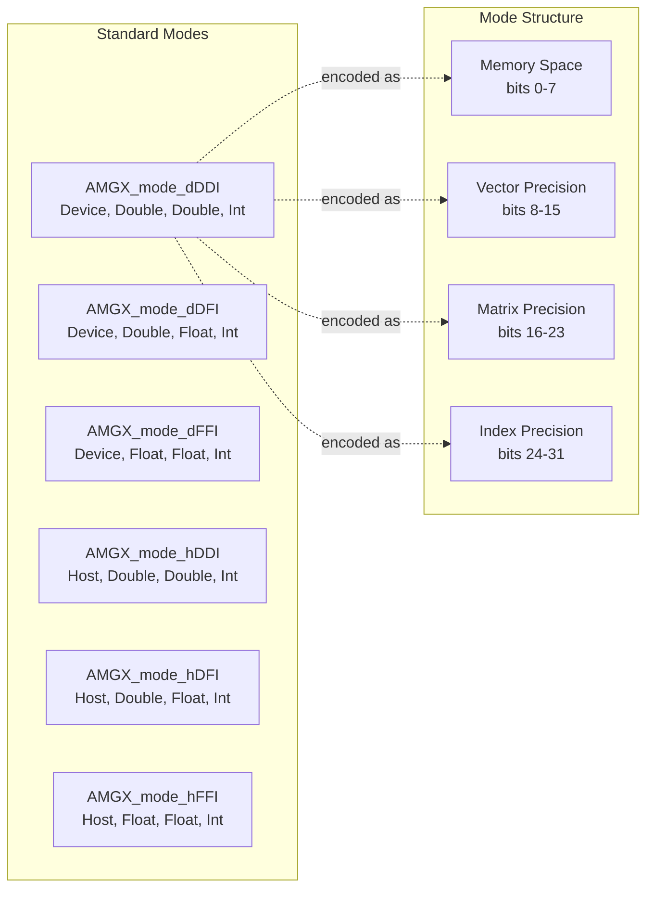
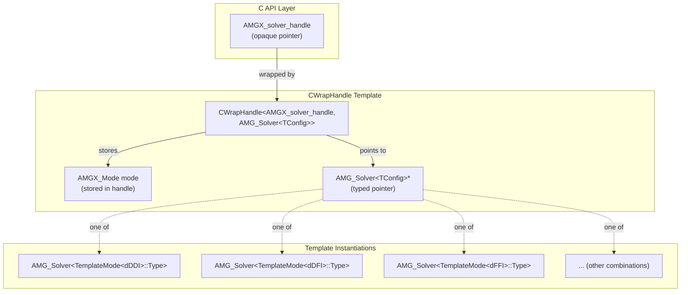
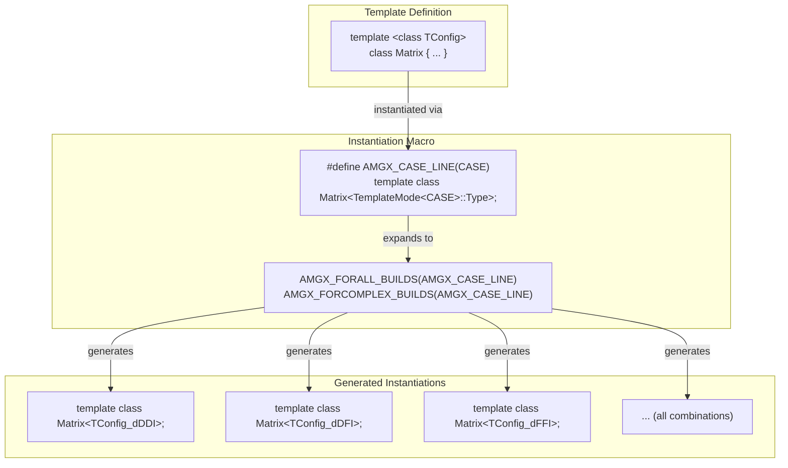
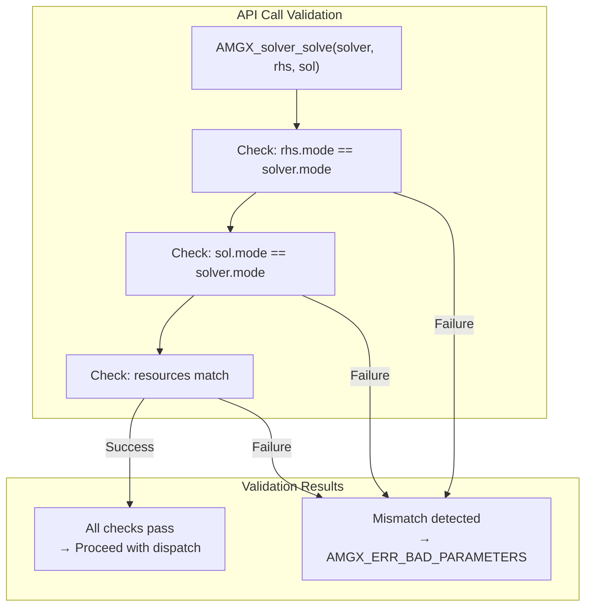
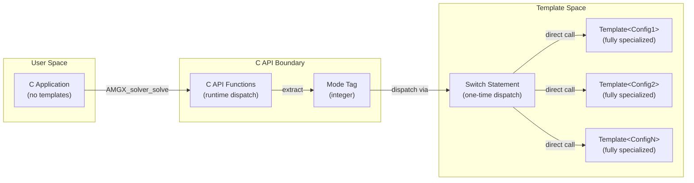

<!-- source: DeepWiki mcp.deepwiki.com · repo NVIDIA/AMGX · extra page Mode System and Template Dispatch · fetched 2026-10-26 -->

# Mode System and Template Dispatch

<details>
<summary>Relevant source files</summary>

The following files were used as context for generating this wiki page:

- [examples/amgx_capi.h](examples/amgx_capi.h)
- [examples/amgx_mpi_capi.c](examples/amgx_mpi_capi.c)
- [examples/amgx_mpi_poisson7.c](examples/amgx_mpi_poisson7.c)
- [include/amgx_c.h](include/amgx_c.h)
- [src/amgx_c.cu](src/amgx_c.cu)
- [src/matrix_analysis.cu](src/matrix_analysis.cu)

</details>


## Purpose and Scope

This document describes AMGX's mode system and template dispatch mechanism, which enables runtime selection of compile-time template parameters through the C API. The mode system encodes memory location (host/device), numeric precisions (float/double/complex), and index types into a single integer value, allowing the C API to dispatch calls to the appropriate template instantiation.

For general C API design and object lifecycle, see [API Design and Object Model](#4.1.1). For error handling in the C API, see [Error Handling](#4.1.3).

## Mode Encoding System

### AMGX_Mode Enumeration

The `AMGX_Mode` type is a 32-bit integer that encodes four template parameters:

| Parameter | Bits | Purpose |
|-----------|------|---------|
| MemorySpace | 0-7 | Host (`AMGX_host`) or Device (`AMGX_device`) memory location |
| VecPrecision | 8-15 | Vector data type: float, double, complex, int, int64, bool |
| MatPrecision | 16-23 | Matrix data type: float, double, complex |
| IndPrecision | 24-31 | Index type: int or int64 |

**Mode Extraction Macro:**
```cpp
AMGX_GET_MODE_VAL(AMGX_<Parameter>, mode)
```

This macro extracts a specific parameter value from the packed mode integer.

**Sources:** [include/amgx_config.h:1-200]()

### Common Mode Values



**Mode Creation Examples:**

```cpp
// From examples
AMGX_Mode mode = AMGX_mode_dDDI;  // Device, double vectors/matrices, int indices

// Extract parameters
int memspace = AMGX_GET_MODE_VAL(AMGX_MemorySpace, mode);
int vecprec = AMGX_GET_MODE_VAL(AMGX_VecPrecision, mode);
size_t sizeof_val = (vecprec == AMGX_vecDouble) ? sizeof(double) : sizeof(float);
```

**Sources:** [include/amgx_config.h:1-200](), [examples/amgx_mpi_capi.c:186-209](), [examples/amgx_mpi_poisson7.c:180-203]()

## Template Configuration Classes

### TemplateConfig Structure

The `TemplateConfig` template class encapsulates all four mode parameters as template arguments:

```cpp
template <AMGX_MemorySpace MEM, AMGX_VecPrecision VEC, 
          AMGX_MatPrecision MAT, AMGX_IndPrecision IND>
struct TemplateConfig {
    static const AMGX_MemorySpace memSpace = MEM;
    static const AMGX_VecPrecision vecPrec = VEC;
    static const AMGX_MatPrecision matPrec = MAT;
    static const AMGX_IndPrecision indPrec = IND;
    
    // Type aliases
    typedef <type> VecPrec;      // Vector value type
    typedef <type> MatPrec;      // Matrix value type
    typedef <type> IndPrec;      // Index type
};
```

**TemplateMode Mapping:**

The `TemplateMode` template maps mode enum values to `TemplateConfig` types:

```cpp
template <AMGX_Mode MODE> struct TemplateMode {
    typedef TemplateConfig<
        AMGX_GET_MODE_VAL(AMGX_MemorySpace, MODE),
        AMGX_GET_MODE_VAL(AMGX_VecPrecision, MODE),
        AMGX_GET_MODE_VAL(AMGX_MatPrecision, MODE),
        AMGX_GET_MODE_VAL(AMGX_IndPrecision, MODE)
    > Type;
};
```

**Core Templated Classes:**

All major AMGX classes are templated on `TConfig`:

- `Matrix<TConfig>` - Sparse matrix storage
- `Vector<TConfig>` - Dense vector storage
- `Solver<TConfig>` - Base solver class
- `AMG_Solver<TConfig>` - AMG solver implementation

**Sources:** [include/amgx_config.h:1-200]()

## Runtime Dispatch Mechanism

### Opaque Handle Wrapping



**CWrapHandle Implementation:**

The `CWrapHandle` template stores both the mode and a typed pointer within an opaque handle structure:

```cpp
template<typename HandleType, typename ObjectType>
class CWrapHandle {
    AMGX_Mode mode;              // Runtime mode tag
    ObjectType* ptr;             // Typed object pointer
    AMGX_SOLVE_STATUS status;    // Last solve status
};
```

**Mode Extraction Functions:**

```cpp
// Get mode from handle
template<typename HandleType>
AMGX_Mode get_mode_from(HandleType handle);

// Get typed object from handle
template<AMGX_Mode CASE, template<typename> class ObjectType, typename HandleType>
ObjectType<typename TemplateMode<CASE>::Type>* 
    get_mode_object_from(HandleType handle);
```

**Sources:** [src/amgx_c.cu:45-127](), [src/amgx_c_wrappers.inl]()

### Dispatch Flow

```mermaid
sequenceDiagram
    participant User as "User Application"
    participant API as "AMGX C API<br/>(amgx_c.cu)"
    participant Dispatch as "Mode Dispatch<br/>(switch statement)"
    participant Template as "Template Instantiation"
    participant Impl as "Typed Implementation"
    
    User->>API: AMGX_solver_solve(slv, b, x)
    API->>API: get_mode_from&lt;AMGX_solver_handle&gt;(slv)
    API->>Dispatch: switch(mode)
    
    alt mode == AMGX_mode_dDDI
        Dispatch->>Template: CASE: dDDI
        Template->>Impl: solve_with&lt;dDDI, AMG_Solver, Vector&gt;()
        Impl->>Impl: AMG_Solver&lt;TConfig_dDDI&gt;::solve()
    else mode == AMGX_mode_dDFI
        Dispatch->>Template: CASE: dDFI
        Template->>Impl: solve_with&lt;dDFI, AMG_Solver, Vector&gt;()
        Impl->>Impl: AMG_Solver&lt;TConfig_dDFI&gt;::solve()
    else mode == other
        Dispatch->>Template: CASE: other
        Template->>Impl: solve_with&lt;other, AMG_Solver, Vector&gt;()
    end
    
    Impl-->>User: AMGX_RC return code
```

**Sources:** [src/amgx_c.cu:714-752]()

## Template Dispatch Macros

### AMGX_FORALL_BUILDS Macro

The `AMGX_FORALL_BUILDS` macro expands a given macro for all supported mode combinations:

```cpp
#define AMGX_FORALL_BUILDS(MACRO) \
    MACRO(AMGX_mode_dDDI) \
    MACRO(AMGX_mode_dDFI) \
    MACRO(AMGX_mode_dFFI) \
    MACRO(AMGX_mode_hDDI) \
    MACRO(AMGX_mode_hDFI) \
    MACRO(AMGX_mode_hFFI) \
    // ... additional modes
```

This enables explicit template instantiation for all supported configurations.

### AMGX_CASE_LINE Pattern

The `AMGX_CASE_LINE` macro pattern generates switch case statements for mode dispatch:

```cpp
// Define case line macro
#define AMGX_CASE_LINE(CASE) \
    case CASE: { \
        *resources = get_mode_object_from<CASE, AMG_Solver, AMGX_solver_handle>(slv) \
                     ->getResources(); \
    } \
    break;

// Expand for all builds
switch (mode) {
    AMGX_FORALL_BUILDS(AMGX_CASE_LINE)
    AMGX_FORCOMPLEX_BUILDS(AMGX_CASE_LINE)
    default:
        AMGX_CHECK_API_ERROR_NORSRC(AMGX_ERR_BAD_MODE);
}

#undef AMGX_CASE_LINE
```

This pattern appears throughout the C API implementation for dispatching operations.

**Sources:** [src/amgx_c.cu:45-127](), [src/matrix_analysis.cu:940-943]()

### Explicit Instantiation Pattern



At the end of template implementation files, explicit instantiation ensures all mode combinations are compiled:

```cpp
// Example from matrix_analysis.cu
#define AMGX_CASE_LINE(CASE) \
    template class MatrixAnalysis<TemplateMode<CASE>::Type>;

AMGX_FORALL_BUILDS(AMGX_CASE_LINE)
AMGX_FORCOMPLEX_BUILDS(AMGX_CASE_LINE)
#undef AMGX_CASE_LINE
```

**Sources:** [src/matrix_analysis.cu:940-943]()

## API Function Dispatch Examples

### Matrix Operations

```cpp
template<AMGX_Mode CASE>
inline AMGX_RC matrix_upload_all(
    AMGX_matrix_handle mtx,
    int n, int nnz, int block_dimx, int block_dimy,
    const int *row_ptrs, const int *col_indices,
    const void *data, const void *diag_data,
    Resources *resources)
{
    typedef Matrix<typename TemplateMode<CASE>::Type> MatrixLetterT;
    typedef CWrapHandle<AMGX_matrix_handle, MatrixLetterT> MatrixW;
    
    MatrixW wrapA(mtx);
    MatrixLetterT &A = *wrapA.wrapped();
    
    // Perform type-specific operation
    typedef typename MatPrecisionMap<
        AMGX_GET_MODE_VAL(AMGX_MatPrecision, CASE)
    >::Type ValueType;
    
    cudaMemcpy(A.values.raw(), data, 
               sizeof(ValueType) * nnz * block_dimx * block_dimy,
               cudaMemcpyDefault);
    // ...
}
```

The dispatch wrapper then calls this template function:

```cpp
AMGX_RC AMGX_matrix_upload_all(AMGX_matrix_handle mtx, /* ... *) {
    AMGX_Mode mode = get_mode_from<AMGX_matrix_handle>(mtx);
    
    switch (mode) {
        #define AMGX_CASE_LINE(CASE) \
            case CASE: return matrix_upload_all<CASE>( \
                mtx, n, nnz, block_dimx, block_dimy, \
                row_ptrs, col_indices, data, diag_data, resources);
        
        AMGX_FORALL_BUILDS(AMGX_CASE_LINE)
        AMGX_FORCOMPLEX_BUILDS(AMGX_CASE_LINE)
        #undef AMGX_CASE_LINE
        
        default:
            return AMGX_RC_BAD_MODE;
    }
}
```

**Sources:** [src/amgx_c.cu:852-922]()

### Solver Operations

```cpp
template<AMGX_Mode CASE,
         template<typename> class SolverType,
         template<typename> class VectorType>
inline AMGX_ERROR solve_with(
    AMGX_solver_handle slv,
    AMGX_vector_handle rhs,
    AMGX_vector_handle sol,
    Resources *resources,
    bool xIsZero = false)
{
    typedef SolverType<typename TemplateMode<CASE>::Type> SolverLetterT;
    typedef CWrapHandle<AMGX_solver_handle, SolverLetterT> SolverW;
    typedef VectorType<typename TemplateMode<CASE>::Type> VectorLetterT;
    typedef CWrapHandle<AMGX_vector_handle, VectorLetterT> VectorW;
    
    SolverW wrapSolver(slv);
    SolverLetterT &solver = *wrapSolver.wrapped();
    
    VectorW wrapRhs(rhs);
    VectorLetterT &b = *wrapRhs.wrapped();
    
    VectorW wrapSol(sol);
    VectorLetterT &x = *wrapSol.wrapped();
    
    // Validate mode consistency
    if (wrapRhs.mode() != wrapSolver.mode()) {
        FatalError("Error: mismatch between RHS mode and Solver Mode.\n",
                   AMGX_ERR_BAD_PARAMETERS);
    }
    
    // Call typed solve method
    return solver.solve(b, x, wrapSolver.last_solve_status(), xIsZero);
}
```

**Sources:** [src/amgx_c.cu:714-752]()

## Mode Validation and Type Safety

### Mode Consistency Checks



Mode consistency is validated before dispatching to ensure type safety:

```cpp
// Mode mismatch detection
if (wrapRhs.mode() != wrapSolver.mode()) {
    FatalError("Error: mismatch between RHS mode and Solver Mode.\n",
               AMGX_ERR_BAD_PARAMETERS);
}

if (wrapRhs.mode() != wrapSol.mode()) {
    FatalError("Error: mismatch between RHS mode and Sol Mode.\n",
               AMGX_ERR_BAD_PARAMETERS);
}

// Resource consistency check
if ((b.getResources() != solver.getResources()) ||
    (x.getResources() != solver.getResources())) {
    FatalError("Error: Inconsistency between solver and rhs/sol resources",
               AMGX_ERR_BAD_PARAMETERS);
}
```

**Sources:** [src/amgx_c.cu:714-752]()

## Precision Selection at Runtime

### User-Visible Mode Selection

Users select precision and memory location when creating objects:

```c
// Select mode
AMGX_Mode mode = AMGX_mode_dDDI;  // Device, double/double/int

// Create objects with chosen mode
AMGX_matrix_create(&A, rsrc, mode);
AMGX_vector_create(&x, rsrc, mode);
AMGX_vector_create(&b, rsrc, mode);
AMGX_solver_create(&solver, rsrc, mode, cfg);
```

### Mode-Dependent Data Handling

Data upload/download operations use mode to determine data type sizes:

```c
// Query vector precision from mode
size_t sizeof_v_val = 
    (AMGX_GET_MODE_VAL(AMGX_VecPrecision, mode) == AMGX_vecDouble) 
    ? sizeof(double) 
    : sizeof(float);

// Allocate appropriately sized buffer
void *x_h = malloc(n * block_dimx * sizeof_v_val);

// Upload/download with correct interpretation
AMGX_vector_upload(x, n, block_dimx, x_h);
AMGX_vector_download(x, x_h);
```

**Sources:** [examples/amgx_mpi_capi.c:364-389](), [examples/amgx_mpi_poisson7.c:205-209]()

## Template Instantiation Strategy

### Compile-Time vs Runtime Polymorphism

AMGX uses **explicit template instantiation** instead of virtual functions to avoid runtime overhead:

| Approach | AMGX Choice | Reason |
|----------|-------------|---------|
| Virtual functions | ❌ Not used | Runtime overhead, vtable lookups |
| Template instantiation | ✅ Used | Zero runtime cost after dispatch |
| Dynamic dispatch | ✅ One-time | Only at C API boundary |



This design provides:
- **Type safety**: Compile-time checks within each instantiation
- **Performance**: No virtual function overhead in hot paths
- **Flexibility**: Runtime mode selection via C API
- **Code reuse**: Single template implementation for all modes

**Sources:** [src/amgx_c.cu:45-127](), [src/amgx_c.cu:714-752]()

## Summary Table: Mode System Components

| Component | Location | Purpose |
|-----------|----------|---------|
| `AMGX_Mode` | [include/amgx_config.h]() | Enum encoding all template parameters |
| `AMGX_GET_MODE_VAL` | [include/amgx_config.h]() | Extract parameter from mode value |
| `TemplateConfig` | [include/amgx_config.h]() | Template class encapsulating configuration |
| `TemplateMode` | [include/amgx_config.h]() | Maps mode enum to TemplateConfig type |
| `CWrapHandle` | [src/amgx_c_wrappers.inl]() | Wraps typed objects with mode tag |
| `get_mode_from` | [src/amgx_c.cu]() | Extracts mode from opaque handle |
| `get_mode_object_from` | [src/amgx_c.cu]() | Gets typed pointer from handle |
| `AMGX_FORALL_BUILDS` | [include/amgx_config.h]() | Macro for iterating all modes |
| `AMGX_CASE_LINE` | Various `.cu` files | Pattern for switch case generation |

---

