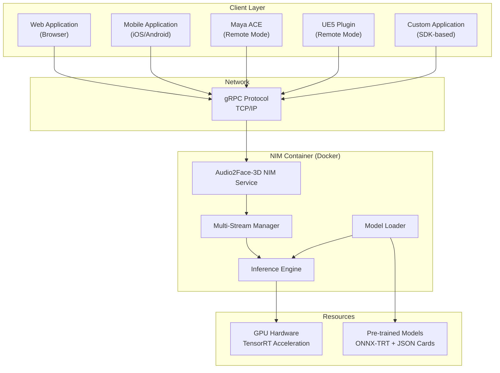
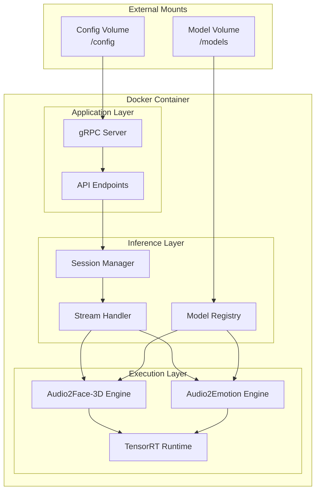
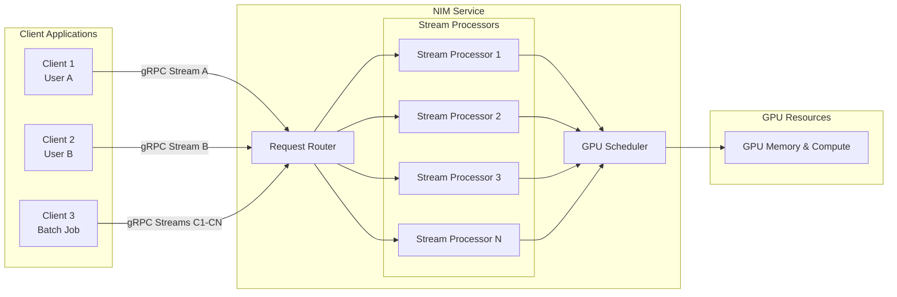
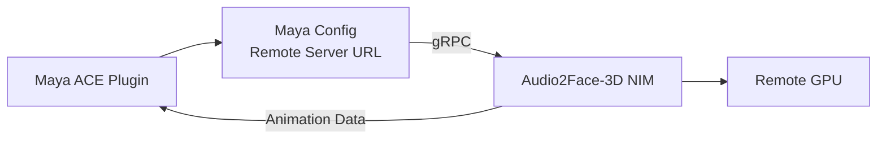
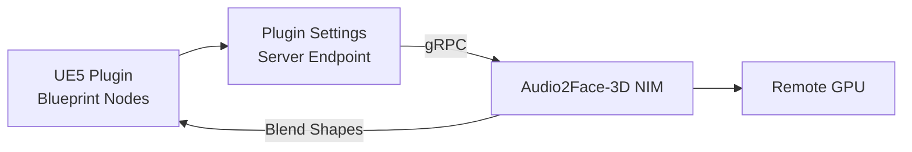
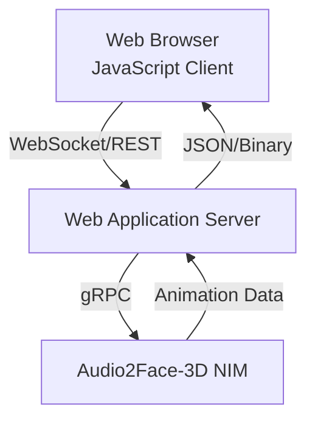
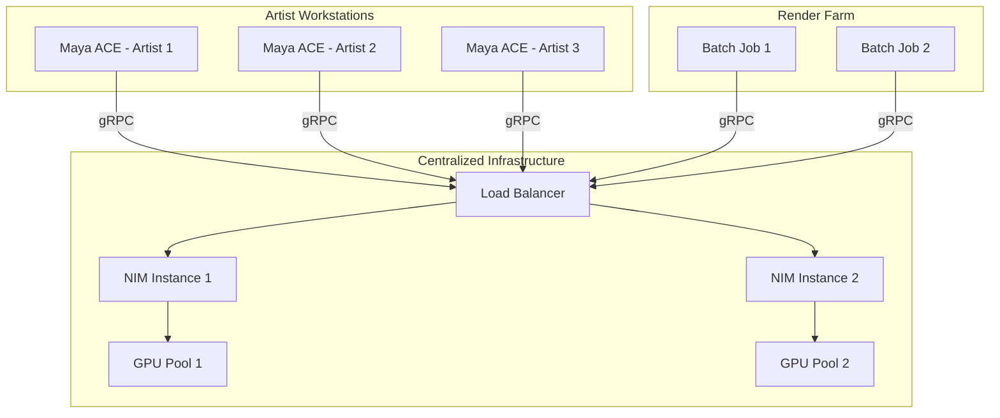

<!-- source: DeepWiki mcp.deepwiki.com · repo NVIDIA/Audio2Face-3D · page 6.1 NIM Microservice · fetched 2026-10-26 -->

# NIM Microservice

Relevant source files

The following files were used as context for generating this wiki page:

- [README.md](README.md)

## Purpose and Scope

This document describes the Audio2Face-3D NIM (NVIDIA Inference Microservice), a containerized deployment solution for serving Audio2Face-3D models at scale. The NIM microservice exposes the inference engine via gRPC protocol, enabling multiple concurrent clients to generate facial animation from audio in production environments.

For information about local inference using the C++ library, see [C++ SDK](#3.1). For guidance on choosing between local and remote deployment architectures, see [Deployment Patterns](#6.2). For details on the models that can be loaded into NIM, see [Audio2Face-3D Models](#5.1) and [Audio2Emotion Models](#5.2).

**Sources:** [README.md:211-234]()

## System Overview

The Audio2Face-3D NIM is a Docker-based microservice that centralizes Audio2Face-3D inference capabilities on a GPU-equipped server. Client applications communicate with the service over gRPC, submitting audio data and receiving facial animation outputs. This architecture decouples inference hardware from client devices, enabling lightweight clients (web browsers, mobile devices, thin workstations) to access GPU-accelerated facial animation generation.

**Sources:** [README.md:211-234](), [README.md:61-67]()

## Target Audience and Access

The NIM microservice is designed for Linux system administrators, cloud engineers, and DevOps personnel responsible for deploying production-scale AI services.

| Audience | Primary Use Case |
|----------|-----------------|
| Linux System Administrators | Server deployment and maintenance |
| Cloud Engineers | Multi-tenant cloud deployments |
| DevOps Teams | CI/CD integration and scaling |
| Studio Technical Directors | Centralized studio animation services |

The service is distributed as a Docker container and is available at [build.nvidia.com/nvidia/audio2face-3d](https://build.nvidia.com/nvidia/audio2face-3d).

**Sources:** [README.md:213-215]()

## Deployment Architecture

### Container Structure

The NIM is packaged as a Docker container that encapsulates:
- The Audio2Face-3D inference engine
- TensorRT runtime for GPU acceleration
- gRPC server implementation
- Model loading and management subsystem
- Multi-stream request handling

The container follows the NVIDIA Inference Microservice standard, ensuring compatibility with NVIDIA's deployment ecosystem and tooling.

**Sources:** [README.md:62-66](), [README.md:217-219]()

### Resource Requirements

The NIM container requires:
- NVIDIA GPU with TensorRT support
- Docker runtime with GPU passthrough (nvidia-docker)
- Sufficient VRAM for loaded models (varies by model version)
- Network accessibility for gRPC clients

**Sources:** [README.md:226]()

## gRPC Protocol Interface

The NIM exposes its functionality through a gRPC API, providing high-performance, low-latency communication between clients and the inference service. The protocol supports:

- **Streaming Audio Input**: Clients can send audio data in real-time chunks
- **Streaming Animation Output**: The service returns animation data as it is generated
- **Bidirectional Communication**: Supports full-duplex streaming for interactive applications
- **Session Management**: Multiple concurrent sessions per client or across clients

### Protocol Benefits

| Feature | Description | Benefit |
|---------|-------------|---------|
| Binary Protocol | Compact binary serialization | Lower bandwidth, faster transmission |
| HTTP/2 Transport | Multiplexed connections | Efficient connection pooling |
| Strongly Typed | Protocol buffer definitions | Type safety, cross-language support |
| Streaming Support | Native bidirectional streaming | Real-time audio processing |

**Sources:** [README.md:225]()

## Multi-Stream Architecture

The NIM supports concurrent processing of multiple audio streams, enabling:

1. **Multi-User Scenarios**: Different users generate facial animation simultaneously
2. **Multi-Character Workflows**: Single client processes multiple characters concurrently
3. **Batch Processing**: Parallel processing of multiple audio files

**Sources:** [README.md:224]()

## Model Loading and Management

The NIM supports dynamic model loading using JSON model cards, the same format used by the SDK, Maya ACE, and UE5 Plugin. This enables:

- Loading Audio2Face-3D models (v2.3 regression or v3.0 diffusion)
- Loading Audio2Emotion models (v2.2 production or v3.0 experimental)
- Switching between models without container restart
- Supporting custom-trained models from the Training Framework

### Model Card Integration

The service reads model metadata from JSON model cards to configure:
- Model architecture and version
- Input/output specifications
- Blend shape mappings
- Language support metadata

**Sources:** [README.md:144](), [README.md:168]()

## Integration Patterns

### Maya ACE Remote Mode

Maya ACE can connect to the NIM instead of performing local inference:

This pattern enables artists on thin clients to access GPU-accelerated inference from a centralized server.

**Sources:** [README.md:167]()

### UE5 Plugin Remote Mode

The Unreal Engine 5 Plugin supports remote inference configuration:

Game developers can test with local inference during development and deploy with NIM for production.

**Sources:** [README.md:202]()

### Custom SDK Applications

Applications built with the C++ SDK can optionally connect to NIM instead of performing local inference by implementing a gRPC client.

**Sources:** [README.md:115]()

## Production Use Cases

### Web-Based Digital Humans

The NIM enables browser-based applications to access GPU-accelerated facial animation without client-side GPU requirements:

**Use Cases:**
- Interactive web avatars
- Customer service chatbots with animated faces
- Online gaming platforms
- Virtual event platforms

**Sources:** [README.md:230]()

### Multi-Platform Game Runtime

Games deployed across platforms (console, mobile, PC) can use a centralized NIM service as a backend:

| Platform | Local Processing | Network Connection | NIM Benefit |
|----------|------------------|-------------------|-------------|
| Mobile | Limited GPU | 4G/5G/WiFi | Offload heavy inference |
| Console | Fixed Hardware | Broadband | Consistent quality |
| PC | Variable GPU | Broadband | Guaranteed performance |
| Cloud Gaming | Server-side | LAN | Minimal latency |

**Sources:** [README.md:231]()

### Studio Animation Pipeline

Animation studios can deploy NIM as a centralized service accessible to all artists:

This democratizes access to GPU resources and ensures consistent model versions across the team.

**Sources:** [README.md:232]()

### Automated Batch Processing

The NIM can process thousands of audio files in parallel for large-scale production:

**Workflow:**
1. Submit batch of audio files to NIM via gRPC
2. NIM processes multiple streams concurrently
3. Animation data returned as files or database records
4. Integrate into larger rendering pipeline

**Performance Characteristics:**
- Multi-stream parallelism maximizes GPU utilization
- Horizontal scaling via multiple NIM instances
- Queue management for large job volumes

**Sources:** [README.md:233]()

## Licensing

The NIM is distributed under the [NVIDIA Software License Agreement and Product Specific Terms for AI Products](https://www.nvidia.com/en-us/agreements/enterprise-software/product-specific-terms-for-ai-products), which differs from the MIT license used by the SDK, Maya ACE, and UE5 Plugin.

**Sources:** [README.md:65]()

## Comparison: Local vs Remote Inference

| Aspect | Local Inference (SDK) | Remote Inference (NIM) |
|--------|---------------------|----------------------|
| Deployment | Per-workstation installation | Centralized server deployment |
| GPU Requirements | Each client needs GPU | Shared GPU resources |
| Network Dependency | None | Requires stable network connection |
| Latency | Lowest (no network) | Network-dependent |
| Model Management | Per-client model files | Centralized model repository |
| Scalability | Limited by client hardware | Horizontally scalable |
| Cost Model | Fixed per-seat | Variable based on usage |
| Best For | Single-user, local workflows | Multi-user, production deployments |

The choice between local and remote inference depends on:
- Number of concurrent users
- Available client hardware
- Network infrastructure
- Production scale requirements
- Budget and licensing considerations

**Sources:** [README.md:167](), [README.md:202](), [README.md:217-234]()

---

