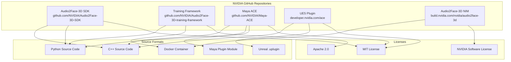
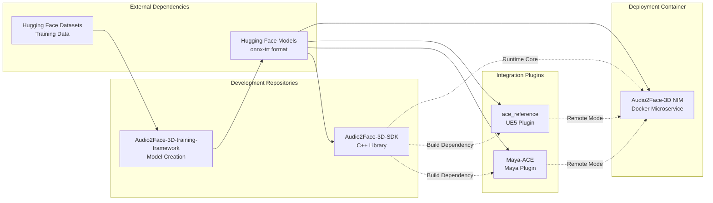
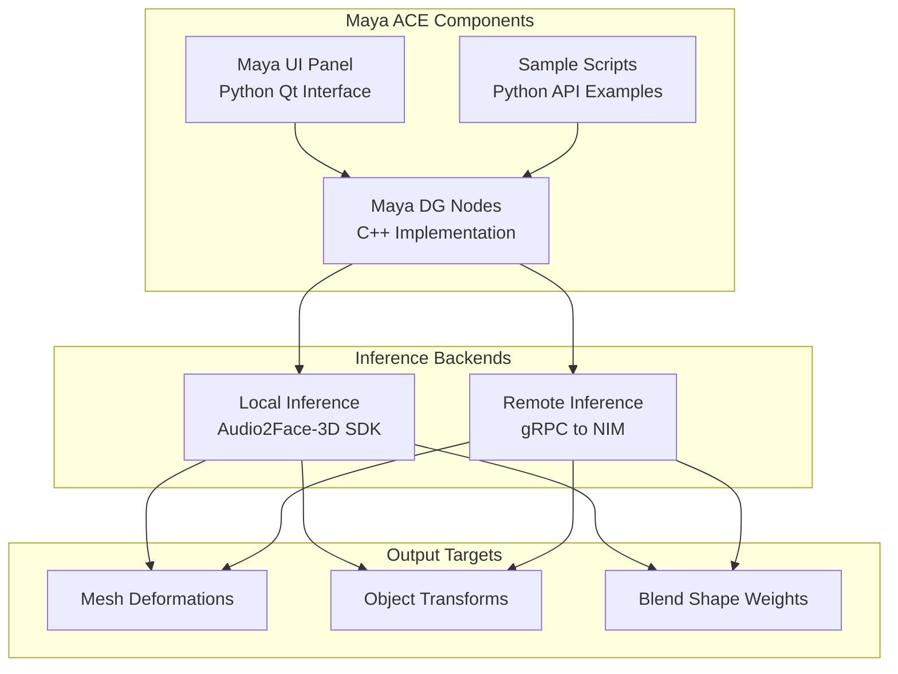
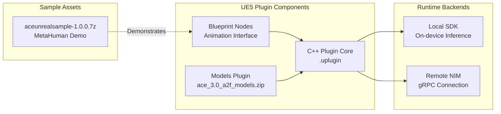
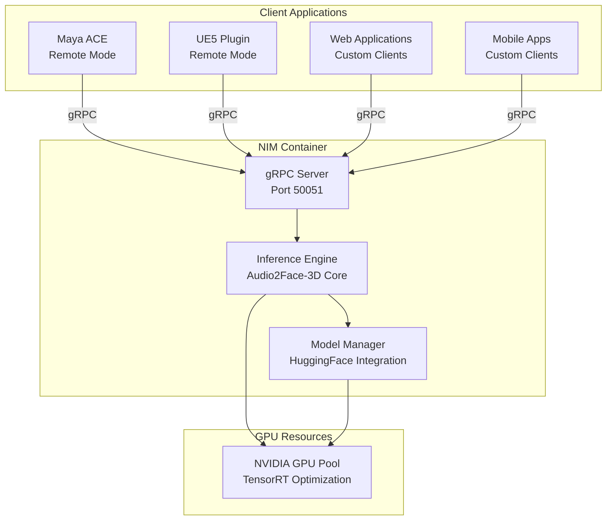

<!-- source: DeepWiki mcp.deepwiki.com · repo NVIDIA/Audio2Face-3D · page 7.1 NVIDIA Repositories · fetched 2026-10-26 -->

# NVIDIA Repositories

Relevant source files

The following files were used as context for generating this wiki page:

- [README.md](README.md)

## Purpose and Scope

This page provides a comprehensive index of all NVIDIA GitHub repositories that comprise the Audio2Face-3D ecosystem. These repositories contain source code, build scripts, plugins, and deployment containers for integrating Audio2Face-3D capabilities into various workflows.

For pre-trained models and training datasets distributed via Hugging Face Hub, see [Hugging Face Hub](#7.2). For detailed documentation on individual components, refer to their respective pages: [C++ SDK](#3.1), [Maya ACE Plugin](#3.2), [Unreal Engine 5 Plugin](#3.3), [Training Framework](#4.1), and [NIM Microservice](#6.1).

**Sources:** [README.md:23-68]()

---

## Repository Overview

The Audio2Face-3D ecosystem is distributed across five primary NVIDIA repositories, each targeting specific developer personas and use cases. All repositories except NIM use permissive open-source licenses (MIT or Apache 2.0), enabling broad commercial and research use.

**Sources:** [README.md:25-68]()

---

## Repository Matrix

The following table summarizes all NVIDIA repositories with their technical specifications and licensing:

| Repository | Primary Format | Secondary Format | License | Target Audience |
|------------|---------------|------------------|---------|-----------------|
| **Audio2Face-3D SDK** | C++ Source Code | Python Bindings | MIT | C++ developers, pipeline engineers |
| **Training Framework** | Python Source Code | Docker Container | Apache 2.0 | ML researchers, technical artists |
| **Maya ACE (MACE)** | Maya Plugin Module | C++ & Python Source | MIT | 3D animators, technical directors |
| **UE5 Plugin** | Unreal .uplugin | C++ Source Code | MIT | Game developers using UE5 |
| **Audio2Face-3D NIM** | Docker Container | gRPC Service | NVIDIA Software License | DevOps engineers, cloud admins |

**Sources:** [README.md:25-68]()

---

## Repository Dependency Graph

This diagram shows how the repositories depend on and interact with each other:

**Sources:** [README.md:23-234]()

---

## Audio2Face-3D SDK

**Repository:** [https://github.com/NVIDIA/Audio2Face-3D-SDK](https://github.com/NVIDIA/Audio2Face-3D-SDK)

**Format:** Source Code - C++ & Python

**License:** MIT

The Audio2Face-3D SDK is a cross-platform C++ library providing real-time inference capabilities for generating facial animation from audio. It serves as the foundational component used by both the Maya ACE plugin and Unreal Engine 5 plugin.

### Key Capabilities

- **Cross-platform C++ library** with Python bindings
- **Real-time inference engine** optimized for low-latency applications
- **Hardware acceleration** via NVIDIA GPUs with CPU fallback support
- **Model loading** from JSON model cards and ONNX-TRT weights

### Target Use Cases

The SDK is designed for developers building custom applications, plugins, or batch processing tools that require direct integration of Audio2Face-3D capabilities.

For comprehensive SDK documentation including API reference and integration examples, see [C++ SDK](#3.1).

**Sources:** [README.md:109-128]()

---

## Audio2Face-3D Training Framework

**Repository:** [https://github.com/NVIDIA/Audio2Face-3D-training-framework](https://github.com/NVIDIA/Audio2Face-3D-training-framework)

**Format:** Source Code - Python & Docker Container

**License:** Apache 2.0

The Training Framework provides the complete toolset for creating custom Audio2Face-3D models from proprietary datasets. This is the same framework NVIDIA used to train the official Mark, Claire, and James models.

### Key Capabilities

- **Custom model training** from scratch using proprietary animation data
- **Docker-based environment** for reproducible training workflows
- **Multi-language support** for training on datasets in single or multiple languages
- **Standardized export** to ONNX-TRT format with JSON model cards

### Output Format

Trained models are exported in two components:
- **ONNX-TRT model weights** (`.onnx` files optimized for TensorRT)
- **JSON model card** (metadata describing model capabilities and configuration)

These outputs are compatible with all Audio2Face-3D tools (SDK, MACE, UE5 Plugin, NIM).

For detailed training workflows, dataset preparation, and export procedures, see [Training Framework](#4.1). For information on training datasets, see [Training Datasets](#4.2).

**Sources:** [README.md:129-151]()

---

## Maya ACE Plugin (MACE)

**Repository:** [https://github.com/NVIDIA/Maya-ACE](https://github.com/NVIDIA/Maya-ACE)

**Format:** Autodesk Maya Plugin Module, Source Code C++ and Python

**License:** MIT

MACE integrates Audio2Face-3D capabilities directly into the Autodesk Maya environment, providing an artist-friendly interface for generating real-time facial animation.

### Key Capabilities

- **Real-time viewport preview** of facial animation
- **Dual inference modes:** local execution or remote connection to Audio2Face-3D NIM
- **Model loading** via JSON model cards (supports both pre-trained and custom models)
- **Flexible output formats:** mesh deformations, object transformations, or blend shape weights
- **Production export** as Maya keyframes or FBX format

### Plugin Architecture

For complete installation instructions, UI workflow, and integration examples, see [Maya ACE Plugin](#3.2).

**Sources:** [README.md:152-178]()

---

## Unreal Engine 5 Plugin

**Download Links:**
- [ACE Unreal 5.6 Plugin](https://developer.nvidia.com/downloads/assets/ace/nv_ace_reference-ue5.6-v2.5.0rc3.zip)
- [ACE Unreal 5.5 Plugin](https://developer.nvidia.com/downloads/assets/ace/nv_ace_reference-ue5.5-v2.5.0rc3.zip)
- [ACE Unreal 5.4 Plugin](https://developer.nvidia.com/downloads/assets/ace/nv_ace_reference-ue5.4-v2.4.0.zip)
- [Audio2Face-3D 3.0 Models Plugin](https://developer.nvidia.com/downloads/assets/ace/ace_3.0_a2f_models.zip)
- [Audio2Face-3D 2.3 Models Plugin](https://developer.nvidia.com/downloads/assets/ace/ace_2.5_v2.3_a2f_models.zip)
- [Unreal Sample Project](https://developer.nvidia.com/downloads/assets/ace/aceunrealsample-1.0.0.7z)

**Format:** Unreal Engine (.uplugin) & Source Code C++

**License:** MIT

The UE5 plugin brings real-time AI-driven facial animation into Unreal Engine game development workflows via Blueprint integration.

### Installation Components

The UE5 solution requires two separate plugin installations:
1. **Core ACE Unreal Plugin** - Engine-version specific (5.4, 5.5, or 5.6)
2. **Audio2Face-3D Models Plugin** - Version specific (v2.3 or v3.0 models)

### Key Capabilities

- **Blueprint node integration** for artist-friendly workflows (no C++ required)
- **Real-time character rigging** within the Unreal Engine editor
- **Dual inference modes:** local execution or remote connection to NIM
- **MetaHuman support** with pre-configured sample project
- **Full C++ source code** available for custom extensions

### Plugin Architecture

For Blueprint integration examples, MetaHuman rigging, and deployment configuration, see [Unreal Engine 5 Plugin](#3.3).

**Sources:** [README.md:179-210]()

---

## Audio2Face-3D NIM

**Repository:** [https://build.nvidia.com/nvidia/audio2face-3d](https://build.nvidia.com/nvidia/audio2face-3d)

**Format:** Docker Container

**License:** [NVIDIA Software License Agreement and Product Specific Terms for AI Products](https://www.nvidia.com/en-us/agreements/enterprise-software/product-specific-terms-for-ai-products)

The Audio2Face-3D NIM (NVIDIA Inference Microservice) is a containerized microservice designed for large-scale, multi-user deployments. It exposes Audio2Face-3D inference via the gRPC protocol.

### Key Capabilities

- **Large-scale concurrent inference** for production environments
- **Multi-stream processing** supporting multiple simultaneous audio streams
- **gRPC protocol** for high-performance client-server communication
- **Centralized GPU resources** serving multiple client applications
- **Hot-swappable models** loaded from Hugging Face Hub

### NIM Service Architecture

### Deployment Requirements

- **Docker runtime** with NVIDIA Container Toolkit
- **NVIDIA GPU** with TensorRT support
- **Network configuration** for gRPC port (default 50051)

For Docker deployment instructions, configuration options, and scaling strategies, see [NIM Microservice](#6.1). For architectural patterns using NIM, see [Deployment Patterns](#6.2).

**Sources:** [README.md:211-234]()

---

## Repository Licensing Summary

The Audio2Face-3D repositories use three distinct licenses based on their use cases:

| License Type | Repositories | Permissions | Restrictions |
|-------------|--------------|-------------|--------------|
| **MIT** | SDK, MACE, UE5 Plugin | Commercial use, modification, distribution, private use | Liability disclaimer, license/copyright notice required |
| **Apache 2.0** | Training Framework | Commercial use, modification, distribution, patent grant | License/copyright notice required, state changes |
| **NVIDIA Software License** | NIM | Use with NVIDIA hardware, deployment in production | Proprietary license, see agreement for full terms |

The MIT and Apache 2.0 licenses enable unrestricted commercial use, modification, and redistribution of source code. The NIM container uses a proprietary NVIDIA license with specific terms for AI products.

**Sources:** [README.md:25-68]()

---

## Build and Installation Patterns

### Source Code Repositories

For repositories distributed as source code (SDK, Training Framework, MACE), typical installation patterns include:

1. **Clone the repository** from GitHub
2. **Install dependencies** (varies by platform and repository)
3. **Build from source** using provided build scripts
4. **Link or install** into target environment

Specific build instructions are provided in each repository's README and installation guides.

### Plugin Packages

The UE5 Plugin is distributed as pre-built packages (`.zip` files) containing compiled binaries for specific Unreal Engine versions. Installation involves:

1. **Download version-specific plugin packages**
2. **Extract to Unreal Engine plugins directory**
3. **Enable plugin** in Unreal Engine project settings
4. **Load model plugin** separately (v2.3 or v3.0)

### Container Deployment

The NIM microservice is distributed as a Docker container image. Deployment involves:

1. **Pull Docker image** from NVIDIA NGC registry
2. **Configure environment variables** for model selection and ports
3. **Run container** with GPU access enabled
4. **Verify gRPC endpoint** is accessible to clients

For detailed build and installation instructions specific to each component, refer to their individual documentation pages: [C++ SDK](#3.1), [Maya ACE Plugin](#3.2), [Unreal Engine 5 Plugin](#3.3), [Training Framework](#4.1), and [NIM Microservice](#6.1).

**Sources:** [README.md:23-234]()

---

