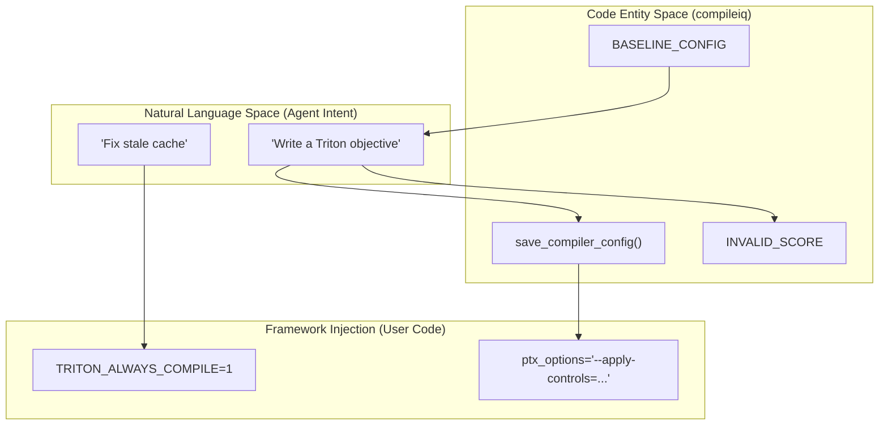
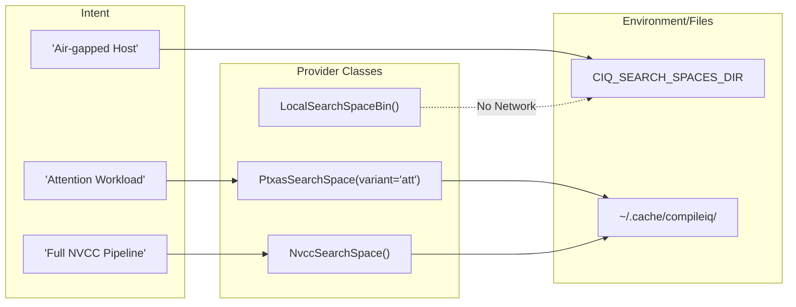

<!-- source: DeepWiki mcp.deepwiki.com · repo NVIDIA/CompileIQ · page 7 Agent Skills · fetched 2026-10-26 -->

# Agent Skills

Relevant source files

The following files were used as context for generating this wiki page:

- [AGENTS.md](AGENTS.md)
- [agent-skills/MANIFEST.md](agent-skills/MANIFEST.md)
- [agent-skills/README.md](agent-skills/README.md)
- [agent-skills/compileiq-author-objective/SKILL.md](agent-skills/compileiq-author-objective/SKILL.md)
- [agent-skills/compileiq-author-objective/references/templates.md](agent-skills/compileiq-author-objective/references/templates.md)
- [agent-skills/compileiq-booster-pack/SKILL.md](agent-skills/compileiq-booster-pack/SKILL.md)
- [agent-skills/compileiq-booster-pack/scripts/apply_one_acf.sh](agent-skills/compileiq-booster-pack/scripts/apply_one_acf.sh)
- [agent-skills/compileiq-bootstrap/SKILL.md](agent-skills/compileiq-bootstrap/SKILL.md)
- [agent-skills/compileiq-bootstrap/scripts/check_env.sh](agent-skills/compileiq-bootstrap/scripts/check_env.sh)
- [agent-skills/compileiq-debug/SKILL.md](agent-skills/compileiq-debug/SKILL.md)
- [agent-skills/compileiq-debug/scripts/diagnose_csv.py](agent-skills/compileiq-debug/scripts/diagnose_csv.py)
- [agent-skills/compileiq-run-search/SKILL.md](agent-skills/compileiq-run-search/SKILL.md)
- [agent-skills/compileiq-search-space/SKILL.md](agent-skills/compileiq-search-space/SKILL.md)
- [agent-skills/install.sh](agent-skills/install.sh)

The `agent-skills/` directory provides an agent-agnostic toolset for driving CompileIQ optimization campaigns using AI coding agents (e.g., Claude Code, Cursor, GitHub Copilot). These skills follow the [SKILL.md convention](https://agentskills.io) and allow agents to perform environment validation, apply pre-built optimizations, and author search objectives without manual developer intervention.

## System Overview

CompileIQ ships with seven distinct skills that cover the end-to-end optimization lifecycle. These skills bridge the "Natural Language Space" of agent instructions to the "Code Entity Space" of the CompileIQ Python API and CLI tools.

### Skill Workflow Order
For a fresh project, the recommended workflow follows this sequence:
1.  **Bootstrap**: Verify the environment and CUDA toolkit.
2.  **Booster Pack**: Try curated optimizations before running a full search.
3.  **Author Objective**: (If no pack helps) Write the search objective function.
4.  **Run Search**: Execute the generational optimization loop.
5.  **Validate Result**: Perform statistical verification of speedups.

**Sources:** [AGENTS.md:106-123](), [agent-skills/README.md:12-29]()

## Installation and Cross-Agent Support

The `agent-skills/install.sh` script acts as a cross-agent mounter. It detects the presence of supported agents and installs the skills using the appropriate method (symlinks, file copies, or config edits) for each.

### Supported Agents and Methods
| Agent | Installation Method | Target Location |
| :--- | :--- | :--- |
| **Claude Code** | Symlink | `.claude/skills/<skill>/` |
| **Cursor** | Rendered `.mdc` | `.cursor/rules/<skill>.mdc` |
| **Copilot** | Rendered instructions | `.github/instructions/<skill>.instructions.md` |
| **Windsurf** | Symlink | `.windsurf/rules/<skill>.md` |
| **Aider** | Config Edit | `.aider.conf.yml` |

For details on the installation process and the `MANIFEST.md` version index, see **[Skill Catalog & Installation](#7.1)**.

**Sources:** [agent-skills/README.md:31-60](), [agent-skills/install.sh:1-50]()

## The Skill Catalog

The following table summarizes the primary purpose of each skill. Each skill is backed by a `SKILL.md` file containing trigger words and detailed instructions for the agent.

| Skill | Purpose | Key Code Entities / Tools |
| :--- | :--- | :--- |
| `bootstrap` | Env validation | `check_env.sh`, `PtxasSearchSpace.retrieve()` |
| `booster-pack` | Pre-built ACFs | `apply_one_acf.sh`, `booster-pack-catalog.json` |
| `search-space` | Space selection | `PtxasSearchSpace`, `NvccSearchSpace`, `att` variant |
| `author-objective` | Logic definition | `save_compiler_config`, `INVALID_SCORE`, `BASELINE_CONFIG` |
| `run-search` | Execution | `Search.start()`, `SearchConfiguration`, `smoke_search.py` |
| `validate-result` | Verification | `welch_validate.py`, `SearchResult.get_best_result()` |
| `debug` | Troubleshooting | `diagnose_csv.py`, `CIQ_SOCKET_TIMEOUT` |

For deep dives into each skill's frontmatter and usage, see **[Skill Catalog & Installation](#7.1)**.

**Sources:** [AGENTS.md:110-118](), [agent-skills/MANIFEST.md:6-14]()

## Mapping Agent Intent to Code Entities

The following diagrams illustrate how agent-facing concepts map to the underlying CompileIQ codebase.

### Objective Function Injection Path
This diagram shows how the `compileiq-author-objective` skill guides an agent to bridge framework-specific code with CompileIQ's ACF application mechanism.

**Sources:** [agent-skills/compileiq-author-objective/SKILL.md:58-114](), [agent-skills/compileiq-author-objective/references/templates.md:86-116]()

### Search Space Resolution Path
This diagram shows how the `compileiq-search-space` skill maps user workload descriptions to specific search space providers.

**Sources:** [agent-skills/compileiq-search-space/SKILL.md:44-88](), [agent-skills/compileiq-bootstrap/SKILL.md:98-107]()

## Validation & Debugging Scripts

CompileIQ bundles several specialized scripts within the `agent-skills/` subdirectories to assist agents in diagnosing failures and verifying performance gains.

- **`check_env.sh`**: Validates CUDA 13.3+, GPU visibility, and library imports [agent-skills/compileiq-bootstrap/scripts/check_env.sh:34-87]().
- **`welch_validate.py`**: Uses Welch's t-test and Cohen's d to ensure speedups are statistically significant [agent-skills/MANIFEST.md:23]().
- **`diagnose_csv.py`**: Analyzes `dump_results` CSVs for pathologies like `STALLED_CONVERGENCE` or `HIGH_VARIANCE` [agent-skills/compileiq-debug/scripts/diagnose_csv.py:8-12]().
- **`apply_one_acf.sh`**: A controlled wrapper for applying a single ACF and logging the result to `booster-pack-log.csv` [agent-skills/compileiq-booster-pack/scripts/apply_one_acf.sh:122-129]().

For detailed script usage and exit codes, see **[Validation & Debugging Scripts](#7.2)**.

**Sources:** [agent-skills/MANIFEST.md:17-24](), [agent-skills/README.md:90-93]()

---

