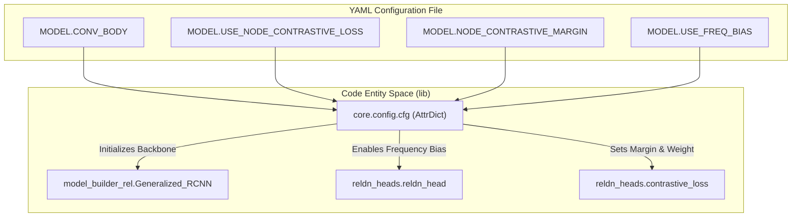
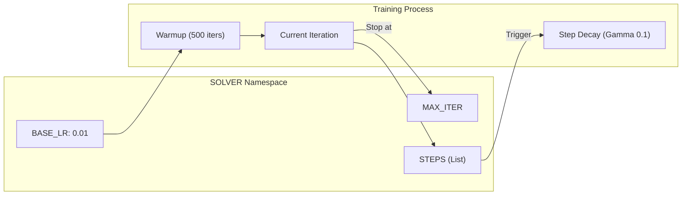

<!-- source: DeepWiki mcp.deepwiki.com · repo NVIDIA/ContrastiveLosses4VRD · page 3.2 Per-Dataset YAML Configuration Files · fetched 2026-10-26 -->

# Per-Dataset YAML Configuration Files

Relevant source files

The following files were used as context for generating this wiki page:

- [configs/oi_rel/e2e_faster_rcnn_X-101-64x4d-FPN_12_epochs_oi_rel_default_node_contrastive_loss_w_so_p_aware_margin_point2_so_weight_point5.yaml](configs/oi_rel/e2e_faster_rcnn_X-101-64x4d-FPN_12_epochs_oi_rel_default_node_contrastive_loss_w_so_p_aware_margin_point2_so_weight_point5.yaml)
- [configs/oi_rel_mini/e2e_faster_rcnn_X-101-64x4d-FPN_12_epochs_oi_rel_mini_default_node_contrastive_loss_w_so_p_aware_margin_point2_so_weight_point5.yaml](configs/oi_rel_mini/e2e_faster_rcnn_X-101-64x4d-FPN_12_epochs_oi_rel_mini_default_node_contrastive_loss_w_so_p_aware_margin_point2_so_weight_point5.yaml)
- [configs/vg/e2e_faster_rcnn_X-101-64x4d-FPN_8_epochs_vg_v3_default_node_contrastive_loss_w_so_p_aware_margin_point2_so_weight_point5.yaml](configs/vg/e2e_faster_rcnn_X-101-64x4d-FPN_8_epochs_vg_v3_default_node_contrastive_loss_w_so_p_aware_margin_point2_so_weight_point5.yaml)
- [configs/vrd/e2e_faster_rcnn_VGG16_16_epochs_vrd_v3_default_node_contrastive_loss_w_so_p_aware_margin_point2_so_weight_point5_IN_pretrained.yaml](configs/vrd/e2e_faster_rcnn_VGG16_16_epochs_vrd_v3_default_node_contrastive_loss_w_so_p_aware_margin_point2_so_weight_point5_IN_pretrained.yaml)

This page details the configuration structure and hyperparameter selections for the three primary datasets supported by ContrastiveLosses4VRD: **VRD**, **Visual Genome (VG)**, and **OpenImages (OI)**. The repository utilizes YAML files to define model architectures, contrastive loss parameters, and solver schedules tailored to the specific scale and characteristics of each dataset.

## Overview of Configuration Structure

The configuration system follows a hierarchical structure where dataset-specific YAML files override global defaults. All relationship detection configs share a common `MODEL.SUBTYPE: 3` designation, which identifies them as relationship-aware models within the `generalized_rcnn` framework [configs/vrd/e2e_faster_rcnn_VGG16_16_epochs_vrd_v3_default_node_contrastive_loss_w_so_p_aware_margin_point2_so_weight_point5_IN_pretrained.yaml:2-3]().

### Configuration Logic Flow
The following diagram illustrates how YAML parameters map to the internal `AttrDict` and eventually influence the relationship detection components.

**Title: Configuration to Model Entity Mapping**

**Sources:** [configs/vrd/e2e_faster_rcnn_VGG16_16_epochs_vrd_v3_default_node_contrastive_loss_w_so_p_aware_margin_point2_so_weight_point5_IN_pretrained.yaml:1-20](), [configs/oi_rel/e2e_faster_rcnn_X-101-64x4d-FPN_12_epochs_oi_rel_default_node_contrastive_loss_w_so_p_aware_margin_point2_so_weight_point5.yaml:1-21]()

---

## Dataset-Specific Backbone Selection

The choice of backbone varies significantly based on the dataset size and the complexity of the relationship categories.

| Dataset | Backbone Architecture | Configuration File Entry |
| :--- | :--- | :--- |
| **VRD** | VGG16 | `MODEL.CONV_BODY: VGG16.VGG16_conv_body` [configs/vrd/..._vrd_v3_...yaml:11]() |
| **Visual Genome** | ResNeXt-101-64x4d-FPN | `MODEL.CONV_BODY: FPN.fpn_ResNet101_conv5_body` [configs/vg/..._vg_v3_...yaml:11]() |
| **OpenImages** | ResNeXt-101-64x4d-FPN | `MODEL.CONV_BODY: FPN.fpn_ResNet101_conv5_body` [configs/oi_rel/..._oi_rel_...yaml:11]() |

### VGG16 (VRD)
For the smaller VRD dataset, a VGG16 backbone is used. It specifies `ROI_BOX_HEAD: VGG16.VGG16_roi_conv5_head` [configs/vrd/..._vrd_v3_...yaml:34]() and relies on standard RPN sizes `(32, 64, 128, 256, 512)` [configs/vrd/..._vrd_v3_...yaml:37]().

### ResNeXt-101-FPN (VG and OI)
Larger datasets utilize Feature Pyramid Networks (FPN) and ResNeXt-101. These configs enable `FPN.FPN_ON: True` and `FPN.MULTILEVEL_ROIS: True` [configs/oi_rel/..._oi_rel_...yaml:32-33](). They also configure specific ResNeXt parameters such as `NUM_GROUPS: 64` and `WIDTH_PER_GROUP: 4` [configs/vg/..._vg_v3_...yaml:40-41]().

**Sources:** [configs/vrd/e2e_faster_rcnn_VGG16_16_epochs_vrd_v3_default_node_contrastive_loss_w_so_p_aware_margin_point2_so_weight_point5_IN_pretrained.yaml:11-37](), [configs/oi_rel/e2e_faster_rcnn_X-101-64x4d-FPN_12_epochs_oi_rel_default_node_contrastive_loss_w_so_p_aware_margin_point2_so_weight_point5.yaml:11-41]()

---

## Contrastive Loss Hyperparameters

The core contribution of this repository is the Node Contrastive Loss. Across all datasets, the default configuration employs a triple-loss strategy (SPO-agnostic, SO-aware, and P-aware).

### Margin and Weight Settings
The standard settings used in the provided YAML files are:
*   **Base Margin**: `NODE_CONTRASTIVE_MARGIN: 0.2` [configs/vg/..._vg_v3_...yaml:13]()
*   **SO-Aware**: Margin `0.2`, Weight `0.5` [configs/oi_rel/..._oi_rel_...yaml:15-16]()
*   **P-Aware**: Margin `0.2`, Weight `0.1` [configs/vrd/..._vrd_v3_...yaml:18-19]()
*   **Sample Size**: `NODE_SAMPLE_SIZE: 128` pairs per image [configs/oi_rel/..._oi_rel_...yaml:20]()

### Relationship Scoring Flags
All configs enable the following to improve relationship disambiguation:
*   `USE_FREQ_BIAS: True`: Incorporates statistical predicate frequency [configs/vg/..._vg_v3_...yaml:5]().
*   `USE_SPATIAL_FEAT: True`: Includes relative geometry between subject and object [configs/oi_rel/..._oi_rel_...yaml:7]().
*   `ADD_SO_SCORES: True`: Adds subject/object classification scores to the relationship score [configs/vrd/..._vrd_v3_...yaml:8]().

**Sources:** [configs/vrd/e2e_faster_rcnn_VGG16_16_epochs_vrd_v3_default_node_contrastive_loss_w_so_p_aware_margin_point2_so_weight_point5_IN_pretrained.yaml:5-20](), [configs/vg/e2e_faster_rcnn_X-101-64x4d-FPN_8_epochs_vg_v3_default_node_contrastive_loss_w_so_p_aware_margin_point2_so_weight_point5.yaml:5-20]()

---

## Solver Schedules and Iterations

The solver configurations are tuned to the image count of each dataset to achieve the specified number of epochs.

**Title: Solver Data Flow and Schedule Components**

### Dataset Comparison Table

| Dataset | Images | Max Iterations | Step Schedule (Iterations) | Epochs |
| :--- | :--- | :--- | :--- | :--- |
| **VRD** | ~4,000 | 7,560 | `[0, 5040, 6720]` | 16 |
| **VG** | 62,723 | 62,723 | `[0, 41815, 55754]` | 8 |
| **OpenImages** | 53,953 | 80,930 | `[0, 53954, 71937]` | 12 |
| **OI Mini** | 4,500 | 6,750 | `[0, 4500, 6000]` | 12 |

*Note: `MAX_ITER` calculation typically follows `(Num_Images * Epochs) / Num_GPUs`. All configs assume `NUM_GPUS: 8` [configs/oi_rel/..._oi_rel_...yaml:22, 29]().*

**Sources:** [configs/vrd/e2e_faster_rcnn_VGG16_16_epochs_vrd_v3_default_node_contrastive_loss_w_so_p_aware_margin_point2_so_weight_point5_IN_pretrained.yaml:22-29](), [configs/vg/e2e_faster_rcnn_X-101-64x4d-FPN_8_epochs_vg_v3_default_node_contrastive_loss_w_so_p_aware_margin_point2_so_weight_point5.yaml:22-30](), [configs/oi_rel/e2e_faster_rcnn_X-101-64x4d-FPN_12_epochs_oi_rel_default_node_contrastive_loss_w_so_p_aware_margin_point2_so_weight_point5.yaml:22-30](), [configs/oi_rel_mini/e2e_faster_rcnn_X-101-64x4d-FPN_12_epochs_oi_rel_mini_default_node_contrastive_loss_w_so_p_aware_margin_point2_so_weight_point5.yaml:29-30]()

---

## Inference and Evaluation Settings

Testing parameters ensure consistency with the evaluation metrics (Recall@K).

*   **Multi-Level RPN**: For FPN models, `RPN_PRE_NMS_TOP_N` is set to `2000` during training and `1000` during test per level [configs/oi_rel/..._oi_rel_...yaml:52, 60]().
*   **Predicate K**: OpenImages and VRD configs specify `PRD_Ks: (1, 10)`, meaning evaluation is performed considering the top 1 and top 10 predicate predictions per object pair [configs/oi_rel/..._oi_rel_...yaml:62]().
*   **Force JSON Eval**: All configs set `FORCE_JSON_DATASET_EVAL: True` to use the COCO-style JSON evaluation pipeline [configs/vg/..._vg_v3_...yaml:54]().

**Sources:** [configs/oi_rel/e2e_faster_rcnn_X-101-64x4d-FPN_12_epochs_oi_rel_default_node_contrastive_loss_w_so_p_aware_margin_point2_so_weight_point5.yaml:52-62](), [configs/vg/e2e_faster_rcnn_X-101-64x4d-FPN_8_epochs_vg_v3_default_node_contrastive_loss_w_so_p_aware_margin_point2_so_weight_point5.yaml:54-58]()

---

