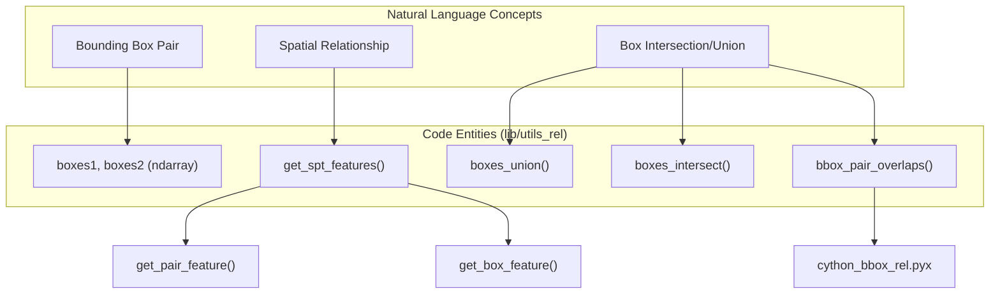
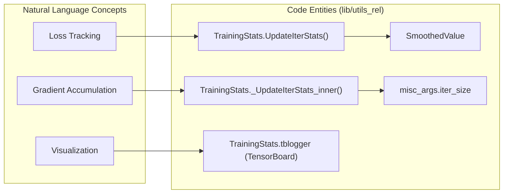

<!-- source: DeepWiki mcp.deepwiki.com · repo NVIDIA/ContrastiveLosses4VRD · page 6 Utility Libraries · fetched 2026-10-26 -->

# Utility Libraries

Relevant source files

The following files were used as context for generating this wiki page:

- [lib/utils_rel/boxes_rel.py](lib/utils_rel/boxes_rel.py)
- [lib/utils_rel/cython_bbox_rel.pyx](lib/utils_rel/cython_bbox_rel.pyx)
- [lib/utils_rel/training_stats_rel.py](lib/utils_rel/training_stats_rel.py)

The `lib/utils_rel/` directory contains essential supporting modules that handle geometric computations, training instrumentation, and system-level operations. These utilities bridge the gap between raw data (bounding boxes, image pixels) and the structured inputs required by the relationship detection heads.

### Overview of Utility Modules

The utility suite is divided into two primary categories: geometric/spatial processing and training/logging infrastructure.

| Module | Primary Responsibility | Key Entities |
| :--- | :--- | :--- |
| `boxes_rel.py` | Spatial feature engineering and box math. | `get_spt_features`, `boxes_union` |
| `cython_bbox_rel.pyx` | High-performance IoU and overlap calculations. | `bbox_pair_overlaps` |
| `training_stats_rel.py` | Metric tracking and TensorBoard integration. | `TrainingStats` |
| `logging_rel.py` | Structured console and file logging. | `log_stats`, `SmoothedValue` |
| `net_rel.py` | Model weight initialization and parameter management. | `initialize_gpu_from_weights` |

---

### Geometric and Spatial Utilities

Relationship detection relies heavily on the spatial configuration between subjects and objects. The codebase provides a robust pipeline for converting absolute bounding box coordinates into relative spatial features.

**Spatial Feature Pipeline**
The `get_spt_features` function [lib/utils_rel/boxes_rel.py:65-72]() generates a comprehensive feature vector by concatenating:
1.  **Pairwise Deltas**: Relative scale and translation between the subject and object [lib/utils_rel/boxes_rel.py:75-79]().
2.  **Union Features**: Relative geometry between individual boxes and their union [lib/utils_rel/boxes_rel.py:70-71]().
3.  **Absolute Encoding**: Normalized coordinates relative to image dimensions [lib/utils_rel/boxes_rel.py:82-88]().

For performance-critical operations, such as calculating overlaps between hundreds of proposal pairs, the system uses a Cython implementation of `bbox_pair_overlaps` [lib/utils_rel/cython_bbox_rel.pyx:37-77]().

**Natural Language to Code Entity Mapping: Spatial Ops**

**Sources:** [lib/utils_rel/boxes_rel.py:65-132](), [lib/utils_rel/cython_bbox_rel.pyx:37-77]()

For more details on coordinate transformations and spatial feature vectors, see **[Bounding Box and Spatial Feature Utilities](#6.1)**.

---

### Training, Logging, and System Helpers

The training utilities manage the complexities of multi-GPU execution, gradient accumulation, and performance monitoring.

*   **Training Statistics**: The `TrainingStats` class [lib/utils_rel/training_stats_rel.py:40-43]() tracks losses and metrics using a `SmoothedValue` window [lib/utils_rel/training_stats_rel.py:51-56]() to provide stable logging. It explicitly supports `iter_size` > 1, allowing for gradient accumulation across multiple sub-iterations [lib/utils_rel/training_stats_rel.py:109-112]().
*   **Logging**: `logging_rel.py` provides standardized formatting for training progress, including ETA calculations and memory usage tracking [lib/utils_rel/training_stats_rel.py:34-35]().
*   **Network Initialization**: `net_rel.py` assists in loading weights and managing parameter groups, which is critical when the backbone and relationship heads have different learning rates.

**Natural Language to Code Entity Mapping: Training Infrastructure**

**Sources:** [lib/utils_rel/training_stats_rel.py:40-168](), [lib/utils_rel/logging_rel.py:34-35]()

For details on metric tracking and multi-GPU subprocess management, see **[Training Statistics, Logging, and Subprocess Utilities](#6.2)**.

---

