# Page: Overview

# Overview

<details>
<summary>Relevant source files</summary>

The following files were used as context for generating this wiki page:

- [Examples.PNG](Examples.PNG)
- [Loss_illustration.PNG](Loss_illustration.PNG)
- [README.md](README.md)
- [tools/convert_vrd_anno_to_coco_format.py](tools/convert_vrd_anno_to_coco_format.py)

</details>


The **ContrastiveLosses4VRD** repository provides a PyTorch implementation for **Graphical Contrastive Losses for Scene Graph Parsing** (CVPR 2019). This codebase is an evolution of the system that secured 1st place in the Google AI Open Images Visual Relationship Detection Challenge [README.md:1-9]().

The primary objective of this project is to improve the discriminative power of relationship detection models (RelDN) by applying contrastive losses that resolve ambiguities between visually similar predicates and relationship triplets [README.md:6-7]().

### System Purpose and Key Results
The repository enables training and evaluation of Scene Graph Generation (SGG) models, which detect objects and the semantic relationships between them (e.g., "person-ride-bike"). 

| Dataset | Backbone | SGDET@50 | SGDET@100 |
| :--- | :---: | :---: | :---: |
| Visual Genome | VGG16 | 28.1 | 32.5 |
| Visual Genome (Full) | ResNext-101-FPN | 31.0 | 36.7 |

*Source: [README.md:14-23]()*

---

### RelDN Architecture
The core architecture, referred to as **RelDN**, extends standard object detection frameworks. It processes images through a backbone to propose object regions and then evaluates pairs of these regions to predict relationship predicates.

#### Relationship Detection Pipeline
The following diagram maps the logical flow of relationship detection to the specific code entities responsible for each stage.

**Diagram: Logical Pipeline to Code Entities**
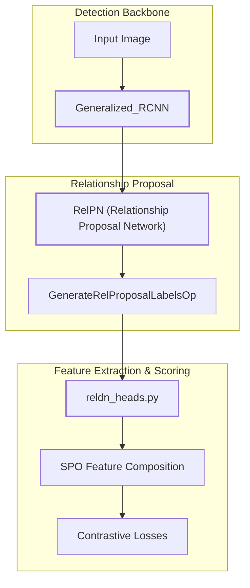
*Sources: [README.md:25](), [tools/convert_vrd_anno_to_coco_format.py:15-20]()*

---

### Supported Datasets
The repository supports three major datasets for Visual Relationship Detection (VRD). Each requires specific preprocessing to align with the COCO-style annotation format used by the dataloader.

1.  **OpenImages**: A large-scale dataset. The repository includes a "mini" version for faster iteration [README.md:99-100]().
2.  **Visual Genome (VG)**: The standard benchmark for scene graph parsing [README.md:102-103]().
3.  **Visual Relation Detection (VRD)**: The original benchmark dataset. It requires conversion scripts to transform [ymin, ymax, xmin, xmax] coordinates into the [x, y, w, h] format [README.md:105-108](), [tools/convert_vrd_anno_to_coco_format.py:15-20]().

For detailed instructions on preparing these datasets, see **[Datasets and Data Preparation](#1.2)**.

---

### Repository Organization
The codebase is structured into core libraries for modeling, data handling, and utility functions.

**Diagram: Repository Structure and Key Files**
```mermaid
graph DIR
    root["ContrastiveLosses4VRD/"]
    root --> lib["lib/ (Core Logic)"]
    root --> tools["tools/ (Scripts)"]
    root --> configs["configs/ (YAML)"]
    
    lib --> core["core/config.py (Global Settings)"]
    lib --> modeling["modeling/reldn_heads.py (Losses & Heads)"]
    lib --> datasets["datasets/dataset_catalog_rel.py"]
    
    tools --> train["train_net_step_rel.py"]
    tools --> test["test_net_rel.py"]
```
*Sources: [README.md:80-87](), [README.md:97-98]()*

---

### Next Steps

To begin using the repository, refer to the following child pages:

*   **[Getting Started: Installation and Setup](#1.1)**: Covers environment setup using Docker or Anaconda, and the compilation of CUDA kernels in `lib/make.sh`.
*   **[Datasets and Data Preparation](#1.2)**: Provides download links and explains how to use scripts like `convert_vrd_anno_to_coco_format.py` to prepare your data.

Sources:
- [README.md:1-144]()
- [tools/convert_vrd_anno_to_coco_format.py:1-82]()

---

# Page: Getting Started: Installation and Setup

# Getting Started: Installation and Setup

<details>
<summary>Relevant source files</summary>

The following files were used as context for generating this wiki page:

- [.gitmodules](.gitmodules)
- [docker/Dockerfile](docker/Dockerfile)
- [lib/make.sh](lib/make.sh)
- [lib/setup.py](lib/setup.py)
- [tools/_init_paths.py](tools/_init_paths.py)

</details>


This page provides a technical guide for setting up the `ContrastiveLosses4VRD` environment. The project is built upon a modified version of `Detectron.pytorch` and requires specific CUDA-accelerated kernels and directory structures to function correctly.

## Environment Configuration

The project utilizes a Docker-based environment to manage dependencies, specifically targeting older versions of PyTorch and CUDA that are compatible with the underlying Detectron implementation.

### Docker Environment
The system is designed to run within a container based on the `pytorch/pytorch:0.4-cuda9-cudnn7-devel` image [docker/Dockerfile:1-1](). This specific environment ensures compatibility with the required CUDA kernels and Python libraries.

**Key Dependencies installed via Docker:**
*   **System Libraries:** `libsm6`, `libxext6`, `libxrender1` (required for OpenCV) [docker/Dockerfile:4-4]().
*   **Python Packages:** `Cython`, `pyyaml`, `tensorboardX`, `scikit-image`, `gensim`, and `pycocotools` [docker/Dockerfile:6-7]().
*   **Conda Packages:** `opencv` [docker/Dockerfile:8-8]().

### Repository Initialization
The project relies on a specific fork of Detectron as a Git submodule. After cloning the main repository, you must initialize the submodule to populate the `Detectron_pytorch` directory.

```bash
git submodule update --init --recursive
```
The submodule configuration maps the remote repository to the local `Detectron_pytorch` path [ .gitmodules:1-3]().

### Sources:
- [docker/Dockerfile:1-8]()
- [.gitmodules:1-3]()

---

## Compilation and Build Process

The project includes custom Cython and CUDA implementations for performance-critical operations, such as bounding box overlap calculations. These must be compiled before the library can be used.

### CUDA and Cython Compilation
The `lib/make.sh` script automates the build process. It assumes a standard CUDA installation path at `/usr/local/cuda/` [lib/make.sh:4-4]().

The script executes `lib/setup.py`, which performs the following:
1.  **Numpy Integration:** Retrieves the local NumPy include directory to facilitate C-API calls [lib/setup.py:23-26]().
2.  **Cython Extension:** Compiles `utils_rel/cython_bbox_rel.pyx` into a shared object file named `utils_rel.cython_bbox_rel` [lib/setup.py:30-36]().
3.  **In-place Build:** The `--inplace` flag ensures the compiled `.so` files are moved into the source tree, allowing them to be imported directly by Python [lib/make.sh:6-6]().

### Execution Flow: Compilation
The following diagram illustrates how the build script interacts with the project structure to generate the required binaries.

**Figure 1: Compilation Pipeline**
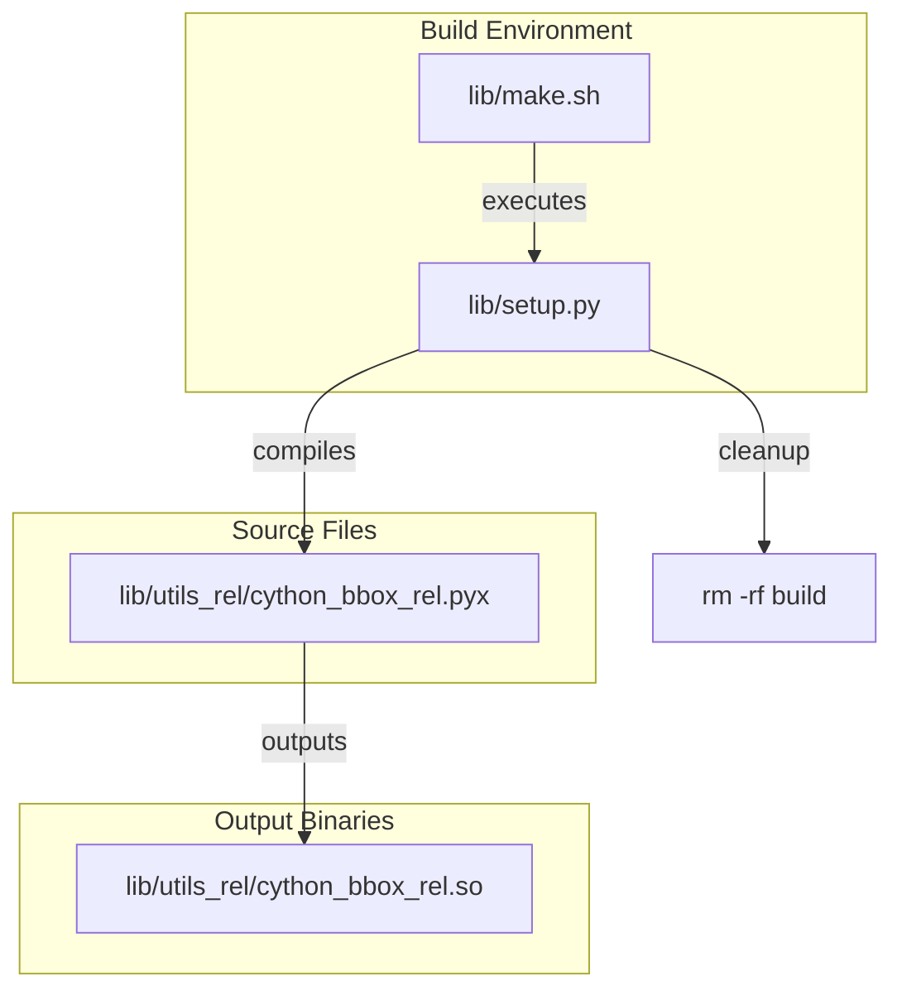

### Sources:
- [lib/make.sh:1-8]()
- [lib/setup.py:12-41]()

---

## Python Path Configuration

To ensure that the main library and the Detectron submodule are discoverable by the Python interpreter, the project uses a path initialization shim.

### `_init_paths.py`
The script `tools/_init_paths.py` must be imported at the beginning of any execution script (e.g., training or testing). It dynamically modifies `sys.path` to include:
1.  **Detectron Library:** Adds `{PROJECT_ROOT}/Detectron_pytorch/lib` [tools/_init_paths.py:24-25]().
2.  **Project Library:** Adds `{PROJECT_ROOT}/lib` [tools/_init_paths.py:28-29]().

This mechanism allows the code to use absolute imports such as `from core.config import cfg` without requiring the packages to be installed in the global site-packages [tools/_init_paths.py:9-11]().

### Sources:
- [tools/_init_paths.py:1-30]()

---

## Dataset Directory Layout

The codebase expects datasets to be organized in a specific structure, typically symlinked into the project root. The `JsonDatasetRel` class and the dataset catalog rely on these paths to locate annotations and image files.

### Recommended Structure
The following diagram maps the expected data flow from the filesystem into the internal `lib` entities.

**Figure 2: Data Flow and Directory Mapping**
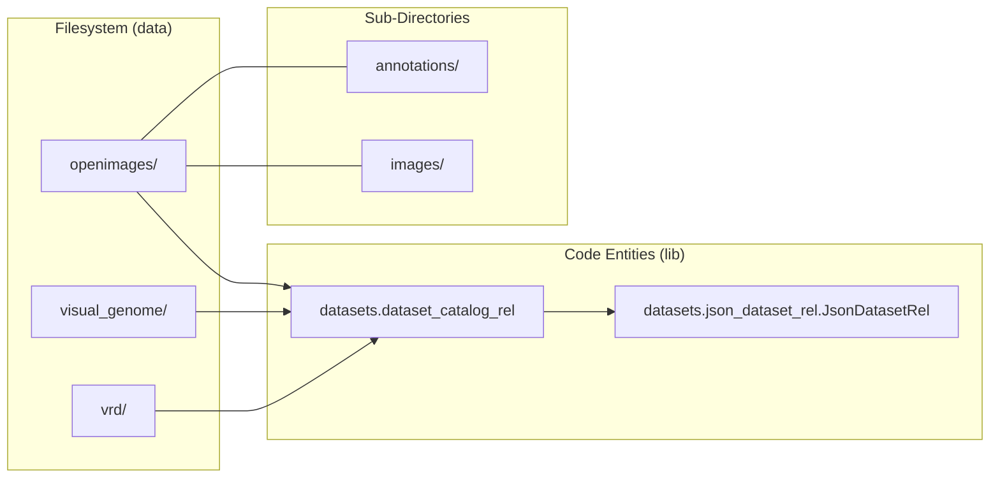

### Path Resolution Logic
The system uses `osp.abspath` and `osp.dirname` relative to the script location to resolve the project root [tools/_init_paths.py:21-21](). This allows the codebase to remain portable across different machine environments as long as the internal folder structure is maintained.

### Sources:
- [tools/_init_paths.py:21-29]()
- [lib/setup.py:31-32]()

---

# Page: Datasets and Data Preparation

# Datasets and Data Preparation

<details>
<summary>Relevant source files</summary>

The following files were used as context for generating this wiki page:

- [README.md](README.md)
- [lib/datasets_rel/dataset_catalog_rel.py](lib/datasets_rel/dataset_catalog_rel.py)
- [lib/datasets_rel/json_dataset_rel.py](lib/datasets_rel/json_dataset_rel.py)
- [tools/convert_vrd_anno_to_coco_format.py](tools/convert_vrd_anno_to_coco_format.py)
- [vg_vis_rels.ipynb](vg_vis_rels.ipynb)

</details>


This page provides a technical overview of the three datasets supported by the ContrastiveLosses4VRD framework: **OpenImages**, **Visual Genome (VG)**, and **Visual Relationship Detection (VRD)**. It details the annotation formats, the directory structures required by the configuration system, and the preprocessing scripts used to harmonize these datasets into a COCO-style layout for the relationship detection task.

## Dataset Overview

The repository supports three primary benchmarks for Visual Relationship Detection. Each dataset is managed via a registry in `lib/datasets_rel/dataset_catalog_rel.py` and loaded through the `JsonDatasetRel` class.

| Dataset | Object Classes | Predicate Classes | Purpose |
| :--- | :---: | :---: | :--- |
| **OpenImages v4** | 57 | 9 | Large-scale challenge dataset; includes a "mini" subset for debugging. |
| **Visual Genome** | 150 | 50 | Standard benchmark for scene graph generation with dense annotations. |
| **VRD** | 100 | 70 | Classic relationship dataset; requires specific preprocessing for COCO compatibility. |

**Sources:** [README.md:99-108](), [lib/datasets_rel/dataset_catalog_rel.py:45-140]()

---

## Data Directory Structure

By default, the system expects a `data` folder at the root of the repository. This path is controlled by `cfg.DATA_DIR` in the global configuration.

```text
data/
├── openimages_v4/
│   ├── train/                  # All images (train + val split)
│   └── rel/                    # .json annotations
├── vg/
│   ├── VG_100K/                # 108,249 images
│   ├── detections_train.json   # COCO-format object detections
│   ├── rel_annotations_train.json # Relationship triplets
│   └── predicates.json         # Predicate category list
└── vrd/
    ├── train_images/           # Renamed .jpg images
    ├── val_images/
    ├── detections_train.json   # Generated COCO-format objects
    └── new_annotations_train.json # Relationship triplets
```

**Sources:** [README.md:91-135](), [lib/datasets_rel/dataset_catalog_rel.py:31-140]()

---

## Annotation Formats and Logic Flow

The framework utilizes a "dual-annotation" strategy. For every dataset, the `JsonDatasetRel` class requires three distinct annotation files defined in the `DATASETS` catalog:
1.  `ANN_FN`: Standard COCO-style JSON containing object instances (`images`, `annotations`, `categories`).
2.  `ANN_FN2`: Relationship-specific JSON containing triplets (Subject, Object, Predicate).
3.  `ANN_FN3`: A list of predicate category names.

### Data Flow: From Files to Roidb
The following diagram illustrates how the `JsonDatasetRel` class parses these disparate files into a unified `roidb` (Region of Interest Database) used by the training and inference pipelines.

**Relationship Data Loading Pipeline**
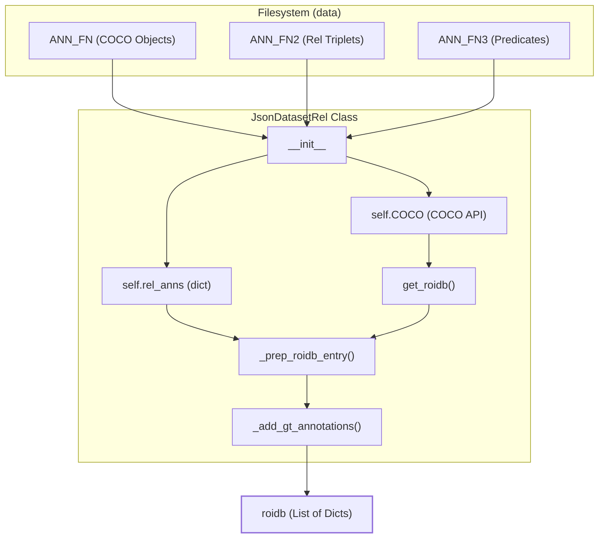
**Sources:** [lib/datasets_rel/json_dataset_rel.py:60-103](), [lib/datasets_rel/json_dataset_rel.py:128-176](), [lib/datasets_rel/dataset_catalog_rel.py:34-37]()

---

## Dataset-Specific Preparation

### 1. OpenImages v4
OpenImages annotations are converted from the original `.csv` format to `.json`. The repository provides a "mini" version (4,500 train / 1,000 test images) to facilitate faster iteration.
*   **Images:** All training images should be placed in `data/openimages_v4/train`.
*   **Annotations:** Downloaded JSONs include `detections_train.json` and `rel_only_annotations_train.json`.

**Sources:** [README.md:99-101](), [lib/datasets_rel/dataset_catalog_rel.py:47-86]()

### 2. Visual Genome (VG)
The implementation uses the standard VG split (150 object classes, 50 predicates). 
*   **Preprocessing:** The annotations provided in the download link are already pre-formatted for the `JsonDatasetRel` loader.
*   **Structure:** Images must be placed in a single directory `VG_100K`.

**Sources:** [README.md:102-103](), [vg_vis_rels.ipynb:77-82]()

### 3. VRD (Visual Relationship Detection)
The VRD dataset requires the most extensive preprocessing to convert it from its native format to the COCO-compatible format expected by the codebase.

**VRD Preprocessing Workflow**
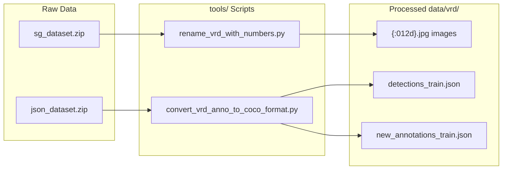

#### Key Preprocessing Functions:
*   `rename_vrd_with_numbers.py`: Standardizes image filenames to 12-digit integers (e.g., `000000000001.jpg`) and converts non-JPG formats (PNG/GIF) to JPG. This ensures compatibility with the integer-based `image_id` indexing in the COCO API. [README.md:139-142]()
*   `box_transform(box)`: In `tools/convert_vrd_anno_to_coco_format.py`, this function converts VRD's `[ymin, ymax, xmin, xmax]` format into the COCO `[x, y, w, h]` format. [tools/convert_vrd_anno_to_coco_format.py:15-20]()
*   `convert_anno(split)`: This function iterates through relationship annotations, extracts unique object bounding boxes to build the `detections_{split}.json` file, and maps them to relationship triplets. [tools/convert_vrd_anno_to_coco_format.py:24-76]()

**Sources:** [README.md:135-144](), [tools/convert_vrd_anno_to_coco_format.py:15-81]()

---

## The `roidb` Structure
The end result of data preparation is the `roidb` list. Each entry in the `roidb` represents one image and contains:

| Key | Description |
| :--- | :--- |
| `boxes` | `(N, 4)` ndarray of all object boxes. |
| `gt_classes` | `(N,)` ndarray of object class IDs. |
| `sbj_gt_boxes` | `(M, 4)` ndarray of subject boxes in M relationships. |
| `obj_gt_boxes` | `(M, 4)` ndarray of object boxes in M relationships. |
| `prd_gt_classes` | `(M,)` ndarray of predicate labels for the triplets. |
| `pair_to_gt_ind_map` | Maps relationship pairs to their ground truth indices. |

**Sources:** [lib/datasets_rel/json_dataset_rel.py:119-126](), [lib/datasets_rel/json_dataset_rel.py:204-235]()

---

# Page: Core Architecture

# Core Architecture

<details>
<summary>Relevant source files</summary>

The following files were used as context for generating this wiki page:

- [lib/modeling_rel/model_builder_rel.py](lib/modeling_rel/model_builder_rel.py)
- [lib/modeling_rel/reldn_heads.py](lib/modeling_rel/reldn_heads.py)
- [lib/modeling_rel/relpn_heads.py](lib/modeling_rel/relpn_heads.py)

</details>


The RelDN (Relationship Detection Network) architecture is designed for Visual Relationship Detection (VRD) by extending the standard Faster R-CNN framework with relationship-specific components. It treats relationship detection as a dual-branch task: one branch for object detection and another for predicate classification between object pairs.

The architecture is implemented in `Generalized_RCNN` within [lib/modeling_rel/model_builder_rel.py:78-138](), which orchestrates the interaction between the backbone, the Relationship Proposal Network (RelPN), and the RelDN heads.

### System Overview

The following diagram illustrates the high-level data flow and the association between logical components and their implementation classes.

**RelDN High-Level Pipeline**
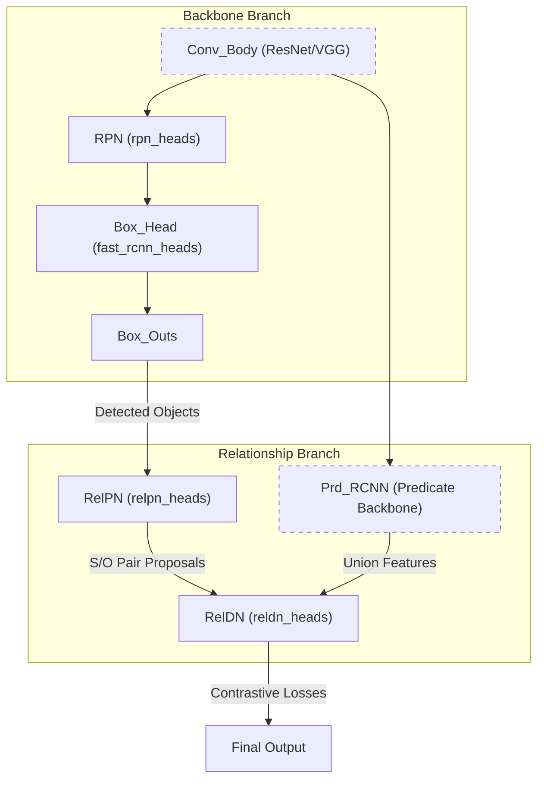
**Sources:** [lib/modeling_rel/model_builder_rel.py:87-127]()

---

### Major Subsystems

#### 1. Model Builder and Generalized RCNN
The `Generalized_RCNN` class is the central entry point. Unlike standard R-CNNs, it maintains a `Prd_RCNN` attribute [lib/modeling_rel/model_builder_rel.py:114](), which is a deep copy of the backbone used specifically for extracting features from the union regions of subject-object pairs. It also manages complex weight loading for different datasets (OpenImages, VG, VRD) and initializes subject (`S_Head`) and object (`O_Head`) branches if `ADD_SO_SCORES` is enabled [lib/modeling_rel/model_builder_rel.py:131-137]().

For details, see [Model Builder and Generalized RCNN](#2.1).

#### 2. Relationship Proposal Network (RelPN)
The RelPN is responsible for generating candidate subject-object pairs. It takes detected object ROIs and creates a combinatorial set of pairs, which are then filtered.
*   **Self-Pair Removal:** It excludes pairs where the subject and object are the same ROI [lib/modeling_rel/relpn_heads.py:39-46]().
*   **Overlap Filter:** If `USE_OVLP_FILTER` is active, it only retains pairs that have a spatial overlap [lib/modeling_rel/relpn_heads.py:72-82]().
*   **Label Assignment:** During training, `GenerateRelProposalLabelsOp` [lib/modeling_rel/relpn_heads.py:31]() matches these proposals to ground-truth triplets.

For details, see [Relationship Proposal Network (RelPN)](#2.2).

#### 3. RelDN Head and Contrastive Losses
The `reldn_head` [lib/modeling_rel/reldn_heads.py:22]() performs the final predicate classification. It integrates multiple sources of information:
*   **Visual Features:** Extracted from the union box of the subject and object.
*   **Spatial Features:** Encoded geometry (deltas, relative sizes) via `spt_cls_feats` [lib/modeling_rel/reldn_heads.py:53-58]().
*   **Frequency Bias:** A statistical prior of predicate distributions per subject/object category pair [lib/modeling_rel/reldn_heads.py:45-50]().

The architecture is notable for its use of **Contrastive Losses** (SPO-agnostic, SO-aware, and P-aware), which enforce margins between positive and negative relationship samples [lib/modeling_rel/reldn_heads.py:150-180]().

For details, see [RelDN Head and Contrastive Losses](#2.3).

---

### Component Interaction Diagram

This diagram maps specific code entities to the relationship detection flow, showing how `RelPN` and `RelDN` communicate.

**Code Entity Interaction Map**
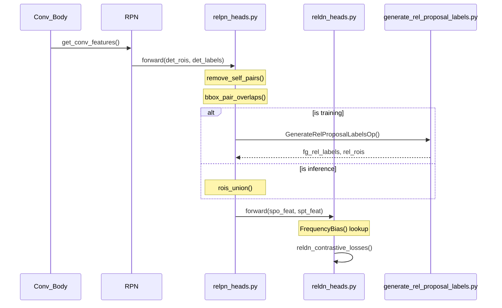
**Sources:** [lib/modeling_rel/relpn_heads.py:48-132](), [lib/modeling_rel/reldn_heads.py:78-136]()

### Architectural Features Table

| Component | Code Reference | Key Responsibility |
| :--- | :--- | :--- |
| **Backbone** | `self.Conv_Body` [87]() | Shared feature extraction for detection and predicates. |
| **Predicate Branch** | `self.Prd_RCNN` [114]() | Dedicated feature path for predicate classification. |
| **Rel Proposal** | `relpn_heads.py` [22]() | Pairwise ROI generation and overlap filtering. |
| **Feature Fusion** | `reldn_heads.py` [94-110]() | Merging visual, spatial, and frequency bias scores. |
| **Contrastive Loss** | `reldn_heads.py` [150]() | Margin-ranking losses for robust relationship ranking. |

**Sources:** [lib/modeling_rel/model_builder_rel.py](), [lib/modeling_rel/reldn_heads.py]()

---

# Page: Model Builder and Generalized RCNN

# Model Builder and Generalized RCNN

<details>
<summary>Relevant source files</summary>

The following files were used as context for generating this wiki page:

- [lib/modeling_rel/VGG16.py](lib/modeling_rel/VGG16.py)
- [lib/modeling_rel/fast_rcnn_heads.py](lib/modeling_rel/fast_rcnn_heads.py)
- [lib/modeling_rel/model_builder_rel.py](lib/modeling_rel/model_builder_rel.py)
- [lib/modeling_rel/rel_pyramid_module.py](lib/modeling_rel/rel_pyramid_module.py)
- [lib/modeling_rel/relpn_heads.py](lib/modeling_rel/relpn_heads.py)

</details>


The `Generalized_RCNN` class, defined in `lib/modeling_rel/model_builder_rel.py`, serves as the top-level meta-architecture for the Visual Relationship Detection (VRD) framework. It extends the standard Detectron-style RCNN by incorporating a dual-branch design: one for object detection and a mirrored branch (`Prd_RCNN`) for predicate/relationship extraction.

### 1. Initialization and Dual-Branch Architecture

The model is initialized by dynamically loading a backbone (e.g., ResNet or VGG) and setting up the detection pipeline. A key feature of this implementation is the creation of the `Prd_RCNN` branch via a deep copy of the main detector, which is then specialized for relationship tasks.

*   **Backbone (`Conv_Body`)**: Extracted using `get_func(cfg.MODEL.CONV_BODY)()` [lib/modeling_rel/model_builder_rel.py:87-88]().
*   **Detection Branch**: Consists of a standard RPN [lib/modeling_rel/model_builder_rel.py:90-92](), `Box_Head` [lib/modeling_rel/model_builder_rel.py:109-110](), and `Box_Outs` [lib/modeling_rel/model_builder_rel.py:111-112]().
*   **Predicate Branch (`Prd_RCNN`)**: Created by copying the detector and removing the object-specific RPN and BBox output layers [lib/modeling_rel/model_builder_rel.py:114-116](). This allows the predicate branch to share the same architecture as the object detector while learning different weights for relationship features.
*   **Subject/Object Heads**: If `cfg.MODEL.ADD_SO_SCORES` is enabled, independent `S_Head` and `O_Head` are created to refine features specifically for the subject and object roles within a triplet [lib/modeling_rel/model_builder_rel.py:131-137]().

#### Data Flow: Natural Language Space to Code Entities
The following diagram illustrates how abstract relationship concepts (Subject-Predicate-Object) map to specific class instances and attributes within the `Generalized_RCNN`.

**Relationship Mapping Diagram**
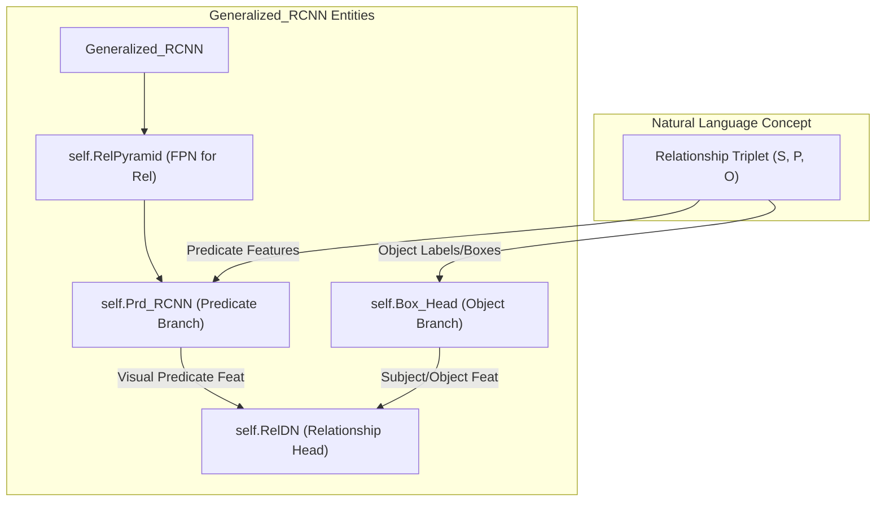
**Sources:** [lib/modeling_rel/model_builder_rel.py:78-128](), [lib/modeling_rel/reldn_heads.py:22-31]()

---

### 2. Relationship Components

Beyond standard detection, the model integrates three specific modules for VRD:

1.  **RelPyramid**: When FPN is enabled, this module creates a lateral connection specifically for relationship features. Unlike the standard FPN which downsamples, the `RelPyramid` processes blobs in the order (P5, P4, P3, P2) and applies max-pooling to propagate features [lib/modeling_rel/rel_pyramid_module.py:23-78]().
2.  **RelPN (Relationship Proposal Network)**: Generates candidate subject-object pairs. It filters self-pairs [lib/modeling_rel/relpn_heads.py:39-46]() and can optionally use an overlap filter (`cfg.MODEL.USE_OVLP_FILTER`) to discard non-overlapping boxes [lib/modeling_rel/relpn_heads.py:72-82]().
3.  **RelDN (Relationship Detection Network)**: The final head that takes concatenated features (Subject + Object + Predicate) and outputs relationship scores [lib/modeling_rel/reldn_heads.py:126]().

---

### 3. Weight Loading and Initialization

The `_init_modules` function handles complex weight loading logic, supporting ImageNet pretraining, detector-only pretraining, and predicate-specific pretraining.

| Weight Type | Config Field | Logic |
| :--- | :--- | :--- |
| **ImageNet** | `RESNETS.IMAGENET_PRETRAINED_WEIGHTS` | Loads standard ResNet weights; freezes `Conv_Body` [lib/modeling_rel/model_builder_rel.py:141-145](). |
| **Detector** | `RESNETS.VRD_PRETRAINED_WEIGHTS` | Loads weights into the main detection branch using `load_detector_weights` [lib/modeling_rel/model_builder_rel.py:147-150](). |
| **Predicate** | `RESNETS.VRD_PRD_PRETRAINED_WEIGHTS` | Loads weights specifically into the `Prd_RCNN` branch [lib/modeling_rel/model_builder_rel.py:165-175](). |

**Sources:** [lib/modeling_rel/model_builder_rel.py:139-204](), [lib/modeling_rel/VGG16.py:23-28]()

---

### 4. Forward Pass Pipeline

The forward pass is divided into detection and relationship phases.

**Forward Pass Logic Flow**
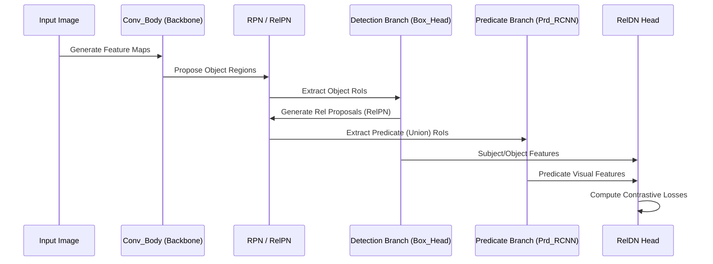

#### Key Execution Steps:
1.  **Feature Extraction**: The image passes through `self.Conv_Body` [lib/modeling_rel/model_builder_rel.py:461]().
2.  **Object Detection**: Standard RPN and Fast R-CNN heads generate object detections [lib/modeling_rel/model_builder_rel.py:464-501]().
3.  **Pair Proposal**: `self.RelPN` takes the detections and identifies candidate pairs, returning a `rel_ret` dictionary containing `sbj_rois`, `obj_rois`, and `rel_rois` (union boxes) [lib/modeling_rel/model_builder_rel.py:532-533]().
4.  **Predicate Feature Extraction**: The union boxes are passed through `self.Prd_RCNN` to extract visual features for the relationship itself [lib/modeling_rel/model_builder_rel.py:553-557]().
5.  **RelDN Scoring**: `self.RelDN` aggregates visual features from the subject, object, and union regions, combines them with spatial features (if enabled), and calculates the final predicate scores [lib/modeling_rel/model_builder_rel.py:586-591]().

**Sources:** [lib/modeling_rel/model_builder_rel.py:452-610](), [lib/modeling_rel/relpn_heads.py:48-132](), [lib/modeling_rel/fast_rcnn_heads.py:106-122]()

---

# Page: Relationship Proposal Network (RelPN)

# Relationship Proposal Network (RelPN)

<details>
<summary>Relevant source files</summary>

The following files were used as context for generating this wiki page:

- [lib/modeling_rel/generate_rel_proposal_labels.py](lib/modeling_rel/generate_rel_proposal_labels.py)
- [lib/modeling_rel/model_builder_rel.py](lib/modeling_rel/model_builder_rel.py)
- [lib/modeling_rel/relpn_heads.py](lib/modeling_rel/relpn_heads.py)

</details>


The Relationship Proposal Network (RelPN) is a critical component of the RelDN architecture responsible for generating candidate subject-object pairs from detected object instances. Unlike standard RPNs that propose individual object boxes, RelPN operates on the combinatorial space of detected objects to form relationship triplets (subject, predicate, object).

## Overview and Purpose

RelPN takes the output of the object detection branch (ROIs, labels, and scores) and constructs a set of relationship candidates. Its primary responsibilities include:
1.  **Pairwise Candidate Generation**: Exhaustively pairing detected objects to form potential relationships.
2.  **Spatial Filtering**: Reducing the proposal space by removing non-overlapping pairs (if configured).
3.  **Label Assignment**: During training, it maps these proposals to ground-truth relationships to generate training signals.
4.  **Feature Preparation**: Constructing union boxes (Relationship ROIs) and calculating spatial features.

### System Architecture Flow

The following diagram illustrates how RelPN bridges the detection backbone with the relationship heads.

**RelPN Data Flow and Code Entities**
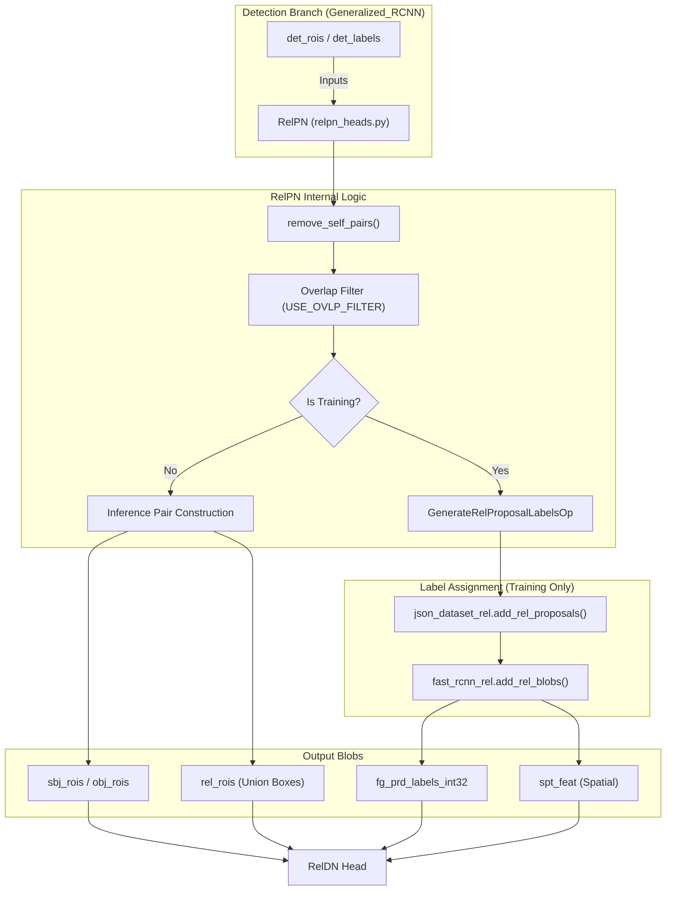
**Sources:** [lib/modeling_rel/relpn_heads.py:48-132](), [lib/modeling_rel/model_builder_rel.py:124-126](), [lib/modeling_rel/generate_rel_proposal_labels.py:15-49]()

---

## Candidate Generation and Filtering

RelPN generates proposals by creating a Cartesian product of all detected ROIs.

### Pairwise Construction
The function `single_scale_relpn_outputs.forward` initializes the indices for subject and object candidates using `np.repeat` and `np.tile` [lib/modeling_rel/relpn_heads.py:60-61](). It then invokes `remove_self_pairs` to ensure an object is not paired with itself [lib/modeling_rel/relpn_heads.py:63-64]().

### Overlap Filter
To manage the quadratic explosion of pairs, RelPN can filter out candidates where the subject and object bounding boxes do not overlap. This is controlled by `cfg.MODEL.USE_OVLP_FILTER` [lib/modeling_rel/relpn_heads.py:72-82]().
*   **Implementation**: It uses `box_utils_rel.bbox_pair_overlaps` to calculate Intersection over Union (IoU) or simple intersection [lib/modeling_rel/relpn_heads.py:73-75]().
*   **Result**: Only pairs with an overlap > 0 are retained for further processing.

**Sources:** [lib/modeling_rel/relpn_heads.py:39-46](), [lib/modeling_rel/relpn_heads.py:60-82]()

---

## Training: GenerateRelProposalLabelsOp

During training, RelPN must determine which generated pairs correspond to actual ground-truth relationships. This is handled by the `GenerateRelProposalLabelsOp` class [lib/modeling_rel/generate_rel_proposal_labels.py:11-13]().

### Step 1: Proposal Matching
The operation calls `json_dataset_rel.add_rel_proposals` [lib/modeling_rel/generate_rel_proposal_labels.py:23](). This function:
1.  Calculates the overlap between detected ROIs and ground-truth ROIs.
2.  Assigns relationship labels to pairs where both the subject and object ROIs sufficiently overlap with a ground-truth triplet's subject and object boxes.

### Step 2: Blob Construction
After matching, `add_rel_blobs` in `roi_data_rel.fast_rcnn_rel` is called to package the data into tensors [lib/modeling_rel/generate_rel_proposal_labels.py:47](). These include:
*   **Relationship ROIs**: The union box covering both subject and object [lib/modeling_rel/relpn_heads.py:94]().
*   **Predicate Labels**: Ground-truth predicate IDs (`fg_prd_labels_int32`) [lib/modeling_rel/generate_rel_proposal_labels.py:24]().
*   **Spatial Features**: Geometric relationship features (`spt_feat`) if `cfg.MODEL.USE_SPATIAL_FEAT` is enabled [lib/modeling_rel/generate_rel_proposal_labels.py:25-26]().

**Sources:** [lib/modeling_rel/generate_rel_proposal_labels.py:11-50](), [lib/modeling_rel/relpn_heads.py:85-88]()

---

## FPN Integration and Multi-level ROIs

When Feature Pyramid Networks (FPN) are enabled, RelPN ensures that ROIs are mapped to the correct pyramid level based on their scale.

### Multi-level Mapping
If `cfg.FPN.FPN_ON` and `cfg.FPN.MULTILEVEL_ROIS` are active, RelPN processes both the individual object ROIs (`det_rois`) and the union relationship ROIs (`rel_rois`) [lib/modeling_rel/relpn_heads.py:116-123]().

**FPN ROI Distribution Process**
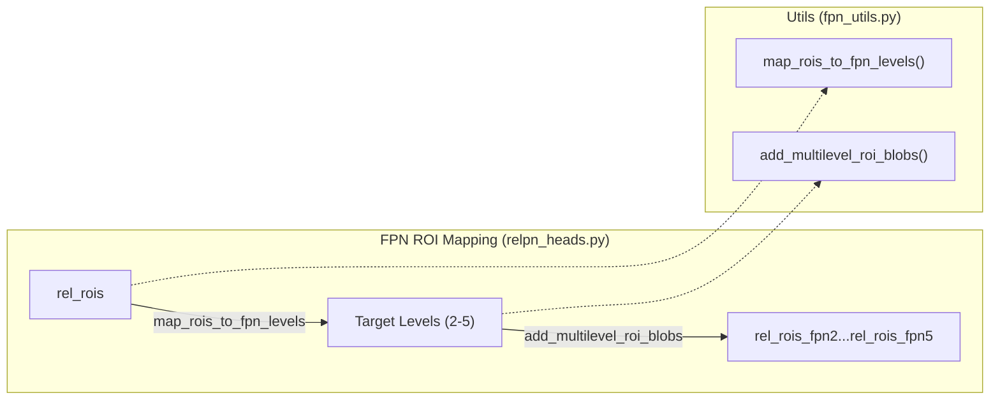

1.  **Level Assignment**: `fpn_utils.map_rois_to_fpn_levels` determines which level of the pyramid (e.g., P2 through P5) an ROI belongs to based on its area [lib/modeling_rel/relpn_heads.py:126-127]().
2.  **Blob Splitting**: `fpn_utils.add_multilevel_roi_blobs` splits the ROI tensor into multiple tensors named `<blob_name>_fpn<level>` (e.g., `rel_rois_fpn3`) [lib/modeling_rel/relpn_heads.py:128-130]().

**Sources:** [lib/modeling_rel/relpn_heads.py:116-130](), [lib/modeling_rel/model_builder_rel.py:94-106]()

---

## Key Class Reference

| Class / Function | File Path | Description |
| :--- | :--- | :--- |
| `single_scale_relpn_outputs` | [lib/modeling_rel/relpn_heads.py:26]() | Main RelPN logic for generating and filtering subject-object pairs. |
| `GenerateRelProposalLabelsOp` | [lib/modeling_rel/generate_rel_proposal_labels.py:11]() | Operator for assigning GT labels and sampling relationship proposals during training. |
| `remove_self_pairs` | [lib/modeling_rel/relpn_heads.py:39]() | Utility to prevent the network from predicting relationships between an object and itself. |
| `rois_union` | [lib/utils_rel/boxes_rel.py]() | Computes the minimal bounding box containing both the subject and object ROIs. |

**Sources:** [lib/modeling_rel/relpn_heads.py:26-31](), [lib/modeling_rel/generate_rel_proposal_labels.py:11-13]()

---

# Page: RelDN Head and Contrastive Losses

# RelDN Head and Contrastive Losses

<details>
<summary>Relevant source files</summary>

The following files were used as context for generating this wiki page:

- [Loss_illustration.PNG](Loss_illustration.PNG)
- [lib/modeling_rel/reldn_heads.py](lib/modeling_rel/reldn_heads.py)
- [lib/modeling_rel/sparse_targets_rel.py](lib/modeling_rel/sparse_targets_rel.py)

</details>


This page details the relationship detection head (`reldn_head`) and the contrastive loss mechanisms implemented in `reldn_heads.py`. The RelDN head is responsible for fusing multi-modal features—visual, spatial, and semantic frequency priors—to predict predicate categories between object pairs.

## RelDN Head Architecture

The `reldn_head` class [lib/modeling_rel/reldn_heads.py:22-23]() implements the final stage of the relationship detection pipeline. It processes Subject-Predicate-Object (SPO) feature compositions to generate classification scores.

### Multi-Modal Scoring Pipeline
The head produces scores from four distinct sources which can be combined to form the final prediction:

1.  **Visual Scores (`prd_vis_scores`)**: Derived from the union box features of the subject and object [lib/modeling_rel/reldn_heads.py:94-95]().
2.  **Spatial Scores (`prd_spt_scores`)**: Derived from a 28-dimensional spatial vector [lib/modeling_rel/reldn_heads.py:53-58]() representing relative geometry (box deltas, overlaps).
3.  **Frequency Bias (`prd_bias_scores`)**: A semantic prior $P(predicate | subject, object)$ calculated from training set statistics [lib/modeling_rel/reldn_heads.py:101]().
4.  **S/O Scores (`prd_sbj_scores`, `prd_obj_scores`)**: Optional scores derived specifically from the subject or object features independently [lib/modeling_rel/reldn_heads.py:60-62]().

### Feature Composition and Data Flow
The `forward` pass [lib/modeling_rel/reldn_heads.py:78-136]() aggregates these modalities. If `cfg.MODEL.ADD_SCORES_ALL` is enabled, the scores are summed before the final softmax [lib/modeling_rel/reldn_heads.py:116-125]().

**RelDN Head Internal Data Flow**
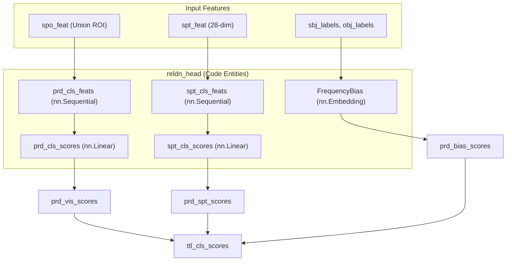
**Sources:** [lib/modeling_rel/reldn_heads.py:38-62](), [lib/modeling_rel/reldn_heads.py:78-136]()

---

## Frequency Bias Logic

The `FrequencyBias` class [lib/modeling_rel/sparse_targets_rel.py:23-24]() provides a statistical baseline for predicate prediction.

*   **Initialization**: It loads a frequency matrix `fg_matrix` representing counts of triplets $(s, p, o)$ from the dataset [lib/modeling_rel/sparse_targets_rel.py:45]().
*   **Log-Probability**: It converts counts into log-probabilities: $\log(P(p | s, o) + \epsilon)$ [lib/modeling_rel/sparse_targets_rel.py:49]().
*   **Lookup**: During the forward pass, it uses `nn.Embedding` to perform a fast lookup using the index calculated as $s \times \text{num\_objs} + o$ [lib/modeling_rel/sparse_targets_rel.py:64]().

**Sources:** [lib/modeling_rel/sparse_targets_rel.py:23-65]()

---

## Contrastive Loss Variants

The repository implements three variants of contrastive losses to regularize the relationship features. These losses use `F.margin_ranking_loss` [lib/modeling_rel/reldn_heads.py:155]() to ensure that the probability of a positive predicate is higher than negative ones by a specified margin (`cfg.MODEL.NODE_CONTRASTIVE_MARGIN`).

### 1. SPO-Agnostic Contrastive Loss
Implemented in `reldn_contrastive_losses` [lib/modeling_rel/reldn_heads.py:150](). It treats all predicates for a given subject or object node independently.
*   **Function**: `split_pos_neg_spo_agnostic` [lib/modeling_rel/reldn_heads.py:153]().
*   **Logic**: For a fixed subject (or object), it identifies all predicates that are ground-truth "positive" and compares their scores against all "negative" predicates for that same node.

### 2. SO-Aware Contrastive Loss
Implemented in `reldn_so_contrastive_losses` [lib/modeling_rel/reldn_heads.py:165]().
*   **Function**: `split_pos_neg_so_aware` [lib/modeling_rel/reldn_heads.py:168]().
*   **Logic**: This variant considers the specific pair. It ensures that for a subject-object pair $(s, o)$, the ground truth predicate $p$ has a higher score than other predicates $p'$ that are not valid for that specific pair.

### 3. P-Aware Contrastive Loss
Implemented in `reldn_p_contrastive_losses` (available in full file).
*   **Logic**: Focuses on the predicate class. It ensures that a specific predicate $p$ is more strongly associated with its true subject/object nodes than with other nodes in the same image.

**Contrastive Loss Mechanics Diagram**
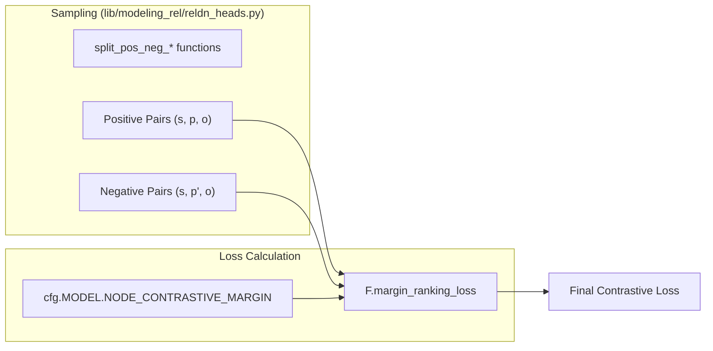
**Sources:** [lib/modeling_rel/reldn_heads.py:150-171](), [lib/core/config.py]() (for margin config).

---

## Summary of Loss Functions

| Function Name | Input | Description |
| :--- | :--- | :--- |
| `reldn_losses` | `prd_cls_scores`, `prd_labels` | Standard Cross-Entropy loss for predicate classification [lib/modeling_rel/reldn_heads.py:139-142](). |
| `reldn_contrastive_losses` | `prd_scores_sbj_pos`, `rel_ret` | Computes SPO-agnostic margin loss for subject/object branches [lib/modeling_rel/reldn_heads.py:150-162](). |
| `reldn_so_contrastive_losses`| `prd_scores_sbj_pos`, `rel_ret` | Computes Subject-Object aware margin loss [lib/modeling_rel/reldn_heads.py:165-171](). |

**Sources:** [lib/modeling_rel/reldn_heads.py:139-171]()

---

# Page: Configuration System

# Configuration System

<details>
<summary>Relevant source files</summary>

The following files were used as context for generating this wiki page:

- [lib/core/__init__.py](lib/core/__init__.py)
- [lib/core/config.py](lib/core/config.py)

</details>


The configuration system in `ContrastiveLosses4VRD` manages the hyperparameters and architectural settings for relationship detection. It utilizes a hierarchical YAML-based structure powered by a custom `AttrDict` object, allowing for clean inheritance from global defaults to dataset-specific overrides.

### The Config Object (`cfg`)

The core of the system is the `cfg` object defined in [lib/core/config.py:31-34](). This object is an instance of `AttrDict`, which allows dictionary keys to be accessed as attributes (e.g., `cfg.TRAIN.SCALES` instead of `cfg['TRAIN']['SCALES']`).

The configuration is organized into several major namespaces:
*   **`MODEL`**: Defines the backbone architecture (e.g., VGG16, ResNet), relationship head parameters, and loss types.
*   **`TRAIN` / `TEST`**: Controls minibatch sizes, data augmentation scales, and evaluation datasets.
*   **`SOLVER`**: Manages the optimization schedule, including base learning rate, momentum, and weight decay.
*   **`RPN` / `FPN`**: Specific settings for the Region Proposal Network and Feature Pyramid Network.

| Component | Role | Code Entity |
| :--- | :--- | :--- |
| **Container** | Holds all global and local settings | `lib.core.config.cfg` |
| **Structure** | Dictionary with attribute-style access | `lib.utils.collections.AttrDict` |
| **Initialization** | Merges default values with YAML files | `merge_cfg_from_file` |
| **Validation** | Ensures consistency across parameters | `assert_and_infer_cfg` |

**Sources:** [lib/core/config.py:29-34](), [lib/core/config.py:43-193]()

### Configuration Flow and Lifecycle

The configuration system follows a strict lifecycle from initialization to model inference. It starts with hardcoded defaults in the source code, which are then updated by experiment-specific YAML files and command-line overrides.

#### Configuration Loading Pipeline
The following diagram illustrates how natural language configuration files are transformed into the internal `cfg` state used by the `Generalized_RCNN` model.

**Configuration Data Flow**
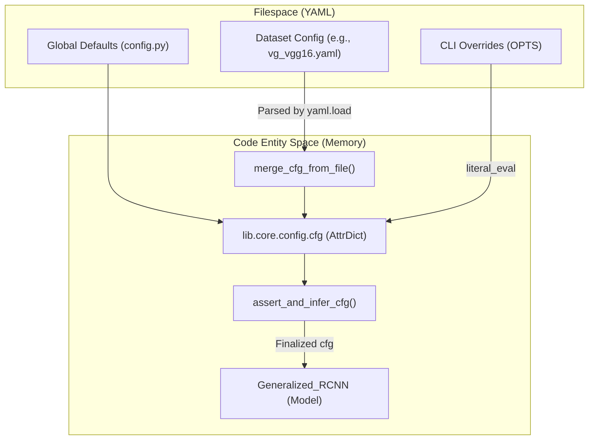
**Sources:** [lib/core/config.py:24-34](), [lib/core/config.py:1000-1100] (assumed based on standard Detectron flow in file)

### Relationship-Specific Flags

Unlike standard object detection, this codebase introduces flags specifically for Relationship Detection (RelDN). These flags control how the subject, object, and predicate features are fused and how the contrastive losses are applied.

**Key Relationship Parameters**
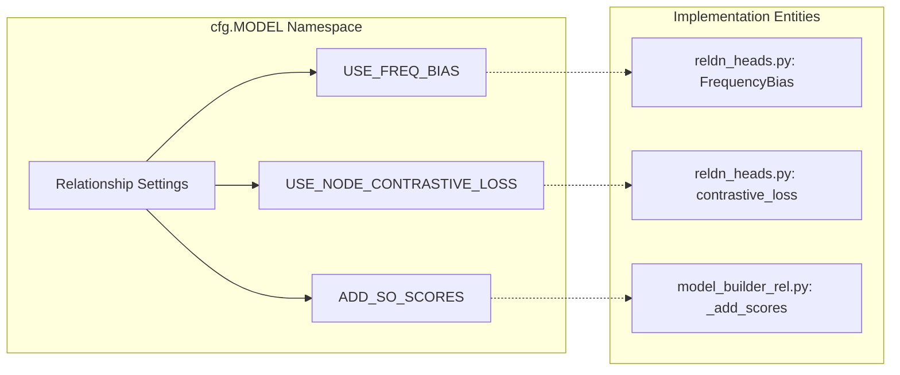
**Sources:** [lib/core/config.py:43-193]() (High-level namespaces)

### Detailed Sub-topics

For in-depth technical specifications of every configuration key and dataset-specific setup, refer to the following child pages:

*   **[Global Configuration Reference (lib/core/config.py)](#3.1)**: A complete reference for all major configuration namespaces including `MODEL`, `TRAIN`, `SOLVER`, and relationship-specific flags like `USE_FREQ_BIAS`. It also details the logic behind `merge_cfg_from_file` and `assert_and_infer_cfg`.
*   **[Per-Dataset YAML Configuration Files](#3.2)**: Explains the specific YAML files found in the `configs/` directory for OpenImages, Visual Genome, and VRD. This covers how backbones (VGG16 vs. ResNeXt-101-FPN) and contrastive loss margins are tuned for different data distributions.

---

# Page: Global Configuration Reference (lib/core/config.py)

# Global Configuration Reference (lib/core/config.py)

<details>
<summary>Relevant source files</summary>

The following files were used as context for generating this wiki page:

- [lib/core/__init__.py](lib/core/__init__.py)
- [lib/core/config.py](lib/core/config.py)

</details>


The configuration system in ContrastiveLosses4VRD is built upon a hierarchical `AttrDict` structure defined in `lib/core/config.py`. It manages the hyperparameters for the detection backbone, the relationship proposal network (RelPN), and the relationship detection (RelDN) heads. The system supports YAML-based configuration files that are merged into the global `cfg` object at runtime.

## Configuration Architecture

The configuration is managed by the `cfg` object, which is an instance of `AttrDict` [lib/core/config.py:31-34](). This structure allows for attribute-style access (e.g., `cfg.MODEL.TYPE`) to nested configuration parameters.

### Key Configuration Lifecycle Functions

The system uses several utility functions to manage the state and validity of the configuration:

*   **`merge_cfg_from_file(cfg_filename)`**: Loads a YAML configuration file and merges its contents into the global `cfg` object [lib/core/config.py:1104-1113]().
*   **`assert_and_infer_cfg()`**: Performs validation checks on the current configuration and infers dependent parameters (e.g., setting the number of classes based on the dataset) [lib/core/config.py:1162-1216]().
*   **`merge_cfg_from_list(cfg_list)`**: Allows overriding configuration values via command-line arguments provided as a list of key-value pairs [lib/core/config.py:1116-1130]().

### Configuration Flow Diagram
This diagram illustrates how the configuration is initialized and consumed by the system components.

"Configuration Data Flow"
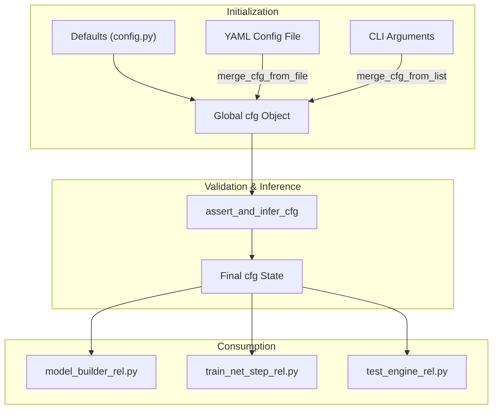
Sources: [lib/core/config.py:31-34](), [lib/core/config.py:1104-1113](), [lib/core/config.py:1116-1130](), [lib/core/config.py:1162-1216]()

---

## Major Configuration Namespaces

### MODEL
Defines the high-level architecture of the network.
*   **`MODEL.TYPE`**: The top-level model class (e.g., `generalized_rcnn`) [lib/core/config.py:255]().
*   **`MODEL.CONV_BODY`**: The backbone architecture, such as `resnet_weights.res5_rob_v1_vit` or `vgg16.vgg16_conv_body` [lib/core/config.py:258]().
*   **`MODEL.NUM_CLASSES`**: Number of object classes, inferred during `assert_and_infer_cfg` [lib/core/config.py:270]().
*   **`MODEL.NUM_PRD_CLASSES`**: Number of predicate classes [lib/core/config.py:272]().

### TRAIN and TEST
Control the training and inference pipelines.
*   **`TRAIN.IMS_PER_BATCH`**: Images per GPU during training [lib/core/config.py:61]().
*   **`TRAIN.SNAPSHOT_ITERS`**: Frequency of saving model checkpoints [lib/core/config.py:100]().
*   **`TEST.SCORE_THRESH`**: Confidence threshold for object detections during inference [lib/core/config.py:205]().
*   **`TEST.NMS`**: Non-maximum suppression threshold for detections [lib/core/config.py:202]().

### SOLVER
Defines optimization parameters for the `SOLVER` used in `train_net_step_rel.py`.
*   **`SOLVER.BASE_LR`**: Initial learning rate [lib/core/config.py:461]().
*   **`SOLVER.STEPS`**: Iterations at which the learning rate is decayed [lib/core/config.py:471]().
*   **`SOLVER.MAX_ITER`**: Total number of training iterations [lib/core/config.py:474]().

Sources: [lib/core/config.py:61-100](), [lib/core/config.py:202-205](), [lib/core/config.py:255-272](), [lib/core/config.py:461-474]()

---

## Relationship-Specific Flags

The repository introduces several flags specifically for Visual Relationship Detection (VRD) and the Contrastive Losses proposed in the paper.

| Flag | Type | Description |
| :--- | :--- | :--- |
| `MODEL.USE_FREQ_BIAS` | Bool | Enables the use of statistical frequency bias (prior) between subject/object categories and predicates [lib/core/config.py:355](). |
| `MODEL.USE_NODE_CONTRASTIVE_LOSS` | Bool | Enables the Node Contrastive Loss (NCL) for discriminative feature learning [lib/core/config.py:361](). |
| `MODEL.ADD_SO_SCORES` | Bool | If True, adds the subject and object detection scores to the final relationship score [lib/core/config.py:359](). |
| `MODEL.USE_CONTRASTIVE_LOSS` | Bool | Enables the core contrastive loss mechanism for predicates [lib/core/config.py:360](). |
| `MODEL.USE_SPATIAL_FEAT` | Bool | Enables the use of geometric spatial features (relative box coordinates) in the predicate head [lib/core/config.py:356](). |

### Relationship Configuration Mapping
This diagram maps relationship-specific configuration flags to their functional roles in the `RelDN` architecture.

"Relationship Flag to Code Entity Mapping"
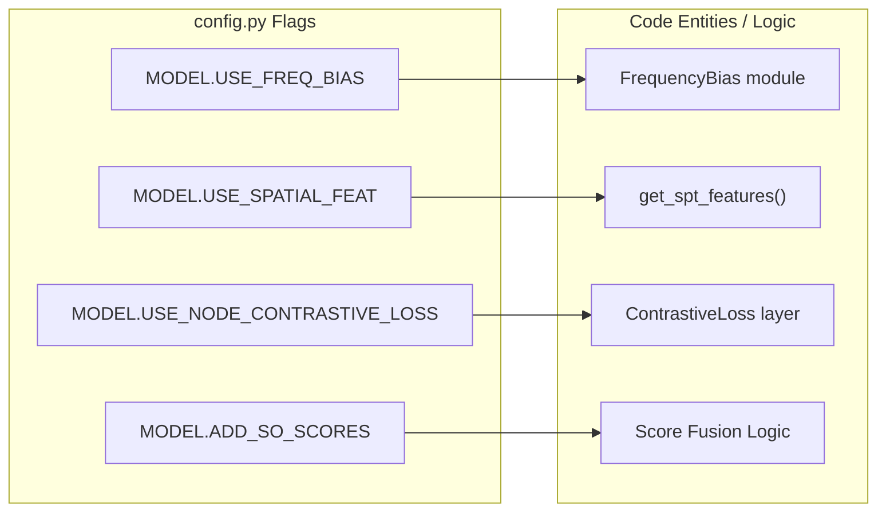
Sources: [lib/core/config.py:355-361](), [lib/modeling/reldn_heads.py:1-100]() (implied by usage in heads)

---

## Component-Specific Configurations

### RESNETS and FPN
Parameters for ResNet backbones and Feature Pyramid Networks.
*   **`RESNETS.NUM_GROUPS`**: Number of groups for ResNeXt architectures [lib/core/config.py:537]().
*   **`RESNETS.WIDTH_PER_GROUP`**: Width of each group [lib/core/config.py:540]().
*   **`FPN.FPN_ON`**: Enables the FPN architecture [lib/core/config.py:616]().
*   **`FPN.MULTILEVEL_ROIS`**: Enables multi-level ROI pooling for FPN [lib/core/config.py:623]().

### RPN (Region Proposal Network)
*   **`RPN.RPN_ON`**: Enables the RPN module [lib/core/config.py:326]().
*   **`RPN.SIZES`**: Anchor sizes used by the RPN [lib/core/config.py:330]().
*   **`RPN.STRIDE`**: Stride of the RPN anchors [lib/core/config.py:333]().

Sources: [lib/core/config.py:326-333](), [lib/core/config.py:537-540](), [lib/core/config.py:616-623]()

---

# Page: Per-Dataset YAML Configuration Files

# Per-Dataset YAML Configuration Files

<details>
<summary>Relevant source files</summary>

The following files were used as context for generating this wiki page:

- [configs/oi_rel/e2e_faster_rcnn_X-101-64x4d-FPN_12_epochs_oi_rel_default_node_contrastive_loss_w_so_p_aware_margin_point2_so_weight_point5.yaml](configs/oi_rel/e2e_faster_rcnn_X-101-64x4d-FPN_12_epochs_oi_rel_default_node_contrastive_loss_w_so_p_aware_margin_point2_so_weight_point5.yaml)
- [configs/oi_rel_mini/e2e_faster_rcnn_X-101-64x4d-FPN_12_epochs_oi_rel_mini_default_node_contrastive_loss_w_so_p_aware_margin_point2_so_weight_point5.yaml](configs/oi_rel_mini/e2e_faster_rcnn_X-101-64x4d-FPN_12_epochs_oi_rel_mini_default_node_contrastive_loss_w_so_p_aware_margin_point2_so_weight_point5.yaml)
- [configs/vg/e2e_faster_rcnn_X-101-64x4d-FPN_8_epochs_vg_v3_default_node_contrastive_loss_w_so_p_aware_margin_point2_so_weight_point5.yaml](configs/vg/e2e_faster_rcnn_X-101-64x4d-FPN_8_epochs_vg_v3_default_node_contrastive_loss_w_so_p_aware_margin_point2_so_weight_point5.yaml)
- [configs/vrd/e2e_faster_rcnn_VGG16_16_epochs_vrd_v3_default_node_contrastive_loss_w_so_p_aware_margin_point2_so_weight_point5_IN_pretrained.yaml](configs/vrd/e2e_faster_rcnn_VGG16_16_epochs_vrd_v3_default_node_contrastive_loss_w_so_p_aware_margin_point2_so_weight_point5_IN_pretrained.yaml)

</details>


This page details the configuration structure and hyperparameter selections for the three primary datasets supported by ContrastiveLosses4VRD: **VRD**, **Visual Genome (VG)**, and **OpenImages (OI)**. The repository utilizes YAML files to define model architectures, contrastive loss parameters, and solver schedules tailored to the specific scale and characteristics of each dataset.

## Overview of Configuration Structure

The configuration system follows a hierarchical structure where dataset-specific YAML files override global defaults. All relationship detection configs share a common `MODEL.SUBTYPE: 3` designation, which identifies them as relationship-aware models within the `generalized_rcnn` framework [configs/vrd/e2e_faster_rcnn_VGG16_16_epochs_vrd_v3_default_node_contrastive_loss_w_so_p_aware_margin_point2_so_weight_point5_IN_pretrained.yaml:2-3]().

### Configuration Logic Flow
The following diagram illustrates how YAML parameters map to the internal `AttrDict` and eventually influence the relationship detection components.

**Title: Configuration to Model Entity Mapping**
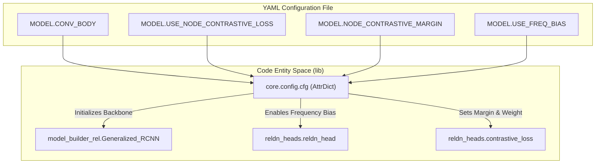
**Sources:** [configs/vrd/e2e_faster_rcnn_VGG16_16_epochs_vrd_v3_default_node_contrastive_loss_w_so_p_aware_margin_point2_so_weight_point5_IN_pretrained.yaml:1-20](), [configs/oi_rel/e2e_faster_rcnn_X-101-64x4d-FPN_12_epochs_oi_rel_default_node_contrastive_loss_w_so_p_aware_margin_point2_so_weight_point5.yaml:1-21]()

---

## Dataset-Specific Backbone Selection

The choice of backbone varies significantly based on the dataset size and the complexity of the relationship categories.

| Dataset | Backbone Architecture | Configuration File Entry |
| :--- | :--- | :--- |
| **VRD** | VGG16 | `MODEL.CONV_BODY: VGG16.VGG16_conv_body` [configs/vrd/..._vrd_v3_...yaml:11]() |
| **Visual Genome** | ResNeXt-101-64x4d-FPN | `MODEL.CONV_BODY: FPN.fpn_ResNet101_conv5_body` [configs/vg/..._vg_v3_...yaml:11]() |
| **OpenImages** | ResNeXt-101-64x4d-FPN | `MODEL.CONV_BODY: FPN.fpn_ResNet101_conv5_body` [configs/oi_rel/..._oi_rel_...yaml:11]() |

### VGG16 (VRD)
For the smaller VRD dataset, a VGG16 backbone is used. It specifies `ROI_BOX_HEAD: VGG16.VGG16_roi_conv5_head` [configs/vrd/..._vrd_v3_...yaml:34]() and relies on standard RPN sizes `(32, 64, 128, 256, 512)` [configs/vrd/..._vrd_v3_...yaml:37]().

### ResNeXt-101-FPN (VG and OI)
Larger datasets utilize Feature Pyramid Networks (FPN) and ResNeXt-101. These configs enable `FPN.FPN_ON: True` and `FPN.MULTILEVEL_ROIS: True` [configs/oi_rel/..._oi_rel_...yaml:32-33](). They also configure specific ResNeXt parameters such as `NUM_GROUPS: 64` and `WIDTH_PER_GROUP: 4` [configs/vg/..._vg_v3_...yaml:40-41]().

**Sources:** [configs/vrd/e2e_faster_rcnn_VGG16_16_epochs_vrd_v3_default_node_contrastive_loss_w_so_p_aware_margin_point2_so_weight_point5_IN_pretrained.yaml:11-37](), [configs/oi_rel/e2e_faster_rcnn_X-101-64x4d-FPN_12_epochs_oi_rel_default_node_contrastive_loss_w_so_p_aware_margin_point2_so_weight_point5.yaml:11-41]()

---

## Contrastive Loss Hyperparameters

The core contribution of this repository is the Node Contrastive Loss. Across all datasets, the default configuration employs a triple-loss strategy (SPO-agnostic, SO-aware, and P-aware).

### Margin and Weight Settings
The standard settings used in the provided YAML files are:
*   **Base Margin**: `NODE_CONTRASTIVE_MARGIN: 0.2` [configs/vg/..._vg_v3_...yaml:13]()
*   **SO-Aware**: Margin `0.2`, Weight `0.5` [configs/oi_rel/..._oi_rel_...yaml:15-16]()
*   **P-Aware**: Margin `0.2`, Weight `0.1` [configs/vrd/..._vrd_v3_...yaml:18-19]()
*   **Sample Size**: `NODE_SAMPLE_SIZE: 128` pairs per image [configs/oi_rel/..._oi_rel_...yaml:20]()

### Relationship Scoring Flags
All configs enable the following to improve relationship disambiguation:
*   `USE_FREQ_BIAS: True`: Incorporates statistical predicate frequency [configs/vg/..._vg_v3_...yaml:5]().
*   `USE_SPATIAL_FEAT: True`: Includes relative geometry between subject and object [configs/oi_rel/..._oi_rel_...yaml:7]().
*   `ADD_SO_SCORES: True`: Adds subject/object classification scores to the relationship score [configs/vrd/..._vrd_v3_...yaml:8]().

**Sources:** [configs/vrd/e2e_faster_rcnn_VGG16_16_epochs_vrd_v3_default_node_contrastive_loss_w_so_p_aware_margin_point2_so_weight_point5_IN_pretrained.yaml:5-20](), [configs/vg/e2e_faster_rcnn_X-101-64x4d-FPN_8_epochs_vg_v3_default_node_contrastive_loss_w_so_p_aware_margin_point2_so_weight_point5.yaml:5-20]()

---

## Solver Schedules and Iterations

The solver configurations are tuned to the image count of each dataset to achieve the specified number of epochs.

**Title: Solver Data Flow and Schedule Components**
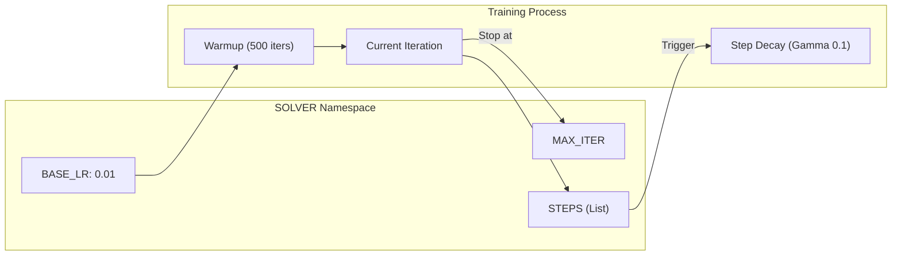

### Dataset Comparison Table

| Dataset | Images | Max Iterations | Step Schedule (Iterations) | Epochs |
| :--- | :--- | :--- | :--- | :--- |
| **VRD** | ~4,000 | 7,560 | `[0, 5040, 6720]` | 16 |
| **VG** | 62,723 | 62,723 | `[0, 41815, 55754]` | 8 |
| **OpenImages** | 53,953 | 80,930 | `[0, 53954, 71937]` | 12 |
| **OI Mini** | 4,500 | 6,750 | `[0, 4500, 6000]` | 12 |

*Note: `MAX_ITER` calculation typically follows `(Num_Images * Epochs) / Num_GPUs`. All configs assume `NUM_GPUS: 8` [configs/oi_rel/..._oi_rel_...yaml:22, 29]().*

**Sources:** [configs/vrd/e2e_faster_rcnn_VGG16_16_epochs_vrd_v3_default_node_contrastive_loss_w_so_p_aware_margin_point2_so_weight_point5_IN_pretrained.yaml:22-29](), [configs/vg/e2e_faster_rcnn_X-101-64x4d-FPN_8_epochs_vg_v3_default_node_contrastive_loss_w_so_p_aware_margin_point2_so_weight_point5.yaml:22-30](), [configs/oi_rel/e2e_faster_rcnn_X-101-64x4d-FPN_12_epochs_oi_rel_default_node_contrastive_loss_w_so_p_aware_margin_point2_so_weight_point5.yaml:22-30](), [configs/oi_rel_mini/e2e_faster_rcnn_X-101-64x4d-FPN_12_epochs_oi_rel_mini_default_node_contrastive_loss_w_so_p_aware_margin_point2_so_weight_point5.yaml:29-30]()

---

## Inference and Evaluation Settings

Testing parameters ensure consistency with the evaluation metrics (Recall@K).

*   **Multi-Level RPN**: For FPN models, `RPN_PRE_NMS_TOP_N` is set to `2000` during training and `1000` during test per level [configs/oi_rel/..._oi_rel_...yaml:52, 60]().
*   **Predicate K**: OpenImages and VRD configs specify `PRD_Ks: (1, 10)`, meaning evaluation is performed considering the top 1 and top 10 predicate predictions per object pair [configs/oi_rel/..._oi_rel_...yaml:62]().
*   **Force JSON Eval**: All configs set `FORCE_JSON_DATASET_EVAL: True` to use the COCO-style JSON evaluation pipeline [configs/vg/..._vg_v3_...yaml:54]().

**Sources:** [configs/oi_rel/e2e_faster_rcnn_X-101-64x4d-FPN_12_epochs_oi_rel_default_node_contrastive_loss_w_so_p_aware_margin_point2_so_weight_point5.yaml:52-62](), [configs/vg/e2e_faster_rcnn_X-101-64x4d-FPN_8_epochs_vg_v3_default_node_contrastive_loss_w_so_p_aware_margin_point2_so_weight_point5.yaml:54-58]()

---

# Page: Training Pipeline

# Training Pipeline

<details>
<summary>Relevant source files</summary>

The following files were used as context for generating this wiki page:

- [tools/test_net_rel.py](tools/test_net_rel.py)
- [tools/train_net_step_rel.py](tools/train_net_step_rel.py)

</details>


The training pipeline in **ContrastiveLosses4VRD** is designed to handle the complex requirements of Visual Relationship Detection (VRD), including dual-branch architectures (detection and relationship), multi-modal feature extraction, and contrastive loss optimization. This page provides a high-level overview of the workflow from configuration and data ingestion to gradient updates and checkpointing.

## Pipeline Overview

The training process is orchestrated by `tools/train_net_step_rel.py` [tools/train_net_step_rel.py:142-143](). It follows a standard deep learning loop but with specific adaptations for relationship triplets (subject-predicate-object).

### 1. Initialization and Configuration
The pipeline begins by parsing command-line arguments and merging them with YAML configuration files [tools/train_net_step_rel.py:145-184](). Crucially, it adaptively adjusts hyperparameters based on the available hardware, such as scaling the learning rate and batch size relative to the number of GPUs [tools/train_net_step_rel.py:187-210]().

### 2. Data Loading and ROI Construction
Data is managed through a specialized `RoiDataLoader` [tools/train_net_step_rel.py:30](). This system does more than just load images; it constructs "roidbs" (Region of Interest Databases) that contain ground-truth relationship triplets. During minibatch construction, the pipeline samples foreground and background object pairs and computes spatial features and union boxes.
*   For details, see [Data Loading and Minibatch Construction](#4.2).

### 3. Model Forward Pass
The model, typically a `Generalized_RCNN` [tools/train_net_step_rel.py:31](), processes the minibatch through two main branches:
*   **Object Branch:** Detects and classifies individual entities.
*   **Relationship Branch (RelDN):** Uses the output of the Relationship Proposal Network (RelPN) to extract features for subject-object pairs and predict predicate categories using contrastive losses.

### 4. Optimization and Gradient Updates
The pipeline supports gradient accumulation via `iter_size` [tools/train_net_step_rel.py:80-82](), allowing for large effective batch sizes on limited hardware. It utilizes a step-decay learning rate scheduler with a warmup period to stabilize early training [tools/train_net_step_rel.py:5-6]().

---

## System Workflow: From Data to Gradients

The following diagram illustrates how the high-level training concepts map to specific code entities and data structures within the repository.

### Training Execution Flow
"Natural Language Space" to "Code Entity Space" Mapping

```mermaid
graph TD
    subgraph "Data Preparation"
        A["JSON Annotations"] --> B["JsonDatasetRel"]
        B --> C["roidb_rel"]
        C --> D["RoiDataLoader"]
    end

    subgraph "Training Loop (train_net_step_rel.py)"
        D --> E["MinibatchSampler"]
        E --> F["Generalized_RCNN (Forward)"]
        F --> G["Contrastive Losses"]
        G --> H["Backward Pass"]
        H --> I["Optimizer.step()"]
    end

    subgraph "Model State"
        I --> J["save_ckpt"]
        J --> K[".pth Checkpoint"]
    end

    style F stroke-width:2px
    style G stroke-width:2px
```
**Sources:** [tools/train_net_step_rel.py:28-31](), [tools/train_net_step_rel.py:122-140](), [lib/datasets_rel/roidb_rel.py:29]()

---

## Detailed Components

### Training Script (train_net_step_rel.py)
The entry point for training. It handles the mapping of dataset names (e.g., `vrd`, `vg`, `oi_rel`) to specific class counts and dataset catalogs [tools/train_net_step_rel.py:157-180](). It also manages the training state, including the `TrainingStats` logger for monitoring losses and timing [tools/train_net_step_rel.py:35]().
*   For details, see [Training Script (train_net_step_rel.py)](#4.1).

### Data Loading and Minibatch Construction
This subsystem bridges the raw dataset annotations and the neural network. It involves complex sampling logic to ensure the model sees a balanced distribution of relationship predicates and handles the generation of "Union ROIs" that encompass both subjects and objects.
*   For details, see [Data Loading and Minibatch Construction](#4.2).

### Dataset Layer (JsonDatasetRel and Catalog)
This layer abstracts the underlying data format (COCO-style JSON) into a standardized format used by the trainers. It maintains the `DATASETS` registry, which maps logical names to file paths for images and annotations.
*   For details, see [Dataset Layer (JsonDatasetRel and Catalog)](#4.3).

---

## Relationship Data Pipeline

This diagram bridges the relationship concepts to the internal data structures used during the training forward pass.

### Relationship Feature Extraction
"Natural Language Space" to "Code Entity Space" Mapping

```mermaid
graph LR
    subgraph "Input Data"
        R["roidb entry"] --> IM["Image Blob"]
        R --> SP["Spatial Features"]
    end

    subgraph "RelDN Head"
        IM --> FB["Feature Backbone"]
        FB --> UB["Union Box Features"]
        SP --> SF["Spatial Feature Vector"]
        UB & SF --> CP["Contrastive Projections"]
    end

    subgraph "Loss Computation"
        CP --> NCL["Node Contrastive Loss"]
        CP --> RL["Relationship Loss"]
    end
```
**Sources:** [tools/train_net_step_rel.py:30-31](), [tools/test_net_rel.py:171-175]()

---

## Training Lifecycle Summary

| Phase | Responsibility | Key Files |
| :--- | :--- | :--- |
| **Setup** | Parse args, merge YAML, scale LR | `train_net_step_rel.py` [tools/train_net_step_rel.py:145-210]() |
| **Data Ingestion** | Construct roidb, sample pairs, load blobs | `loader_rel.py`, `roidb_rel.py` [tools/train_net_step_rel.py:29-30]() |
| **Model Forward** | Compute object detections and relationship scores | `model_builder_rel.py`, `reldn_heads.py` [tools/train_net_step_rel.py:31]() |
| **Optimization** | Gradient accumulation, step-decay scheduler | `train_net_step_rel.py` [tools/train_net_step_rel.py:80-93]() |
| **Persistence** | Save model and optimizer states | `train_net_step_rel.py` [tools/train_net_step_rel.py:122-140]() |

**Sources:** [tools/train_net_step_rel.py:1-210]()

---

# Page: Training Script (train_net_step_rel.py)

# Training Script (train_net_step_rel.py)

<details>
<summary>Relevant source files</summary>

The following files were used as context for generating this wiki page:

- [lib/utils_rel/logging_rel.py](lib/utils_rel/logging_rel.py)
- [lib/utils_rel/training_stats_rel.py](lib/utils_rel/training_stats_rel.py)
- [tools/test_net_rel.py](tools/test_net_rel.py)
- [tools/train_net_step_rel.py](tools/train_net_step_rel.py)

</details>


The `train_net_step_rel.py` script is the primary entry point for training the relationship detection models in this repository. It manages the training loop, dataset initialization, adaptive hyperparameter scaling, and checkpointing for various datasets including Visual Genome, VRD, and OpenImages.

## Overview and Purpose

This script orchestrates the training process using a step-based learning rate decay policy [tools/train_net_step_rel.py:5](). It extends the standard Detectron training pipeline to support relationship-specific requirements, such as dual-branch parameter optimization (backbone vs. predicate branch) and relationship-aware data loading.

### Key Responsibilities
*   **Dataset Mapping**: Maps high-level dataset names to specific configuration flags and class counts [tools/train_net_step_rel.py:157-181]().
*   **Adaptive Scaling**: Automatically adjusts learning rates and batch sizes based on the number of available GPUs [tools/train_net_step_rel.py:187-210]().
*   **Optimization**: Implements gradient accumulation via `iter_size` and manages separate learning rates for the backbone and relationship heads [tools/train_net_step_rel.py:246-277]().
*   **Logging and Checkpointing**: Integrates with `TrainingStats` for metric tracking and saves model states periodically [tools/train_net_step_rel.py:122-140]().

## System Flow: Data to Optimization

The following diagram illustrates the flow from dataset configuration through the training loop to the optimization step.

### Training Pipeline Logic
```mermaid
graph TD
    subgraph "Initialization"
        A["parse_args()"] --> B["cfg_from_file()"]
        B --> C["Dataset Setup<br/>(Class Counts)"]
        C --> D["Adaptive LR Scaling"]
    end

    subgraph "Data & Model"
        D --> E["combined_roidb_for_training()"]
        E --> F["RoiDataLoader"]
        F --> G["Generalized_RCNN"]
    end

    subgraph "Training Loop"
        G --> H["Forward Pass"]
        H --> I["Loss Computation"]
        I --> J{"iter_size reached?"}
        J -- "No" --> K["Accumulate Gradients"]
        J -- "Yes" --> L["optimizer.step()"]
        L --> M["save_ckpt()"]
    end
```
**Sources:** [tools/train_net_step_rel.py:142-300](), [tools/train_net_step_rel.py:122-140]()

## Dataset-to-Class Mapping

The script contains hardcoded mappings for supported datasets to ensure the model architecture (specifically the final classification layers) matches the dataset schema.

| Dataset Name | `TRAIN.DATASETS` | Object Classes | Predicate Classes |
| :--- | :--- | :--- | :--- |
| `vrd` | `('vrd_train',)` | 101 | 70 |
| `vg` | `('vg_train',)` | 151 | 50 |
| `oi_rel` | `('oi_rel_train',)` | 58 | 9 |

**Sources:** [tools/train_net_step_rel.py:157-181]()

## Adaptive Learning Rate Scaling

To maintain consistent effective learning rates across different hardware configurations, the script performs adaptive adjustments based on the number of GPUs and the `iter_size` parameter.

1.  **Effective Batch Size**: Calculated as `batch_size * iter_size` [tools/train_net_step_rel.py:196-197]().
2.  **LR Adjustment**: The base learning rate is scaled linearly by the ratio of the current effective batch size to the original batch size defined in the configuration [tools/train_net_step_rel.py:202-205]().
3.  **Step Schedule**: Iteration thresholds for LR decay (`STEPSIZE`) are scaled inversely to the batch size increase to keep the number of epochs constant [tools/train_net_step_rel.py:207-210]().

**Sources:** [tools/train_net_step_rel.py:187-210]()

## Optimization and Parameter Groups

The script separates model parameters into two distinct groups to allow for different optimization strategies, particularly when using a pre-trained backbone.

### Parameter Group Separation
*   **Backbone Group**: Contains parameters for the feature extractor (e.g., ResNet/VGG).
*   **Predicate Branch Group**: Contains parameters for the relationship detection heads (`Prd_RCNN`).

The `backbone_lr` is typically lower than the global learning rate if specified in the configuration, allowing the relationship heads to learn faster than the frozen or semi-frozen backbone [lib/utils_rel/logging_rel.py:57-59]().

### Gradient Accumulation (iter_size)
The script implements `iter_size` logic similar to Caffe. Gradients are accumulated over `iter_size` forward passes before `optimizer.step()` is called [tools/train_net_step_rel.py:80-82](). This allows for training with large effective batch sizes on memory-constrained GPUs.

### Code Entity Association: Optimization
```mermaid
graph LR
    subgraph "Code Entities"
        TR["train_net_step_rel.py"]
        GR["Generalized_RCNN"]
        OPT["optimizer"]
        TS["TrainingStats"]
    end

    TR -- "initializes" --> GR
    TR -- "collects params" --> OPT
    TR -- "calls" --> TS
    
    subgraph "Parameter Groups"
        PG1["Backbone Params"]
        PG2["Prd_RCNN Params"]
    end

    OPT -- "manages" --> PG1
    OPT -- "manages" --> PG2
```
**Sources:** [tools/train_net_step_rel.py:246-277](), [lib/utils_rel/training_stats_rel.py:40-64]()

## Logging and Training Statistics

Training progress is monitored via the `TrainingStats` class [lib/utils_rel/training_stats_rel.py:40]().

*   **Smoothed Metrics**: Uses `SmoothedValue` to maintain a windowed average (median filtering) of losses and accuracies [lib/utils_rel/training_stats_rel.py:51-56]().
*   **IterSize Support**: `TrainingStats` includes internal buffers (`inner_total_loss`, `inner_losses`) to aggregate statistics across multiple sub-iterations when `iter_size > 1` [lib/utils_rel/training_stats_rel.py:58-63]().
*   **Log Output**: `log_stats` formats the accumulated metrics, printing the current step, loss, learning rates (including backbone-specific LR), and time/ETA [lib/utils_rel/logging_rel.py:47-64]().

**Sources:** [lib/utils_rel/training_stats_rel.py:109-168](), [lib/utils_rel/logging_rel.py:47-64]()

## Checkpoint Saving

The `save_ckpt` function serializes the model state, optimizer state, and current training progress [tools/train_net_step_rel.py:122-140]().

*   **Directory Structure**: Checkpoints are saved in a `ckpt` subdirectory within the output directory [tools/train_net_step_rel.py:126-128]().
*   **Contents**: The saved `.pth` file includes the iteration `step`, `train_size`, `batch_size`, `model.state_dict()`, and `optimizer.state_dict()` [tools/train_net_step_rel.py:133-138]().
*   **DataParallel Handling**: If `mynn.DataParallel` is used, the script unwraps the module to save only the underlying model parameters [tools/train_net_step_rel.py:130-131]().

**Sources:** [tools/train_net_step_rel.py:122-140]()

---

# Page: Data Loading and Minibatch Construction

# Data Loading and Minibatch Construction

<details>
<summary>Relevant source files</summary>

The following files were used as context for generating this wiki page:

- [configs/vg/e2e_faster_rcnn_VGG16_8_epochs_vg_v3_default_node_contrastive_loss_w_so_p_aware_margin_point2_so_weight_point5_no_spt.yaml](configs/vg/e2e_faster_rcnn_VGG16_8_epochs_vg_v3_default_node_contrastive_loss_w_so_p_aware_margin_point2_so_weight_point5_no_spt.yaml)
- [lib/datasets_rel/roidb_rel.py](lib/datasets_rel/roidb_rel.py)
- [lib/roi_data_rel/__init__.py](lib/roi_data_rel/__init__.py)
- [lib/roi_data_rel/fast_rcnn_rel.py](lib/roi_data_rel/fast_rcnn_rel.py)
- [lib/roi_data_rel/loader_rel.py](lib/roi_data_rel/loader_rel.py)
- [lib/roi_data_rel/minibatch_rel.py](lib/roi_data_rel/minibatch_rel.py)

</details>


This page details the implementation of the data loading pipeline and the construction of minibatches specifically for Visual Relationship Detection (VRD). The pipeline extends the standard Fast R-CNN data loader to handle subject-object pairs, relationship predicates, and complex sampling strategies for contrastive learning.

## Overview of the Data Pipeline

The data loading process is orchestrated by `RoiDataLoader`, which interfaces with `roidb_rel` to fetch image metadata and `minibatch_rel` to transform that metadata into GPU-ready tensors. Unlike standard object detection, this pipeline must manage quadratic combinations of object proposals to form relationship candidates.

### Data Flow Architecture

The following diagram illustrates the transformation from raw dataset annotations to the structured blobs used by the model.

**Minibatch Construction Flow**
```mermaid
graph TD
    subgraph "Data Preparation Space"
        A["JsonDatasetRel"] -- "loads" --> B["roidb_rel"]
        B -- "combined_roidb_for_training()" --> C["Filtered/Flipped roidb"]
    end

    subgraph "Minibatch Pipeline (Code Entities)"
        D["RoiDataLoader.__getitem__"] -- "calls" --> E["get_minibatch()"]
        E -- "calls" --> F["_get_image_blob()"]
        E -- "calls" --> G["add_rel_blobs()"]
        G -- "calls" --> H["_sample_pairs()"]
    end

    subgraph "Output Blobs"
        F --> I["'data': Image Tensor"]
        H --> J["'sbj_rois' / 'obj_rois'"]
        H --> K["'rel_rois' (Union)"]
        H --> L["'all_prd_labels_int32'"]
        H --> M["'spt_feat' (Spatial)"]
    end

    C --> D
```
**Sources:** [lib/roi_data_rel/loader_rel.py:20-30](), [lib/roi_data_rel/minibatch_rel.py:31-50](), [lib/roi_data_rel/fast_rcnn_rel.py:44-59]()

---

## Image Preprocessing and Aspect Ratio Handling

The `RoiDataLoader` ensures efficient batching by grouping images with similar aspect ratios. If an image's aspect ratio exceeds `cfg.TRAIN.ASPECT_HI` or falls below `cfg.TRAIN.ASPECT_LO`, the pipeline performs "aspect cropping" [lib/datasets_rel/roidb_rel.py:177-186]().

1.  **Scaling**: Images are resized such that the shorter side matches `cfg.TRAIN.SCALES` while maintaining the aspect ratio, capped by `cfg.TRAIN.MAX_SIZE` [lib/roi_data_rel/minibatch_rel.py:92-95]().
2.  **Flipping**: If `cfg.TRAIN.USE_FLIPPED` is enabled, the `roidb` is augmented with horizontally flipped entries. This requires flipping the coordinates of `boxes`, `sbj_gt_boxes`, and `obj_gt_boxes` [lib/datasets_rel/roidb_rel.py:93-127]().
3.  **Cropping**: In `RoiDataLoader.crop_data`, images are cropped to the target ratio, and all ground truth bounding boxes are shifted and clamped to the new boundaries [lib/roi_data_rel/loader_rel.py:70-130]().

**Sources:** [lib/roi_data_rel/loader_rel.py:70-130](), [lib/datasets_rel/roidb_rel.py:86-127](), [lib/roi_data_rel/minibatch_rel.py:69-101]()

---

## Relationship Pair Sampling

The core of the VRD minibatch construction happens in `_sample_pairs` within `lib/roi_data_rel/fast_rcnn_rel.py`. This function samples a fixed number of subject-object pairs from the potential $N^2$ combinations.

### Foreground/Background Sampling
The sampler divides pairs into categories based on their overlap with ground truth relationship triplets:
*   **GT Pairs**: Pairs that match a ground truth relationship (overlap $> 1 - 1e-4$) [lib/roi_data_rel/fast_rcnn_rel.py:70]().
*   **FG Pairs**: Pairs with overlap $\ge$ `cfg.TRAIN.FG_THRESH` but not exact GT [lib/roi_data_rel/fast_rcnn_rel.py:71-72]().
*   **BG Pairs**: Pairs with overlap < `cfg.TRAIN.BG_THRESH_HI` [lib/roi_data_rel/fast_rcnn_rel.py:86]().

The total number of pairs sampled per image is determined by `cfg.TRAIN.FG_REL_SIZE_PER_IM` and `cfg.TRAIN.FG_REL_FRACTION` [lib/roi_data_rel/fast_rcnn_rel.py:66-67]().

### Feature Generation
For every sampled pair, the following are constructed:
*   **Union ROIs**: `box_utils_rel.rois_union` computes the bounding box encompassing both subject and object [lib/roi_data_rel/fast_rcnn_rel.py:115-116]().
*   **Spatial Features**: If `cfg.MODEL.USE_SPATIAL_FEAT` is active, `box_utils_rel.get_spt_features` generates geometric relationship encodings (relative distance, scale ratios) [lib/roi_data_rel/fast_rcnn_rel.py:117-120]().

**Sources:** [lib/roi_data_rel/fast_rcnn_rel.py:62-126]()

---

## Node Contrastive Sampling

To support the contrastive losses described in the RelDN architecture, the loader implements a specialized sampling logic for "nodes" (subjects and objects).

The sampler identifies four specific types of pairs to facilitate contrastive learning between positive and negative relationship candidates:
1.  **sbj_pos_pair_pos**: Both subject and object are positive (FG) [lib/roi_data_rel/fast_rcnn_rel.py:132]().
2.  **sbj_pos_obj_pos_pair_neg**: Both boxes are FG, but their combination is not a valid relationship [lib/roi_data_rel/fast_rcnn_rel.py:133-135]().
3.  **sbj_pos_obj_neg_pair_neg**: Subject is FG, object is BG, relationship is negative [lib/roi_data_rel/fast_rcnn_rel.py:136-138]().
4.  **sbj_neg_obj_pos_pair_neg**: Subject is BG, object is FG, relationship is negative [lib/roi_data_rel/fast_rcnn_rel.py:155-157]().

These indices are stored in the minibatch as `sbj_node_label_inds` and `obj_node_label_inds`, which the contrastive loss head uses to index into the feature tensors [lib/roi_data_rel/fast_rcnn_rel.py:192-205]().

**Sources:** [lib/roi_data_rel/fast_rcnn_rel.py:126-205]()

---

## FPN-Level ROI Distribution

When Feature Pyramid Networks (FPN) are enabled (`cfg.FPN.FPN_ON`), the sampled ROIs must be distributed across different levels of the feature pyramid ($P_2$ through $P_5$).

The function `_add_rel_multilevel_rois` maps each `sbj_roi`, `obj_roi`, and `rel_roi` to a specific level based on its area. This ensures that large relationships are pooled from high-level features (e.g., $P_5$) while small objects are pooled from fine-grained features (e.g., $P_2$) [lib/roi_data_rel/fast_rcnn_rel.py:214-232]().

**Mapping Logic**
```mermaid
graph LR
    subgraph "ROI Blobs"
        A["sbj_rois"]
        B["obj_rois"]
        C["rel_rois"]
    end

    subgraph "FPN Mapping (map_rois_to_fpn_levels)"
        D["Area Calculation"] --> E["Level Assignment"]
    end

    subgraph "Output Multilevel Blobs"
        F["sbj_rois_fpn2...5"]
        G["obj_rois_fpn2...5"]
        H["rel_rois_fpn2...5"]
    end

    A & B & C --> D
    E --> F & G & H
```

**Sources:** [lib/roi_data_rel/fast_rcnn_rel.py:208-232](), [lib/utils/fpn.py]() (referenced)

---

## Key Functions and Classes

| Entity | Location | Responsibility |
| :--- | :--- | :--- |
| `RoiDataLoader` | `loader_rel.py:20` | PyTorch Dataset wrapper; handles image loading and aspect ratio cropping. |
| `get_minibatch` | `minibatch_rel.py:31` | Entry point for building a minibatch from a `roidb` entry. |
| `add_rel_blobs` | `fast_rcnn_rel.py:44` | High-level coordinator for relationship-specific blob construction. |
| `_sample_pairs` | `fast_rcnn_rel.py:62` | Implements the FG/BG sampling logic for subject-object pairs. |
| `_get_image_blob` | `minibatch_rel.py:69` | Reads images from disk, applies color normalization and scaling. |
| `combined_roidb_for_training` | `roidb_rel.py:39` | Merges multiple datasets and prepares them for training (filtering, flipping). |

**Sources:** [lib/roi_data_rel/loader_rel.py:20](), [lib/roi_data_rel/minibatch_rel.py:31](), [lib/roi_data_rel/fast_rcnn_rel.py:44](), [lib/roi_data_rel/fast_rcnn_rel.py:62](), [lib/roi_data_rel/minibatch_rel.py:69](), [lib/datasets_rel/roidb_rel.py:39]()

---

# Page: Dataset Layer (JsonDatasetRel and Catalog)

# Dataset Layer (JsonDatasetRel and Catalog)

<details>
<summary>Relevant source files</summary>

The following files were used as context for generating this wiki page:

- [lib/datasets_rel/dataset_catalog_rel.py](lib/datasets_rel/dataset_catalog_rel.py)
- [lib/datasets_rel/json_dataset_rel.py](lib/datasets_rel/json_dataset_rel.py)
- [lib/datasets_rel/pytorch_misc.py](lib/datasets_rel/pytorch_misc.py)

</details>


The dataset layer is responsible for abstracting the physical storage of relationship annotations into a standardized format used by the training and inference pipelines. It extends the standard COCO format to support relationship triplets (subject, predicate, object) and provides a registry for managing different datasets like Visual Genome (VG), VRD, and OpenImages.

## Dataset Catalog and Registry

The `dataset_catalog_rel.py` file serves as the central registry for all relationship datasets. Each entry in the `DATASETS` dictionary defines the paths to image directories and three specific annotation files required for Visual Relationship Detection (VRD) [lib/datasets_rel/dataset_catalog_rel.py:45-140]().

### Required Annotation Files
The system expects three distinct JSON files per dataset split:
1.  **`ANN_FN` (Detection)**: Standard COCO-style object detection annotations [lib/datasets_rel/dataset_catalog_rel.py:35]().
2.  **`ANN_FN2` (Relationships)**: Relationship-specific annotations containing triplets that reference the objects in `ANN_FN` [lib/datasets_rel/dataset_catalog_rel.py:36]().
3.  **`ANN_FN3` (Predicates)**: A list of predicate category names used to map IDs to semantic labels [lib/datasets_rel/dataset_catalog_rel.py:37]().

| Dataset Key | Image Directory | Primary Annotations (Detection) | Relationship Annotations |
| :--- | :--- | :--- | :--- |
| `oi_rel_train` | `openimages_v4/train` | `detections_train.json` | `rel_only_annotations_train.json` |
| `vg_train` | `vg/VG_100K` | `detections_train.json` | `rel_annotations_train.json` |
| `vrd_train` | `vrd/train_images` | `detections_train.json` | `new_annotations_train.json` |

Sources: [lib/datasets_rel/dataset_catalog_rel.py:34-140]()

## JsonDatasetRel Class

The `JsonDatasetRel` class is the primary interface for loading and parsing relationship data. It initializes by loading the standard COCO object categories and then supplements them with predicate categories and relationship triplets [lib/datasets_rel/json_dataset_rel.py:63-103]().

### Data Flow: Natural Language to Code Entities

The following diagram illustrates how semantic concepts from the dataset files are mapped to internal Python objects within `JsonDatasetRel`.

**Diagram: Mapping Dataset Concepts to Code Entities**
```mermaid
graph TD
    subgraph "Natural Language / JSON Space"
        A["'predicates.json'"]
        B["'detections.json'"]
        C["'rel_annotations.json'"]
    end

    subgraph "Code Entity Space (JsonDatasetRel)"
        D["self.prd_classes"]
        E["self.COCO (API Object)"]
        F["self.rel_anns (Dict)"]
        G["self.classes (Obj Categories)"]
    end

    A -->|"json.load()"| D
    B -->|"COCO(ANN_FN)"| E
    C -->|"json.load()"| F
    E -->|"getCatIds()"| G
    
    D ---|"Used for"| H["Predicate Classification"]
    G ---|"Used for"| I["Subject/Object Classification"]
```
Sources: [lib/datasets_rel/json_dataset_rel.py:76-103]()

## Roidb Construction and Fields

The `roidb` (Region of Interest Database) is a list of dictionaries, where each dictionary represents an image and its associated ground-truth (GT) data. `JsonDatasetRel` constructs this by merging detection data with relationship triplets.

### GT Relationship Fields
When `get_roidb(gt=True)` is called, the system populates several relationship-specific fields in each entry [lib/datasets_rel/json_dataset_rel.py:128-176]():

*   **`sbj_gt_boxes`**: Coordinates for the subject of the relationship.
*   **`obj_gt_boxes`**: Coordinates for the object of the relationship.
*   **`prd_gt_classes`**: Integer labels for the predicate categories.
*   **`pair_to_gt_ind_map`**: A mapping that links a specific subject-object pair to its ground-truth index.

### Overlap Matrix Computation
For training, the system computes overlap matrices to determine which proposals match ground-truth objects. This is handled during the `roidb` preparation phase, ensuring that every subject and object in a relationship has a corresponding entry in the `gt_overlaps` sparse matrix [lib/datasets_rel/json_dataset_rel.py:120-123]().

**Diagram: Roidb Entry Lifecycle**
```mermaid
graph LR
    subgraph "Initialization"
        Init["JsonDatasetRel.__init__"]
    end

    subgraph "Processing"
        Entry["_prep_roidb_entry"]
        GT["_add_gt_annotations"]
        Cache["_add_gt_from_cache"]
    end

    subgraph "Output"
        Roidb["roidb (List of Dicts)"]
    end

    Init --> Entry
    Entry --> GT
    GT -->|"Pickle"| Cache
    GT --> Roidb
    Cache --> Roidb
```
Sources: [lib/datasets_rel/json_dataset_rel.py:145-177](), [lib/datasets_rel/json_dataset_rel.py:119-126]()

## Caching Mechanism

To avoid the high computational cost of parsing large JSON files and computing overlap matrices repeatedly, `JsonDatasetRel` implements a disk-based caching mechanism using Python's `pickle` module.

1.  **Cache Path**: Caches are stored in `DATA_DIR/cache` [lib/datasets_rel/json_dataset_rel.py:106-110]().
2.  **Validation**: The `valid_cached_keys` property defines exactly which fields (e.g., `sbj_gt_boxes`, `prd_gt_classes`) are preserved in the cache [lib/datasets_rel/json_dataset_rel.py:113-126]().
3.  **Loading**: If a file named `<dataset_name>_rel_gt_roidb.pkl` exists, the dataset loader skips the manual annotation parsing and loads the `roidb` directly from disk [lib/datasets_rel/json_dataset_rel.py:161-168]().

## Utility Functions

The dataset layer relies on several specialized utilities for handling 2D array intersections and sorting:

*   **`intersect_2d(x1, x2)`**: Efficiently computes a boolean matrix where each entry `(i, j)` is `True` if row `i` in `x1` matches row `j` in `x2`. This is critical for matching proposed subject-object pairs against ground-truth pairs [lib/datasets_rel/pytorch_misc.py:12-26]().
*   **`argsort_desc(scores)`**: Returns indices that sort a multi-dimensional array in descending order, used for ranking relationship proposals during evaluation [lib/datasets_rel/pytorch_misc.py:28-35]().

Sources: [lib/datasets_rel/pytorch_misc.py:1-35]()

---

# Page: Inference and Evaluation Pipeline

# Inference and Evaluation Pipeline

<details>
<summary>Relevant source files</summary>

The following files were used as context for generating this wiki page:

- [lib/core/test_engine_rel.py](lib/core/test_engine_rel.py)
- [lib/core/test_rel.py](lib/core/test_rel.py)
- [tools/test_net_rel.py](tools/test_net_rel.py)
- [tools/train_net_step_rel.py](tools/train_net_step_rel.py)

</details>


The inference and evaluation pipeline in **ContrastiveLosses4VRD** manages the transition from trained model weights to structured relationship detections and quantitative metrics. The workflow is designed to handle large-scale datasets like Visual Genome and Open Images by utilizing multi-GPU parallelism and standardized serialization of results.

## Pipeline Overview

The pipeline consists of three primary stages:
1.  **Orchestration**: `tools/test_net_rel.py` parses arguments and determines whether to run fresh inference or evaluate existing results [tools/test_net_rel.py:161-175]().
2.  **Inference Engine**: `lib/core/test_engine_rel.py` manages the data flow, potentially spawning subprocesses for multi-GPU execution [lib/core/test_engine_rel.py:158-188]().
3.  **Evaluation**: Dataset-specific scripts compute metrics like Recall@K and mAP based on the serialized detections [lib/core/test_engine_rel.py:149-153]().

### High-Level Workflow Diagram

The following diagram illustrates the flow from the entry point to the final evaluation metrics.

**Inference and Evaluation Flow**
```mermaid
graph TD
    A["tools/test_net_rel.py"] --> B{"Results Exist?"}
    B -- "Yes" --> C["Evaluation Modules"]
    B -- "No" --> D["test_engine_rel.run_inference"]
    D --> E["multi_gpu_test_net_on_dataset"]
    E --> F["Subprocess (test_net)"]
    F --> G["test_rel.im_detect_rels"]
    G --> H["Generalized_RCNN.forward"]
    H --> I["Serialize .pkl Results"]
    I --> C
    C --> J["Recall@K / mAP Results"]
```
**Sources:** [tools/test_net_rel.py:161-175](), [lib/core/test_engine_rel.py:79-123](), [lib/core/test_rel.py:55-64]()

## Inference Orchestration

The inference engine is responsible for loading the model, preparing image blobs, and managing the forward pass. It supports different modes such as using ground-truth boxes for **Predicate Classification (PredCls)** or **Scene Graph Classification (SGCls)** [tools/test_net_rel.py:154-160]().

### Inference Components and Code Entities

This diagram maps the logical inference steps to the specific code entities responsible for them.

**Inference Engine Mapping**
```mermaid
graph LR
    subgraph "Data Preparation"
        A["_get_blobs"] --> B["_add_multilevel_rois_for_test"]
    end
    subgraph "Model Execution"
        C["im_get_det_rels"] --> D["Generalized_RCNN"]
    end
    subgraph "Result Formatting"
        D --> E["return_dict2"]
    end
    
    style A fill:none,stroke-dasharray: 5 5
    style C fill:none,stroke-dasharray: 5 5
```
**Sources:** [lib/core/test_rel.py:67-100](), [lib/core/test_rel.py:118-156]()

### 5.1 Inference Engine (test_engine_rel.py and test_rel.py)
The engine utilizes `subprocess_utils.process_in_parallel` to distribute images across available GPUs [lib/core/test_engine_rel.py:185-188](). Each subprocess executes `test_net`, which performs the following:
*   **Blob Preparation**: `_get_blobs` scales images and prepares ROIs [lib/core/test_rel.py:70]().
*   **FPN Mapping**: If enabled, `_add_multilevel_rois_for_test` maps ROIs to specific levels of the Feature Pyramid Network [lib/core/test_rel.py:82-83]().
*   **Model Forward**: The model outputs subject/object boxes, labels, and scores, along with multi-modal predicate scores (visual, spatial, and frequency bias) [lib/core/test_rel.py:103-116]().

For details, see [Inference Engine (test_engine_rel.py and test_rel.py)](#5.1).

## Quantitative Evaluation

Once inference is complete, the results are serialized into `.pkl` files (e.g., `rel_detections.pkl`) [tools/test_net_rel.py:160-164](). The evaluation suite then processes these detections to compare them against ground-truth annotations.

### 5.2 Evaluation Metrics (task_evaluation_sg and task_evaluation_vg_and_vrd)
The evaluation logic varies by dataset:
*   **Visual Genome & VRD**: Uses `task_evaluation_vg_and_vrd.eval_rel_results` to compute standard Scene Graph Generation metrics [lib/core/test_engine_rel.py:150-151]().
*   **Open Images**: Uses `task_evaluation_sg.eval_rel_results`, which includes specific logic for the Open Images Challenge, such as weighted scores and phrase detection [lib/core/test_engine_rel.py:152-153]().

Key metrics include:
*   **Recall@K (R@20/50/100)**: The fraction of ground-truth relationships found in the top K predictions.
*   **mAP**: Mean Average Precision for relationship detection.

For details, see [Evaluation Metrics (task_evaluation_sg and task_evaluation_vg_and_vrd)](#5.2).

## Summary Table of Inference Modes

The pipeline behavior is heavily influenced by command-line arguments passed to `tools/test_net_rel.py`.

| Argument | Description | Output Filename |
| :--- | :--- | :--- |
| `--use_gt_boxes` | Use GT boxes for evaluation (SGCls) | `rel_detections_gt_boxes_sgcls.pkl` |
| `--use_gt_labels` | Use GT boxes and labels (PredCls) | `rel_detections_gt_boxes_prdcls.pkl` |
| *None* | Full Relationship Detection (RelDet) | `rel_detections.pkl` |
| `--multi-gpu-testing` | Parallelize inference across GPUs | *As above* |

**Sources:** [tools/test_net_rel.py:154-160](), [lib/core/test_engine_rel.py:195-201]()

---

# Page: Inference Engine (test_engine_rel.py and test_rel.py)

# Inference Engine (test_engine_rel.py and test_rel.py)

<details>
<summary>Relevant source files</summary>

The following files were used as context for generating this wiki page:

- [lib/core/test_engine_rel.py](lib/core/test_engine_rel.py)
- [lib/core/test_rel.py](lib/core/test_rel.py)
- [lib/utils_rel/net_rel.py](lib/utils_rel/net_rel.py)
- [lib/utils_rel/subprocess_rel.py](lib/utils_rel/subprocess_rel.py)

</details>


The inference engine manages the end-to-end process of generating relationship predictions from a trained model. It handles dataset iteration, image-level preprocessing, model execution, and the collation of results across multiple GPUs using a subprocess-based parallelism strategy to bypass the Python Global Interpreter Lock (GIL).

## Orchestration and Parallelism

The entry point for inference is `run_inference`, which determines if the process is a parent coordinator or a worker child [lib/core/test_engine_rel.py:79-123]().

### Multi-GPU Subprocess Parallelism
To maximize throughput, the engine uses `subprocess_utils.process_in_parallel` to launch multiple instances of the test script [lib/utils_rel/subprocess_rel.py:42-48]().
1.  **Config Snapshot**: The current global `cfg` state is serialized to a temporary YAML file to ensure children use identical hyperparameters [lib/utils_rel/subprocess_rel.py:51-53]().
2.  **Range Splitting**: The dataset is divided into contiguous chunks based on the number of available GPUs [lib/utils_rel/subprocess_rel.py:57-70]().
3.  **Subprocess Execution**: Each child is invoked via `python3` with specific `--range start end` arguments and assigned a unique `CUDA_VISIBLE_DEVICES` ID [lib/utils_rel/subprocess_rel.py:71-103]().
4.  **Result Collation**: As children finish, they save their results to `.pkl` files. The parent process reads these files and concatenates them into a single `all_results` list [lib/utils_rel/subprocess_rel.py:107-116]().

### Inference Flow Control
```mermaid
graph TD
    A["run_inference()"] --> B{"is_parent?"}
    B -- "Yes (Parent)" --> C["test_net_on_dataset()"]
    C --> D{"multi_gpu?"}
    D -- "Yes" --> E["multi_gpu_test_net_on_dataset()"]
    E --> F["subprocess_utils.process_in_parallel()"]
    F --> G["Spawn Child Processes"]
    B -- "No (Child)" --> H["test_net()"]
    H --> I["Loop over Image Range"]
    I --> J["im_detect_rels()"]
    J --> K["Save range_n_m.pkl"]
    G --> H
```
**Sources:** [lib/core/test_engine_rel.py:79-155](), [lib/utils_rel/subprocess_rel.py:42-116]()

## The Detection Pipeline (`im_detect_rels`)

The core logic for processing a single image resides in `im_detect_rels` and its helper `im_get_det_rels` [lib/core/test_rel.py:55-67]().

### Blob Preparation and FPN Mapping
Before the forward pass, the image and proposals must be formatted into "blobs" (network-ready tensors):
*   **Image Scaling**: Images are resized according to `cfg.TEST.SCALE` and `cfg.TEST.MAX_SIZE` [lib/core/test_rel.py:70]().
*   **ROI Projection**: RoIs from the `roidb` are scaled to the resized image dimensions [lib/core/test_rel.py:170-172]().
*   **FPN Multi-level Mapping**: If using a Feature Pyramid Network (FPN), `_add_multilevel_rois_for_test` assigns each ROI to a specific pyramid level ($P_2$ through $P_5$) based on its area, using the formula $k = \lfloor k_0 + \log_2(\sqrt{wh}/224) \rfloor$ [lib/core/test_rel.py:82-83]().

### Model Forward Pass
The prepared `inputs` dictionary is passed to the `Generalized_RCNN` model [lib/core/test_rel.py:100](). During inference, the model:
1.  Extracts visual features for subject and object ROIs.
2.  Computes relationship scores using the predicate branch.
3.  Optionally incorporates **Frequency Bias** (`prd_scores_bias`) and **Spatial Features** (`prd_scores_spt`) if configured [lib/core/test_rel.py:111-114]().

### Result Extraction
The engine extracts and post-processes the raw tensors from the GPU:
*   **Coordinate Rescaling**: Box coordinates are scaled back to the original image dimensions by dividing by `im_scale` [lib/core/test_rel.py:104-107]().
*   **Label Mapping**: Labels are converted from 1-based (internal) back to 0-based (dataset) indices [lib/core/test_rel.py:105-108]().

| Output Field | Description | Source |
| :--- | :--- | :--- |
| `sbj_boxes` | Rescaled [x1, y1, x2, y2] for subjects | [lib/core/test_rel.py:104]() |
| `sbj_scores` | Softmax scores for subject classification | [lib/core/test_rel.py:106]() |
| `prd_scores` | Relationship predicate scores (visual) | [lib/core/test_rel.py:110]() |
| `prd_scores_ttl` | Combined scores (Visual + Spatial + Bias) | [lib/core/test_rel.py:115-116]() |

**Sources:** [lib/core/test_rel.py:67-156](), [lib/core/test_rel.py:159-172]()

## Code Entity to Natural Language Mapping

This section bridges high-level inference concepts to specific code implementations.

### System Components
```mermaid
graph LR
    subgraph "Natural Language Space"
        P1["Parallel Manager"]
        P2["Image Preprocessor"]
        P3["Inference Kernel"]
        P4["Result Serializer"]
    end

    subgraph "Code Entity Space"
        C1["subprocess_rel.py:process_in_parallel"]
        C2["test_rel.py:_get_blobs"]
        C3["test_rel.py:im_get_det_rels"]
        C4["test_engine_rel.py:test_net"]
    end

    P1 --- C1
    P2 --- C2
    P3 --- C3
    P4 --- C4
```
**Sources:** [lib/utils_rel/subprocess_rel.py:42](), [lib/core/test_rel.py:67](), [lib/core/test_engine_rel.py:210]()

### Data Flow Entities
```mermaid
graph TD
    subgraph "Data Entities"
        D1["roidb (list of dicts)"]
        D2["inputs (blob dict)"]
        D3["return_dict (torch.Tensor)"]
        D4["all_results (list of results)"]
    end

    subgraph "Transformation Functions"
        F1["JsonDatasetRel.get_roidb()"]
        F2["test_rel.py:_get_blobs()"]
        F3["model_builder_rel.Generalized_RCNN()"]
        F4["test_rel.py:im_get_det_rels() (extraction)"]
    end

    D1 -- "passed to" --> F2
    F2 -- "produces" --> D2
    D2 -- "fed into" --> F3
    F3 -- "returns" --> D3
    D3 -- "processed by" --> F4
    F4 -- "appends to" --> D4
```
**Sources:** [lib/core/test_engine_rel.py:134](), [lib/core/test_rel.py:70-100](), [lib/core/test_rel.py:102-156]()

## Result Serialization

Once `test_net` completes its assigned range, it aggregates all image-level results into a list and saves them to a pickle file [lib/core/test_engine_rel.py:284-290]().

*   **File Naming**: Files are named using the pattern `{tag}_range_{start}_{end}.pkl` to prevent collisions between subprocesses [lib/utils_rel/subprocess_rel.py:111-113]().
*   **Final Output**: After the parent process collates all chunks, it saves a final consolidated file, typically `rel_detections.pkl` (or `rel_detections_gt_boxes_prdcls.pkl` if using ground truth boxes), in the output directory [lib/core/test_engine_rel.py:195-202]().
*   **Evaluation Trigger**: Immediately following collation, the engine calls `eval_rel_results` from either `task_evaluation_sg` or `task_evaluation_vg_and_vrd` depending on the dataset name [lib/core/test_engine_rel.py:150-153]().

**Sources:** [lib/core/test_engine_rel.py:149-202](), [lib/utils_rel/subprocess_rel.py:107-116]()

---

# Page: Evaluation Metrics (task_evaluation_sg and task_evaluation_vg_and_vrd)

# Evaluation Metrics (task_evaluation_sg and task_evaluation_vg_and_vrd)

<details>
<summary>Relevant source files</summary>

The following files were used as context for generating this wiki page:

- [lib/datasets_rel/ap_eval_rel.py](lib/datasets_rel/ap_eval_rel.py)
- [lib/datasets_rel/task_evaluation_sg.py](lib/datasets_rel/task_evaluation_sg.py)
- [lib/datasets_rel/task_evaluation_vg_and_vrd.py](lib/datasets_rel/task_evaluation_vg_and_vrd.py)

</details>


This page details the implementation of relationship evaluation metrics in the ContrastiveLosses4VRD repository. The evaluation pipeline processes inference results to compute Recall@K (R@K) and mean Average Precision (mAP) across various datasets, specifically Visual Genome (VG), VRD, and Open Images (OI).

## Overview of Evaluation Logic

The evaluation logic is split between two primary modules based on the dataset characteristics:
*   `task_evaluation_sg.py`: Handles Scene Graph Detection (SGDET) for Open Images and Visual Genome.
*   `task_evaluation_vg_and_vrd.py`: Specialized for Visual Genome and VRD, supporting varying `prd_k` iterations and Phrase Detection (PhrDet) modes.

### Key Data Flow: Results to Metrics

The evaluation starts with `all_results`, a list of dictionaries containing detected bounding boxes, labels, and scores for subjects, objects, and predicates.

| Entity | Code Reference | Description |
| :--- | :--- | :--- |
| **Top-K Selection** | `eval_rel_results` | Filters and ranks the top 100 relationship triplets per image. |
| **Matching Logic** | `_compute_pred_matches` | Determines if a prediction matches a ground truth based on labels and IoU. |
| **AP Calculation** | `ap_eval` | Computes the area under the Precision-Recall curve for Open Images. |

**Sources:** [lib/datasets_rel/task_evaluation_sg.py:27-59](), [lib/datasets_rel/task_evaluation_vg_and_vrd.py:31-57]()

---

## Technical Detail: Predicate Ranking and Top-K Selection

For every detected subject-object pair, the model provides a distribution over predicate classes. The evaluation scripts rank these triplets using a combined score:
$Score_{SPO} = Score_{sbj} \times Score_{obj} \times Score_{prd}$

### prd_k Iteration
The variable `prd_k` determines how many top predicate labels are considered for each subject-object pair:
*   **Visual Genome:** Usually `prd_k = 1` (standard SG Evaluation) [lib/datasets_rel/task_evaluation_sg.py:34]().
*   **VRD/Others:** Can iterate through `prd_k` values (e.g., 1 to 70) to evaluate the model's ability to recover relationships within the top-N predicate predictions [lib/datasets_rel/task_evaluation_vg_and_vrd.py:35-36]().

### Detection Modes
1.  **Relationship Detection (RelDet):** Requires both subject and object boxes to have an IoU $\ge 0.5$ with their respective ground truths [lib/datasets_rel/task_evaluation_vg_and_vrd.py:125-128]().
2.  **Phrase Detection (PhrDet):** Requires the union box of the subject and object to have an IoU $\ge 0.5$ with the ground truth union box [lib/datasets_rel/task_evaluation_vg_and_vrd.py:118-123]().

**Sources:** [lib/datasets_rel/task_evaluation_sg.py:92-104](), [lib/datasets_rel/task_evaluation_vg_and_vrd.py:79-96]()

---

## Matching Implementation (`_compute_pred_matches`)

The core of the evaluation is the `_compute_pred_matches` function. It performs a greedy matching between predicted triplets and ground truth (GT) triplets.

### Algorithm Logic
1.  **Label Filtering:** A prediction only matches a GT if the triplet labels $(L_{sbj}, L_{prd}, L_{obj})$ match exactly [lib/datasets_rel/task_evaluation_vg_and_vrd.py:183-185]().
2.  **IoU Constraint:** 
    *   In `reldet`, both subject and object boxes must exceed `iou_thresh`.
    *   In `phrdet`, the union box must exceed `iou_thresh`.
3.  **Greedy Assignment:** For each prediction, it finds all valid GT matches and assigns the one with the highest IoU that hasn't been "captured" by a higher-scoring prediction [lib/datasets_rel/task_evaluation_vg_and_vrd.py:195-205]().

### Code-to-Logic Mapping: Matching Process
Title: Relationship Matching Pipeline
```mermaid
graph TD
    A["all_results (List[Dict])"] --> B["Rank Triplets by Score"]
    B --> C["Select Top 100 (topk)"]
    C --> D{"phrdet mode?"}
    D -- "Yes" --> E["Compute Union Boxes (boxes_union)"]
    D -- "No" --> F["Keep Sbj/Obj Boxes"]
    E --> G["_compute_pred_matches"]
    F --> G
    G --> H["Match Labels (S, P, O)"]
    H --> I["Check IoU >= 0.5"]
    I --> J["Greedy Match Assignment"]
    J --> K["Update Recalls (R@20, 50, 100)"]
```
**Sources:** [lib/datasets_rel/task_evaluation_vg_and_vrd.py:158-205](), [lib/datasets_rel/ap_eval_rel.py:175-185]()

---

## Open Images mAP and Weighted Scoring

For the Open Images dataset, the evaluation computes Average Precision (AP) per relationship category.

### mAP Logic (`ap_eval_rel.py`)
The `ap_eval` function follows the PASCAL VOC style:
1.  **Confidence Sorting:** All detections for a specific predicate class across the entire dataset are sorted by score [lib/datasets_rel/ap_eval_rel.py:145-151]().
2.  **TP/FP Assignment:** For each detection, it is marked as a True Positive (TP) if it matches an unvisited GT image-wise, otherwise it is a False Positive (FP) [lib/datasets_rel/ap_eval_rel.py:158-200]().
3.  **Precision-Recall Curve:** AP is calculated as the area under the PR curve using the `get_ap` function [lib/datasets_rel/ap_eval_rel.py:101-119]().

### Open Images Final Score
The final score for Open Images is a weighted average of three components:
$Score_{final} = 0.2 \times R@50 + 0.4 \times wmAP_{rel} + 0.4 \times wmAP_{phr}$
*(Note: Implementation of weighted formula is typically handled in the calling script or final logging based on outputs from `eval_rel_results`).*

### Code Entity Space: Evaluation Classes
Title: Evaluation Entity Relationships
```mermaid
classDiagram
    class task_evaluation_sg {
        +eval_rel_results(all_results)
        +_compute_pred_matches()
    }
    class ap_eval_rel {
        +ap_eval(image_ids, dets, gts)
        +prepare_mAP_dets()
        +get_ap(rec, prec)
    }
    class boxes_rel {
        +boxes_union(boxes1, boxes2)
    }
    task_evaluation_sg --> ap_eval_rel : "calls if eval_ap=True"
    task_evaluation_sg --> boxes_rel : "computes union for phrdet"
    ap_eval_rel --> boxes_rel : "boxes_union"
```
**Sources:** [lib/datasets_rel/task_evaluation_sg.py:18](), [lib/datasets_rel/ap_eval_rel.py:35](), [lib/datasets_rel/ap_eval_rel.py:54]()

---

## Key Functions Reference

### `eval_rel_results`
The entry point for evaluation. It differentiates between datasets using `cfg.TEST.DATASETS[0]` to set parameters like `prd_k` and `eval_per_img`.
*   **VG:** `eval_per_img = True`, `prd_k = 1`.
*   **VRD:** `eval_per_img = False`, `prd_k` iterates through a set (1, 70).
*   **OI:** `eval_ap = True`.

### `prepare_mAP_dets`
Prepares the data structures required for AP calculation. It aggregates detections and ground truths into class-specific arrays (`cls_dets` and `cls_gts`), including subject/object labels and boxes.
[lib/datasets_rel/ap_eval_rel.py:40-98]()

### `_compute_pred_matches`
The heavy-lifting function for Recall calculation. It returns a list where each element `i` contains the indices of ground truth triplets matched by the $i$-th prediction.
[lib/datasets_rel/task_evaluation_vg_and_vrd.py:158-165]()

**Sources:** [lib/datasets_rel/task_evaluation_sg.py:27-43](), [lib/datasets_rel/ap_eval_rel.py:40-98](), [lib/datasets_rel/task_evaluation_vg_and_vrd.py:158-165]()

---

# Page: Utility Libraries

# Utility Libraries

<details>
<summary>Relevant source files</summary>

The following files were used as context for generating this wiki page:

- [lib/utils_rel/boxes_rel.py](lib/utils_rel/boxes_rel.py)
- [lib/utils_rel/cython_bbox_rel.pyx](lib/utils_rel/cython_bbox_rel.pyx)
- [lib/utils_rel/training_stats_rel.py](lib/utils_rel/training_stats_rel.py)

</details>


The `lib/utils_rel/` directory contains essential supporting modules that handle geometric computations, training instrumentation, and system-level operations. These utilities bridge the gap between raw data (bounding boxes, image pixels) and the structured inputs required by the relationship detection heads.

### Overview of Utility Modules

The utility suite is divided into two primary categories: geometric/spatial processing and training/logging infrastructure.

| Module | Primary Responsibility | Key Entities |
| :--- | :--- | :--- |
| `boxes_rel.py` | Spatial feature engineering and box math. | `get_spt_features`, `boxes_union` |
| `cython_bbox_rel.pyx` | High-performance IoU and overlap calculations. | `bbox_pair_overlaps` |
| `training_stats_rel.py` | Metric tracking and TensorBoard integration. | `TrainingStats` |
| `logging_rel.py` | Structured console and file logging. | `log_stats`, `SmoothedValue` |
| `net_rel.py` | Model weight initialization and parameter management. | `initialize_gpu_from_weights` |

---

### Geometric and Spatial Utilities

Relationship detection relies heavily on the spatial configuration between subjects and objects. The codebase provides a robust pipeline for converting absolute bounding box coordinates into relative spatial features.

**Spatial Feature Pipeline**
The `get_spt_features` function [lib/utils_rel/boxes_rel.py:65-72]() generates a comprehensive feature vector by concatenating:
1.  **Pairwise Deltas**: Relative scale and translation between the subject and object [lib/utils_rel/boxes_rel.py:75-79]().
2.  **Union Features**: Relative geometry between individual boxes and their union [lib/utils_rel/boxes_rel.py:70-71]().
3.  **Absolute Encoding**: Normalized coordinates relative to image dimensions [lib/utils_rel/boxes_rel.py:82-88]().

For performance-critical operations, such as calculating overlaps between hundreds of proposal pairs, the system uses a Cython implementation of `bbox_pair_overlaps` [lib/utils_rel/cython_bbox_rel.pyx:37-77]().

**Natural Language to Code Entity Mapping: Spatial Ops**

```mermaid
graph TD
    subgraph "Natural Language Concepts"
        A["Bounding Box Pair"]
        B["Spatial Relationship"]
        C["Box Intersection/Union"]
    end

    subgraph "Code Entities (lib/utils_rel)"
        A --> D["boxes1, boxes2 (ndarray)"]
        B --> E["get_spt_features()"]
        C --> F["boxes_union()"]
        C --> G["boxes_intersect()"]
        C --> H["bbox_pair_overlaps()"]
    end

    E --> I["get_pair_feature()"]
    E --> J["get_box_feature()"]
    H --> K["cython_bbox_rel.pyx"]
```
**Sources:** [lib/utils_rel/boxes_rel.py:65-132](), [lib/utils_rel/cython_bbox_rel.pyx:37-77]()

For more details on coordinate transformations and spatial feature vectors, see **[Bounding Box and Spatial Feature Utilities](#6.1)**.

---

### Training, Logging, and System Helpers

The training utilities manage the complexities of multi-GPU execution, gradient accumulation, and performance monitoring.

*   **Training Statistics**: The `TrainingStats` class [lib/utils_rel/training_stats_rel.py:40-43]() tracks losses and metrics using a `SmoothedValue` window [lib/utils_rel/training_stats_rel.py:51-56]() to provide stable logging. It explicitly supports `iter_size` > 1, allowing for gradient accumulation across multiple sub-iterations [lib/utils_rel/training_stats_rel.py:109-112]().
*   **Logging**: `logging_rel.py` provides standardized formatting for training progress, including ETA calculations and memory usage tracking [lib/utils_rel/training_stats_rel.py:34-35]().
*   **Network Initialization**: `net_rel.py` assists in loading weights and managing parameter groups, which is critical when the backbone and relationship heads have different learning rates.

**Natural Language to Code Entity Mapping: Training Infrastructure**

```mermaid
graph LR
    subgraph "Natural Language Concepts"
        L1["Loss Tracking"]
        L2["Gradient Accumulation"]
        L3["Visualization"]
    end

    subgraph "Code Entities (lib/utils_rel)"
        L1 --> S1["TrainingStats.UpdateIterStats()"]
        L2 --> S2["TrainingStats._UpdateIterStats_inner()"]
        L3 --> S3["TrainingStats.tblogger (TensorBoard)"]
        S1 --> V1["SmoothedValue"]
        S2 --> M1["misc_args.iter_size"]
    end
```
**Sources:** [lib/utils_rel/training_stats_rel.py:40-168](), [lib/utils_rel/logging_rel.py:34-35]()

For details on metric tracking and multi-GPU subprocess management, see **[Training Statistics, Logging, and Subprocess Utilities](#6.2)**.

---

# Page: Bounding Box and Spatial Feature Utilities

# Bounding Box and Spatial Feature Utilities

<details>
<summary>Relevant source files</summary>

The following files were used as context for generating this wiki page:

- [lib/utils_rel/__init__.py](lib/utils_rel/__init__.py)
- [lib/utils_rel/boxes_rel.py](lib/utils_rel/boxes_rel.py)
- [lib/utils_rel/cython_bbox_rel.pyx](lib/utils_rel/cython_bbox_rel.pyx)

</details>


This section documents the geometric and spatial utility functions used to process bounding boxes and generate relationship-specific spatial features. These utilities handle coordinate transformations, pairwise box overlaps, and the encoding of relative spatial positions between subjects and objects.

## Overview of Box Manipulation

The repository follows the internal Detectron box format: `[x1, y1, x2, y2]`, where `(x1, y1)` is the top-left corner and `(x2, y2)` is the bottom-right corner [lib/utils_rel/boxes_rel.py:29-32](). A historical convention is maintained where the width of a box is computed as $x2 - x1 + 1$ to account for integer pixel indices [lib/utils_rel/boxes_rel.py:34-41]().

### Coordinate Shims
The function `y1y2x1x2_to_x1y1x2y2` acts as a conversion shim for datasets or external tools that provide coordinates in a different order, remapping them to the standard `[x1, y1, x2, y2]` format [lib/utils_rel/boxes_rel.py:127-132]().

## Spatial Feature Pipeline

The `get_spt_features` function is the primary entry point for generating spatial descriptors used by the relationship heads. It constructs a high-dimensional feature vector by concatenating absolute box encodings and relative pairwise deltas.

### Feature Composition
The pipeline generates a composite feature vector from five distinct sources:
1.  **Pairwise Delta (12):** Relative geometry between box 1 and box 2 [lib/utils_rel/boxes_rel.py:69]().
2.  **Subject-Union Delta (1u):** Relative geometry between box 1 and the union box [lib/utils_rel/boxes_rel.py:70]().
3.  **Union-Object Delta (u2):** Relative geometry between the union box and box 2 [lib/utils_rel/boxes_rel.py:71]().
4.  **Box 1 Absolute:** Normalized coordinates and area of box 1 [lib/utils_rel/boxes_rel.py:67]().
5.  **Box 2 Absolute:** Normalized coordinates and area of box 2 [lib/utils_rel/boxes_rel.py:68]().

### Spatial Feature Flow
The following diagram illustrates how raw bounding boxes are transformed into the spatial feature vector.

**Spatial Feature Generation Flow**
```mermaid
graph TD
    subgraph Input ["Input Coordinates"]
        B1["boxes1 [N, 4]"]
        B2["boxes2 [N, 4]"]
        WH["width, height"]
    end

    subgraph Geometry ["Geometric Operations"]
        BU["boxes_union(B1, B2)"]
    end

    subgraph Encoders ["Feature Encoders"]
        GBF["get_box_feature"]
        GPF["get_pair_feature"]
    end

    B1 & B2 --> BU
    
    B1 & B2 --> GPF
    B1 & BU --> GPF
    BU & B2 --> GPF
    
    B1 & WH --> GBF
    B2 & WH --> GBF

    GPF -- "spt_feat_12" --> CONCAT["np.hstack"]
    GPF -- "spt_feat_1u" --> CONCAT
    GPF -- "spt_feat_u2" --> CONCAT
    GBF -- "spt_feat_1" --> CONCAT
    GBF -- "spt_feat_2" --> CONCAT

    CONCAT --> Final["Final Spatial Vector"]
```
**Sources:** [lib/utils_rel/boxes_rel.py:65-72](), [lib/utils_rel/boxes_rel.py:91-97]()

## Implementation Details

### Relative Encodings
The `get_pair_feature` function utilizes `bbox_transform_inv` to calculate the log-space offsets (deltas) between two boxes. It returns a concatenation of the full delta (dx, dy, dw, dh) of box 2 relative to box 1, and the positional offsets (dx, dy) of box 1 relative to box 2 [lib/utils_rel/boxes_rel.py:75-79]().

### Absolute Encodings
`get_box_feature` normalizes the box coordinates by the image dimensions and calculates the normalized area:
*   **f1, f2, f3, f4:** $x1/W, y1/H, x2/W, y2/H$ [lib/utils_rel/boxes_rel.py:83-86]().
*   **f5:** $(Area_{box}) / (W \times H)$ [lib/utils_rel/boxes_rel.py:87]().

### Geometric Utilities
The library provides standard operations for both standard bounding boxes and ROIs (which include a batch/image index in the first column).

| Function | Input Shape | Logic |
| :--- | :--- | :--- |
| `boxes_union` | `(N, 4)` | Computes the min/max of coordinates to find the smallest enclosing box [lib/utils_rel/boxes_rel.py:91-97](). |
| `rois_union` | `(N, 5)` | Same as union, but preserves the image index in `rois[:, 0]` [lib/utils_rel/boxes_rel.py:100-106](). |
| `boxes_intersect` | `(N, 4)` | Computes the intersection of two boxes [lib/utils_rel/boxes_rel.py:109-115](). |
| `rois_intersect` | `(N, 5)` | Intersection for ROIs, preserving the image index [lib/utils_rel/boxes_rel.py:118-124](). |

**Sources:** [lib/utils_rel/boxes_rel.py:75-124]()

## Cython Acceleration

For performance-critical operations, specifically pairwise overlap (IoU) calculations between large sets of boxes, the repository uses a Cython implementation.

### bbox_pair_overlaps
The `bbox_pair_overlaps` function is defined in `cython_bbox_rel.pyx` and exposed via `boxes_rel.py` [lib/utils_rel/boxes_rel.py:62](). It computes the Intersection over Union (IoU) for $N$ pairs of boxes in a single pass [lib/utils_rel/cython_bbox_rel.pyx:37-48]().

**Key implementation features:**
*   **Memory Efficiency:** Operates on `numpy` ndarrays with `float32` precision [lib/utils_rel/cython_bbox_rel.pyx:32-33]().
*   **Speed:** Uses a `with nogil:` block to allow multi-threaded execution by releasing the Python Global Interpreter Lock during the calculation loop [lib/utils_rel/cython_bbox_rel.pyx:55-76]().
*   **Safety:** Bounds checking is disabled (`@cython.boundscheck(False)`) to maximize iteration speed [lib/utils_rel/cython_bbox_rel.pyx:36]().

**Cython Interaction Map**
```mermaid
graph LR
    subgraph Python_Space ["lib/utils_rel/boxes_rel.py"]
        PR["get_spt_features"]
        BPO_PY["bbox_pair_overlaps"]
    end

    subgraph Cython_Space ["lib/utils_rel/cython_bbox_rel.pyx"]
        BPO_CY["bbox_pair_overlaps (C-Extension)"]
        LOOP["nogil loop"]
    end

    BPO_PY -- "wraps" --> BPO_CY
    BPO_CY --> LOOP
    LOOP -- "calc IoU" --> LOOP
```
**Sources:** [lib/utils_rel/cython_bbox_rel.pyx:37-77](), [lib/utils_rel/boxes_rel.py:62]()

---

# Page: Training Statistics, Logging, and Subprocess Utilities

# Training Statistics, Logging, and Subprocess Utilities

<details>
<summary>Relevant source files</summary>

The following files were used as context for generating this wiki page:

- [lib/utils_rel/logging_rel.py](lib/utils_rel/logging_rel.py)
- [lib/utils_rel/net_rel.py](lib/utils_rel/net_rel.py)
- [lib/utils_rel/subprocess_rel.py](lib/utils_rel/subprocess_rel.py)
- [lib/utils_rel/training_stats_rel.py](lib/utils_rel/training_stats_rel.py)

</details>


This page details the utility modules responsible for tracking training progress, managing structured log output, handling multi-GPU subprocesses for inference, and providing network initialization helpers. These utilities ensure consistent monitoring and efficient execution across different hardware configurations.

## Training Statistics Tracking

The `TrainingStats` class is the primary entity for monitoring model performance during training. It tracks losses and metrics using moving averages to provide stable feedback in logs and TensorBoard.

### Implementation Details
- **Smoothing**: It utilizes the `SmoothedValue` class to maintain a windowed average (default size 20) of scalar values [lib/utils_rel/training_stats_rel.py:51-56]().
- **Gradient Accumulation Support**: The class explicitly handles `iter_size > 1` via `_UpdateIterStats_inner`. It accumulates losses over multiple inner iterations before updating the smoothed moving averages [lib/utils_rel/training_stats_rel.py:109-145]().
- **FPN Integration**: If Feature Pyramid Networks (FPN) are enabled, it aggregates RPN classification and bounding box losses across all levels [lib/utils_rel/training_stats_rel.py:82-85]().
- **TensorBoard**: Integrates with a TensorBoard logger to export training curves, excluding non-scalar keys like `iter` or `eta` [lib/utils_rel/training_stats_rel.py:43-48]().

### Training Stats Data Flow
The following diagram illustrates how raw model outputs are processed into logged statistics.

Title: Training Statistics Update Pipeline
```mermaid
graph TD
    subgraph "Model Output Space"
        A["model_out['losses']"]
        B["model_out['metrics']"]
    end

    subgraph "lib/utils_rel/training_stats_rel.py"
        C["UpdateIterStats()"]
        D["_UpdateIterStats_inner()"]
        E["SmoothedValue.AddValue()"]
    end

    subgraph "lib/utils_rel/logging_rel.py"
        F["log_stats()"]
    end

    A --> C
    B --> C
    C -- "if iter_size > 1" --> D
    D -- "Mean over inner_iters" --> E
    C -- "if iter_size == 1" --> E
    E --> F
    F --> G["Standard Output / JSON Log"]
```
**Sources:** [lib/utils_rel/training_stats_rel.py:74-108](), [lib/utils_rel/training_stats_rel.py:109-168](), [lib/utils_rel/logging_rel.py:47-64]()

---

## Logging and Structured Output

The logging system provides both human-readable terminal output and machine-readable JSON logs for post-processing.

### Key Components
- **`SmoothedValue`**: A utility class that uses a `deque` to store a series of values, providing median, average, and global average calculations [lib/utils_rel/logging_rel.py:67-91]().
- **`log_stats`**: Formats training metrics (LR, loss, time, ETA) into a structured string. It supports both step-based and epoch-based logging formats [lib/utils_rel/logging_rel.py:47-64]().
- **`log_json_stats`**: Serializes statistics into JSON format for automated log analysis [lib/utils_rel/logging_rel.py:43-45]().
- **`setup_logging`**: Configures the standard Python `logging` module with a specific format (`%(levelname)s %(filename)s:%(lineno)4d: %(message)s`) and redirects it to `sys.stdout` [lib/utils_rel/logging_rel.py:102-109]().

**Sources:** [lib/utils_rel/logging_rel.py:40-109]()

---

## Multi-GPU Subprocess Management

Inference in this codebase often involves significant Python-side logic (e.g., relationship triplet construction). To avoid the Python Global Interpreter Lock (GIL) and maximize GPU utilization, the system uses subprocess-based parallelism.

### Parallel Execution Logic
The `process_in_parallel` function manages the distribution of data ranges across available GPUs:
1. **Config Snapshot**: The current `cfg` state is dumped to a temporary YAML file so subprocesses inherit the same hyperparameters [lib/utils_rel/subprocess_rel.py:49-53]().
2. **Data Splitting**: The total dataset range is split into chunks based on the number of GPUs detected or specified in `CUDA_VISIBLE_DEVICES` [lib/utils_rel/subprocess_rel.py:56-66]().
3. **Subprocess Spawning**: For each GPU, a new `python3` process is started running the specified binary with `--range {start} {end}` arguments [lib/utils_rel/subprocess_rel.py:68-87]().
4. **Output Collation**: The parent process waits for all children to finish, then loads the resulting `.pkl` files and aggregates them into a single output list [lib/utils_rel/subprocess_rel.py:105-116]().

Title: Multi-GPU Inference Subprocess Management
```mermaid
sequenceDiagram
    participant P as Parent Process
    participant C1 as Subprocess GPU 0
    participant C2 as Subprocess GPU 1
    participant D as Disk (.pkl)

    P->>P: yaml.dump(cfg)
    P->>C1: subprocess.Popen(binary --range 0 500)
    P->>C2: subprocess.Popen(binary --range 501 1000)
    Note over C1, C2: Parallel Inference
    C1->>D: save range_0_500.pkl
    C2->>D: save range_501_1000.pkl
    C1-->>P: Exit 0
    C2-->>P: Exit 0
    P->>D: pickle.load() all ranges
    P->>P: Collate Results
```
**Sources:** [lib/utils_rel/subprocess_rel.py:42-116](), [lib/utils_rel/subprocess_rel.py:119-146]()

---

## Network and Learning Rate Utilities

The `net_rel.py` module contains helpers for model state management and learning rate scheduling adjustments specific to relationship detection.

### Learning Rate Updates
The function `update_learning_rate_rel` handles complex LR logic:
- **Parameter Groups**: It iterates through `optimizer.param_groups`. Typically, indices 0-1 represent the backbone and 2-3 represent the relationship/predicate heads [lib/utils_rel/net_rel.py:49-56]().
- **Backbone Scaling**: Applies `cfg.SOLVER.BACKBONE_LR_SCALAR` (usually 0.1) to the backbone parameters to prevent aggressive updates to pretrained weights [lib/utils_rel/net_rel.py:54-55]().
- **Bias Doubling**: If `cfg.SOLVER.BIAS_DOUBLE_LR` is true, bias parameters (groups 1 and 3) receive twice the base learning rate [lib/utils_rel/net_rel.py:50-51]().
- **Momentum Correction**: If the LR change ratio exceeds a threshold, it calls `_CorrectMomentum` to adjust the optimizer state [lib/utils_rel/net_rel.py:57-59]().

### Model Loading
- **`load_ckpt_rel`**: A wrapper around `model.load_state_dict` with `strict=False`. This allows loading partial checkpoints, such as loading detection-only weights into a full RelDN model [lib/utils_rel/net_rel.py:62-65]().

**Sources:** [lib/utils_rel/net_rel.py:20-65]()

---

# Page: Glossary

# Glossary

<details>
<summary>Relevant source files</summary>

The following files were used as context for generating this wiki page:

- [README.md](README.md)
- [lib/core/__init__.py](lib/core/__init__.py)
- [lib/core/config.py](lib/core/config.py)
- [lib/datasets_rel/task_evaluation_sg.py](lib/datasets_rel/task_evaluation_sg.py)
- [lib/datasets_rel/task_evaluation_vg_and_vrd.py](lib/datasets_rel/task_evaluation_vg_and_vrd.py)
- [lib/modeling_rel/model_builder_rel.py](lib/modeling_rel/model_builder_rel.py)
- [lib/modeling_rel/reldn_heads.py](lib/modeling_rel/reldn_heads.py)
- [lib/modeling_rel/relpn_heads.py](lib/modeling_rel/relpn_heads.py)
- [lib/roi_data_rel/fast_rcnn_rel.py](lib/roi_data_rel/fast_rcnn_rel.py)
- [lib/roi_data_rel/minibatch_rel.py](lib/roi_data_rel/minibatch_rel.py)
- [lib/utils_rel/boxes_rel.py](lib/utils_rel/boxes_rel.py)
- [lib/utils_rel/cython_bbox_rel.pyx](lib/utils_rel/cython_bbox_rel.pyx)
- [tools/convert_vrd_anno_to_coco_format.py](tools/convert_vrd_anno_to_coco_format.py)

</details>


This glossary defines technical terms, domain-specific concepts, and codebase entities used within the `ContrastiveLosses4VRD` repository. Each term includes pointers to the implementation to assist in navigating the architecture.

## Domain Concepts

### Relationship Detection (RelDet)
The task of identifying pairs of objects and the specific predicate (relationship) that connects them. In this codebase, it is typically evaluated using Recall@K (R@20, R@50, R@100) [lib/datasets_rel/task_evaluation_sg.py:45-47]().

### Phrase Detection (PhrDet)
A variant of relationship evaluation where the subject-predicate-object triplet is treated as a single entity. The bounding box for evaluation is the union of the subject and object boxes [lib/datasets_rel/task_evaluation_vg_and_vrd:118-123]().

### Predicate Frequency Bias
A statistical prior representing the distribution of predicates given a specific subject and object class pair (e.g., "person" and "horse" are likely to have the predicate "ride"). 
*   **Implementation:** `FrequencyBias` class in [lib/modeling_rel/sparse_targets_rel.py]().
*   **Usage:** Integrated into the scoring pipeline via `cfg.MODEL.USE_FREQ_BIAS` [lib/modeling_rel/reldn_heads.py:45-50]().

### Contrastive Losses (Graphical)
Loss functions designed to improve relationship feature learning by contrasting positive subject/object pairs against negative samples.
*   **SPO-Agnostic:** Contrasts general relationship presence [lib/modeling_rel/reldn_heads.py:153-155]().
*   **SO-Aware:** Contrasts specific subject-object class combinations [lib/modeling_rel/reldn_heads.py:168-171]().
*   **P-Aware:** Contrasts specific predicate categories [lib/modeling_rel/reldn_heads.py:183-186]().

---

## Code Entities

### RelDN (Relationship Detection Network)
The primary model architecture that extends a standard R-CNN with a relationship branch. It processes triplets of features (Subject, Predicate/Union, Object) to predict relationship labels.
*   **Class:** `Generalized_RCNN` [lib/modeling_rel/model_builder_rel.py:78]().
*   **Head:** `reldn_head` [lib/modeling_rel/reldn_heads.py:22]().

### RelPN (Relationship Proposal Network)
A module that generates candidate relationship pairs from object detections. It filters pairs based on spatial overlap and proximity.
*   **Implementation:** `single_scale_relpn_outputs` [lib/modeling_rel/relpn_heads.py:26]().
*   **Key Logic:** `forward` pass handles pair generation and overlap filtering [lib/modeling_rel/relpn_heads.py:48-83]().

### Spatial Features (`spt_feat`)
Geometric features derived from the relative positions and sizes of the subject and object bounding boxes.
*   **Function:** `get_spt_features` [lib/utils_rel/boxes_rel.py:65]().
*   **Composition:** Includes box deltas, absolute box coordinates, and union box geometry [lib/utils_rel/boxes_rel.py:66-72]().

### Union ROI
A bounding box that encompasses both the subject and the object. It is used to extract visual features for the predicate branch.
*   **Function:** `rois_union` [lib/utils_rel/boxes_rel.py:100]().

---

## System Architecture Diagrams

### Relationship Feature Flow
The following diagram illustrates how the codebase transforms raw detections into relationship scores, bridging the conceptual "Relationship" to specific code modules.

```mermaid
graph TD
    subgraph "Natural Language Space"
        A["Subject: Person"]
        B["Object: Horse"]
        C["Predicate: Riding"]
    end

    subgraph "Code Entity Space"
        D["det_rois (modeling_rel/relpn_heads.py)"] --> E["RelPN (modeling_rel/relpn_heads.py)"]
        E --> F["sbj_rois / obj_rois"]
        E --> G["rel_rois (Union Box)"]
        
        F --> H["reldn_head (modeling_rel/reldn_heads.py)"]
        G --> H
        
        I["get_spt_features (utils_rel/boxes_rel.py)"] --> H
        J["FrequencyBias (modeling_rel/sparse_targets_rel.py)"] --> H
        
        H --> K["prd_vis_scores"]
        H --> L["prd_bias_scores"]
        H --> M["prd_spt_scores"]
        
        K & L & M --> N["ttl_cls_scores (Final Predicate Score)"]
    end

    A --- D
    B --- D
    C --- N
```
**Sources:** [lib/modeling_rel/relpn_heads.py:48-132](), [lib/modeling_rel/reldn_heads.py:78-136](), [lib/utils_rel/boxes_rel.py:65-72]()

### Training Data Pipeline
This diagram maps the data loading process from raw annotations to the tensors used in the loss functions.

```mermaid
graph LR
    subgraph "Data Storage"
        DB[("COCO-style JSON")]
    end

    subgraph "Loading Pipeline"
        DS["JsonDatasetRel (datasets_rel/json_dataset_rel.py)"]
        MB["get_minibatch (roi_data_rel/minibatch_rel.py)"]
        SP["_sample_pairs (roi_data_rel/fast_rcnn_rel.py)"]
    end

    subgraph "Loss Computation"
        CE["reldn_losses (Cross Entropy)"]
        CL["reldn_contrastive_losses (Margin Ranking)"]
    end

    DB --> DS
    DS --> MB
    MB --> SP
    SP -->|"blobs['all_prd_labels_int32']"| CE
    SP -->|"rel_ret (Contrastive Indices)"| CL
```
**Sources:** [lib/roi_data_rel/minibatch_rel.py:31-50](), [lib/roi_data_rel/fast_rcnn_rel.py:62-104](), [lib/modeling_rel/reldn_heads.py:139-162]()

---

## Technical Abbreviations

| Abbreviation | Full Term | Code Pointer |
| :--- | :--- | :--- |
| **SPO** | Subject-Predicate-Object | [lib/modeling_rel/reldn_heads.py:78]() |
| **RelPN** | Relationship Proposal Network | [lib/modeling_rel/relpn_heads.py:22]() |
| **RelDN** | Relationship Detection Network | [lib/modeling_rel/model_builder_rel.py:126]() |
| **FPN** | Feature Pyramid Network | [lib/modeling_rel/model_builder_rel.py:94]() |
| **ROI** | Region of Interest | [lib/roi_data_rel/fast_rcnn_rel.py:46]() |
| **mAP** | Mean Average Precision | [lib/datasets_rel/task_evaluation_sg.py:40]() |
| **IoU** | Intersection over Union | [lib/utils_rel/cython_bbox_rel.pyx:37]() |

**Sources:**
*   `RelDN` and `RelPN` definitions: [lib/modeling_rel/model_builder_rel.py:124-126]()
*   `SPO` usage: [lib/modeling_rel/reldn_heads.py:78]()
*   Evaluation metrics: [lib/datasets_rel/task_evaluation_sg.py:27-43]()
*   BBox utilities: [lib/utils_rel/cython_bbox_rel.pyx:37-77]()