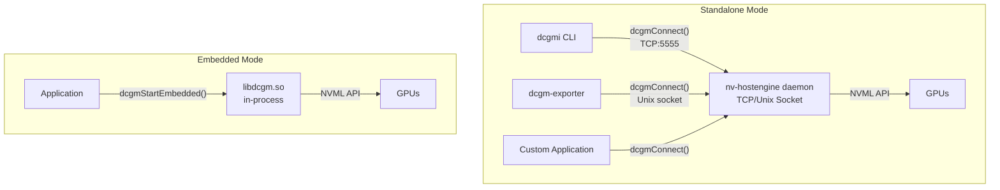
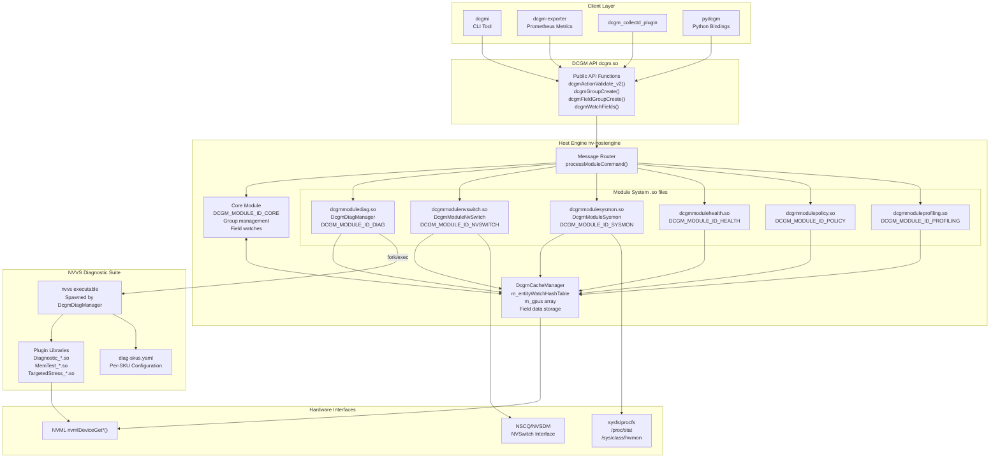
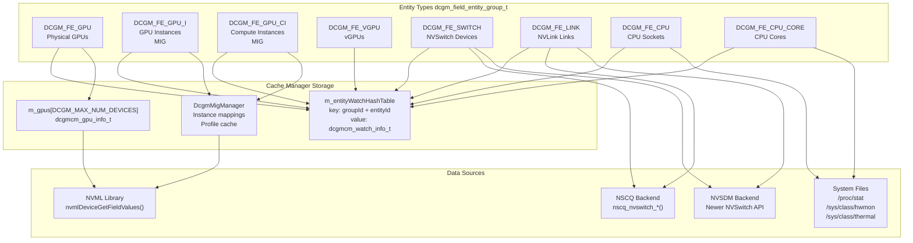
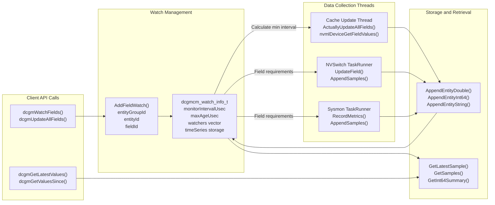

<!-- source: DeepWiki mcp.deepwiki.com · repo NVIDIA/DCGM · page 1 Overview · fetched 2026-10-26 -->

# Overview

Relevant source files

The following files were used as context for generating this wiki page:

- [README.md](README.md)
- [common/ThreeWayCmpDefault.hpp](common/ThreeWayCmpDefault.hpp)
- [modules/nvswitch/DcgmModuleNvSwitch.cpp](modules/nvswitch/DcgmModuleNvSwitch.cpp)
- [nvvs/include/NvvsJsonStrings.h](nvvs/include/NvvsJsonStrings.h)
- [testing/python3/tests/test_dcgm_collectd_plugin.py](testing/python3/tests/test_dcgm_collectd_plugin.py)

## Purpose and Scope

This document provides an overview of NVIDIA Data Center GPU Manager (DCGM), explaining its purpose, architecture, and key components. For detailed information about specific subsystems, refer to:
- Architecture details: [Architecture](#1.1)
- Installation and setup: [Installation](#1.2)
- Core components and internal APIs: [Core Components](#2)
- Individual modules: [Modules](#3)
- Diagnostic capabilities: [NVVS](#4)
- Building from source: [Building and Development](#5)

Sources: [README.md:1-147]()

## What is DCGM

DCGM is a daemon-based system for monitoring, managing, and diagnosing NVIDIA datacenter GPUs in cluster environments. It provides active health monitoring, comprehensive diagnostics, system alerts, and governance policies including power and clock management. The system is designed to simplify GPU administration, improve resource reliability and uptime, automate administrative tasks, and drive overall infrastructure efficiency.

DCGM supports Linux operating systems on x86_64, Arm (aarch64), and POWER (ppc64le) platforms. The software distribution includes:
- `libdcgm.so` - Core API library
- `nv-hostengine` - Host engine daemon
- `dcgmi` - Command-line interface
- NVVS (NVIDIA Validation Suite) - Diagnostic tool suite
- API bindings for C, Python (`pydcgm`), and Go

Sources: [README.md:1-24]()

## Deployment Models

DCGM supports two deployment models, both using the same `libdcgm.so` library:

**Standalone Mode**: The `nv-hostengine` daemon runs as a separate process. Client applications connect via TCP (default port 5555) or Unix domain sockets using `dcgmConnect()`. This is the recommended deployment for production environments as it provides isolation, persistence, and allows multiple clients to share a single DCGM instance.

**Embedded Mode**: Applications directly link against `libdcgm.so` and call `dcgmStartEmbedded()` to run the host engine in-process. This mode is useful for testing, development, or single-application deployments.

Sources: [README.md:6-24]()

## Core Architecture

The following diagram shows DCGM's primary components and their relationships with specific code entities:

The architecture follows a modular design with clear separation of concerns:

**API Layer (`libdcgm.so`)**: Provides the public C API including functions like `dcgmActionValidate_v2()`, `dcgmGroupCreate()`, and `dcgmWatchFields()`. This layer handles both embedded and remote connections.

**Message Router**: The `processModuleCommand()` function routes API calls to appropriate modules based on `moduleId` and `subCommand` fields in the message header.

**Core Module**: Manages fundamental operations including group management, field watch registration, and client connection handling. It coordinates with `DcgmCacheManager` for data operations.

**Cache Manager (`DcgmCacheManager`)**: Central data repository that maintains `m_entityWatchHashTable` for field watches and `m_gpus` array for GPU information. Collects metrics from hardware via NVML and system interfaces, implements the field watch system, and stores time-series data.

**Specialized Modules**: Each module provides domain-specific functionality:
- **Diag Module** (`dcgmmodulediag.so`): Orchestrates diagnostic runs through NVVS
- **NVSwitch Module** (`dcgmmodulenvswitch.so`): Manages NVSwitch devices via NSCQ/NVSDM
- **Sysmon Module** (`dcgmmodulesysmon.so`): Monitors CPU metrics via sysfs/procfs
- **Health Module**: Performs health checks
- **Policy Module**: Enforces policies
- **Profiling Module**: Collects profiling metrics

**NVVS Suite**: Separate process (`nvvs`) spawned by the Diag module for running diagnostic tests. Uses plugin architecture with per-CUDA-version builds. Configuration comes from `diag-skus.yaml`.

Sources: [README.md:1-147](), [modules/nvswitch/DcgmModuleNvSwitch.cpp:1-580]()

## Entity Hierarchy and Hardware Support

DCGM provides unified monitoring across heterogeneous hardware through its entity system:

The `DcgmCacheManager` maintains a unified view of all monitored entities through `m_entityWatchHashTable`, keyed by entity group ID and entity ID. Each entity type uses appropriate backend interfaces:

- **GPUs and MIG Instances**: Monitored via NVML (`nvmlDeviceGetFieldValues()`). The `DcgmMigManager` handles bidirectional mapping between DCGM entity IDs and NVML instance IDs
- **NVSwitch Devices and Links**: Accessed through NSCQ (legacy) or NVSDM (newer) backends, selected at runtime by `DcgmModuleNvSwitch`
- **CPUs and CPU Cores**: Monitored by `DcgmModuleSysmon` reading from `/proc/stat`, `/sys/class/hwmon`, and `/sys/class/thermal`

This design allows applications to monitor mixed environments (MIG-enabled and non-MIG GPUs, multi-socket CPUs, NVSwitch fabrics) through a unified API.

Sources: [modules/nvswitch/DcgmModuleNvSwitch.cpp:1-580]()

## Key Capabilities

### GPU Monitoring and Management
- Real-time field monitoring via the watch system with configurable update intervals
- Support for 1000+ fields including clocks, temperatures, power, utilization, memory, PCIe, NVLink
- Historical data retention with time-series storage in `DcgmCacheManager`
- Group-based operations for managing multiple GPUs
- MIG (Multi-Instance GPU) awareness with per-instance metrics

### Diagnostics (NVVS)
Comprehensive GPU validation through `nvvs` executable and plugin suite:
- **Diagnostic Plugin** (`Diagnostic_*.so`): GPU stress testing with GEMM operations
- **Memory Plugin** (`MemTest_*.so`): Memory subsystem validation
- **Targeted Stress** (`TargetedStress_*.so`): Sustained performance testing
- **PCIe Plugin**: Bandwidth and connectivity tests
- **EUD Plugin**: Extended Unit Diagnostics
- Per-GPU-SKU configuration via `diag-skus.yaml`
- Multi-CUDA-version support (11/12/13) for compatibility

### System Monitoring
The Sysmon module (`DcgmModuleSysmon`) provides CPU-level telemetry:
- Per-socket and per-core CPU utilization
- CPU temperatures from hwmon sensors
- CPU power consumption where available
- Integration with GPU metrics for holistic system view

### Health and Policy Management
- Active health monitoring via Health module
- Policy-based governance via Policy module
- Automated violation detection and reporting
- Event subscription for real-time notifications

### External Integrations
- **Kubernetes**: `dcgm-exporter` exports metrics as Prometheus endpoints
- **Collectd**: `dcgm_collectd_plugin` integrates with Collectd daemon
- **Python**: `pydcgm` bindings for Python applications
- **Go**: Go language bindings available

Sources: [README.md:1-147](), [testing/python3/tests/test_dcgm_collectd_plugin.py:1-200]()

## Data Flow and Field Watch System

The field watch system is DCGM's core mechanism for efficient metric collection:

**Watch Registration**: Clients call `dcgmWatchFields()` which creates or updates `dcgmcm_watch_info_t` entries in `m_entityWatchHashTable`. Each watch info tracks multiple watchers with potentially different intervals and retention policies.

**Interval Calculation**: The cache manager calculates the minimum required polling interval across all watchers for each field, optimizing data collection frequency.

**Data Collection**: Three primary collection mechanisms:
- **Pull Model (GPUs)**: Update thread periodically calls `nvmlDeviceGetFieldValues()` based on watch intervals
- **Push Model (NVSwitch)**: `DcgmModuleNvSwitch::UpdateField()` writes samples via `AppendSamples()`
- **Push Model (Sysmon)**: `DcgmModuleSysmon::RecordMetrics()` writes CPU metrics via `AppendSamples()`

**Storage**: Samples are stored in time-series format within each `dcgmcm_watch_info_t`, with automatic retention management based on `maxAgeUsec`.

**Retrieval**: Clients retrieve data via `dcgmGetLatestValues()` or `dcgmGetValuesSince()`, which internally call `GetLatestSample()` or `GetSamples()`.

Sources: [README.md:1-147]()

## Security and Reporting

For security vulnerability reporting, DCGM follows NVIDIA's standard security process. Security issues should be reported through the [NVIDIA Product Security](https://www.nvidia.com/en-us/security) website, not via GitHub issues. This ensures proper CVE creation and community notification.

For non-security bugs and feature requests, use the [GitHub issue tracker](https://github.com/NVIDIA/DCGM/issues).

Sources: [README.md:125-131]()

---

