# Page: Overview

# Overview

<details>
<summary>Relevant source files</summary>

The following files were used as context for generating this wiki page:

- [AV-Solutions/README.md](AV-Solutions/README.md)
- [README.md](README.md)

</details>


## Purpose and Scope

This document provides an overview of the DL4AGX repository, which contains model designs, deployment solutions for state-of-the-art networks, and inference samples for Autonomous Vehicle (AV) applications on NVIDIA DRIVE platforms. The repository is organized into two main components: deployment solutions (`AV-Solutions/`) and hardware-friendly model architectures (`Models/`).

For detailed information about specific deployment solutions, see [AV-Solutions: Deployment Solutions](#2). For information about efficient model architectures, see [Models: Efficient Architectures](#3).

## Repository Architecture

DL4AGX follows a two-branch architecture that separates research from deployment, enabling both the development of efficient models and their practical deployment on automotive hardware.

### High-Level Architecture

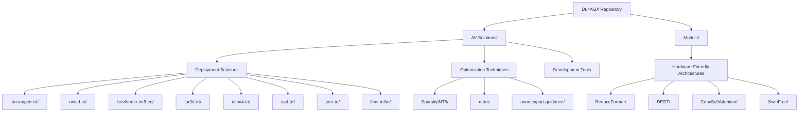

**Sources:** [README.md:1-27](), [AV-Solutions/README.md:1-37]()

## AV-Solutions: Deployment Branch

The `AV-Solutions/` directory contains deployment solutions for state-of-the-art autonomous vehicle models, focusing on TensorRT optimization and NVIDIA Drive platform deployment. This branch implements a common deployment pipeline that transforms PyTorch models into optimized TensorRT engines.

### Deployment Categories

| Category | Solutions | Purpose |
|----------|-----------|---------|
| 3D Object Detection | `far3d-trt/`, `vad-trt/`, `petr-trt/`, `streampetr-trt/` | Deploy 3D detection models with TensorRT |
| BEV Perception | `bevformer-int8-eq/` | BEV perception with explicit quantization |
| End-to-End Driving | `uniad-trt/` | Unified autonomous driving pipeline |
| Language Models | `llms-trtllm/` | LLM deployment with TensorRT-LLM |
| Specialized Components | `dcnv4-trt/` | Deformable convolution optimization |

### Optimization Techniques

| Technique | Implementation | Description |
|-----------|----------------|-------------|
| Quantization | `SparsityINT8/`, `bevformer-int8-eq/` | INT8 quantization and explicit quantization |
| Multi-device Inference | `mtmi/` | GPU and DLA parallel execution |
| ONNX Export | `onnx-export-guidance/` | TensorRT-friendly model export |

**Sources:** [AV-Solutions/README.md:1-37](), [README.md:8-20]()

## Models: Efficient Architectures Branch

The `Models/` directory provides hardware-friendly model architectures designed for improved accuracy, faster inference, and better resource utilization on edge devices.

### Model Architecture Overview

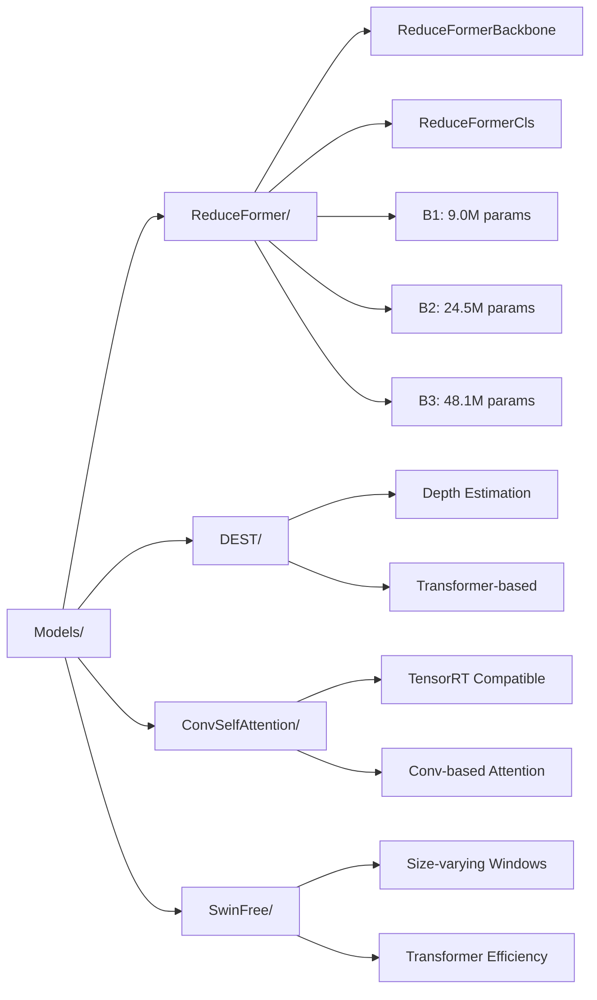

**Sources:** [README.md:21-25]()

## Target Platform and Technology Stack

### Hardware Platform

The repository primarily targets **NVIDIA Drive Orin** platforms, which provide:
- GPU cores for FP16/FP32 inference
- DLA (Deep Learning Accelerator) cores for INT8 inference
- Multi-device parallel execution capabilities

### Technology Stack

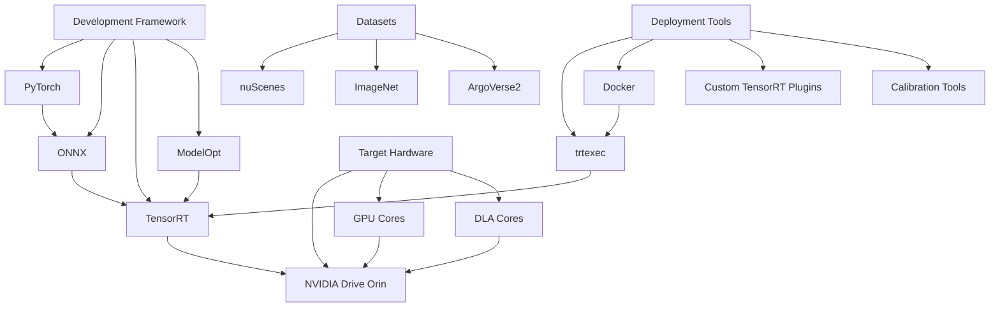

**Sources:** [AV-Solutions/README.md:1-37]()

## Development Workflow

### Standard Deployment Pipeline

The repository implements a consistent workflow across all deployment solutions:

1. **Model Development**: Start with PyTorch implementations
2. **ONNX Export**: Convert models using TorchScript-based ONNX exporter
3. **Optimization**: Apply quantization, sparsity, and other optimizations
4. **TensorRT Conversion**: Build optimized TensorRT engines
5. **Platform Deployment**: Deploy on NVIDIA Drive Orin hardware

### Cross-System Integration

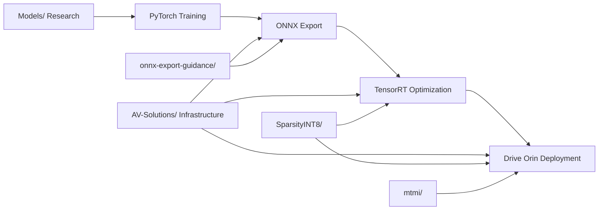

This workflow enables seamless integration between the research-focused `Models/` directory and the deployment-focused `AV-Solutions/` directory, providing a complete development and deployment ecosystem for autonomous vehicle deep learning applications.

**Sources:** [README.md:1-27](), [AV-Solutions/README.md:4-11]()

---

# Page: AV-Solutions: Deployment Solutions

# AV-Solutions: Deployment Solutions

<details>
<summary>Relevant source files</summary>

The following files were used as context for generating this wiki page:

- [AV-Solutions/README.md](AV-Solutions/README.md)
- [README.md](README.md)

</details>


## Purpose and Scope

The AV-Solutions directory provides deployment solutions for state-of-the-art autonomous vehicle models on NVIDIA DRIVE platforms using TensorRT. This system encompasses model optimization techniques, hardware-specific deployment pipelines, and inference applications designed for production autonomous vehicle systems.

This document covers the overall architecture and organization of deployment solutions. For detailed information about efficient model architectures designed for deployment, see [Models: Efficient Architectures](#3). For specific deployment workflows and implementation details of individual solutions, refer to the respective subsection pages [2.1](#2.1) through [2.7](#2.7).

## System Architecture

### Overall Deployment Pipeline

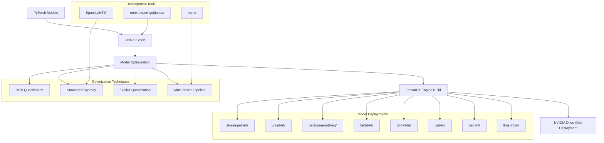

Sources: [AV-Solutions/README.md:1-37](), [README.md:8-19]()

### Model Categories and Solutions Mapping

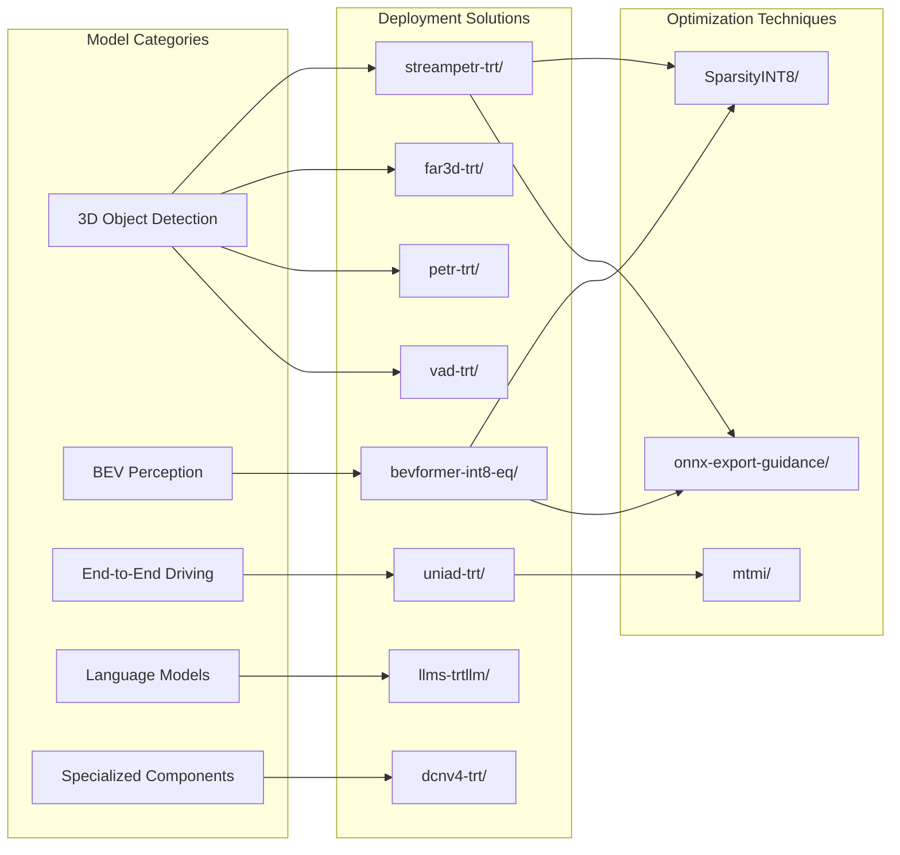

Sources: [AV-Solutions/README.md:13-35]()

## Deployment Solutions Overview

The AV-Solutions system is organized into three main categories: model-specific deployment solutions, optimization techniques, and development tools.

### Model-Specific Deployments

| Solution | Target Model | Primary Focus | Hardware Target |
|----------|--------------|---------------|-----------------|
| `streampetr-trt/` | [StreamPETR](https://github.com/exiawsh/StreamPETR) | 3D Object Detection | NVIDIA Drive Orin |
| `uniad-trt/` | [UniAD](https://arxiv.org/abs/2212.10156) | End-to-End Autonomous Driving | NVIDIA Drive Orin |
| `dcnv4-trt/` | [DCNv4](https://github.com/OpenGVLab/DCNv4) | Deformable Convolution Optimization | NVIDIA Drive Orin |
| `bevformer-int8-eq/` | [BEVFormer](https://github.com/fundamentalvision/BEVFormer) | BEV Perception with INT8 | NVIDIA GPUs |
| `far3d-trt/` | [Far3D](https://github.com/megvii-research/Far3D) | 3D Object Detection | NVIDIA Drive Orin |
| `llms-trtllm/` | Llama-3.1-8B, DeepSeek-R1 | Large Language Models | NVIDIA Drive Orin |
| `vad-trt/` | [VADv1](https://github.com/hustvl/VAD) | Vector-based Autonomous Driving | NVIDIA Drive Orin |
| `petr-trt/` | [PETRv1&v2](https://github.com/megvii-research/PETR) | 3D Object Detection | NVIDIA Drive Orin |

Sources: [AV-Solutions/README.md:13-35]()

### Optimization Techniques and Tools

| Component | Purpose | Key Features |
|-----------|---------|--------------|
| `SparsityINT8/` | Combines structured sparsity with INT8 quantization | PyTorch training workflow, TensorRT inference |
| `mtmi/` | Multi-task model inference across GPU and DLA | Simultaneous GPU/DLA deployment |
| `onnx-export-guidance/` | ONNX export best practices | TorchScript-based export guidance |

Sources: [AV-Solutions/README.md:4-11]()

## Hardware Architecture and Optimization

### NVIDIA Drive Orin Deployment Strategy

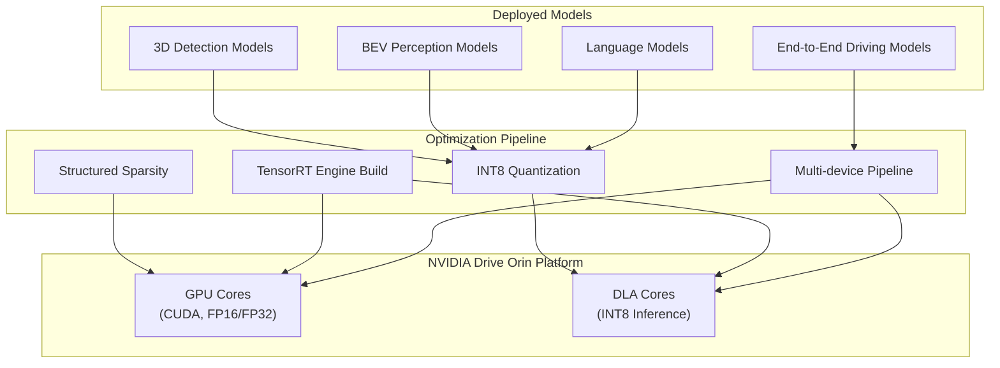

Sources: [AV-Solutions/README.md:10-11](), [AV-Solutions/README.md:22-35]()

## Technology Stack Integration

The deployment solutions leverage a consistent technology stack across all model implementations:

- **Framework Pipeline**: PyTorch → ONNX → TensorRT → NVIDIA Drive Orin
- **Optimization Methods**: INT8 quantization, structured sparsity, explicit quantization
- **Hardware Utilization**: GPU and DLA acceleration with multi-device inference
- **Development Support**: Docker environments, custom TensorRT plugins, calibration tools

The system provides both model-specific optimization examples and general-purpose tools for deploying autonomous vehicle deep learning models in production environments.

Sources: [AV-Solutions/README.md:1-37](), [README.md:5-19]()

---

# Page: Deployment Architecture and Workflow

# Deployment Architecture and Workflow

<details>
<summary>Relevant source files</summary>

The following files were used as context for generating this wiki page:

- [AV-Solutions/README.md](AV-Solutions/README.md)
- [README.md](README.md)

</details>


## Purpose and Scope

This document describes the common deployment architecture and workflow used across all AV-Solutions in the DL4AGX repository. It covers the standardized pipeline for converting PyTorch models to TensorRT engines optimized for NVIDIA Drive Orin platforms, including optimization strategies, hardware targeting approaches, and supporting infrastructure.

For specific deployment implementations, see the individual solution pages under section 2. For hardware-friendly model architectures that can be deployed using this workflow, see [Models: Efficient Architectures](#3).

## Overall Deployment Architecture

The deployment architecture follows a standardized pipeline that transforms PyTorch models into optimized TensorRT engines for autonomous vehicle applications.

### Core Deployment Pipeline

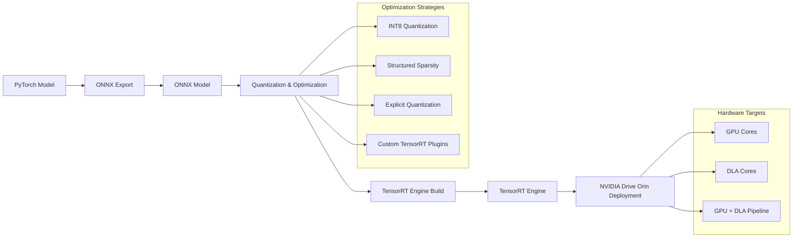

Sources: [AV-Solutions/README.md:1-37](), [README.md:1-27]()

## Core Workflow Stages

### PyTorch to ONNX Export

The first stage converts PyTorch models to ONNX format using TorchScript-based exporters. This critical step requires careful handling of complex AV model architectures to ensure TensorRT compatibility.

| Component | Description | Reference |
|-----------|-------------|-----------|
| Export Guidance | Comprehensive tips for TensorRT-friendly ONNX export | `onnx-export-guidance/` |
| TorchScript Exporter | PyTorch's built-in ONNX exporter | External dependency |
| Model Preprocessing | Architecture-specific preparations | Per-solution implementation |

**Common Export Challenges:**
- Complex attention mechanisms in transformer-based models
- Custom layer implementations requiring plugin support
- Dynamic shape handling for variable input sizes
- Maintaining numerical precision during conversion

Sources: [AV-Solutions/README.md:4-5]()

### TensorRT Optimization

The optimization stage applies various techniques to improve inference performance while maintaining model accuracy.

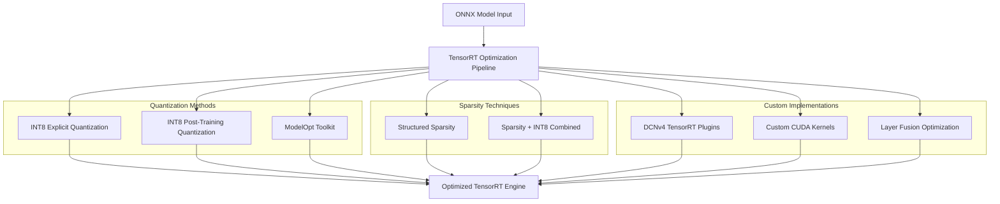

Sources: [AV-Solutions/README.md:7-8](), [AV-Solutions/README.md:19-20](), [AV-Solutions/README.md:22-23]()

### Hardware Deployment

The final stage deploys optimized engines to NVIDIA Drive Orin hardware, targeting specific compute units based on model requirements and performance constraints.

| Deployment Target | Use Cases | Optimization Focus |
|------------------|-----------|-------------------|
| GPU Cores | High-throughput inference, FP16/FP32 precision | Memory bandwidth, compute intensity |
| DLA Cores | Power-efficient INT8 inference | Energy efficiency, structured operations |
| Multi-device Pipeline | Complex multi-task models | Load balancing, synchronization |

Sources: [AV-Solutions/README.md:10-11]()

## Optimization Strategies

### Quantization Approaches

The repository implements multiple quantization strategies depending on model architecture and accuracy requirements:

**INT8 Explicit Quantization**: Used in solutions like `bevformer-int8-eq` for precise control over quantization parameters.

**Sparsity with INT8**: Combines structured sparsity and quantization as demonstrated in `SparsityINT8/` for maximum efficiency.

**ModelOpt Integration**: Leverages NVIDIA's ModelOpt toolkit for automated quantization workflows.

Sources: [AV-Solutions/README.md:22-23](), [AV-Solutions/README.md:7-8]()

### Custom Plugin Development

Several solutions implement custom TensorRT plugins for operations not natively supported:

| Solution | Custom Plugin | Purpose |
|----------|---------------|---------|
| `dcnv4-trt` | Deformable Convolution v4 | Optimized DCNv4 operations |
| `streampetr-trt` | StreamPETR-specific | Temporal feature aggregation |
| `uniad-trt` | UniAD components | End-to-end driving pipeline |

Sources: [AV-Solutions/README.md:19-20](), [AV-Solutions/README.md:13-14](), [AV-Solutions/README.md:16-17]()

## Hardware Targeting

### NVIDIA Drive Orin Platform

All deployment solutions target the NVIDIA Drive Orin platform, which provides:

- **GPU Cores**: High-performance compute for complex models
- **DLA Cores**: Dedicated deep learning accelerators for efficient inference
- **Unified Memory Architecture**: Optimized data movement between compute units

### Multi-Device Inference

The `mtmi/` solution demonstrates advanced multi-device deployment:

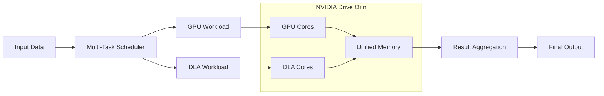

Sources: [AV-Solutions/README.md:10-11]()

## Infrastructure Components

### Development Environment

The deployment workflow relies on several infrastructure components:

| Component | Purpose | Implementation |
|-----------|---------|----------------|
| Docker Environments | Consistent build environments | Per-solution Dockerfiles |
| `trtexec` Tool | TensorRT engine building and benchmarking | NVIDIA TensorRT toolkit |
| Calibration Data | INT8 quantization calibration | Dataset-specific implementations |
| Build Systems | Automated compilation and deployment | CMake-based build scripts |

### Model-Specific Solutions

Each AV-Solution provides a complete implementation of this deployment architecture:

- **3D Object Detection**: `far3d-trt`, `vad-trt`, `petr-trt`
- **BEV Perception**: `bevformer-int8-eq`
- **End-to-End Driving**: `uniad-trt`
- **Language Models**: `llms-trtllm`
- **Temporal Processing**: `streampetr-trt`

Sources: [AV-Solutions/README.md:25-36](), [AV-Solutions/README.md:28-29]()

The deployment architecture provides a standardized yet flexible framework that accommodates the diverse requirements of autonomous vehicle deep learning models while maintaining consistent optimization and deployment practices across all solutions.

---

# Page: 3D Object Detection Solutions

# 3D Object Detection Solutions

<details>
<summary>Relevant source files</summary>

The following files were used as context for generating this wiki page:

- [AV-Solutions/far3d-trt/README.md](AV-Solutions/far3d-trt/README.md)
- [AV-Solutions/far3d-trt/docker/Dockerfile](AV-Solutions/far3d-trt/docker/Dockerfile)
- [AV-Solutions/far3d-trt/patch/far3d.patch](AV-Solutions/far3d-trt/patch/far3d.patch)
- [AV-Solutions/far3d-trt/tools/export_onnx.py](AV-Solutions/far3d-trt/tools/export_onnx.py)
- [AV-Solutions/far3d-trt/tools/quantize_onnx.py](AV-Solutions/far3d-trt/tools/quantize_onnx.py)
- [AV-Solutions/far3d-trt/tools/test_tensorrt.py](AV-Solutions/far3d-trt/tools/test_tensorrt.py)
- [AV-Solutions/vad-trt/.gitignore](AV-Solutions/vad-trt/.gitignore)
- [AV-Solutions/vad-trt/LICENSE](AV-Solutions/vad-trt/LICENSE)
- [AV-Solutions/vad-trt/README.md](AV-Solutions/vad-trt/README.md)
- [AV-Solutions/vad-trt/app/.gitignore](AV-Solutions/vad-trt/app/.gitignore)
- [AV-Solutions/vad-trt/app/CMakeLists.txt](AV-Solutions/vad-trt/app/CMakeLists.txt)
- [AV-Solutions/vad-trt/app/demo/.gitignore](AV-Solutions/vad-trt/app/demo/.gitignore)
- [AV-Solutions/vad-trt/app/demo/config.json](AV-Solutions/vad-trt/app/demo/config.json)
- [AV-Solutions/vad-trt/app/demo/data/.gitkeep](AV-Solutions/vad-trt/app/demo/data/.gitkeep)
- [AV-Solutions/vad-trt/app/demo/onnx_files/.gitkeep](AV-Solutions/vad-trt/app/demo/onnx_files/.gitkeep)
- [AV-Solutions/vad-trt/app/lib/check.hpp](AV-Solutions/vad-trt/app/lib/check.hpp)

</details>


This page documents the deployment solutions for 3D object detection models in the AV-Solutions directory. The solutions provide optimized TensorRT implementations of state-of-the-art 3D detection models for deployment on NVIDIA Drive Orin platforms.

For general deployment architecture and workflow information, see [Deployment Architecture and Workflow](#2.1). For end-to-end driving solutions that include planning capabilities, see [End-to-End Driving Solutions](#2.4).

## Overview

The 3D object detection solutions implement two primary models:

| Model | Type | Key Features | Target Dataset |
|-------|------|--------------|----------------|
| Far3D | Camera-only 3D Detection | 2D detector initialization, perspective-aware feature aggregation | Argoverse2 |
| VAD | End-to-end Vectorized Detection | Temporal modeling, vectorized scene representation | nuScenes |

Both solutions follow the standard deployment pipeline from PyTorch models to optimized TensorRT engines running on NVIDIA Drive Orin hardware.

## Deployment Architecture

The 3D object detection deployment follows a common multi-stage architecture:

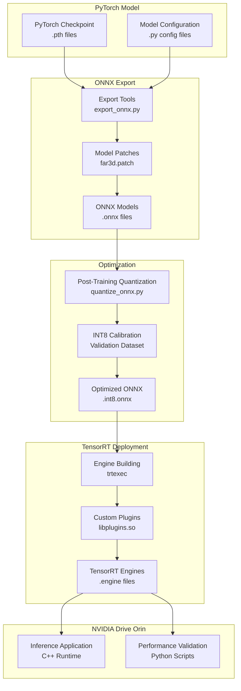

**Sources:** [AV-Solutions/far3d-trt/README.md:25-89](), [AV-Solutions/vad-trt/README.md:47-64]()

## Far3D TensorRT Implementation

Far3D implements camera-only 3D object detection using adaptive query mechanisms and multi-scale deformable attention.

### Model Architecture Components

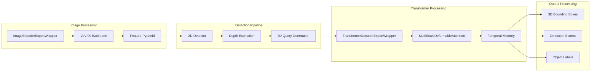

**Sources:** [AV-Solutions/far3d-trt/tools/export_onnx.py:186-236](), [AV-Solutions/far3d-trt/tools/export_onnx.py:239-303]()

### Export Workflow

The Far3D export process involves two main wrapper classes:

- **`ImageEncoderExportWrapper`**: Handles image feature extraction and 2D detection
- **`TransformerDecoderExportWrapper`**: Manages 3D query processing and temporal memory

Key export steps:

1. **Model Preparation**: Load checkpoint and apply patches from [AV-Solutions/far3d-trt/patch/far3d.patch:1-28327]()
2. **ONNX Export**: Export encoder and decoder separately using [AV-Solutions/far3d-trt/tools/export_onnx.py:452-504]()
3. **MSDA Plugin Patching**: Apply multi-scale deformable attention fixes via [AV-Solutions/far3d-trt/tools/export_onnx.py:353-393]()

### Quantization Support

Far3D supports INT8 quantization for the image encoder:

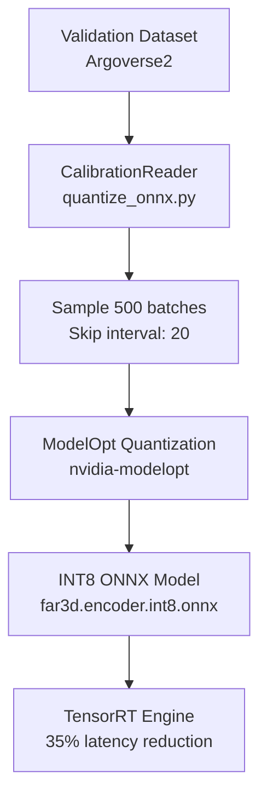

**Sources:** [AV-Solutions/far3d-trt/tools/quantize_onnx.py:64-80](), [AV-Solutions/far3d-trt/tools/quantize_onnx.py:143-149]()

### Performance Results

| Precision | Framework | GPU Compute Time (ms) | Accuracy (mAP) |
|-----------|-----------|----------------------|----------------|
| FP32 + FP32 | PyTorch 1.13.1 | 730.0 | 0.241 |
| FP16 + FP32 | TensorRT 8.6 | 367.4 | 0.233 |
| FP16 + FP16 | TensorRT 10.9 | 203.9 | 0.232 |
| INT8 + FP16 | TensorRT 10.9 | 132.3 | 0.230 |

**Sources:** [AV-Solutions/far3d-trt/README.md:177-185]()

## VAD TensorRT Implementation

VAD (Vectorized Scene Representation for Efficient Autonomous Driving) implements an end-to-end approach with temporal modeling.

### Temporal Model Architecture

VAD handles temporal sequences differently for first and subsequent frames:

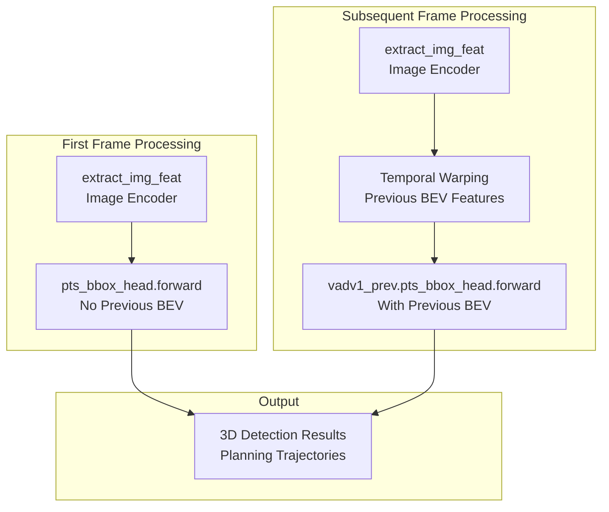

**Sources:** [AV-Solutions/vad-trt/README.md:54-64]()

### Custom Plugin System

VAD requires custom TensorRT plugins for specialized operations:

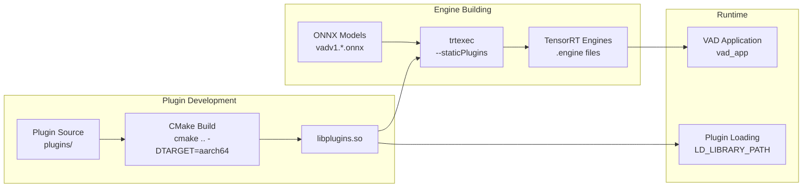

**Sources:** [AV-Solutions/vad-trt/README.md:134-143](), [AV-Solutions/vad-trt/README.md:204-221]()

### Demo Application

VAD includes a complete C++ inference application:

- **Configuration**: JSON-based setup via [AV-Solutions/vad-trt/app/demo/config.json:1-33]()
- **Visualization**: Integration with cuOSD for result rendering
- **Multi-engine Support**: Separate backbone and head engines

## Common Code Patterns

### TensorRT Inference Base Class

Both solutions utilize common inference patterns through the `TRTInferenceBase` class:

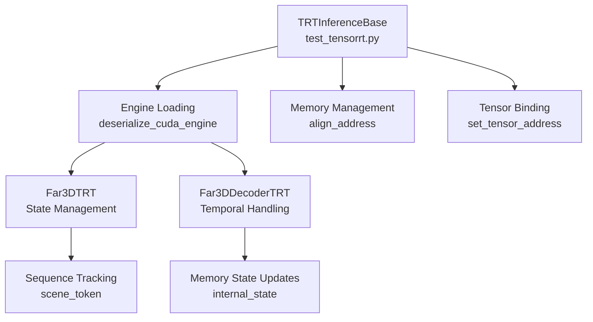

**Sources:** [AV-Solutions/far3d-trt/tools/test_tensorrt.py:142-230](), [AV-Solutions/far3d-trt/tools/test_tensorrt.py:232-296]()

### Memory State Management

Both Far3D and VAD implement temporal memory management:

- **State Variables**: `memory_embedding`, `memory_reference_point`, `memory_timestamp`, `memory_egopose`, `memory_velo`
- **Sequence Reset**: Triggered by scene token changes
- **State Persistence**: Maintained across frames within sequences

**Sources:** [AV-Solutions/far3d-trt/tools/export_onnx.py:237](), [AV-Solutions/far3d-trt/tools/test_tensorrt.py:244-246]()

## Deployment Considerations

### Hardware Requirements
- **Target Platform**: NVIDIA Drive Orin
- **TensorRT Versions**: 8.6.13.3 (VAD), 8.6/10.9 (Far3D)
- **Memory Alignment**: 256-byte boundary requirements for tensor addresses

### Build Dependencies
- **Cross-compilation**: NVIDIA DRIVE SDK docker images
- **Plugin Support**: Custom operation implementations
- **Dataset Access**: Argoverse2 (Far3D), nuScenes (VAD)

**Sources:** [AV-Solutions/far3d-trt/README.md:99-114](), [AV-Solutions/vad-trt/README.md:122-133]()

---

# Page: BEV Perception Solutions

# BEV Perception Solutions

<details>
<summary>Relevant source files</summary>

The following files were used as context for generating this wiki page:

- [AV-Solutions/bevformer-int8-eq/LICENSE](AV-Solutions/bevformer-int8-eq/LICENSE)
- [AV-Solutions/bevformer-int8-eq/README.md](AV-Solutions/bevformer-int8-eq/README.md)
- [AV-Solutions/bevformer-int8-eq/bevformer_trt10.patch](AV-Solutions/bevformer-int8-eq/bevformer_trt10.patch)
- [AV-Solutions/bevformer-int8-eq/docker/tensorrt.Dockerfile](AV-Solutions/bevformer-int8-eq/docker/tensorrt.Dockerfile)
- [AV-Solutions/bevformer-int8-eq/results/deploy_trt.sh](AV-Solutions/bevformer-int8-eq/results/deploy_trt.sh)
- [AV-Solutions/bevformer-int8-eq/results/evaluate_trt.sh](AV-Solutions/bevformer-int8-eq/results/evaluate_trt.sh)
- [AV-Solutions/bevformer-int8-eq/results/onnx2trt_calib_npz.py](AV-Solutions/bevformer-int8-eq/results/onnx2trt_calib_npz.py)
- [AV-Solutions/bevformer-int8-eq/tools/calib_data_prep.py](AV-Solutions/bevformer-int8-eq/tools/calib_data_prep.py)
- [AV-Solutions/bevformer-int8-eq/tools/onnx_postprocess.py](AV-Solutions/bevformer-int8-eq/tools/onnx_postprocess.py)
- [AV-Solutions/bevformer-int8-eq/tools/quantize_model.py](AV-Solutions/bevformer-int8-eq/tools/quantize_model.py)

</details>


This document covers the deployment of BEVFormer models using explicit quantization techniques with NVIDIA's ModelOpt Toolkit for TensorRT optimization. The solution provides an end-to-end workflow from PyTorch model export to TensorRT engine deployment with INT8 quantization for improved inference performance on NVIDIA Drive platforms.

For information about other 3D object detection solutions, see [3D Object Detection Solutions](#2.2). For end-to-end driving solutions, see [End-to-End Driving Solutions](#2.4).

## Overview and Architecture

The BEV Perception Solutions system implements a comprehensive deployment pipeline for BEVFormer models, focusing on explicit quantization using the ModelOpt toolkit. This approach provides better control over quantization placement compared to implicit TensorRT quantization methods.

### Deployment Workflow

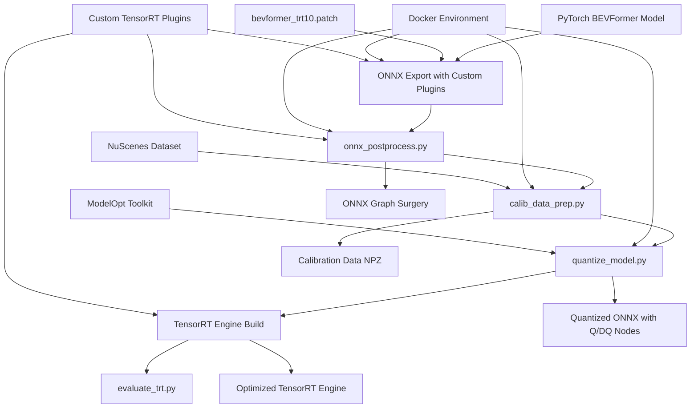

Sources: [AV-Solutions/bevformer-int8-eq/README.md:1-152]()

### Key Components and Dependencies

The system relies on several critical components working together:

| Component | Purpose | Key Files |
|-----------|---------|-----------|
| ONNX Post-processing | Handle custom TensorRT plugins and graph updates | `tools/onnx_postprocess.py` |
| Calibration Data Preparation | Generate representative data for quantization | `tools/calib_data_prep.py` |
| Model Quantization | Apply explicit quantization with ModelOpt | `tools/quantize_model.py` |
| TensorRT Engine Building | Create optimized inference engines | `results/onnx2trt_calib_npz.py` |
| Accuracy Evaluation | Validate deployment results | Modified evaluation scripts |

Sources: [AV-Solutions/bevformer-int8-eq/README.md:5-11](), [AV-Solutions/bevformer-int8-eq/tools/onnx_postprocess.py:1-266](), [AV-Solutions/bevformer-int8-eq/tools/calib_data_prep.py:1-165]()

## ONNX Export and Post-processing

### Custom Plugin Integration

The ONNX export process requires careful handling of custom TensorRT plugins used in BEVFormer architecture. The `onnx_postprocess.py` tool automatically detects and configures these plugins for ONNX Runtime compatibility.

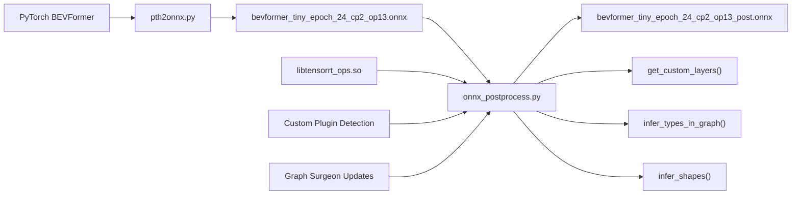

The `get_custom_layers()` function in `onnx_postprocess.py` performs TensorRT network parsing to identify custom plugin layers:

- Loads custom plugin libraries using `ctypes.CDLL()`
- Creates TensorRT builder and network for ONNX parsing
- Identifies layers with `"PLUGIN"` type designation
- Extracts tensor shapes and names for graph surgery

Sources: [AV-Solutions/bevformer-int8-eq/tools/onnx_postprocess.py:43-91](), [AV-Solutions/bevformer-int8-eq/README.md:58-69]()

### Graph Surgery Operations

The post-processing pipeline performs three critical operations:

1. **Custom Op Domain Assignment**: Updates custom operations to use `trt.plugins` domain for ONNX Runtime compatibility
2. **Type Inference**: Ensures all tensors have appropriate data types using `infer_types_in_graph()`
3. **Shape Inference**: Updates tensor shapes throughout the graph using `infer_shapes()`

Sources: [AV-Solutions/bevformer-int8-eq/tools/onnx_postprocess.py:94-200](), [AV-Solutions/bevformer-int8-eq/tools/onnx_postprocess.py:217-246]()

## Calibration Data Generation

### Dataset Processing Pipeline

The calibration data preparation uses the NuScenes dataset to generate representative input samples for quantization. The `calib_data_prep.py` script implements a sophisticated data processing pipeline that maintains temporal consistency across BEV sequences.

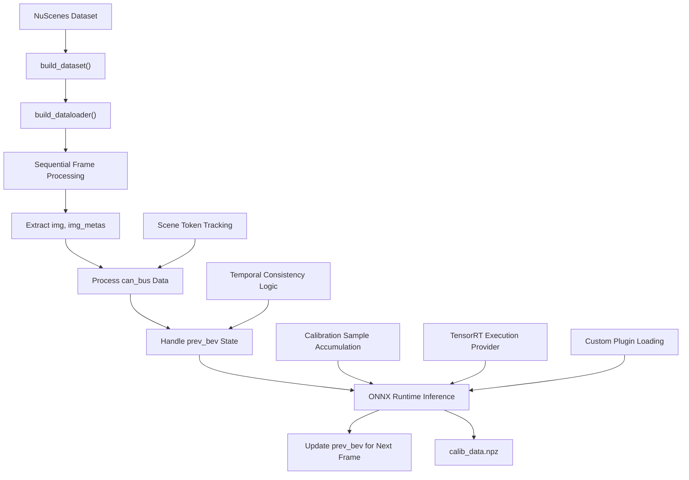

The calibration process maintains temporal consistency by tracking scene tokens and managing `prev_bev` state transitions:

- Uses `use_prev_bev` flag to handle scene boundaries
- Processes CAN bus data for ego vehicle motion
- Accumulates 600 calibration samples by default
- Executes ONNX Runtime to maintain BEV feature continuity

Sources: [AV-Solutions/bevformer-int8-eq/tools/calib_data_prep.py:63-161](), [AV-Solutions/bevformer-int8-eq/README.md:71-78]()

### Data Format and Structure

The calibration data is stored in NPZ format containing the following tensors:

| Input Name | Shape | Description |
|------------|-------|-------------|
| `image` | `[N, 6, 3, 256, 704]` | Multi-camera input images |
| `prev_bev` | `[N, 40000, 1, 256]` | Previous BEV feature embeddings |
| `use_prev_bev` | `[N, 1]` | Flag for temporal continuity |
| `can_bus` | `[N, 18]` | Vehicle motion and pose data |
| `lidar2img` | `[N, 1, 6, 4, 4]` | Camera calibration matrices |

Sources: [AV-Solutions/bevformer-int8-eq/tools/calib_data_prep.py:130-136]()

## ModelOpt Quantization Process

### Explicit Quantization Workflow

The `quantize_model.py` script implements explicit quantization using NVIDIA's ModelOpt toolkit, providing precise control over quantization placement through Q/DQ (Quantize/Dequantize) node insertion.

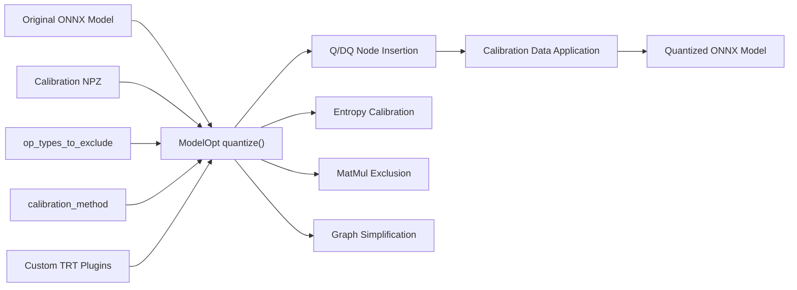

Key quantization parameters:

- **Calibration Method**: Uses entropy-based calibration for optimal threshold selection
- **Operation Exclusion**: Excludes `MatMul` operations from quantization to preserve transformer accuracy
- **Plugin Support**: Maintains compatibility with custom TensorRT plugins
- **Graph Simplification**: Optional ONNX graph optimization

Sources: [AV-Solutions/bevformer-int8-eq/tools/quantize_model.py:84-102](), [AV-Solutions/bevformer-int8-eq/README.md:84-103]()

### Quantization Strategy

The explicit quantization approach provides several advantages over implicit TensorRT quantization:

1. **Controlled Placement**: Q/DQ nodes explicitly define quantization boundaries
2. **Operator Selection**: Fine-grained control over which operations to quantize
3. **Calibration Transparency**: Clear visibility into calibration data usage
4. **Cross-platform Compatibility**: Quantized models work across different TensorRT versions

The system specifically excludes `MatMul` operations from quantization based on NVIDIA's recommendation for transformer-based models, where multi-head attention blocks perform better in FP16 precision.

Sources: [AV-Solutions/bevformer-int8-eq/README.md:95-98]()

## TensorRT Engine Optimization

### Engine Building Process

The TensorRT engine building process supports both explicit and implicit quantization approaches for performance comparison:

```mermaid
graph TD
    A["Quantized ONNX Model"] --> B["trtexec Engine Build"]
    C["Original ONNX Model"] --> D["onnx2trt_calib_npz.py"]
    
    B --> E["Explicit Quantization Engine"]
    D --> F["Implicit Quantization Engine"]
    
    G["--staticPlugins"] --> B
    G --> D
    H["Custom Plugin Library"] --> G
    
    I["Calibration Data NPZ"] --> D
    J["--best Optimization"] --> B
    K["DictDataset Wrapper"] --> D
    
    E --> L["Performance Evaluation"]
    F --> L
```

The explicit quantization path uses standard `trtexec` with the pre-quantized ONNX model, while implicit quantization uses a custom calibrator implementation in `onnx2trt_calib_npz.py`.

Sources: [AV-Solutions/bevformer-int8-eq/README.md:105-114](), [AV-Solutions/bevformer-int8-eq/results/onnx2trt_calib_npz.py:104-153]()

### Custom Calibrator Implementation

The `DictDataset` class in `onnx2trt_calib_npz.py` wraps calibration data for TensorRT's implicit quantization:

- Implements PyTorch `Dataset` interface for TensorRT calibrator
- Handles dynamic batch sizing based on input shapes
- Manages multi-input tensor formatting for BEVFormer requirements
- Provides data streaming for calibration process

The calibrator decodes input tensors with specific handling for BEVFormer's multi-modal inputs: `image`, `prev_bev`, `use_prev_bev`, `can_bus`, and `lidar2img`.

Sources: [AV-Solutions/bevformer-int8-eq/results/onnx2trt_calib_npz.py:77-133]()

## Performance Results and Evaluation

### Quantization Performance Comparison

The deployment achieves significant performance improvements through quantization while maintaining accuracy:

| Precision | GPU Compute Time (ms) | Accuracy (NDS / mAP) |
|-----------|----------------------|---------------------|
| FP32 | 18.82 | NDS: 0.354, mAP: 0.252 |
| FP16 | 9.36 | NDS: 0.354, mAP: 0.251 |
| TensorRT PTQ (Implicit) | 6.20 | NDS: 0.353, mAP: 0.250 |
| ModelOpt PTQ (Explicit) | 6.02 | NDS: 0.352, mAP: 0.251 |

The explicit quantization approach achieves slightly better performance than implicit quantization while maintaining comparable accuracy.

Sources: [AV-Solutions/bevformer-int8-eq/README.md:126-147]()

### Evaluation Infrastructure

The accuracy evaluation uses modified scripts that integrate with the TensorRT deployment:

```mermaid
graph LR
    A["TensorRT Engine"] --> B["evaluate_trt.py"]
    B --> C["NuScenes Evaluation"]
    C --> D["NDS/mAP Metrics"]
    
    E["Custom Plugin Loading"] --> B
    F["Modified TensorRT Utils"] --> B
    G["Updated Context API"] --> B
    
    H["do_inference()"] --> B
    I["allocate_buffers()"] --> B
    J["load_tensorrt_plugin()"] --> B
```

The evaluation infrastructure includes updates for TensorRT 10 compatibility, with modified memory allocation and execution APIs in the utility functions.

Sources: [AV-Solutions/bevformer-int8-eq/results/evaluate_trt.sh:1-56](), [AV-Solutions/bevformer-int8-eq/bevformer_trt10.patch:509-620]()

## TensorRT 10 Compatibility

### Plugin Interface Updates

The `bevformer_trt10.patch` file addresses compatibility changes in TensorRT 10, primarily related to data type handling and plugin interfaces:

- Updates integer type definitions using conditional compilation
- Modifies plugin kernel signatures for TensorRT 10 compatibility
- Handles changes in tensor address management
- Updates execution context API usage

Key changes include the introduction of `TRT_INT_TYPE` typedef for handling int32/int64 differences across TensorRT versions and updates to plugin kernel function signatures.

Sources: [AV-Solutions/bevformer-int8-eq/bevformer_trt10.patch:1-620]()

### Docker Environment

The Docker environment provides a controlled deployment platform with all necessary dependencies:

- TensorRT 24.08 base image with CUDA 12 support
- ModelOpt toolkit 0.27.1 for quantization
- Custom compilation of BEVFormer TensorRT plugins
- Integration with MMDetection and MMCV frameworks

The environment ensures reproducible deployment across different systems while managing complex dependency requirements.

Sources: [AV-Solutions/bevformer-int8-eq/docker/tensorrt.Dockerfile:1-101]()

---

# Page: End-to-End Driving Solutions

# End-to-End Driving Solutions

<details>
<summary>Relevant source files</summary>

The following files were used as context for generating this wiki page:

- [.gitattributes](.gitattributes)
- [.gitignore](.gitignore)
- [AV-Solutions/uniad-trt/README.md](AV-Solutions/uniad-trt/README.md)
- [AV-Solutions/uniad-trt/assets/uniad_best_eq_video.gif](AV-Solutions/uniad-trt/assets/uniad_best_eq_video.gif)
- [AV-Solutions/uniad-trt/assets/uniad_fp32_video.gif](AV-Solutions/uniad-trt/assets/uniad_fp32_video.gif)
- [AV-Solutions/uniad-trt/docker/requirements.txt](AV-Solutions/uniad-trt/docker/requirements.txt)
- [AV-Solutions/uniad-trt/documents/data_prep.md](AV-Solutions/uniad-trt/documents/data_prep.md)
- [AV-Solutions/uniad-trt/documents/env_prep.md](AV-Solutions/uniad-trt/documents/env_prep.md)
- [AV-Solutions/uniad-trt/documents/explicit_quantization.md](AV-Solutions/uniad-trt/documents/explicit_quantization.md)
- [AV-Solutions/uniad-trt/documents/proj_setup.md](AV-Solutions/uniad-trt/documents/proj_setup.md)
- [AV-Solutions/uniad-trt/documents/train_export.md](AV-Solutions/uniad-trt/documents/train_export.md)
- [AV-Solutions/uniad-trt/inference_app/README.md](AV-Solutions/uniad-trt/inference_app/README.md)
- [AV-Solutions/uniad-trt/patch/uniad-onnx-export.patch](AV-Solutions/uniad-trt/patch/uniad-onnx-export.patch)
- [AV-Solutions/uniad-trt/patch/uniad-tiny-training-support.patch](AV-Solutions/uniad-trt/patch/uniad-tiny-training-support.patch)
- [AV-Solutions/uniad-trt/tools/add_onnx_export_support.sh](AV-Solutions/uniad-trt/tools/add_onnx_export_support.sh)
- [AV-Solutions/uniad-trt/tools/postprocess_bevformer_tiny_epoch_24_pth.py](AV-Solutions/uniad-trt/tools/postprocess_bevformer_tiny_epoch_24_pth.py)

</details>


This document covers the deployment of UniAD (Unified Autonomous Driving) models on NVIDIA Drive Orin platforms using TensorRT. The solution provides a complete end-to-end pipeline from multi-view vision input to planning outputs, encompassing detection, tracking, motion prediction, occupancy estimation, and path planning in a unified framework.

For Bird's Eye View perception deployment without end-to-end planning, see [BEV Perception Solutions](#2.3). For general deployment architecture patterns, see [Deployment Architecture and Workflow](#2.1).

## UniAD Architecture Overview

UniAD implements a unified autonomous driving framework that processes multi-view camera inputs through several interconnected modules to produce final driving decisions.

### System Architecture

```mermaid
graph TD
    A["Multi-view Images"] --> B["BEVFormer Backbone"]
    B --> C["BEV Feature Extraction"]
    C --> D["Track Head"]
    C --> E["Motion Head"] 
    C --> F["Map Segmentation Head"]
    C --> G["Occupancy Head"]
    C --> H["Planning Head"]
    
    D --> I["Object Detection & Tracking"]
    E --> J["Motion Prediction"]
    F --> K["Lane Detection"]
    G --> L["Occupancy Prediction"] 
    H --> M["Path Planning"]
    
    I --> N["Unified Driving Decision"]
    J --> N
    K --> N
    L --> N
    M --> N
    
    subgraph "TensorRT Optimization"
        O["MotionHeadTRT"]
        P["ONNX Export"]
        Q["TensorRT Engine"]
    end
    
    E --> O
    O --> P
    P --> Q
```

**UniAD End-to-End Pipeline Architecture**

Sources: [AV-Solutions/uniad-trt/README.md:1-8](), [AV-Solutions/uniad-trt/patch/uniad-onnx-export.patch:24-25]()

### Core Components

The UniAD system consists of several key detector classes and head modules:

| Component | Class Name | Purpose |
|-----------|------------|---------|
| Main Detector | `UniAD` | End-to-end driving with all modules |
| Base Detector | `UniADTrack` | Detection and tracking foundation |
| Motion Prediction | `MotionHead` / `MotionHeadTRT` | Trajectory forecasting |
| Occupancy Estimation | `OccHead` | Scene occupancy prediction |
| Path Planning | `PlanningHeadSingleMode` | Ego vehicle planning |

Sources: [AV-Solutions/uniad-trt/patch/uniad-onnx-export.patch:144-146](), [AV-Solutions/uniad-trt/patch/uniad-onnx-export.patch:535-538]()

## UniAD-Tiny Model Configuration

For efficient deployment on NVIDIA Drive Orin, a reduced-complexity variant called UniAD-tiny is trained with the following specifications:

### Model Specifications

| Component | UniAD (Original) | UniAD-tiny |
|-----------|------------------|------------|
| Image Backbone | ResNet-101 | ResNet-50 |
| BEV Size | 200×200 | 50×50 |
| Image Size | 1600×928 | 400×256 |
| BEV Slicer | Yes | No |
| BEV Upsample | Yes | No |

### Training Configuration

The training process involves two stages with specific configuration files:

```mermaid
graph LR
    A["Stage 1: Track + Map"] --> B["BEVFormer-tiny Pretrained"]
    A --> C["tiny_imgx0.25_track_map.py"]
    C --> D["epoch_6.pth"]
    
    D --> E["Stage 2: End-to-End"]
    E --> F["tiny_imgx0.25_e2e.py"] 
    F --> G["tiny_imgx0.25_e2e_ep20.pth"]
    
    G --> H["ONNX Export Ready"]
```

**UniAD-Tiny Training Pipeline**

Sources: [AV-Solutions/uniad-trt/documents/train_export.md:4-8](), [AV-Solutions/uniad-trt/documents/train_export.md:15-16]()

## Training Pipeline

### Environment Setup

The training process requires a separate Docker environment with PyTorch 1.12 compatibility:

```bash
# Create training environment
mkdir UniAD_train && cd UniAD_train
git clone https://github.com/OpenDriveLab/UniAD.git
cd UniAD && git checkout 02fa68c5
git apply <path_to_uniad-trt/patch/uniad-tiny-training-support.patch>
```

### Training Execution

The training follows a two-stage approach:

1. **Stage 1**: Detection and tracking with map segmentation using `tiny_imgx0.25_track_map.py`
2. **Stage 2**: Full end-to-end training using `tiny_imgx0.25_e2e.py`

Sources: [AV-Solutions/uniad-trt/documents/train_export.md:20-53]()

## ONNX Export Process

### Export Configuration

The ONNX export process utilizes specialized TensorRT-compatible model variants and configuration files:

```mermaid
graph TD
    A["PyTorch Model"] --> B["TRT-Compatible Modules"]
    B --> C["MotionHeadTRT"]
    B --> D["MotionTransformerDecoderTRT"]  
    B --> E["Custom ONNX Operations"]
    
    C --> F["Export Script"]
    D --> F
    E --> F
    
    F --> G["tiny_imgx0.25_e2e_trt_p.py"]
    G --> H["export_onnx.py"]
    H --> I["uniad_tiny.onnx"]
    
    subgraph "TRT Modifications"
        J["denormalize_bbox_trt"]
        K["custom_torch_atan2_trt"]
        L["forward_test_trt"]
    end
    
    C --> J
    C --> K
    C --> L
```

**ONNX Export Process with TensorRT Optimizations**

### Key Export Modifications

The export process includes several TensorRT-specific modifications:

- **Custom ATAN2 Implementation**: `custom_torch_atan2_trt()` function replaces standard PyTorch atan2 for TensorRT compatibility
- **Bbox Denormalization**: `denormalize_bbox_trt()` provides TensorRT-optimized bounding box processing
- **Motion Head Variants**: `MotionHeadTRT` and `MotionHeadTRTP` classes with TensorRT-specific forward methods

Sources: [AV-Solutions/uniad-trt/patch/uniad-onnx-export.patch:83-105](), [AV-Solutions/uniad-trt/patch/uniad-onnx-export.patch:144-276]()

### Export Command

```bash
cd /workspace/UniAD
CUDA_VISIBLE_DEVICES=0 ./tools/uniad_export_onnx.sh \
    ./projects/configs/stage2_e2e/tiny_imgx0.25_e2e_trt_p.py \
    ./ckpts/tiny_imgx0.25_e2e_ep20.pth 1
```

Sources: [AV-Solutions/uniad-trt/documents/train_export.md:84-88]()

## TensorRT Optimization

### Explicit Quantization

The solution supports INT8 quantization using NVIDIA's ModelOpt toolkit:

```mermaid
graph LR
    A["FP32 ONNX Model"] --> B["Calibration Data Generation"]
    B --> C["prepare_calib_data.py"]
    C --> D["calib_data_shape0_901.npz"]
    
    D --> E["ModelOpt Quantization"]
    E --> F["INT8 ONNX Model"]
    
    F --> G["TensorRT Engine Build"]
    G --> H["Optimized Engine"]
    
    subgraph "Performance Improvements"
        I["FP32: 64.0469ms"]
        J["FP16: 49.7559ms"] 
        K["INT8(EQ)+FP16: 39.3125ms"]
    end
```

**TensorRT Optimization Pipeline**

### Quantization Process

The quantization workflow involves:

1. **Calibration Data Preparation**: Cherry-pick samples with `minShape 901` based on `prev_track_intances0` input shapes
2. **ModelOpt Application**: Apply explicit quantization with specific operator exclusions
3. **Engine Generation**: Build optimized TensorRT engines for NVIDIA Drive Orin

```bash
# Quantization command
python -m modelopt.onnx.quantization \
    --onnx_path=<path_to_onnx_model> \
    --trt_plugins=/workspace/UniAD/plugins/lib/lib_uniad_plugins_trt10.9_x86_cu118.so \
    --calibration_eps trt cuda:0 cpu \
    --op_types_to_exclude MatMul \
    --calibration_data_path=/workspace/UniAD/calib_data_shape0_901.npz \
    --output_path=<path_to_quantized_onnx_model> \
    --dq_only
```

Sources: [AV-Solutions/uniad-trt/documents/explicit_quantization.md:46-60](), [AV-Solutions/uniad-trt/documents/explicit_quantization.md:93-98]()

## Inference Pipeline

### C++ Application Architecture

The inference application implements a complete pipeline from raw sensor data to visualization:

```mermaid
graph TD
    A["Raw Images"] --> B["Preprocessing"]
    A --> C["Metadata Loading"]
    
    subgraph "Input Processing"
        D["timestamp"]
        E["l2g_r_mat"]
        F["l2g_t"] 
        G["command"]
        H["img_metas_can_bus"]
        I["img_metas_lidar2img"]
    end
    
    C --> D
    C --> E
    C --> F
    C --> G
    C --> H
    C --> I
    
    B --> J["TensorRT Engine"]
    D --> J
    E --> J
    F --> J
    G --> J
    H --> J
    I --> J
    
    J --> K["Detection Results"]
    J --> L["Planning Trajectory"]
    J --> M["Motion Predictions"]
    
    K --> N["Visualization Output"]
    L --> N
    M --> N
    
    subgraph "TensorRT Versions"
        O["enqueueV2 (TRT 8.6)"]
        P["enqueueV3 (TRT 10.7)"]
    end
    
    J --> O
    J --> P
```

**C++ Inference Application Pipeline**

### Required Plugins

The inference requires custom TensorRT plugins for unsupported operations:

- **MultiScaleDeformableAttnTRT**: Multi-scale deformable attention
- **InverseTRT**: Matrix inversion operations  
- **RotateTRT**: Rotation transformations

### Build Process

```bash
cd enqueueV<2 or 3>/
mkdir ./build && cd ./build/
cmake .. -DTENSORRT_PATH=<path_to_TensorRT> -DTARGET_GPU_SM=<GPU_compute_capability>
make -j$(nproc)
```

Sources: [AV-Solutions/uniad-trt/inference_app/README.md:17-27](), [AV-Solutions/uniad-trt/inference_app/README.md:53-75]()

## Performance Results

### Latency and Accuracy Metrics

| Model | Framework | Precision | Latency (ms) | FPS | Planning MSE |
|-------|-----------|-----------|--------------|-----|--------------|
| UniAD-tiny | PyTorch-1.12 | FP32 | 843.5172 | 1.18 | 0 |
| UniAD-tiny | TensorRT-10.7 | FP32 | 64.0469 | 15.61 | 9.2417e-07 |
| UniAD-tiny | TensorRT-10.7 | FP16 | 49.7559 | 20.10 | 0.0458 |
| UniAD-tiny | TensorRT-10.7 | INT8(EQ)+FP16 | 39.3125 | 25.44 | 0.0502 |

### Key Performance Improvements

- **13.2x speedup** from PyTorch FP32 to TensorRT FP32
- **21.5x speedup** with INT8 quantization while maintaining accuracy
- Minimal planning trajectory deviation (MSE < 0.1) across all optimizations

Sources: [AV-Solutions/uniad-trt/documents/explicit_quantization.md:93-98]()

## File Structure

The complete UniAD-TensorRT solution maintains the following organization:

```
UniAD/
├── ckpts/
│   ├── tiny_imgx0.25_e2e_ep20.pth
├── projects/configs/stage2_e2e/
│   ├── tiny_imgx0.25_e2e_trt_p.py
├── tools/
│   ├── export_onnx.py
│   ├── prepare_calib_data.py
├── inference_app/
│   ├── enqueueV2/
│   ├── enqueueV3/
├── plugins/
│   ├── lib/
│   │   ├── libuniad_plugin.so
```

Sources: [AV-Solutions/uniad-trt/documents/train_export.md:57-81](), [AV-Solutions/uniad-trt/inference_app/README.md:63-95]()

---

# Page: Language Model Deployment

# Language Model Deployment

<details>
<summary>Relevant source files</summary>

The following files were used as context for generating this wiki page:

- [AV-Solutions/llms-trtllm/LICENSE](AV-Solutions/llms-trtllm/LICENSE)
- [AV-Solutions/llms-trtllm/README.md](AV-Solutions/llms-trtllm/README.md)
- [AV-Solutions/llms-trtllm/batch_manager/aarch64-linux-gnu/libtensorrt_llm_batch_manager_static.a](AV-Solutions/llms-trtllm/batch_manager/aarch64-linux-gnu/libtensorrt_llm_batch_manager_static.a)
- [AV-Solutions/llms-trtllm/batch_manager/aarch64-linux-gnu/libtensorrt_llm_batch_manager_static.pre_cxx11.a](AV-Solutions/llms-trtllm/batch_manager/aarch64-linux-gnu/libtensorrt_llm_batch_manager_static.pre_cxx11.a)
- [AV-Solutions/llms-trtllm/batch_manager/aarch64-linux-gnu/version.txt](AV-Solutions/llms-trtllm/batch_manager/aarch64-linux-gnu/version.txt)
- [AV-Solutions/llms-trtllm/build_from_source_changes.patch](AV-Solutions/llms-trtllm/build_from_source_changes.patch)
- [AV-Solutions/llms-trtllm/executor/aarch64-linux-gnu/libtensorrt_llm_executor_static.a](AV-Solutions/llms-trtllm/executor/aarch64-linux-gnu/libtensorrt_llm_executor_static.a)
- [AV-Solutions/llms-trtllm/executor/aarch64-linux-gnu/libtensorrt_llm_executor_static.pre_cxx11.a](AV-Solutions/llms-trtllm/executor/aarch64-linux-gnu/libtensorrt_llm_executor_static.pre_cxx11.a)
- [AV-Solutions/llms-trtllm/json_modifier.py](AV-Solutions/llms-trtllm/json_modifier.py)
- [AV-Solutions/llms-trtllm/nvrtcWrapper/aarch64-linux-gnu/libtensorrt_llm_nvrtc_wrapper.so](AV-Solutions/llms-trtllm/nvrtcWrapper/aarch64-linux-gnu/libtensorrt_llm_nvrtc_wrapper.so)

</details>


This document covers the deployment of Large Language Models (LLMs) using TensorRT-LLM on NVIDIA Drive Orin platforms. The system provides optimized inference for automotive applications through INT4 quantization and custom runtime optimizations. For general deployment architecture patterns, see [Deployment Architecture and Workflow](#2.1). For other model types, see [3D Object Detection Solutions](#2.2) and [BEV Perception Solutions](#2.3).

## System Architecture

The LLM deployment system follows a two-stage approach: quantization on x86 development systems followed by engine compilation and deployment on Drive Orin targets. The architecture separates model preparation from runtime execution to optimize for the resource constraints of automotive platforms.

```mermaid
graph TB
    subgraph "Development Environment"
        A[LLM_Model] --> B["convert_checkpoint.py"]
        B --> C["INT4_AWQ_Quantized_Model"]
    end
    
    subgraph "Drive Orin Target"
        D["setup_from_source_{MODEL_NAME}.sh"] --> E["TensorRT-LLM_Build"]
        C --> F["trtllm-build"]
        E --> F
        F --> G["TensorRT_Engine"]
        G --> H["run.py"]
        H --> I["LLM_Inference"]
    end
    
    subgraph "Supporting Components"
        J["json_modifier.py"] --> K["Config_Files"]
        L["batch_manager"] --> I
        M["executor"] --> I
        N["nvrtcWrapper"] --> I
    end
    
    K --> F
    
    style A fill:#f9f,stroke:#333
    style C fill:#bbf,stroke:#333
    style G fill:#bfb,stroke:#333
    style I fill:#fbf,stroke:#333
```

**Sources:** [AV-Solutions/llms-trtllm/README.md:1-83](), [AV-Solutions/llms-trtllm/json_modifier.py:1-47]()

## Supported Models and Environment Requirements

The system currently supports two LLM variants optimized for automotive deployment:

| Model | Hugging Face ID | Quantization Support |
|-------|----------------|---------------------|
| Llama-3.1-8B | `meta-llama/Llama-3.1-8B` | INT4_AWQ |
| DeepSeek-R1-Distill-Llama-8B | `deepseek-ai/DeepSeek-R1-Distill-Llama-8B` | INT4_AWQ |

### Drive Orin Environment Specifications

The deployment requires a specific software stack on the target platform:

```mermaid
graph TD
    A["Drive_OS_0.6.9.0"] --> B["Ubuntu_20.04"]
    B --> C["Python_3.8"]
    C --> D["CUDA_11.4"]
    D --> E["TensorRT_10.4.0.11"]
    E --> F["TensorRT-LLM_0.13"]
    
    G["Development_x86"] --> H["TensorRT-LLM_0.16"]
    H --> I["modelOpt_0.19.0"]
    
    style A fill:#e1f5fe
    style F fill:#e8f5e8
    style H fill:#fff3e0
```

**Sources:** [AV-Solutions/llms-trtllm/README.md:10-18](), [AV-Solutions/llms-trtllm/README.md:23-32]()

## Deployment Workflow

The LLM deployment process consists of distinct phases executed across different environments to optimize for both development efficiency and runtime performance.

```mermaid
sequenceDiagram
    participant Dev as "x86_Development"
    participant Script as "convert_checkpoint.py"
    participant Orin as "Drive_Orin"
    participant Build as "setup_from_source.sh"
    participant Engine as "trtllm-build"
    participant Runtime as "run.py"
    
    Dev->>Script: "model_dir, output_dir"
    Script->>Script: "dtype=float16, use_weight_only, weight_only_precision=int4_awq"
    Script->>Dev: "quantized_checkpoint"
    
    Dev->>Orin: "copy checkpoints"
    Orin->>Build: "MODEL_NAME"
    Build->>Orin: "TensorRT-LLM environment"
    
    Orin->>Engine: "checkpoint_dir, output_dir, gemm_plugin=auto, max_batch_size=1"
    Engine->>Orin: "TensorRT_engine"
    
    Orin->>Runtime: "max_output_len=128, engine_dir, tokenizer_dir"
    Runtime->>Orin: "inference_results"
```

**Sources:** [AV-Solutions/llms-trtllm/README.md:34-38](), [AV-Solutions/llms-trtllm/README.md:66-75]()

## Quantization Process

### INT4_AWQ Quantization

The system employs INT4 Activation-aware Weight Quantization (AWQ) to reduce model size and improve inference speed while maintaining accuracy. This quantization is performed on x86 systems with sufficient GPU memory.

**Required Environment:**
- x86 system with ≥16GB GPU memory
- TensorRT-LLM 0.16
- modelOpt 0.19.0

**Quantization Command:**
```bash
python convert_checkpoint.py \
    --model_dir $input_model \
    --output_dir $output_model \
    --dtype float16 \
    --use_weight_only \
    --weight_only_precision=int4_awq
```

**Sources:** [AV-Solutions/llms-trtllm/README.md:21-38]()

## TensorRT-LLM Build System

### Source Build Configuration

The `setup_from_source_{MODEL_NAME}.sh` script configures the TensorRT-LLM build environment specifically for Drive Orin. The build system applies platform-specific patches through `build_from_source_changes.patch`.

**Build Output Structure:**
```
work_dir/
├── batch_manager/
├── executor/
├── build_from_source_changes.patch
├── setup_from_source.sh
├── TensorRT-LLM/
├── TensorRT-10.4.0.11/
├── {MODEL_NAME}/
├── {MODEL_NAME}_int4_awq/
├── trtllm_0.13/
├── nccl/
└── json_modifier.py
```

**Sources:** [AV-Solutions/llms-trtllm/README.md:43-62](), [AV-Solutions/llms-trtllm/build_from_source_changes.patch:1-16]()

### Configuration Management

The `json_modifier.py` utility handles model configuration adjustments required for Drive Orin deployment:

```python
def modify_json(file_path):
    with open(file_path, 'r') as file:
        data = json.load(file)
    data['rotary_scaling'] = None
    with open(file_path, 'w') as file:
        json.dump(data, file, indent=4)
```

**Sources:** [AV-Solutions/llms-trtllm/json_modifier.py:20-32]()

## Engine Building and Optimization

### TensorRT Engine Generation

The `trtllm-build` command compiles the quantized checkpoint into an optimized TensorRT engine for Drive Orin:

```bash
trtllm-build \
    --checkpoint_dir $path_engine \
    --output_dir $path_engine/1-gpu/ \
    --gemm_plugin auto \
    --max_batch_size 1
```

**Key Build Parameters:**
- `gemm_plugin auto`: Enables automatic GEMM plugin selection
- `max_batch_size 1`: Optimizes for single-request inference
- Output directory structure: `{model}/1-gpu/`

**Sources:** [AV-Solutions/llms-trtllm/README.md:66-69]()

## Runtime Inference System

### Inference Execution

The runtime system uses the compiled TensorRT engine for LLM inference through the `run.py` script:

```bash
python run.py \
    --max_output_len 128 \
    --engine_dir $path_engine/1-gpu/ \
    --tokenizer_dir $path_model
```

### Performance Characteristics

**Sample Inference Output:**
```
[11/21/2024-16:10:58] [TRT-LLM] [I] Load engine takes: 62.147863149642944 sec
Input [Text 0]: "<|begin_of_text|>Born in north-east France, Soyer trained as a"
Output [Text 0 Beam 0]: " chef in Paris before moving to London in 1848..."
```

**Sources:** [AV-Solutions/llms-trtllm/README.md:71-82]()

## Runtime Components

The deployment system includes several key runtime components that provide the execution environment:

```mermaid
graph LR
    A["libtensorrt_llm_executor_static.a"] --> B["Executor_Runtime"]
    C["libtensorrt_llm_batch_manager_static.a"] --> D["Batch_Manager"]
    E["libtensorrt_llm_nvrtc_wrapper.so"] --> F["NVRTC_Wrapper"]
    
    B --> G["LLM_Inference"]
    D --> G
    F --> G
    
    H["version.txt"] --> I["Component_Versioning"]
    
    style G fill:#e8f5e8
    style B fill:#fff3e0
    style D fill:#f3e5f5
    style F fill:#e1f5fe
```

**Component Functions:**
- **Executor**: Manages model execution and inference scheduling
- **Batch Manager**: Handles request batching and memory management  
- **NVRTC Wrapper**: Provides runtime compilation capabilities for custom kernels

**Sources:** [AV-Solutions/llms-trtllm/executor/](), [AV-Solutions/llms-trtllm/batch_manager/](), [AV-Solutions/llms-trtllm/nvrtcWrapper/]()

---

# Page: Multi-task Inference and Optimization

# Multi-task Inference and Optimization

<details>
<summary>Relevant source files</summary>

The following files were used as context for generating this wiki page:

- [AV-Solutions/mtmi/.gitattributes](AV-Solutions/mtmi/.gitattributes)
- [AV-Solutions/mtmi/.gitignore](AV-Solutions/mtmi/.gitignore)
- [AV-Solutions/mtmi/README.md](AV-Solutions/mtmi/README.md)
- [AV-Solutions/mtmi/onnx_files/mtmi.onnx](AV-Solutions/mtmi/onnx_files/mtmi.onnx)
- [AV-Solutions/mtmi/onnx_files/mtmi_depth_head.onnx](AV-Solutions/mtmi/onnx_files/mtmi_depth_head.onnx)
- [AV-Solutions/mtmi/onnx_files/mtmi_encoder.onnx](AV-Solutions/mtmi/onnx_files/mtmi_encoder.onnx)
- [AV-Solutions/mtmi/onnx_files/mtmi_seg_head.onnx](AV-Solutions/mtmi/onnx_files/mtmi_seg_head.onnx)
- [AV-Solutions/mtmi/onnx_files/mtmi_slim.onnx](AV-Solutions/mtmi/onnx_files/mtmi_slim.onnx)
- [AV-Solutions/streampetr-trt/conversion/pth2onnx.py](AV-Solutions/streampetr-trt/conversion/pth2onnx.py)

</details>


This document covers the Multi-task Model Inference (MTMI) system, which demonstrates deployment of multi-task networks on NVIDIA Drive Orin platform using heterogeneous compute resources. The system leverages GPU and DLA cores to achieve optimal latency and throughput through strategic task assignment and pipelined execution.

For deployment of individual model types, see [3D Object Detection Solutions](#2.2), [BEV Perception Solutions](#2.3), and [End-to-End Driving Solutions](#2.4). For general deployment architecture, see [Deployment Architecture and Workflow](#2.1).

## System Architecture Overview

The MTMI system implements a multi-task network that performs both depth estimation and semantic segmentation using a shared encoder backbone. The key innovation lies in the strategic assignment of different network components to heterogeneous compute units on the NVIDIA Drive Orin SoC.

### Compute Resource Assignment

```mermaid
graph TD
    A["Input Image<br/>1024x1024"] --> B["MiT-B0 Encoder<br/>GPU FP16"]
    B --> C["Feature Maps<br/>Shared Representation"]
    C --> D["Depth Decoder<br/>DLA0 INT8"]
    C --> E["Segmentation Decoder<br/>DLA1 INT8"]
    D --> F["Depth Output"]
    E --> G["Segmentation Output"]
    
    subgraph "NVIDIA Drive Orin SoC"
        H["GPU Cores<br/>FP16 Processing"]
        I["DLA0<br/>INT8 Processing"]
        J["DLA1<br/>INT8 Processing"]
    end
    
    B --> H
    D --> I
    E --> J
```
**Resource Assignment Architecture**

Sources: [AV-Solutions/mtmi/README.md:1-10]()

### Pipelined Execution Model

The system achieves higher throughput through overlapped execution, where GPU processing for the current frame occurs simultaneously with DLA processing of the previous frame's features.

```mermaid
sequenceDiagram
    participant GPU as "GPU (Encoder)"
    participant DLA0 as "DLA0 (Depth)"
    participant DLA1 as "DLA1 (Segmentation)"
    
    Note over GPU,DLA1: Frame N Processing
    GPU->>GPU: "Encode Frame N"
    par Parallel DLA Processing
        DLA0->>DLA0: "Depth Frame N-1"
    and
        DLA1->>DLA1: "Segment Frame N-1"
    end
    
    Note over GPU,DLA1: Frame N+1 Processing  
    GPU->>GPU: "Encode Frame N+1"
    par Parallel DLA Processing
        DLA0->>DLA0: "Depth Frame N"
    and
        DLA1->>DLA1: "Segment Frame N"
    end
```
**Pipelined Execution Timeline**

Sources: [AV-Solutions/mtmi/README.md:6-8]()

## Model Architecture and Components

The MTMI system is built upon a multi-task network with three main components that can be deployed independently.

### Network Components

| Component | Purpose | Target Device | Precision | ONNX Model |
|-----------|---------|---------------|-----------|------------|
| `mtmi_encoder` | Feature extraction using MiT-B0 backbone | GPU | FP16 | `mtmi_encoder.onnx` |
| `mtmi_depth_head` | Progressive depth decoder from DEST | DLA0 | INT8 | `mtmi_depth_head.onnx` |
| `mtmi_seg_head` | Slim SegFormer-B0 segmentation head | DLA1 | INT8 | `mtmi_seg_head.onnx` |

Sources: [AV-Solutions/mtmi/README.md:12-29]()

### ONNX Model Pipeline

```mermaid
graph LR
    A["mtmi.onnx<br/>Complete Network"] --> B["onnx_simplify.py"]
    B --> C["mtmi_slim.onnx<br/>Simplified Model"]
    C --> D["onnx_split.py"]
    
    D --> E["mtmi_encoder.onnx<br/>MiT-B0 Backbone"]
    D --> F["mtmi_depth_head.onnx<br/>DEST Decoder"]
    D --> G["mtmi_seg_head.onnx<br/>SegFormer Head"]
    
    E --> H["GPU Engine<br/>FP16"]
    F --> I["DLA0 Loadable<br/>INT8"]
    G --> J["DLA1 Loadable<br/>INT8"]
```
**ONNX Model Processing Pipeline**

Sources: [AV-Solutions/mtmi/README.md:31-39](), [AV-Solutions/mtmi/onnx_files/]()

## Deployment Pipeline

### Post-training Quantization Workflow

The deployment process involves careful quantization to enable INT8 execution on DLA cores while maintaining accuracy.

```mermaid
graph TD
    A["Input Images"] --> B["batch_preprocessing_onnx.py<br/>Feature Extraction"]
    B --> C["Intermediate Features<br/>Cached for Calibration"]
    C --> D["create_calibration_cache.py<br/>Calibration Process"]
    D --> E["calibration_cache_depth.bin"]
    D --> F["calibration_cache_seg_mod.bin"]
    
    G["mtmi_depth_head.onnx"] --> H["trtexec<br/>DLA0 Build"]
    E --> H
    H --> I["mtmi_depth_i8_dla.loadable"]
    
    J["mtmi_seg_head.onnx"] --> K["trtexec<br/>DLA1 Build"]
    F --> K
    K --> L["mtmi_seg_i8_dla.loadable"]
    
    M["mtmi_encoder.onnx"] --> N["trtexec<br/>GPU Build"]
    N --> O["mtmi_encoder_fp16.engine"]
```
**Quantization and Engine Building Workflow**

Sources: [AV-Solutions/mtmi/README.md:41-97]()

### TensorRT Engine Configuration

The system uses specific TensorRT configurations optimized for each compute target:

#### GPU Encoder Configuration
```bash
trtexec --onnx=onnx_files/mtmi_encoder.onnx \
        --fp16 \
        --saveEngine=engines/mtmi_encoder_fp16.engine \
        --outputIOFormats=fp16:chw32
```

#### DLA Decoder Configuration  
```bash
trtexec --onnx=onnx_files/mtmi_depth_head.onnx \
        --int8 \
        --saveEngine=loadables/mtmi_depth_i8_dla.loadable \
        --useDLACore=0 \
        --inputIOFormats=int8:chw32 \
        --outputIOFormats=int8:dla_linear \
        --buildDLAStandalone \
        --calib=calibration/calibration_cache_depth.bin
```

Sources: [AV-Solutions/mtmi/README.md:65-96]()

## Optimization Techniques

### I/O Scale Optimization

The system implements manual I/O scale adjustment for the segmentation head to achieve optimal DLA kernel selection:

> "In order to achieve best INT8 resize perf on DLA, we carefully change the I/O scale manually for segmentation head while keeping the accuracy. TensorRT will choose a better DLA kernel with modified scales."

Sources: [AV-Solutions/mtmi/README.md:60-61]()

### Memory Layout Optimization

The deployment uses specific memory formats optimized for inter-device data transfer:
- GPU output: `fp16:chw32` format for efficient GPU-to-DLA transfer
- DLA input: `int8:chw32` format for optimal DLA ingestion  
- DLA output: `int8:dla_linear` format for DLA-optimized memory layout

Sources: [AV-Solutions/mtmi/README.md:67-96]()

## Implementation Details

### Inference Application Architecture

```mermaid
graph TD
    A["Application Start"] --> B["Initialization<br/>Load Engines"]
    B --> C["Image Loading Loop"]
    C --> D["Preprocessing<br/>1024x1024 Crop"]
    D --> E["GPU Encoder<br/>mtmi_encoder_fp16.engine"]
    E --> F["Feature Quantization<br/>FP16 to INT8"]
    
    F --> G["Parallel DLA Execution"]
    G --> H["DLA0 Depth<br/>mtmi_depth_i8_dla.loadable"]
    G --> I["DLA1 Segmentation<br/>mtmi_seg_i8_dla.loadable"]
    
    H --> J["Result Collection"]
    I --> J
    J --> K["Output Dumping<br/>results/"]
    K --> L["Next Iteration Check"]
    L --> C
    L --> M["Cleanup and Exit"]
```
**Inference Application Flow**

The application implements the following execution steps:
1. **Initialization**: Load TensorRT engines and DLA loadables
2. **Image Processing Loop**: 
   - Load and preprocess input images (1024x1024 crop)
   - Execute encoder on GPU in FP16
   - Quantize feature maps for DLA input
   - Run depth and segmentation decoders in parallel on DLA0/DLA1
   - Collect and dump results for visualization

Sources: [AV-Solutions/mtmi/README.md:100-109]()

### Build and Deployment Environment

The system uses Docker-based cross-compilation for NVIDIA Drive Orin deployment:

**Docker Environment**: `nvcr.io/drive-priority/driveos-pdk/drive-agx-orin-linux-aarch64-pdk-build-x86:6.0.8.1-0006`

**Build Process**:
```bash
cd /DL4AGX/mtmi/inference_app
sh build.sh
```

**Runtime Requirements**:
- Engine files: `mtmi_encoder_fp16.engine`, `mtmi_depth_i8_dla.loadable`, `mtmi_seg_i8_dla.loadable`
- Input images: 1024x1024 PNG format in `tests/` directory
- Results directory for output visualization

Sources: [AV-Solutions/mtmi/README.md:111-157]()

### Visualization and Results

The system includes visualization tools for result analysis:
- `visualize.py`: Processes binary output data into visual results
- Output format: Overlaid depth and segmentation results on input images

Sources: [AV-Solutions/mtmi/README.md:152-158]()

---

# Page: Development Tools and Guidance

# Development Tools and Guidance

<details>
<summary>Relevant source files</summary>

The following files were used as context for generating this wiki page:

- [.gitmodules](.gitmodules)
- [AV-Solutions/onnx-export-guidance/README.md](AV-Solutions/onnx-export-guidance/README.md)
- [AV-Solutions/uniad-trt/.gitignore](AV-Solutions/uniad-trt/.gitignore)
- [AV-Solutions/uniad-trt/onnx/uniad_tiny_dummy.onnx](AV-Solutions/uniad-trt/onnx/uniad_tiny_dummy.onnx)
- [AV-Solutions/uniad-trt/tools/export_onnx.py](AV-Solutions/uniad-trt/tools/export_onnx.py)

</details>


This document covers the development tools, guidance, and infrastructure provided within the DL4AGX repository for model deployment workflows. The primary focus is on ONNX export guidance for TensorRT deployment, along with supporting development infrastructure including Docker environments and build systems.

For information about specific model deployment solutions, see the individual solution pages under sections [2.2](#2.2) through [2.6](#2.6). For details about efficient model architectures, see section [3](#3).

## ONNX Export Guidance

The repository provides comprehensive guidance for exporting PyTorch models to ONNX format for TensorRT deployment. This guidance addresses common issues encountered when using the TorchScript-based ONNX exporter with TensorRT.

### TorchScript-Based ONNX Export Overview

The TorchScript-based ONNX exporter leverages `torch.jit.trace()` to capture static computation graphs and supports `torch.jit.script()` for data-dependent control flow. The basic export pattern follows this structure:

```python
torch.onnx.export(
    model,
    input_tuple,
    "model.onnx",
    opset_version=13,
    do_constant_folding=True,
    input_names=["input"],
    output_names=["output"]
)
```

**Export Workflow Diagram**

```mermaid
graph TD
    A["PyTorch Model"] --> B["TorchScript Trace/Script"]
    B --> C["ONNX Export"]
    C --> D["ONNX Graph Repair"]
    D --> E["TensorRT Engine Build"]
    
    F["Input Validation"] --> C
    G["Dynamic Axes Config"] --> C
    H["Operator Support Check"] --> C
    
    D --> I["onnx_graphsurgeon"]
    I --> J["Reshape allowzero=1"]
    I --> K["Custom Op Registration"]
    
    E --> L["NVIDIA Drive Orin Deployment"]
    
    subgraph "Common Issues"
        M["Control Flow"]
        N["Dynamic Shapes"]
        O["Bool Indexing"]
        P["Empty Tensors"]
    end
    
    M --> B
    N --> G
    O --> F
    P --> D
```

Sources: [AV-Solutions/onnx-export-guidance/README.md:21-48]()

### Control Flow Handling

The guidance provides specific strategies for handling control flow constructs that are problematic for TensorRT deployment.

#### If-Else Vectorization

Static if-else statements are preserved during export, but dynamic if-else requires vectorization:

```python
# Dynamic if-else vectorization pattern
condC = ~(condA|condB) 
a = condA*funcA(...) + condB*funcB(...) + condC*funcC(...)
```

For cases involving string comparisons or None tensor checks, the guidance recommends moving comparisons outside the ONNX graph and passing indicator tensors as auxiliary inputs.

#### Loop Handling

Parallelizable loops can be vectorized, while non-parallelizable loops require different approaches:
- Static loop counts: Keep as-is for unfolding during export
- Dynamic loop counts: Use `@torch.jit.script` for separate TorchScript functions

Sources: [AV-Solutions/onnx-export-guidance/README.md:57-239]()

### Tensor Operations and Data Types

#### Squeeze/Unsqueeze Operations

The guidance specifically addresses issues with `torch.Tensor.squeeze()` which creates problematic conditional nodes:

```python
# Avoid: x.squeeze(0)
# Use: x[0] or explicit reshaping
x = y[:,:,0,:,:]  # for known shapes
```

#### Dynamic Shape Handling

TensorRT has limitations with dynamic shape tensor assignments. The recommended approach uses broadcasting operations:

```python
# Avoid: A[_mask] = B[_mask]
# Use: A = A*(~_mask) + B*(_mask)
```

Sources: [AV-Solutions/onnx-export-guidance/README.md:149-334]()

### Operator Support and Workarounds

#### Missing Operators

The guidance provides implementations for unsupported operators:

- `torch.unique()` replacement using sort and diff operations
- `torch.atan2()` implementation using basic math operations
- `NonZero` operation replacement with `topK`

#### Custom Operators and Plugins

For operators that cannot be rewritten, the standard solution involves ONNX custom operators with corresponding TensorRT plugins.

Sources: [AV-Solutions/onnx-export-guidance/README.md:394-460]()

## Model Export Implementation

### UniAD Export Example

The UniAD deployment solution demonstrates practical application of the ONNX export guidance. The export script implements a multi-frame inference pattern with dynamic input handling.

**UniAD Export Process Diagram**

```mermaid
graph TD
    A["config_file"] --> B["build_model()"]
    B --> C["load_checkpoint()"]
    C --> D["model.cuda().eval()"]
    
    D --> E["_generate_empty_zeros_tracks_trt()"]
    E --> F["Multi-frame Loop (6 frames)"]
    
    F --> G["Load Input Arrays"]
    G --> H["Process prev_track_instances"]
    H --> I["Handle use_prev_bev Logic"]
    I --> J["model.forward_uniad_trt()"]
    
    J --> K["Save Outputs"]
    K --> L["Update State Variables"]
    L --> M{frame == 5?}
    
    M -->|No| F
    M -->|Yes| N["torch.onnx.export()"]
    
    N --> O["onnx_graphsurgeon Repair"]
    O --> P["Set allowzero=1 for Reshape"]
    P --> Q["Save Repaired ONNX"]
    
    subgraph "Input Shapes"
        R["prev_track_instances: [-1, 512]"]
        S["img: [1, 6, 3, img_h, img_w]"]
        T["prev_bev: [bevh**2, 1, 256]"]
        U["dynamic_axes Configuration"]
    end
    
    R --> G
    S --> G
    T --> G
    U --> N
```

The script handles dynamic batch dimensions and complex state management across multiple inference frames, demonstrating real-world application of the ONNX export patterns.

Sources: [AV-Solutions/uniad-trt/tools/export_onnx.py:152-544]()

### Input and Output Management

The export process manages complex input/output structures with dynamic shapes:

| Input Category | Example Fields | Dynamic Axes | Purpose |
|---|---|---|---|
| Track Instances | `prev_track_intances0` to `prev_track_intances13` | `[0]` | Object tracking state |
| BEV Features | `prev_bev`, `bev_embed` | Static | Bird's eye view representation |
| Camera Data | `img`, `img_metas_lidar2img` | Static/Dynamic | Multi-camera inputs |
| Scene Context | `timestamp`, `l2g_r_mat`, `command` | Static | Temporal and spatial context |

The dynamic axes configuration enables variable numbers of tracked objects while maintaining static shapes for image and spatial tensors.

Sources: [AV-Solutions/uniad-trt/tools/export_onnx.py:271-371]()

## Development Infrastructure

### Repository Structure and Submodules

The development infrastructure includes external dependencies managed through Git submodules:

```mermaid
graph TD
    A["DL4AGX Repository"] --> B["AV-Solutions/"]
    B --> C["uniad-trt/"]
    B --> D["dcnv4-trt/"]
    B --> E["far3d-trt/"]
    B --> F["common/"]
    
    C --> G["UniAD Submodule"]
    C --> H["BEVFormer_tensorrt Submodule"]
    C --> I["nuscenes-devkit Submodule"]
    
    D --> J["stb Submodule"]
    E --> K["Far3D Submodule"]
    E --> L["mmdetection3d Submodule"]
    E --> M["Lidar_AI_Solution Submodule"]
    
    F --> N["common/dependencies/stb"]
    
    subgraph "External Dependencies"
        G
        H
        I
        J
        K
        L
        M
        N
    end
```

The submodule configuration enables integration of upstream repositories while maintaining deployment-specific modifications and TensorRT optimization code.

Sources: [.gitmodules:1-28]()

### Build and Development Environment

The development workflow includes standardized ignore patterns and build directories:

- Build artifacts: `build/`, `engines/`, `*.engine`
- Data directories: `data/`, `docker/nuscenes`
- Development files: `.vscode`, `*.log`, `*.npy`, `*.bin`
- Media outputs: `*.jpg`, `*.mp4`

This structure supports iterative development with TensorRT engine building and inference testing.

Sources: [AV-Solutions/uniad-trt/.gitignore:1-17]()

### Graph Surgery and Post-Processing

The ONNX export workflow includes automated graph repair using `onnx_graphsurgeon`:

```python
import onnx_graphsurgeon as gs

graph = gs.import_onnx(onnx.load(onnx_file_name))
for node in graph.nodes:
    if node.op == "Reshape":
        node.attrs["allowzero"] = 1
onnx.save(gs.export_onnx(graph), onnx_file_name[:-4]+'repaired.onnx')
```

This post-processing step addresses TensorRT compatibility issues, particularly for empty tensor reshaping operations.

Sources: [AV-Solutions/onnx-export-guidance/README.md:310-322](), [AV-Solutions/uniad-trt/tools/export_onnx.py:536-540]()

## Constant Folding and Device Management

### Device Migration Issues

A common issue during ONNX export involves tensors residing on different devices during constant folding. The guidance provides multiple solutions:

1. **Manual Unrolling**: Convert range-based indexing to element-wise operations
2. **Broadcasting Reformulation**: Replace broadcasting with explicit tensor operations  
3. **Device-side Index Generation**: Create indices directly on the target device
4. **Post-export Constant Folding**: Defer optimization to TensorRT engine build

These patterns address the fundamental issue where CPU-side indexing operations don't properly migrate to GPU during ONNX export.

Sources: [AV-Solutions/onnx-export-guidance/README.md:461-518]()

### Best Practices Summary

The development guidance establishes key practices for successful TensorRT deployment:

- Use real input data for ONNX export, especially for dynamic shapes
- Avoid Python built-in functions and data types within ONNX graphs
- Replace `torch.where` with multiplication/addition patterns
- Convert bool indexing to long indexing when TensorRT compatibility issues arise
- Leverage `@torch.jit.script` for unavoidable dynamic control flow

These practices ensure reliable conversion from PyTorch research models to production-ready TensorRT engines for NVIDIA Drive platforms.

Sources: [AV-Solutions/onnx-export-guidance/README.md:520-580]()

---

# Page: Models: Efficient Architectures

# Models: Efficient Architectures

<details>
<summary>Relevant source files</summary>

The following files were used as context for generating this wiki page:

- [Models/README.md](Models/README.md)
- [Models/ReduceFormer/reduceformer/backbone.py](Models/ReduceFormer/reduceformer/backbone.py)
- [Models/ReduceFormer/reduceformer/cls.py](Models/ReduceFormer/reduceformer/cls.py)

</details>


## Purpose and Scope

This document provides an overview of the efficient model architectures implemented in the Models directory, designed to achieve improved accuracy, faster inference speed, and better resource utilization for edge device deployment in autonomous vehicle applications. These architectures focus on hardware-friendly designs that can be effectively deployed using the solutions documented in [AV-Solutions: Deployment Solutions](#2).

For detailed implementation specifics of individual architectures, see [Design Philosophy and Architecture Overview](#3.1), [ReduceFormer Architecture](#3.2), and [Swin-Free and Additional Models](#3.3).

## Architecture Portfolio

The Models directory contains four distinct efficient architecture families, each targeting different aspects of model optimization:

| Architecture | Primary Focus | Key Innovation | Target Application |
|--------------|---------------|----------------|-------------------|
| **DEST** | Depth Estimation | GPU-friendly simplified attention | Depth estimation, semantic segmentation |
| **ConvSelfAttention** | TensorRT Compatibility | Convolution-only attention emulation | Safety-critical autonomous systems |
| **ReduceFormer** | Transformer Simplification | Reduction operations + element-wise multiplication | General vision tasks, edge deployment |
| **Swin-Free** | Window Attention | Size-varying windows without shifting | High-throughput inference |

**Sources:** [Models/README.md:1-18]()

## Design Philosophy

### Hardware-Friendly Optimization Strategies

The efficient architectures implement several core optimization strategies:

```mermaid
graph TB
    A["Efficient Architecture Design"] --> B["Computation Reduction"]
    A --> C["Memory Optimization"] 
    A --> D["Hardware Compatibility"]
    
    B --> B1["Simplified Attention Mechanisms"]
    B --> B2["Reduction Operations"]
    B --> B3["Element-wise Operations"]
    
    C --> C1["Reduced Parameter Count"]
    C --> C2["Optimized Memory Access"]
    C --> C3["Efficient Feature Reuse"]
    
    D --> D1["TensorRT Compatible Operations"]
    D --> D2["GPU-friendly Computations"]
    D --> D3["Edge Device Deployment"]
    
    B1 --> E["DEST: GPU-friendly attention"]
    B2 --> F["ReduceFormer: RF_Attn mechanism"]
    B3 --> G["ConvSelfAttention: Conv-only operations"]
    
    D1 --> H["ConvSelfAttention restricted mode"]
    D2 --> I["ReduceFormer multi-scale processing"]
    D3 --> J["Swin-Free size-varying windows"]
```

**Sources:** [Models/README.md:2-18]()

## ReduceFormer Implementation Architecture

ReduceFormer represents the most comprehensive implementation in the Models directory, featuring a modular backbone-head architecture:

```mermaid
graph TB
    subgraph "ReduceFormer Architecture"
        A["ReduceFormerCls"] --> B["ReduceFormerBackbone"]
        A --> C["ClsHead"]
        
        B --> D["Input Stem"]
        B --> E["Early Stages"]
        B --> F["Later Stages with RF_Attn"]
        
        F --> G["ReduceFormerBlock"]
        G --> H["RF_Attn (context_module)"]
        G --> I["MBConv (local_module)"]
        
        H --> J["Multi-scale QKV Generation"]
        H --> K["Reduction-based Attention"]
        H --> L["Element-wise Multiplication"]
        
        C --> M["ConvLayer + AdaptiveAvgPool2d"]
        C --> N["LinearLayer Classification"]
    end
    
    subgraph "Model Variants"
        O["reduceformer_backbone_b1<br/>16,32,64,128,256 channels<br/>9.0M parameters"]
        P["reduceformer_backbone_b2<br/>24,48,96,192,384 channels<br/>24.5M parameters"] 
        Q["reduceformer_backbone_b3<br/>32,64,128,256,512 channels<br/>48.1M parameters"]
    end
    
    B --> O
    B --> P
    B --> Q
```

**Sources:** [Models/ReduceFormer/reduceformer/backbone.py:188-338](), [Models/ReduceFormer/reduceformer/cls.py:58-109]()

## Core Implementation Components

### RF_Attn Mechanism

The `RF_Attn` class implements the core attention mechanism using reduction operations:

```mermaid
graph LR
    A["Input Tensor"] --> B["qkv: ConvLayer(3 * total_dim)"]
    B --> C["Multi-scale Aggregation"]
    C --> D["aggreg: ModuleList[Conv2d]"]
    D --> E["rf_att: Reduction Attention"]
    E --> F["proj: ConvLayer(out_channels)"]
    F --> G["Output Tensor"]
    
    subgraph "RF_Attn Components"
        H["kernel_func: build_act('relu')"]
        I["eps: 1.0e-15 (numerical stability)"]
        J["scales: tuple (default: (5,))"]
    end
    
    E --> H
    E --> I
    C --> J
```

**Sources:** [Models/ReduceFormer/reduceformer/backbone.py:40-149]()

### Model Variant Configurations

The three ReduceFormer variants provide different parameter-accuracy trade-offs:

| Variant | Width List | Depth List | Dim | Parameters | Use Case |
|---------|------------|------------|-----|------------|----------|
| **B1** | [16,32,64,128,256] | [1,2,3,3,4] | 16 | 9.0M | Ultra-lightweight edge |
| **B2** | [24,48,96,192,384] | [1,3,4,4,6] | 32 | 24.5M | Balanced efficiency |
| **B3** | [32,64,128,256,512] | [1,4,6,6,9] | 32 | 48.1M | High accuracy applications |

**Sources:** [Models/ReduceFormer/reduceformer/backbone.py:313-338]()

## Code Entity Relationships

### Class Inheritance and Composition

```mermaid
graph TD
    A["nn.Module"] --> B["ReduceFormerBackbone"]
    A --> C["RF_Attn"] 
    A --> D["ReduceFormerBlock"]
    A --> E["ReduceFormerCls"]
    
    B --> F["input_stem: OpSequential"]
    B --> G["stages: nn.ModuleList"]
    
    D --> H["context_module: ResidualBlock[RF_Attn]"]
    D --> I["local_module: ResidualBlock[MBConv]"]
    
    C --> J["qkv: ConvLayer"]
    C --> K["aggreg: nn.ModuleList[Conv2d]"]
    C --> L["proj: ConvLayer"]
    
    E --> M["backbone: ReduceFormerBackbone"]
    E --> N["head: ClsHead"]
    
    subgraph "Factory Functions"
        O["reduceformer_backbone_b1()"]
        P["reduceformer_backbone_b2()"] 
        Q["reduceformer_backbone_b3()"]
        R["reduceformer_cls_b1()"]
        S["reduceformer_cls_b2()"]
        T["reduceformer_cls_b3()"]
    end
    
    O --> B
    P --> B
    Q --> B
    R --> E
    S --> E
    T --> E
```

**Sources:** [Models/ReduceFormer/reduceformer/backbone.py:32-37](), [Models/ReduceFormer/reduceformer/cls.py:23-29]()

## Integration with Deployment Pipeline

The efficient architectures are designed to integrate seamlessly with the TensorRT deployment pipeline:

```mermaid
graph LR
    A["Efficient Models<br/>(Models)"] --> B["PyTorch Training"]
    B --> C["ONNX Export"]
    C --> D["TensorRT Optimization<br/>(AV-Solutions)"]
    
    subgraph "Architecture Features for Deployment"
        E["GPU-friendly Operations"]
        F["Reduced Parameter Count"]
        G["Hardware-compatible Attention"]
        H["Optimized Memory Access"]
    end
    
    A --> E
    A --> F
    A --> G
    A --> H
    
    E --> D
    F --> D
    G --> D
    H --> D
```

**Sources:** [Models/README.md:2-18]()

---

# Page: Design Philosophy and Architecture Overview

# Design Philosophy and Architecture Overview

<details>
<summary>Relevant source files</summary>

The following files were used as context for generating this wiki page:

- [Models/README.md](Models/README.md)
- [Models/ReduceFormer/reduceformer/backbone.py](Models/ReduceFormer/reduceformer/backbone.py)
- [Models/ReduceFormer/reduceformer/cls.py](Models/ReduceFormer/reduceformer/cls.py)

</details>


## Purpose and Scope

This document explains the design principles and architectural patterns underlying the efficient model implementations in the Models directory. It covers the common design philosophy, modular architecture patterns, and key components shared across all efficient models including ReduceFormer, DEST, Convolutional Self-Attention, and Swin-Free.

For detailed implementation of specific models, see [ReduceFormer Architecture](#3.2) and [Swin-Free and Additional Models](#3.3). For deployment and optimization of these models, see [AV-Solutions: Deployment Solutions](#2).

## Design Philosophy

The efficient model architectures in this repository follow four core design principles:

### Hardware-First Design Approach

All models prioritize **hardware compatibility** and **inference efficiency** over architectural complexity. This manifests in several key design decisions:

- **TensorRT compatibility**: Operations are chosen to work seamlessly in TensorRT's restricted mode, critical for safety-critical autonomous vehicle applications
- **GPU-friendly operations**: Emphasis on operations that leverage GPU parallel processing capabilities effectively
- **Reduced memory footprint**: Architectures designed for edge devices with limited memory resources
- **Simplified attention mechanisms**: Replacing complex self-attention with more efficient alternatives

### Modular Component Design

The architecture follows a **modular building block** approach that enables:

- **Reusable components**: Common building blocks shared across different model variants
- **Configurable architectures**: Easy scaling through parameter adjustment rather than architectural changes
- **Composable designs**: Mix-and-match components for different use cases

### Efficiency Through Simplification

Rather than adding complexity, these models achieve better performance through **strategic simplification**:

- **Reduction operations**: Using mathematical reductions instead of complex attention computations
- **Element-wise operations**: Leveraging simple mathematical operations that are highly optimized on modern hardware
- **Fewer normalization layers**: Reducing computational overhead while maintaining model stability

### Edge-Cloud Versatility

Models are designed to perform well across different deployment scenarios:

- **Edge device deployment**: Optimized for resource-constrained automotive computing platforms
- **High-throughput cloud**: Efficient batch processing for large-scale inference
- **Multi-scale deployment**: Single architecture family that scales from mobile to server

Sources: [Models/README.md:1-18]()

## Architectural Patterns and Components

### Core Component Hierarchy

```mermaid
graph TD
    A["Efficient Model Architecture"] --> B["Backbone"]
    A --> C["Task-Specific Head"]
    
    B --> D["Input Stem"]
    B --> E["Feature Extraction Stages"]
    B --> F["Context Modules"]
    
    D --> D1["ConvLayer"]
    D --> D2["ResidualBlock"]
    
    E --> E1["MBConv"]
    E --> E2["DSConv"]
    E --> E3["Local Blocks"]
    
    F --> F1["RF_Attn"]
    F --> F2["Simplified Attention"]
    F --> F3["Size-varying Windows"]
    
    C --> G["ClsHead"]
    C --> H["Detection Head"]
    C --> I["Segmentation Head"]
    
    G --> G1["ConvLayer + AdaptiveAvgPool2d"]
    G --> G2["LinearLayer"]
```

This diagram illustrates the hierarchical component structure where specialized attention mechanisms and efficient building blocks replace traditional transformer components.

Sources: [Models/ReduceFormer/reduceformer/backbone.py:188-272](), [Models/ReduceFormer/reduceformer/cls.py:32-56]()

### Code Entity Architecture Map

```mermaid
graph TD
    subgraph "ReduceFormer Implementation"
        A["ReduceFormerBackbone"] --> B["RF_Attn"]
        A --> C["ReduceFormerBlock"] 
        A --> D["OpSequential"]
        
        B --> B1["rf_att()"]
        B --> B2["kernel_func"]
        B --> B3["aggreg ModuleList"]
        
        C --> C1["context_module"]
        C --> C2["local_module"]
        
        E["ReduceFormerCls"] --> A
        E --> F["ClsHead"]
        
        F --> F1["ConvLayer"]
        F --> F2["AdaptiveAvgPool2d"]
        F --> F3["LinearLayer"]
    end
    
    subgraph "Model Variants"
        G["reduceformer_backbone_b1()"]
        H["reduceformer_backbone_b2()"]
        I["reduceformer_backbone_b3()"]
        
        G --> G1["width_list: [16,32,64,128,256]"]
        G --> G2["depth_list: [1,2,3,3,4]"]
        G --> G3["dim: 16"]
        
        H --> H1["width_list: [24,48,96,192,384]"]
        H --> H2["depth_list: [1,3,4,4,6]"]
        H --> H3["dim: 32"]
        
        I --> I1["width_list: [32,64,128,256,512]"]
        I --> I2["depth_list: [1,4,6,6,9]"]
        I --> I3["dim: 32"]
    end
    
    G --> A
    H --> A
    I --> A
```

This diagram maps the conceptual architecture to actual code entities, showing how the `ReduceFormerBackbone` class implements the modular design through specific components like `RF_Attn` and `ReduceFormerBlock`.

Sources: [Models/ReduceFormer/reduceformer/backbone.py:32-37](), [Models/ReduceFormer/reduceformer/backbone.py:313-338](), [Models/ReduceFormer/reduceformer/cls.py:23-29]()

## Key Architectural Innovations

### Simplified Attention Mechanism

The `RF_Attn` class implements a novel attention mechanism that replaces traditional self-attention:

| Traditional Self-Attention | ReduceFormer Attention |
|----------------------------|------------------------|
| Matrix multiplication heavy | Element-wise operations |
| Quadratic complexity | Linear complexity |
| High memory usage | Reduced memory footprint |
| Complex gradient flow | Simplified gradients |

The core innovation is in the `rf_att()` method which implements attention through reduction operations:

```python
# From RF_Attn.rf_att() method
sum_k = torch.sum(k, (-1, -2), keepdim=True) 
sum_v = torch.sum(v * sum_k, (-1, -2), keepdim=True) 
sum_kv = torch.sum(k * sum_v, (-1, -2), keepdim=True)          
sum_q = torch.sum(q, 1, keepdim=True)

out = (q * sum_kv) / (sum_q * sum_k + 1.0e-15)
```

Sources: [Models/ReduceFormer/reduceformer/backbone.py:40-149](), [Models/ReduceFormer/reduceformer/backbone.py:103-128]()

### Multi-Scale Feature Aggregation

The architecture implements multi-scale processing through the `aggreg` ModuleList:

```mermaid
graph LR
    A["Input qkv"] --> B["Base Scale"]
    A --> C["Conv3x3"]
    A --> D["Conv5x5"]
    A --> E["ConvNxN"]
    
    B --> F["Concatenate"]
    C --> F
    D --> F
    E --> F
    
    F --> G["RF_Attn Processing"]
    G --> H["Output"]
    
    subgraph "Scale-specific Processing"
        C --> C1["groups=3*total_dim"]
        D --> D1["padding=get_same_padding(scale)"]
        E --> E1["bias=use_bias[0]"]
    end
```

This approach allows the model to capture features at different spatial scales while maintaining computational efficiency.

Sources: [Models/ReduceFormer/reduceformer/backbone.py:76-90](), [Models/ReduceFormer/reduceformer/backbone.py:131-140]()

### Hierarchical Block Structure

The `ReduceFormerBlock` combines two complementary processing paths:

1. **Context Module**: Global feature relationships via `RF_Attn`
2. **Local Module**: Local feature refinement via `MBConv`

```mermaid
graph TD
    A["Input Features"] --> B["Context Module"]
    A --> C["Local Module"]
    
    B --> B1["RF_Attn"]
    B --> B2["ResidualBlock"]
    B --> D["Add"]
    
    C --> C1["MBConv"]
    C --> C2["ResidualBlock"] 
    C --> D
    
    D --> E["Output Features"]
    
    subgraph "Context Path"
        B1 --> B3["Global Attention"]
        B1 --> B4["Multi-scale Aggregation"]
    end
    
    subgraph "Local Path"
        C1 --> C3["Depth-wise Conv"]
        C1 --> C4["Point-wise Conv"]
        C1 --> C5["Expand-Reduce"]
    end
```

Sources: [Models/ReduceFormer/reduceformer/backbone.py:151-185]()

## Model Scaling and Variants

### Parameterized Architecture Design

The architecture supports systematic scaling through configuration parameters:

| Variant | Parameters | Width List | Depth List | Dimension |
|---------|------------|------------|------------|-----------|
| B1 | 9.0M | [16,32,64,128,256] | [1,2,3,3,4] | 16 |
| B2 | 24.5M | [24,48,96,192,384] | [1,3,4,4,6] | 32 |
| B3 | 48.1M | [32,64,128,256,512] | [1,4,6,6,9] | 32 |

### Stage-wise Architecture Progression

```mermaid
graph LR
    A["Input"] --> B["Stem Stage"]
    B --> C["Early Stages"]
    C --> D["Deep Stages"]
    D --> E["Final Stage"]
    
    subgraph "Stage 0: Input Stem"
        B --> B1["ConvLayer stride=2"]
        B --> B2["Local Blocks"]
    end
    
    subgraph "Stages 1-2: Feature Extraction"
        C --> C1["MBConv/DSConv"]
        C --> C2["Residual Connections"]
        C --> C3["Stride=2 Downsampling"]
    end
    
    subgraph "Stages 3+: ReduceFormer Blocks"
        D --> D1["Local Block + ReduceFormerBlock"]
        D --> D2["RF_Attn + MBConv"]
        D --> D3["Multi-scale Processing"]
    end
```

The architecture transitions from simple convolutions in early stages to sophisticated ReduceFormer blocks in deeper stages, balancing efficiency with representational power.

Sources: [Models/ReduceFormer/reduceformer/backbone.py:313-338](), [Models/ReduceFormer/reduceformer/backbone.py:226-272]()

## Integration and Extensibility Patterns

### Modular Head Architecture

The `ClsHead` demonstrates the extensible head design pattern:

```mermaid
graph TD
    A["feed_dict['stage_final']"] --> B["ConvLayer 1x1"]
    B --> C["AdaptiveAvgPool2d"]
    C --> D["LinearLayer + LayerNorm"]
    D --> E["LinearLayer + Dropout"]
    E --> F["Class Predictions"]
    
    subgraph "Configurable Parameters"
        G["in_channels"]
        H["width_list"]
        I["n_classes"]
        J["dropout"]
        K["norm"]
        L["act_func"]
    end
    
    G --> B
    H --> D
    H --> E
    I --> E
    J --> E
    K --> B
    K --> D
    L --> B
    L --> D
```

This pattern enables easy adaptation to different tasks by swapping heads while maintaining the same backbone.

### Model Factory Pattern

The codebase implements a factory pattern for model instantiation:

- `reduceformer_cls_b1()`, `reduceformer_cls_b2()`, `reduceformer_cls_b3()` factory functions
- `build_kwargs_from_config()` utility for configuration management
- Consistent parameter passing and model construction

This pattern ensures consistent model creation across different variants and simplifies hyperparameter management.

Sources: [Models/ReduceFormer/reduceformer/cls.py:70-109](), [Models/ReduceFormer/reduceformer/backbone.py:313-338]()

---

# Page: ReduceFormer Architecture

# ReduceFormer Architecture

<details>
<summary>Relevant source files</summary>

The following files were used as context for generating this wiki page:

- [Models/ReduceFormer/README.md](Models/ReduceFormer/README.md)
- [Models/ReduceFormer/cls_model_zoo.py](Models/ReduceFormer/cls_model_zoo.py)
- [Models/ReduceFormer/configs/b1_rf.yaml](Models/ReduceFormer/configs/b1_rf.yaml)
- [Models/ReduceFormer/configs/b2_rf.yaml](Models/ReduceFormer/configs/b2_rf.yaml)
- [Models/ReduceFormer/configs/b3_rf.yaml](Models/ReduceFormer/configs/b3_rf.yaml)
- [Models/ReduceFormer/docker/Dockerfile](Models/ReduceFormer/docker/Dockerfile)
- [Models/ReduceFormer/reduceformer/__init__.py](Models/ReduceFormer/reduceformer/__init__.py)
- [Models/ReduceFormer/resources/ReduceFormer_CVPRW_2024_Poster.pdf](Models/ReduceFormer/resources/ReduceFormer_CVPRW_2024_Poster.pdf)
- [Models/ReduceFormer/resources/reduceformer_attn.png](Models/ReduceFormer/resources/reduceformer_attn.png)

</details>


## Purpose and Scope

This document provides a comprehensive technical overview of the ReduceFormer architecture implementation, covering the core architectural components, model variants, and implementation details. ReduceFormer is a vision transformer that replaces traditional attention mechanisms with tensor reduction operations to achieve improved computational efficiency while maintaining competitive accuracy.

For information about deployment and optimization of ReduceFormer models, see [AV-Solutions: Deployment Solutions](#2). For broader context on efficient model architectures in the repository, see [Models: Efficient Architectures](#3).

## Architecture Overview

ReduceFormer introduces a novel attention mechanism that uses tensor reduction by summation instead of traditional matrix multiplication and Softmax operations. This approach significantly reduces computational complexity while maintaining the benefits of attention mechanisms for vision tasks.

**ReduceFormer Architecture Overview**
```mermaid
graph TB
    subgraph "ReduceFormer Implementation"
        A["ReduceFormerCls"] --> B["ReduceFormerBackbone"]
        A --> C["Classification Head"]
        
        B --> D["Reduction Operations"]
        B --> E["Element-wise Multiplication"]
        B --> F["Feature Extraction Blocks"]
        
        D --> G["Tensor Summation"]
        E --> H["Channel-wise Operations"]
        F --> I["Multi-stage Processing"]
    end
    
    subgraph "Model Variants"
        J["reduceformer_cls_b1"] --> A
        K["reduceformer_cls_b2"] --> A
        L["reduceformer_cls_b3"] --> A
    end
    
    subgraph "Configuration"
        M["b1_rf.yaml"] --> J
        N["b2_rf.yaml"] --> K
        O["b3_rf.yaml"] --> L
    end
```

Sources: [Models/ReduceFormer/README.md:11-15](), [Models/ReduceFormer/cls_model_zoo.py:16-22]()

## Core Components

### Module Structure

The ReduceFormer implementation follows a modular design with clear separation between backbone feature extraction and classification components.

**Component Organization**
```mermaid
graph LR
    subgraph "reduceformer Package"
        A["__init__.py"] --> B["backbone.py"]
        A --> C["cls.py"]
    end
    
    subgraph "Model Creation"
        D["cls_model_zoo.py"] --> E["create_cls_model()"]
        E --> F["ReduceFormerCls"]
        
        F --> G["reduceformer_cls_b1()"]
        F --> H["reduceformer_cls_b2()"]
        F --> I["reduceformer_cls_b3()"]
    end
    
    subgraph "External Integration"
        J["EfficientViT Repository"] --> A
        K["efficientvit/models/"] --> A
    end
```

Sources: [Models/ReduceFormer/reduceformer/__init__.py:16-17](), [Models/ReduceFormer/cls_model_zoo.py:28-41]()

### Model Factory Pattern

The `create_cls_model` function implements a factory pattern for instantiating different ReduceFormer variants:

```python
def create_cls_model(name: str, pretrained=True, weight_url: str or None = None, **kwargs) -> ReduceFormerCls:
    model_dict = {
        "b1_rf": reduceformer_cls_b1,
        "b2_rf": reduceformer_cls_b2,
        "b3_rf": reduceformer_cls_b3,
    }
```

The factory maps model identifiers to their corresponding constructor functions and handles model instantiation with optional pretrained weights.

Sources: [Models/ReduceFormer/cls_model_zoo.py:28-41]()

## Model Variants

ReduceFormer provides three model variants with different computational complexities and performance characteristics:

| Variant | Parameters | MACs (224×224) | MACs (288×288) | Orin Latency (bs1) |
|---------|------------|----------------|----------------|-------------------|
| ReduceFormer-B1 | 9.0M | 0.52G | 0.85G | 0.68ms |
| ReduceFormer-B2 | 24.5M | 1.68G | 2.77G | 1.29ms |
| ReduceFormer-B3 | 48.1M | 3.87G | 6.40G | 2.22ms |

**Model Variant Relationships**
```mermaid
graph TB
    subgraph "Model Variants"
        A["reduceformer_cls_b1"] --> D["9.0M parameters"]
        B["reduceformer_cls_b2"] --> E["24.5M parameters"] 
        C["reduceformer_cls_b3"] --> F["48.1M parameters"]
    end
    
    subgraph "Performance Characteristics"
        D --> G["Lightweight<br/>0.52G MACs"]
        E --> H["Balanced<br/>1.68G MACs"]
        F --> I["High Capacity<br/>3.87G MACs"]
    end
    
    subgraph "Target Applications"
        G --> J["Edge Devices<br/>Resource Constrained"]
        H --> K["General Purpose<br/>Good Trade-off"]
        I --> L["High Accuracy<br/>Cloud Computing"]
    end
```

Sources: [Models/ReduceFormer/README.md:103-115]()

### Performance Scaling

The models demonstrate consistent accuracy improvements with increased model size:

- **ReduceFormer-B1**: 79.3% → 80.6% (224×224 → 288×288)
- **ReduceFormer-B2**: 81.9% → 83.0% (224×224 → 288×288)  
- **ReduceFormer-B3**: 83.4% → 84.2% (224×224 → 288×288)

Sources: [Models/ReduceFormer/README.md:103-115]()

## Configuration System

### Training Configurations

Each model variant has dedicated configuration files that specify training hyperparameters and data augmentation strategies:

**Configuration Hierarchy**
```mermaid
graph TB
    subgraph "Base Configuration"
        A["net_config"] --> B["Model Name"]
        A --> C["Dropout Settings"]
    end
    
    subgraph "Data Processing"
        D["data_provider"] --> E["Image Sizes"]
        D --> F["Data Augmentation"]
        F --> G["RandAug"]
        F --> H["Random Erase"]
    end
    
    subgraph "Training Strategy"
        I["run_config"] --> J["Learning Rate"]
        I --> K["Mixup/CutMix"]
        I --> L["MESA (B3 only)"]
    end
    
    subgraph "Regularization"
        M["backbone_drop"] --> N["Drop Probability"]
        M --> O["Linear Decay"]
    end
```

Sources: [Models/ReduceFormer/configs/b1_rf.yaml:1-8](), [Models/ReduceFormer/configs/b2_rf.yaml:1-27](), [Models/ReduceFormer/configs/b3_rf.yaml:1-29]()

### Configuration Differences

The model variants use progressively more sophisticated training strategies:

- **B1**: Minimal configuration with basic dropout
- **B2**: Adds data augmentation (RandAug, Random Erase) and advanced regularization
- **B3**: Includes all B2 features plus MESA optimization and advanced mixup strategies

Sources: [Models/ReduceFormer/configs/b1_rf.yaml:1-8](), [Models/ReduceFormer/configs/b2_rf.yaml:6-27](), [Models/ReduceFormer/configs/b3_rf.yaml:6-29]()

## Implementation Architecture

### Computational Approach

ReduceFormer replaces the computationally expensive components of traditional transformers:

**Traditional vs ReduceFormer Attention**
```mermaid
graph TB
    subgraph "Traditional Attention"
        A["Query × Key"] --> B["Softmax"]
        B --> C["× Value"]
        C --> D["Matrix Multiplication<br/>High Complexity"]
    end
    
    subgraph "ReduceFormer Attention"
        E["Tensor Reduction"] --> F["Summation Operations"]
        F --> G["Element-wise Multiplication"]
        G --> H["Simplified Operations<br/>Low Complexity"]
    end
    
    subgraph "Benefits"
        I["Reduced Memory Bandwidth"]
        J["Faster Inference"]
        K["Edge Device Compatibility"]
        L["Maintained Attention Benefits"]
    end
    
    H --> I
    H --> J
    H --> K
    H --> L
```

Sources: [Models/ReduceFormer/README.md:11-15]()

### Integration with EfficientViT

ReduceFormer builds upon the EfficientViT framework, requiring specific integration steps:

1. Clone EfficientViT repository
2. Copy ReduceFormer modules to `efficientvit/models/reduceformer/`
3. Copy configuration files to `configs/cls/imagenet/`
4. Replace `cls_model_zoo.py` in the EfficientViT root

This integration approach leverages EfficientViT's training infrastructure while introducing the novel ReduceFormer architecture.

Sources: [Models/ReduceFormer/README.md:20-57]()

## Development and Deployment

### Training Infrastructure

ReduceFormer uses the EfficientViT training pipeline with multi-GPU distributed training support:

```bash
torchpack dist-run -np 8 \
python train_cls_model.py configs/cls/imagenet/b1_rf.yaml \
    --data_provider.image_size "[128,160,192,224,256,288]" \
    --run_config.eval_image_size "[288]" \
    --path .exp/cls/imagenet/b1_r288/
```

The training supports progressive image size scaling and flexible evaluation resolutions.

Sources: [Models/ReduceFormer/README.md:67-86]()

### Hardware Optimization

ReduceFormer is specifically optimized for NVIDIA DRIVE Orin deployment with TensorRT-8.6 in FP16 precision. The simplified operations (reduction and element-wise multiplication) are well-suited for efficient hardware acceleration compared to traditional matrix multiplication operations.

Sources: [Models/ReduceFormer/README.md:117-118]()

---

# Page: Swin-Free and Additional Models

# Swin-Free and Additional Models

<details>
<summary>Relevant source files</summary>

The following files were used as context for generating this wiki page:

- [Models/SwinFree/LICENSE-NSCLv1](Models/SwinFree/LICENSE-NSCLv1)
- [Models/SwinFree/README.md](Models/SwinFree/README.md)
- [Models/SwinFree/Swin-Free.patch](Models/SwinFree/Swin-Free.patch)
- [Models/SwinFree/swin-free.png](Models/SwinFree/swin-free.png)

</details>


This document covers the Swin-Free Transformer architecture and other additional efficient model implementations in the DL4AGX repository beyond the core ReduceFormer architecture. The Swin-Free Transformer represents an alternative approach to achieving cross-window attention in vision transformers while eliminating the computational overhead of window shifting operations found in standard Swin Transformers.

For information about the core efficient model design philosophy, see [Design Philosophy and Architecture Overview](#3.1). For details about the main ReduceFormer implementation, see [ReduceFormer Architecture](#3.2).

## Swin-Free Transformer Overview

The Swin-Free Transformer addresses a key performance bottleneck in the standard Swin Transformer: memory copy operations required for window shifting. Instead of using shifted windows to enable cross-window connections, Swin-Free employs size-varying windows across different stages while maintaining the same computational benefits.

### Key Design Differences

The fundamental innovation of Swin-Free lies in replacing the shift mechanism with stage-specific window sizes. This eliminates the need for `torch.roll` operations and their associated memory copies while preserving cross-window attention capabilities.

```mermaid
graph TD
    A["Standard Swin Transformer"] --> B["Window Partitioning"]
    B --> C["Window Shifting (torch.roll)"]
    C --> D["Self-Attention"]
    D --> E["Reverse Shifting"]
    
    F["Swin-Free Transformer"] --> G["Size-Varying Windows"]
    G --> H["Direct Window Partitioning"]
    H --> I["Self-Attention"]
    
    C -.->|"Memory Copy Overhead"| J["Performance Bottleneck"]
    H -.->|"No Memory Copies"| K["Improved Performance"]
    
    style J fill:#ffcccc
    style K fill:#ccffcc
```

**Sources:** [Models/SwinFree/README.md:8-12](), [Models/SwinFree/Swin-Free.patch:628-629]()

## Implementation Architecture

The Swin-Free implementation is structured as a patch applied to the Microsoft Swin Transformer codebase, introducing new model classes and configuration parameters.

### Core Components

```mermaid
graph LR
    A["swin_free.py"] --> B["SwinFree"]
    A --> C["SwinTransformerBlock"]
    A --> D["WindowAttention"]
    A --> E["BasicLayer"]
    
    F["swin_free_br.py"] --> G["SwinFreeBR"]
    
    H["config.py"] --> I["MODEL.SWINFREE"]
    I --> J["WINDOW_SIZES"]
    I --> K["DEPTHS"]
    I --> L["NUM_HEADS"]
    
    M["models/build.py"] --> N["build_model()"]
    N --> B
    N --> G
```

**Sources:** [Models/SwinFree/Swin-Free.patch:224-229](), [Models/SwinFree/Swin-Free.patch:9-21](), [Models/SwinFree/Swin-Free.patch:166-220]()

### Key Code Entities

The implementation centers around these primary classes and functions:

- `SwinFree` class: Main transformer model with size-varying windows
- `SwinFreeBR` class: Variant using BatchNorm instead of LayerNorm  
- `BasicLayer` class: Modified to disable window shifting (`shift_size=0`)
- `WindowAttention` class: Unchanged attention mechanism
- `build_model()` function: Factory method for instantiating model variants

```mermaid
classDiagram
    class SwinFree {
        +img_size: int
        +patch_size: int
        +embed_dim: int
        +depths: list
        +num_heads: list
        +window_sizes: list
        +forward(x)
        +_init_weights(m)
    }
    
    class BasicLayer {
        +dim: int
        +input_resolution: tuple
        +depth: int
        +window_size: int
        +blocks: ModuleList
        +forward(x)
    }
    
    class SwinTransformerBlock {
        +dim: int
        +window_size: int
        +shift_size: int
        +attn: WindowAttention
        +mlp: Mlp
        +forward(x)
    }
    
    SwinFree --> BasicLayer
    BasicLayer --> SwinTransformerBlock
    SwinTransformerBlock --> WindowAttention
```

**Sources:** [Models/SwinFree/Swin-Free.patch:713-796](), [Models/SwinFree/Swin-Free.patch:592-662](), [Models/SwinFree/Swin-Free.patch:403-541]()

## Model Variants and Configuration

Swin-Free provides multiple model variants optimized for different computational requirements and accuracy targets.

### Standard Variants

| Variant | Embed Dim | Depths | Num Heads | Window Sizes |
|---------|-----------|--------|-----------|--------------|
| Swin-Free-T | 96 | [2,2,6,2] | [3,6,12,24] | [7,14,14,7] |
| Swin-Free-S | 96 | [2,2,18,2] | [3,6,12,24] | [7,14,14,7] |
| Swin-Free-B | 128 | [2,2,18,2] | [4,8,16,32] | [7,14,14,7] |

### Depth-Reduced (DR) Variants

| Variant | Embed Dim | Depths | Num Heads | Window Sizes |
|---------|-----------|--------|-----------|--------------|
| Swin-Free-DR12-B | 128 | [2,2,12,2] | [4,8,16,32] | [7,14,14,7] |

### BatchNorm (BR) Variants

The BR variants replace LayerNorm with BatchNorm1d for potentially improved inference performance:

```mermaid
graph TD
    A["Standard Swin-Free"] --> B["LayerNorm"]
    C["Swin-Free-BR"] --> D["BatchNorm1d"]
    
    E["config.yaml"] --> F["TYPE: Swin-Free"]
    G["config.yaml"] --> H["TYPE: Swin-Free-BR"]
    
    F --> I["norm_layer=nn.LayerNorm"]
    H --> J["norm_layer=nn.BatchNorm1d"]
```

**Sources:** [Models/SwinFree/Swin-Free.patch:26-88](), [Models/SwinFree/Swin-Free.patch:216-219]()

## Training and Evaluation Configuration

The Swin-Free models use the same training infrastructure as standard Swin Transformers but with modified configuration files.

### Configuration Structure

```mermaid
graph LR
    A["Training Script"] --> B["main.py"]
    B --> C["torch.distributed.launch"]
    C --> D["--cfg configs/Swin-Free/"]
    
    E["Config Files"] --> F["Swin-Free_base_patch4_window7_224.yaml"]
    E --> G["Swin-Free-BR_base_patch4_window7_224.yaml"]
    
    F --> H["MODEL.TYPE: Swin-Free"]
    G --> I["MODEL.TYPE: Swin-Free-BR"]
    
    H --> J["MODEL.SWINFREE.*"]
    I --> J
```

**Sources:** [Models/SwinFree/README.md:29-102](), [Models/SwinFree/Swin-Free.patch:104-151]()

### Key Training Parameters

The models share common training parameters with standard Swin Transformers:

- Batch size: 128 per GPU
- Drop path rates: 0.2 (Tiny), 0.3 (Small), 0.5 (Base)
- Window sizes: Stage-specific [7,14,14,7] pattern
- Patch size: 4x4 with stride 4

## Integration with Build System

The Swin-Free models integrate into the existing model factory through the `build_model()` function:

```mermaid
flowchart TD
    A["build_model(config)"] --> B{model_type}
    B -->|"Swin-Free"| C["SwinFree(...)"]
    B -->|"Swin-Free-BR"| D["SwinFreeBR(...)"]
    B -->|"swin"| E["SwinTransformer(...)"]
    
    C --> F["config.MODEL.SWINFREE.*"]
    D --> F
    
    F --> G["window_sizes"]
    F --> H["depths"]
    F --> I["num_heads"]
    F --> J["embed_dim"]
```

**Sources:** [Models/SwinFree/Swin-Free.patch:182-220](), [Models/SwinFree/Swin-Free.patch:173-174]()

The key modification to support Swin-Free variants is the addition of `find_unused_parameters=True` to the DistributedDataParallel wrapper, which accommodates the different parameter usage patterns compared to standard Swin Transformers.

**Sources:** [Models/SwinFree/Swin-Free.patch:160-161]()