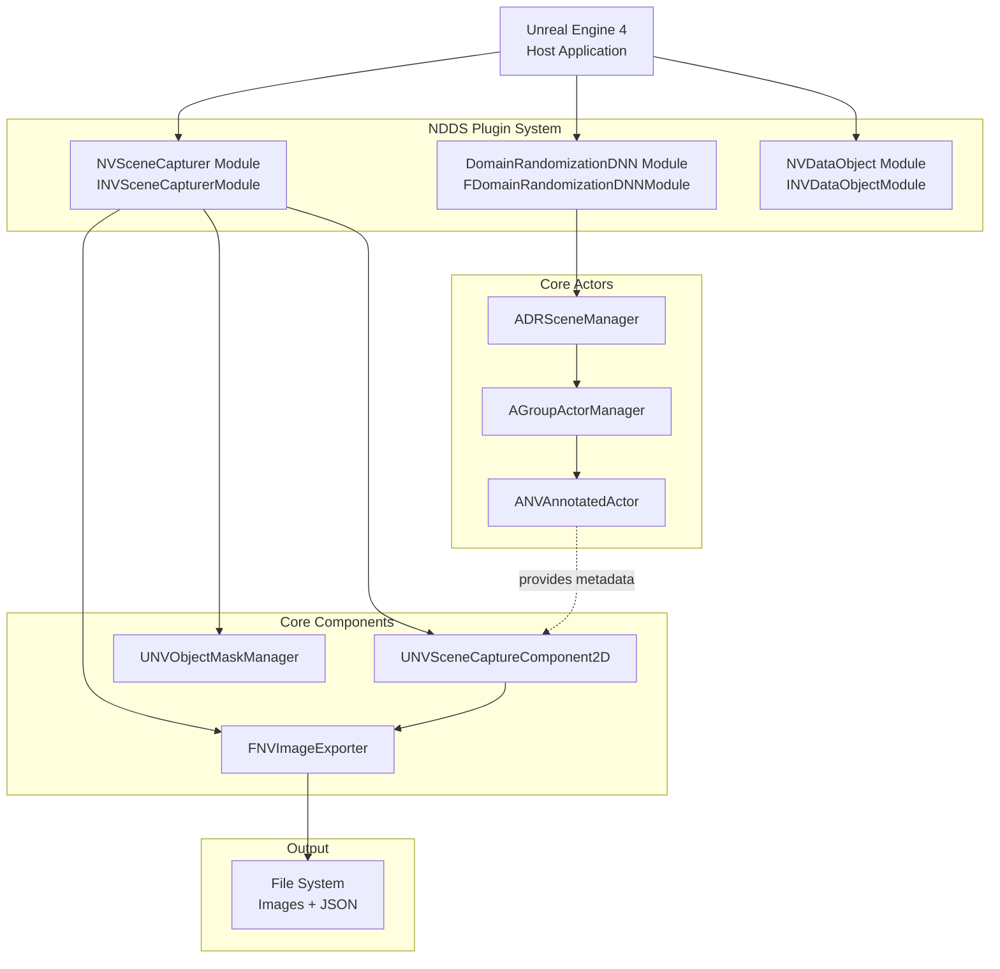
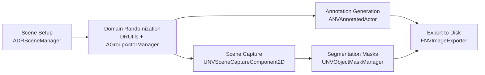
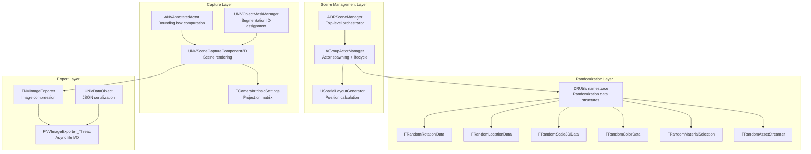
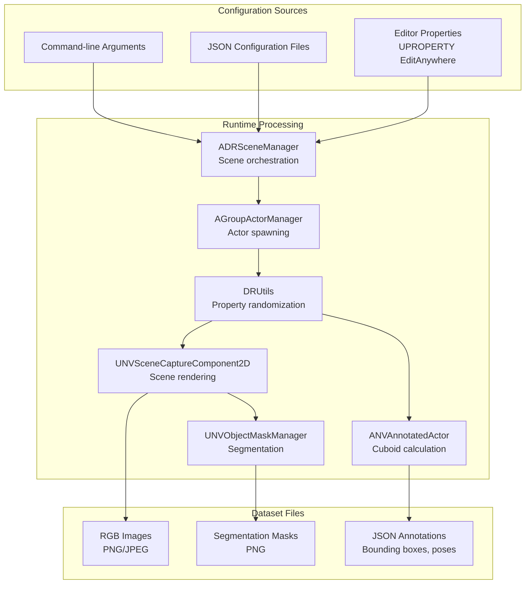

<!-- source: DeepWiki mcp.deepwiki.com · repo NVIDIA/Dataset_Synthesizer · page 1 Overview · fetched 2026-10-26 -->

# Overview

Relevant source files

The following files were used as context for generating this wiki page:

- [Documentation/ClassDetails/NDDSIntro.png](Documentation/ClassDetails/NDDSIntro.png)
- [Documentation/ClassDetails/_domain_randomization_d_n_n_module_8h_source.html](Documentation/ClassDetails/_domain_randomization_d_n_n_module_8h_source.html)
- [Documentation/ClassDetails/_n_v_scene_capturer_module_8h_source.html](Documentation/ClassDetails/_n_v_scene_capturer_module_8h_source.html)

## Purpose and Scope

NVIDIA DeepLearning Dataset Synthesizer (NDDS) is an Unreal Engine plugin system designed to generate synthetic training datasets for deep learning applications. This overview introduces the system's architecture, core modules, and workflow. For detailed information about specific subsystems, see:

- Repository setup and Git LFS configuration: [Getting Started](#2)
- Domain randomization implementation: [Domain Randomization System](#4)
- Scene capture and annotation: [Scene Capture & Annotation](#5)
- Data export pipeline: [Data Export](#7)

**Sources:** [Documentation/ClassDetails/NDDSIntro.png]()

## What is NDDS?

NDDS is a modular Unreal Engine plugin architecture that procedurally generates diverse, annotated synthetic scenes for training deep neural networks. The system combines domain randomization techniques with automated scene capture and annotation to produce datasets containing:

- RGB images with configurable camera intrinsics
- Bounding box annotations (2D and 3D cuboids)
- Segmentation masks (class-level and instance-level)
- JSON metadata files containing object poses, camera parameters, and annotations

The system addresses the challenge of acquiring large-scale labeled training data by synthesizing photorealistic scenes with automatic ground-truth generation.

**Sources:** Repository overview from cluster analysis

## System Architecture

NDDS consists of three primary plugin modules that extend Unreal Engine:

| Module | Primary Class | Responsibility |
|--------|--------------|----------------|
| **DomainRandomizationDNN** | `FDomainRandomizationDNNModule` | Scene orchestration, actor spawning, property randomization |
| **NVSceneCapturer** | `INVSceneCapturerModule` | Scene capture, annotation generation, segmentation masking |
| **NVDataObject** | `INVDataObjectModule` | Data-driven configuration via JSON serialization |

**Sources:** 
- [Documentation/ClassDetails/_domain_randomization_d_n_n_module_8h_source.html:17]()
- [Documentation/ClassDetails/_n_v_scene_capturer_module_8h_source.html:18]()
- High-level architecture diagram (Diagram 1)

## Primary Workflow

The NDDS workflow progresses through six stages:

1. **Scene Setup**: `ADRSceneManager` initializes the scene environment and spawns actor managers
2. **Domain Randomization**: `AGroupActorManager` spawns actors and applies randomization to transforms, materials, meshes, and colors
3. **Scene Capture**: `UNVSceneCaptureComponent2D` renders the scene to texture buffers with configured camera intrinsics
4. **Annotation Generation**: `ANVAnnotatedActor` instances compute oriented bounding boxes using PCA-based algorithms
5. **Segmentation Masking**: `UNVObjectMaskManager` generates class-level (stencil) or instance-level (vertex color) segmentation masks
6. **Export to Disk**: `FNVImageExporter` asynchronously compresses and writes images and JSON annotations to the file system

**Sources:** High-level architecture diagram (Diagram 2, Diagram 3)

## Key Code Entities

The table below maps system concepts to concrete code entities developers will encounter:

| Concept | Code Entity | Location Pattern |
|---------|-------------|------------------|
| Scene orchestration | `ADRSceneManager` | Actor class managing randomization workflow |
| Actor group spawning | `AGroupActorManager` | Actor class managing collections of objects |
| Spatial positioning | `USpatialLayoutGenerator` | Component for calculating spawn positions |
| Transform randomization | `FRandomRotationData`, `FRandomLocationData`, `FRandomScale3DData` | Data structures in `DRUtils.h` |
| Appearance randomization | `FRandomColorData`, `FRandomMaterialSelection` | Data structures in `DRUtils.h` |
| Asset variation | `FRandomAssetStreamer` | Circular buffer for mesh streaming |
| Scene rendering | `UNVSceneCaptureComponent2D` | Component for capturing rendered frames |
| Object annotation | `ANVAnnotatedActor` | Actor class with cuboid computation |
| Segmentation masking | `UNVObjectMaskManager` | Manager for stencil/vertex-color IDs |
| Camera configuration | `FCameraIntrinsicSettings` | Data structure for focal length, principal point |
| Image export | `FNVImageExporter` | Main exporter class with PNG/JPEG compression |
| Async file writing | `FNVImageExporter_Thread` | Background thread preventing frame drops |
| JSON serialization | `UNVDataObject`, `UNVDataObjectAsset` | Data-driven configuration system |

**Sources:**
- High-level architecture diagram (Diagram 4, Diagram 5)
- [Documentation/ClassDetails/_domain_randomization_d_n_n_module_8h_source.html:17-24]()
- [Documentation/ClassDetails/_n_v_scene_capturer_module_8h_source.html:18-24]()

## Module Responsibilities

### DomainRandomizationDNN Module

The **DomainRandomizationDNN** module (`FDomainRandomizationDNNModule`) implements the scene setup and randomization pipeline. This module is responsible for:

- Managing scene lifecycle through `ADRSceneManager` and `ANVSceneManager` classes
- Spawning and destroying actors via `AGroupActorManager` instances
- Applying randomization to object properties using `DRUtils` data structures
- Supporting both one-time and repetitive spawning workflows (controlled by `SpawnDuration`)

For detailed documentation, see [DomainRandomizationDNN Module](#3.1) and [Domain Randomization System](#4).

**Sources:** 
- [Documentation/ClassDetails/_domain_randomization_d_n_n_module_8h_source.html:17-24]()
- High-level architecture diagram (Diagram 1)

### NVSceneCapturer Module

The **NVSceneCapturer** module (`INVSceneCapturerModule`) handles scene capture, annotation, and export. This module provides:

- 2D scene capture through `UNVSceneCaptureComponent2D` with configurable render targets
- Bounding box computation in `ANVAnnotatedActor` using PCA-based oriented bounding boxes
- Segmentation mask generation via `UNVObjectMaskManager` (stencil for classes, vertex color for instances)
- Asynchronous image export through `FNVImageExporter` and `FNVImageExporter_Thread`
- Camera intrinsic calculations in `FCameraIntrinsicSettings`

For detailed documentation, see [NVSceneCapturer Module](#3.2) and [Scene Capture & Annotation](#5).

**Sources:**
- [Documentation/ClassDetails/_n_v_scene_capturer_module_8h_source.html:18-24]()
- High-level architecture diagram (Diagram 1)

### NVDataObject Module

The **NVDataObject** module (`INVDataObjectModule`) provides a data-driven configuration system supporting:

- JSON serialization/deserialization via `UNVDataObject` and `UNVDataObjectAsset`
- Polymorphic object creation through `LogicHandlerClassType`
- Interface-based configuration via `INVDataObjectOwner`

This enables external configuration of actors, components, and scene parameters without code modification.

For detailed documentation, see [NVDataObject Module](#3.3) and [Data Object Serialization](#7.2).

**Sources:** High-level architecture diagram (Diagram 5)

## Data Flow Architecture

The system accepts configuration from three sources (command-line arguments, JSON files, and Unreal Editor properties), processes scenes through randomization and capture stages, and exports three types of output files:

1. **RGB Images**: Compressed PNG (Z_BEST_SPEED) or JPEG (configurable quality) images
2. **Segmentation Masks**: PNG images with class IDs (stencil-based) or instance IDs (vertex-color-based)
3. **JSON Annotations**: Metadata files containing bounding boxes, object classes, camera parameters, and transformation matrices

**Sources:** High-level architecture diagram (Diagram 3, Diagram 5)

## Design Patterns

NDDS employs several design patterns for modularity and extensibility:

| Pattern | Implementation | Purpose |
|---------|---------------|---------|
| **Factory** | `UCameraSettingsFactoryBase`, `UCameraSettingFactory_HFOV` | Create camera settings from different specifications |
| **Manager** | `ADRSceneManager`, `AGroupActorManager`, `UNVObjectMaskManager` | Coordinate lifecycle and state of related objects |
| **Component-based** | `UNVSceneCaptureComponent2D`, `UNVCoordinateComponent` | Attach functionality to actors via Unreal's component system |
| **Data-driven** | `UNVDataObject`, `INVDataObjectOwner` | Configure behavior through external data instead of code |
| **Async processing** | `FNVImageExporter_Thread` | Prevent blocking the game thread during file I/O |
| **Circular buffer** | `FRandomAssetStreamer` | Efficiently manage large asset libraries without memory bloat |

**Sources:** High-level architecture diagram (Diagram 5)

## Version Control Strategy

NDDS uses Git with Git Large File Storage (Git LFS) to manage the repository:

- **Git-tracked**: Source code (C++, C#, Python), configuration files (JSON, XML, INI), project files (.uproject, .uplugin), documentation
- **Git LFS-tracked**: Unreal assets (.uasset, .umap), 3D models (.fbx, .obj, .stl), binaries (.dll, .exe, .so), media files (.mp4, .pdf)
- **Ignored**: Build artifacts (Intermediate), cached data (DerivedDataCache), user settings (Saved), IDE configurations (.vs/, .vscode)

This strategy keeps the repository fast while supporting large binary asset libraries required for diverse dataset generation.

For setup instructions, see [Git LFS Configuration](#2.2).

**Sources:** 
- `.gitattributes` file
- `.gitignore` file
- High-level architecture diagram (Diagram 6)

## Next Steps

To understand how to set up and use NDDS:

- [Getting Started](#2): Repository structure and initial setup
- [Architecture Overview](#3): Deep dive into the three plugin modules
- [Domain Randomization System](#4): How scenes are randomized
- [Scene Capture & Annotation](#5): How annotations are generated
- [Segmentation & Masking](#6): How segmentation masks are created
- [Data Export](#7): How datasets are written to disk

---

