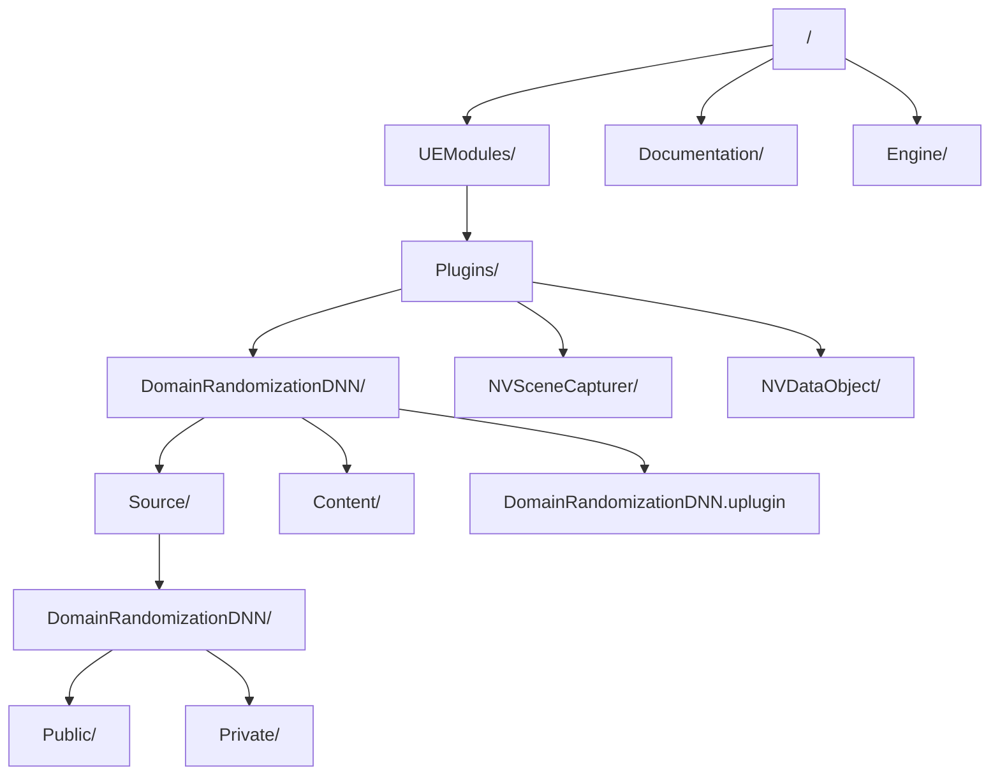
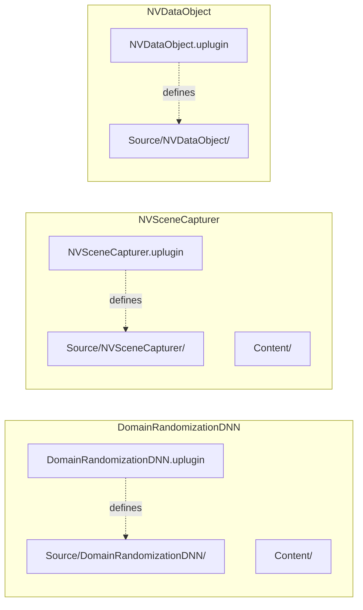
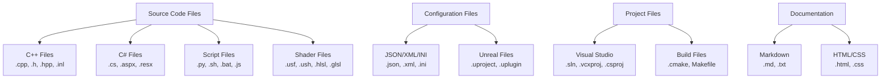
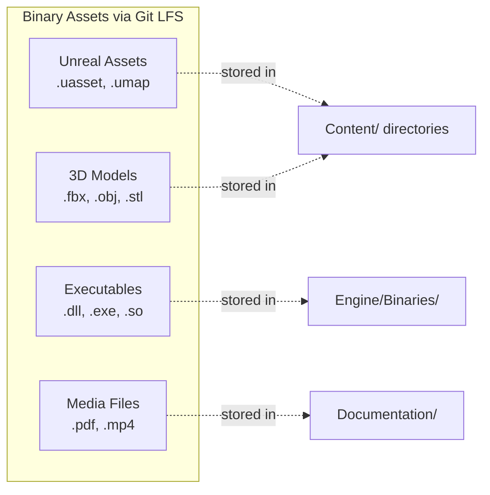
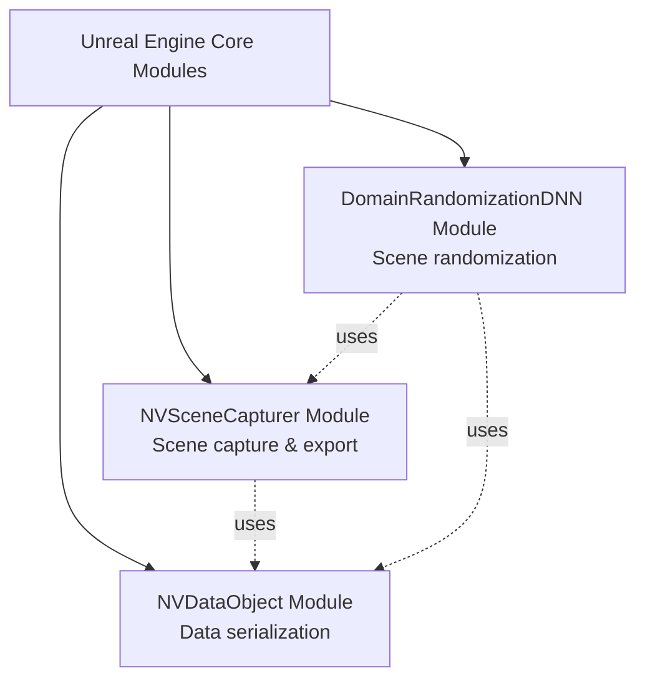

<!-- source: DeepWiki mcp.deepwiki.com · repo NVIDIA/Dataset_Synthesizer · page 2.1 Repository Structure · fetched 2026-10-26 -->

# Repository Structure

<details>
<summary>Relevant source files</summary>

The following files were used as context for generating this wiki page:

- [.gitignore](.gitignore)
- [Documentation/ClassDetails/_domain_randomization_d_n_n_module_8h_source.html](Documentation/ClassDetails/_domain_randomization_d_n_n_module_8h_source.html)

</details>


This page documents the physical organization of the NVIDIA Dataset_Synthesizer repository, explaining how the codebase is structured within the Unreal Engine plugin framework. For information about Git LFS configuration and binary asset management, see [Git LFS Configuration](#2.2). For architectural details about how the modules interact at runtime, see [Architecture Overview](#3).

## Overview

The Dataset_Synthesizer follows Unreal Engine's standard plugin architecture, with all custom functionality organized as plugin modules under the `UEModules/Plugins/` directory. The repository contains three primary plugin modules that implement synthetic dataset generation capabilities, along with supporting configuration files, documentation, and binary assets managed through Git LFS.

## Directory Structure

The repository follows a hierarchical organization based on Unreal Engine conventions:



**Sources:** [Documentation/ClassDetails/_domain_randomization_d_n_n_module_8h_source.html:124]()

### Top-Level Directories

| Directory | Purpose | Git Tracking |
|-----------|---------|--------------|
| `UEModules/Plugins/` | Custom NDDS plugin modules | Yes (source code) |
| `Documentation/` | Generated class documentation (Doxygen HTML) | Yes |
| `Engine/Binaries/ThirdParty/Mono/` | Mono runtime binaries for Mac | Git LFS |
| `Engine/Binaries/DotNET/` | GitDependencies.exe and config | Yes |
| `Intermediate/` | Build artifacts and temporary files | Ignored |
| `Saved/` | User-specific settings and logs | Ignored |
| `DerivedDataCache/` | Unreal Engine cached data | Ignored |
| `NVCapturedData/` | Exported dataset output | Ignored |

**Sources:** [.gitignore:1-181]()

## Plugin Module Organization

Each plugin module follows Unreal Engine's standard structure with a `.uplugin` descriptor file, source code directories, and optional content assets.



### DomainRandomizationDNN Module

Located at `UEModules/Plugins/DomainRandomizationDNN/`, this module implements scene randomization and actor spawning.

**Directory Structure:**
```
DomainRandomizationDNN/
├── DomainRandomizationDNN.uplugin    # Plugin descriptor
├── Source/
│   └── DomainRandomizationDNN/
│       ├── Public/                    # Public header files
│       │   ├── DomainRandomizationDNNModule.h
│       │   ├── DomainRandomizationDNNPCH.h
│       │   ├── DRUtils.h
│       │   ├── DRSceneManager.h
│       │   └── GroupActorManager.h
│       └── Private/                   # Implementation files
│           ├── DomainRandomizationDNNModule.cpp
│           ├── DRUtils.cpp
│           └── ...
└── Content/                           # Blueprint assets (if any)
```

**Key Classes:**
- `FDomainRandomizationDNNModule`: Module initialization and shutdown
- `ADRSceneManager`: Scene orchestration and lifecycle management
- `AGroupActorManager`: Actor spawning and destruction
- `DRUtils`: Randomization data structures and utilities

**Sources:** [Documentation/ClassDetails/_domain_randomization_d_n_n_module_8h_source.html:124]()

### NVSceneCapturer Module

Located at `UEModules/Plugins/NVSceneCapturer/`, this module handles scene capture, annotation, and image export.

**Directory Structure:**
```
NVSceneCapturer/
├── NVSceneCapturer.uplugin           # Plugin descriptor
├── Source/
│   └── NVSceneCapturer/
│       ├── Public/
│       │   ├── NVSceneCapturerModule.h
│       │   ├── NVSceneCaptureComponent2D.h
│       │   ├── NVAnnotatedActor.h
│       │   ├── NVObjectMaskManager.h
│       │   ├── NVImageExporter.h
│       │   └── NVCoordinateComponent.h
│       └── Private/
│           └── ...
└── Content/
```

**Key Classes:**
- `INVSceneCapturerModule`: Module interface
- `UNVSceneCaptureComponent2D`: 2D scene capture component
- `ANVAnnotatedActor`: Annotated actor with cuboid data
- `UNVObjectMaskManager`: Segmentation mask management
- `FNVImageExporter`: Image compression and export
- `UNVCoordinateComponent`: Coordinate axis visualization

**Sources:** High-level architecture diagrams (Diagram 1, Diagram 3)

### NVDataObject Module

Located at `UEModules/Plugins/NVDataObject/`, this module provides data-driven configuration through JSON serialization.

**Directory Structure:**
```
NVDataObject/
├── NVDataObject.uplugin              # Plugin descriptor
└── Source/
    └── NVDataObject/
        ├── Public/
        │   ├── NVDataObjectModule.h
        │   ├── NVDataObject.h
        │   └── NVDataObjectAsset.h
        └── Private/
            └── ...
```

**Key Classes:**
- `INVDataObjectModule`: Module interface
- `UNVDataObject`: Data definition base class
- `UNVDataObjectAsset`: Serializable asset wrapper
- `INVDataObjectOwner`: Interface for data-driven objects

**Sources:** High-level architecture diagrams (Diagram 1, Diagram 5)

## Source File Organization

Each plugin module separates headers into `Public/` and `Private/` directories following Unreal Engine conventions.

### Public Headers

Public headers are located in `Source/<ModuleName>/Public/` and are accessible to other modules. They define:
- Module interfaces (inheriting from `IModuleInterface`)
- Actor classes (inheriting from `AActor`)
- Component classes (inheriting from `UActorComponent`)
- Data structures (`USTRUCT` declarations)
- Public API functions

**Example:** The `FDomainRandomizationDNNModule` class is declared in [UEModules/Plugins/DomainRandomizationDNN/Source/DomainRandomizationDNN/Public/DomainRandomizationDNNModule.h:17-24]()

### Private Implementation

Private implementation files are located in `Source/<ModuleName>/Private/` and contain:
- `.cpp` implementation files
- Internal helper classes
- Module-specific utility functions

### Precompiled Headers

Each module includes a precompiled header (PCH) file for faster compilation:
- `DomainRandomizationDNNPCH.h` for DomainRandomizationDNN module
- Included at the top of the module header file via `#include "DomainRandomizationDNNPCH.h"` ([Documentation/ClassDetails/_domain_randomization_d_n_n_module_8h_source.html:13]())

**Sources:** [Documentation/ClassDetails/_domain_randomization_d_n_n_module_8h_source.html:1-132]()

## File Type Organization

The repository tracks specific file types while ignoring build artifacts and user-specific configurations.

### Tracked Source Files



**Tracked File Extensions:**
- **C/C++:** `.c`, `.cpp`, `.h`, `.hpp`, `.inl`, `.inc` ([.gitignore:20-36]())
- **C#:** `.cs`, `.aspx`, `.resx` ([.gitignore:46-49]())
- **Shaders:** `.usf`, `.ush`, `.hlsl`, `.glsl` ([.gitignore:52-55]())
- **Scripts:** `.py`, `.sh`, `.bat`, `.js` ([.gitignore:67-72]())
- **Configuration:** `.json`, `.xml`, `.ini`, `.uproject`, `.uplugin` ([.gitignore:75-90]())
- **Documentation:** `.md`, `.txt`, `.html`, `.pdf` ([.gitignore:58-62]())

**Sources:** [.gitignore:20-90]()

### Ignored Files and Directories

The following are excluded from version control to prevent repository bloat and conflicts:

| Pattern | Reason | Line Reference |
|---------|--------|----------------|
| `Intermediate/` | Build artifacts | [.gitignore:164]() |
| `obj/` | C# build outputs | [.gitignore:165]() |
| `Saved/` | User settings, logs | [.gitignore:168]() |
| `DerivedDataCache/` | Unreal Engine cache | [.gitignore:161]() |
| `NVCapturedData/` | Exported dataset files | [.gitignore:176]() |
| `.vs/`, `.vscode/` | IDE configurations | [.gitignore:179-180]() |
| `*.sln` (root level) | Generated solution files | [.gitignore:122]() |
| `*~` | Unix backup files | [.gitignore:119]() |

**Sources:** [.gitignore:119-180]()

## Binary Assets and Git LFS

Large binary files are managed through Git Large File Storage (LFS) to keep the repository performant. For detailed Git LFS configuration, see [Git LFS Configuration](#2.2).

### LFS-Tracked Assets



**Tracked via LFS:**
- **Unreal Engine assets:** `.uasset`, `.umap` ([.gitignore:82-83]())
- **3D models:** `.fbx`, `.obj`, `.stl`
- **Binaries:** Mono runtime libraries ([.gitignore:134-144]()), `GitDependencies.exe` ([.gitignore:150-151]())
- **Media:** `.pdf`, `.mp4` ([.gitignore:62-64]())

**Sources:** [.gitignore:82-83](), [.gitignore:134-151]()

## Special Binary Exceptions

The `.gitignore` file explicitly allows specific Mono runtime binaries required for cross-platform operation:

**Mac Mono Binaries** (Engine/Binaries/ThirdParty/Mono/Mac):
- `/bin/*` - Mono executables
- `/etc/mono/config` - Mono configuration
- `/etc/mono/4.5/machine.config` - Framework configuration
- `/lib/libMonoPosixHelper.dylib` - POSIX helper library
- `/lib/mono/4.5/mscorlib.dll` - Core library
- Various GAC assemblies (`Mono.Posix.dll`, `System.dll`, etc.)

**GitDependencies Tool** (Engine/Binaries/DotNET):
- `GitDependencies.exe` - Dependency management tool
- `GitDependencies.exe.config` - Configuration file

The automatically created `/Engine/Binaries/ThirdParty/Mono/Mac/bin/mono` symlink is explicitly ignored ([.gitignore:147]()).

**Sources:** [.gitignore:133-151]()

## Data Export Structure

The system exports generated datasets to the `NVCapturedData/` directory, which is excluded from version control to prevent committing large generated files.

**Typical Export Structure:**
```
NVCapturedData/
├── <capture_session_name>/
│   ├── rgb/                    # Color images
│   │   ├── 000000.png
│   │   ├── 000001.png
│   │   └── ...
│   ├── depth/                  # Depth images
│   ├── segmentation/           # Segmentation masks
│   └── annotations/            # JSON annotation files
│       ├── 000000.json
│       ├── 000001.json
│       └── ...
```

The `FNVImageExporter` and `FNVImageExporter_Thread` classes handle writing to this directory structure asynchronously to prevent frame drops during capture.

**Sources:** [.gitignore:176](), High-level architecture diagrams (Diagram 3)

## Module Dependencies

The three plugin modules have interdependencies that affect build order and module loading:



**Dependency Flow:**
1. `NVDataObject` - Base module with no NDDS dependencies
2. `NVSceneCapturer` - Depends on `NVDataObject` for configuration
3. `DomainRandomizationDNN` - Depends on both other modules for scene capture and data-driven configuration

The `.uplugin` descriptor files specify these dependencies to ensure correct module initialization order.

**Sources:** High-level architecture diagrams (Diagram 1, Diagram 5)

## Build System Integration

The repository integrates with Unreal Engine's build system through:

**Project Files:**
- `.uproject` - Unreal Engine project descriptor
- `.uplugin` - Plugin descriptor files for each module
- `.Build.cs` - Unreal Build Tool configuration (one per module)

**Generated Files (Ignored):**
- `.sln` - Visual Studio solution (generated from `.uproject`)
- `.vcxproj` - Visual Studio project files (generated per module)
- `Makefile` - Build scripts for Unix platforms (root level ignored per [.gitignore:124]())

**Intermediate Build Outputs:**
- `Intermediate/Build/` - Compiled object files
- `Binaries/` - Built plugin DLLs/shared libraries (platform-specific)

The Unreal Build Tool (UBT) processes the `.Build.cs` files to generate platform-specific project files and orchestrate compilation.

**Sources:** [.gitignore:93-109](), [.gitignore:122-124]()

---

