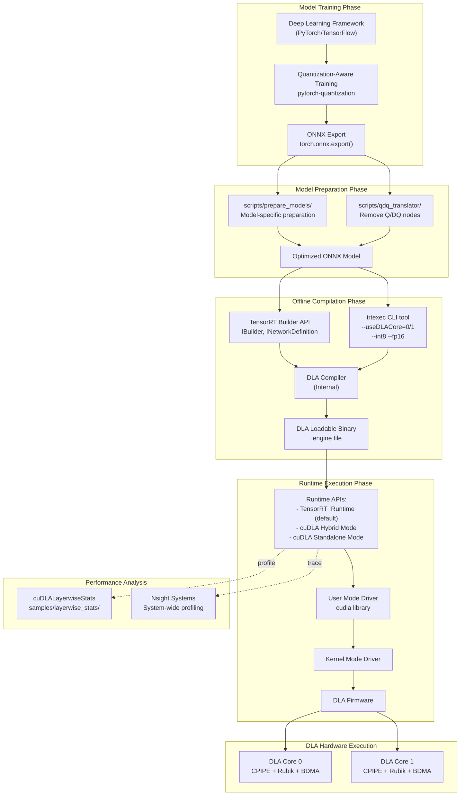
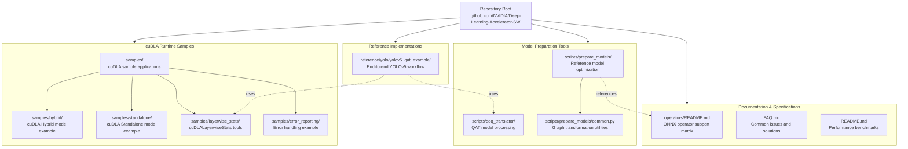
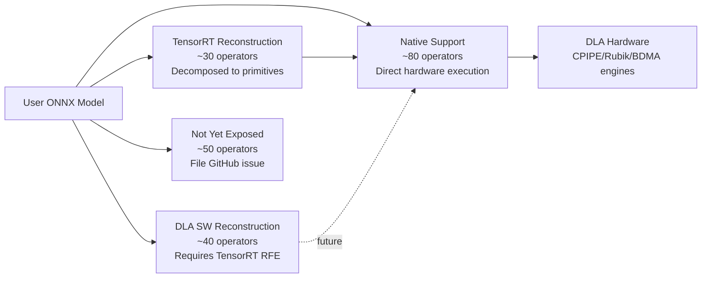

<!-- source: DeepWiki mcp.deepwiki.com · repo NVIDIA/Deep-Learning-Accelerator-SW · page 1 Overview · fetched 2026-10-26 -->

# Overview

<details>
<summary>Relevant source files</summary>

The following files were used as context for generating this wiki page:

- [README.md](README.md)

</details>


This document introduces the NVIDIA Deep Learning Accelerator (DLA) hardware and the software ecosystem for deploying neural networks on DLA. It covers the hardware architecture, software stack components, performance characteristics, and the scope of tools and documentation provided in this repository.

For detailed information on specific topics:
- Hardware architecture details, see [DLA Hardware Architecture](#1.1)
- Software stack layers, see [Software Stack Overview](#1.2)
- Platform-specific requirements, see [Supported Platforms](#1.3)
- Deployment workflows, see [Getting Started](#2)
- Operator compatibility, see [ONNX Operator Support](#4)

---

## What is DLA?

NVIDIA DLA (Deep Learning Accelerator) is a fixed-function hardware accelerator designed for deep learning inference operations. DLA provides dedicated hardware acceleration for convolutional neural networks, supporting convolution, deconvolution, fully connected, activation, pooling, batch normalization, and other common operations.

**Hardware Availability:**
- **Orin SoCs**: Up to 2 second-generation DLA cores
- **Xavier SoCs**: Up to 2 first-generation DLA cores

Each SoC contains two independent DLA cores (DLA0 and DLA1) that can execute different models concurrently or process the same model in a pipelined fashion.

**Software Components:**

The DLA software ecosystem consists of three main components:

| Component | Description | Invocation Methods |
|-----------|-------------|-------------------|
| DLA Compiler | Offline compiler that translates neural network graphs into DLA loadable binaries | TensorRT, NvMedia-DLA, cuDLA |
| DLA Runtime Stack | Firmware, kernel mode driver, and user mode driver for execution | TensorRT Runtime, cuDLA Hybrid, cuDLA Standalone |
| Analysis Tools | Performance profiling and debugging utilities | cuDLALayerwiseStats, Nsight Systems |

Sources: [README.md:1-7]()

---

## Why Use DLA on Orin and Xavier?

DLA provides two critical advantages for deep learning inference on embedded platforms: **high performance contribution** and **superior power efficiency**.

### Performance Contribution by Power Mode

DLA's contribution to total system deep learning performance increases as power budgets decrease. On Jetson AGX Orin 64GB, DLA provides 38% to 74% of total INT8 performance depending on power mode:

| Power Mode | GPU INT8 TOPs | DLA INT8 TOPs (2x cores) | Total TOPs | DLA Percentage |
|------------|---------------|--------------------------|------------|----------------|
| MAXN       | 171           | **105**                  | 275        | **38%**        |
| 50W        | 109           | **92**                   | 200        | **46%**        |
| 30W        | 41            | **90**                   | 131        | **69%**        |
| 15W        | 14            | **40**                   | 54         | **74%**        |

**Key Insight:** At 15W power mode, DLA maintains 40 TOPs (38% of MAXN peak) while GPU drops to 14 TOPs (8% of MAXN peak). This makes DLA essential for power-constrained edge deployments.

### Power Efficiency Advantage

DLA is 3x to 5x more power-efficient than GPU for typical inference workloads (measured as images/second per watt, accelerator power only). This efficiency advantage increases at lower power modes where DLA maintains higher utilization while GPU performance degrades.

Example power efficiency ratios (DLA Perf/W ÷ GPU Perf/W):

| Network | MAXN | 50W | 30W | 15W |
|---------|------|-----|-----|-----|
| ResNet-50 (224x224, bs=2) | 3.5x | 2.9x | 2.6x | **3.9x** |
| SSD-MobileNetV1 (300x300, bs=2) | 4.2x | 3.6x | 3.2x | **5.0x** |
| RetinaNet ResNeXt-50 (800x800, bs=1) | 3.8x | 3.1x | 2.8x | **4.2x** |

Sources: [README.md:9-26](), [README.md:101-123]()

---

## DLA in the Deep Learning Pipeline

The following diagram shows how DLA fits into the end-to-end deep learning inference pipeline, from model training to hardware execution:



**Workflow Phases:**

1. **Training Phase**: Models are trained with quantization-aware training (QAT) techniques and exported to ONNX format
2. **Preparation Phase**: ONNX models are optimized using repository scripts for graph fusion, precision configuration, and QDQ node translation
3. **Compilation Phase**: TensorRT Builder compiles optimized ONNX to DLA loadable binaries through `trtexec` or programmatic APIs
4. **Runtime Phase**: Applications execute DLA loadables using TensorRT Runtime (default since TRT 8.5), cuDLA Hybrid, or cuDLA Standalone modes
5. **Analysis Phase**: Performance is profiled using layerwise statistics tools and system-wide profilers

Sources: [README.md:3-7](), High-level architecture diagrams provided

---

## Repository Structure and Code Organization

This repository provides tools, scripts, and samples for deploying models on DLA. The following diagram maps repository directories to their purposes:



**Key Directories:**

| Directory | Purpose | Key Files |
|-----------|---------|-----------|
| `scripts/prepare_models/` | Model-specific ONNX optimization scripts | `resnet50.py`, `retinanet_resnext50.py`, `common.py` |
| `scripts/qdq_translator/` | QDQ node removal and scale extraction | `qdq_translator.py` |
| `samples/hybrid/` | cuDLA Hybrid mode sample (CUDA-managed) | `sample_cudla_hybrid.cpp` |
| `samples/standalone/` | cuDLA Standalone mode sample (independent DLA) | `sample_cudla_standalone.cpp` |
| `samples/layerwise_stats/` | Performance profiling tools | `cuDLALayerwiseStatsStandalone.cpp` |
| `reference/yolo/yolov5_qat_example/` | Complete YOLOv5 QAT workflow | Training, export, deployment scripts |
| `operators/` | ONNX operator support documentation | `README.md` with support matrix |

Sources: Repository directory structure, [README.md:124-132]()

---

## Reference Models and Accuracy

This repository provides preparation scripts and benchmarks for standard deep learning architectures validated against MLPerf Inference standards.

### Supported Reference Models

| Use Case | Network | INT8 Accuracy on DLA | GPU-Only Layers | Preparation Scripts |
|----------|---------|---------------------|-----------------|---------------------|
| Classification | ResNet-50 | 75.54% ImageNet Top-1 | Top-K (final node) | [scripts/prepare_models/resnet50.py]() |
| Object Detection | RetinaNet ResNeXt-50 | 0.3741 mAP OpenImages | NMS (final node) | [scripts/prepare_models/retinanet_resnext50.py]() |
| Object Detection | RetinaNet ResNet-34 | See MLPerf results | NMS (final node) | [scripts/prepare_models/retinanet_resnet34.py]() |
| Object Detection | SSD-ResNet-34 | 0.21 mAP COCO 2017 | NMS (final node) | [scripts/prepare_models/ssd_resnet34.py]() |
| Object Detection | SSD-MobileNetV1 | 0.23 mAP COCO 2017 | NMS (final node) | [scripts/prepare_models/ssd_mobilenet.py]() |

**Important Characteristics:**

1. **Hybrid Execution Pattern**: Compute-intensive backbones run on DLA, post-processing (NMS, Top-K) runs on GPU
2. **Accuracy Parity**: INT8 accuracy on DLA matches GPU INT8 and approximates FP32 reference within acceptable tolerance
3. **Non-Determinism**: GPU and DLA do not produce bitwise-identical results due to different hardware implementations

### Dense Performance Benchmarks

Performance measured on Jetson AGX Orin 64GB with JetPack 5.1.1 (2x DLA cores, images/second):

| Network | Input Size | Batch | MAXN | 50W | 30W | 15W |
|---------|------------|-------|------|-----|-----|-----|
| ResNet-50 | 224x224 | 2 | 2037 | 1948 | 1928 | 1072 |
| SSD-MobileNetV1 | 300x300 | 2 | 2664 | 2506 | 2472 | 1313 |
| RetinaNet ResNet-34 | 1280x768 | 1 | 108 | 98 | 96 | 45 |
| RetinaNet ResNeXt-50 | 800x800 | 1 | 78 | 72 | 71 | 36 |
| SSD-ResNet-34 | 1200x1200 | 1 | 83 | 76 | 74 | 36 |

### Sparse Performance (2:4 Structured Sparsity)

Sparse performance with `--sparsity=force` flag (dense→sparse speedup):

| Network | MAXN | 50W | 30W | 15W |
|---------|------|-----|-----|-----|
| RetinaNet ResNet-34 (1280x768) | 143 (1.32x) | 133 (1.36x) | 131 (1.37x) | 66 (1.47x) |
| RetinaNet ResNeXt-50 (800x800) | 102 (1.31x) | 96 (1.34x) | 95 (1.34x) | 51 (1.43x) |
| SSD-ResNet-34 (1200x1200) | 103 (1.24x) | 97 (1.28x) | 95 (1.28x) | 49 (1.36x) |

**Key Observations:**
- Sparse speedup increases at lower power modes (15W shows 1.36x-1.47x gains)
- DLA maintains 50%+ of MAXN throughput even at 15W power mode
- Structured sparsity accuracy maintains parity with dense models (validated on Waymo Open Dataset)

Sources: [README.md:27-99]()

---

## ONNX Operator Support

DLA supports approximately 200+ ONNX operators through four support categories:



**Support Categories:**

1. **Native Support (~80 ops)**: Direct mapping to DLA hardware instructions (Conv, Pool, Add, Mul, BatchNorm, Concat, etc.)
2. **TensorRT Reconstruction (~30 ops)**: Decomposed into native primitives during compilation (And, Or, Not, Neg, GRU, Gather, etc.)
3. **DLA SW Reconstruction (~40 ops)**: Hardware capability exists but not yet exposed in TensorRT (GroupNorm, LayerNorm, InstanceNorm, trigonometric functions)
4. **RFE Required (~50 ops)**: Planned for future releases, file GitHub issues for priority requests

For detailed operator support matrix and version-specific availability, see [ONNX Operator Support](#4).

Sources: [README.md:124-127](), [operators/README.md](), Operator support diagram provided

---

## Getting Started with DLA

### Prerequisites

**Minimum Requirements:**
- DLA SW version: 3.14.0+
- TensorRT version: 8.6.12+
- JetPack: 5.1.1+ (Jetson platforms)
- DRIVE OS: 6.0.8.0+ (DRIVE platforms)

**Python Dependencies:**
```bash
python3 -m pip install -r requirements.txt
```

### Quick Deployment Workflow

1. **Prepare Model**: Optimize ONNX model using scripts in `scripts/prepare_models/`
2. **Compile to DLA**: Use `trtexec --onnx=model.onnx --saveEngine=model.engine --useDLACore=0 --int8`
3. **Execute Model**: Run using TensorRT Runtime API or cuDLA samples
4. **Profile Performance**: Use `cuDLALayerwiseStats` tools in `samples/layerwise_stats/`

For detailed tutorials, see [Quick Start Tutorial](#2.2).

### Sample Applications

| Sample | Location | Purpose |
|--------|----------|---------|
| cuDLA Hybrid Mode | `samples/hybrid/` | CUDA-managed DLA execution with CUDA streams |
| cuDLA Standalone Mode | `samples/standalone/` | Independent DLA programming with NvSciBuf/NvSciSync |
| Layerwise Statistics | `samples/layerwise_stats/` | Per-layer performance profiling and CSV export |
| Error Reporting | `samples/error_reporting/` | DLA error handling and debugging |
| YOLOv5 QAT | `reference/yolo/yolov5_qat_example/` | Complete QAT training and deployment workflow |

Sources: [README.md:128-132](), Repository samples directory structure

---

## Platform Support

### Supported Hardware Platforms

| Platform Series | DLA Generation | DLA Cores | DLA SRAM | Typical Use Case |
|-----------------|----------------|-----------|----------|------------------|
| Jetson AGX Orin | 2nd gen | 2 | 1 MB per core | Robotics, edge AI |
| Jetson Orin NX | 2nd gen | 2 | 1 MB per core | Embedded inference |
| DRIVE AGX Orin | 2nd gen | 2 | 1 MB per core | Automotive ADAS |
| Jetson AGX Xavier | 1st gen | 2 | 4 MB shared | Legacy edge AI |
| DRIVE AGX Xavier | 1st gen | 2 | 4 MB shared | Legacy automotive |

### Software Requirements

| Component | Jetson Platform | DRIVE Platform |
|-----------|-----------------|----------------|
| Operating System | JetPack 5.1.1+ | DRIVE OS 6.0.8.0+ |
| DLA SW Version | 3.14.0+ | 3.14.0+ |
| TensorRT | 8.6.12+ | 8.6.12+ |
| CUDA | 11.4+ | 11.4+ |

**Architecture Differences:**
- **Orin (2nd gen)**: Dedicated 1 MB SRAM per DLA core, improved sparsity support, enhanced INT8 throughput
- **Xavier (1st gen)**: Shared 4 MB SRAM across both DLA cores, baseline INT8 support

For platform-specific configuration, see [Supported Platforms](#1.3).

Sources: [README.md:3-4](), [README.md:14-26](), Software stack diagram provided

---

## Repository Scope and Documentation Structure

This repository focuses on:

1. **Model Preparation Workflows**: Scripts and utilities for optimizing ONNX models for DLA deployment
2. **cuDLA Runtime Samples**: Reference implementations demonstrating cuDLA API usage patterns
3. **Performance Analysis Tools**: Layerwise statistics collection and profiling utilities
4. **Operator Support Documentation**: Comprehensive ONNX operator compatibility reference
5. **Reference Implementations**: Complete end-to-end workflows (e.g., YOLOv5 QAT)

**Out of Scope (Covered Elsewhere):**
- TensorRT API documentation: See [NVIDIA TensorRT Documentation](https://docs.nvidia.com/deeplearning/tensorrt)
- DLA hardware specifications: See [DLA Product Page](https://developer.nvidia.com/deep-learning-accelerator)
- JetPack/DRIVE OS installation: See platform-specific documentation
- PyTorch/TensorFlow quantization: See framework-specific quantization guides

**Wiki Navigation:**
- Hardware details: [DLA Hardware Architecture](#1.1)
- Software components: [Software Stack Overview](#1.2)
- Model preparation: [Model Preparation](#3)
- Operator compatibility: [ONNX Operator Support](#4)
- Compilation process: [Model Compilation](#5)
- Runtime execution: [Runtime and Deployment](#6)
- Performance tuning: [Performance Analysis and Optimization](#7)
- Code examples: [Sample Applications](#8)
- Troubleshooting: [FAQ and Troubleshooting](#9)
- Contributions: [Contributing to DLA SW](#10)

Sources: [README.md:1-132](), Wiki table of contents

---

