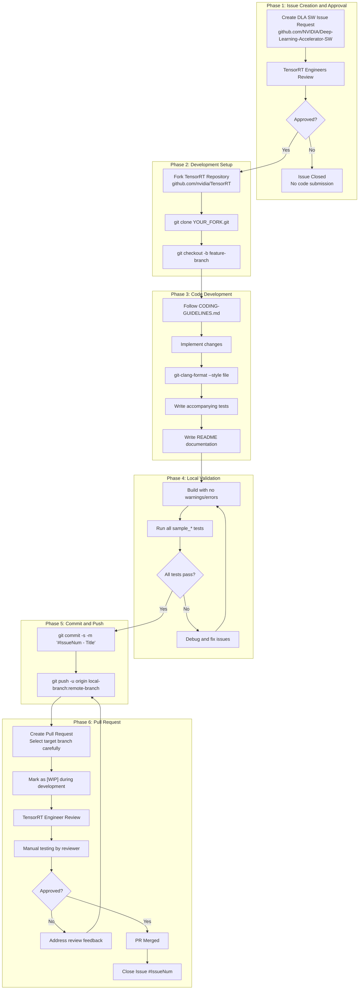
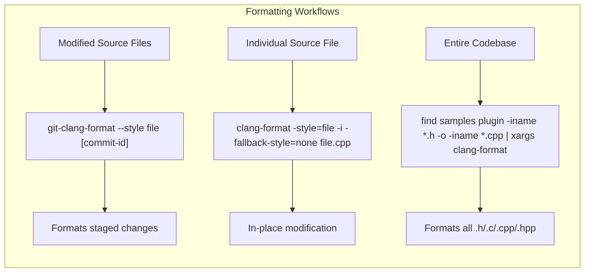
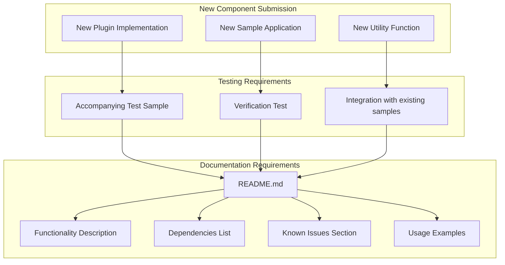
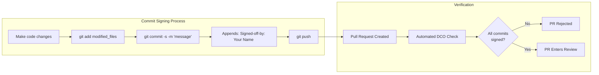
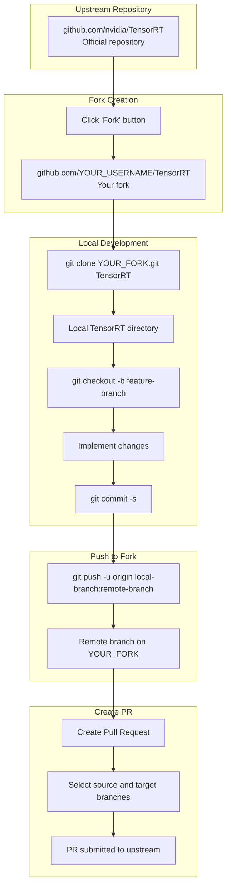
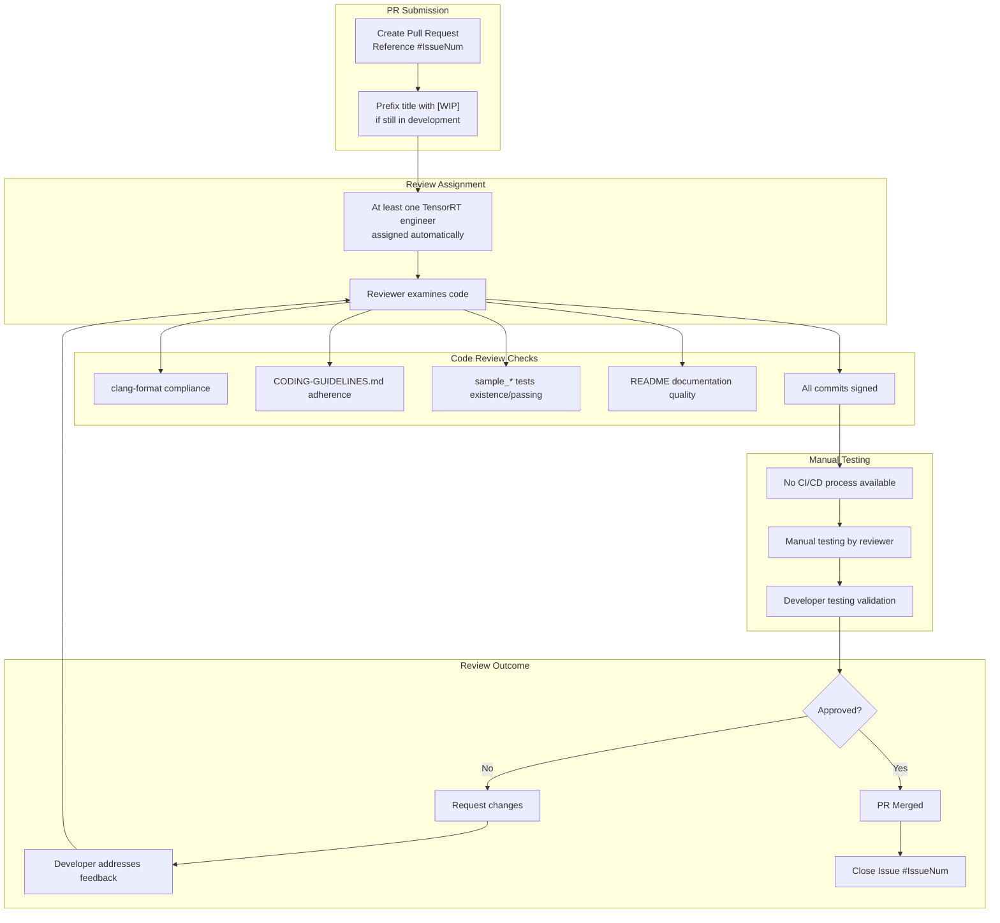

<!-- source: DeepWiki mcp.deepwiki.com · repo NVIDIA/Deep-Learning-Accelerator-SW · page 10 Contributing to DLA SW · fetched 2026-10-26 -->

# Contributing to DLA SW

<details>
<summary>Relevant source files</summary>

The following files were used as context for generating this wiki page:

- [CONTRIBUTING.md](CONTRIBUTING.md)

</details>


## Purpose and Scope

This document provides comprehensive guidelines for contributing to the Deep Learning Accelerator Software (DLA SW) repository. It covers the mandatory contribution process, coding standards, testing requirements, and legal compliance procedures. Contributors must follow these guidelines to ensure code quality, maintainability, and legal compliance with the Developer Certificate of Origin (DCO).

For step-by-step instructions on the contribution workflow, see [Contribution Workflow](#10.1). For detailed coding standards and formatting requirements, see [Coding Standards](#10.2).

---

## Overview

All contributions to the DLA SW repository follow a structured process with multiple quality gates. Contributions must begin with an approved issue request, follow strict coding guidelines enforced by `clang-format`, pass all sample tests, and include proper documentation. All commits must be signed to certify origin and licensing compliance.

The contribution process is designed to:
- Prevent duplicate or misaligned work through mandatory issue approval
- Maintain code consistency through automated formatting
- Ensure functional correctness through testing requirements
- Provide legal protection through commit signing (DCO)
- Facilitate efficient code review through structured PRs

**Sources:** [CONTRIBUTING.md:1-142]()

---

## Contribution Prerequisites

Before contributing, ensure you meet the following requirements:

| Requirement | Description | Mandatory |
|-------------|-------------|-----------|
| **GitHub Account** | Active GitHub account to fork repository and submit PRs | Yes |
| **Issue Approval** | Create and get approval for a DLA SW Issue Request before coding | Yes |
| **Development Environment** | Functional build environment for DLA SW samples | Yes |
| **clang-format** | Installed and configured for code formatting | Yes |
| **Git Sign-off Setup** | Configure Git for commit signing with `--signoff` | Yes |
| **Documentation Skills** | Ability to write clear README and test documentation | Yes |

**Sources:** [CONTRIBUTING.md:1-73]()

---

## End-to-End Contribution Workflow



**Workflow Description:**

The contribution workflow consists of six mandatory phases:

1. **Issue Creation and Approval**: All contributions must begin with a DLA SW Issue Request that receives approval from TensorRT engineers before any code is written. This prevents wasted effort on features that may not be accepted.

2. **Development Setup**: Contributors fork the upstream TensorRT repository and clone it locally. Changes are made on feature branches to isolate work.

3. **Code Development**: Implementation must follow [CODING-GUIDELINES.md]() with automated formatting enforced by `clang-format`. All components require accompanying tests and documentation.

4. **Local Validation**: Before submission, code must build cleanly and all `sample_*` tests must pass. This ensures functional correctness.

5. **Commit and Push**: All commits must be signed with `--signoff` to certify the Developer Certificate of Origin. Commit messages must reference the issue number.

6. **Pull Request**: PRs undergo review by TensorRT engineers including manual testing. Multiple review cycles may be required before approval.

**Sources:** [CONTRIBUTING.md:4-99]()

---

## Code Quality Requirements

### Coding Guidelines Compliance

All source code must strictly adhere to the DLA SW Coding Guidelines specified in [CODING-GUIDELINES.md](). Key requirements include:

| Aspect | Requirement | Enforcement |
|--------|-------------|-------------|
| **Formatting** | TensorRT code formatting rules | `clang-format --style file` |
| **Naming Conventions** | Class, function, variable naming standards | Manual review |
| **Comment Style** | Consistent commenting approach | Manual review |
| **Indentation** | Standard indentation rules | `clang-format` |
| **Line Length** | Maximum line length limits | `clang-format` |
| **Code Reuse** | Follow existing patterns in module | Manual review |
| **Complexity** | Avoid unnecessary complexity | Manual review |

**Sources:** [CONTRIBUTING.md:10-14]()

### clang-format Usage



**Formatting Commands:**

1. **Format Git Changes** (recommended for contributors):
   ```bash
   # Format staged changes
   git-clang-format --style file
   
   # Format changes since specific commit
   git-clang-format --style file <commit-id>
   ```

2. **Format Individual Files**:
   ```bash
   clang-format -style=file -i -fallback-style=none <file.cpp>
   ```

3. **Format Entire Codebase** (maintainers only):
   ```bash
   find samples plugin -iname *.h -o -iname *.c -o -iname *.cpp -o -iname *.hpp \
   | xargs clang-format -style=file -i -fallback-style=none
   ```

The `-style=file` option reads formatting rules from [.clang-format]() in the repository root. The `-i` flag performs in-place modification.

**Sources:** [CONTRIBUTING.md:16-39]()

---

## Pull Request Best Practices

### PR Structure and Content

| Practice | Description | Rationale |
|----------|-------------|-----------|
| **Single Concern** | Each PR addresses one issue | Easier review, faster approval |
| **No Commented Code** | Remove commented-out code | Maintains readability |
| **Clean Build Log** | Zero warnings and errors | Ensures code quality |
| **Passing Tests** | All `sample_*` tests pass | Validates functionality |
| **Complete Documentation** | README and test documentation | Enables usage and maintenance |
| **Proper Dependencies** | Indicate PR dependencies in description | Manages complex changes |

### Commit Message Format

All commit messages must follow this format:

```
#<Issue Number> - <Commit Title>

<Commit Body>
```

**Commit Title Rules:**
- Use imperative mood ("Add feature" not "Added feature")
- Follow [these rules](https://chris.beams.io/posts/git-commit)
- Reference the issue number with `#<number>`

**Example:**
```bash
git commit -s -m "#123 - Add support for LayerNorm operator

Implements native LayerNorm support on DLA by decomposing
into Mul, Add, and ReduceMean operations. Includes sample
test demonstrating 2.3x speedup over GPU implementation."
```

**Sources:** [CONTRIBUTING.md:43-61]()

---

## Testing and Documentation Requirements

### Component Testing Requirements



All new OSS components must include:

1. **Test Coverage**:
   - Plugins: Sample demonstrating plugin usage
   - Samples: Verification test validating functionality
   - Utilities: Integration tests with existing samples

2. **Documentation**:
   - Functionality description
   - Dependency list with versions
   - Known issues and limitations
   - Usage examples with expected output

Reference existing samples in [samples/]() directory for documentation standards.

**Sources:** [CONTRIBUTING.md:58-65]()

---

## Adding or Disabling Functionality

When adding optional functionality, follow this structure:

| Approach | Use Case | Implementation |
|----------|----------|----------------|
| **CMake Option** | Default behavior control | Add option with default matching existing behavior |
| **File Inclusion** | Entire files optional | Modify [CMakeLists.txt]() to include/exclude files |
| **Conditional Compilation** | Minor changes to existing files | Use `#if` guards around specific code blocks |

**Example CMake Option:**
```cmake
option(ENABLE_NEW_FEATURE "Enable new feature" OFF)

if(ENABLE_NEW_FEATURE)
    target_sources(sample_app PRIVATE new_feature.cpp)
endif()
```

Avoid using `#if` guards around entire file bodies; prefer CMake-level file inclusion/exclusion.

**Sources:** [CONTRIBUTING.md:66-70]()

---

## Legal Compliance: Commit Signing

### Developer Certificate of Origin (DCO)

All commits must be signed to certify that:
- The contribution is your original work, OR
- You have rights to submit it under the same/compatible license
- You understand the contribution is public and permanent

**Unsigned commits will not be accepted.**

### Signing Commits



**Signing Command:**
```bash
# Sign a single commit
git commit -s -m "Add cool feature."

# The -s flag appends:
# Signed-off-by: Your Name <your@email.com>
```

**Verify Signing:**
```bash
# Check last commit for sign-off
git log -1 --pretty=format:"%B"
```

The DCO certifies four key points (see [CONTRIBUTING.md:131-141]() for full text):
- (a) You created the contribution or have rights to submit it
- (b) Contribution based on appropriately licensed previous work
- (c) Contribution provided by someone who certified (a), (b), or (c)
- (d) You understand the contribution is public and permanent

**Sources:** [CONTRIBUTING.md:100-142]()

---

## Repository Fork and Clone Process

### Forking Workflow



**Fork and Clone Commands:**
```bash
# 1. Fork via GitHub UI
# Navigate to github.com/nvidia/TensorRT and click "Fork"

# 2. Clone your fork
git clone https://github.com/YOUR_USERNAME/YOUR_FORK.git TensorRT
cd TensorRT

# 3. Create feature branch
git checkout -b feature-dla-optimization

# 4. Make changes and commit
git add modified_files
git commit -s -m "#123 - Optimize DLA memory layout"

# 5. Push to fork
git push -u origin feature-dla-optimization:feature-dla-optimization
```

**Important**: Exercise caution when selecting source and target branches for PRs. Versioned releases post to `release/` branches of the upstream repository.

**Sources:** [CONTRIBUTING.md:78-94]()

---

## Pull Request Review Process

### Review Workflow



**Review Process Details:**

1. **PR Creation**: Reference the issue number in the PR description. Mark as `[WIP]` if still iterating on changes.

2. **Automatic Assignment**: At least one TensorRT engineer is assigned to review the PR.

3. **Review Checks**: Reviewers verify:
   - Code formatting with `clang-format`
   - Adherence to [CODING-GUIDELINES.md]()
   - Test coverage and passing tests
   - Documentation completeness
   - All commits properly signed

4. **Manual Testing**: Since no CI/CD process exists yet, reviewers manually test functionality. Adequate testing by both developer and reviewer is required before acceptance.

5. **Iteration**: Multiple review cycles are normal. Address feedback promptly and push new commits to the same branch.

6. **Merge and Closure**: After approval, the PR is merged and the original issue is closed.

**Sources:** [CONTRIBUTING.md:91-99]()

---

## Quality Gates Summary

All contributions must pass these quality gates:

| Gate | Requirement | Verification Method |
|------|-------------|---------------------|
| **Issue Approval** | TensorRT engineer approval before coding | GitHub issue status |
| **Code Formatting** | `clang-format` compliance | `git-clang-format --style file` |
| **Coding Guidelines** | [CODING-GUIDELINES.md]() adherence | Manual review |
| **Clean Build** | No warnings or errors | Local build verification |
| **Passing Tests** | All `sample_*` tests pass | Local test execution |
| **Documentation** | Complete README with examples | Manual review |
| **Test Coverage** | Accompanying test for new components | Manual review |
| **Commit Signing** | All commits signed with DCO | Automated DCO check |
| **PR Review** | TensorRT engineer approval | Manual review |
| **Manual Testing** | Adequate functional testing | Manual testing by reviewer |

**Sources:** [CONTRIBUTING.md:1-142]()

---

## Additional Considerations

### Contribution Scope

Keep contributions focused and concise:
- Avoid committing commented-out code
- Address single concerns per PR when possible
- For complex multi-part changes, open multiple dependent PRs with clear descriptions

### Code Maintenance

Preserve maintainability and readability:
- Follow existing conventions in the relevant module
- Avoid introducing unnecessary complexity
- Use consistent patterns with surrounding code

### License and Patent Compliance

Ensure you can contribute your work to open source:
- No license conflicts with existing code
- No patent conflicts introduced
- Sign commits to certify compliance

**Sources:** [CONTRIBUTING.md:41-73]()

---

## Quick Reference: Contribution Checklist

Before submitting a PR, verify:

- [ ] Issue created and approved by TensorRT engineer
- [ ] Repository forked and cloned locally
- [ ] Feature branch created
- [ ] Code follows [CODING-GUIDELINES.md]()
- [ ] `clang-format` applied to all changes
- [ ] Clean build with no warnings/errors
- [ ] All `sample_*` tests pass
- [ ] README documentation written
- [ ] Test sample/verification provided
- [ ] All commits signed with `git commit -s`
- [ ] Commit messages reference issue number
- [ ] PR created with clear description
- [ ] PR marked `[WIP]` if still iterating

**Sources:** [CONTRIBUTING.md:1-142]()

---

