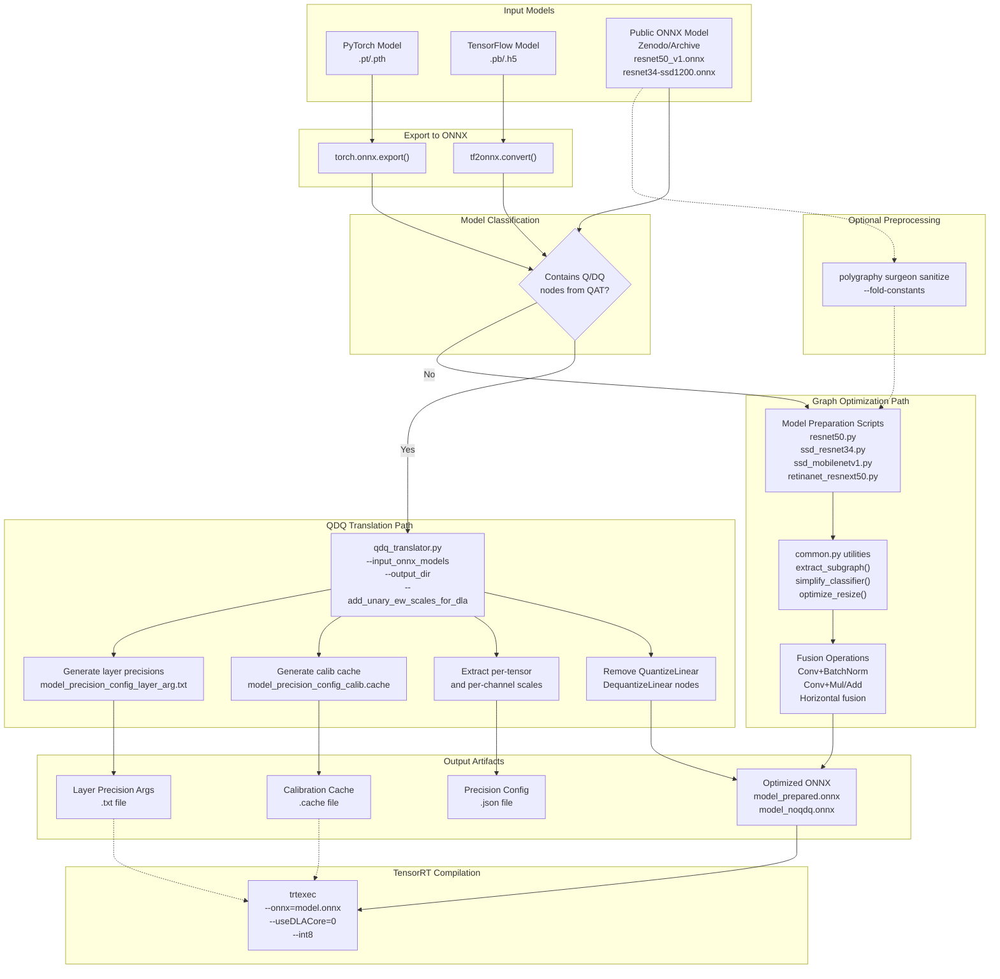
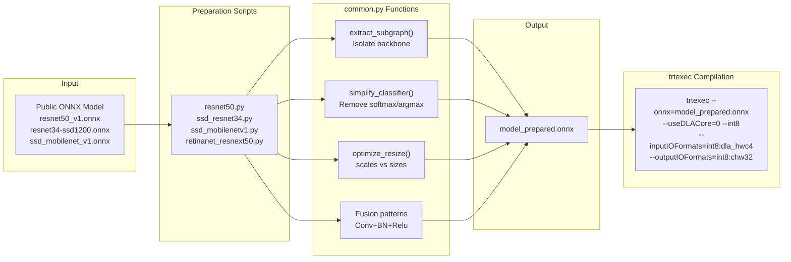
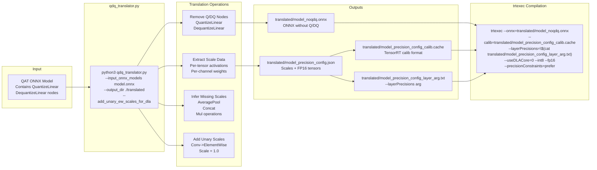

<!-- source: DeepWiki mcp.deepwiki.com · repo NVIDIA/Deep-Learning-Accelerator-SW · page 3 Model Preparation · fetched 2026-10-26 -->

# Model Preparation

<details>
<summary>Relevant source files</summary>

The following files were used as context for generating this wiki page:

- [scripts/prepare_models/README.md](scripts/prepare_models/README.md)
- [tools/qdq-translator/README.md](tools/qdq-translator/README.md)

</details>


## Purpose and Scope

This document covers the process of transforming neural network models from their original formats into DLA-compatible ONNX models ready for compilation. Model preparation is the critical bridge between model training and deployment, involving graph optimizations, quantization metadata extraction, and structural transformations that enable efficient DLA execution.

Model preparation encompasses two primary workflows: (1) direct ONNX graph optimization for models without explicit quantization nodes, and (2) QDQ (Quantize/DeQuantize) translation for models trained with Quantization-Aware Training (QAT). This phase precedes TensorRT compilation (see [Model Compilation](#5)) and follows model training and export (see [Getting Started](#2) for basic deployment).

For detailed information about specific preparation scripts and techniques, see:
- [ONNX Model Preparation Scripts](#3.1) for graph transformation utilities
- [QDQ Translator for Quantized Models](#3.2) for QAT model conversion
- [Graph Optimization Techniques](#3.3) for fusion and optimization patterns

## Model Preparation Workflow Overview



**Workflow: Model Preparation Pipeline**

The diagram illustrates two distinct preparation paths that converge at the TensorRT compilation stage. Models containing Q/DQ nodes from QAT frameworks flow through `qdq_translator.py`, while models without explicit quantization undergo graph optimization via model-specific preparation scripts. Both paths produce optimized ONNX graphs, but the QDQ path additionally generates quantization metadata required for INT8 inference.

Sources: [scripts/prepare_models/README.md:1-136](), [tools/qdq-translator/README.md:1-176]()

## Input Model Requirements

### Supported Model Formats

| Format | Framework | Requirements | Typical Use Case |
|--------|-----------|--------------|------------------|
| ONNX without Q/DQ | PyTorch, TensorFlow, Public | Standard ONNX opset 11+ | Pre-trained models requiring PTQ |
| ONNX with Q/DQ | PyTorch QAT, TensorFlow QAT | Q/DQ nodes from quantization toolkits | QAT models with explicit quantization |
| PyTorch `.pt`/`.pth` | PyTorch | Requires `torch.onnx.export()` | Custom trained models |
| TensorFlow `.pb`/`.h5` | TensorFlow | Requires `tf2onnx.convert()` | TensorFlow SavedModel format |

### Quantization-Aware Training Models

For models trained with QAT, the following quantization configurations are required for QDQ Translator compatibility:

**Activation Quantization:**
- Mode: `per_tensor`
- Calibration methods: `max` or `histogram` (PyTorch)

**Weight Quantization:**
- Mode: `per_channel`
- Calibration method: `max` (PyTorch, required)
- Note: `histogram` calibration requires `--calibration_type histogram` flag

**Supported QAT Frameworks:**
- NVIDIA PyTorch Quantization: https://github.com/NVIDIA/TensorRT/tree/main/tools/pytorch-quantization
- NVIDIA TensorFlow Quantization: https://github.com/NVIDIA/TensorRT/tree/main/tools/tensorflow-quantization

Sources: [tools/qdq-translator/README.md:76-79]()

### Minimum Software Requirements for QDQ Translation

| Hardware Platform | Operating System | DLA SW Version | Notes |
|-------------------|------------------|----------------|-------|
| DRIVE Orin | DRIVE OS 6.0.7.0 | DLA 3.13.0 | Minimum for `--add_unary_ew_scales_for_dla` |
| Jetson Orin | JetPack 6.0 | DLA 3.14.1 | Recommended for full feature support |

The `--add_unary_ew_scales_for_dla` flag requires DLA SW 3.13.0+ to enable INT8 execution of Conv+ElementWise fusions without intermediate Q/DQ nodes. See [QDQ Translator for Quantized Models](#3.2) for detailed explanation.

Sources: [tools/qdq-translator/README.md:5-10]()

## Model Preparation Paths

### Path 1: Direct ONNX Optimization



**Path 1: Direct ONNX Optimization Workflow**

This path applies to models without explicit Q/DQ nodes. Preparation scripts in [scripts/prepare_models/]() perform graph transformations using utilities from `common.py`. The output is a single optimized ONNX file ready for INT8 PTQ compilation via `trtexec`.

Sources: [scripts/prepare_models/README.md:8-96]()

### Path 2: QDQ Translation for QAT Models



**Path 2: QDQ Translation Workflow**

QAT models with explicit quantization nodes flow through `qdq_translator.py`, which removes Q/DQ operators while preserving quantization semantics through calibration metadata. The translator generates four output files: the cleaned ONNX graph, a JSON precision configuration, a TensorRT-compatible calibration cache, and a text file containing layer precision arguments.

Sources: [tools/qdq-translator/README.md:12-26](), [scripts/prepare_models/README.md:28-56]()

## Output Artifacts

### File Structure and Purpose

| Artifact | Path Pattern | Purpose | Usage in trtexec |
|----------|--------------|---------|------------------|
| Optimized ONNX | `model_prepared.onnx` or `translated/model_noqdq.onnx` | DLA-compatible graph without Q/DQ nodes | `--onnx=<path>` |
| Calibration Cache | `translated/model_precision_config_calib.cache` | Per-tensor INT8 scales in TensorRT format | `--calib=<path>` |
| Precision Config JSON | `translated/model_precision_config.json` | Human-readable scales and FP16 layer list | Inspection/debugging |
| Layer Precision Args | `translated/model_precision_config_layer_arg.txt` | Comma-separated layer:precision pairs | `--layerPrecisions=$(cat <path>)` |

### Calibration Cache Format

The calibration cache file generated by `qdq_translator.py` contains per-tensor quantization scales in TensorRT's implicit quantization format. This enables INT8 execution without explicit Q/DQ nodes in the graph.

**Example calibration cache entry:**
```
TRT-8600-EntropyCalibration2
conv1_output: 3c008000  # Hexadecimal float32 scale value
conv2_output: 3c010000
```

The cache version (`TRT-8600`) is configurable via `--trt_calib_version` flag.

Sources: [tools/qdq-translator/README.md:42-46]()

### Layer Precision Arguments

The `model_precision_config_layer_arg.txt` file contains a colon-separated list of layers that must execute at FP16 precision, formatted for direct use with `trtexec --layerPrecisions`.

**Example content:**
```
layer_name_1:fp16,layer_name_2:fp16,layer_name_3:fp16
```

This file works in conjunction with `--precisionConstraints=prefer` to ensure mixed-precision execution where INT8 is used for quantized layers and FP16 for layers without valid scales.

Sources: [tools/qdq-translator/README.md:105-109]()

## Preparation Script Usage Patterns

### ResNet-50 Example (Direct Optimization)

**Download and Prepare:**
```bash
# Download from MLCommons inference benchmark
wget https://zenodo.org/record/4735647/files/resnet50_v1.onnx

# Run preparation script
python3 scripts/prepare_models/resnet50.py

# Output: resnet50_v1_prepared.onnx
```

**Compile for DLA:**
```bash
trtexec --useDLACore=0 \
        --int8 \
        --memPoolSize=dlaSRAM:1 \
        --inputIOFormats=int8:dla_hwc4 \
        --outputIOFormats=int8:chw32 \
        --onnx=resnet50_v1_prepared.onnx \
        --shapes=input_tensor:0:2x3x224x224
```

Sources: [scripts/prepare_models/README.md:8-26]()

### ResNet-50 Example (QDQ Translation)

**Prepare QAT Model:**
```bash
# Follow TensorFlow QAT workflow (see tools/qdq-translator/e2e_workflow/tensorflow_workflow)

# Translate QAT model
python3 tools/qdq-translator/qdq_translator.py \
        --input_onnx_models resnet_50v1.onnx \
        --output_dir ./translated \
        --add_unary_ew_scales_for_dla

# Additional preparation (optional graph optimizations)
python3 scripts/prepare_models/resnet50_noqdq.py

# Outputs:
#   translated/resnet_50v1_noqdq.onnx
#   translated/resnet_50v1_precision_config_calib.cache
#   translated/resnet_50v1_precision_config_layer_arg.txt
#   translated/resnet_50v1_noqdq_prepared.onnx (after resnet50_noqdq.py)
```

**Compile for DLA:**
```bash
trtexec --onnx=translated/resnet_50v1_noqdq_prepared.onnx \
        --calib=translated/resnet_50v1_precision_config_calib.cache \
        --useDLACore=0 \
        --int8 \
        --fp16 \
        --precisionConstraints=prefer \
        --memPoolSize=dlaSRAM:1 \
        --shapes=StatefulPartitionedCall/resnet50/quant_conv1_bn/FusedBatchNormV3:0:2x3x224x224 \
        --layerPrecisions=$(cat translated/resnet_50v1_precision_config_layer_arg.txt) \
        --inputIOFormats=int8:hwc4 \
        --outputIOFormats=fp16:chw16
```

Sources: [scripts/prepare_models/README.md:28-56](), [tools/qdq-translator/README.md:12-26]()

### SSD-MobileNetV1 Example

**Preparation with Custom Input Shape:**
```bash
# Download model
wget https://zenodo.org/record/4735652/files/ssd_mobilenet_v1_coco_2018_01_28.onnx

# Prepare
python3 scripts/prepare_models/ssd_mobilenetv1.py

# Compile with dynamic shape specification
trtexec --useDLACore=0 \
        --int8 \
        --memPoolSize=dlaSRAM:1 \
        --inputIOFormats=int8:dla_hwc4 \
        --outputIOFormats=int8:chw32 \
        --onnx=ssd_mobilenet_v1_coco_2018_01_28_prepared.onnx \
        --shapes=Preprocessor/sub:0:2x3x300x300
```

Note the `--shapes` argument specifying the input tensor name and dimensions. Preparation scripts may modify input/output tensor names, requiring matching `--shapes` specifications.

Sources: [scripts/prepare_models/README.md:78-96]()

### RetinaNet with Polygraphy Preprocessing

**Using Polygraphy for Constant Folding:**
```bash
# Download model
wget https://zenodo.org/record/6617879/files/resnext50_32x4d_fpn.onnx

# Sanitize with Polygraphy constant folding
polygraphy surgeon sanitize resnext50_32x4d_fpn.onnx \
           -o resnext50_32x4d_fpn_sanitized.onnx \
           --fold-constants

# Prepare
python3 scripts/prepare_models/retinanet_resnext50.py

# Compile
trtexec --useDLACore=0 \
        --int8 \
        --memPoolSize=dlaSRAM:1 \
        --inputIOFormats=int8:dla_hwc4 \
        --outputIOFormats=int8:chw32 \
        --onnx=resnext50_32x4d_fpn_sanitized_prepared.onnx
```

The `polygraphy surgeon sanitize` command with `--fold-constants` eliminates constant computation subgraphs, simplifying the graph before DLA-specific preparation.

Sources: [scripts/prepare_models/README.md:98-115]()

## Common Preparation Techniques

### Subgraph Extraction

Extracting the backbone network from full detection/classification models enables focused DLA deployment for compute-intensive feature extraction, while post-processing runs on GPU.

**Typical use case:** Isolating ResNet-34 backbone from RetinaNet for separate compilation and hybrid GPU-DLA execution.

Sources: Referenced in high-level diagrams; implementation in `common.py` utilities

### Classifier Head Simplification

Removing non-essential operations from classification heads (e.g., `Softmax`, `ArgMax`, `TopK`) reduces graph complexity and enables DLA execution of the entire backbone without GPU fallback.

**Rationale:** Classification post-processing is typically lightweight and can be performed on CPU/GPU after DLA inference completes.

Sources: Referenced in high-level diagrams; implementation pattern in preparation scripts

### Resize Operation Optimization

Converting `Resize` operators from `sizes` mode to `scales` mode or vice versa to match DLA operator support constraints.

**DLA constraint:** Specific resize modes may have better support depending on DLA SW and TensorRT versions.

Sources: Referenced in high-level diagrams

### Horizontal Fusion

Combining multiple parallel operations (e.g., multiple convolution branches in Inception-style architectures) into single operations where possible to reduce kernel launch overhead.

**Example:** Fusing multiple 1x1 convolutions operating on the same input into a single wider convolution.

Sources: Referenced in high-level diagrams

## QDQ Translation Deep Dive

### The `--add_unary_ew_scales_for_dla` Flag

This flag addresses a specific INT8 execution scenario introduced in DLA SW 3.13.0.

**Problem:** When a Conv layer's outputs feed directly into an ElementWise Add operation without intermediate Q/DQ nodes, TensorRT may conservatively upgrade both operations to FP16, even though DLA hardware can execute the fusion in INT8.

**Solution:** Insert unary scales (value `1.0`) between Conv and ElementWise operations. The DLA Compiler interprets unary scales identically to missing scales when the other Add input has valid scales, enabling INT8 fusion.

**Graph transformation example:**

Before (Q/DQ graph):
```
Conv -> BatchNorm -> [no Q/DQ] -> Add (left input)
                                   ^
Conv -> BatchNorm -> Q/DQ -------->| (right input with scale)
```

After translation without flag:
```
Conv -> (no scale) -> Add  # Both Conv and Add run in FP16
         ^
Conv -> (scale) --->|
```

After translation with `--add_unary_ew_scales_for_dla`:
```
Conv -> (scale=1.0) -> Add  # Both Conv and Add run in INT8
         ^
Conv -> (scale) ------>|
```

The unary scale of `1.0` indicates the Conv's outputs are scaled only by weight scales, allowing correct INT8 fusion with the quantized right input.

Sources: [tools/qdq-translator/README.md:111-138]()

### Scale Inference Options

The QDQ Translator provides flags to infer missing scales for specific operator types:

| Flag | Affected Operators | Behavior | Impact |
|------|-------------------|----------|--------|
| `--infer_average_pool_scales` | `AveragePool`, `GlobalAveragePool`, `ReduceMean` | Propagate scales upstream/downstream | May reduce latency, may impact accuracy |
| `--infer_concat_scales` | `Concat` | Set output scale to max of input scales | Required for models like Inception-V3 |
| `--infer_mul_scales` | `Mul` | Propagate scales for multiply operations | May reduce latency, may impact accuracy |
| `--addtl_ops_to_infer_adjacent_scales` | User-specified operators | Propagate scales like Transpose/Reshape | Extend default set of pass-through ops |

**Default pass-through operators** (scales propagated automatically):
`Pad`, `Transpose`, `MaxPool`, `Flatten`, `Relu`, `Squeeze`, `Reshape`, `Sigmoid`

Sources: [tools/qdq-translator/README.md:47-61]()

## Reference Model Support Matrix

| Model | Source | Preparation Script | QDQ Translation | Sparsity Support | Notes |
|-------|--------|-------------------|-----------------|------------------|-------|
| ResNet-50 | MLCommons | `resnet50.py` | Yes (TF workflow) | No | Image classification |
| SSD-ResNet-34 | MLCommons | `ssd_resnet34.py` | No | No | Object detection |
| SSD-MobileNetV1 | MLCommons | `ssd_mobilenetv1.py` | No | No | Lightweight detection |
| RetinaNet ResNeXt-50 | MLCommons | `retinanet_resnext50.py` | No | No | Dense object detection |
| RetinaNet ResNet-34 | Zenodo | None (pre-prepared) | No | Yes (2:4 structured) | Sparse INT8 benchmark |
| YOLOv5s | NVIDIA-AI-IOT | See cuDLA samples | Yes (PyTorch workflow) | No | End-to-end QAT example |

All MLCommons models sourced from: https://github.com/mlcommons/inference/

Sources: [scripts/prepare_models/README.md:8-136](), [tools/qdq-translator/README.md:142-158]()

## Accuracy Validation Results

### QDQ Translator Accuracy (ImageNet Top-1)

Models trained with NVIDIA TensorFlow Quantization, evaluated with TensorRT 8.6-EA on GeForce RTX 3090:

| Model | Original INT8 (with Q/DQ) | Translated INT8 (without Q/DQ) | Notes |
|-------|---------------------------|-------------------------------|-------|
| ResNet-50v1 | 75.18% | 75.22% | Negligible accuracy difference |
| ResNet-50v2 | 75.77% | 73.87% | Accuracy drop observed |
| MobileNet-v1 | 70.45% | 70.41% | Equivalent accuracy |
| MobileNet-v2 | 71.62% | 71.73% | Slight improvement |
| EfficientNet-B0 | 75.83% | 75.79% | Equivalent accuracy |
| EfficientNet-B3 | 79.02% | 77.96% | Accuracy drop observed |
| Inception-V3 | 78.06% | 78.20% (with `--infer_concat_scales`) | Requires scale inference |

Sources: [tools/qdq-translator/README.md:160-171]()

### QDQ Translator Accuracy (COCO 2017 val mAP)

YOLOv5s model trained with NVIDIA PyTorch Quantization, evaluated with TensorRT 8.6 on NVIDIA DRIVE Orin:

| Model | Resolution | Batch Size | FP32 mAP | INT8 mAP (Translated) |
|-------|-----------|------------|----------|----------------------|
| YOLOv5s | 672x672 | 1 | 37.4 | 37.3 |

Sources: [tools/qdq-translator/README.md:153-158]()

## Best Practices

### When to Use QDQ Translation vs. Direct PTQ

**Use QDQ Translation when:**
- Model was trained with QAT using NVIDIA quantization toolkits
- Explicit Q/DQ nodes exist in ONNX graph
- Per-channel weight quantization is required
- Accuracy must match QAT training results

**Use Direct PTQ (via preparation scripts) when:**
- Starting from unquantized public models
- QAT training is not feasible
- Faster deployment iteration is priority
- Accuracy requirements are flexible

### Preparation Script Execution Environment

**Host-side execution (x86/ARM development machine):**
- Model download and preparation scripts (Python)
- QDQ Translator (`qdq_translator.py`)
- Polygraphy sanitization
- Graph optimization utilities

**Target-side execution (Jetson Orin/DRIVE Orin):**
- TensorRT compilation (`trtexec`)
- DLA loadable generation
- Inference execution

This separation enables cross-compilation workflows and reduces target storage requirements.

Sources: [scripts/prepare_models/README.md:4-6]()

### Dependency Management

**Python requirements (host):**
Install dependencies for preparation scripts and QDQ Translator:
```bash
pip install -r requirements.txt
```

Located at repository root: [requirements.txt]()

**TensorRT availability (target):**
Default installation path on L4T platforms: `/usr/local/tensorrt/bin/trtexec`

Sources: [scripts/prepare_models/README.md:4-6]()

### Version Compatibility

**Critical version constraints:**
- DLA SW 3.13.0+ required for `--add_unary_ew_scales_for_dla` support
- TensorRT 8.5+ recommended for model preparation examples
- `onnxoptimizer` must be exactly version `0.3.2` for EfficientNet models

**Known issues:**
- Newer `onnxoptimizer` versions may cause TensorRT engine build failures for EfficientNet-B0/B3 models trained with NVIDIA TensorFlow Quantization

Sources: [tools/qdq-translator/README.md:5-10](), [tools/qdq-translator/README.md:173-176]()

---

