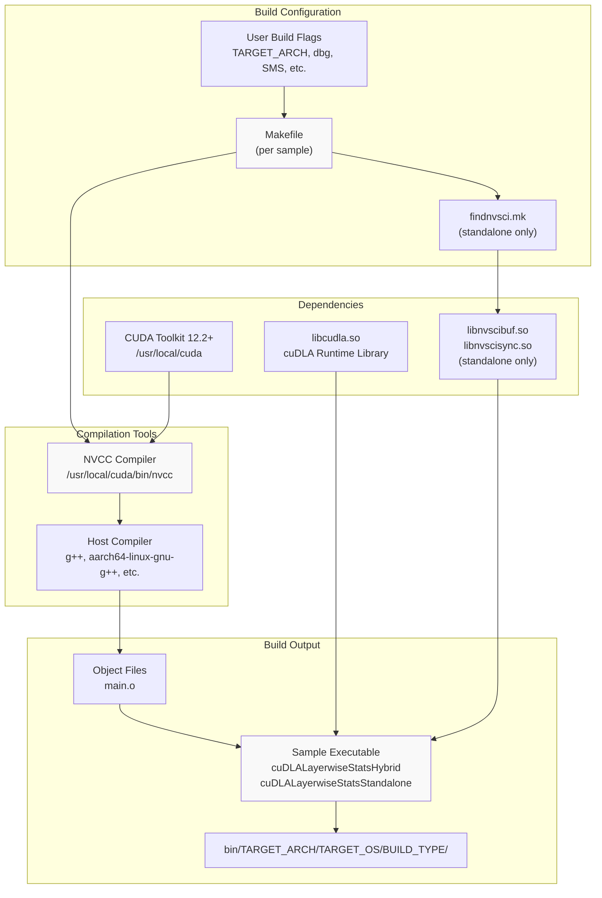
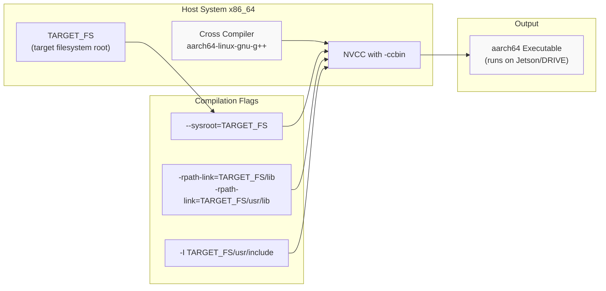
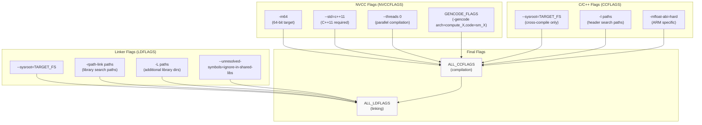
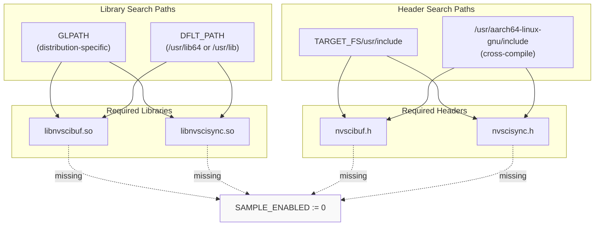
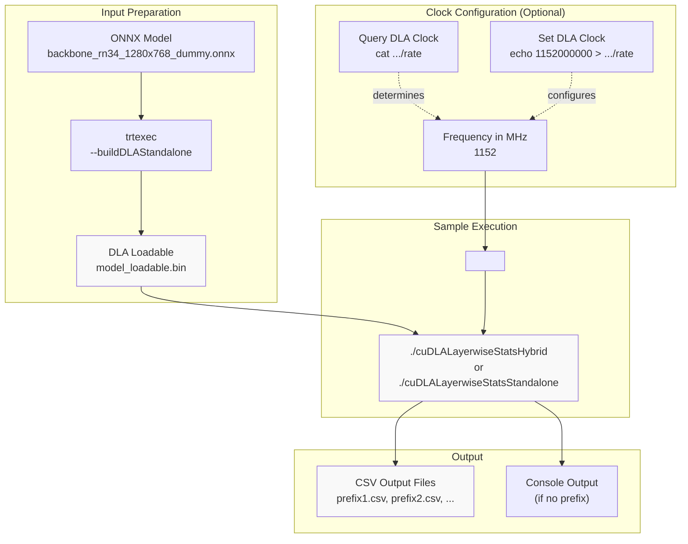

<!-- source: DeepWiki mcp.deepwiki.com · repo NVIDIA/Deep-Learning-Accelerator-SW · page 8.2 Building and Running Samples · fetched 2026-10-26 -->

# Building and Running Samples

<details>
<summary>Relevant source files</summary>

The following files were used as context for generating this wiki page:

- [samples/cuDLA/cuDLALayerwiseStatsHybrid/Makefile](samples/cuDLA/cuDLALayerwiseStatsHybrid/Makefile)
- [samples/cuDLA/cuDLALayerwiseStatsHybrid/README.md](samples/cuDLA/cuDLALayerwiseStatsHybrid/README.md)
- [samples/cuDLA/cuDLALayerwiseStatsHybrid/main.cu](samples/cuDLA/cuDLALayerwiseStatsHybrid/main.cu)
- [samples/cuDLA/cuDLALayerwiseStatsStandalone/Makefile](samples/cuDLA/cuDLALayerwiseStatsStandalone/Makefile)
- [samples/cuDLA/cuDLALayerwiseStatsStandalone/findnvsci.mk](samples/cuDLA/cuDLALayerwiseStatsStandalone/findnvsci.mk)
- [samples/cuDLA/cuDLALayerwiseStatsStandalone/main.cpp](samples/cuDLA/cuDLALayerwiseStatsStandalone/main.cpp)

</details>


## Purpose and Scope

This document provides detailed instructions for building and running the cuDLA sample applications provided in the repository. It covers the build system architecture, compilation options, cross-compilation workflows, platform-specific requirements, and execution procedures.

For information about the sample applications themselves and their functionality, see [cuDLA Sample Overview](#8.1). For performance analysis using the layerwise statistics samples, see [Layerwise Statistics Collection](#7.1).

---

## Build System Architecture

All cuDLA samples use a Makefile-based build system that supports native compilation and cross-compilation for ARM platforms.



**Build System Components**

Sources: [samples/cuDLA/cuDLALayerwiseStatsHybrid/Makefile:1-394](), [samples/cuDLA/cuDLALayerwiseStatsStandalone/Makefile:1-397]()

---

## Prerequisites

### Minimum Requirements

| Component | Requirement |
|-----------|-------------|
| **CUDA Toolkit** | Version 12.2 or later |
| **GCC Version** | 4.7.0 or later (for C++11 support) |
| **Target Architecture** | `aarch64` (ARM 64-bit) |
| **Operating System** | Linux or QNX |
| **DLA Hardware** | Jetson Orin/Xavier or DRIVE Orin/Xavier |

### Platform Restrictions

The following platform combinations are **not supported** and will be automatically waived during build:

- Linux x86_64
- Mac OSX (Darwin)
- ARMv7 (32-bit ARM)
- SBSA architecture

Sources: [samples/cuDLA/cuDLALayerwiseStatsHybrid/Makefile:269-293](), [samples/cuDLA/cuDLALayerwiseStatsStandalone/Makefile:269-293]()

### Library Dependencies

**Hybrid Mode Samples:**
- `libcudla.so` - cuDLA runtime library
- CUDA runtime libraries (automatically linked)

**Standalone Mode Samples:**
- `libcudla.so` - cuDLA runtime library
- `libnvscibuf.so` - NvSci buffer management
- `libnvscisync.so` - NvSci synchronization primitives

The build system automatically searches for NvSci libraries using `findnvsci.mk` and will waive the build if dependencies are missing.

Sources: [samples/cuDLA/cuDLALayerwiseStatsStandalone/findnvsci.mk:111-141](), [samples/cuDLA/cuDLALayerwiseStatsHybrid/Makefile:356]()

---

## Building Samples

### Native Compilation

To build a sample on the target device (native compilation):

```bash
cd samples/cuDLA/<sample_directory>
make
```

Example for layerwise statistics hybrid sample:

```bash
cd samples/cuDLA/cuDLALayerwiseStatsHybrid
make
```

The build process:
1. Compiles source files (`.cu` or `.cpp`) to object files using `nvcc`
2. Links object files with required libraries
3. Copies executable to `bin/$(TARGET_ARCH)/$(TARGET_OS)/$(BUILD_TYPE)/`

Sources: [samples/cuDLA/cuDLALayerwiseStatsHybrid/Makefile:365-385]()

### Cross-Compilation



**Cross-Compilation Workflow**

To cross-compile from x86_64 host to aarch64 target:

```bash
make TARGET_ARCH=aarch64 TARGET_FS=/path/to/target/filesystem
```

**Build Options:**

| Option | Description | Example |
|--------|-------------|---------|
| `TARGET_ARCH=<arch>` | Target architecture | `TARGET_ARCH=aarch64` |
| `TARGET_FS=<path>` | Target filesystem root path | `TARGET_FS=/mnt/jetson-rootfs` |
| `HOST_COMPILER=<compiler>` | Override host compiler | `HOST_COMPILER=aarch64-linux-gnu-g++` |
| `dbg=1` | Build with debug symbols (`-g -G`) | `make dbg=1` |
| `SMS="A B ..."` | Override SM architectures | `SMS="72 87"` |

The `TARGET_FS` must point to the target device's root filesystem, which provides:
- Target system libraries (`/lib`, `/usr/lib`)
- Target headers (`/usr/include`)
- Architecture-specific paths (`/usr/lib/aarch64-linux-gnu`)

Sources: [samples/cuDLA/cuDLALayerwiseStatsHybrid/Makefile:179-227](), [samples/cuDLA/cuDLALayerwiseStatsStandalone/Makefile:179-227]()

### Compiler Flags and Settings



**SM Architecture Codes**

The build system generates code for multiple SM (Streaming Multiprocessor) architectures:

- **ARM platforms (aarch64):** SM 53, 61, 70, 72, 75, 80, 86, 87
- **x86_64 platforms:** SM 35, 37, 50, 52, 60, 61, 70, 75, 80, 86

Sources: [samples/cuDLA/cuDLALayerwiseStatsHybrid/Makefile:261-355](), [samples/cuDLA/cuDLALayerwiseStatsStandalone/Makefile:331-358]()

---

## Build Verification

### Checking Dependencies

To verify all dependencies are met before building:

```bash
make check.deps
```

Output on success:
```
Sample is ready - all dependencies have been met
```

Output on failure:
```
Sample will be waived due to the above missing dependencies
```

### GCC Version Check

The Makefile automatically validates GCC version during build:

```bash
# Build will proceed only if GCC >= 4.7.0
make
# Output: >>> GCC Version is greater or equal to 4.7.0 <<<
```

Sources: [samples/cuDLA/cuDLALayerwiseStatsHybrid/Makefile:306-329](), [samples/cuDLA/cuDLALayerwiseStatsStandalone/Makefile:310-332]()

### NvSci Library Detection (Standalone Only)

The standalone samples use `findnvsci.mk` to locate required NvSci libraries:



**NvSci Detection Logic**

Sources: [samples/cuDLA/cuDLALayerwiseStatsStandalone/findnvsci.mk:111-141]()

---

## Running Samples

### Preparing DLA Loadables

Before running samples, you must generate a DLA loadable using `trtexec`. This is typically done on the target device:

```bash
# Locate trtexec (typically in /usr/src/tensorrt/bin)
cd /usr/src/tensorrt/bin/

# Generate DLA loadable from ONNX model
./trtexec \
    --onnx=backbone_rn34_1280x768_dummy.onnx \
    --saveEngine=model_loadable.bin \
    --useDLACore=0 \
    --int8 \
    --memPoolSize=dlaSRAM:1 \
    --inputIOFormats=int8:dla_hwc4 \
    --outputIOFormats=int8:chw32 \
    --buildDLAStandalone
```

For detailed information on `trtexec` options, see [Using trtexec for DLA](#5.2).

Sources: [samples/cuDLA/cuDLALayerwiseStatsHybrid/README.md:76-106]()

### Setting DLA Clock Frequency (Optional)

For accurate layerwise profiling, you may need to set or query the DLA clock frequency:

```bash
# Query current DLA clock frequency (in Hz)
sudo cat /sys/kernel/debug/bpmp/debug/clk/nafll_dla0_core/rate

# Set DLA clock frequency (example: 1152 MHz = 1152000000 Hz)
DLA_CLK=1152000000
echo ${DLA_CLK} | sudo tee /sys/kernel/debug/bpmp/debug/clk/nafll_dla0_core/rate
```

**Platform-Specific Path:**
- **Standard platforms:** `/sys/kernel/debug/bpmp/debug/clk/nafll_dla0_core/rate`
- **D6Q Standard:** `/dev/nvbpmpdebugfs/bpmp_debug/clk/nafll_dla0_core/rate`

**Note:** The frequency value is specified in Hz when setting, but in MHz when passed to sample executables.

Sources: [samples/cuDLA/cuDLALayerwiseStatsHybrid/README.md:92-111]()

### Sample Execution Workflow



**Sample Execution Flow**

Sources: [samples/cuDLA/cuDLALayerwiseStatsHybrid/README.md:86-112](), [samples/cuDLA/cuDLALayerwiseStatsHybrid/main.cu:229-260]()

### Command-Line Arguments

#### cuDLALayerwiseStatsHybrid

```bash
./cuDLALayerwiseStatsHybrid <loadable> <freqMHZ> <statSupport> <filenamePrefix>
```

**Arguments:**

| Argument | Type | Description | Example |
|----------|------|-------------|---------|
| `<loadable>` | string | Path to DLA loadable binary file | `model_loadable.bin` |
| `<freqMHZ>` | uint32 | DLA clock frequency in MHz | `1152` |
| `<statSupport>` | uint32 | Enable layerwise profiling (0=off, 1=on) | `1` |
| `<filenamePrefix>` | string (optional) | Prefix for output CSV files (max 190 chars) | `hybrid1` |

**Example:**
```bash
./cuDLALayerwiseStatsHybrid model_loadable.bin 1152 1 hybrid1
# Generates: hybrid11.csv, hybrid12.csv, ...
```

**Output when `statSupport=1` and prefix provided:**
- CSV files named `<filenamePrefix><index>.csv` where `<index>` is 1-based
- Each CSV contains layerwise statistics for one task/subgraph

**Output when `statSupport=1` and no prefix:**
- Statistics printed to console

Sources: [samples/cuDLA/cuDLALayerwiseStatsHybrid/README.md:86-98](), [samples/cuDLA/cuDLALayerwiseStatsHybrid/main.cu:251-262]()

#### cuDLALayerwiseStatsStandalone

```bash
./cuDLALayerwiseStatsStandalone <loadable> <freqMHZ> <statSupport> <filenamePrefix>
```

**Arguments:** (Same as hybrid mode)

The standalone mode sample has identical command-line interface but uses NvSciBuf/NvSciSync for memory management instead of CUDA-managed memory.

Sources: [samples/cuDLA/cuDLALayerwiseStatsStandalone/main.cpp:471-500]()

### Execution Requirements

**Memory Requirements:**

The samples automatically allocate memory for:
- Input tensors (based on `cudlaModuleTensorDescriptor`)
- Output tensors
- Task statistics buffers (when `statSupport=1`)

**Hybrid Mode:**
```cpp
// GPU memory allocation via cudaMalloc
cudaMalloc(&(inputBufferGPU[ii]), inputTensorDesc[ii].size);
cudaMalloc(&(outputBufferGPU[ii]), outputTensorDesc[ii].size);
cudaMalloc(&(outputTaskStatisticsGPU[ii]), outputTaskStatisticsDesc[ii].size);
```

**Standalone Mode:**
```cpp
// NvSciBuf object allocation
NvSciBufObjAlloc(reconciledInputAttrList[ii], &inputBufObj[ii]);
NvSciBufObjAlloc(reconciledOutputAttrList[ii], &outputBufObj[ii]);
NvSciBufObjAlloc(reconciledStatisticsOutputAttrList[ii], &statisticsBufObj[ii]);
```

Sources: [samples/cuDLA/cuDLALayerwiseStatsHybrid/main.cu:526-579](), [samples/cuDLA/cuDLALayerwiseStatsStandalone/main.cpp:914-918]()

### Resource Validation

**Checking Loadable Compatibility:**

The samples automatically validate that the loadable supports layerwise statistics:

```cpp
err = cudlaModuleGetAttributes(moduleHandle, CUDLA_NUM_OUTPUT_TASK_STATISTICS, &attribute);
numOutputTaskStatistics = attribute.numOutputTensors;

if(numOutputTaskStatistics == 0) {
    DPRINTF("Layerwise stats is not supported for this Loadable \n");
    cleanUp(&resourceList);
    return 1;
}
```

If the loadable was not built with layerwise profiling support, the sample will exit with an error message.

Sources: [samples/cuDLA/cuDLALayerwiseStatsHybrid/main.cu:376-389](), [samples/cuDLA/cuDLALayerwiseStatsStandalone/main.cpp:582-598]()

---

## Build Targets and Cleanup

### Available Make Targets

| Target | Description |
|--------|-------------|
| `make` or `make all` | Build the sample (default) |
| `make build` | Build the sample (explicit) |
| `make check.deps` | Verify dependencies without building |
| `make run` | Build and run the sample |
| `make clean` | Remove object files and executable |
| `make clobber` | Same as `clean` |

### Cleanup

To remove build artifacts:

```bash
# Remove object files and executable from current directory
make clean

# Also removes executable from bin/ directory
make clean
```

**Files Removed:**
- Object files (`*.o`)
- Sample executable
- Executable in `bin/$(TARGET_ARCH)/$(TARGET_OS)/$(BUILD_TYPE)/`

Sources: [samples/cuDLA/cuDLALayerwiseStatsHybrid/Makefile:389-394](), [samples/cuDLA/cuDLALayerwiseStatsStandalone/Makefile:392-397]()

---

## Troubleshooting Build Issues

### Common Build Errors

**Error: Sample waived on x86_64**
```
>>> WARNING - cuDLALayerwiseStatsHybrid is not supported on Linux x86_64 - waiving sample <<<
```
**Solution:** Build on or cross-compile to aarch64 target platform.

**Error: Missing NvSci libraries (Standalone only)**
```
>>> WARNING - libnvscibuf.so not found, Waiving the sample <<<
>>> WARNING - libnvscisync.so not found, Waiving the sample <<<
```
**Solution:** Ensure NvSci libraries are installed or set `TARGET_FS` to point to a filesystem containing them.

**Error: GCC version too old**
```
>>> Waiving build. Minimum GCC version required is 4.7.0<<<
```
**Solution:** Update GCC to version 4.7.0 or later, or specify a newer compiler:
```bash
make HOST_COMPILER=gcc-9
```

**Error: Missing CUDA headers**
```
fatal error: cuda_runtime.h: No such file or directory
```
**Solution:** Set `CUDA_PATH` environment variable:
```bash
export CUDA_PATH=/usr/local/cuda
make
```

### Cross-Compilation Issues

**Error: Cannot find target libraries**
```
/usr/bin/ld: cannot find -lcudla
```
**Solution:** Set `TARGET_FS` to the target device's root filesystem:
```bash
make TARGET_ARCH=aarch64 TARGET_FS=/mnt/jetson-orin-rootfs
```

**Error: Wrong architecture for binary**
```
cannot execute binary file: Exec format error
```
**Solution:** You built for the wrong architecture. Verify:
```bash
file cuDLALayerwiseStatsHybrid
# Should output: ELF 64-bit LSB executable, ARM aarch64, ...
```

Sources: [samples/cuDLA/cuDLALayerwiseStatsHybrid/Makefile:269-293](), [samples/cuDLA/cuDLALayerwiseStatsStandalone/findnvsci.mk:114-141]()

---

## Platform-Specific Build Notes

### Jetson Orin/Xavier

**Native Build:**
```bash
cd samples/cuDLA/cuDLALayerwiseStatsHybrid
make
./cuDLALayerwiseStatsHybrid model.bin 1152 1 output
```

**CUDA Toolkit Location:**
- Default: `/usr/local/cuda`
- JetPack installation: `/usr/local/cuda-12.2/`

### DRIVE Orin/Xavier

**QNX Cross-Compilation:**
```bash
export QNX_HOST=/path/to/qnx/host
export QNX_TARGET=/path/to/qnx/target
make TARGET_OS=qnx TARGET_ARCH=aarch64
```

**DRIVE OS Specific:**
- D6Q Standard uses different BPMP debug path for clock control
- See [Setting DLA Clock Frequency](#setting-dla-clock-frequency-optional)

### Cross-Compilation from x86_64

```bash
# Install cross-compiler
sudo apt-get install g++-aarch64-linux-gnu

# Mount or copy target filesystem
# Option 1: Direct device mount
sudo mkdir /mnt/jetson-rootfs
sudo mount -t nfs jetson-device:/  /mnt/jetson-rootfs

# Option 2: Filesystem extracted from SDK
# (e.g., extracted from DRIVE OS PDK or JetPack SDK)

# Build
make TARGET_ARCH=aarch64 TARGET_FS=/mnt/jetson-rootfs

# Copy to target
scp cuDLALayerwiseStatsHybrid nvidia@jetson-device:~/
```

Sources: [samples/cuDLA/cuDLALayerwiseStatsHybrid/Makefile:120-157](), [samples/cuDLA/cuDLALayerwiseStatsStandalone/Makefile:120-157]()

---

## Build System Code Entities

### Key Makefile Variables

| Variable | Purpose | Example Value |
|----------|---------|---------------|
| `CUDA_PATH` | CUDA Toolkit installation directory | `/usr/local/cuda` |
| `HOST_ARCH` | Architecture of build machine | `x86_64`, `aarch64` |
| `TARGET_ARCH` | Architecture of target device | `aarch64` |
| `TARGET_OS` | Target operating system | `linux`, `qnx` |
| `TARGET_FS` | Target filesystem root (cross-compile) | `/mnt/jetson-rootfs` |
| `HOST_COMPILER` | C++ compiler for host | `g++`, `aarch64-linux-gnu-g++` |
| `NVCC` | NVIDIA CUDA compiler | `$(CUDA_PATH)/bin/nvcc` |
| `NVCCFLAGS` | Flags passed to nvcc | `-m64 --std=c++11` |
| `CCFLAGS` | C/C++ compiler flags | `--sysroot=$(TARGET_FS)` |
| `LDFLAGS` | Linker flags | `-rpath-link=$(TARGET_FS)/lib` |
| `LIBRARIES` | Libraries to link | `-lcudla -lnvscibuf -lnvscisync` |
| `SAMPLE_ENABLED` | Build gate (0=skip, 1=build) | `1` |

### Build Flow Functions

**Makefile Targets:**
- `all`: Default target, calls `build`
- `build`: Depends on sample executable
- `check.deps`: Validates dependencies, sets `SAMPLE_ENABLED`
- `clean`: Removes build artifacts

**Makefile Includes:**
- `findnvsci.mk`: Detects NvSci libraries (standalone samples only)

Sources: [samples/cuDLA/cuDLALayerwiseStatsHybrid/Makefile:34-394](), [samples/cuDLA/cuDLALayerwiseStatsStandalone/Makefile:34-397](), [samples/cuDLA/cuDLALayerwiseStatsStandalone/findnvsci.mk:1-144]()

---

