# Page: Overview

# Overview

<details>
<summary>Relevant source files</summary>

The following files were used as context for generating this wiki page:

- [README.md](README.md)

</details>


This document introduces the NVIDIA Deep Learning Accelerator (DLA) hardware and the software ecosystem for deploying neural networks on DLA. It covers the hardware architecture, software stack components, performance characteristics, and the scope of tools and documentation provided in this repository.

For detailed information on specific topics:
- Hardware architecture details, see [DLA Hardware Architecture](#1.1)
- Software stack layers, see [Software Stack Overview](#1.2)
- Platform-specific requirements, see [Supported Platforms](#1.3)
- Deployment workflows, see [Getting Started](#2)
- Operator compatibility, see [ONNX Operator Support](#4)

---

## What is DLA?

NVIDIA DLA (Deep Learning Accelerator) is a fixed-function hardware accelerator designed for deep learning inference operations. DLA provides dedicated hardware acceleration for convolutional neural networks, supporting convolution, deconvolution, fully connected, activation, pooling, batch normalization, and other common operations.

**Hardware Availability:**
- **Orin SoCs**: Up to 2 second-generation DLA cores
- **Xavier SoCs**: Up to 2 first-generation DLA cores

Each SoC contains two independent DLA cores (DLA0 and DLA1) that can execute different models concurrently or process the same model in a pipelined fashion.

**Software Components:**

The DLA software ecosystem consists of three main components:

| Component | Description | Invocation Methods |
|-----------|-------------|-------------------|
| DLA Compiler | Offline compiler that translates neural network graphs into DLA loadable binaries | TensorRT, NvMedia-DLA, cuDLA |
| DLA Runtime Stack | Firmware, kernel mode driver, and user mode driver for execution | TensorRT Runtime, cuDLA Hybrid, cuDLA Standalone |
| Analysis Tools | Performance profiling and debugging utilities | cuDLALayerwiseStats, Nsight Systems |

Sources: [README.md:1-7]()

---

## Why Use DLA on Orin and Xavier?

DLA provides two critical advantages for deep learning inference on embedded platforms: **high performance contribution** and **superior power efficiency**.

### Performance Contribution by Power Mode

DLA's contribution to total system deep learning performance increases as power budgets decrease. On Jetson AGX Orin 64GB, DLA provides 38% to 74% of total INT8 performance depending on power mode:

| Power Mode | GPU INT8 TOPs | DLA INT8 TOPs (2x cores) | Total TOPs | DLA Percentage |
|------------|---------------|--------------------------|------------|----------------|
| MAXN       | 171           | **105**                  | 275        | **38%**        |
| 50W        | 109           | **92**                   | 200        | **46%**        |
| 30W        | 41            | **90**                   | 131        | **69%**        |
| 15W        | 14            | **40**                   | 54         | **74%**        |

**Key Insight:** At 15W power mode, DLA maintains 40 TOPs (38% of MAXN peak) while GPU drops to 14 TOPs (8% of MAXN peak). This makes DLA essential for power-constrained edge deployments.

### Power Efficiency Advantage

DLA is 3x to 5x more power-efficient than GPU for typical inference workloads (measured as images/second per watt, accelerator power only). This efficiency advantage increases at lower power modes where DLA maintains higher utilization while GPU performance degrades.

Example power efficiency ratios (DLA Perf/W ÷ GPU Perf/W):

| Network | MAXN | 50W | 30W | 15W |
|---------|------|-----|-----|-----|
| ResNet-50 (224x224, bs=2) | 3.5x | 2.9x | 2.6x | **3.9x** |
| SSD-MobileNetV1 (300x300, bs=2) | 4.2x | 3.6x | 3.2x | **5.0x** |
| RetinaNet ResNeXt-50 (800x800, bs=1) | 3.8x | 3.1x | 2.8x | **4.2x** |

Sources: [README.md:9-26](), [README.md:101-123]()

---

## DLA in the Deep Learning Pipeline

The following diagram shows how DLA fits into the end-to-end deep learning inference pipeline, from model training to hardware execution:

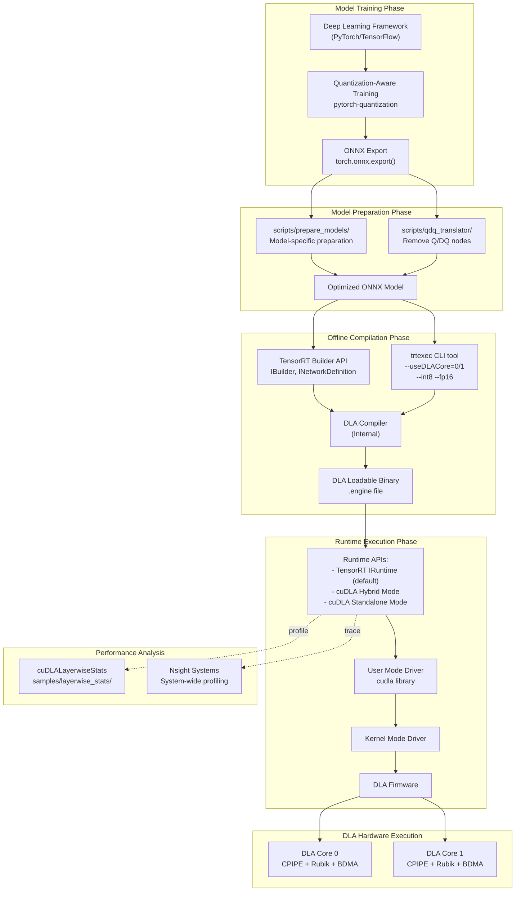

**Workflow Phases:**

1. **Training Phase**: Models are trained with quantization-aware training (QAT) techniques and exported to ONNX format
2. **Preparation Phase**: ONNX models are optimized using repository scripts for graph fusion, precision configuration, and QDQ node translation
3. **Compilation Phase**: TensorRT Builder compiles optimized ONNX to DLA loadable binaries through `trtexec` or programmatic APIs
4. **Runtime Phase**: Applications execute DLA loadables using TensorRT Runtime (default since TRT 8.5), cuDLA Hybrid, or cuDLA Standalone modes
5. **Analysis Phase**: Performance is profiled using layerwise statistics tools and system-wide profilers

Sources: [README.md:3-7](), High-level architecture diagrams provided

---

## Repository Structure and Code Organization

This repository provides tools, scripts, and samples for deploying models on DLA. The following diagram maps repository directories to their purposes:

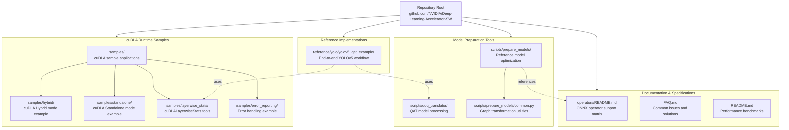

**Key Directories:**

| Directory | Purpose | Key Files |
|-----------|---------|-----------|
| `scripts/prepare_models/` | Model-specific ONNX optimization scripts | `resnet50.py`, `retinanet_resnext50.py`, `common.py` |
| `scripts/qdq_translator/` | QDQ node removal and scale extraction | `qdq_translator.py` |
| `samples/hybrid/` | cuDLA Hybrid mode sample (CUDA-managed) | `sample_cudla_hybrid.cpp` |
| `samples/standalone/` | cuDLA Standalone mode sample (independent DLA) | `sample_cudla_standalone.cpp` |
| `samples/layerwise_stats/` | Performance profiling tools | `cuDLALayerwiseStatsStandalone.cpp` |
| `reference/yolo/yolov5_qat_example/` | Complete YOLOv5 QAT workflow | Training, export, deployment scripts |
| `operators/` | ONNX operator support documentation | `README.md` with support matrix |

Sources: Repository directory structure, [README.md:124-132]()

---

## Reference Models and Accuracy

This repository provides preparation scripts and benchmarks for standard deep learning architectures validated against MLPerf Inference standards.

### Supported Reference Models

| Use Case | Network | INT8 Accuracy on DLA | GPU-Only Layers | Preparation Scripts |
|----------|---------|---------------------|-----------------|---------------------|
| Classification | ResNet-50 | 75.54% ImageNet Top-1 | Top-K (final node) | [scripts/prepare_models/resnet50.py]() |
| Object Detection | RetinaNet ResNeXt-50 | 0.3741 mAP OpenImages | NMS (final node) | [scripts/prepare_models/retinanet_resnext50.py]() |
| Object Detection | RetinaNet ResNet-34 | See MLPerf results | NMS (final node) | [scripts/prepare_models/retinanet_resnet34.py]() |
| Object Detection | SSD-ResNet-34 | 0.21 mAP COCO 2017 | NMS (final node) | [scripts/prepare_models/ssd_resnet34.py]() |
| Object Detection | SSD-MobileNetV1 | 0.23 mAP COCO 2017 | NMS (final node) | [scripts/prepare_models/ssd_mobilenet.py]() |

**Important Characteristics:**

1. **Hybrid Execution Pattern**: Compute-intensive backbones run on DLA, post-processing (NMS, Top-K) runs on GPU
2. **Accuracy Parity**: INT8 accuracy on DLA matches GPU INT8 and approximates FP32 reference within acceptable tolerance
3. **Non-Determinism**: GPU and DLA do not produce bitwise-identical results due to different hardware implementations

### Dense Performance Benchmarks

Performance measured on Jetson AGX Orin 64GB with JetPack 5.1.1 (2x DLA cores, images/second):

| Network | Input Size | Batch | MAXN | 50W | 30W | 15W |
|---------|------------|-------|------|-----|-----|-----|
| ResNet-50 | 224x224 | 2 | 2037 | 1948 | 1928 | 1072 |
| SSD-MobileNetV1 | 300x300 | 2 | 2664 | 2506 | 2472 | 1313 |
| RetinaNet ResNet-34 | 1280x768 | 1 | 108 | 98 | 96 | 45 |
| RetinaNet ResNeXt-50 | 800x800 | 1 | 78 | 72 | 71 | 36 |
| SSD-ResNet-34 | 1200x1200 | 1 | 83 | 76 | 74 | 36 |

### Sparse Performance (2:4 Structured Sparsity)

Sparse performance with `--sparsity=force` flag (dense→sparse speedup):

| Network | MAXN | 50W | 30W | 15W |
|---------|------|-----|-----|-----|
| RetinaNet ResNet-34 (1280x768) | 143 (1.32x) | 133 (1.36x) | 131 (1.37x) | 66 (1.47x) |
| RetinaNet ResNeXt-50 (800x800) | 102 (1.31x) | 96 (1.34x) | 95 (1.34x) | 51 (1.43x) |
| SSD-ResNet-34 (1200x1200) | 103 (1.24x) | 97 (1.28x) | 95 (1.28x) | 49 (1.36x) |

**Key Observations:**
- Sparse speedup increases at lower power modes (15W shows 1.36x-1.47x gains)
- DLA maintains 50%+ of MAXN throughput even at 15W power mode
- Structured sparsity accuracy maintains parity with dense models (validated on Waymo Open Dataset)

Sources: [README.md:27-99]()

---

## ONNX Operator Support

DLA supports approximately 200+ ONNX operators through four support categories:

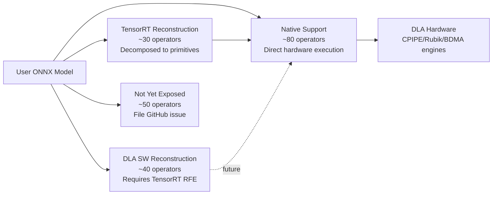

**Support Categories:**

1. **Native Support (~80 ops)**: Direct mapping to DLA hardware instructions (Conv, Pool, Add, Mul, BatchNorm, Concat, etc.)
2. **TensorRT Reconstruction (~30 ops)**: Decomposed into native primitives during compilation (And, Or, Not, Neg, GRU, Gather, etc.)
3. **DLA SW Reconstruction (~40 ops)**: Hardware capability exists but not yet exposed in TensorRT (GroupNorm, LayerNorm, InstanceNorm, trigonometric functions)
4. **RFE Required (~50 ops)**: Planned for future releases, file GitHub issues for priority requests

For detailed operator support matrix and version-specific availability, see [ONNX Operator Support](#4).

Sources: [README.md:124-127](), [operators/README.md](), Operator support diagram provided

---

## Getting Started with DLA

### Prerequisites

**Minimum Requirements:**
- DLA SW version: 3.14.0+
- TensorRT version: 8.6.12+
- JetPack: 5.1.1+ (Jetson platforms)
- DRIVE OS: 6.0.8.0+ (DRIVE platforms)

**Python Dependencies:**
```bash
python3 -m pip install -r requirements.txt
```

### Quick Deployment Workflow

1. **Prepare Model**: Optimize ONNX model using scripts in `scripts/prepare_models/`
2. **Compile to DLA**: Use `trtexec --onnx=model.onnx --saveEngine=model.engine --useDLACore=0 --int8`
3. **Execute Model**: Run using TensorRT Runtime API or cuDLA samples
4. **Profile Performance**: Use `cuDLALayerwiseStats` tools in `samples/layerwise_stats/`

For detailed tutorials, see [Quick Start Tutorial](#2.2).

### Sample Applications

| Sample | Location | Purpose |
|--------|----------|---------|
| cuDLA Hybrid Mode | `samples/hybrid/` | CUDA-managed DLA execution with CUDA streams |
| cuDLA Standalone Mode | `samples/standalone/` | Independent DLA programming with NvSciBuf/NvSciSync |
| Layerwise Statistics | `samples/layerwise_stats/` | Per-layer performance profiling and CSV export |
| Error Reporting | `samples/error_reporting/` | DLA error handling and debugging |
| YOLOv5 QAT | `reference/yolo/yolov5_qat_example/` | Complete QAT training and deployment workflow |

Sources: [README.md:128-132](), Repository samples directory structure

---

## Platform Support

### Supported Hardware Platforms

| Platform Series | DLA Generation | DLA Cores | DLA SRAM | Typical Use Case |
|-----------------|----------------|-----------|----------|------------------|
| Jetson AGX Orin | 2nd gen | 2 | 1 MB per core | Robotics, edge AI |
| Jetson Orin NX | 2nd gen | 2 | 1 MB per core | Embedded inference |
| DRIVE AGX Orin | 2nd gen | 2 | 1 MB per core | Automotive ADAS |
| Jetson AGX Xavier | 1st gen | 2 | 4 MB shared | Legacy edge AI |
| DRIVE AGX Xavier | 1st gen | 2 | 4 MB shared | Legacy automotive |

### Software Requirements

| Component | Jetson Platform | DRIVE Platform |
|-----------|-----------------|----------------|
| Operating System | JetPack 5.1.1+ | DRIVE OS 6.0.8.0+ |
| DLA SW Version | 3.14.0+ | 3.14.0+ |
| TensorRT | 8.6.12+ | 8.6.12+ |
| CUDA | 11.4+ | 11.4+ |

**Architecture Differences:**
- **Orin (2nd gen)**: Dedicated 1 MB SRAM per DLA core, improved sparsity support, enhanced INT8 throughput
- **Xavier (1st gen)**: Shared 4 MB SRAM across both DLA cores, baseline INT8 support

For platform-specific configuration, see [Supported Platforms](#1.3).

Sources: [README.md:3-4](), [README.md:14-26](), Software stack diagram provided

---

## Repository Scope and Documentation Structure

This repository focuses on:

1. **Model Preparation Workflows**: Scripts and utilities for optimizing ONNX models for DLA deployment
2. **cuDLA Runtime Samples**: Reference implementations demonstrating cuDLA API usage patterns
3. **Performance Analysis Tools**: Layerwise statistics collection and profiling utilities
4. **Operator Support Documentation**: Comprehensive ONNX operator compatibility reference
5. **Reference Implementations**: Complete end-to-end workflows (e.g., YOLOv5 QAT)

**Out of Scope (Covered Elsewhere):**
- TensorRT API documentation: See [NVIDIA TensorRT Documentation](https://docs.nvidia.com/deeplearning/tensorrt)
- DLA hardware specifications: See [DLA Product Page](https://developer.nvidia.com/deep-learning-accelerator)
- JetPack/DRIVE OS installation: See platform-specific documentation
- PyTorch/TensorFlow quantization: See framework-specific quantization guides

**Wiki Navigation:**
- Hardware details: [DLA Hardware Architecture](#1.1)
- Software components: [Software Stack Overview](#1.2)
- Model preparation: [Model Preparation](#3)
- Operator compatibility: [ONNX Operator Support](#4)
- Compilation process: [Model Compilation](#5)
- Runtime execution: [Runtime and Deployment](#6)
- Performance tuning: [Performance Analysis and Optimization](#7)
- Code examples: [Sample Applications](#8)
- Troubleshooting: [FAQ and Troubleshooting](#9)
- Contributions: [Contributing to DLA SW](#10)

Sources: [README.md:1-132](), Wiki table of contents

---

# Page: DLA Hardware Architecture

# DLA Hardware Architecture

<details>
<summary>Relevant source files</summary>

The following files were used as context for generating this wiki page:

- [FAQ/README.md](FAQ/README.md)
- [README.md](README.md)

</details>


## Purpose and Scope

This page documents the physical hardware components of the NVIDIA Deep Learning Accelerator (DLA), including its compute engines, memory architecture, and microcontroller. This covers the hardware layer only; for information about the software stack that interfaces with this hardware, see [Software Stack Overview](#1.2). For information about supported platforms and DLA generations, see [Supported Platforms](#1.3).

The DLA is a fixed-function accelerator engine designed for deep learning operations such as convolution, deconvolution, fully connected, activation, pooling, and batch normalization. Each NVIDIA Orin or Xavier SoC contains up to two DLA instances, enabling concurrent execution of multiple deep learning workloads.

**Sources:** [README.md:1-6](), [FAQ/README.md:32-33]()

---

## DLA Hardware Block Diagram

The DLA hardware consists of two primary components: the **DLA Core** (compute engines) and **DLA Falcon** (control microcontroller), along with dedicated SRAM and access to system DRAM.

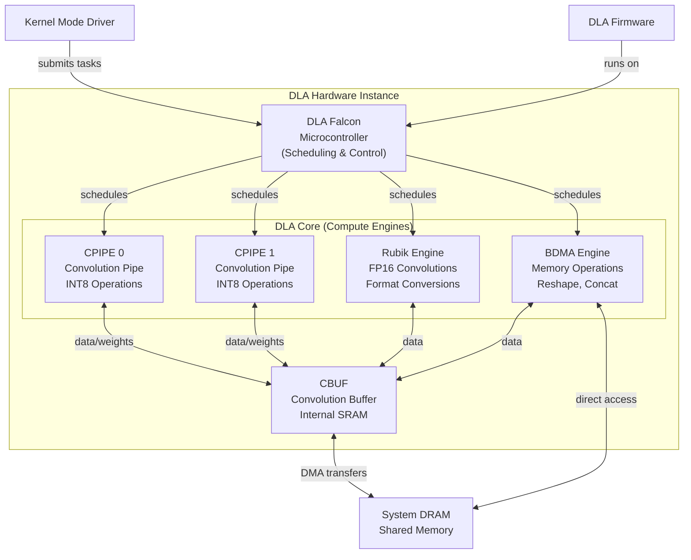

**Sources:** [README.md:3](), [FAQ/README.md:32-33]()

---

## DLA Core vs DLA Falcon

### DLA Core
The **DLA Core** is responsible for performing all mathematical operations. It contains multiple parallel execution engines that can process different types of operations simultaneously:
- Two Convolution Pipes (CPIPEs) for INT8 convolution operations
- Rubik Engine for FP16 convolutions and data format transformations
- BDMA (Broadcast DMA) Engine for memory operations

### DLA Falcon
The **DLA Falcon** is a microcontroller that orchestrates and schedules workloads on the DLA Core. It executes the DLA firmware and manages:
- Task scheduling across execution engines
- Coordination between CPIPEs, Rubik, and BDMA
- Communication with the kernel mode driver
- Sequencing of operations within a DLA loadable

The Falcon ensures that the DLA Core's execution engines are utilized efficiently and that operations execute in the correct order.

**Sources:** [FAQ/README.md:32-33]()

---

## Execution Engines

### Convolution Pipes (CPIPEs)

The DLA Core contains **two Convolution Pipes** that operate in parallel. These are the primary compute engines optimized for INT8 operations.

**Capabilities:**
- INT8 convolution operations (primary precision)
- Pooling operations (Max, Average)
- Point-wise operations (ReLU, PReLU, element-wise operations)
- Batch normalization (fused with convolution)
- Dense convolutions and 2:4 structured sparse convolutions

**Architecture:**
- Each CPIPE can independently execute convolution operations
- Both CPIPEs can operate concurrently on different layers
- Data and weights are loaded from CBUF (internal SRAM)

**Performance Characteristics:**
- Optimized for high arithmetic intensity workloads
- Peak performance depends on whether operations are math-bound or memory-bound
- Structured sparsity (2:4 pattern) provides 1.24x-1.47x speedup for math-bound layers

**Sources:** [README.md:14-21](), [README.md:84-99]()

### Rubik Engine

The **Rubik Engine** is a specialized execution unit for operations that CPIPEs cannot handle.

**Capabilities:**
- FP16 convolution operations
- Format conversions and data transformations
- Reshape and transpose operations
- Operations requiring flexibility beyond CPIPE capabilities

**Design Trade-offs:**
On Orin (2nd generation DLA), NVIDIA optimized for INT8 performance:
- 9x increase in INT8 compute (CPIPEs)
- Reduced FP16 convolution performance (Rubik) compared to Xavier
- Emphasis on INT8 inference workloads rather than FP16

**Sources:** [FAQ/README.md:65-67]()

### BDMA Engine

The **BDMA (Broadcast DMA) Engine** handles memory operations that do not require computation.

**Capabilities:**
- Memory-to-memory copies
- Concatenation operations
- Reshape operations (data movement only)
- Efficient data transfers between CBUF and DRAM

**Purpose:**
The BDMA offloads non-computational memory operations from the CPIPEs and Rubik, allowing them to focus on mathematical operations while BDMA handles data movement in parallel.

**Sources:** [README.md:3]()

---

## Operation-to-Engine Mapping

The following diagram shows how different neural network operations map to specific DLA execution engines:

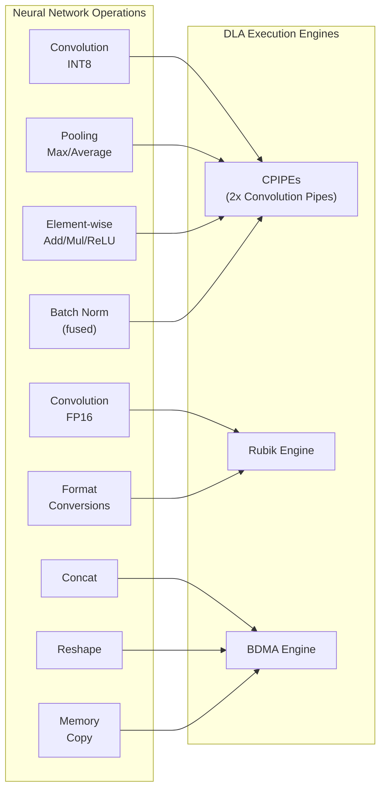

**Sources:** [README.md:3](), [FAQ/README.md:60-67]()

---

## Memory Architecture

### Internal SRAM (CBUF)

The DLA contains internal SRAM called **CBUF (Convolution Buffer)** for storing intermediate data and weights during execution.

#### Xavier (1st Generation DLA)
- **Total SRAM:** 4 MiB shared across 2 DLAs and 2 PVAs (Programmable Vision Accelerators)
- **Architecture:** Shared memory pool
- **Implications:** Potential contention between DLA and PVA workloads

#### Orin (2nd Generation DLA)
- **SRAM per DLA:** 1 MiB exclusive per DLA instance
- **Architecture:** Dedicated memory per DLA
- **Implications:** No contention, predictable performance per DLA

**CBUF Validation:**
When TensorRT compiles a model for DLA, it performs CBUF validation to ensure that convolution layers can fit their data and weights into CBUF. If validation fails, the layer may fall back to GPU execution.

**Sources:** [FAQ/README.md:96-98](), [FAQ/README.md:133-134]()

### System DRAM Access

The DLA has direct access to system DRAM, similar to GPU and CPU.

**Characteristics:**
- Shared system memory with GPU, CPU, and other accelerators
- DMA transfers between CBUF and DRAM
- Potential bandwidth contention when DLA and GPU run concurrently

**Memory Bandwidth Considerations:**
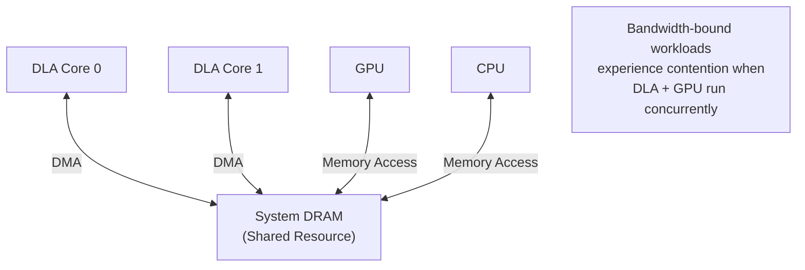

When running workloads concurrently on DLA and GPU, both accelerators compete for DRAM bandwidth, which can increase latency for bandwidth-bound operations.

**Sources:** [FAQ/README.md:93-94](), [FAQ/README.md:51-59]()

---

## DLA Memory Hierarchy

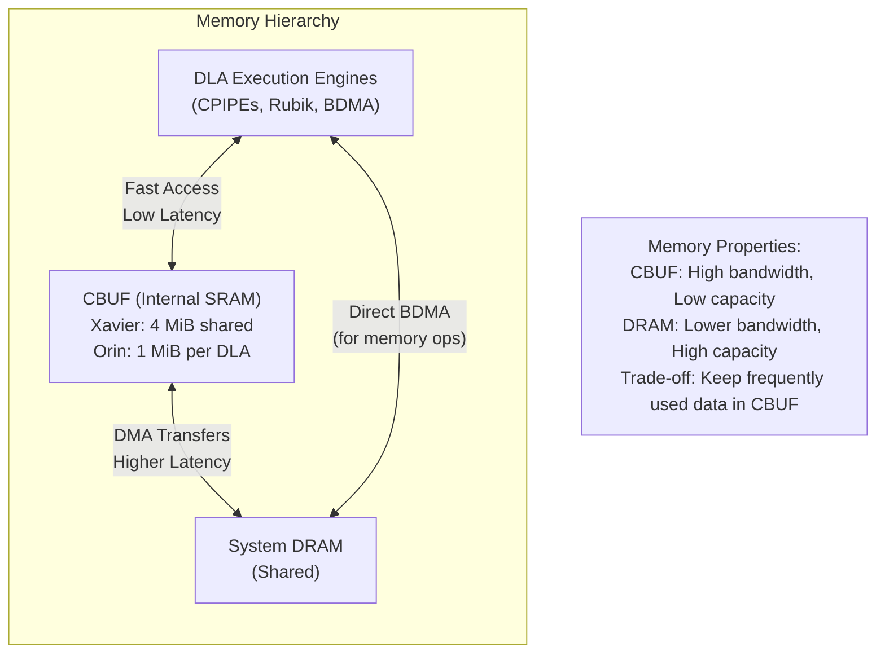

**Performance Implications:**
- Math-bound layers benefit from CBUF for weight/activation storage
- Memory-bound layers are limited by DRAM bandwidth
- CBUF size constrains maximum convolution layer dimensions

**Sources:** [FAQ/README.md:96-98](), [FAQ/README.md:133-134]()

---

## DLA Generation Differences: Xavier vs Orin

### Xavier (1st Generation)
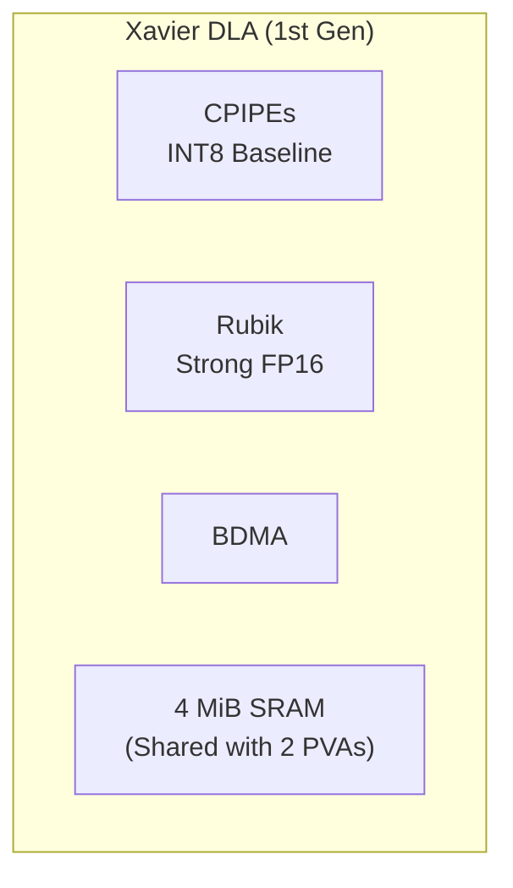

**Characteristics:**
- Balanced INT8 and FP16 performance
- 4 MiB SRAM shared between 2 DLAs and 2 PVAs
- Baseline DLA architecture

### Orin (2nd Generation)
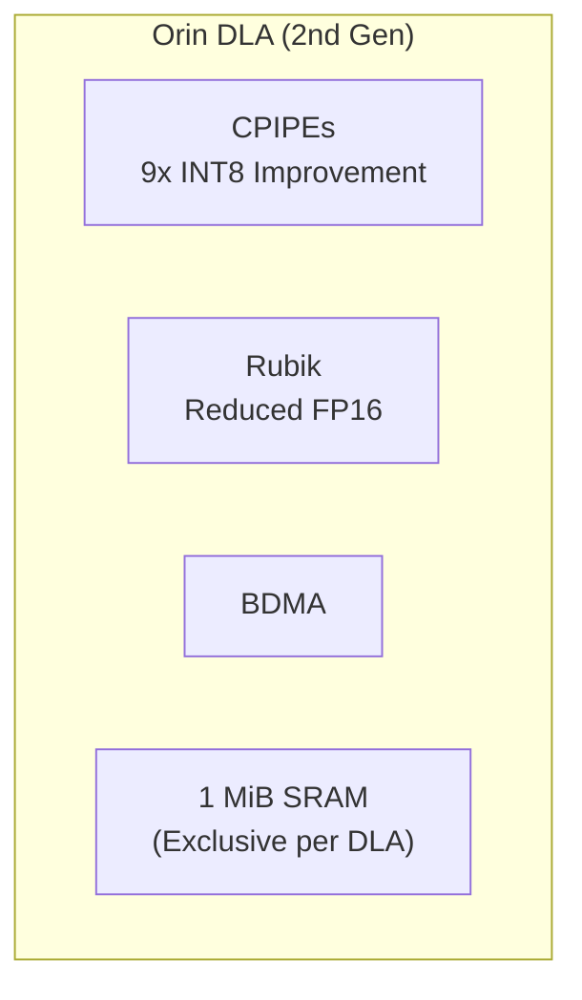

**Characteristics:**
- 9x increase in INT8 compute performance
- Reduced FP16 convolution performance (trade-off)
- 1 MiB exclusive SRAM per DLA (no sharing)
- Optimized for inference workloads

### Performance Comparison Table

| Feature | Xavier (1st Gen) | Orin (2nd Gen) |
|---------|-----------------|----------------|
| INT8 Performance | Baseline | 9x improvement |
| FP16 Performance | Strong | Reduced (trade-off) |
| SRAM Architecture | 4 MiB shared (2 DLAs + 2 PVAs) | 1 MiB exclusive per DLA |
| Target Precision | FP16 + INT8 | INT8-optimized |
| Structured Sparsity | Supported | Supported |
| DLA Instances | 2x per SoC | 2x per SoC |

**Sources:** [README.md:3](), [FAQ/README.md:65-67](), [FAQ/README.md:96-98]()

---

## DLA Performance Scaling Across Power Modes

The DLA maintains near-peak performance across different power modes, unlike GPU which scales linearly with power budget:

| Power Mode | GPU INT8 TOPs | 2x DLA INT8 TOPs | DLA % of Total |
|------------|---------------|------------------|----------------|
| MAXN | 171 | 105 | 38% |
| 50W | 109 | 92 | 46% |
| 30W | 41 | 90 | 69% |
| 15W | 14 | 40 | 74% |

**Key Insights:**
- At 15W power mode, DLA contributes 74% of total DL performance
- DLA maintains 40 TOPs even at 15W (only 2.6x reduction from MAXN)
- GPU drops from 171 to 14 TOPs (12.2x reduction)
- DLA becomes increasingly important as power budget decreases

**Hardware Explanation:**
The DLA's fixed-function architecture consumes less power per operation than the programmable GPU architecture, allowing it to maintain higher performance at lower power budgets.

**Sources:** [README.md:14-25](), [README.md:101-122]()

---

## Hardware Clock Frequency

DLA clock frequency can be configured to tune performance and power consumption.

**Configuration Methods:**
- Power mode selection (MAXN, 50W, 30W, 15W) sets default clocks
- Manual clock frequency adjustment possible on Jetson platforms
- DRIVE platforms typically require clock configuration at OS setup/flashing time

**Clock Scaling Behavior:**
- DLA clock frequency directly impacts throughput (TOPs)
- Lower clocks reduce power consumption proportionally
- Deterministic latency when clocks are locked

**Sources:** [FAQ/README.md:90-91](), [FAQ/README.md:114-115]()

---

## Hardware Utilization and Determinism

### Deterministic Execution
DLA provides deterministic inference latency when:
- Clock frequencies are locked
- DRAM bandwidth is not bottlenecked
- No external interference from concurrent workloads

This makes DLA suitable for applications requiring consistent latency, such as automotive and robotics.

### Concurrent Execution Capability
The two DLA instances can execute independently:
- Model A on DLA Core 0, Model B on DLA Core 1
- Same model on both cores for higher throughput
- DLA + GPU hybrid execution for complex pipelines

**Sources:** [FAQ/README.md:107-115]()

---

## Summary

The DLA hardware architecture consists of:

1. **DLA Falcon:** Microcontroller for scheduling and control
2. **DLA Core Execution Engines:**
   - 2x CPIPEs for INT8 convolutions and point-wise operations
   - Rubik Engine for FP16 convolutions and format conversions
   - BDMA Engine for memory operations
3. **Memory Hierarchy:**
   - Internal CBUF (SRAM): 1 MiB per DLA on Orin, 4 MiB shared on Xavier
   - System DRAM: Shared with GPU/CPU
4. **Generation Evolution:**
   - Xavier: Balanced INT8/FP16
   - Orin: 9x INT8 improvement, reduced FP16, exclusive SRAM

The fixed-function architecture provides high power efficiency (3-5x better than GPU) and deterministic latency, making DLA essential for inference workloads, especially at lower power budgets where DLA contributes up to 74% of total DL performance.

**Sources:** [README.md:1-25](), [FAQ/README.md:32-98]()

---

# Page: Software Stack Overview

# Software Stack Overview

<details>
<summary>Relevant source files</summary>

The following files were used as context for generating this wiki page:

- [FAQ/README.md](FAQ/README.md)
- [README.md](README.md)

</details>


## Purpose and Scope

This document describes the DLA software stack architecture, covering the compiler layer, runtime stack components (firmware, kernel driver, user driver), and programming interfaces (TensorRT, NvMedia-DLA, cuDLA). This page provides a technical understanding of how software components translate neural networks into executable DLA loadables and manage their execution on hardware.

For information about DLA hardware architecture, see [DLA Hardware Architecture](#1.1). For details on specific supported platforms and version requirements, see [Supported Platforms](#1.3). For compilation workflows and tools, see [Model Compilation](#5).

---

## Stack Architecture

The DLA software stack implements a layered architecture separating concerns between offline compilation (model translation) and on-device runtime (execution management). The stack consists of three primary layers:

1. **Compiler Layer**: Translates neural network graphs into DLA-executable binary format (DLA loadables)
2. **Runtime Stack**: Three-tier driver model managing loadable execution on hardware
3. **Interface Layer**: Multiple API entry points for different use cases and deployment scenarios

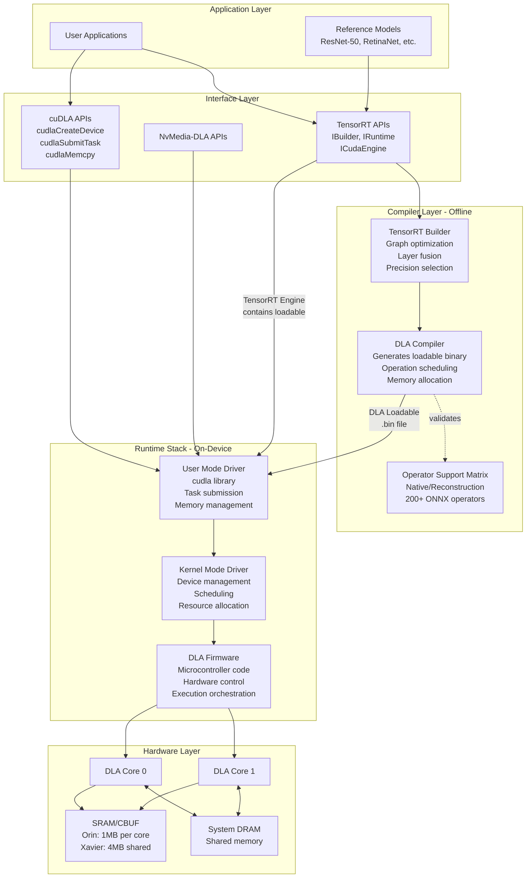

**Diagram: DLA Software Stack Layers**

The diagram illustrates the separation between offline compilation (Compiler Layer) and on-device execution (Runtime Stack). All three interface options (TensorRT, cuDLA, NvMedia-DLA) converge on the same underlying runtime infrastructure. The Runtime Stack implements a classic three-tier driver model providing abstraction, security, and resource management between user applications and hardware.

**Sources:** [README.md:5-5](), [FAQ/README.md:79-81]()

---

## Compiler Layer

### TensorRT Builder as DLA Compiler Interface

TensorRT Builder (`IBuilder`) is the exclusive user-facing interface for invoking the DLA compiler. The builder performs graph-level optimizations before delegating DLA-specific code generation to the DLA compiler component.

**Key Classes and APIs:**
- `IBuilder`: Constructs optimized execution engines from network definitions
- `IBuilderConfig`: Configures build options including DLA core selection via `setDLACore()`
- `INetworkDefinition`: Represents the neural network graph to compile
- `ICudaEngine`: Serialized output containing DLA loadable(s) and metadata

**Compilation Process:**

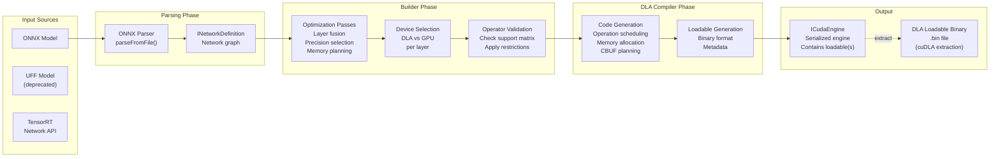

**Diagram: Compilation Flow Through TensorRT Builder**

**Sources:** [README.md:5](), [FAQ/README.md:79-81]()

### DLA Compiler Internals

The DLA compiler component (invoked internally by TensorRT Builder) performs the following transformations:

| Compilation Phase | Operations |
|-------------------|------------|
| **Layer Mapping** | Maps network layers to DLA hardware engines (CPIPEs, Rubik, BDMA) |
| **Precision Assignment** | Determines INT8/FP16 execution for each layer based on configuration |
| **Memory Planning** | Allocates SRAM (CBUF) and DRAM buffers for intermediate tensors |
| **Operation Scheduling** | Determines execution order respecting data dependencies |
| **Sparsity Handling** | Configures 2:4 structured sparsity for applicable convolution layers |
| **Binary Generation** | Produces DLA loadable in proprietary binary format |

**Key Restrictions Enforced:**
- CBUF validation: Ensures convolution weights and activations fit in SRAM
- Format constraints: Validates tensor formats compatible with DLA engines (e.g., `kDLA_HWC4`, `kCHW32`)
- Dimension limits: Enforces hardware limits on tensor dimensions and channel counts
- Precision rules: Validates precision configurations per layer type

**Sources:** [FAQ/README.md:134-135](), [README.md:5]()

---

## Runtime Stack

The runtime stack implements a three-tier architecture for executing DLA loadables on hardware. Each tier provides specific abstractions and services.

### Three-Tier Driver Model

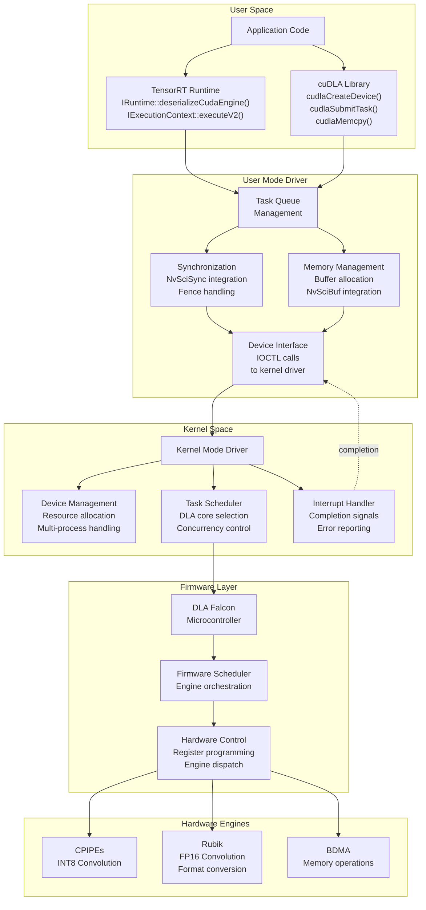

**Diagram: Runtime Stack Component Interaction**

**Sources:** [README.md:5](), [FAQ/README.md:56-58]()

### User Mode Driver (cudla library)

The user mode driver provides the primary interface between applications and the kernel driver. It implements:

**Core Functions:**
- `cudlaCreateDevice()`: Initializes DLA device context
- `cudlaModuleLoadFromMemory()`: Loads DLA loadable binary into driver
- `cudlaMemcpy()`: Copies data between host and device memory
- `cudlaSubmitTask()`: Submits inference task to DLA core
- `cudlaMemRegister()`: Registers memory buffers with NvSciBuf

**Memory Management:**
The user mode driver handles two memory allocation paths:
1. **CUDA-managed memory**: Used in hybrid mode with GPU interoperation
2. **NvSciBuf allocations**: Used in standalone mode for zero-copy sharing

**Synchronization:**
- **NvSciSync**: Cross-process synchronization primitive
- **Fences**: Signal completion of DLA tasks to waiting processes

**Sources:** [FAQ/README.md:81]()

### Kernel Mode Driver

The kernel mode driver manages DLA hardware resources and provides isolation between processes. Key responsibilities:

| Responsibility | Description |
|----------------|-------------|
| **Device Enumeration** | Discovers and initializes DLA core 0 and core 1 |
| **Resource Allocation** | Manages SRAM, register access, interrupt vectors |
| **Multi-Process Scheduling** | Arbitrates access when multiple processes use DLA |
| **Security** | Enforces permission checks and resource limits |
| **Power Management** | Handles clock gating and power state transitions |
| **Error Handling** | Reports hardware errors and timeout conditions |

**Sources:** [README.md:5]()

### DLA Firmware

The DLA firmware runs on the DLA Falcon microcontroller and provides low-level hardware control. Firmware responsibilities include:

- **Operation Dispatch**: Programs hardware engines (CPIPEs, Rubik, BDMA) with operation parameters
- **Dependency Resolution**: Ensures operations execute in correct order respecting data dependencies
- **Engine Orchestration**: Coordinates parallel execution across multiple engines
- **Error Detection**: Monitors for hardware faults and reports to kernel driver
- **Performance Counters**: Maintains hardware utilization metrics

The firmware operates autonomously after receiving a loaded task from the kernel driver, minimizing CPU involvement during inference.

**Sources:** [README.md:5](), [FAQ/README.md:33]()

---

## Interface Layer

DLA provides three distinct programming interfaces, each optimized for different deployment scenarios.

### Interface Comparison

| Interface | Use Case | API Style | Memory Management | Typical User |
|-----------|----------|-----------|-------------------|--------------|
| **TensorRT Runtime** | General-purpose inference, GPU+DLA hybrid | Object-oriented C++ | CUDA unified memory | Application developers |
| **cuDLA Hybrid** | CUDA-managed DLA with stream integration | C API | CUDA streams | GPU-DLA concurrent workloads |
| **cuDLA Standalone** | Independent DLA operation, minimal GPU dependency | C API | NvSciBuf | Safety-critical, multi-process |

### TensorRT Runtime Interface

TensorRT Runtime has used cuDLA internally as the default DLA execution path since TensorRT 8.5. This provides the simplest interface for most users.

**Key APIs:**
```cpp
// Build phase
IBuilder* builder = createInferBuilder(logger);
IBuilderConfig* config = builder->createBuilderConfig();
config->setFlag(BuilderFlag::kINT8);
config->setDLACore(0);  // Select DLA core 0
ICudaEngine* engine = builder->buildEngineWithConfig(*network, *config);

// Runtime phase
IRuntime* runtime = createInferRuntime(logger);
ICudaEngine* engine = runtime->deserializeCudaEngine(engineData, engineSize);
IExecutionContext* context = engine->createExecutionContext();
context->executeV2(buffers);  // Execute inference
```

**Advantages:**
- Unified API for GPU and DLA
- Automatic memory management
- Integrated profiling with `--dumpProfile`
- Seamless GPU fallback for unsupported layers

**Sources:** [FAQ/README.md:79-81](), [README.md:5]()

### cuDLA Hybrid Mode

cuDLA hybrid mode enables CUDA-managed DLA execution integrated with CUDA streams. This allows fine-grained control over GPU-DLA concurrency.

**Key APIs:**
```cpp
// Device initialization
cudlaDevHandle devHandle;
cudlaCreateDevice(0, &devHandle, CUDLA_CUDA_DLA);  // Core 0, hybrid mode

// Module loading
cudlaModule moduleHandle;
cudlaModuleLoadFromMemory(devHandle, loadableData, &moduleHandle);

// Task submission with CUDA stream
cudlaSubmitTask(devHandle, moduleHandle, inputPtr, outputPtr, 
                numInputs, numOutputs, stream);  // CUDA stream
cudaStreamSynchronize(stream);
```

**Advantages:**
- Integration with existing CUDA pipelines
- Stream-based synchronization
- Shared CUDA memory allocations
- Concurrent GPU kernel and DLA execution

**Use Case Example:** Object detection pipeline where backbone runs on DLA and post-processing (NMS) runs on GPU in parallel with next frame's backbone inference.

**Sources:** [FAQ/README.md:57-58]()

### cuDLA Standalone Mode

cuDLA standalone mode provides independent DLA operation without CUDA runtime dependencies. Memory uses NvSciBuf for zero-copy sharing across processes.

**Key APIs:**
```cpp
// Device initialization (standalone)
cudlaDevHandle devHandle;
cudlaCreateDevice(0, &devHandle, CUDLA_STANDALONE);

// NvSciBuf memory registration
NvSciBufObj bufObj;
cudlaMemRegister(devHandle, bufObj, &registeredPtr);

// Task submission with NvSciSync
NvSciSyncFence preFence, postFence;
cudlaSubmitTask(devHandle, moduleHandle, inputPtr, outputPtr,
                numInputs, numOutputs, &preFence, &postFence);
NvSciSyncFenceWait(&postFence, timeout);
```

**Advantages:**
- No CUDA runtime dependency
- Suitable for safety-critical systems
- Multi-process memory sharing via NvSciBuf
- Explicit synchronization control

**Use Case Example:** Automotive applications where DLA runs in separate process from GPU, with strict memory isolation requirements.

**Sources:** [FAQ/README.md:81]()

### NvMedia-DLA Interface

NvMedia-DLA provides a safety-certified interface for automotive applications on DRIVE platforms. It offers deterministic execution guarantees and is integrated with the DRIVE OS safety framework.

**Sources:** [README.md:5]()

---

## Execution Flow

### Compilation to Execution Data Flow

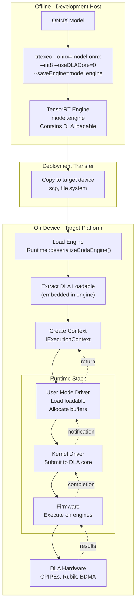

**Diagram: End-to-End Data Flow from Compilation to Execution**

**Sources:** [FAQ/README.md:118-122]()

### Memory Management Across Stack Layers

The DLA stack manages three distinct memory regions:

| Memory Region | Management Layer | Purpose | Typical Size |
|---------------|------------------|---------|--------------|
| **System DRAM** | User mode driver + Kernel driver | Input/output tensors, intermediate buffers | MBs to GBs |
| **DLA SRAM (CBUF)** | DLA firmware + Compiler | Convolution weights, activations during compute | 1-4 MB |
| **Register Memory** | DLA firmware | Hardware engine configuration | KBs |

**DRAM Access Pattern:**
- User application allocates input/output buffers (CUDA or NvSciBuf)
- User mode driver registers buffers with kernel driver
- Kernel driver programs DMA descriptors
- DLA firmware controls BDMA engine for data transfers
- CPIPEs/Rubik fetch data from DRAM as needed

**SRAM Management:**
- DLA compiler performs static analysis during build to allocate CBUF
- Larger layers split into tiles that fit in SRAM
- Firmware loads tiles on-demand during execution
- CBUF validation during compilation ensures fit

**Sources:** [FAQ/README.md:93-98](), [FAQ/README.md:134-135]()

---

## Version Evolution and Compatibility

### TensorRT 8.5+ Default Behavior

Starting with TensorRT 8.5, DLA inference automatically uses cuDLA as the underlying runtime implementation. Previous versions used a different runtime path. This transition provides:

- Improved latency characteristics
- Better concurrent execution with GPU
- Enhanced profiling capabilities
- Unified synchronization primitives

Users do not need code changes; the cuDLA integration is transparent through TensorRT APIs.

**Sources:** [FAQ/README.md:57]()

### Platform-Specific Considerations

| Platform | DLA Generation | Key Differences |
|----------|----------------|-----------------|
| **Jetson Xavier** | 1st generation | 4MB SRAM shared between 2 DLAs and 2 PVAs |
| **Jetson Orin** | 2nd generation | 1MB SRAM exclusive per DLA, optimized INT8 |
| **DRIVE Xavier** | 1st generation | Similar to Jetson Xavier |
| **DRIVE Orin** | 2nd generation | Similar to Jetson Orin, safety certification |

**Software Version Requirements:**
- Minimum DLA SW version: 3.12.x for base features
- DLA SW 3.14.0+: Advanced math operators (trigonometric, hyperbolic)
- TensorRT 8.6.12+: Increased operator exposure
- JetPack 5.1.1+ or DRIVE OS 6.0.8.0+ recommended

**Sources:** [FAQ/README.md:29-30](), [FAQ/README.md:96-98]()

---

## Debugging and Profiling Integration

### Stack-Level Profiling Points

The DLA stack provides profiling hooks at multiple layers:

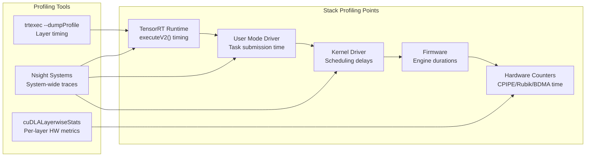

**Diagram: Profiling Integration Points Across Stack**

**Available Metrics:**
- **TensorRT level**: End-to-end layer execution time
- **cuDLA level**: Task submission and completion latency
- **Kernel level**: Scheduling and context switch overhead  
- **Firmware level**: Engine dispatch and synchronization
- **Hardware level**: CPIPE duration, Rubik duration, BDMA duration, SRAM usage

**Sources:** [FAQ/README.md:117-125]()

---

## Concurrent Execution and Multi-Core Support

The DLA runtime stack supports multiple execution modes for the two available DLA cores:

### Single-Core Sequential Execution
- One model executes on one DLA core
- Simplest deployment model
- Specify core with `setDLACore(0)` or `setDLACore(1)`

### Multi-Core Parallel Execution
- Different models on each core concurrently
- Maximum throughput for multi-model inference
- Example: `trtexec --useDLACore=0` in one process, `--useDLACore=1` in another

### Hybrid GPU-DLA Execution
- Network partitioned between GPU and DLA
- Backbone on DLA, post-processing on GPU
- Managed automatically by TensorRT or explicitly via cuDLA streams

### Multi-Model Single-Core
- Multiple models execute sequentially on same core
- Runtime multiplexes access to hardware
- Lower throughput than multi-core but simpler resource management

**Scheduling Considerations:**
- Kernel driver arbitrates access when multiple processes submit tasks
- CUDA environment variable `CUDA_DEVICE_MAX_CONNECTIONS=32` can reduce scheduling interference
- cuDLA standalone mode provides more deterministic scheduling than hybrid mode

**Sources:** [FAQ/README.md:107-112](), [FAQ/README.md:51-58]()

---

## Summary

The DLA software stack implements a clear separation between offline compilation (TensorRT Builder → DLA Compiler) and on-device runtime (User Driver → Kernel Driver → Firmware). Three interface options (TensorRT Runtime, cuDLA Hybrid, cuDLA Standalone) provide flexibility for different deployment scenarios while sharing common underlying infrastructure. The three-tier driver model provides abstraction, security, and resource management between applications and hardware.

Key architectural decisions:
- TensorRT Builder as exclusive compiler interface ensures consistent optimization
- Three-tier runtime provides security isolation and multi-process support
- Multiple interface options enable different deployment patterns (safety-critical, CUDA-integrated, etc.)
- cuDLA as default runtime since TensorRT 8.5 improves performance characteristics

For compilation workflows, see [Model Compilation](#5). For runtime programming patterns, see [Runtime and Deployment](#6). For performance analysis, see [Performance Analysis and Optimization](#7).

---

# Page: Supported Platforms

# Supported Platforms

<details>
<summary>Relevant source files</summary>

The following files were used as context for generating this wiki page:

- [README.md](README.md)
- [operators/README.md](operators/README.md)

</details>


## Purpose and Scope

This page documents the hardware platforms and software versions supported by the DLA software stack. It covers the specific combinations of hardware platforms (Jetson Orin, DRIVE Orin, Xavier), operating system releases (JetPack, DRIVE OS), DLA software versions, and TensorRT versions that are compatible with each other. For information about the DLA hardware architecture itself, see [DLA Hardware Architecture](#1.1). For system requirements and minimum versions needed for specific features, see [System Requirements](#2.1).

---

## Hardware Platform Support

The DLA software stack supports NVIDIA platforms with integrated Deep Learning Accelerator hardware across two product lines: **Jetson** (embedded computing) and **DRIVE** (automotive computing).

### Platform Categories

| **Platform Family** | **Target Domain** | **DLA Generation** | **DLA Cores** | **Representative Products** |
|---------------------|-------------------|-------------------|---------------|----------------------------|
| Jetson Orin | Embedded AI | 2nd Generation | 2 | Jetson AGX Orin 64GB, Jetson Orin NX 16GB |
| DRIVE Orin | Automotive AI | 2nd Generation | Up to 2 | DRIVE Orin platform variants |
| Jetson Xavier | Embedded AI | 1st Generation | Up to 2 | Jetson AGX Xavier |
| DRIVE Xavier | Automotive AI | 1st Generation | Up to 2 | DRIVE Xavier platform variants |

**Sources:** [README.md:3-4]()

---

## DLA Hardware Generations

### Second-Generation DLA (Orin)

Second-generation DLA hardware on Orin SoCs features architectural improvements over the first generation:

- **DLA Cores:** Up to 2 independent cores per SoC
- **SRAM Architecture:** 1MB SRAM per DLA core (exclusive, not shared between cores)
- **Peak Performance:** Up to 105 TOPs sparse INT8 on Jetson AGX Orin 64GB (both cores combined)
- **New Capabilities:** Enhanced sparse INT8 support with 2:4 structured sparsity

### First-Generation DLA (Xavier)

First-generation DLA hardware on Xavier SoCs:

- **DLA Cores:** Up to 2 cores per SoC
- **SRAM Architecture:** 4MB SRAM shared between both DLA cores
- **Peak Performance:** Lower than Orin generation
- **Operator Support:** Subset of Orin's operator support (see [Operator Support Matrix](#4.1))

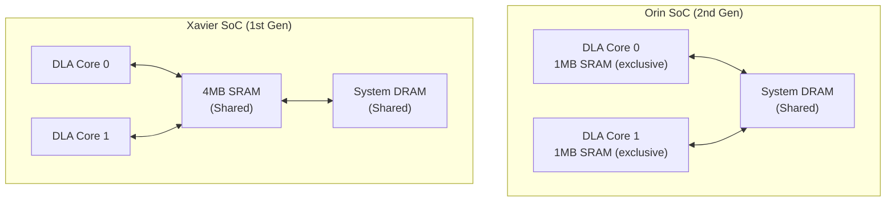

**Key Architectural Difference:** Orin's exclusive SRAM per core eliminates contention between DLA cores, enabling better concurrent execution performance compared to Xavier's shared SRAM architecture.

**Sources:** [README.md:3-4]()

---

## Software Stack Compatibility Matrix

The DLA software stack consists of three key versioned components that must be compatible:

1. **Operating System:** JetPack (Jetson) or DRIVE OS (Automotive)
2. **DLA SW:** The DLA firmware, kernel driver, and compiler libraries
3. **TensorRT:** The inference runtime and builder interface

The following table shows the validated combinations of these components:

| **Hardware Platform** | **Operating System** | **DLA SW Version** | **TensorRT Version** |
|-----------------------|----------------------|-------------------|---------------------|
| DRIVE Orin | DRIVE OS 6.0.6.0 | DLA 3.12.0 | TensorRT 8.5.10 |
| Jetson Orin | JetPack 5.1.1 | DLA 3.12.1 | TensorRT 8.5.2 |
| DRIVE Orin | DRIVE OS 6.0.7.0 | DLA 3.13.0 | TensorRT 8.6.10 |
| DRIVE Orin | DRIVE OS 6.0.8.0 | DLA 3.14.0 | TensorRT 8.6.11 |
| Jetson Orin | JetPack 6 | DLA 3.14.1 | TensorRT 8.6.2 |
| DRIVE Orin | DRIVE OS 6.0.8.1 | DLA 3.14.1 | TensorRT 8.6.11 |
| DRIVE Orin | DRIVE OS 6.0.9.0 | DLA 3.14.2 | TensorRT 8.6.12 |
| DRIVE Orin | DRIVE OS 6.0.9.1 | DLA 3.14.3 | TensorRT 8.6.12 |

**Important Notes:**
- The OS release includes and ships with the specific DLA SW and TensorRT versions shown to its right
- DLA SW and TensorRT versions are tightly coupled and must match the combinations shown above
- Using mismatched versions may result in compilation failures or runtime errors

**Sources:** [operators/README.md:14-26]()

---

## Software Version Evolution and Feature Availability

Different DLA SW versions introduce new operator support and capabilities:

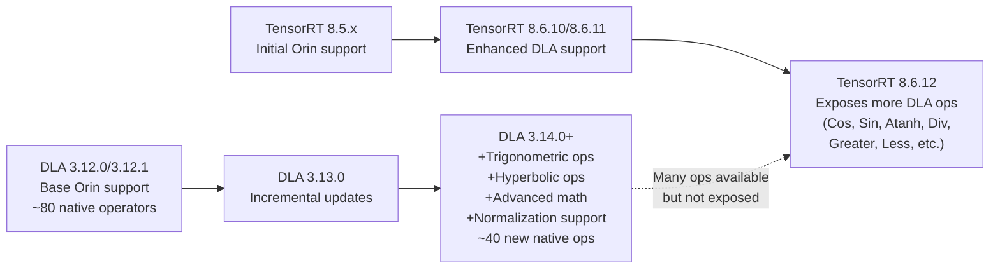

### Key Version Milestones

**DLA 3.12.x (Initial Orin Release):**
- Base operator support (~80 native ONNX operators)
- INT8 and FP16 precision support
- 2:4 structured sparsity support

**DLA 3.14.0+ (Major Expansion):**
- Added ~40 new native operators including:
  - Trigonometric: `Acos`, `Asin`, `Atan`, `Cos`, `Sin`, `Tan`
  - Hyperbolic: `Acosh`, `Asinh`, `Atanh`, `Cosh`, `Sinh`
  - Math operations: `Ceil`, `Exp`, `Floor`, `Log`, `Round`, `Sqrt`
  - Normalization primitives enabling GroupNorm, LayerNorm, InstanceNorm reconstruction

**TensorRT 8.6.12 (Increased Exposure):**
- Exposed several DLA 3.14.0 operators through TensorRT builder:
  - `Cos`, `Sin` (Unary layer)
  - `Atanh` (Unary layer)
  - `Div` (ElementWise layer)
  - `Greater`, `Less` (Comparison operations)
  - `GlobalMaxPool` (Reduce layer)

**Note:** Many operators supported in DLA SW 3.14.0+ are not yet exposed in TensorRT 8.6.12 and require an RFE (Request for Enhancement). See [Operator Support Matrix](#4.1) for details.

**Sources:** [operators/README.md:1-152]()

---

## Jetson Platform Power Modes

Jetson AGX Orin 64GB supports multiple power modes that trade total system power consumption for compute performance. Notably, **DLA performance remains relatively stable across power modes** while GPU performance scales more dramatically.

### Power Mode Specifications

| **Power Mode** | **Total TDP** | **GPU INT8 TOPs** | **2x DLA INT8 TOPs** | **Total INT8 TOPs** | **DLA % of Total** |
|----------------|---------------|-------------------|---------------------|--------------------|--------------------|
| MAXN | ~275W equivalent | 171 | **105** | 275 | **38%** |
| 50W | 50W | 109 | **92** | 200 | **46%** |
| 30W | 30W | 41 | **90** | 131 | **69%** |
| 15W | 15W | 14 | **40** | 54 | **74%** |

**Key Insights:**
- DLA maintains 85-90% of peak performance even at 30W power mode
- At 15W, DLA still provides 40 TOPs (38% of MAXN performance)
- At lower power modes, DLA contributes a higher percentage of total DL performance
- This makes DLA critical for power-constrained edge deployments

**Sources:** [README.md:14-25]()

---

## Platform-Specific Performance Characteristics

### DLA TOPs Equivalence Across Platforms

The following relationships help understand performance equivalence across different platform configurations:

**Jetson AGX Orin 64GB Power Mode Equivalents:**
- **30W & 50W modes:** DLA TOPs comparable to maximum clocks on DRIVE Orin platforms
- This alignment enables consistent performance modeling between Jetson development and DRIVE automotive deployment

**Jetson Orin NX 16GB:**
- Maximum DLA TOPs comparable to **15W power mode** on Jetson AGX Orin 64GB
- Useful for understanding performance expectations on lower-tier Orin variants

**Sources:** [README.md:23-25]()

---

## Platform Performance Example: ResNet-50

The following table illustrates how DLA performance scales across power modes on Jetson AGX Orin 64GB:

| **Network** | **Input Size** | **Batch Size** | **MAXN** | **50W** | **30W** | **15W** |
|-------------|----------------|----------------|----------|---------|---------|---------|
| ResNet-50 | 224x224 | 2 | 2037 img/s | 1948 img/s | 1928 img/s | 1072 img/s |

**Key Observation:** DLA maintains 95% of MAXN throughput at 30W mode (only 11% TDP), demonstrating exceptional power efficiency.

**Sources:** [README.md:74]()

---

## Deployment Environment Requirements

### Jetson Platforms

**Operating System:** JetPack 5.1.1 or later (JetPack 6 recommended)

**Installation:** JetPack includes:
- L4T (Linux for Tegra) kernel with DLA kernel driver
- DLA firmware
- User-mode DLA libraries
- TensorRT with DLA support
- CUDA Toolkit with cuDLA APIs

**Access Methods:**
- TensorRT Builder API with `--useDLACore` flag
- cuDLA Hybrid mode (CUDA-managed DLA execution)
- cuDLA Standalone mode (independent DLA programming)

### DRIVE Platforms

**Operating System:** DRIVE OS 6.0.6.0 or later (6.0.9.0+ recommended)

**Installation:** DRIVE OS includes:
- QNX or Linux kernel with DLA kernel driver
- DLA firmware
- NvMedia-DLA APIs (primary interface for automotive safety applications)
- TensorRT with DLA support
- cuDLA APIs

**Access Methods:**
- TensorRT Builder API with `--useDLACore` flag
- NvMedia-DLA APIs (automotive-grade interface)
- cuDLA Hybrid mode
- cuDLA Standalone mode

**Sources:** [README.md:1-7](), [operators/README.md:14-26]()

---

## Version Compatibility Diagram

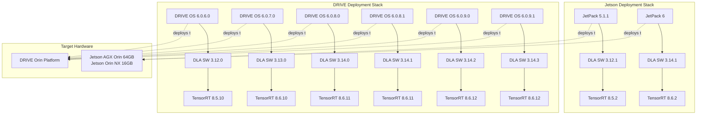

**Sources:** [operators/README.md:14-26]()

---

## Minimum Version Requirements for Features

Different features and capabilities require specific minimum software versions:

| **Feature** | **Minimum DLA SW** | **Minimum TensorRT** | **Notes** |
|-------------|-------------------|---------------------|-----------|
| Base INT8/FP16 inference | DLA 3.12.0 | TensorRT 8.5.2 | Available on all supported platforms |
| 2:4 Structured Sparsity | DLA 3.12.0 | TensorRT 8.5.2 | Use `--sparsity=force` flag |
| Trigonometric operators (native in DLA SW) | DLA 3.14.0 | TensorRT 8.6.11 | Some exposed in TRT 8.6.12 |
| `Cos`, `Sin` operators (exposed) | DLA 3.14.0 | TensorRT 8.6.12 | Unary layer support |
| `Div` operator (exposed) | DLA 3.14.0 | TensorRT 8.6.12 | ElementWise layer support |
| `Greater`, `Less` operators (exposed) | DLA 3.14.0 | TensorRT 8.6.12 | Comparison operations |
| Normalization reconstruction | DLA 3.14.0 | TensorRT 8.6.11 | GroupNorm, LayerNorm, InstanceNorm |

**Sources:** [operators/README.md:14-152]()

---

## Verifying Your Platform Configuration

To verify your platform's DLA SW and TensorRT versions:

### Checking TensorRT Version

```bash
dpkg -l | grep tensorrt
```

Or programmatically:
```python
import tensorrt as trt
print(trt.__version__)
```

### Checking DLA SW Version

The DLA SW version is embedded in the OS release and can be inferred from:

**On Jetson:**
```bash
cat /etc/nv_tegra_release
```

**On DRIVE:**
Check DRIVE OS version, which determines DLA SW version (see compatibility matrix above).

### Checking DLA Hardware Availability

```bash
ls -l /dev/nvhost-nvdla*
```

Expected output showing 2 DLA devices:
```
/dev/nvhost-nvdla0
/dev/nvhost-nvdla1
```

**Sources:** Derived from general Linux/Jetson system administration practices

---

## Cross-Platform Development Considerations

### Jetson as Development Platform for DRIVE Deployment

Jetson platforms serve as effective development environments for DRIVE automotive deployments:

1. **Performance Alignment:** Jetson AGX Orin 64GB at 30W/50W provides similar DLA TOPs to DRIVE Orin maximum clocks
2. **Software Stack Similarity:** Both use TensorRT builder with `--useDLACore` flag
3. **Workflow Portability:** Models compiled on Jetson can be validated before DRIVE deployment

**Recommended Workflow:**
- Develop and optimize models on Jetson with JetPack 6 (DLA 3.14.1, TensorRT 8.6.2)
- Validate on Jetson at 30W/50W power modes to simulate DRIVE performance
- Deploy to DRIVE OS 6.0.9.0+ (DLA 3.14.2+, TensorRT 8.6.12) for production

### Platform-Specific API Considerations

| **API** | **Jetson** | **DRIVE** | **Primary Use Case** |
|---------|-----------|----------|---------------------|
| TensorRT Runtime | Supported | Supported | Default runtime since TensorRT 8.5 |
| cuDLA Hybrid | Supported | Supported | CUDA-managed DLA with GPU interop |
| cuDLA Standalone | Supported | Supported | Independent DLA programming |
| NvMedia-DLA | Not available | Supported | Automotive safety-critical applications |

**Sources:** [README.md:5]()

---

## Summary

The DLA software stack supports two hardware generations (Xavier and Orin) across two product families (Jetson and DRIVE). The Orin generation provides significantly enhanced performance and operator support compared to Xavier. Key platform selection considerations include:

- **Jetson Orin:** Ideal for edge AI development, prototyping, and embedded deployments
- **DRIVE Orin:** Designed for automotive-grade production deployments with safety certifications
- **Power Modes:** Jetson provides flexible power/performance tradeoffs (15W to MAXN)
- **Software Coupling:** OS version tightly couples to specific DLA SW and TensorRT versions
- **Version Recommendations:** Use JetPack 6 / DRIVE OS 6.0.9.0+ for latest operator support

For building and running your first DLA workload, proceed to [Quick Start Tutorial](#2.2).

**Sources:** [README.md:1-133](), [operators/README.md:1-152]()

---

# Page: Getting Started

# Getting Started

<details>
<summary>Relevant source files</summary>

The following files were used as context for generating this wiki page:

- [README.md](README.md)
- [scripts/prepare_models/README.md](scripts/prepare_models/README.md)

</details>


This page provides a high-level introduction to deploying deep learning models on NVIDIA DLA hardware. It covers the essential workflow from ONNX model input to inference execution on DLA, including the key tools and command-line utilities required for each stage.

For detailed system prerequisites and software version requirements, see [System Requirements](#2.1). For a step-by-step walkthrough of deploying your first model, see [Quick Start Tutorial](#2.2). For performance expectations and reference benchmarks, see [Performance Benchmarks and Reference Models](#2.3).

For comprehensive model preparation techniques, see [Model Preparation](#3). For runtime deployment options, see [Runtime and Deployment](#6).

## Purpose and Scope

This guide assumes you have:
- An ONNX model ready for deployment
- Access to a supported NVIDIA platform (Jetson Orin/Xavier or DRIVE Orin/Xavier)
- Basic familiarity with TensorRT and command-line tools

The workflow covered here applies to standard CNN-based models (ResNet, MobileNet, RetinaNet, etc.). For operator support details and model compatibility, see [ONNX Operator Support](#4).

**Sources**: [README.md:1-7](), [README.md:128-132]()

## DLA Deployment Overview

The DLA deployment workflow consists of three main phases executed on different systems:

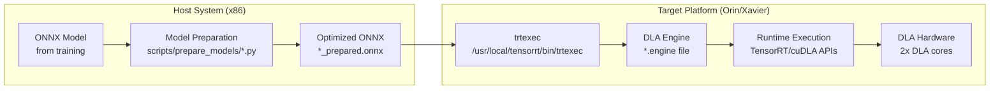

**Diagram**: End-to-end DLA deployment workflow showing offline preparation (host) and on-device compilation/execution (target)

**Sources**: [README.md:3-7](), [scripts/prepare_models/README.md:1-6]()

## Prerequisites Overview

### Required Software Components

| Component | Minimum Version | Purpose |
|-----------|----------------|---------|
| **DLA SW** | 3.12.x (3.13.0+ for QAT) | DLA compiler and firmware |
| **TensorRT** | 8.5.x+ (8.6.12+ recommended) | DLA compiler interface |
| **JetPack** (Jetson) | 5.1.1+ | Platform software stack |
| **DRIVE OS** (Automotive) | 6.0.8.0+ | Platform software stack |
| **Python** | 3.8+ | Model preparation scripts |

### Required Python Packages

Install dependencies from [requirements.txt:1-end]():
```bash
python3 -m pip install -r requirements.txt
```

**Note**: Python model preparation scripts are designed for x86 host systems. The `trtexec` compilation and runtime execution occur on the target Orin/Xavier device.

**Sources**: [README.md:128-132](), [scripts/prepare_models/README.md:3-6]()

For complete system requirements including SRAM allocations and platform-specific details, see [System Requirements](#2.1).

## Basic Workflow: Three-Stage Process

### Stage 1: Model Preparation (Host)

Model preparation scripts optimize ONNX graphs for DLA compatibility by performing graph transformations, layer fusion, and format conversions.

**Example**: ResNet-50 preparation using [scripts/prepare_models/resnet50.py:1-end]()
```bash
# On x86 host
python3 scripts/prepare_models/resnet50.py
# Generates: resnet50_v1_prepared.onnx
```

The preparation scripts are model-specific and located in [scripts/prepare_models/]():

| Script | Model | Input | Output |
|--------|-------|-------|--------|
| `resnet50.py` | ResNet-50 | `resnet50_v1.onnx` | `resnet50_v1_prepared.onnx` |
| `ssd_resnet34.py` | SSD-ResNet-34 | `resnet34-ssd1200.onnx` | `resnet34-ssd1200_prepared.onnx` |
| `ssd_mobilenetv1.py` | SSD-MobileNetV1 | `ssd_mobilenet_v1_coco_2018_01_28.onnx` | `ssd_mobilenet_v1_coco_2018_01_28_prepared.onnx` |
| `retinanet_resnext50.py` | RetinaNet ResNeXt-50 | `resnext50_32x4d_fpn_sanitized.onnx` | `resnext50_32x4d_fpn_prepared.onnx` |

**Sources**: [scripts/prepare_models/README.md:8-135]()

### Stage 2: Compilation with trtexec (Target)

The `trtexec` tool invokes TensorRT's builder to compile ONNX models into DLA-executable engine files. This step runs on the target device.

**Example**: Compiling ResNet-50 for DLA
```bash
# On Orin/Xavier target
/usr/local/tensorrt/bin/trtexec \
    --useDLACore=0 \
    --int8 \
    --memPoolSize=dlaSRAM:1 \
    --inputIOFormats=int8:dla_hwc4 \
    --outputIOFormats=int8:chw32 \
    --onnx=resnet50_v1_prepared.onnx \
    --shapes=input_tensor:0:2x3x224x224
```

**Key trtexec Flags for DLA**:

| Flag | Purpose | Typical Value |
|------|---------|---------------|
| `--useDLACore` | Select DLA core (0 or 1) | `0` or `1` |
| `--int8` | Enable INT8 precision | (flag only) |
| `--memPoolSize` | Allocate DLA SRAM | `dlaSRAM:1` (1MB) |
| `--inputIOFormats` | Input tensor format | `int8:dla_hwc4` or `int8:hwc4` |
| `--outputIOFormats` | Output tensor format | `int8:chw32` |
| `--onnx` | Input ONNX file path | `<model>.onnx` |
| `--shapes` | Input tensor shape | `<name>:<batch>x<C>x<H>x<W>` |
| `--sparsity` | Enable sparse inference | `force` (optional) |

**Sources**: [scripts/prepare_models/README.md:24-26](), [scripts/prepare_models/README.md:74-76]()

### Stage 3: Runtime Execution (Target)

After compilation, the resulting `.engine` file can be executed using one of three runtime APIs:

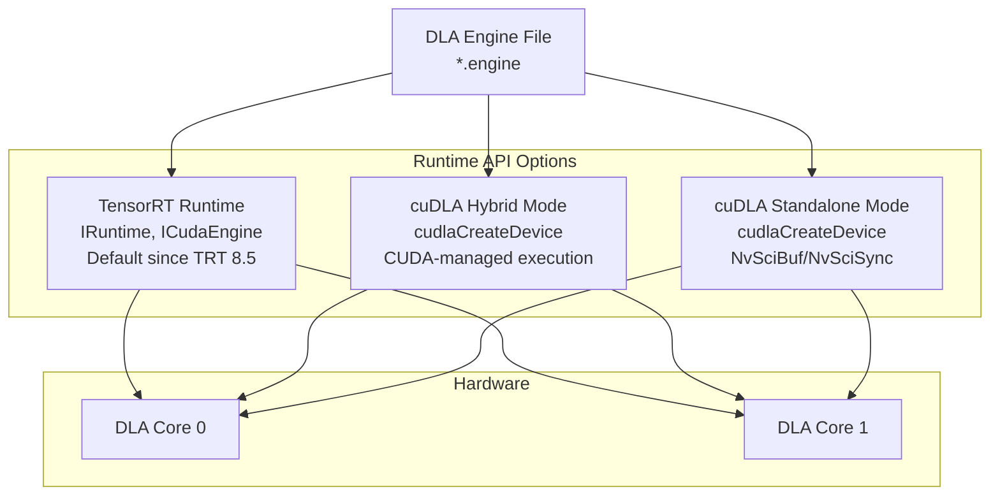

**Diagram**: Runtime API options for executing DLA engines. TensorRT Runtime is the default and recommended path for most applications.

**Runtime Selection Guide**:

| API | Use Case | Memory Management | Synchronization |
|-----|----------|-------------------|-----------------|
| **TensorRT Runtime** | Default for most applications | CUDA unified memory | CUDA streams |
| **cuDLA Hybrid** | CUDA-integrated workflows | `cudaMalloc` | CUDA streams |
| **cuDLA Standalone** | Safety-critical applications | `NvSciBuf` | `NvSciSync` |

For detailed runtime API usage and code examples, see [Runtime and Deployment](#6).

**Sources**: [README.md:5-7]()

## Key Tools and File Paths

This diagram maps the natural language workflow to concrete code entities in the repository:

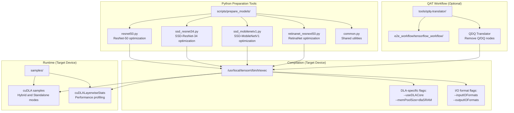

**Diagram**: Code entity mapping showing file paths and tool locations in the repository

**Sources**: [scripts/prepare_models/README.md:1-135](), [README.md:128-132]()

## Reference Models and Expected Performance

The repository includes preparation scripts and performance data for five reference models validated against MLPerf benchmarks:

### Model Performance Summary (2x DLA, Jetson AGX Orin 64GB)

| Model | Resolution | Batch Size | Dense (img/sec) | Sparse (img/sec) | Power Mode |
|-------|------------|------------|-----------------|------------------|------------|
| **ResNet-50** | 224×224 | 2 | 2037 | N/A | MAXN |
| **SSD-MobileNetV1** | 300×300 | 2 | 2664 | N/A | MAXN |
| **RetinaNet ResNet-34** | 1280×768 | 1 | 108 | 143 (1.32×) | MAXN |
| **SSD-ResNet-34** | 1200×1200 | 1 | 83 | 103 (1.24×) | MAXN |
| **RetinaNet ResNeXt-50** | 800×800 | 1 | 78 | 102 (1.31×) | MAXN |

**Key Observations**:
- Dense performance scales well across power modes (MAXN/50W/30W maintain ~95% throughput)
- Sparse inference (2:4 structured sparsity) provides 1.24× to 1.47× speedup
- Lower power modes (15W) show higher dense→sparse speedup (up to 1.47×)
- DLA maintains 40 TOPs at 15W power mode (74% of total Orin DL performance)

**Sources**: [README.md:27-51](), [README.md:63-99]()

For complete performance data across all power modes and detailed analysis, see [Performance Benchmarks and Reference Models](#2.3).

## Accuracy and Validation

All reference models are validated against MLPerf Inference benchmarks:

| Model | Metric | DLA INT8 | GPU INT8 | FP32 Reference |
|-------|--------|----------|----------|----------------|
| ResNet-50 | Top-1 (ImageNet) | 75.54% | 76.00% | 76.46% |
| SSD-MobileNetV1 | mAP (COCO) | 0.23 | 0.23 | 0.23 |
| SSD-ResNet-34 | mAP (COCO) | 0.21 | 0.21 | 0.20 |
| RetinaNet ResNeXt-50 | mAP (OpenImages) | 0.3741 | 0.3740 | 0.3757 |

**Note**: GPU and DLA do not produce bitwise identical results. Differences are expected due to different arithmetic implementations, but stay within acceptable tolerances of FP32 reference accuracy.

**Sources**: [README.md:32-44]()

## Power Efficiency Advantage

DLA provides 3× to 5× better performance-per-watt compared to GPU for typical CNN workloads:

```mermaid
graph LR
    subgraph "Power Mode Comparison (Jetson AGX Orin 64GB)"
        MAXN["MAXN Mode<br/>DLA: 3-4× GPU efficiency"]
        P50W["50W Mode<br/>DLA: 3-4× GPU efficiency"]
        P30W["30W Mode<br/>DLA: 2.5-3.5× GPU efficiency"]
        P15W["15W Mode<br/>DLA: 4-5.5× GPU efficiency"]
    end
    
    subgraph "DLA Contribution to Total DL Performance"
        MAXN_Perf["MAXN: 38% DLA<br/>(105 of 275 TOPs)"]
        P15W_Perf["15W: 74% DLA<br/>(40 of 54 TOPs)"]
    end
    
    MAXN --> MAXN_Perf
    P15W --> P15W_Perf
```

**Diagram**: DLA power efficiency advantage increases at lower power budgets

At 15W power mode, DLA contributes 74% of total Orin DL performance while maintaining excellent power efficiency, making it ideal for embedded and edge deployments.

**Sources**: [README.md:9-26](), [README.md:101-123]()

## Next Steps

### Quick Start Path
1. **Verify Prerequisites**: Check [System Requirements](#2.1) for software versions
2. **Follow Tutorial**: Complete [Quick Start Tutorial](#2.2) with ResNet-50
3. **Review Benchmarks**: Compare results against [Performance Benchmarks](#2.3)

### Deep Dive Paths
- **Model Optimization**: See [Model Preparation](#3) for graph optimization techniques
- **Operator Support**: Check [ONNX Operator Support](#4) for layer compatibility
- **Advanced Compilation**: Explore [Model Compilation](#5) for precision configuration
- **Runtime Options**: Compare deployment modes in [Runtime and Deployment](#6)
- **Performance Tuning**: Use profiling tools in [Performance Analysis and Optimization](#7)

### Common Workflows
- **QAT Models**: Follow QDQ Translator workflow in [QDQ Translator for Quantized Models](#3.2)
- **Sparse Models**: Enable `--sparsity=force` flag (see [Structured Sparsity](#5.4))
- **Multi-DLA**: Run concurrent models on both cores (see [Concurrent Execution](#6.4))
- **Hybrid GPU-DLA**: Partition backbones to DLA, post-processing to GPU (see [Runtime API Overview](#6.1))

**Sources**: [README.md:1-133](), [scripts/prepare_models/README.md:1-135]()

---

# Page: System Requirements

# System Requirements

<details>
<summary>Relevant source files</summary>

The following files were used as context for generating this wiki page:

- [README.md](README.md)
- [operators/README.md](operators/README.md)
- [samples/cuDLA/cuDLALayerwiseStatsHybrid/README.md](samples/cuDLA/cuDLALayerwiseStatsHybrid/README.md)

</details>


## Purpose and Scope

This page specifies the hardware, software, and toolchain prerequisites required to deploy models on NVIDIA Deep Learning Accelerator (DLA) hardware. It covers minimum version requirements for platforms, operating systems, DLA software, TensorRT, and development tools.

For comprehensive platform details including power modes and performance characteristics, see [Supported Platforms](#1.3). For runtime deployment options, see [Runtime API Overview](#6.1).

---

## Hardware Platform Requirements

DLA is available on NVIDIA embedded and automotive platforms with the following hardware characteristics:

### Supported Platforms

| Platform Category | Specific Platforms | DLA Generation | DLA Cores | SRAM per Core |
|---|---|---|---|---|
| **Jetson Embedded** | Jetson AGX Orin 64GB<br/>Jetson Orin NX 16GB | 2nd generation | 2 | 1 MB |
| **DRIVE Automotive** | DRIVE Orin | 2nd generation | 2 | 1 MB |
| **Jetson Embedded (Legacy)** | Jetson AGX Xavier | 1st generation | 2 | 4 MB (shared) |
| **DRIVE Automotive (Legacy)** | DRIVE Xavier | 1st generation | 2 | 4 MB (shared) |

**Key Hardware Differences:**

- **Orin DLA (2nd generation)**: Exclusive 1 MB SRAM per core, structured sparsity support, enhanced INT8/FP16 precision capabilities
- **Xavier DLA (1st generation)**: Shared 4 MB SRAM, baseline DLA functionality

### CPU Architecture Requirement

All DLA platforms use **aarch64** (ARM64) architecture. Cross-compilation from x86_64 hosts is supported and commonly used for development workflows.

**Sources:** [README.md:3-26](), [operators/README.md:16-26]()

---

## Software Version Requirements

### Operating System and Software Stack Compatibility

The following table shows the minimum system configurations with verified DLA support. Each OS version is packaged with specific DLA SW and TensorRT versions:

```mermaid
graph TB
    subgraph JetsonPlatforms["Jetson Platforms"]
        JP511["JetPack 5.1.1"]
        JP6["JetPack 6.0"]
        
        JP511 --> DLA3121["DLA SW 3.12.1"]
        JP511 --> TRT852["TensorRT 8.5.2"]
        
        JP6 --> DLA3141["DLA SW 3.14.1"]
        JP6 --> TRT862["TensorRT 8.6.2"]
    end
    
    subgraph DRIVEPlatforms["DRIVE Platforms"]
        DO606["DRIVE OS 6.0.6.0"]
        DO607["DRIVE OS 6.0.7.0"]
        DO608["DRIVE OS 6.0.8.0"]
        DO6081["DRIVE OS 6.0.8.1"]
        DO609["DRIVE OS 6.0.9.0"]
        DO6091["DRIVE OS 6.0.9.1"]
        
        DO606 --> DLA3120["DLA SW 3.12.0"]
        DO606 --> TRT8510["TensorRT 8.5.10"]
        
        DO607 --> DLA3130["DLA SW 3.13.0"]
        DO607 --> TRT8610["TensorRT 8.6.10"]
        
        DO608 --> DLA3140["DLA SW 3.14.0"]
        DO608 --> TRT8611["TensorRT 8.6.11"]
        
        DO6081 --> DLA31411["DLA SW 3.14.1"]
        DO6081 --> TRT86111["TensorRT 8.6.11"]
        
        DO609 --> DLA3142["DLA SW 3.14.2"]
        DO609 --> TRT8612["TensorRT 8.6.12"]
        
        DO6091 --> DLA3143["DLA SW 3.14.3"]
        DO6091 --> TRT86121["TensorRT 8.6.12"]
    end
    
    JetsonPlatforms -.supports.-> JetsonHW["Jetson Orin Hardware"]
    DRIVEPlatforms -.supports.-> DRIVEHW["DRIVE Orin Hardware"]
```

**Title:** Operating System and DLA Software Version Relationships

**Sources:** [operators/README.md:14-26]()

### Version Compatibility Matrix

| Hardware Platform | Operating System | DLA SW Version | TensorRT Version | Minimum Requirement |
|---|---|---|---|---|
| **Jetson Orin** | JetPack 5.1.1 | 3.12.1 | 8.5.2 | Baseline |
| **Jetson Orin** | JetPack 6.0 | 3.14.1 | 8.6.2 | Enhanced operator support |
| **DRIVE Orin** | DRIVE OS 6.0.6.0 | 3.12.0 | 8.5.10 | Baseline |
| **DRIVE Orin** | DRIVE OS 6.0.7.0 | 3.13.0 | 8.6.10 | Intermediate |
| **DRIVE Orin** | DRIVE OS 6.0.8.0 | 3.14.0 | 8.6.11 | Enhanced operators |
| **DRIVE Orin** | DRIVE OS 6.0.8.1 | 3.14.1 | 8.6.11 | Enhanced operators |
| **DRIVE Orin** | DRIVE OS 6.0.9.0 | 3.14.2 | 8.6.12 | Latest operators |
| **DRIVE Orin** | DRIVE OS 6.0.9.1 | 3.14.3 | 8.6.12 | Latest operators |

**Important Version Notes:**

- **DLA SW 3.14.0+** introduces significant operator expansion including trigonometric, hyperbolic, and advanced math functions (Sin, Cos, Atanh, Sqrt, etc.)
- **TensorRT 8.6.12** exposes additional operators previously only available in DLA SW (Div, Greater, Less, GlobalMaxPool, etc.)
- **TensorRT 8.5.x** marks the transition to TensorRT Runtime as the default DLA runtime (previously NvMedia-DLA)

**Sources:** [operators/README.md:14-26]()

---

## DLA Feature Support by Version

Different DLA SW versions enable different hardware features and operator support:

```mermaid
graph LR
    subgraph VersionTimeline["DLA SW Version Timeline"]
        V3120["DLA 3.12.x<br/>Baseline operators<br/>~80 native ops"]
        V3140["DLA 3.14.0+<br/>+Trigonometric<br/>+Hyperbolic<br/>+Advanced math<br/>~120+ native ops"]
    end
    
    subgraph Features["Feature Availability"]
        SparsitySupport["Structured Sparsity<br/>2:4 pattern"]
        INT8Support["INT8 Precision<br/>via PTQ/QAT"]
        FP16Support["FP16 Precision<br/>Hybrid mode"]
        
        V3120 --> SparsitySupport
        V3120 --> INT8Support
        V3120 --> FP16Support
        
        V3140 --> ExtendedOps["Extended Operators:<br/>Cos, Sin, Atanh<br/>Div, Sqrt, Pad<br/>DepthToSpace, etc."]
    end
    
    TRT8612["TensorRT 8.6.12"] -.exposes subset of.-> ExtendedOps
```

**Title:** DLA SW Feature Evolution and TensorRT Exposure

**Sources:** [operators/README.md:34-152]()

---

## Development Environment Requirements

### For Model Preparation and Compilation (x86_64 Host)

| Component | Version | Purpose |
|---|---|---|
| **Python** | 3.6+ | Model preparation scripts |
| **ONNX** | 1.12.0+ | Model format |
| **ONNX Runtime** | Latest | Model validation |
| **TensorRT** | 8.5.2+ | Model compilation (via `trtexec`) |

**Python Dependencies:**

Install via `requirements.txt`:
```bash
python3 -m pip install -r requirements.txt
```

**Key Python packages:**
- `onnx` - ONNX model manipulation
- `onnxruntime` - Model validation
- `numpy` - Numerical operations
- `opencv-python` - Image preprocessing (for samples)

**Sources:** [README.md:128-132]()

### For Runtime Execution and Samples (aarch64 Target)

| Component | Version | Purpose |
|---|---|---|
| **CUDA Toolkit** | 12.2+ | cuDLA runtime samples |
| **GCC/G++** | Platform default | Building cuDLA samples |
| **Make** | GNU Make | Build system |
| **clang-format** | 10.0+ | Code formatting (for contributions) |

**Minimum Configuration for Layerwise Profiling:**

| Hardware Platform | OS | DLA SW Version | Feature |
|---|---|---|---|
| DRIVE Orin | DRIVE OS 6.0.8.0 (not QNX Safety) | DLA 3.14.0 | Layerwise statistics |
| Jetson Orin | JetPack 6.0 | DLA 3.14.1 | Layerwise statistics |

**Note:** Layerwise profiling requires DLA SW 3.14.0+ and is not supported in QNX Safety configurations.

**Sources:** [samples/cuDLA/cuDLALayerwiseStatsHybrid/README.md:31-36](), [samples/cuDLA/cuDLALayerwiseStatsHybrid/README.md:48]()

### Supported Operating Systems for Development

| Target Platform | Supported OS | Notes |
|---|---|---|
| **Jetson Orin** | Linux (L4T) | Native or cross-compiled |
| **DRIVE Orin** | DRIVE OS Linux | Native or cross-compiled |
| **DRIVE Orin** | QNX 7.1+ | Safety-certified configurations |

**Cross-Compilation Support:**

DLA samples can be cross-compiled from x86_64 hosts to aarch64 targets:
```bash
make TARGET_ARCH=aarch64
```

**Sources:** [samples/cuDLA/cuDLALayerwiseStatsHybrid/README.md:28-29](), [samples/cuDLA/cuDLALayerwiseStatsHybrid/README.md:59-62]()

---

## Build Tool Requirements

### Makefile Variables for Cross-Compilation

The cuDLA samples use makefiles with the following configuration options:

```mermaid
graph TB
    subgraph BuildOptions["Build Configuration Options"]
        TargetArch["TARGET_ARCH=aarch64<br/>Cross-compile target"]
        HostCompiler["HOST_COMPILER=g++<br/>Compiler selection"]
        DebugBuild["dbg=1<br/>Debug symbols"]
        SMArch["SMS='A B ...'<br/>SM architectures"]
    end
    
    subgraph BuildSystem["Build System Components"]
        Makefile["Makefile"]
        GCC["GCC/G++ Compiler"]
        NVCC["NVCC CUDA Compiler"]
        
        Makefile --> GCC
        Makefile --> NVCC
    end
    
    TargetArch --> Makefile
    HostCompiler --> Makefile
    DebugBuild --> Makefile
    SMArch --> Makefile
    
    subgraph OutputArtifacts["Build Outputs"]
        Executable["cuDLA Sample Binary"]
        DebugInfo["Debug Symbols"]
    end
    
    BuildSystem --> Executable
    DebugBuild --> DebugInfo
```

**Title:** cuDLA Sample Build System Architecture

**Supported SM Architectures:** SM 6.0, 6.1, 7.0, 7.2, 7.5, 8.0, 8.6, 8.7

**Sources:** [samples/cuDLA/cuDLALayerwiseStatsHybrid/README.md:23-25](), [samples/cuDLA/cuDLALayerwiseStatsHybrid/README.md:58-75]()

---

## TensorRT `trtexec` Tool Requirements

The `trtexec` command-line tool is the primary interface for compiling DLA loadables. It requires:

### Minimum Version Requirements

| TensorRT Version | DLA Features Available |
|---|---|
| 8.5.2+ | Baseline DLA compilation, INT8/FP16 support |
| 8.6.10+ | Expanded operator support |
| 8.6.12+ | Latest operator exposure (Cos, Sin, Div, Greater, Less) |

### Key `trtexec` Flags for DLA

| Flag | Purpose | Example Value |
|---|---|---|
| `--useDLACore` | Target DLA core index | `0` or `1` |
| `--int8` | Enable INT8 precision | N/A (boolean) |
| `--fp16` | Enable FP16 precision | N/A (boolean) |
| `--inputIOFormats` | Input tensor format | `int8:dla_hwc4` |
| `--outputIOFormats` | Output tensor format | `int8:chw32` |
| `--memPoolSize` | DLA SRAM allocation | `dlaSRAM:1` |
| `--buildDLAStandalone` | Generate standalone loadable | N/A (boolean) |
| `--sparsity` | Enable structured sparsity | `force` |
| `--profilingVerbosity` | Profiling detail level | `layer_names_only` |

**Note:** The `--profilingVerbosity` flag supports `layer_names_only` in TensorRT 8.6.12 and earlier. Future versions will support `detailed` and `none` options.

**Sources:** [samples/cuDLA/cuDLALayerwiseStatsHybrid/README.md:76-85]()

---

## Version Dependency Chain

The following diagram illustrates how different software components depend on each other:

```mermaid
graph TB
    subgraph HardwareLayer["Hardware Layer"]
        OrinHW["Orin DLA Hardware<br/>2x cores, 1MB SRAM each"]
    end
    
    subgraph FirmwareLayer["Firmware Layer"]
        DLAFirmware["DLA Firmware"]
        OrinHW --> DLAFirmware
    end
    
    subgraph DriverLayer["Driver Layer"]
        KernelDriver["Kernel Mode Driver"]
        UserDriver["User Mode Driver<br/>cudla library"]
        
        DLAFirmware --> KernelDriver
        KernelDriver --> UserDriver
    end
    
    subgraph OSLayer["Operating System Layer"]
        JP511["JetPack 5.1.1"]
        JP6["JetPack 6.0"]
        DO608["DRIVE OS 6.0.8.0+"]
        
        JP511 -.bundles.-> UserDriver
        JP6 -.bundles.-> UserDriver
        DO608 -.bundles.-> UserDriver
    end
    
    subgraph DLASWLayer["DLA SW Layer"]
        DLA3121["DLA SW 3.12.1"]
        DLA3141["DLA SW 3.14.1"]
        DLA3143["DLA SW 3.14.3"]
        
        JP511 -.includes.-> DLA3121
        JP6 -.includes.-> DLA3141
        DO608 -.includes.-> DLA3143
    end
    
    subgraph TensorRTLayer["TensorRT Layer"]
        TRT852["TensorRT 8.5.2"]
        TRT862["TensorRT 8.6.2"]
        TRT8612["TensorRT 8.6.12"]
        
        JP511 -.includes.-> TRT852
        JP6 -.includes.-> TRT862
        DO608 -.includes.-> TRT8612
    end
    
    subgraph CompilerTools["Compilation Tools"]
        trtexec["trtexec CLI<br/>/usr/src/tensorrt/bin/"]
        
        TRT852 --> trtexec
        TRT862 --> trtexec
        TRT8612 --> trtexec
    end
    
    subgraph RuntimeAPIs["Runtime APIs"]
        TRTRuntime["TensorRT Runtime"]
        cuDLAHybrid["cuDLA Hybrid"]
        cuDLAStandalone["cuDLA Standalone"]
        
        TRT852 --> TRTRuntime
        TRT862 --> TRTRuntime
        TRT8612 --> TRTRuntime
        
        UserDriver --> cuDLAHybrid
        UserDriver --> cuDLAStandalone
    end
    
    subgraph ApplicationLayer["Application Layer"]
        UserApp["User Applications<br/>Sample Applications"]
        
        trtexec -.compiles models for.-> UserApp
        TRTRuntime --> UserApp
        cuDLAHybrid --> UserApp
        cuDLAStandalone --> UserApp
    end
```

**Title:** Complete Software Stack Dependency Chain from Hardware to Application

**Sources:** [README.md:1-7](), [operators/README.md:5-6]()

---

## Verification Steps

### Verify Platform Configuration

After installing the required software, verify your configuration:

**1. Check DLA Hardware Availability:**
```bash
# Query DLA devices
ls -l /dev/nvhost-nvdla*
```

**2. Verify DLA SW Version (if accessible):**
```bash
# Check system logs or package information
dpkg -l | grep dla  # On Jetson
```

**3. Verify TensorRT Installation:**
```bash
# Check TensorRT version
/usr/src/tensorrt/bin/trtexec --version
```

**4. Verify CUDA Toolkit (for cuDLA samples):**
```bash
nvcc --version  # Should show CUDA 12.2+
```

**5. Check DLA Clock Frequency (optional for profiling):**
```bash
# Query DLA core 0 clock
sudo cat /sys/kernel/debug/bpmp/debug/clk/nafll_dla0_core/rate
```
**Note:** On DRIVE OS D6Q Standard, use `/dev/nvbpmpdebugfs/bpmp_debug/clk/nafll_dla0_core/rate`

**Sources:** [samples/cuDLA/cuDLALayerwiseStatsHybrid/README.md:77-95]()

---

## Summary of Minimum Requirements

| Component | Minimum Version | Recommended Version | Notes |
|---|---|---|---|
| **Hardware** | Jetson/DRIVE Orin | Jetson AGX Orin 64GB | 2nd gen DLA required for latest features |
| **OS (Jetson)** | JetPack 5.1.1 | JetPack 6.0 | Determines bundled DLA SW/TensorRT |
| **OS (DRIVE)** | DRIVE OS 6.0.6.0 | DRIVE OS 6.0.9.0+ | Automotive platform |
| **DLA SW** | 3.12.0 | 3.14.1+ | 3.14.0+ for extended operators |
| **TensorRT** | 8.5.2 | 8.6.12 | 8.6.12 for latest operator exposure |
| **CUDA Toolkit** | 12.2 | Latest | For cuDLA sample development |
| **Python** | 3.6 | 3.8+ | Model preparation scripts |
| **CPU Arch** | aarch64 | aarch64 | ARM64 required for all platforms |

**Next Steps:**
- For a hands-on introduction, proceed to [Quick Start Tutorial](#2.2)
- For detailed platform specifications, see [Supported Platforms](#1.3)
- For operator support details, see [Operator Support Matrix](#4.1)

**Sources:** [README.md:1-132](), [operators/README.md:1-152](), [samples/cuDLA/cuDLALayerwiseStatsHybrid/README.md:1-154]()

---

# Page: Quick Start Tutorial

# Quick Start Tutorial

<details>
<summary>Relevant source files</summary>

The following files were used as context for generating this wiki page:

- [README.md](README.md)
- [scripts/prepare_models/README.md](scripts/prepare_models/README.md)

</details>


This tutorial provides a practical walkthrough for deploying your first deep learning model on DLA hardware. You will download an ONNX model, prepare it for DLA execution, compile it into a DLA loadable using `trtexec`, and verify basic inference functionality.

**Scope**: This page covers the minimal end-to-end workflow from ONNX model to DLA execution. For detailed system requirements, see [System Requirements](#2.1). For comprehensive model preparation techniques, see [Model Preparation](#3). For runtime API programming, see [Runtime and Deployment](#6).

**Prerequisites**: You should have completed the setup steps in [System Requirements](#2.1), including installing JetPack/DRIVE OS and verifying DLA availability on your platform.

**Sources**: [README.md:1-133](), [scripts/prepare_models/README.md:1-136]()

---

## Workflow Overview

The DLA deployment workflow consists of three phases executed on different systems:

```mermaid
graph LR
    subgraph "Host (x86)"
        Download["Download ONNX Model<br/>zenodo.org or archive.org"]
        PrepScript["Run Preparation Script<br/>Python utilities"]
        PreparedONNX["Prepared ONNX Model<br/>*_prepared.onnx"]
        
        Download --> PrepScript
        PrepScript --> PreparedONNX
    end
    
    subgraph "Target (Orin/Xavier)"
        Transfer["Transfer Model<br/>scp/rsync"]
        TRTExec["trtexec Compilation<br/>--useDLACore=0 --int8"]
        DLAEngine["DLA Engine Binary<br/>*.engine file"]
        Inference["Run Inference<br/>trtexec or cuDLA API"]
        
        Transfer --> TRTExec
        TRTExec --> DLAEngine
        DLAEngine --> Inference
    end
    
    PreparedONNX --> Transfer
    
    style PrepScript fill:#f9f9f9
    style TRTExec fill:#f9f9f9
    style DLAEngine fill:#f9f9f9
```

**Key Steps**:
1. **Host preparation**: Download public ONNX model and run Python optimization scripts
2. **Model transfer**: Copy prepared ONNX to target device
3. **Compilation**: Use `trtexec` to build DLA-optimized engine
4. **Execution**: Run inference and collect performance metrics

**Sources**: [scripts/prepare_models/README.md:1-20](), [README.md:63-96]()

---

## Tutorial: ResNet-50 Deployment

This tutorial uses ResNet-50 as the example model because it has a simple single-input topology and minimal preparation requirements.

### Step 1: Download Model (Host)

Download the MLCommons reference ResNet-50 model:

```bash
# Option 1: Original location
wget https://zenodo.org/record/4735647/files/resnet50_v1.onnx

# Option 2: Mirror (if original unavailable)
wget https://web.archive.org/web/20221201211434/https://zenodo.org/record/4735647/files/resnet50_v1.onnx
```

**Model Details**:
- **Input**: `input_tensor:0` with shape `[batch, 3, 224, 224]`
- **Output**: `softmax_tensor:0` with 1000 class logits
- **Dataset**: ImageNet 2012 validation set
- **Reference Accuracy**: FP32 Top-1 76.46%, INT8 on DLA 75.54%

**Sources**: [scripts/prepare_models/README.md:8-26](), [README.md:36]()

---

### Step 2: Prepare Model (Host)

Install Python dependencies and run the preparation script:

```bash
# Install dependencies (first time only)
python3 -m pip install -r requirements.txt

# Run ResNet-50 preparation script
python3 scripts/prepare_models/resnet50.py
```

The preparation script `resnet50.py` performs these optimizations:
- Simplifies the classification head by removing Top-K operation
- Optimizes Resize operations for DLA compatibility
- Applies constant folding and graph cleanup

**Output**: `resnet50_v1_prepared.onnx` in the current directory

**Sources**: [README.md:128-132](), [scripts/prepare_models/README.md:18-26]()

---

### Step 3: Transfer to Target

Copy the prepared model to your Jetson Orin or DRIVE Orin device:

```bash
# Example using scp
scp resnet50_v1_prepared.onnx nvidia@<target-ip>:~/models/
```

**Sources**: [scripts/prepare_models/README.md:22-23]()

---

### Step 4: Build DLA Engine (Target)

The following `trtexec` command compiles the ONNX model into a DLA loadable binary:

```bash
/usr/local/tensorrt/bin/trtexec \
    --useDLACore=0 \
    --int8 \
    --memPoolSize=dlaSRAM:1 \
    --inputIOFormats=int8:dla_hwc4 \
    --outputIOFormats=int8:chw32 \
    --onnx=resnet50_v1_prepared.onnx \
    --shapes=input_tensor:0:2x3x224x224
```

**Critical Parameters**:

| Parameter | Value | Purpose |
|-----------|-------|---------|
| `--useDLACore=0` | `0` or `1` | Selects which DLA core to compile for (Orin has 2 cores) |
| `--int8` | (flag) | Enables INT8 quantization for DLA acceleration |
| `--memPoolSize=dlaSRAM:1` | `1` MB | Allocates DLA SRAM for intermediate buffers |
| `--inputIOFormats` | `int8:dla_hwc4` | Configures input to use DLA-native HWC4 format |
| `--outputIOFormats` | `int8:chw32` | Configures output format (vectorized INT8) |
| `--shapes` | `2x3x224x224` | Specifies batch size 2 for optimal throughput |

**Compilation Process**:
```mermaid
graph TB
    ONNX["ONNX Model<br/>resnet50_v1_prepared.onnx"]
    Parser["TensorRT ONNX Parser<br/>nvinfer1::IParser"]
    Network["INetworkDefinition<br/>Internal graph representation"]
    Builder["IBuilder + IBuilderConfig<br/>--useDLACore=0 --int8"]
    Compiler["DLA Compiler<br/>Layer fusion & optimization"]
    Loadable["DLA Loadable Binary<br/>*.engine file"]
    
    ONNX --> Parser
    Parser --> Network
    Network --> Builder
    Builder --> Compiler
    Compiler --> Loadable
    
    ConfigFlags["Config Flags:<br/>--memPoolSize=dlaSRAM:1<br/>--inputIOFormats<br/>--outputIOFormats"] -.applied to.-> Builder
```

**Expected Output**:
- Compilation time: 30-120 seconds (depends on host)
- Engine file: `resnet50_v1_prepared.engine` (typically 15-30 MB)
- Console output includes layer-by-layer compilation progress

**Sources**: [scripts/prepare_models/README.md:24-26](), [README.md:5]()

---

### Step 5: Run Inference (Target)

Execute the compiled engine to verify functionality:

```bash
# Basic inference execution
/usr/local/tensorrt/bin/trtexec \
    --loadEngine=resnet50_v1_prepared.engine \
    --iterations=100 \
    --warmUp=200
```

**Performance Metrics Output**:

```mermaid
graph LR
    Engine["DLA Engine<br/>resnet50_v1_prepared.engine"]
    Runtime["TensorRT IRuntime<br/>Loads engine metadata"]
    Context["IExecutionContext<br/>Manages inference state"]
    DLASubmit["DLA Task Submission<br/>Kernel driver interface"]
    DLAExec["DLA Hardware Execution<br/>CPIPE + Rubik engines"]
    Results["Performance Metrics<br/>Throughput, Latency, Host/Device time"]
    
    Engine --> Runtime
    Runtime --> Context
    Context --> DLASubmit
    DLASubmit --> DLAExec
    DLAExec --> Results
```

**Expected Performance** (Jetson AGX Orin 64GB, MAXN mode, batch size 2):
- **Throughput**: ~2037 images/sec on 2x DLA cores combined
- **Latency**: ~0.98 ms per batch (2 images)
- **GPU Time**: Minimal (only for data transfers and Top-K post-processing)
- **DLA Time**: >95% of total execution time

The output will show:

```
Throughput: XXXX qps
Host Latency: min = X.XX ms, max = X.XX ms, mean = X.XX ms
Enqueue Time: min = X.XX ms, max = X.XX ms, mean = X.XX ms
H2D Latency: min = X.XX ms, max = X.XX ms, mean = X.XX ms
GPU Compute Time: min = X.XX ms, max = X.XX ms, mean = X.XX ms
D2H Latency: min = X.XX ms, max = X.XX ms, mean = X.XX ms
```

**Sources**: [README.md:74](), [scripts/prepare_models/README.md:24-26]()

---

## Understanding trtexec Output

When running `trtexec` for compilation, you will see detailed logging:

### Compilation Log Structure

```mermaid
graph TB
    Start["trtexec starts"]
    ParseONNX["Parse ONNX model<br/>Layer count and topology"]
    BuilderConfig["Apply builder configuration<br/>DLA core, precision, formats"]
    LayerAssignment["Layer assignment to DLA<br/>Native/Reconstruction check"]
    Optimization["Graph optimization<br/>Fusion and memory planning"]
    CodeGen["DLA code generation<br/>Firmware instructions"]
    Serialize["Serialize engine to disk<br/>*.engine binary"]
    
    Start --> ParseONNX
    ParseONNX --> BuilderConfig
    BuilderConfig --> LayerAssignment
    LayerAssignment --> Optimization
    Optimization --> CodeGen
    CodeGen --> Serialize
    
    style LayerAssignment fill:#f9f9f9
    style CodeGen fill:#f9f9f9
```

**Key Log Sections**:

1. **Network Definition**: Shows parsed layers and their types
2. **Builder Configuration**: Confirms DLA settings and precision modes
3. **Layer Assignment**: Indicates which layers run on DLA vs GPU fallback
4. **Optimization Pass**: Reports fusion operations and graph transformations
5. **Engine Serialization**: Reports final binary size and memory requirements

**Warning Messages to Expect**:
- `Layer <name> is running on GPU` - Indicates post-processing layers (e.g., Top-K, NMS)
- `Using dynamically generated scales` - Normal when no calibration cache provided
- This is expected for models without explicit quantization metadata

**Sources**: [scripts/prepare_models/README.md:24-26]()

---

## Verifying DLA Execution

To confirm your model is actually running on DLA hardware (not GPU fallback):

### Method 1: Check trtexec Build Log

During compilation, search for:
```
[I] [TRT] DlaLayer: <layer_name> is assigned to DLA
```

If most layers show this message, your model is DLA-compatible.

### Method 2: Monitor with tegrastats

Run in a separate terminal while executing inference:

```bash
# On target device
tegrastats --interval 100
```

Look for `DLA0` and `DLA1` utilization percentages. During ResNet-50 inference at batch size 2, you should see:
- `DLA0: 95-100%` (if using `--useDLACore=0`)
- `GPU: 0-5%` (minimal activity for memory transfers)

### Method 3: Use Layerwise Statistics

For detailed per-layer metrics, see [Layerwise Statistics Collection](#7.1).

**Sources**: [README.md:5](), [scripts/prepare_models/README.md:24-26]()

---

## Command Reference Table

Here is a quick reference for the key `trtexec` parameters used in DLA workflows:

| Parameter | Required | Typical Values | Description |
|-----------|----------|----------------|-------------|
| `--onnx` | Yes | `model.onnx` | Input ONNX model path |
| `--useDLACore` | Yes | `0` or `1` | DLA core selection (Orin has 2 cores) |
| `--int8` | Yes | (flag) | Enable INT8 precision (required for DLA) |
| `--memPoolSize` | Recommended | `dlaSRAM:1` | DLA SRAM allocation in MB |
| `--inputIOFormats` | Recommended | `int8:dla_hwc4` | DLA-native input format |
| `--outputIOFormats` | Recommended | `int8:chw32` | Vectorized INT8 output |
| `--shapes` | If dynamic | `input:BxCxHxW` | Fixed input dimensions |
| `--saveEngine` | Optional | `model.engine` | Output engine file path |
| `--loadEngine` | For inference | `model.engine` | Pre-compiled engine |
| `--iterations` | For benchmarking | `100` | Number of inference iterations |
| `--warmUp` | For benchmarking | `200` | Warmup iterations before timing |

**Sources**: [scripts/prepare_models/README.md:24-26](), [scripts/prepare_models/README.md:36-46]()

---

## Troubleshooting Quick Start

### Issue: "Could not find DLACore 0"

**Cause**: DLA hardware not available on platform or JetPack/DRIVE OS not installed

**Solution**: 
1. Verify platform supports DLA (see [Supported Platforms](#1.3))
2. Check `/sys/devices/platform/13e00000.host1x/15880000.nvdla0/` exists
3. Ensure JetPack ≥5.1.1 or DRIVE OS ≥6.0.8.0

### Issue: "No layers running on DLA"

**Cause**: Model contains unsupported operators or layer configurations

**Solution**:
1. Check operator support in [ONNX Operator Support](#4)
2. Review layer restrictions in [Layer Restrictions and Constraints](#4.3)
3. Use model preparation scripts to optimize graph (see [Model Preparation](#3))

### Issue: "CBUF size validation failed"

**Cause**: Insufficient SRAM allocation for intermediate buffers

**Solution**:
1. Increase `--memPoolSize=dlaSRAM:2` (or higher)
2. Reduce batch size in `--shapes` parameter
3. See [Common Issues and Solutions](#9.2) for detailed troubleshooting

**Sources**: [README.md:1-133]()

---

## Next Steps

After completing this tutorial, explore:

1. **[Performance Benchmarks and Reference Models](#2.3)**: Compare your results against reference performance data
2. **[Model Preparation](#3)**: Learn advanced graph optimization techniques for better DLA utilization
3. **[Precision Configuration](#5.3)**: Use QAT models with calibration caches for optimal accuracy
4. **[Structured Sparsity](#5.4)**: Enable 2:4 sparsity with `--sparsity=force` for 1.24-1.47x speedup
5. **[cuDLA Hybrid Mode](#6.2)**: Program DLA directly using CUDA-managed API for production deployments
6. **[Layerwise Statistics Collection](#7.1)**: Profile per-layer performance to identify bottlenecks

**Sources**: [README.md:1-133](), [scripts/prepare_models/README.md:1-136]()

---

# Page: Performance Benchmarks and Reference Models

# Performance Benchmarks and Reference Models

<details>
<summary>Relevant source files</summary>

The following files were used as context for generating this wiki page:

- [README.md](README.md)

</details>


## Purpose and Scope

This page presents reference performance benchmarks and accuracy metrics for standard deep learning models running on NVIDIA DLA hardware. These benchmarks provide baseline expectations for network architectures, throughput rates across different power modes, and accuracy when using INT8 quantization. The data helps developers understand DLA's performance characteristics and make informed decisions about model deployment.

For instructions on preparing these models for DLA deployment, see [Model Preparation](#3). For detailed performance analysis techniques, see [Performance Analysis and Optimization](#7).

---

## Reference Model Overview

The repository provides performance benchmarks for five standard deep learning architectures aligned with MLPerf Inference standards. These models represent common use cases and network design patterns that map well to DLA hardware capabilities.

### Benchmark Models and Characteristics

```mermaid
graph TB
    subgraph Classification["Classification Models"]
        ResNet50["ResNet-50<br/>224x224<br/>Batch size: 2"]
    end
    
    subgraph ObjectDetection["Object Detection Models"]
        RetinaNetNext50["RetinaNet ResNeXt-50<br/>800x800<br/>Batch size: 1"]
        RetinaNet34["RetinaNet ResNet-34<br/>1280x768<br/>Batch size: 1"]
        SSDResNet34["SSD-ResNet-34<br/>1200x1200<br/>Batch size: 1"]
        SSDMobileNet["SSD-MobileNetV1<br/>300x300<br/>Batch size: 2"]
    end
    
    subgraph Backbones["Backbone Networks"]
        ResNet34BB["ResNet-34 backbone<br/>1280x768<br/>Batch size: 1"]
    end
    
    subgraph ExecutionStrategy["Execution Strategy"]
        DLABackbone["DLA Execution<br/>Compute-intensive backbone"]
        GPUPostproc["GPU Execution<br/>Post-processing layers<br/>NMS, Top-K"]
    end
    
    ResNet50 --> DLABackbone
    RetinaNetNext50 --> DLABackbone
    RetinaNet34 --> DLABackbone
    SSDResNet34 --> DLABackbone
    SSDMobileNet --> DLABackbone
    ResNet34BB --> DLABackbone
    
    DLABackbone --> GPUPostproc
    
    subgraph MLPerf["MLPerf Alignment"]
        MLPerfInference["MLPerf Inference<br/>v2.0, v2.1, v3.0, v3.1"]
    end
    
    RetinaNetNext50 -.validated.-> MLPerfInference
    RetinaNet34 -.validated.-> MLPerfInference
    ResNet50 -.validated.-> MLPerfInference
    SSDResNet34 -.validated.-> MLPerfInference
    SSDMobileNet -.validated.-> MLPerfInference
```

**Benchmark Model Characteristics**

| Model | Task | Input Resolution | Batch Size | Backbone Architecture | Key Features |
|-------|------|------------------|------------|----------------------|--------------|
| ResNet-50 | Classification | 224×224 | 2 | ResNet-50 | Standard ImageNet classifier |
| RetinaNet ResNeXt-50 | Object Detection | 800×800 | 1 | ResNeXt-50 | Heavy backbone, high accuracy |
| RetinaNet ResNet-34 | Object Detection | 1280×768 | 1 | ResNet-34 | Moderate complexity |
| SSD-ResNet-34 | Object Detection | 1200×1200 | 1 | ResNet-34 | Large input resolution |
| SSD-MobileNetV1 | Object Detection | 300×300 | 2 | MobileNetV1 | Lightweight, high throughput |

Sources: [README.md:27-80]()

---

## Accuracy Benchmarks

All reference models maintain high accuracy when running in INT8 precision on DLA hardware, with minimal degradation compared to FP32 reference implementations.

### Model Accuracy on DLA vs GPU

| Use Case | Network | INT8 Accuracy on DLA | GPU INT8 Accuracy | FP32 Reference | Dataset | GPU-only Layers |
|----------|---------|---------------------|-------------------|----------------|---------|-----------------|
| Object Detection | RetinaNet ResNeXt-50 | mAP: **0.3741** | 0.3740 | 0.3757 | OpenImages MLPerf | NMS |
| Classification | ResNet-50 | Top-1: **75.54%** | 76.00% | 76.46% | ImageNet 2012 | Top-K |
| Object Detection | SSD-ResNet-34 | mAP: **0.21** | 0.21 | 0.20 | COCO 2017 | NMS |
| Object Detection | SSD-MobileNetV1 | mAP: **0.23** | 0.23 | 0.23 | COCO 2017 | NMS |

### Key Observations

1. **Minimal Accuracy Loss**: DLA INT8 accuracy is within 1% of FP32 reference for all benchmarks
2. **GPU Parity**: DLA and GPU produce nearly identical INT8 results, though not bitwise-identical due to different execution paths
3. **Hybrid Execution**: Final post-processing layers (NMS, Top-K) run on GPU while compute-intensive backbones execute on DLA
4. **MLPerf Validation**: Results align with official MLPerf Inference submissions v2.0, v2.1, v3.0, and v3.1

```mermaid
graph LR
    subgraph ModelArchitecture["Model Architecture Split"]
        Backbone["Backbone Network<br/>Conv, Pool, BatchNorm<br/>Activation layers"]
        DetectionHead["Detection/Classification Head<br/>Additional Conv layers<br/>Confidence/bbox prediction"]
        Postprocessing["Post-processing<br/>NMS, Top-K<br/>Output formatting"]
    end
    
    subgraph Execution["Execution Mapping"]
        DLAExec["DLA Execution<br/>INT8 precision<br/>95%+ compute"]
        GPUExec["GPU Execution<br/>Final layers only"]
    end
    
    Backbone --> DLAExec
    DetectionHead --> DLAExec
    Postprocessing --> GPUExec
    
    DLAExec --> Result["Model Output<br/>Minimal accuracy delta"]
    GPUExec --> Result
```

Sources: [README.md:32-50]()

---

## Dense Performance Benchmarks

The following tables present throughput measurements (images per second) for both DLA cores combined on Jetson AGX Orin 64GB, measured with JetPack 5.1.1 across different power modes.

### Throughput Across Power Modes (Dense INT8)

| Network | MAXN (275W equiv) | 50W Mode | 30W Mode | 15W Mode |
|---------|-------------------|----------|----------|----------|
| RetinaNet ResNeXt-50<br/>(800×800, bs=1) | **78** img/s | 72 img/s | 71 img/s | 36 img/s |
| ResNet-34 backbone<br/>(1280×768, bs=1) | **285** img/s | 260 img/s | 255 img/s | 121 img/s |
| RetinaNet ResNet-34<br/>(1280×768, bs=1) | **108** img/s | 98 img/s | 96 img/s | 45 img/s |
| SSD-ResNet-34<br/>(1200×1200, bs=1) | **83** img/s | 76 img/s | 74 img/s | 36 img/s |
| ResNet-50<br/>(224×224, bs=2) | **2037** img/s | 1948 img/s | 1928 img/s | 1072 img/s |
| SSD-MobileNetV1<br/>(300×300, bs=2) | **2664** img/s | 2506 img/s | 2472 img/s | 1313 img/s |

### DLA Performance Scaling Characteristics

```mermaid
graph TB
    subgraph PowerModes["Power Mode Configuration"]
        MAXN["MAXN Mode<br/>GPU: 171 TOPs<br/>DLA: 105 TOPs<br/>DLA: 38% of total"]
        P50W["50W Mode<br/>GPU: 109 TOPs<br/>DLA: 92 TOPs<br/>DLA: 46% of total"]
        P30W["30W Mode<br/>GPU: 41 TOPs<br/>DLA: 90 TOPs<br/>DLA: 69% of total"]
        P15W["15W Mode<br/>GPU: 14 TOPs<br/>DLA: 40 TOPs<br/>DLA: 74% of total"]
    end
    
    subgraph PerfCharacteristics["Performance Characteristics"]
        PeakPerf["Peak Performance<br/>MAXN provides highest<br/>absolute throughput"]
        GracefulDeg["Graceful Degradation<br/>DLA maintains 86-90%<br/>of peak at 30W/50W"]
        LowPowerEff["Low Power Efficiency<br/>DLA dominates at 15W<br/>with 40/54 TOPs ratio"]
    end
    
    subgraph AppImplications["Application Implications"]
        HighThroughput["High Throughput Apps<br/>Use MAXN/50W modes<br/>2000+ img/s possible"]
        PowerConstrained["Power-Constrained Apps<br/>Use 30W/15W modes<br/>Still 30+ img/s @ 1280×768"]
        BatteryLife["Battery-Powered Systems<br/>DLA critical at 15W<br/>74% of DL performance"]
    end
    
    MAXN --> PeakPerf
    P30W --> GracefulDeg
    P50W --> GracefulDeg
    P15W --> LowPowerEff
    
    PeakPerf --> HighThroughput
    GracefulDeg --> PowerConstrained
    LowPowerEff --> BatteryLife
```

### Performance Analysis

**Power Mode Impact**:
- **MAXN to 50W**: DLA maintains 88-96% of peak performance with 82% power reduction
- **MAXN to 30W**: DLA maintains 86-95% of peak performance with 89% power reduction  
- **MAXN to 15W**: DLA maintains 38-53% of peak performance with 95% power reduction

**Model Complexity Impact**:
- **ResNet-34 backbone**: 285 img/s (compute-intensive backbone only)
- **RetinaNet ResNet-34**: 108 img/s (backbone + detection head, 2.6× slower)
- **ResNet-50**: 2037 img/s (smaller input, higher batch size enables 7× higher throughput than RetinaNet)

**Platform Equivalence**:
- 30W/50W modes on Jetson AGX Orin 64GB ≈ DRIVE Orin maximum clocks
- Jetson Orin NX 16GB performance ≈ Jetson AGX Orin 64GB 15W mode

Sources: [README.md:63-80]()

---

## Sparse Performance Benchmarks (Structured Sparsity)

DLA on Orin supports 2:4 structured sparsity, enabling additional performance gains for math-bound convolution layers. The sparse acceleration increases at lower power modes where more layers become math-bound.

### Throughput with Structured Sparsity (Sparse INT8)

| Network | MAXN | 50W | 30W | 15W |
|---------|------|-----|-----|-----|
| RetinaNet ResNeXt-50<br/>(800×800, bs=1) | **102** img/s<br/>(1.31× speedup) | 96 img/s<br/>(1.34×) | 95 img/s<br/>(1.34×) | 51 img/s<br/>(1.43×) |
| ResNet-34 backbone<br/>(1280×768, bs=1) | **384** img/s<br/>(1.35× speedup) | 360 img/s<br/>(1.38×) | 354 img/s<br/>(1.39×) | 176 img/s<br/>(1.45×) |
| RetinaNet ResNet-34<br/>(1280×768, bs=1) | **143** img/s<br/>(1.32× speedup) | 133 img/s<br/>(1.36×) | 131 img/s<br/>(1.37×) | 66 img/s<br/>(1.47×) |
| SSD-ResNet-34<br/>(1200×1200, bs=1) | **103** img/s<br/>(1.24× speedup) | 97 img/s<br/>(1.28×) | 95 img/s<br/>(1.28×) | 49 img/s<br/>(1.36×) |

### Reproducing Sparse Results

Add `--sparsity=force` flag to the `trtexec` commands provided in [scripts/prepare_models/README.md]():

```bash
trtexec --onnx=model.onnx \
        --int8 \
        --useDLACore=0 \
        --sparsity=force \
        --inputIOFormats=int8:dla_hwc4 \
        --outputIOFormats=int8:chw32
```

### Structured Sparsity Acceleration Analysis

```mermaid
graph TB
    subgraph SparsityMechanism["2:4 Structured Sparsity"]
        Pattern["Sparsity Pattern<br/>2 zeros in every 4 weights<br/>50% weight reduction"]
        Hardware["DLA Hardware Support<br/>Dedicated sparse compute<br/>in CPIPE engines"]
    end
    
    subgraph PowerModeImpact["Power Mode Impact on Speedup"]
        MAXNSpeedup["MAXN Mode<br/>1.24×-1.35× speedup<br/>High TOPs/bandwidth ratio"]
        P50WSpeedup["50W Mode<br/>1.28×-1.38× speedup<br/>Medium ratio"]
        P30WSpeedup["30W Mode<br/>1.28×-1.39× speedup<br/>Lower ratio"]
        P15WSpeedup["15W Mode<br/>1.36×-1.47× speedup<br/>Lowest ratio<br/>More math-bound layers"]
    end
    
    subgraph AccuracyMaintenance["Accuracy with Sparsity"]
        DenseModel["Dense Model<br/>RetinaNet ResNet-34<br/>44.7 mAP"]
        SparseModel["Sparse Model<br/>RetinaNet ResNet-34<br/>44.8 mAP"]
        Training["Training Process<br/>26 epochs dense<br/>+ 26 epochs sparse"]
    end
    
    Pattern --> Hardware
    Hardware --> MAXNSpeedup
    Hardware --> P50WSpeedup
    Hardware --> P30WSpeedup
    Hardware --> P15WSpeedup
    
    DenseModel --> Training
    Training --> SparseModel
    
    subgraph Principle["Performance Principle"]
        TopsVsBandwidth["DLA TOPs / DRAM Bandwidth Ratio<br/>Lower at 15W → more math-bound<br/>Higher speedup from sparsity"]
    end
    
    P15WSpeedup -.explained by.-> TopsVsBandwidth
```

### Sparsity Performance Principles

1. **Math-Bound Acceleration**: Sparse acceleration benefits math-bound dense convolution layers. The more compute-intensive a layer, the higher the expected speedup.

2. **Power Mode Scaling**: Lower power modes reduce DLA TOPs/DRAM bandwidth ratio, making more layers math-bound and increasing sparse acceleration (1.43×-1.47× at 15W vs 1.24×-1.35× at MAXN).

3. **Accuracy Preservation**: Structured sparsity training maintains or slightly improves accuracy (44.7 → 44.8 mAP for RetinaNet ResNet-34 on Waymo Open Dataset).

Sources: [README.md:52-99]()

---

## Power Efficiency Metrics

DLA provides 3× to 5× better power efficiency (performance per watt) compared to GPU for these benchmarks, with highest efficiency at lower power modes.

### DLA vs GPU Power Efficiency Ratio (Perf/W)

| Network | Weight Mode | MAXN | 50W | 30W | 15W |
|---------|-------------|------|-----|-----|-----|
| RetinaNet ResNeXt-50<br/>(800×800, bs=1) | Dense | **3.8×** | 3.1× | 2.8× | 4.2× |
| RetinaNet ResNeXt-50<br/>(800×800, bs=1) | Sparse | **4.7×** | 4.1× | 3.7× | 5.6× |
| ResNet-34 backbone<br/>(1280×768, bs=1) | Dense | **4.3×** | 3.7× | 3.4× | 4.9× |
| ResNet-34 backbone<br/>(1280×768, bs=1) | Sparse | **3.4×** | 3.0× | 2.7× | 4.1× |
| RetinaNet ResNet-34<br/>(1280×768, bs=1) | Dense | **4.2×** | 3.5× | 3.1× | 4.6× |
| RetinaNet ResNet-34<br/>(1280×768, bs=1) | Sparse | **3.5×** | 2.9× | 2.6× | 3.9× |
| SSD-ResNet-34<br/>(1200×1200, bs=1) | Dense | **3.7×** | 3.0× | 2.7× | 4.1× |
| SSD-ResNet-34<br/>(1200×1200, bs=1) | Sparse | **3.5×** | 3.3× | 2.9× | 4.3× |
| ResNet-50<br/>(224×224, bs=2/256) | Dense | **3.5×** | 2.9× | 2.6× | 3.9× |
| SSD-MobileNetV1<br/>(300×300, bs=2/128) | Dense | **4.2×** | 3.6× | 3.2× | 5.0× |

*Note: Ratio compares DLA accelerator power efficiency to GPU accelerator power efficiency (images/sec per watt). GPU batch sizes optimized for GPU (256 for ResNet-50, 128 for SSD-MobileNetV1).*

### Power Efficiency Architecture

```mermaid
graph TB
    subgraph DLAAdvantages["DLA Power Efficiency Advantages"]
        FixedFunction["Fixed-Function Design<br/>Specialized for convolution<br/>No programmability overhead"]
        SRAM["On-Chip SRAM<br/>Orin: 1MB per core<br/>Reduces DRAM access"]
        INT8Opt["INT8 Optimization<br/>Lower power/op<br/>vs FP16/FP32"]
    end
    
    subgraph GPUCharacteristics["GPU Characteristics"]
        Programmable["Programmable Architecture<br/>General-purpose compute<br/>Higher flexibility cost"]
        CacheDRAM["Cache + DRAM<br/>More off-chip traffic<br/>for DL workloads"]
        MixedPrecision["Mixed Precision<br/>FP16/FP32 common<br/>Higher power/op"]
    end
    
    subgraph PowerModeEfficiency["Power Mode Efficiency Trends"]
        HighPowerGPU["MAXN Mode<br/>GPU competitive<br/>3-4.7× DLA advantage"]
        MidPowerBalance["30W/50W Modes<br/>DLA gains advantage<br/>2.6-4.1× advantage"]
        LowPowerDLA["15W Mode<br/>DLA dominates<br/>3.9-5.6× advantage<br/>74% of total DL TOPs"]
    end
    
    subgraph OptimalStrategy["Optimal Deployment Strategy"]
        HybridExec["Hybrid Execution<br/>DLA: backbone<br/>GPU: post-processing"]
        PowerAware["Power-Aware Scheduling<br/>Use DLA at low power<br/>Leverage GPU at high power"]
    end
    
    FixedFunction --> HighPowerGPU
    SRAM --> MidPowerBalance
    INT8Opt --> LowPowerDLA
    
    LowPowerDLA --> HybridExec
    MidPowerBalance --> PowerAware
```

### Power Efficiency Key Insights

1. **Consistent Advantage**: DLA is 3-5× more power-efficient than GPU across all benchmarks and power modes
2. **Sparsity Impact**: Structured sparsity generally improves DLA power efficiency (e.g., 3.8× → 4.7× for RetinaNet ResNeXt-50 at MAXN)
3. **Low-Power Dominance**: At 15W mode, DLA provides up to 5.6× better efficiency and contributes 74% of total platform DL performance
4. **Architecture Synergy**: DLA's fixed-function design and on-chip SRAM minimize power consumption for convolution-heavy workloads

Sources: [README.md:101-122]()

---

## DLA Contribution to Total Platform Performance

Understanding DLA's contribution to overall platform performance helps justify its use at different power budgets.

### DLA Percentage of Total Orin DL Performance

| Platform Metric | MAXN | 50W | 30W | 15W |
|-----------------|------|-----|-----|-----|
| GPU Sparse INT8 TOPs | 171 | 109 | 41 | 14 |
| **2× DLA Sparse INT8 TOPs** | **105** | **92** | **90** | **40** |
| Total Platform TOPs | 275 | 200 | 131 | 54 |
| **DLA % of Total** | **38%** | **46%** | **69%** | **74%** |

```mermaid
graph LR
    subgraph MAXNMode["MAXN Mode - 275 TOPs Total"]
        MAXN_GPU["GPU: 171 TOPs<br/>62%"]
        MAXN_DLA["DLA: 105 TOPs<br/>38%"]
    end
    
    subgraph P50WMode["50W Mode - 200 TOPs Total"]
        P50W_GPU["GPU: 109 TOPs<br/>54%"]
        P50W_DLA["DLA: 92 TOPs<br/>46%"]
    end
    
    subgraph P30WMode["30W Mode - 131 TOPs Total"]
        P30W_GPU["GPU: 41 TOPs<br/>31%"]
        P30W_DLA["DLA: 90 TOPs<br/>69%"]
    end
    
    subgraph P15WMode["15W Mode - 54 TOPs Total"]
        P15W_GPU["GPU: 14 TOPs<br/>26%"]
        P15W_DLA["DLA: 40 TOPs<br/>74%"]
    end
    
    subgraph Conclusion["Key Insight"]
        Importance["DLA becomes increasingly<br/>critical at lower power budgets<br/>Essential for battery-powered systems"]
    end
    
    MAXN_DLA -.-> Importance
    P50W_DLA -.-> Importance
    P30W_DLA -.-> Importance
    P15W_DLA -.-> Importance
```

### Platform Notes

- **DRIVE Orin Equivalence**: The 30W and 50W power modes on Jetson AGX Orin 64GB are comparable to maximum DLA clocks on DRIVE Orin automotive platforms
- **Jetson Orin NX 16GB**: Maximum DLA performance is comparable to Jetson AGX Orin 64GB 15W mode
- **Battery-Powered Systems**: At 15W, DLA provides 74% of platform DL performance, making it essential for mobile and edge applications

Sources: [README.md:9-25]()

---

## Reproducing Benchmark Results

All benchmark results can be reproduced using the model preparation scripts and `trtexec` tool.

### Step-by-Step Reproduction

1. **Prepare the model** using scripts in [scripts/prepare_models/README.md]():
   ```bash
   cd scripts/prepare_models
   python3 prepare_<model_name>.py
   ```

2. **Compile with trtexec**:
   ```bash
   # Dense INT8 compilation
   trtexec --onnx=<model>.onnx \
           --int8 \
           --useDLACore=0 \
           --inputIOFormats=int8:dla_hwc4 \
           --outputIOFormats=int8:chw32 \
           --saveEngine=<model>.engine
   
   # Sparse INT8 compilation (add --sparsity=force)
   trtexec --onnx=<model>.onnx \
           --int8 \
           --sparsity=force \
           --useDLACore=0 \
           --inputIOFormats=int8:dla_hwc4 \
           --outputIOFormats=int8:chw32 \
           --saveEngine=<model>_sparse.engine
   ```

3. **Benchmark performance**:
   ```bash
   trtexec --loadEngine=<model>.engine \
           --useDLACore=0 \
           --iterations=1000 \
           --avgRuns=100
   ```

### Model-Specific Instructions

Each reference model has detailed preparation instructions in the model preparation documentation:

| Model | Documentation Section |
|-------|----------------------|
| ResNet-50 | [scripts/prepare_models/README.md - ResNet-50 section]() |
| RetinaNet ResNeXt-50 | [scripts/prepare_models/README.md - RetinaNet ResNeXt-50 section]() |
| RetinaNet ResNet-34 | [scripts/prepare_models/README.md - RetinaNet ResNet-34 section]() |
| SSD-ResNet-34 | [scripts/prepare_models/README.md - SSD-ResNet-34 section]() |
| SSD-MobileNetV1 | [scripts/prepare_models/README.md - SSD-MobileNetV1 section]() |

Sources: [README.md:33-38](), [README.md:95-96]()

---

## Key Takeaways

### Performance Characteristics

1. **Graceful Power Scaling**: DLA maintains 86-95% of peak performance when scaling from MAXN to 30W/50W modes, enabling high-throughput inference even under power constraints

2. **Low-Power Dominance**: At 15W, DLA provides 74% of total platform DL performance and 3.9-5.6× better power efficiency than GPU, making it essential for battery-powered systems

3. **Sparse Acceleration**: Structured sparsity provides 1.24-1.47× speedup over dense operation, with higher gains at lower power modes where layers become more math-bound

4. **Accuracy Preservation**: INT8 quantization on DLA maintains accuracy within 1% of FP32 reference across all benchmarks, with no accuracy loss from structured sparsity

### Architectural Insights

1. **Hybrid Execution Model**: Compute-intensive backbones run on DLA while post-processing layers (NMS, Top-K) run on GPU, optimizing for both performance and compatibility

2. **Batch Size Strategy**: High-throughput models (ResNet-50, SSD-MobileNetV1) benefit from batch size 2, while detection models with large inputs use batch size 1

3. **Head Complexity Impact**: Attaching detection heads to backbones adds considerable MAC operations (e.g., ResNet-34 backbone: 285 img/s → RetinaNet ResNet-34: 108 img/s)

### Deployment Recommendations

1. **Power-Constrained Applications**: Prioritize DLA at 15W and 30W modes where it provides 69-74% of platform performance
2. **High-Throughput Requirements**: Use MAXN or 50W modes for maximum absolute throughput (2000+ img/s achievable for small models)
3. **Structured Sparsity**: Enable for additional 24-47% performance boost with no accuracy loss, especially valuable at lower power modes
4. **MLPerf Validation**: All benchmarks align with MLPerf Inference standards, ensuring reproducibility and industry comparability

Sources: [README.md:42-122]()

---

# Page: Model Preparation

# Model Preparation

<details>
<summary>Relevant source files</summary>

The following files were used as context for generating this wiki page:

- [scripts/prepare_models/README.md](scripts/prepare_models/README.md)
- [tools/qdq-translator/README.md](tools/qdq-translator/README.md)

</details>


## Purpose and Scope

This document covers the process of transforming neural network models from their original formats into DLA-compatible ONNX models ready for compilation. Model preparation is the critical bridge between model training and deployment, involving graph optimizations, quantization metadata extraction, and structural transformations that enable efficient DLA execution.

Model preparation encompasses two primary workflows: (1) direct ONNX graph optimization for models without explicit quantization nodes, and (2) QDQ (Quantize/DeQuantize) translation for models trained with Quantization-Aware Training (QAT). This phase precedes TensorRT compilation (see [Model Compilation](#5)) and follows model training and export (see [Getting Started](#2) for basic deployment).

For detailed information about specific preparation scripts and techniques, see:
- [ONNX Model Preparation Scripts](#3.1) for graph transformation utilities
- [QDQ Translator for Quantized Models](#3.2) for QAT model conversion
- [Graph Optimization Techniques](#3.3) for fusion and optimization patterns

## Model Preparation Workflow Overview

```mermaid
graph TB
    subgraph "Input Models"
        PTModel["PyTorch Model<br/>.pt/.pth"]
        TFModel["TensorFlow Model<br/>.pb/.h5"]
        PublicONNX["Public ONNX Model<br/>Zenodo/Archive<br/>resnet50_v1.onnx<br/>resnet34-ssd1200.onnx"]
    end
    
    subgraph "Export to ONNX"
        PTExport["torch.onnx.export()"]
        TFExport["tf2onnx.convert()"]
        
        PTModel --> PTExport
        TFModel --> TFExport
    end
    
    subgraph "Model Classification"
        HasQDQ{"Contains Q/DQ<br/>nodes from QAT?"}
        
        PTExport --> HasQDQ
        TFExport --> HasQDQ
        PublicONNX --> HasQDQ
    end
    
    subgraph "QDQ Translation Path"
        QDQTool["qdq_translator.py<br/>--input_onnx_models<br/>--output_dir<br/>--add_unary_ew_scales_for_dla"]
        RemoveQDQ["Remove QuantizeLinear<br/>DequantizeLinear nodes"]
        ExtractScales["Extract per-tensor<br/>and per-channel scales"]
        GenCalib["Generate calib cache<br/>model_precision_config_calib.cache"]
        GenLayerArg["Generate layer precisions<br/>model_precision_config_layer_arg.txt"]
        
        HasQDQ -->|Yes| QDQTool
        QDQTool --> RemoveQDQ
        QDQTool --> ExtractScales
        QDQTool --> GenCalib
        QDQTool --> GenLayerArg
    end
    
    subgraph "Graph Optimization Path"
        PrepScripts["Model Preparation Scripts<br/>resnet50.py<br/>ssd_resnet34.py<br/>ssd_mobilenetv1.py<br/>retinanet_resnext50.py"]
        CommonUtils["common.py utilities<br/>extract_subgraph()<br/>simplify_classifier()<br/>optimize_resize()"]
        FusionOps["Fusion Operations<br/>Conv+BatchNorm<br/>Conv+Mul/Add<br/>Horizontal fusion"]
        
        HasQDQ -->|No| PrepScripts
        PrepScripts --> CommonUtils
        CommonUtils --> FusionOps
    end
    
    subgraph "Optional Preprocessing"
        Polygraphy["polygraphy surgeon sanitize<br/>--fold-constants"]
        
        PublicONNX -.-> Polygraphy
        Polygraphy -.-> PrepScripts
    end
    
    subgraph "Output Artifacts"
        OptONNX["Optimized ONNX<br/>model_prepared.onnx<br/>model_noqdq.onnx"]
        CalibCache["Calibration Cache<br/>.cache file"]
        PrecisionJSON["Precision Config<br/>.json file"]
        LayerArgTXT["Layer Precision Args<br/>.txt file"]
        
        RemoveQDQ --> OptONNX
        FusionOps --> OptONNX
        GenCalib --> CalibCache
        ExtractScales --> PrecisionJSON
        GenLayerArg --> LayerArgTXT
    end
    
    subgraph "TensorRT Compilation"
        TRTExec["trtexec<br/>--onnx=model.onnx<br/>--useDLACore=0<br/>--int8"]
        
        OptONNX --> TRTExec
        CalibCache -.-> TRTExec
        LayerArgTXT -.-> TRTExec
    end
```

**Workflow: Model Preparation Pipeline**

The diagram illustrates two distinct preparation paths that converge at the TensorRT compilation stage. Models containing Q/DQ nodes from QAT frameworks flow through `qdq_translator.py`, while models without explicit quantization undergo graph optimization via model-specific preparation scripts. Both paths produce optimized ONNX graphs, but the QDQ path additionally generates quantization metadata required for INT8 inference.

Sources: [scripts/prepare_models/README.md:1-136](), [tools/qdq-translator/README.md:1-176]()

## Input Model Requirements

### Supported Model Formats

| Format | Framework | Requirements | Typical Use Case |
|--------|-----------|--------------|------------------|
| ONNX without Q/DQ | PyTorch, TensorFlow, Public | Standard ONNX opset 11+ | Pre-trained models requiring PTQ |
| ONNX with Q/DQ | PyTorch QAT, TensorFlow QAT | Q/DQ nodes from quantization toolkits | QAT models with explicit quantization |
| PyTorch `.pt`/`.pth` | PyTorch | Requires `torch.onnx.export()` | Custom trained models |
| TensorFlow `.pb`/`.h5` | TensorFlow | Requires `tf2onnx.convert()` | TensorFlow SavedModel format |

### Quantization-Aware Training Models

For models trained with QAT, the following quantization configurations are required for QDQ Translator compatibility:

**Activation Quantization:**
- Mode: `per_tensor`
- Calibration methods: `max` or `histogram` (PyTorch)

**Weight Quantization:**
- Mode: `per_channel`
- Calibration method: `max` (PyTorch, required)
- Note: `histogram` calibration requires `--calibration_type histogram` flag

**Supported QAT Frameworks:**
- NVIDIA PyTorch Quantization: https://github.com/NVIDIA/TensorRT/tree/main/tools/pytorch-quantization
- NVIDIA TensorFlow Quantization: https://github.com/NVIDIA/TensorRT/tree/main/tools/tensorflow-quantization

Sources: [tools/qdq-translator/README.md:76-79]()

### Minimum Software Requirements for QDQ Translation

| Hardware Platform | Operating System | DLA SW Version | Notes |
|-------------------|------------------|----------------|-------|
| DRIVE Orin | DRIVE OS 6.0.7.0 | DLA 3.13.0 | Minimum for `--add_unary_ew_scales_for_dla` |
| Jetson Orin | JetPack 6.0 | DLA 3.14.1 | Recommended for full feature support |

The `--add_unary_ew_scales_for_dla` flag requires DLA SW 3.13.0+ to enable INT8 execution of Conv+ElementWise fusions without intermediate Q/DQ nodes. See [QDQ Translator for Quantized Models](#3.2) for detailed explanation.

Sources: [tools/qdq-translator/README.md:5-10]()

## Model Preparation Paths

### Path 1: Direct ONNX Optimization

```mermaid
graph LR
    subgraph "Input"
        ONNX["Public ONNX Model<br/>resnet50_v1.onnx<br/>resnet34-ssd1200.onnx<br/>ssd_mobilenet_v1.onnx"]
    end
    
    subgraph "Preparation Scripts"
        Script["resnet50.py<br/>ssd_resnet34.py<br/>ssd_mobilenetv1.py<br/>retinanet_resnext50.py"]
    end
    
    subgraph "common.py Functions"
        ExtractSub["extract_subgraph()<br/>Isolate backbone"]
        SimplifyClass["simplify_classifier()<br/>Remove softmax/argmax"]
        OptResize["optimize_resize()<br/>scales vs sizes"]
        FuseOps["Fusion patterns<br/>Conv+BN+Relu"]
    end
    
    subgraph "Output"
        PrepONNX["model_prepared.onnx"]
    end
    
    ONNX --> Script
    Script --> ExtractSub
    Script --> SimplifyClass
    Script --> OptResize
    Script --> FuseOps
    ExtractSub --> PrepONNX
    SimplifyClass --> PrepONNX
    OptResize --> PrepONNX
    FuseOps --> PrepONNX
    
    subgraph "trtexec Compilation"
        TRT["trtexec --onnx=model_prepared.onnx<br/>--useDLACore=0 --int8<br/>--inputIOFormats=int8:dla_hwc4<br/>--outputIOFormats=int8:chw32"]
    end
    
    PrepONNX --> TRT
```

**Path 1: Direct ONNX Optimization Workflow**

This path applies to models without explicit Q/DQ nodes. Preparation scripts in [scripts/prepare_models/]() perform graph transformations using utilities from `common.py`. The output is a single optimized ONNX file ready for INT8 PTQ compilation via `trtexec`.

Sources: [scripts/prepare_models/README.md:8-96]()

### Path 2: QDQ Translation for QAT Models

```mermaid
graph LR
    subgraph "Input"
        QDQONNX["QAT ONNX Model<br/>Contains QuantizeLinear<br/>DequantizeLinear nodes"]
    end
    
    subgraph "qdq_translator.py"
        TranslateCmd["python3 qdq_translator.py<br/>--input_onnx_models model.onnx<br/>--output_dir ./translated<br/>--add_unary_ew_scales_for_dla"]
    end
    
    subgraph "Translation Operations"
        RemoveNodes["Remove Q/DQ Nodes<br/>QuantizeLinear<br/>DequantizeLinear"]
        ExtractData["Extract Scale Data<br/>Per-tensor activations<br/>Per-channel weights"]
        InferScales["Infer Missing Scales<br/>AveragePool<br/>Concat<br/>Mul operations"]
        AddUnary["Add Unary Scales<br/>Conv->ElementWise<br/>Scale = 1.0"]
    end
    
    subgraph "Outputs"
        NoQDQ["translated/model_noqdq.onnx<br/>ONNX without Q/DQ"]
        PrecJSON["translated/model_precision_config.json<br/>Scales + FP16 tensors"]
        CalibCache["translated/model_precision_config_calib.cache<br/>TensorRT calib format"]
        LayerArg["translated/model_precision_config_layer_arg.txt<br/>--layerPrecisions arg"]
    end
    
    QDQONNX --> TranslateCmd
    TranslateCmd --> RemoveNodes
    TranslateCmd --> ExtractData
    TranslateCmd --> InferScales
    TranslateCmd --> AddUnary
    
    RemoveNodes --> NoQDQ
    ExtractData --> PrecJSON
    PrecJSON --> CalibCache
    PrecJSON --> LayerArg
    
    subgraph "trtexec Compilation"
        TRTCmd["trtexec --onnx=translated/model_noqdq.onnx<br/>--calib=translated/model_precision_config_calib.cache<br/>--layerPrecisions=\$(cat translated/model_precision_config_layer_arg.txt)<br/>--useDLACore=0 --int8 --fp16<br/>--precisionConstraints=prefer"]
    end
    
    NoQDQ --> TRTCmd
    CalibCache --> TRTCmd
    LayerArg --> TRTCmd
```

**Path 2: QDQ Translation Workflow**

QAT models with explicit quantization nodes flow through `qdq_translator.py`, which removes Q/DQ operators while preserving quantization semantics through calibration metadata. The translator generates four output files: the cleaned ONNX graph, a JSON precision configuration, a TensorRT-compatible calibration cache, and a text file containing layer precision arguments.

Sources: [tools/qdq-translator/README.md:12-26](), [scripts/prepare_models/README.md:28-56]()

## Output Artifacts

### File Structure and Purpose

| Artifact | Path Pattern | Purpose | Usage in trtexec |
|----------|--------------|---------|------------------|
| Optimized ONNX | `model_prepared.onnx` or `translated/model_noqdq.onnx` | DLA-compatible graph without Q/DQ nodes | `--onnx=<path>` |
| Calibration Cache | `translated/model_precision_config_calib.cache` | Per-tensor INT8 scales in TensorRT format | `--calib=<path>` |
| Precision Config JSON | `translated/model_precision_config.json` | Human-readable scales and FP16 layer list | Inspection/debugging |
| Layer Precision Args | `translated/model_precision_config_layer_arg.txt` | Comma-separated layer:precision pairs | `--layerPrecisions=$(cat <path>)` |

### Calibration Cache Format

The calibration cache file generated by `qdq_translator.py` contains per-tensor quantization scales in TensorRT's implicit quantization format. This enables INT8 execution without explicit Q/DQ nodes in the graph.

**Example calibration cache entry:**
```
TRT-8600-EntropyCalibration2
conv1_output: 3c008000  # Hexadecimal float32 scale value
conv2_output: 3c010000
```

The cache version (`TRT-8600`) is configurable via `--trt_calib_version` flag.

Sources: [tools/qdq-translator/README.md:42-46]()

### Layer Precision Arguments

The `model_precision_config_layer_arg.txt` file contains a colon-separated list of layers that must execute at FP16 precision, formatted for direct use with `trtexec --layerPrecisions`.

**Example content:**
```
layer_name_1:fp16,layer_name_2:fp16,layer_name_3:fp16
```

This file works in conjunction with `--precisionConstraints=prefer` to ensure mixed-precision execution where INT8 is used for quantized layers and FP16 for layers without valid scales.

Sources: [tools/qdq-translator/README.md:105-109]()

## Preparation Script Usage Patterns

### ResNet-50 Example (Direct Optimization)

**Download and Prepare:**
```bash
# Download from MLCommons inference benchmark
wget https://zenodo.org/record/4735647/files/resnet50_v1.onnx

# Run preparation script
python3 scripts/prepare_models/resnet50.py

# Output: resnet50_v1_prepared.onnx
```

**Compile for DLA:**
```bash
trtexec --useDLACore=0 \
        --int8 \
        --memPoolSize=dlaSRAM:1 \
        --inputIOFormats=int8:dla_hwc4 \
        --outputIOFormats=int8:chw32 \
        --onnx=resnet50_v1_prepared.onnx \
        --shapes=input_tensor:0:2x3x224x224
```

Sources: [scripts/prepare_models/README.md:8-26]()

### ResNet-50 Example (QDQ Translation)

**Prepare QAT Model:**
```bash
# Follow TensorFlow QAT workflow (see tools/qdq-translator/e2e_workflow/tensorflow_workflow)

# Translate QAT model
python3 tools/qdq-translator/qdq_translator.py \
        --input_onnx_models resnet_50v1.onnx \
        --output_dir ./translated \
        --add_unary_ew_scales_for_dla

# Additional preparation (optional graph optimizations)
python3 scripts/prepare_models/resnet50_noqdq.py

# Outputs:
#   translated/resnet_50v1_noqdq.onnx
#   translated/resnet_50v1_precision_config_calib.cache
#   translated/resnet_50v1_precision_config_layer_arg.txt
#   translated/resnet_50v1_noqdq_prepared.onnx (after resnet50_noqdq.py)
```

**Compile for DLA:**
```bash
trtexec --onnx=translated/resnet_50v1_noqdq_prepared.onnx \
        --calib=translated/resnet_50v1_precision_config_calib.cache \
        --useDLACore=0 \
        --int8 \
        --fp16 \
        --precisionConstraints=prefer \
        --memPoolSize=dlaSRAM:1 \
        --shapes=StatefulPartitionedCall/resnet50/quant_conv1_bn/FusedBatchNormV3:0:2x3x224x224 \
        --layerPrecisions=$(cat translated/resnet_50v1_precision_config_layer_arg.txt) \
        --inputIOFormats=int8:hwc4 \
        --outputIOFormats=fp16:chw16
```

Sources: [scripts/prepare_models/README.md:28-56](), [tools/qdq-translator/README.md:12-26]()

### SSD-MobileNetV1 Example

**Preparation with Custom Input Shape:**
```bash
# Download model
wget https://zenodo.org/record/4735652/files/ssd_mobilenet_v1_coco_2018_01_28.onnx

# Prepare
python3 scripts/prepare_models/ssd_mobilenetv1.py

# Compile with dynamic shape specification
trtexec --useDLACore=0 \
        --int8 \
        --memPoolSize=dlaSRAM:1 \
        --inputIOFormats=int8:dla_hwc4 \
        --outputIOFormats=int8:chw32 \
        --onnx=ssd_mobilenet_v1_coco_2018_01_28_prepared.onnx \
        --shapes=Preprocessor/sub:0:2x3x300x300
```

Note the `--shapes` argument specifying the input tensor name and dimensions. Preparation scripts may modify input/output tensor names, requiring matching `--shapes` specifications.

Sources: [scripts/prepare_models/README.md:78-96]()

### RetinaNet with Polygraphy Preprocessing

**Using Polygraphy for Constant Folding:**
```bash
# Download model
wget https://zenodo.org/record/6617879/files/resnext50_32x4d_fpn.onnx

# Sanitize with Polygraphy constant folding
polygraphy surgeon sanitize resnext50_32x4d_fpn.onnx \
           -o resnext50_32x4d_fpn_sanitized.onnx \
           --fold-constants

# Prepare
python3 scripts/prepare_models/retinanet_resnext50.py

# Compile
trtexec --useDLACore=0 \
        --int8 \
        --memPoolSize=dlaSRAM:1 \
        --inputIOFormats=int8:dla_hwc4 \
        --outputIOFormats=int8:chw32 \
        --onnx=resnext50_32x4d_fpn_sanitized_prepared.onnx
```

The `polygraphy surgeon sanitize` command with `--fold-constants` eliminates constant computation subgraphs, simplifying the graph before DLA-specific preparation.

Sources: [scripts/prepare_models/README.md:98-115]()

## Common Preparation Techniques

### Subgraph Extraction

Extracting the backbone network from full detection/classification models enables focused DLA deployment for compute-intensive feature extraction, while post-processing runs on GPU.

**Typical use case:** Isolating ResNet-34 backbone from RetinaNet for separate compilation and hybrid GPU-DLA execution.

Sources: Referenced in high-level diagrams; implementation in `common.py` utilities

### Classifier Head Simplification

Removing non-essential operations from classification heads (e.g., `Softmax`, `ArgMax`, `TopK`) reduces graph complexity and enables DLA execution of the entire backbone without GPU fallback.

**Rationale:** Classification post-processing is typically lightweight and can be performed on CPU/GPU after DLA inference completes.

Sources: Referenced in high-level diagrams; implementation pattern in preparation scripts

### Resize Operation Optimization

Converting `Resize` operators from `sizes` mode to `scales` mode or vice versa to match DLA operator support constraints.

**DLA constraint:** Specific resize modes may have better support depending on DLA SW and TensorRT versions.

Sources: Referenced in high-level diagrams

### Horizontal Fusion

Combining multiple parallel operations (e.g., multiple convolution branches in Inception-style architectures) into single operations where possible to reduce kernel launch overhead.

**Example:** Fusing multiple 1x1 convolutions operating on the same input into a single wider convolution.

Sources: Referenced in high-level diagrams

## QDQ Translation Deep Dive

### The `--add_unary_ew_scales_for_dla` Flag

This flag addresses a specific INT8 execution scenario introduced in DLA SW 3.13.0.

**Problem:** When a Conv layer's outputs feed directly into an ElementWise Add operation without intermediate Q/DQ nodes, TensorRT may conservatively upgrade both operations to FP16, even though DLA hardware can execute the fusion in INT8.

**Solution:** Insert unary scales (value `1.0`) between Conv and ElementWise operations. The DLA Compiler interprets unary scales identically to missing scales when the other Add input has valid scales, enabling INT8 fusion.

**Graph transformation example:**

Before (Q/DQ graph):
```
Conv -> BatchNorm -> [no Q/DQ] -> Add (left input)
                                   ^
Conv -> BatchNorm -> Q/DQ -------->| (right input with scale)
```

After translation without flag:
```
Conv -> (no scale) -> Add  # Both Conv and Add run in FP16
         ^
Conv -> (scale) --->|
```

After translation with `--add_unary_ew_scales_for_dla`:
```
Conv -> (scale=1.0) -> Add  # Both Conv and Add run in INT8
         ^
Conv -> (scale) ------>|
```

The unary scale of `1.0` indicates the Conv's outputs are scaled only by weight scales, allowing correct INT8 fusion with the quantized right input.

Sources: [tools/qdq-translator/README.md:111-138]()

### Scale Inference Options

The QDQ Translator provides flags to infer missing scales for specific operator types:

| Flag | Affected Operators | Behavior | Impact |
|------|-------------------|----------|--------|
| `--infer_average_pool_scales` | `AveragePool`, `GlobalAveragePool`, `ReduceMean` | Propagate scales upstream/downstream | May reduce latency, may impact accuracy |
| `--infer_concat_scales` | `Concat` | Set output scale to max of input scales | Required for models like Inception-V3 |
| `--infer_mul_scales` | `Mul` | Propagate scales for multiply operations | May reduce latency, may impact accuracy |
| `--addtl_ops_to_infer_adjacent_scales` | User-specified operators | Propagate scales like Transpose/Reshape | Extend default set of pass-through ops |

**Default pass-through operators** (scales propagated automatically):
`Pad`, `Transpose`, `MaxPool`, `Flatten`, `Relu`, `Squeeze`, `Reshape`, `Sigmoid`

Sources: [tools/qdq-translator/README.md:47-61]()

## Reference Model Support Matrix

| Model | Source | Preparation Script | QDQ Translation | Sparsity Support | Notes |
|-------|--------|-------------------|-----------------|------------------|-------|
| ResNet-50 | MLCommons | `resnet50.py` | Yes (TF workflow) | No | Image classification |
| SSD-ResNet-34 | MLCommons | `ssd_resnet34.py` | No | No | Object detection |
| SSD-MobileNetV1 | MLCommons | `ssd_mobilenetv1.py` | No | No | Lightweight detection |
| RetinaNet ResNeXt-50 | MLCommons | `retinanet_resnext50.py` | No | No | Dense object detection |
| RetinaNet ResNet-34 | Zenodo | None (pre-prepared) | No | Yes (2:4 structured) | Sparse INT8 benchmark |
| YOLOv5s | NVIDIA-AI-IOT | See cuDLA samples | Yes (PyTorch workflow) | No | End-to-end QAT example |

All MLCommons models sourced from: https://github.com/mlcommons/inference/

Sources: [scripts/prepare_models/README.md:8-136](), [tools/qdq-translator/README.md:142-158]()

## Accuracy Validation Results

### QDQ Translator Accuracy (ImageNet Top-1)

Models trained with NVIDIA TensorFlow Quantization, evaluated with TensorRT 8.6-EA on GeForce RTX 3090:

| Model | Original INT8 (with Q/DQ) | Translated INT8 (without Q/DQ) | Notes |
|-------|---------------------------|-------------------------------|-------|
| ResNet-50v1 | 75.18% | 75.22% | Negligible accuracy difference |
| ResNet-50v2 | 75.77% | 73.87% | Accuracy drop observed |
| MobileNet-v1 | 70.45% | 70.41% | Equivalent accuracy |
| MobileNet-v2 | 71.62% | 71.73% | Slight improvement |
| EfficientNet-B0 | 75.83% | 75.79% | Equivalent accuracy |
| EfficientNet-B3 | 79.02% | 77.96% | Accuracy drop observed |
| Inception-V3 | 78.06% | 78.20% (with `--infer_concat_scales`) | Requires scale inference |

Sources: [tools/qdq-translator/README.md:160-171]()

### QDQ Translator Accuracy (COCO 2017 val mAP)

YOLOv5s model trained with NVIDIA PyTorch Quantization, evaluated with TensorRT 8.6 on NVIDIA DRIVE Orin:

| Model | Resolution | Batch Size | FP32 mAP | INT8 mAP (Translated) |
|-------|-----------|------------|----------|----------------------|
| YOLOv5s | 672x672 | 1 | 37.4 | 37.3 |

Sources: [tools/qdq-translator/README.md:153-158]()

## Best Practices

### When to Use QDQ Translation vs. Direct PTQ

**Use QDQ Translation when:**
- Model was trained with QAT using NVIDIA quantization toolkits
- Explicit Q/DQ nodes exist in ONNX graph
- Per-channel weight quantization is required
- Accuracy must match QAT training results

**Use Direct PTQ (via preparation scripts) when:**
- Starting from unquantized public models
- QAT training is not feasible
- Faster deployment iteration is priority
- Accuracy requirements are flexible

### Preparation Script Execution Environment

**Host-side execution (x86/ARM development machine):**
- Model download and preparation scripts (Python)
- QDQ Translator (`qdq_translator.py`)
- Polygraphy sanitization
- Graph optimization utilities

**Target-side execution (Jetson Orin/DRIVE Orin):**
- TensorRT compilation (`trtexec`)
- DLA loadable generation
- Inference execution

This separation enables cross-compilation workflows and reduces target storage requirements.

Sources: [scripts/prepare_models/README.md:4-6]()

### Dependency Management

**Python requirements (host):**
Install dependencies for preparation scripts and QDQ Translator:
```bash
pip install -r requirements.txt
```

Located at repository root: [requirements.txt]()

**TensorRT availability (target):**
Default installation path on L4T platforms: `/usr/local/tensorrt/bin/trtexec`

Sources: [scripts/prepare_models/README.md:4-6]()

### Version Compatibility

**Critical version constraints:**
- DLA SW 3.13.0+ required for `--add_unary_ew_scales_for_dla` support
- TensorRT 8.5+ recommended for model preparation examples
- `onnxoptimizer` must be exactly version `0.3.2` for EfficientNet models

**Known issues:**
- Newer `onnxoptimizer` versions may cause TensorRT engine build failures for EfficientNet-B0/B3 models trained with NVIDIA TensorFlow Quantization

Sources: [tools/qdq-translator/README.md:5-10](), [tools/qdq-translator/README.md:173-176]()

---

# Page: ONNX Model Preparation Scripts

# ONNX Model Preparation Scripts

<details>
<summary>Relevant source files</summary>

The following files were used as context for generating this wiki page:

- [scripts/prepare_models/README.md](scripts/prepare_models/README.md)
- [scripts/prepare_models/common.py](scripts/prepare_models/common.py)

</details>


## Purpose and Scope

The ONNX Model Preparation Scripts provide Python utilities and reference workflows for optimizing ONNX models before DLA compilation. These scripts perform graph-level transformations including operation fusion, subgraph extraction, resize optimization, and classification head simplification to improve DLA compatibility and performance.

This document covers the preparation scripts located in [scripts/prepare_models/](). For quantized models requiring Q/DQ node removal and scale extraction, see [QDQ Translator for Quantized Models](#3.2). For detailed explanations of the optimization algorithms used in these scripts, see [Graph Optimization Techniques](#3.3). For TensorRT compilation after model preparation, see [Using trtexec for DLA](#5.2).

---

## Model Preparation Workflow

The model preparation workflow transforms public ONNX models into DLA-optimized versions through Python-based graph surgery operations.

### End-to-End Pipeline

```mermaid
graph TB
    Download["Download Original ONNX<br/>From Zenodo/MLCommons"]
    Sanitize["Optional: polygraphy surgeon sanitize<br/>--fold-constants"]
    PrepScript["Run Preparation Script<br/>python3 resnet50.py<br/>python3 ssd_resnet34.py<br/>python3 ssd_mobilenetv1.py<br/>python3 retinanet_resnext50.py"]
    OptimizedONNX["Optimized ONNX Model<br/>*_prepared.onnx"]
    CopyTarget["Copy to Orin Target Device"]
    TRTExec["TensorRT Compilation<br/>trtexec --useDLACore=0 --int8"]
    DLAEngine["DLA Loadable<br/>.engine file"]
    
    Download --> Sanitize
    Sanitize --> PrepScript
    Download -.direct path.-> PrepScript
    PrepScript --> OptimizedONNX
    OptimizedONNX --> CopyTarget
    CopyTarget --> TRTExec
    TRTExec --> DLAEngine
    
    subgraph "Host Machine"
        Download
        Sanitize
        PrepScript
        OptimizedONNX
    end
    
    subgraph "Target Device"
        TRTExec
        DLAEngine
    end
```

**Sources:** [scripts/prepare_models/README.md:1-136]()

### Execution Environment Requirements

The preparation scripts execute on a host machine with Python dependencies, not on the target device. The workflow separates graph optimization (host) from compilation and execution (target).

| Component | Location | Requirements |
|-----------|----------|--------------|
| Model Download | Host | Internet access |
| Preparation Scripts | Host | Python 3, onnx-graphsurgeon, numpy |
| Optimized ONNX | Transfer | File copy to target |
| TensorRT Compilation | Target | TensorRT 8.5+, DLA SW 3.12+ |
| DLA Execution | Target | Jetson/DRIVE Orin platform |

**Sources:** [scripts/prepare_models/README.md:4-6]()

---

## Supported Reference Models

The repository provides preparation scripts for five MLCommons Inference reference models with documented optimization workflows.

### Model Coverage Matrix

```mermaid
graph TB
    subgraph "Classification Models"
        ResNet50["ResNet-50<br/>resnet50.py<br/>resnet50_noqdq.py"]
    end
    
    subgraph "Object Detection Models"
        SSDResNet34["SSD-ResNet-34<br/>ssd_resnet34.py"]
        SSDMobileNet["SSD-MobileNetV1<br/>ssd_mobilenetv1.py"]
        RetinaNetRNX50["RetinaNet ResNeXt-50<br/>retinanet_resnext50.py"]
        RetinaNetRN34["RetinaNet ResNet-34<br/>No prep script required<br/>Direct deployment"]
    end
    
    subgraph "Optimization Targets"
        ConvFusion["Conv+Mul/Add Fusion<br/>fuse_mul_into_conv()<br/>fuse_add_into_conv()"]
        HorizontalFusion["Horizontal Conv Fusion<br/>fuse_convs_horizontally()"]
        SubgraphExt["Subgraph Extraction<br/>extract_subgraph()"]
        ResizeOpt["Resize Optimization<br/>to_resize_with_scales()"]
        ClassHead["Classifier Head Simplification<br/>simplify_classification_head()"]
    end
    
    ResNet50 --> ConvFusion
    ResNet50 --> ClassHead
    SSDResNet34 --> ConvFusion
    SSDResNet34 --> HorizontalFusion
    SSDMobileNet --> ConvFusion
    SSDMobileNet --> ResizeOpt
    RetinaNetRNX50 --> SubgraphExt
    RetinaNetRN34 --> SSDResNet34
```

**Sources:** [scripts/prepare_models/README.md:8-136](), [scripts/prepare_models/common.py:1-154]()

### Model Download Sources

All reference models originate from MLCommons Inference benchmarks with Zenodo hosting and Archive.org mirrors.

| Model | Original Location | Mirror | Input Shape |
|-------|-------------------|--------|-------------|
| ResNet-50 | zenodo.org/record/4735647 | web.archive.org backup | 2×3×224×224 |
| SSD-ResNet-34 | zenodo.org/record/3228411 | web.archive.org backup | Variable |
| SSD-MobileNetV1 | zenodo.org/record/4735652 | web.archive.org backup | 2×3×300×300 |
| RetinaNet ResNeXt-50 | zenodo.org/record/6617879 | N/A | Variable |
| RetinaNet ResNet-34 | zenodo.org/record/8144349 | N/A | 1×3×1280×768 |

**Sources:** [scripts/prepare_models/README.md:10-124]()

---

## Common Utility Functions

The [scripts/prepare_models/common.py]() module provides reusable graph transformation functions using ONNX GraphSurgeon for model preparation scripts.

### Function-to-Purpose Mapping

```mermaid
graph LR
    subgraph "Fusion Operations"
        FuseMul["fuse_mul_into_conv()<br/>[common.py:17-28]"]
        FuseAdd["fuse_add_into_conv()<br/>[common.py:31-41]"]
        FuseGeneric["fuse_into_conv()<br/>[common.py:44-55]"]
        FuseHoriz["fuse_convs_horizontally()<br/>[common.py:58-97]"]
    end
    
    subgraph "Graph Transformations"
        ExtractSub["extract_subgraph()<br/>[common.py:100-113]"]
        ResizeScales["to_resize_with_scales()<br/>[common.py:115-123]"]
        SimplifyClass["simplify_classification_head()<br/>[common.py:125-153]"]
    end
    
    subgraph "Use Cases"
        ReduceOps["Reduce Operation Count<br/>Improve DLA Efficiency"]
        DLACompat["Improve DLA Compatibility<br/>Native vs Reconstruction"]
        IsolateBackbone["Isolate Backbone Subgraph<br/>Separate Post-Processing"]
        OptFormat["Optimize Resize Inputs<br/>Scales preferred over Sizes"]
        ConvClass["Convert MatMul to Conv<br/>Better DLA Support"]
    end
    
    FuseMul --> ReduceOps
    FuseAdd --> ReduceOps
    FuseHoriz --> ReduceOps
    FuseGeneric -.generic wrapper.-> FuseMul
    FuseGeneric -.generic wrapper.-> FuseAdd
    
    ExtractSub --> IsolateBackbone
    ResizeScales --> OptFormat
    SimplifyClass --> ConvClass
    
    ReduceOps --> DLACompat
    ConvClass --> DLACompat
```

**Sources:** [scripts/prepare_models/common.py:1-154]()

### Vertical Fusion: Conv + ElementWise

The vertical fusion functions combine consecutive operations into single convolution nodes by absorbing element-wise operations into convolution weights and biases.

#### fuse_mul_into_conv()

Absorbs a `Mul` node into the preceding `Conv` node by scaling convolution weights:

```python
# Function signature and behavior
def fuse_mul_into_conv(conv_node, mul_node):
    # Requirements:
    # - Conv has no bias (2 inputs only)
    # - Mul has constant factor input
    # - Mul factors shape: [1, C, 1, 1] broadcasting
    
    # Transformation:
    # Conv(x, W) → Mul(·, M) becomes Conv(x, W * M)
```

The multiplication factors are broadcast-multiplied into the convolution kernel weights [common.py:17-28](). This eliminates the separate `Mul` operation from the graph.

**Sources:** [scripts/prepare_models/common.py:17-28]()

#### fuse_add_into_conv()

Absorbs an `Add` node into the preceding `Conv` node by appending the addition constants as convolution bias:

```python
# Function signature and behavior
def fuse_add_into_conv(conv_node, add_node):
    # Requirements:
    # - Conv has no bias (2 inputs only)
    # - Add has constant parameter input
    # - Add params shape: [1, C, 1, 1] broadcasting
    
    # Transformation:
    # Conv(x, W) → Add(·, B) becomes Conv(x, W, B)
```

The addition parameters are flattened and appended as the convolution bias input [common.py:31-41]().

**Sources:** [scripts/prepare_models/common.py:31-41]()

#### fuse_into_conv()

Generic fusion wrapper that applies fusion functions to matching node patterns in topological order:

```python
# Function signature
def fuse_into_conv(graph, fusion_func, node_pattern):
    # fusion_func: fuse_mul_into_conv or fuse_add_into_conv
    # node_pattern: ('Conv', 'Mul') or ('Conv', 'Add')
    
    # Qualification criteria:
    # - Node has single output not in graph outputs
    # - Output has single consumer
    # - Consumer's only variable input is from this node
```

The function iterates through the graph, identifies qualifying consecutive node pairs, and applies the fusion transformation [common.py:44-55]().

**Sources:** [scripts/prepare_models/common.py:44-55]()

### Horizontal Fusion: Multi-Branch Convolutions

The `fuse_convs_horizontally()` function merges parallel convolution branches that share the same input into a single wider convolution.

```mermaid
graph TB
    subgraph "Before Horizontal Fusion"
        Input1["Shared Input Tensor"]
        Conv1["Conv1<br/>Output: [N, C1, H, W]"]
        Conv2["Conv2<br/>Output: [N, C2, H, W]"]
        Conv3["Conv3<br/>Output: [N, C3, H, W]"]
        Out1["Graph Output 1"]
        Out2["Graph Output 2"]
        Out3["Graph Output 3"]
        
        Input1 --> Conv1
        Input1 --> Conv2
        Input1 --> Conv3
        Conv1 --> Out1
        Conv2 --> Out2
        Conv3 --> Out3
    end
    
    subgraph "After Horizontal Fusion"
        Input2["Shared Input Tensor"]
        FusedConv["Fused Conv<br/>Output: [N, C1+C2+C3, H, W]<br/>Weights concatenated on axis=0"]
        FusedOut["Single Graph Output"]
        
        Input2 --> FusedConv
        FusedConv --> FusedOut
    end
```

**Function Requirements:**
- All convolutions must share identical attributes (kernel size, stride, padding, dilation)
- Input channels must match across all convolutions
- Kernel spatial dimensions must match [common.py:58-97]()

**Transformation:**
```python
# Weight concatenation
first_weights.values = np.concatenate([w1, w2, w3, ...], axis=0)

# Bias concatenation
first_bias.values = np.concatenate([b1, b2, b3, ...], axis=0)

# Output removal (except first)
graph.outputs.remove(conv2.outputs[0])
graph.outputs.remove(conv3.outputs[0])
```

**Sources:** [scripts/prepare_models/common.py:58-97]()

### Subgraph Extraction

The `extract_subgraph()` function isolates a portion of the computational graph by redefining inputs and outputs, useful for separating DLA-compatible backbones from GPU-executed post-processing.

```python
# Function signature
def extract_subgraph(graph, input_names, output_names, input_shape):
    # input_names: List of tensor names to become new graph inputs
    # output_names: List of tensor names to become new graph outputs
    # input_shape: Shape for new input tensors [N, C, H, W]
    
    # Transformations:
    # 1. Update batch dimension for all non-constant tensors
    # 2. Redefine graph.inputs to specified tensors
    # 3. Redefine graph.outputs to specified tensors
    # 4. Cleanup unused nodes
    # 5. Clear inferred shapes for easier node transformations
```

This function is particularly useful for RetinaNet models where the detection head contains operators not well-supported on DLA [common.py:100-113]().

**Sources:** [scripts/prepare_models/common.py:100-113]()

### Resize Optimization

The `to_resize_with_scales()` function converts `Resize` nodes from `sizes` specification to `scales` specification, which TensorRT handles more efficiently.

```python
# Transformation
def to_resize_with_scales(graph):
    for node in graph.nodes:
        if node.op == 'Resize' and len(node.inputs) > 3:
            # Convert sizes to scales
            sizes = node.inputs[3].values  # Target output size
            input_shape = node.inputs[0].shape
            scales_vals = sizes / input_shape  # Compute scale factors
            
            # Replace sizes input with scales
            node.inputs = node.inputs[:2] + [scales]
```

**Reason:** DLA compiler optimizes `Resize` operations more effectively when specified as scale factors rather than absolute output dimensions [common.py:115-123]().

**Sources:** [scripts/prepare_models/common.py:115-123]()

### Classification Head Simplification

The `simplify_classification_head()` function converts common classification head patterns (`ReduceMean → Squeeze → MatMul → Add → Softmax`) into DLA-native operations (`AveragePool → Conv`).

```mermaid
graph LR
    subgraph "Original Classification Head"
        ReduceMean1["ReduceMean<br/>Axes: [2,3]"]
        Squeeze1["Squeeze<br/>Axes: [2,3]"]
        MatMul1["MatMul<br/>W: [InCh, Classes]"]
        Add1["Add<br/>B: [Classes]"]
        Softmax1["Softmax<br/>Axis: -1"]
        
        ReduceMean1 --> Squeeze1
        Squeeze1 --> MatMul1
        MatMul1 --> Add1
        Add1 --> Softmax1
    end
    
    subgraph "Simplified Classification Head"
        AvgPool2["AveragePool<br/>kernel_shape: [7,7]"]
        Conv2["Conv<br/>kernel: [Classes, InCh, 1, 1]<br/>bias: [Classes]"]
        Softmax2["Softmax<br/>Axis: 1"]
        
        AvgPool2 --> Conv2
        Conv2 --> Softmax2
    end
```

**Transformations Applied:**
1. `ReduceMean` → `AveragePool` with explicit kernel size
2. `Squeeze` node removed (output connections transferred)
3. `MatMul` → `Conv` with transposed weights reshaped to 4D [C_out, C_in, 1, 1]
4. `Add` bias absorbed into `Conv` as third input
5. `Softmax` axis updated to channel dimension (axis=1)

**DLA Benefits:** Convolution and pooling have native DLA support, while `MatMul` requires reconstruction [common.py:125-153]().

**Sources:** [scripts/prepare_models/common.py:125-153]()

---

## Model-Specific Preparation Examples

Each reference model requires a specific sequence of optimizations tailored to its architecture.

### ResNet-50 Standard Workflow

```bash
# Download
wget https://zenodo.org/record/4735647/files/resnet50_v1.onnx

# Prepare (on host)
python3 resnet50.py

# Deploy (on target)
trtexec --useDLACore=0 --int8 --memPoolSize=dlaSRAM:1 \
        --inputIOFormats=int8:dla_hwc4 \
        --outputIOFormats=int8:chw32 \
        --onnx=resnet50_v1_prepared.onnx \
        --shapes=input_tensor:0:2x3x224x224
```

**Applied Optimizations:**
- Vertical fusion of `Conv+Mul` and `Conv+Add` patterns
- Classification head simplification (`ReduceMean → MatMul → Add` to `AveragePool → Conv`)

**Sources:** [scripts/prepare_models/README.md:8-26]()

### ResNet-50 QDQ Workflow

For quantization-aware trained models with Q/DQ nodes, see the specialized workflow:

```bash
# 1. Follow QDQ Translator workflow (separate tool)
# 2. Run preparation on translated model
python3 resnet50_noqdq.py

# 3. Deploy with calibration cache
trtexec --onnx=translated/resnet_50v1_noqdq_prepared.onnx \
        --calib=translated/resnet_50v1_precision_config_calib.cache \
        --useDLACore=0 --int8 --fp16 --precisionConstraints=prefer \
        --layerPrecisions=$(cat translated/resnet_50v1_precision_config_layer_arg.txt)
```

**Note:** This workflow requires DLA SW version ≥ 3.13.0 and the `--add_unary_ew_scales_for_dla` flag during QDQ translation [scripts/prepare_models/README.md:28-56]().

**Sources:** [scripts/prepare_models/README.md:28-56]()

### SSD-ResNet-34 Workflow

```bash
# Download
wget https://zenodo.org/record/3228411/files/resnet34-ssd1200.onnx

# Prepare
python3 ssd_resnet34.py

# Deploy
trtexec --useDLACore=0 --int8 --memPoolSize=dlaSRAM:1 \
        --inputIOFormats=int8:dla_hwc4 \
        --outputIOFormats=int8:chw32 \
        --onnx=resnet34-ssd1200_prepared.onnx
```

**Applied Optimizations:**
- Vertical fusion of convolution patterns
- Horizontal fusion of parallel detection head branches

**Sources:** [scripts/prepare_models/README.md:58-76]()

### SSD-MobileNetV1 Workflow

```bash
# Download
wget https://zenodo.org/record/4735652/files/ssd_mobilenet_v1_coco_2018_01_28.onnx

# Prepare
python3 ssd_mobilenetv1.py

# Deploy
trtexec --useDLACore=0 --int8 --memPoolSize=dlaSRAM:1 \
        --inputIOFormats=int8:dla_hwc4 \
        --outputIOFormats=int8:chw32 \
        --onnx=ssd_mobilenet_v1_coco_2018_01_28_prepared.onnx \
        --shapes=Preprocessor/sub:0:2x3x300x300
```

**Applied Optimizations:**
- Resize operation conversion (sizes → scales)
- Vertical fusion of depthwise and pointwise convolutions

**Sources:** [scripts/prepare_models/README.md:78-96]()

### RetinaNet ResNeXt-50 Workflow

```bash
# Download
wget https://zenodo.org/record/6617879/files/resnext50_32x4d_fpn.onnx

# Constant folding (required preprocessing)
polygraphy surgeon sanitize resnext50_32x4d_fpn.onnx \
    -o resnext50_32x4d_fpn_sanitized.onnx \
    --fold-constants

# Prepare
python3 retinanet_resnext50.py

# Deploy
trtexec --useDLACore=0 --int8 --memPoolSize=dlaSRAM:1 \
        --inputIOFormats=int8:dla_hwc4 \
        --outputIOFormats=int8:chw32 \
        --onnx=resnext50_32x4d_fpn_prepared.onnx
```

**Applied Optimizations:**
- Subgraph extraction to isolate DLA-compatible backbone
- Constant folding via Polygraphy surgeon

**Sources:** [scripts/prepare_models/README.md:98-115]()

### RetinaNet ResNet-34 Direct Deployment

Unlike other models, RetinaNet ResNet-34 requires no preparation script as it's already optimized:

```bash
# Download
wget https://zenodo.org/record/8144349/files/retinanet_rn34_1280x768_dummy.onnx
# Or backbone only:
wget https://zenodo.org/record/8144349/files/backbone_rn34_1280x768_dummy.onnx

# Deploy directly (dense)
trtexec --useDLACore=0 --int8 --memPoolSize=dlaSRAM:1 \
        --inputIOFormats=int8:dla_hwc4 \
        --outputIOFormats=int8:chw32 \
        --onnx=retinanet_rn34_1280x768_dummy.onnx

# Deploy with structured sparsity
trtexec --useDLACore=0 --int8 --memPoolSize=dlaSRAM:1 \
        --inputIOFormats=int8:dla_hwc4 \
        --outputIOFormats=int8:chw32 \
        --onnx=retinanet_rn34_1280x768_dummy.onnx \
        --sparsity=force
```

**Note:** These models use dummy random parameters due to dataset licensing restrictions and serve primarily as structural references for sparsity benchmarks [scripts/prepare_models/README.md:117-136]().

**Sources:** [scripts/prepare_models/README.md:117-136]()

---

## Integration with TensorRT Compilation

The preparation scripts produce optimized ONNX models designed for TensorRT's ONNX parser and DLA compiler interface.

### Compilation Parameter Relationships

```mermaid
graph TB
    PreparedONNX["Prepared ONNX Model<br/>*_prepared.onnx"]
    
    subgraph "TensorRT Builder Configuration"
        DLACore["--useDLACore=0<br/>Target DLA core"]
        Precision["--int8<br/>Quantization precision"]
        MemPool["--memPoolSize=dlaSRAM:1<br/>SRAM allocation"]
        InputFmt["--inputIOFormats=int8:dla_hwc4<br/>DLA HWC4 layout"]
        OutputFmt["--outputIOFormats=int8:chw32<br/>INT8 CHW32 layout"]
        Shapes["--shapes=<br/>Dynamic shape binding"]
    end
    
    subgraph "Preparation Optimizations Enable"
        FusedOps["Fused Operations<br/>Reduce layer count"]
        NativeOps["Native DLA Ops<br/>Conv, Pool vs MatMul"]
        OptResize["Optimized Resize<br/>Scales preferred"]
        CleanGraph["Clean Subgraph<br/>No unused branches"]
    end
    
    subgraph "Compilation Outcomes"
        Efficiency["Higher CPIPE/Rubik<br/>Utilization"]
        Compatibility["Full DLA Deployment<br/>No GPU fallback"]
        Performance["Lower Latency<br/>Fewer memory transfers"]
    end
    
    PreparedONNX --> DLACore
    PreparedONNX --> Precision
    PreparedONNX --> MemPool
    PreparedONNX --> InputFmt
    PreparedONNX --> OutputFmt
    PreparedONNX --> Shapes
    
    FusedOps --> Efficiency
    NativeOps --> Compatibility
    OptResize --> Performance
    CleanGraph --> Performance
    
    DLACore --> Efficiency
    Precision --> Compatibility
    MemPool --> Performance
```

**Sources:** [scripts/prepare_models/README.md:1-136]()

### Common trtexec Flags After Preparation

| Flag | Purpose | Typical Value |
|------|---------|---------------|
| `--onnx` | Prepared model path | `*_prepared.onnx` |
| `--useDLACore` | Target DLA core | `0` or `1` |
| `--int8` | Enable INT8 precision | Always specified |
| `--memPoolSize` | SRAM allocation | `dlaSRAM:1` (1MB on Orin) |
| `--inputIOFormats` | Input tensor format | `int8:dla_hwc4` or `int8:hwc4` |
| `--outputIOFormats` | Output tensor format | `int8:chw32` |
| `--shapes` | Dynamic shape binding | Model-specific |

The `dla_hwc4` format (DLA hardware-optimized HWC with 4-byte alignment) provides optimal performance for DLA execution [scripts/prepare_models/README.md:24-96]().

**Sources:** [scripts/prepare_models/README.md:24-96]()

### Preparation vs. Compilation Separation

```mermaid
graph LR
    subgraph "Preparation Phase (Host)"
        OrigONNX["Original ONNX<br/>Public model"]
        GSTransform["GraphSurgeon<br/>Transformations"]
        PrepONNX["Prepared ONNX<br/>Optimized graph"]
        
        OrigONNX --> GSTransform
        GSTransform --> PrepONNX
    end
    
    subgraph "Transfer"
        PrepONNX --> CopyOp["File Copy<br/>scp/rsync"]
    end
    
    subgraph "Compilation Phase (Target)"
        CopyOp --> TRT["TensorRT Builder<br/>ONNX Parser"]
        TRT --> DLAComp["DLA Compiler<br/>Loadable generation"]
        DLAComp --> EngineFile["DLA Loadable<br/>.engine binary"]
    end
    
    subgraph "Runtime Phase (Target)"
        EngineFile --> Runtime["Runtime APIs<br/>TensorRT/cuDLA"]
        Runtime --> DLAHardware["DLA Hardware<br/>Execution"]
    end
```

**Rationale:** Separating graph optimization (Python) from compilation (C++/TensorRT) enables:
1. Rapid iteration on graph transformations without rebuilding TensorRT
2. Reusable optimization utilities across models
3. Platform-independent preparation on workstations
4. Smaller code footprint on embedded targets

**Sources:** [scripts/prepare_models/README.md:1-6]()

---

## Extending Preparation Scripts

New models can be integrated by creating model-specific preparation scripts that import and compose utilities from [common.py]().

### Template Structure

```python
#!/usr/bin/env python3
import onnx
import onnx_graphsurgeon as gs
from common import (
    fuse_into_conv,
    fuse_mul_into_conv,
    fuse_add_into_conv,
    extract_subgraph,
    to_resize_with_scales,
    simplify_classification_head
)

# Load model
model = onnx.load('original_model.onnx')
graph = gs.import_onnx(model)

# Apply optimizations
fuse_into_conv(graph, fuse_mul_into_conv, ('Conv', 'Mul'))
fuse_into_conv(graph, fuse_add_into_conv, ('Conv', 'Add'))
to_resize_with_scales(graph)

# Export
graph.cleanup().toposort()
onnx.save(gs.export_onnx(graph), 'model_prepared.onnx')
```

**Key Requirements:**
1. Import `onnx_graphsurgeon` for graph manipulation
2. Call `graph.cleanup()` after transformations to remove dead nodes
3. Call `graph.toposort()` before export for correct execution order
4. Test prepared model with trtexec on target hardware
5. Document required trtexec flags in README

**Sources:** [scripts/prepare_models/common.py:1-14]()

---

# Page: QDQ Translator for Quantized Models

# QDQ Translator for Quantized Models

<details>
<summary>Relevant source files</summary>

The following files were used as context for generating this wiki page:

- [tools/qdq-translator/README.md](tools/qdq-translator/README.md)
- [tools/qdq-translator/qdq_translator.py](tools/qdq-translator/qdq_translator.py)

</details>


## Purpose and Scope

The QDQ Translator is a tool for converting ONNX models from Quantization-Aware Training (QAT) workflows into DLA-compatible formats. It transforms models containing explicit `QuantizeLinear` and `DequantizeLinear` (Q/DQ) nodes into models without Q/DQ nodes, while extracting quantization scales into TensorRT-compatible calibration metadata.

This tool bridges the gap between QAT frameworks (NVIDIA PyTorch Quantization, NVIDIA TensorFlow Quantization) and DLA's implicit quantization requirements. The translator produces three key artifacts: a Q/DQ-free ONNX model, a TensorRT calibration cache, and layer precision configurations.

**Related Pages**: For general model preparation workflows, see [ONNX Model Preparation Scripts](#3.1). For precision configuration during compilation, see [Precision Configuration](#5.3). For QAT training workflows, refer to the upstream TensorRT quantization tools documentation.

**System Requirements**: Requires DLA SW 3.13.0+ (DRIVE OS 6.0.7.0+ or JetPack 6.0+) for full DLA compatibility with unary scale support.

Sources: [tools/qdq-translator/README.md:1-11]()

---

## QAT vs. Implicit Quantization

### Quantization Representation Models

QAT models explicitly represent quantization operations in the computational graph using `QuantizeLinear` and `DequantizeLinear` nodes. TensorRT and DLA, however, prefer implicit quantization where scales are stored separately as calibration metadata rather than as graph operations.

| Aspect | QAT (Explicit Q/DQ) | Implicit Quantization |
|--------|---------------------|----------------------|
| **Representation** | Q/DQ nodes in graph | Calibration cache metadata |
| **Scale Storage** | Node attributes | Separate calibration file |
| **Graph Size** | Larger (additional nodes) | Smaller (scales removed) |
| **DLA Compilation** | Not directly supported | Native support |
| **Fusion Opportunities** | May block optimizations | Better fusion potential |
| **TensorRT Preference** | Deprecated for DLA | Required since TRT 8.5+ |

The QDQ Translator performs this representation transformation while preserving quantization semantics.

Sources: [tools/qdq-translator/README.md:1-5](), [tools/qdq-translator/qdq_translator.py:105-111]()

---

## Architecture Overview

The QDQ Translator consists of a single-pass parser with multiple processing stages. The `QATModelParser` class orchestrates the entire transformation pipeline.

### System Architecture

```mermaid
graph TB
    Input["ONNX Model<br/>with Q/DQ nodes"]
    
    subgraph "QATModelParser Core"
        GraphLoad["gs.import_onnx()<br/>Load graph with<br/>ONNX Graph Surgery"]
        PreProcess["fold_reshape_transpose_into_conv()<br/>Pre-processing"]
        Extract["extract_precision_config()<br/>Extract Q/DQ scales"]
        InferForward["infer_unchanged_scales()<br/>downstream=True"]
        InferBackward["infer_unchanged_scales()<br/>downstream=False"]
        OptimPass["onnxoptimizer.optimize()<br/>Graph optimizations"]
        UnaryScales["fuse_with_conv_through_unary_scales()<br/>DLA-specific fusion prep"]
    end
    
    subgraph "Output Generation"
        ONNXOut["model_noqdq.onnx<br/>Q/DQ-free ONNX"]
        JSONOut["model_precision_config.json<br/>Scales + FP16 layers"]
        CalibCache["model_precision_config_calib.cache<br/>TensorRT calibration"]
        LayerArg["model_precision_config_layer_arg.txt<br/>--layerPrecisions argument"]
    end
    
    Input --> GraphLoad
    GraphLoad --> PreProcess
    PreProcess --> Extract
    Extract --> InferForward
    InferForward --> InferBackward
    InferBackward --> OptimPass
    OptimPass --> UnaryScales
    
    UnaryScales --> ONNXOut
    UnaryScales --> JSONOut
    JSONOut --> CalibCache
    JSONOut --> LayerArg
    
    ONNXOut -.feeds into.-> TRTExec["trtexec --onnx=... --calib=...<br/>--layerPrecisions=..."]
    CalibCache -.feeds into.-> TRTExec
    LayerArg -.feeds into.-> TRTExec
```

**Key Components**:
- **`QATModelParser`**: Main orchestrator class [tools/qdq-translator/qdq_translator.py:105-644]()
- **`parse()` method**: Entry point for transformation [tools/qdq-translator/qdq_translator.py:567-643]()
- **`export_to_trt_calib()`**: Generates TensorRT-compatible calibration [tools/qdq-translator/qdq_translator.py:35]()
- **ONNX Graph Surgery (gs)**: Graph manipulation library used throughout

Sources: [tools/qdq-translator/qdq_translator.py:105-644](), [tools/qdq-translator/README.md:28-105]()

---

## End-to-End Workflow

### Processing Pipeline

```mermaid
graph LR
    subgraph "Input"
        QATModel["QAT ONNX Model<br/>resnet_50v1.onnx<br/><br/>Contains:<br/>- QuantizeLinear nodes<br/>- DequantizeLinear nodes<br/>- BatchNormalization<br/>- Nested Q/DQ pairs"]
    end
    
    subgraph "Translation Stage"
        Script["python3 qdq_translator.py<br/>--input_onnx_models model.onnx<br/>--output_dir ./translated<br/>--add_unary_ew_scales_for_dla"]
        
        Parse["QATModelParser.parse()"]
        
        Script --> Parse
    end
    
    subgraph "Processing Steps"
        S1["1. fold_reshape_transpose_into_conv()<br/>Handle grouped Conv weights"]
        S2["2. extract_precision_config()<br/>Remove Q/DQ, save scales"]
        S3["3. infer_unchanged_scales()<br/>Forward + Backward pass"]
        S4["4. onnxoptimizer.optimize()<br/>fuse_bn_into_conv, etc."]
        S5["5. fuse_with_conv_through_unary_scales()<br/>Add unary scales for DLA"]
        
        Parse --> S1
        S1 --> S2
        S2 --> S3
        S3 --> S4
        S4 --> S5
    end
    
    subgraph "Outputs"
        O1["resnet_50v1_noqdq.onnx<br/>No Q/DQ nodes"]
        O2["resnet_50v1_precision_config.json<br/>int8_tensor_scales dict<br/>fp16_nodes list"]
        O3["resnet_50v1_precision_config_calib.cache<br/>TRT 8.6 format calibration"]
        O4["resnet_50v1_precision_config_layer_arg.txt<br/>layer1:fp16,layer2:fp16,..."]
        
        S5 --> O1
        S5 --> O2
        O2 --> O3
        O2 --> O4
    end
    
    subgraph "TensorRT Compilation"
        TRT["trtexec<br/>--onnx=translated/resnet_50v1_noqdq.onnx<br/>--calib=translated/resnet_50v1_precision_config_calib.cache<br/>--useDLACore=0 --int8 --fp16<br/>--precisionConstraints=prefer<br/>--layerPrecisions=$(cat translated/resnet_50v1_precision_config_layer_arg.txt)"]
        
        O1 --> TRT
        O3 --> TRT
        O4 --> TRT
    end
    
    Engine["DLA Engine<br/>resnet_50v1.engine"]
    TRT --> Engine
    
    QATModel --> Script
```

Sources: [tools/qdq-translator/README.md:12-26](), [tools/qdq-translator/README.md:81-104]()

---

## QATModelParser Class

The `QATModelParser` class provides static methods for all transformation operations. It operates on ONNX models using the ONNX Graph Surgery library.

### Core Methods

| Method | Purpose | Line Reference |
|--------|---------|----------------|
| `parse()` | Main entry point, orchestrates entire pipeline | [tools/qdq-translator/qdq_translator.py:567-643]() |
| `get_quantized_tensor()` | Extract quantized tensor from Q node | [tools/qdq-translator/qdq_translator.py:124-207]() |
| `extract_qdq_scales()` | Get scales from Q/DQ pair | [tools/qdq-translator/qdq_translator.py:269-289]() |
| `extract_precision_config()` | Process all Q/DQ nodes, build config | [tools/qdq-translator/qdq_translator.py:292-353]() |
| `verify_weight_scales()` | Validate per-channel weight scales | [tools/qdq-translator/qdq_translator.py:210-225]() |
| `infer_unchanged_scales()` | Propagate scales through neutral ops | [tools/qdq-translator/qdq_translator.py:385-435]() |
| `fold_reshape_transpose_into_conv()` | Fix grouped Conv weight layout | [tools/qdq-translator/qdq_translator.py:457-543]() |
| `fuse_with_conv_through_unary_scales()` | Add unary scales for DLA fusion | [tools/qdq-translator/qdq_translator.py:546-564]() |

### Static Method Design

All methods are static because the parser maintains no state between operations. Each invocation processes a single model independently. The `main()` function instantiates the parser but calls only the `parse()` method.

Sources: [tools/qdq-translator/qdq_translator.py:105-644]()

---

## Scale Extraction Process

### Q/DQ Node Structure

QAT models represent quantization with pairs of `QuantizeLinear` and `DequantizeLinear` nodes:

```mermaid
graph LR
    subgraph "Activation Quantizer (Per-Tensor)"
        A1["Upstream Tensor<br/>(gs.Variable)"]
        A2["QuantizeLinear<br/>inputs: [tensor, scale, zero_point]<br/>scale: gs.Variable from Constant"]
        A3["DequantizeLinear<br/>inputs: [tensor, scale, zero_point]"]
        A4["Downstream Consumer"]
        
        A1 --> A2
        A2 --> A3
        A3 --> A4
    end
    
    subgraph "Weight Quantizer (Per-Channel)"
        W1["Conv Weight<br/>(gs.Constant)"]
        W2["QuantizeLinear<br/>inputs: [weight, scale, zero_point]<br/>scale: gs.Variable from Constant<br/>per-channel scales"]
        W3["DequantizeLinear"]
        W4["Conv Node<br/>input[1]"]
        
        W1 --> W2
        W2 --> W3
        W3 --> W4
    end
```

### Extraction Algorithm

The `extract_precision_config()` method processes Q/DQ pairs:

1. **Locate Q Nodes**: Iterate all nodes, filter for `op == "QuantizeLinear"` [tools/qdq-translator/qdq_translator.py:297-310]()

2. **Classify Quantizer Type**:
   - **Activation**: `quantize_tensor.inputs` is non-empty (has producer) [tools/qdq-translator/qdq_translator.py:314]()
   - **Input**: `quantize_tensor` in `graph.inputs` [tools/qdq-translator/qdq_translator.py:315-317]()
   - **Weight**: `quantize_tensor` is `gs.Constant` [tools/qdq-translator/qdq_translator.py:170]()

3. **Extract Scale Values**:
   - Activation/Input: `quantize_node.inputs[1].inputs[0].attrs["value"].values` [tools/qdq-translator/qdq_translator.py:322]()
   - Weight: Same structure, but per-channel array [tools/qdq-translator/qdq_translator.py:276]()

4. **Verify Weight Scales**: For per-channel weight quantization, verify scales match TensorRT's calculation [tools/qdq-translator/qdq_translator.py:210-225]():
   ```
   Per output channel K:
     scale[K] = max(|weight[K,:,:]|) / 127.0
   ```

5. **Store in Config**: Map tensor name to scale value [tools/qdq-translator/qdq_translator.py:325]()

6. **Rewire Graph**: Replace DQ output with Q input tensor [tools/qdq-translator/qdq_translator.py:335-339]()

7. **Remove Q/DQ Nodes**: Clear outputs to mark for deletion [tools/qdq-translator/qdq_translator.py:341-342]()

Sources: [tools/qdq-translator/qdq_translator.py:292-353](), [tools/qdq-translator/qdq_translator.py:269-289]()

---

## Scale Inference Mechanisms

Not all tensors have explicit Q/DQ nodes. The translator infers missing scales for operations that don't change data distribution.

### Operations Supporting Scale Inference

**Default Operations** (`DEFAULT_OPS_TO_INFER_ADJACENT_SCALES`):
- `MaxPool`: Max operation preserves scale [tools/qdq-translator/qdq_translator.py:40]()
- `Flatten`, `Reshape`, `Transpose`, `Squeeze`: Layout changes only
- `Relu`: Clips to [0, ∞), preserves positive scale
- `Pad`, `Sigmoid`: Special handling

**Optional Operations** (via command-line flags):
- `AveragePool`, `GlobalAveragePool`, `ReduceMean`: `--infer_average_pool_scales` [tools/qdq-translator/qdq_translator.py:67-72]()
- `Concat`: `--infer_concat_scales`, uses max input scale [tools/qdq-translator/qdq_translator.py:73-77]()
- `Mul`: `--infer_mul_scales`, infers from equation [tools/qdq-translator/qdq_translator.py:78-82]()

### Two-Pass Inference Algorithm

The `infer_unchanged_scales()` method runs twice [tools/qdq-translator/qdq_translator.py:385-435]():

**Forward Pass** (`downstream=True`):
```python
for node in graph.nodes:  # topological order
    if node.op in ops_to_infer_adjacent_scales:
        if in_name has scale and out_name missing:
            precision_config[out_name] = precision_config[in_name]
```

**Backward Pass** (`downstream=False`):
```python
for node in reversed(graph.nodes):  # reverse topological order
    if node.op in ops_to_infer_adjacent_scales:
        if out_name has scale and in_name missing:
            precision_config[in_name] = precision_config[out_name]
```

### Special Case: Concat

When `--infer_concat_scales` is enabled, the output scale is set to the maximum of all existing input scales [tools/qdq-translator/qdq_translator.py:401-407]():

```python
if node.op == "Concat":
    max_input_scale = -np.inf
    for concat_inp in node.inputs:
        if concat_inp.name in precision_config and 
           precision_config[concat_inp.name] >= max_input_scale:
            max_input_scale = precision_config[concat_inp.name]
    if max_input_scale != -np.inf:
        precision_config[out_name] = max_input_scale
```

### Special Case: Sigmoid

Sigmoid has non-linear scale transformation [tools/qdq-translator/qdq_translator.py:408-427]():

**Forward (downstream)**: If feeding into `Mul`, set output to `1/127` for SiLU fusion [tools/qdq-translator/qdq_translator.py:408-411]()

**Backward (upstream)**: Infer input scale from output using inverse sigmoid:
```python
y = output_scale * 127
input_scale = log(y / (1 - y)) / 127
```

### Special Case: Mul

When `--infer_mul_scales` is enabled, uses algebraic relationships [tools/qdq-translator/qdq_translator.py:362-382]():

Given `Z = X * Y` with scales `Sz`, `Sx`, `Sy`:
- If `Sz` and `Sx` known: `Sy = (Sz / Sx) / 127`
- If `Sz` and `Sy` known: `Sx = (Sz / Sy) / 127`

Sources: [tools/qdq-translator/qdq_translator.py:385-435](), [tools/qdq-translator/qdq_translator.py:39-41]()

---

## Graph Transformations

### Pre-Processing: Grouped Convolution Fix

The `fold_reshape_transpose_into_conv()` method handles a pattern that occurs in grouped convolutions and ConvTranspose operations [tools/qdq-translator/qdq_translator.py:457-543]().

**Problem**: QAT frameworks may export grouped Conv weights with intermediate `Reshape` and `Transpose` operations:
```
QuantizeLinear -> DequantizeLinear -> Reshape -> Transpose -> Conv
```

**Solution**: Manually transpose the weight tensor and remove intermediate nodes:
```
QuantizeLinear (transposed weights) -> DequantizeLinear -> Conv
```

**Implementation**:
1. Find all `QuantizeLinear` nodes [tools/qdq-translator/qdq_translator.py:509]()
2. Check for pattern `DequantizeLinear -> Reshape -> Transpose -> Conv` [tools/qdq-translator/qdq_translator.py:512-514]()
3. Transpose weight tensor from `[3,3,960,1]` to `[960,1,3,3]` [tools/qdq-translator/qdq_translator.py:519]()
4. Update Variable shapes [tools/qdq-translator/qdq_translator.py:523-533]()
5. Connect DequantizeLinear output directly to Conv [tools/qdq-translator/qdq_translator.py:537]()

### Post-Processing: ONNX Optimizer Passes

After Q/DQ removal, the translator applies ONNX optimizer passes [tools/qdq-translator/qdq_translator.py:652-655]():

| Pass | Purpose |
|------|---------|
| `extract_constant_to_initializer` | Convert Constant nodes to graph initializers |
| `fuse_bn_into_conv` | Fold BatchNormalization into Conv weights/bias |
| `fuse_pad_into_conv` | Merge Pad operations into Conv padding attribute |
| `fuse_pad_into_pool` | Merge Pad operations into Pooling padding attribute |

**BatchNorm Fusion Preparation**: The `prepare_for_bn_fusion()` method ensures Conv nodes have bias tensors (required for fusion) and preserves tensor names [tools/qdq-translator/qdq_translator.py:438-454]():

```python
if node.op == 'Conv' and len(node.inputs) == 2:
    # Add zero bias if missing
    output_channels = node.inputs[1].shape[0]
    bias = gs.Constant(f'{node.name}_bias', 
                      np.zeros(output_channels))
    node.inputs.append(bias)

if node.op == 'BatchNormalization':
    # Swap input/output names to preserve BN output name
    # which typically has the quantization scale
    orig_in_name = node.inputs[0].name
    orig_out_name = node.outputs[0].name
    node.inputs[0].name = orig_out_name
    node.outputs[0].name = orig_in_name
```

Sources: [tools/qdq-translator/qdq_translator.py:457-543](), [tools/qdq-translator/qdq_translator.py:438-454](), [tools/qdq-translator/qdq_translator.py:652-655]()

---

## DLA-Specific Optimizations

### The `--add_unary_ew_scales_for_dla` Flag

Starting with DLA 3.13.0, the DLA compiler can fuse `Conv + Add` patterns even when the Conv output lacks explicit scales. However, TensorRT may conservatively run both operations in FP16 if scales are missing. The `--add_unary_ew_scales_for_dla` flag addresses this issue.

### Conv-ElementWise Fusion Pattern

**Problem Scenario**:
```mermaid
graph LR
    subgraph "Residual Block (Original QAT Model)"
        L1["Conv with Q/DQ<br/>(has scales)"]
        L2["Conv without Q/DQ<br/>(no scales)"]
        BN["BatchNormalization"]
        Add["Add"]
        
        L1 --> Add
        L2 --> BN
        BN --> Add
    end
```

After Q/DQ removal, `L2 -> BN` path has no scales. TensorRT upgrades both to FP16, causing:
- Performance degradation (FP16 slower than INT8)
- Accuracy mismatch (missing INT8 truncation changes model behavior)

**Solution**: Insert unary scale of `1.0` for Conv output [tools/qdq-translator/qdq_translator.py:111-138]():
```json
{
  "conv_bn_with_int8_scales": 0.12836094200611115,
  "conv_bn_without_int8_scales": 1.0
}
```

### Detection and Insertion Algorithm

The `fuse_with_conv_through_unary_scales()` method checks [tools/qdq-translator/qdq_translator.py:546-564]():

1. **Is Conv?**: `node.op == 'Conv'`
2. **Single Consumer?**: `len(tensor.outputs) == 1`
3. **Consumer is Add?**: `single_downstream_node.op == 'Add'`
4. **Binary Add?**: `len(single_downstream_node.inputs) == 2`
5. **Other Input has Scale?**: Other Add input is not in `unary_scales_tensors` set

If all conditions met:
```python
unary_scales_tensors.add(tensor.name)
precision_config[tensor.name] = 1.0
```

**DLA Compiler Interpretation**: A unary scale of `1.0` signals that Conv accumulated outputs should be scaled only by weight scales before adding the other dequantized input—exactly matching the original Q/DQ graph semantics.

Sources: [tools/qdq-translator/README.md:111-138](), [tools/qdq-translator/qdq_translator.py:546-564]()

---

## Output Artifacts

The translator generates four files per input model:

### 1. Q/DQ-Free ONNX Model

**Filename**: `{model_name}_noqdq.onnx`

Contains the modified graph with:
- All `QuantizeLinear` and `DequantizeLinear` nodes removed
- Weight tensors from DQ nodes directly connected to consumers
- Optimizations applied (BatchNorm fusion, Pad fusion, etc.)
- Validated with `onnx.checker.check_model()` [tools/qdq-translator/qdq_translator.py:616]()

### 2. Precision Configuration JSON

**Filename**: `{model_name}_precision_config.json`

**Structure**:
```json
{
  "int8_tensor_scales": {
    "tensor_name_1": 0.12836094200611115,
    "tensor_name_2": 1.0,
    "input_tensor": 0.0078125,
    ...
  },
  "fp16_nodes": [
    "node_name_1",
    "node_name_2",
    ...
  ]
}
```

**`int8_tensor_scales`**: Maps tensor names to quantization scales extracted from Q/DQ pairs or inferred [tools/qdq-translator/qdq_translator.py:638]()

**`fp16_nodes`**: List of node names that consume tensors without scales, recommended to run in FP16 [tools/qdq-translator/qdq_translator.py:624-637]()

### 3. TensorRT Calibration Cache

**Filename**: `{model_name}_precision_config_calib.cache`

**Format**: TensorRT calibration format (version-specific, default 8600) [tools/qdq-translator/qdq_translator.py:45-46]()

Generated by `export_to_trt_calib()` utility [tools/qdq-translator/qdq_translator.py:643](), imported from `utils.py`.

**Purpose**: Provides INT8 calibration scales to TensorRT builder via `--calib` flag.

### 4. Layer Precision Arguments

**Filename**: `{model_name}_precision_config_layer_arg.txt`

**Format**: Comma-separated `layer:precision` pairs:
```
layer_name_1:fp16,layer_name_2:fp16,layer_name_3:fp16
```

**Purpose**: Direct argument for `trtexec --layerPrecisions` flag to force specific layers to FP16 [tools/qdq-translator/README.md:102]().

Sources: [tools/qdq-translator/qdq_translator.py:618-643](), [tools/qdq-translator/README.md:88-105]()

---

## Command-Line Interface

### Basic Usage

```bash
python3 qdq_translator.py \
    --input_onnx_models model1.onnx model2.onnx \
    --output_dir ./translated \
    --add_unary_ew_scales_for_dla
```

### Key Arguments

| Argument | Type | Default | Description |
|----------|------|---------|-------------|
| `--input_onnx_models` | List[str] | Required | Space-separated ONNX model paths with Q/DQ nodes |
| `--output_dir` | str | `./translated` | Output directory for generated files |
| `--trt_calib_version` | str | `8600` | TensorRT version for calibration cache format |
| `--add_unary_ew_scales_for_dla` | flag | False | Insert unary scales for Conv+ElementWise fusion |
| `--infer_average_pool_scales` | flag | False | Infer scales for AveragePool/ReduceMean |
| `--infer_concat_scales` | flag | False | Infer Concat scales (max of inputs) |
| `--infer_mul_scales` | flag | False | Infer Mul scales algebraically |
| `--calibration_type` | str | `max` | Calibration method: `max` or `histogram` |
| `--addtl_ops_to_infer_adjacent_scales` | List[str] | `[]` | Additional ops for scale inference |
| `--rename_node_outputs` | flag | False | Rename tensors to producer node names |
| `--verbose` | flag | False | Enable debug logging |

### Argument Details

**`--calibration_type`**: Affects weight scale verification [tools/qdq-translator/qdq_translator.py:83-87]():
- `max`: Performs strict scale validation (recommended for PyTorch QAT)
- `histogram`: Skips scale validation (only for TensorFlow QAT with histogram calibration)

**`--addtl_ops_to_infer_adjacent_scales`**: Extends `DEFAULT_OPS_TO_INFER_ADJACENT_SCALES` set [tools/qdq-translator/qdq_translator.py:88-94]():
```bash
--addtl_ops_to_infer_adjacent_scales Split Slice Gather
```

**`--rename_node_outputs`**: Useful for debugging, renames tensors to `{node.name}` or `{node.name}_{idx}` [tools/qdq-translator/qdq_translator.py:95-97]()

Sources: [tools/qdq-translator/qdq_translator.py:43-103](), [tools/qdq-translator/README.md:30-67]()

---

## Integration with TensorRT/DLA Pipeline

### Workflow Integration

```mermaid
graph TB
    subgraph "Training Phase"
        Framework["PyTorch/TensorFlow<br/>Training Framework"]
        QATLib["NVIDIA PyTorch Quantization<br/>or TensorFlow Quantization"]
        Export["ONNX Export<br/>with Q/DQ nodes"]
        
        Framework --> QATLib
        QATLib --> Export
    end
    
    subgraph "Translation Phase"
        QDQTrans["qdq_translator.py<br/>--input_onnx_models model.onnx<br/>--output_dir ./translated<br/>--add_unary_ew_scales_for_dla"]
        
        Export --> QDQTrans
    end
    
    subgraph "Translation Outputs"
        ONNX["model_noqdq.onnx"]
        Calib["model_precision_config_calib.cache"]
        LayerPrec["model_precision_config_layer_arg.txt"]
        
        QDQTrans --> ONNX
        QDQTrans --> Calib
        QDQTrans --> LayerPrec
    end
    
    subgraph "Compilation Phase"
        TRTExec["trtexec<br/>--onnx=translated/model_noqdq.onnx<br/>--calib=translated/model_precision_config_calib.cache<br/>--useDLACore=0<br/>--int8 --fp16<br/>--precisionConstraints=prefer<br/>--layerPrecisions=$(cat translated/model_precision_config_layer_arg.txt)<br/>--saveEngine=model.engine"]
        
        ONNX --> TRTExec
        Calib --> TRTExec
        LayerPrec --> TRTExec
    end
    
    subgraph "Runtime Phase"
        Engine["model.engine<br/>DLA Loadable"]
        Runtime["cuDLA Runtime<br/>or TensorRT Runtime"]
        DLA["DLA Hardware<br/>Inference Execution"]
        
        TRTExec --> Engine
        Engine --> Runtime
        Runtime --> DLA
    end
```

### TensorRT Builder Flags

**Required Flags**:
- `--onnx`: Path to `{model}_noqdq.onnx`
- `--calib`: Path to `{model}_precision_config_calib.cache`
- `--useDLACore=0`: Target DLA core 0 (or 1)
- `--int8`: Enable INT8 precision
- `--fp16`: Enable FP16 precision for fallback layers
- `--precisionConstraints=prefer`: Prefer specified layer precisions
- `--layerPrecisions`: Force FP16 for specific layers

**DLA Input/Output Formats** (optional but recommended):
```bash
--inputIOFormats=int8:dla_hwc4     # DLA-native input format
--outputIOFormats=int8:chw32        # DLA-native output format
```

Or enable GPU fallback:
```bash
--allowGPUFallback                  # Allow GPU execution for unsupported ops
```

Sources: [tools/qdq-translator/README.md:92-105]()

---

## Validation and Accuracy

### Supported QAT Configurations

The translator requires specific QAT training configurations [tools/qdq-translator/README.md:76-79]():

| Parameter | Requirement | Notes |
|-----------|-------------|-------|
| **Activation Quantization** | `per_tensor` | Single scale per activation tensor |
| **Weight Quantization** | `per_channel` | Scale per output channel/filter |
| **PyTorch `calib_method`** | `'max'` or `'histogram'` | `'max'` enables strict validation |
| **TensorFlow Quantization** | Any supported method | May use `--calibration_type histogram` |
| **Zero Points** | Must be 0 | Symmetric quantization only |

### Accuracy Results

**COCO 2017 Validation (DRIVE Orin)**:

| Model | FP32 Baseline | INT8 via QDQ Translator |
|-------|---------------|-------------------------|
| YOLOv5s @ 672x672 | 37.4 mAP | 37.3 mAP |

Source: [YOLOv5 cuDLA Sample](https://github.com/NVIDIA-AI-IOT/cuDLA-samples)

**ImageNet Top-1 Accuracy (GeForce RTX 3090)**:

| Model | Original INT8 (with Q/DQ) | Translated INT8 (no Q/DQ) | Notes |
|-------|---------------------------|---------------------------|-------|
| ResNet-50v1 | 75.18% | 75.22% | ✓ Accuracy maintained |
| MobileNet-v1 | 70.45% | 70.41% | ✓ Accuracy maintained |
| MobileNet-v2 | 71.62% | 71.73% | ✓ Accuracy maintained |
| EfficientNet-B0 | 75.83% | 75.79% | ✓ Accuracy maintained |
| Inception-V3 | 78.06% | 78.20% | ✓ With `--infer_concat_scales` |
| ResNet-50v2 | 75.77% | 73.87% | ⚠ Accuracy drop |
| EfficientNet-B3 | 79.02% | 77.96% | ⚠ Accuracy drop |

**Observations**:
- Most models maintain accuracy within 0.1%
- Inception-V3 benefits from `--infer_concat_scales` flag
- Some architectures (ResNet-50v2, EfficientNet-B3) show degradation, may require additional calibration

Sources: [tools/qdq-translator/README.md:153-171]()

---

## Known Limitations

### Model Compatibility

**Not Guaranteed**: The translator may not work for all ONNX models with Q/DQ nodes [tools/qdq-translator/README.md:174](). Community contributions are encouraged for edge cases.

**ONNX Optimizer Version**: Must use `onnxoptimizer==0.3.2` exactly [tools/qdq-translator/README.md:175-176](). Newer versions cause TensorRT engine build failures for EfficientNet models.

### Calibration Method Constraints

**Per-Channel Weight Quantization**: Only supported when using `calib_method='max'` in PyTorch QAT [tools/qdq-translator/README.md:79](). If using `'histogram'` for weights, must pass `--calibration_type histogram` to skip validation (not recommended).

### Scale Inference Accuracy

Using scale inference flags (`--infer_average_pool_scales`, `--infer_mul_scales`) can reduce latency but may also reduce accuracy [tools/qdq-translator/README.md:48-50](). These should be used cautiously and validated on target datasets.

### Operator Coverage

The `ops_to_infer_adjacent_scales` list may need extension for novel architectures [tools/qdq-translator/README.md:147-151]():
- Default set: `{'MaxPool', 'Flatten', 'Relu', 'Pad', 'Transpose', 'Reshape', 'Squeeze', 'Sigmoid'}`
- Extend via `--addtl_ops_to_infer_adjacent_scales` flag
- Incorrect extensions may cause accuracy degradation or kernel fusion issues

Sources: [tools/qdq-translator/README.md:146-176]()

---

## Example: ResNet-50 Translation

### Input Model Inspection

Original QAT model contains Q/DQ pairs around residual connections:


**Key Features**:
- Left path: `Conv` → `BatchNorm` → `Q/DQ` → `Add`
- Right path: `Conv` → `BatchNorm` → (no Q/DQ) → `Add`
- Tensor `"conv_bn_with_int8_scales"` has Q/DQ (has scale)
- Tensor `"conv_bn_without_int8_scales"` lacks Q/DQ (no scale)

### Translation Command

```bash
python3 qdq_translator.py \
    --input_onnx_models resnet_50v1.onnx \
    --output_dir ./translated \
    --add_unary_ew_scales_for_dla
```

### Output Model Inspection

Translated model removes Q/DQ nodes and fuses BatchNorm:


**Transformations Applied**:
1. Q/DQ nodes removed
2. BatchNormalization fused into Conv (via `fuse_bn_into_conv` pass)
3. Unary scale inserted for `"conv_bn_without_int8_scales"`

### Precision Configuration

**JSON Output** (`resnet_50v1_precision_config.json`):
```json
{
  "int8_tensor_scales": {
    "conv_bn_with_int8_scales": 0.12836094200611115,
    "conv_bn_without_int8_scales": 1.0
  },
  "fp16_nodes": []
}
```

**Key Point**: Without `--add_unary_ew_scales_for_dla`, the second tensor would lack a scale, causing TensorRT to run both Conv and Add in FP16 on DLA.

### TensorRT Compilation

```bash
trtexec --onnx=translated/resnet_50v1_noqdq.onnx \
        --calib=translated/resnet_50v1_precision_config_calib.cache \
        --useDLACore=0 \
        --int8 \
        --fp16 \
        --saveEngine=resnet_50v1.engine \
        --precisionConstraints=prefer \
        --layerPrecisions=$(cat translated/resnet_50v1_precision_config_layer_arg.txt) \
        --inputIOFormats=int8:dla_hwc4 \
        --outputIOFormats=fp16:chw16
```

Sources: [tools/qdq-translator/README.md:117-138]()

---

# Page: Graph Optimization Techniques

# Graph Optimization Techniques

<details>
<summary>Relevant source files</summary>

The following files were used as context for generating this wiki page:

- [scripts/prepare_models/common.py](scripts/prepare_models/common.py)
- [scripts/prepare_models/retinanet_resnext50.py](scripts/prepare_models/retinanet_resnext50.py)

</details>


## Purpose and Scope

This page describes the graph optimization utilities provided in the DLA SW repository for transforming ONNX models to improve DLA compatibility and performance. These utilities perform structural transformations on computation graphs, such as layer fusion, subgraph extraction, and operator replacement.

These optimizations are **graph-level transformations** applied before compilation. For the complete model preparation workflow, see [ONNX Model Preparation Scripts](#3.1). For quantization-specific transformations, see [QDQ Translator for Quantized Models](#3.2). For compilation options and precision configuration, see [Model Compilation](#5).

---

## Overview of Optimization Utilities

The DLA SW repository provides a set of graph optimization utilities implemented in [scripts/prepare_models/common.py](). These utilities use the ONNX GraphSurgeon library to manipulate computation graphs at the operator level.

### Available Optimization Functions

| Function | Purpose | Benefit for DLA |
|----------|---------|-----------------|
| `fuse_mul_into_conv` | Fuses `Mul` operation into `Conv` weights | Reduces operator count, eliminates ElementWise layer |
| `fuse_add_into_conv` | Fuses `Add` operation into `Conv` bias | Reduces operator count, eliminates ElementWise layer |
| `fuse_into_conv` | Generic fusion framework | Enables pattern-based graph simplification |
| `fuse_convs_horizontally` | Combines parallel convolutions | Reduces layer count, improves data reuse |
| `extract_subgraph` | Extracts backbone from full model | Isolates DLA-compatible portions |
| `to_resize_with_scales` | Converts Resize to use scales | Ensures DLA-compatible Resize format |
| `simplify_classification_head` | Converts MatMul+Add to Conv | Replaces unsupported ops with supported equivalents |

### Library Dependencies

The optimization utilities depend on:
- **onnx_graphsurgeon**: Graph manipulation library ([scripts/prepare_models/common.py:13]())
- **numpy**: Array operations for weight manipulation ([scripts/prepare_models/common.py:14]())
- **onnx**: Model serialization and shape inference ([scripts/prepare_models/retinanet_resnext50.py:13-15]())

**Sources:** [scripts/prepare_models/common.py:1-14]()

---

## Layer Fusion Techniques

Layer fusion combines multiple operations into a single layer, reducing the number of operators in the graph and eliminating intermediate memory operations. This is particularly beneficial for DLA as it reduces the number of layer submissions and memory transactions.

### Mul-into-Conv Fusion

The `fuse_mul_into_conv` function absorbs a channel-wise multiplication operation into the preceding convolution's weights.

```mermaid
graph LR
    subgraph "Before Fusion"
        A1["Input"] --> B1["Conv<br/>weights: W"]
        B1 --> C1["Mul<br/>factors: S"]
        C1 --> D1["Output"]
    end
    
    subgraph "After Fusion"
        A2["Input"] --> B2["Conv<br/>weights: W * S"]
        B2 --> D2["Output"]
    end
```

**Implementation Details:**

The function modifies the convolution weights in-place by multiplying them with the multiplication factors [scripts/prepare_models/common.py:17-28]():

1. **Validates constraints**: Conv must have no bias, Mul factors must be constant with shape `(C, 1, 1)` where C is the channel dimension
2. **Reshapes factors**: Broadcasts factors to `(C, 1, 1, 1)` for weight multiplication
3. **Fuses weights**: Multiplies `conv_weights *= mul_factors_data`
4. **Removes Mul node**: Clears Mul inputs/outputs and redirects Conv output

**Constraints:**
- Convolution must have exactly 2 inputs (input tensor + weights, no bias) [scripts/prepare_models/common.py:18]()
- Multiplication factors must be a constant tensor [scripts/prepare_models/common.py:22]()
- Factors shape must be `(1, C, 1, 1)` for channel-wise multiplication [scripts/prepare_models/common.py:23]()

**Sources:** [scripts/prepare_models/common.py:17-28]()

---

### Add-into-Conv Fusion

The `fuse_add_into_conv` function absorbs a channel-wise addition operation into the convolution's bias term.

```mermaid
graph LR
    subgraph "Before Fusion"
        A1["Input"] --> B1["Conv<br/>weights: W<br/>no bias"]
        B1 --> C1["Add<br/>params: B"]
        C1 --> D1["Output"]
    end
    
    subgraph "After Fusion"
        A2["Input"] --> B2["Conv<br/>weights: W<br/>bias: B"]
        B2 --> D2["Output"]
    end
```

**Implementation Details:**

The function adds the bias term to the convolution [scripts/prepare_models/common.py:31-41]():

1. **Validates constraints**: Conv must have no bias, Add params must be constant
2. **Flattens bias**: Converts bias from `(1, C, 1, 1)` to `(C,)` shape
3. **Appends bias**: Adds bias as third input to Conv node
4. **Removes Add node**: Clears Add inputs/outputs and redirects Conv output

**Constraints:**
- Convolution must have exactly 2 inputs (no existing bias) [scripts/prepare_models/common.py:32]()
- Addition parameters must be constant [scripts/prepare_models/common.py:35]()
- Parameters shape must be `(1, C, 1, 1)` for channel-wise addition [scripts/prepare_models/common.py:36]()

**Sources:** [scripts/prepare_models/common.py:31-41]()

---

### Generic Fusion Framework

The `fuse_into_conv` function provides a pattern-matching framework for applying fusion operations across the entire graph.

**Implementation:**

The function performs a topological traversal and applies fusion when patterns match [scripts/prepare_models/common.py:44-56]():

```
def fuse_into_conv(graph, fusion_func, node_pattern):
    graph.toposort()  # Ensure topological order
    for node in graph.nodes:
        # Check if node and next_node match pattern
        if qualifies and (node.op, next_node.op) == node_pattern:
            fusion_func(node, next_node)
            graph = graph.cleanup()
```

**Pattern Matching Criteria:**

1. Node must have exactly one output [scripts/prepare_models/common.py:47]()
2. Output must not be a graph output [scripts/prepare_models/common.py:48]()
3. Output must feed exactly one downstream node [scripts/prepare_models/common.py:49]()
4. Downstream node must have only one variable input (the output) [scripts/prepare_models/common.py:52]()
5. Node types must match the specified pattern [scripts/prepare_models/common.py:53]()

**Usage Example:**

From [scripts/prepare_models/retinanet_resnext50.py:42-43]():

```python
common.fuse_into_conv(graph, common.fuse_mul_into_conv, ('Conv', 'Mul'))
common.fuse_into_conv(graph, common.fuse_add_into_conv, ('Conv', 'Add'))
```

**Sources:** [scripts/prepare_models/common.py:44-56](), [scripts/prepare_models/retinanet_resnext50.py:42-43]()

---

### Horizontal Conv Fusion

The `fuse_convs_horizontally` function combines multiple parallel convolution operations that share the same input into a single convolution with concatenated output channels.

```mermaid
graph TB
    subgraph "Before Horizontal Fusion"
        I1["Input"] --> C1["Conv1<br/>Cout=64"]
        I1 --> C2["Conv2<br/>Cout=32"]
        I1 --> C3["Conv3<br/>Cout=128"]
        C1 --> O1["Output1"]
        C2 --> O2["Output2"]
        C3 --> O3["Output3"]
    end
    
    subgraph "After Horizontal Fusion"
        I2["Input"] --> CF["FusedConv<br/>Cout=224<br/>(64+32+128)"]
        CF --> OF["FusedOutput"]
    end
```

**Implementation Details:**

The function concatenates weights and biases along the output channel dimension [scripts/prepare_models/common.py:58-97]():

1. **Validates compatibility**: All convolutions must have identical attributes (kernel, stride, padding, etc.)
2. **Validates input channels**: All convolutions must have the same number of input channels
3. **Concatenates weights**: Stacks weight tensors along axis 0 (output channel dimension)
4. **Concatenates biases**: Stacks bias tensors, creating zero bias if missing
5. **Updates first conv**: First convolution receives concatenated weights/biases
6. **Removes other convs**: Clears inputs/outputs of fused convolutions

**Function Signature:**

```python
def fuse_convs_horizontally(graph, fuse_conv_outputs, new_names=None)
```

- `fuse_conv_outputs`: List of lists, each inner list contains output tensor names to fuse
- `new_names`: Optional list of names for the fused convolutions

**Constraints:**
- All convolutions must share the same input tensor
- Convolution attributes (kernel shape, stride, padding) must match [scripts/prepare_models/common.py:69]()
- Input channel count must match [scripts/prepare_models/common.py:70]()
- Kernel spatial dimensions must match [scripts/prepare_models/common.py:71]()

**Sources:** [scripts/prepare_models/common.py:58-97]()

---

## Subgraph Extraction

The `extract_subgraph` function isolates a portion of the computation graph, creating a new model with specified inputs and outputs. This is commonly used to extract the DLA-compatible backbone from a full model that may contain unsupported post-processing operations.

```mermaid
graph TB
    subgraph "Original Full Model"
        I["Image Input"] --> PP["Preprocessing"]
        PP --> BB["Backbone Network<br/>(DLA-compatible)"]
        BB --> D1["Detection Head"]
        BB --> D2["Classification Head"]
        D1 --> NMS["NMS<br/>(Non-maximum suppression)"]
        D2 --> SM["Softmax"]
        NMS --> FO1["Final Output 1"]
        SM --> FO2["Final Output 2"]
    end
    
    subgraph "Extracted Subgraph for DLA"
        I2["Image Input"] --> BB2["Backbone Network"]
        BB2 --> RO1["Raw Output 1"]
        BB2 --> RO2["Raw Output 2"]
    end
```

**Implementation Details:**

The function modifies graph inputs and outputs [scripts/prepare_models/common.py:100-113]():

1. **Updates batch dimension**: Sets all tensor shapes to use specified batch size
2. **Creates new inputs**: Converts specified tensors to graph inputs with defined shapes
3. **Creates new outputs**: Converts specified tensors to graph outputs
4. **Cleans up graph**: Removes unused nodes and tensors
5. **Clears shape information**: Sets output shapes to None for easier downstream manipulation

**Function Signature:**

```python
def extract_subgraph(graph, input_names, output_names, input_shape)
```

**Usage Example:**

From [scripts/prepare_models/retinanet_resnext50.py:29-36]():

```python
input_shape = (-1, 3, 800, 800)
input_names = ['input']
output_names = [
    'onnx::Shape_1640', 'onnx::Shape_1597', 'onnx::Shape_1554',
    'onnx::Shape_1511', 'onnx::Shape_1468', 'onnx::Shape_1856',
    'onnx::Shape_1813', 'onnx::Shape_1770', 'onnx::Shape_1727',
    'onnx::Shape_1684'
]
common.extract_subgraph(graph, input_names, output_names, input_shape)
```

This example extracts the 10 feature pyramid outputs from RetinaNet, removing the NMS and post-processing logic.

**Sources:** [scripts/prepare_models/common.py:100-113](), [scripts/prepare_models/retinanet_resnext50.py:29-36]()

---

## Resize Optimization

The `to_resize_with_scales` function converts `Resize` operations from using explicit output sizes to using scale factors. DLA's Resize implementation prefers scale-based resizing for better compatibility and performance.

```mermaid
graph LR
    subgraph "Before Optimization"
        A1["Input<br/>shape: [N,C,H,W]"] --> R1["Resize<br/>mode: sizes<br/>sizes: [N,C,H',W']"]
        R1 --> O1["Output<br/>shape: [N,C,H',W']"]
    end
    
    subgraph "After Optimization"
        A2["Input<br/>shape: [N,C,H,W]"] --> R2["Resize<br/>mode: scales<br/>scales: [1.0, 1.0, H'/H, W'/W]"]
        R2 --> O2["Output<br/>shape: [N,C,H',W']"]
    end
```

**Implementation Details:**

The function computes scale factors from input and output sizes [scripts/prepare_models/common.py:115-123]():

1. **Identifies Resize nodes**: Finds Resize operations with 4 inputs (input, roi, scales, sizes)
2. **Extracts sizes**: Gets the target output sizes from the 4th input
3. **Computes scales**: Divides output sizes by input shape: `scales = sizes / input_shape`
4. **Sets batch scale**: Forces batch dimension scale to 1.0
5. **Creates scale constant**: Replaces sizes input with computed scales constant
6. **Updates inputs**: Sets Resize inputs to [input, roi, scales]

**Why This Matters:**

DLA's Resize operator implementation is optimized for scale-based resizing. Using scales instead of explicit sizes:
- Ensures compatibility with DLA's Resize layer restrictions (see [Layer Restrictions and Constraints](#4.3))
- Provides consistent behavior across different batch sizes
- Avoids potential rounding issues in size computation

**Usage Example:**

From [scripts/prepare_models/retinanet_resnext50.py:41]():

```python
common.to_resize_with_scales(graph)
```

**Sources:** [scripts/prepare_models/common.py:115-123](), [scripts/prepare_models/retinanet_resnext50.py:41]()

---

## Classification Head Simplification

The `simplify_classification_head` function converts a typical PyTorch/TensorFlow classification head (Global Average Pool → Squeeze → FC layer) into DLA-native operations (Average Pool → 1x1 Convolution).

```mermaid
graph TB
    subgraph "Before Simplification"
        F1["Feature Map<br/>[N, C, 7, 7]"] --> RM["ReduceMean<br/>axes=[2,3]<br/>(Global Average)"]
        RM --> SQ["Squeeze<br/>Remove dims"]
        SQ --> MM["MatMul<br/>weights: [C, NumClasses]"]
        MM --> AD["Add<br/>bias"]
        AD --> SM1["Softmax"]
        SM1 --> OUT1["Output<br/>[N, NumClasses]"]
    end
    
    subgraph "After Simplification"
        F2["Feature Map<br/>[N, C, 7, 7]"] --> AP["AveragePool<br/>kernel: [7, 7]"]
        AP --> CV["Conv<br/>kernel: [1, 1]<br/>weights: [NumClasses, C, 1, 1]<br/>bias: [NumClasses]"]
        CV --> SM2["Softmax<br/>axis=1"]
        SM2 --> OUT2["Output<br/>[N, NumClasses]"]
    end
```

**Implementation Details:**

The function performs three transformations [scripts/prepare_models/common.py:125-153]():

1. **ReduceMean → AveragePool**: Changes op type and adds kernel_shape attribute
2. **MatMul → Conv**: Transposes and reshapes MatMul weights to Conv weights
3. **Removes Squeeze and Add**: Fuses bias into Conv, removes intermediate nodes
4. **Updates Softmax**: Changes axis from -1 to 1 for channel dimension

**Function Signature:**

```python
def simplify_classification_head(graph, mean_name, squeeze_name, 
                                  matmul_name, add_name, softmax_name=None)
```

**Transformation Details:**

**ReduceMean to AveragePool** [scripts/prepare_models/common.py:131-132]():
```python
node_dict[mean_name].op = 'AveragePool'
node_dict[mean_name].attrs = {'kernel_shape': [7, 7]}
```

**MatMul weights to Conv weights** [scripts/prepare_models/common.py:138-140]():
- Transposes weight matrix: `weights.T`
- Adds spatial dimensions: expands to `[NumClasses, C, 1, 1]`
- Creates 1x1 convolution kernel

**Why This Matters:**

- **ReduceMean**: Not natively supported on DLA, requires reconstruction
- **MatMul**: Not natively supported on DLA, requires reconstruction
- **AveragePool**: Natively supported on DLA CPIPE engines
- **1x1 Conv**: Natively supported on DLA CPIPE engines

This transformation replaces unsupported operators with DLA-native equivalents, enabling the entire classification head to run on DLA.

**Sources:** [scripts/prepare_models/common.py:125-153]()

---

## Using the Optimization Utilities

### Integration into Model Preparation Pipeline

The optimization utilities are typically used in a model-specific preparation script. The general workflow is:

```mermaid
graph TD
    A["Load Original ONNX Model<br/>gs.import_onnx()"] --> B["Extract Subgraph<br/>common.extract_subgraph()"]
    B --> C["Run Shape Inference<br/>onnx.shape_inference.infer_shapes()"]
    C --> D["Reload Graph<br/>gs.import_onnx()"]
    D --> E["Resize Optimization<br/>common.to_resize_with_scales()"]
    E --> F["Conv-Mul Fusion<br/>common.fuse_into_conv(..., 'Conv', 'Mul')"]
    F --> G["Conv-Add Fusion<br/>common.fuse_into_conv(..., 'Conv', 'Add')"]
    G --> H["Horizontal Fusion (if needed)<br/>common.fuse_convs_horizontally()"]
    H --> I["Classification Head (if present)<br/>common.simplify_classification_head()"]
    I --> J["Export Optimized Model<br/>gs.export_onnx()"]
    J --> K["Save to File<br/>onnx.save()"]
```

**Sources:** [scripts/prepare_models/retinanet_resnext50.py:20-50]()

---

### Example: RetinaNet-ResNeXt-50 Preparation

The complete preparation script for RetinaNet demonstrates best practices for combining multiple optimizations:

**File Structure:**

```python
# scripts/prepare_models/retinanet_resnext50.py

# 1. Load model
graph = gs.import_onnx(onnx.load(onnx_file_orig))

# 2. Extract backbone (remove NMS/post-processing)
input_shape = (-1, 3, 800, 800)
input_names = ['input']
output_names = ['onnx::Shape_1640', ...]  # 10 FPN outputs
common.extract_subgraph(graph, input_names, output_names, input_shape)

# 3. Shape inference (required after subgraph extraction)
onnx_model = gs.export_onnx(graph)
onnx_model = shape_inference.infer_shapes(onnx_model)

# 4. Reload and optimize
graph = gs.import_onnx(onnx_model)
common.to_resize_with_scales(graph)
common.fuse_into_conv(graph, common.fuse_mul_into_conv, ('Conv', 'Mul'))
common.fuse_into_conv(graph, common.fuse_add_into_conv, ('Conv', 'Add'))

# 5. Export
model_opt = gs.export_onnx(graph)
onnx.save(model_opt, onnx_file_chopped)
```

**Sources:** [scripts/prepare_models/retinanet_resnext50.py:20-50]()

---

### Code-Level Optimization Workflow

The following diagram maps the high-level workflow to specific code entities:

```mermaid
graph TB
    subgraph "User Script<br/>(e.g., retinanet_resnext50.py)"
        US1["gs.import_onnx()"] --> US2["common.extract_subgraph()"]
        US2 --> US3["shape_inference.infer_shapes()"]
        US3 --> US4["gs.import_onnx()"]
        US4 --> US5["common.to_resize_with_scales()"]
        US5 --> US6["common.fuse_into_conv()"]
        US6 --> US7["gs.export_onnx()"]
    end
    
    subgraph "common.py Module"
        CM1["extract_subgraph()<br/>Line 100-113"]
        CM2["to_resize_with_scales()<br/>Line 115-123"]
        CM3["fuse_into_conv()<br/>Line 44-56"]
        CM4["fuse_mul_into_conv()<br/>Line 17-28"]
        CM5["fuse_add_into_conv()<br/>Line 31-41"]
        CM6["fuse_convs_horizontally()<br/>Line 58-97"]
        CM7["simplify_classification_head()<br/>Line 125-153"]
    end
    
    subgraph "ONNX GraphSurgeon"
        GS1["gs.Graph"]
        GS2["gs.Node"]
        GS3["gs.Constant"]
        GS4["gs.Variable"]
    end
    
    US2 -.calls.-> CM1
    US5 -.calls.-> CM2
    US6 -.calls.-> CM3
    CM3 -.dispatches to.-> CM4
    CM3 -.dispatches to.-> CM5
    
    CM1 -.manipulates.-> GS1
    CM2 -.manipulates.-> GS1
    CM3 -.manipulates.-> GS1
    CM4 -.manipulates.-> GS2
    CM4 -.manipulates.-> GS3
    CM5 -.manipulates.-> GS2
    CM6 -.manipulates.-> GS2
    CM7 -.manipulates.-> GS2
```

**Sources:** [scripts/prepare_models/common.py:1-154](), [scripts/prepare_models/retinanet_resnext50.py:1-51]()

---

## Best Practices

### Optimization Order

Apply optimizations in this recommended order:

1. **Subgraph Extraction First**: Remove unsupported operations before optimization to avoid fusing operators that will be removed
2. **Shape Inference**: Run ONNX shape inference after subgraph extraction to propagate shape information
3. **Resize Optimization**: Apply early as it affects layer count but not layer types
4. **Vertical Fusion (Conv+Mul/Add)**: Apply before horizontal fusion to maximize fusion opportunities
5. **Horizontal Fusion**: Apply after vertical fusion when parallel structure is finalized
6. **Classification Head Simplification**: Apply last as it requires specific node names

### Graph Cleanup

Always call `graph.cleanup()` after modifications to remove dead nodes:
- The `fuse_into_conv` function automatically cleans up after each fusion [scripts/prepare_models/common.py:55]()
- The `extract_subgraph` function includes cleanup [scripts/prepare_models/common.py:109]()
- The `fuse_convs_horizontally` function includes cleanup [scripts/prepare_models/common.py:84]()
- The `simplify_classification_head` function includes cleanup [scripts/prepare_models/common.py:153]()

### Topological Sorting

Graph fusion operations require topological order:
- The `fuse_into_conv` function calls `graph.toposort()` before traversal [scripts/prepare_models/common.py:45]()
- Always sort after major graph modifications

### Preserving Semantics

Ensure mathematical equivalence:
- **Fusion operations**: Only fuse when operations are mathematically equivalent (e.g., Conv→Mul can be fused as weights multiplication)
- **Shape constraints**: Verify tensor shapes match expected patterns before fusion
- **Constant propagation**: Use constants for fusion parameters, not dynamic tensors

**Sources:** [scripts/prepare_models/common.py:44-56](), [scripts/prepare_models/common.py:100-113]()

---

## Common Patterns and Templates

### Pattern 1: Conv + BatchNorm Fusion

While not explicitly provided in the utilities, Conv+BatchNorm fusion follows the same pattern as Conv+Mul+Add:

```
BatchNorm(x) = gamma * (x - mean) / sqrt(var + eps) + beta
             = (gamma / sqrt(var + eps)) * x + (beta - gamma * mean / sqrt(var + eps))
             = scale * x + bias

Conv weights: W_new = W * scale
Conv bias: B_new = bias (computed from BN parameters)
```

This can be implemented using `fuse_mul_into_conv` followed by `fuse_add_into_conv`.

### Pattern 2: Extracting Multiple Outputs

When extracting subgraphs with multiple outputs (e.g., FPN levels):

```python
output_names = [
    'level_p3', 'level_p4', 'level_p5', 'level_p6', 'level_p7'
]
common.extract_subgraph(graph, input_names, output_names, input_shape)
```

### Pattern 3: Finding Node Names

To identify node names for `simplify_classification_head`:

```python
for node in graph.nodes:
    print(f"{node.name}: {node.op}")
    for output in node.outputs:
        print(f"  -> {output.name}")
```

**Sources:** [scripts/prepare_models/common.py:17-153]()

---

## Relationship to TensorRT Compilation

These graph optimizations are **pre-compilation** transformations that prepare the ONNX model before TensorRT processes it. The optimization workflow is:

```mermaid
graph LR
    A["Original ONNX Model"] --> B["Graph Optimization Utilities<br/>(common.py)"]
    B --> C["Optimized ONNX Model"]
    C --> D["TensorRT Builder<br/>(trtexec)"]
    D --> E["DLA Loadable"]
```

**Separation of Concerns:**

- **Graph Optimizations (this page)**: Structural transformations at the ONNX level
- **TensorRT Optimizations**: Kernel fusion, precision calibration, memory optimization
- **DLA Compiler**: Hardware-specific code generation

Graph optimizations reduce the work required by TensorRT and increase the percentage of operations that can run natively on DLA. For TensorRT-specific options, see [Using trtexec for DLA](#5.2).

**Sources:** [scripts/prepare_models/common.py:1-154](), [scripts/prepare_models/retinanet_resnext50.py:20-50]()

---

## Summary

The graph optimization utilities in [scripts/prepare_models/common.py]() provide essential transformations for preparing ONNX models for DLA deployment:

| Optimization | Primary Use Case | DLA Benefit |
|--------------|------------------|-------------|
| **Mul/Add Fusion** | Post-training normalization | Eliminates ElementWise ops |
| **Horizontal Fusion** | Parallel convolution branches | Reduces layer count |
| **Subgraph Extraction** | Removing post-processing | Isolates DLA-compatible backbone |
| **Resize Optimization** | Scale vs. size representation | Ensures DLA compatibility |
| **Classification Head** | PyTorch/TF models | Converts to DLA-native ops |

These utilities work at the **graph structure level**, transforming operator topology before TensorRT compilation. Combined with proper quantization (see [QDQ Translator](#3.2)) and compilation flags (see [Using trtexec for DLA](#5.2)), they enable efficient deployment of complex models on DLA hardware.

**Sources:** [scripts/prepare_models/common.py:1-154]()

---

# Page: ONNX Operator Support

# ONNX Operator Support

<details>
<summary>Relevant source files</summary>

The following files were used as context for generating this wiki page:

- [operators/README.md](operators/README.md)

</details>


This document provides a comprehensive reference for ONNX operator support on NVIDIA Deep Learning Accelerator (DLA) hardware. It covers operator classification, version-specific availability, support status through TensorRT and DLA SW, and reconstruction techniques for unsupported operations.

**Scope**: This page focuses on the overall operator support framework and classification system. For detailed operator-by-operator reference tables, see [Operator Support Matrix](#4.1). For reconstruction implementation details and examples, see [Operator Reconstruction Techniques](#4.2). For layer-specific constraints and restrictions, see [Layer Restrictions and Constraints](#4.3).

**Related pages**: Model preparation workflows are covered in [Model Preparation](#3), compilation options in [Model Compilation](#5), and runtime considerations in [Runtime and Deployment](#6).

## Operator Support Architecture

DLA operator functionality is exposed through TensorRT's builder interface, which internally links to DLA SW libraries. This creates a two-tier support model where operators may be available in DLA SW hardware but not yet exposed through TensorRT APIs.

```mermaid
graph TB
    subgraph "User Model Domain"
        ONNXModel["ONNX Model<br/>(*.onnx)"]
    end
    
    subgraph "TensorRT Parser Layer"
        ONNXParser["TensorRT ONNX Parser<br/>parses operators"]
        OpsetCheck["Opset Version Check<br/>(TensorRT 8.6 supports up to Opset 17)"]
        
        ONNXModel --> ONNXParser
        ONNXParser --> OpsetCheck
    end
    
    subgraph "Operator Classification"
        NativeSupport["Native Support<br/>~80 operators<br/>Direct hardware execution"]
        ReconTRT["TensorRT Reconstruction<br/>~30 operators<br/>Decomposed at build time"]
        ReconDLASW["DLA SW Reconstruction<br/>~40 operators<br/>Hardware capable, TensorRT RFE needed"]
        NotSupported["RFE Required<br/>~50 operators<br/>File GitHub issue"]
        
        OpsetCheck --> NativeSupport
        OpsetCheck --> ReconTRT
        OpsetCheck --> ReconDLASW
        OpsetCheck --> NotSupported
    end
    
    subgraph "TensorRT Builder"
        BuilderAPI["IBuilder interface"]
        DLACompiler["DLA Compiler<br/>(libdla.so)"]
        
        NativeSupport --> BuilderAPI
        ReconTRT --> BuilderAPI
        BuilderAPI --> DLACompiler
    end
    
    subgraph "DLA SW Library"
        DLASWLib["DLA SW 3.14.x<br/>Operator implementations"]
        
        DLACompiler --> DLASWLib
        ReconDLASW -.capability exists.-> DLASWLib
    end
    
    subgraph "Hardware Execution Engines"
        CPIPE["CPIPE Engines<br/>INT8 Conv, Pool, ElementWise"]
        Rubik["Rubik Engine<br/>FP16 Conv, format conversion"]
        BDMA["BDMA Engine<br/>Memory ops, Reshape, Concat"]
        
        DLASWLib --> CPIPE
        DLASWLib --> Rubik
        DLASWLib --> BDMA
    end
    
    subgraph "GPU Fallback"
        GPUExec["GPU Execution<br/>Unsupported operators"]
        
        NotSupported --> GPUExec
    end
    
    subgraph "Reconstruction Scripts"
        OpRecon["op_reconstruction/<br/>Python scripts for decomposition"]
        
        ReconTRT -.examples.-> OpRecon
        ReconDLASW -.examples.-> OpRecon
    end
```

**Sources**: [operators/README.md:1-152]()

## Version Requirements and Evolution

Operator support varies significantly across DLA SW and TensorRT versions. The minimum system configuration determines which operators are available.

### System Configuration Matrix

| Hardware Platform | Operating System | DLA SW Version | TensorRT Version | Key Features |
|-------------------|------------------|----------------|------------------|--------------|
| DRIVE Orin | DRIVE OS 6.0.6.0 | DLA 3.12.0 | TensorRT 8.5.10 | Base operator set |
| Jetson Orin | JetPack 5.1.1 | DLA 3.12.1 | TensorRT 8.5.2 | Base operator set |
| DRIVE Orin | DRIVE OS 6.0.7.0 | DLA 3.13.0 | TensorRT 8.6.10 | Expanded operators |
| DRIVE Orin | DRIVE OS 6.0.8.0 | DLA 3.14.0 | TensorRT 8.6.11 | Trigonometric, hyperbolic, advanced math |
| Jetson Orin | JetPack 6 | DLA 3.14.1 | TensorRT 8.6.2 | DLA 3.14 features |
| DRIVE Orin | DRIVE OS 6.0.8.1 | DLA 3.14.1 | TensorRT 8.6.11 | DLA 3.14 features |
| DRIVE Orin | DRIVE OS 6.0.9.0 | DLA 3.14.2 | TensorRT 8.6.12 | Latest operators (Atanh, Cos, Sin, Div, Greater, Less, GlobalMaxPool) |
| DRIVE Orin | DRIVE OS 6.0.9.1 | DLA 3.14.3 | TensorRT 8.6.12 | Latest features |

```mermaid
graph LR
    subgraph "DLA SW 3.12.x"
        Base["Base Operator Set<br/>Conv, Pool, Activation<br/>ElementWise, Concat"]
    end
    
    subgraph "DLA SW 3.14.0"
        Math["Advanced Math Operators<br/>Acos, Asin, Atan, Cos, Sin<br/>Acosh, Asinh, Atanh, Cosh, Sinh, Tanh<br/>Exp, Log, Sqrt, Reciprocal"]
        Norm["Normalization Support<br/>GroupNorm, InstanceNorm, LayerNorm<br/>MeanVarianceNormalization (Reconstruction)"]
        Activation["Extended Activations<br/>Elu, Celu, HardSigmoid, HardSwish<br/>Mish, Selu, Softplus, Softsign, ThresholdedRelu"]
        Reduce["Reduce Operations<br/>ReduceSum, ReduceL1, ReduceL2<br/>ReduceSumSquare, ReduceLogSum, ReduceLogSumExp"]
        Misc["Miscellaneous<br/>Pad, Expand, Tile, Mod<br/>DepthToSpace, SpaceToDepth"]
        
        Base --> Math
        Base --> Norm
        Base --> Activation
        Base --> Reduce
        Base --> Misc
    end
    
    subgraph "TensorRT 8.6.12"
        Exposed["TensorRT-Exposed Operators<br/>Atanh, Cos, Sin, Div<br/>Greater, Less, GlobalMaxPool"]
        
        Math -.subset exposed.-> Exposed
    end
    
    subgraph "RFE Pending"
        UnexposedDLA["DLA SW Native but TensorRT RFE<br/>~40 operators<br/>Acos, Asin, Atan, Cosh, Sinh<br/>GroupNorm, InstanceNorm, LayerNorm<br/>Many reduce ops, activations"]
        
        Math -.many not exposed.-> UnexposedDLA
        Norm -.all require RFE.-> UnexposedDLA
        Activation -.many require RFE.-> UnexposedDLA
        Reduce -.many require RFE.-> UnexposedDLA
    end
```

**Sources**: [operators/README.md:14-25](), [operators/README.md:37-44](), [operators/README.md:55-60]()

## Operator Classification System

DLA operators fall into four distinct support categories, each requiring different development approaches and workarounds.

### Category 1: Native Support

Operators with native support execute directly on DLA hardware through TensorRT's standard compilation path. These operators are parsed by TensorRT's ONNX parser and compiled into DLA-executable operations without decomposition.

**Examples**: `Conv`, `AveragePool`, `MaxPool`, `Relu`, `Add`, `Mul`, `Sub`, `BatchNormalization`, `Concat`, `Reshape`, `Transpose`, `Sigmoid`, `Tanh`, `LeakyRelu`, `PRelu`, `Clip`, `Softmax`, `Slice`, `Resize`, `ConvTranspose`

**TensorRT Layer Mapping**:
- `Conv` → TensorRT `IConvolutionLayer`
- `AveragePool`, `MaxPool` → TensorRT `IPoolingLayer`
- `Relu`, `Sigmoid`, `Tanh` → TensorRT `IActivationLayer`
- `Add`, `Mul`, `Sub`, `Div`, `Max`, `Sum` → TensorRT `IElementWiseLayer`
- `BatchNormalization` → TensorRT `IScaleLayer`
- `Concat` → TensorRT `IConcatenationLayer`
- `Reshape`, `Transpose` → TensorRT `IShuffleLayer`

**Sources**: [operators/README.md:36-149]()

### Category 2: TensorRT-Level Reconstruction

These operators are decomposed by TensorRT's ONNX parser into sequences of natively-supported DLA operations during the build phase. The decomposition is automatic and transparent to the user.

**Examples**: `And`, `Or`, `Not`, `Neg`, `Xor`, `Where`, `Gather`, `GatherElements`, `GatherND`, `Scatter`, `ScatterElements`, `GRU`, `LSTM`, `RNN`, `CumSum`, `DequantizeLinear`, `QuantizeLinear`, `DepthToSpace`, `SpaceToDepth`, `Identity`

**Reconstruction Script Location**: [op_reconstruction/]() directory contains reference implementations showing how decomposition works. These scripts are intended as recipes; actual decomposition can occur in ONNX domain post-training or during training in PyTorch/TensorFlow.

**Key Reconstruction Examples**:
- `And` → ElementWise multiplication: [op_reconstruction/And.py]()
- `Not` → ElementWise operations: [op_reconstruction/Not.py]()
- `Neg` → Multiplication by -1: [op_reconstruction/Neg.py]()
- `GRU` → Unrolled gates with Conv/Activation: [op_reconstruction/GRU.py]()
- `Gather` → Decomposition into supported primitives: [op_reconstruction/Gather.py]()
- `Where` → Conditional selection decomposition: [op_reconstruction/Where.py]()

**Sources**: [operators/README.md:12](), [operators/README.md:40-150]()

### Category 3: DLA SW-Level Reconstruction

These operators have native hardware support in DLA SW (version 3.14.0+) but are not yet exposed through TensorRT's API. They can be expressed as sequences of other operators that TensorRT does support.

**Examples**: `GroupNormalization`, `InstanceNormalization`, `LayerNormalization`, `MeanVarianceNormalization`, `LogSoftmax`, `ReduceMean`, `ReduceMin`, `ReduceSum`, `ReduceLogSum`, `ReduceLogSumExp`

**Common Reconstruction Patterns**:
- Normalization layers → `ReduceMean`, `Sub`, `Pow`, `Add`, `Sqrt`, `Div`, `Mul`
- `ReduceSum` → Multiple `AveragePool` nodes with rescaling via `BatchNormalization` (TensorRT `IScaleLayer`)
- `ReduceMean` → Multiple `AveragePool` or `Conv` nodes
- `LogSoftmax` → `Softmax` followed by `Log`

**Sources**: [operators/README.md:77-117]()

### Category 4: RFE Required

These operators require a Request for Enhancement (RFE) to be filed with NVIDIA. They either lack hardware support or the support exists but is not exposed in either DLA SW or TensorRT.

**Examples**: `Acos`, `Asin`, `Atan`, `Acosh`, `Asinh`, `Cosh`, `Sinh`, `Ceil`, `Celu`, `Elu`, `Erf`, `Exp`, `Floor`, `GlobalAveragePool`, `HardSigmoid`, `HardSwish`, `Log`, `Mish`, `Pad`, `Reciprocal`, `Round`, `Selu`, `Shrink`, `Sign`, `Softplus`, `Softsign`, `Sqrt`, `Tan`, `ThresholdedRelu`, `Flatten`, `Squeeze`, `Unsqueeze`

**RFE Process**:
1. File issue at https://github.com/NVIDIA/Deep-Learning-Accelerator-SW/issues
2. For TensorRT-specific operators: https://github.com/NVIDIA/TensorRT/issues
3. NVIDIA DRIVE customers: Contact NVIDIA representative directly

**Sources**: [operators/README.md:28-30](), [operators/README.md:37-148]()

## Operator-to-Hardware Engine Mapping

Understanding which hardware engine executes each operator type is critical for performance optimization and debugging.

```mermaid
graph TB
    subgraph "Operator Categories"
        Conv["Convolution Operators<br/>Conv, ConvTranspose<br/>Gemm, MatMul (via 1x1 Conv)"]
        Pool["Pooling Operators<br/>AveragePool, MaxPool<br/>GlobalMaxPool"]
        Elem["ElementWise Operators<br/>Add, Sub, Mul, Div<br/>Max, Min, Sum, Equal<br/>Greater, Less"]
        Activation["Activation Operators<br/>Relu, Sigmoid, Tanh<br/>LeakyRelu, PRelu, Clip"]
        Scale["Scale Operators<br/>BatchNormalization<br/>Mul, Add (with broadcast)"]
        Memory["Memory Operators<br/>Concat, Reshape<br/>Transpose, Slice"]
        SoftMax["SoftMax Operator"]
        Resize["Resize Operator"]
    end
    
    subgraph "DLA Hardware Engines"
        CPIPE["CPIPE (Convolution Pipe)<br/>2 engines per DLA core<br/>INT8 precision"]
        Rubik["Rubik Engine<br/>1 engine per DLA core<br/>FP16 convolutions<br/>Format conversions"]
        BDMA["BDMA (Boundary DMA)<br/>1 engine per DLA core<br/>Memory operations"]
    end
    
    Conv -->|"INT8 mode"| CPIPE
    Conv -->|"FP16 mode"| Rubik
    Pool --> CPIPE
    Elem --> CPIPE
    Activation --> CPIPE
    Scale --> CPIPE
    SoftMax --> CPIPE
    Memory --> BDMA
    Resize --> Rubik
```

**Engine Characteristics**:
- **CPIPE Engines**: Execute INT8 convolutions, pooling, element-wise operations, and activations. Two engines per DLA core enable parallel execution of independent operations.
- **Rubik Engine**: Handles FP16 convolutions and format conversions (e.g., `dla_hwc4` to `chw32`). Critical for hybrid precision workflows.
- **BDMA Engine**: Executes memory operations including tensor reshaping, concatenation, and slicing. Optimized for large data movement.

**Sources**: DLA hardware architecture from [DLA Hardware Architecture](#1.1)

## Important Implementation Notes

### Constant Folding and Build-Time Inference

Certain operators like `Constant`, `ConstantOfShape`, and `Shape` are handled through TensorRT's constant folding optimization rather than runtime execution. TensorRT performs these operations during the build phase, eliminating them from the final DLA loadable.

**Example**: A `Shape` operator followed by `Reshape` is often completely eliminated if the output shape can be inferred statically at build time.

**Sources**: [operators/README.md:51-52](), [operators/README.md:127]()

### Precision-Specific Support

Some operators have precision-dependent support:
- `Gemm` and `MatMul`: Second input must be a constant. TensorRT translates these to 1x1 `Conv` internally.
- FP16 convolutions execute on Rubik engine
- INT8 convolutions execute on CPIPE engines
- Mixed precision models may require GPU fallback for certain layers

**Sources**: [operators/README.md:71](), [operators/README.md:93]()

### GPU Fallback Mechanisms

When an operator is not supported on DLA, TensorRT can automatically fall back to GPU execution if GPU fallback is enabled during compilation. This creates a hybrid execution model where:
1. DLA executes supported operators (typically the backbone)
2. GPU executes unsupported operators (typically post-processing)
3. Data transfers occur automatically between DLA and GPU memory

To enable GPU fallback, do not specify `--useDLACore` or use TensorRT API to allow fallback. For compilation details, see [Using trtexec for DLA](#5.2).

**Sources**: [operators/README.md:51]()

## Operator Support Evolution Timeline

```mermaid
timeline
    title DLA Operator Support Evolution
    section DLA SW 3.12.x
        Base Operator Set : Conv, Pool, Activation, ElementWise, Concat, Reshape, Slice, BatchNorm, Softmax
    section DLA SW 3.14.0
        Advanced Math : Trigonometric (Sin, Cos, Tan, Asin, Acos, Atan)
        : Hyperbolic (Sinh, Cosh, Tanh, Asinh, Acosh, Atanh)
        : Exp, Log, Sqrt, Reciprocal
        Extended Activations : Elu, Celu, HardSigmoid, HardSwish, Mish, Selu, Softplus, Softsign, ThresholdedRelu
        Normalization : GroupNorm, InstanceNorm, LayerNorm (reconstruction)
        Reduce Operations : ReduceSum, ReduceL1, ReduceL2, ReduceSumSquare, ReduceLogSum, ReduceLogSumExp
        Spatial Operations : Pad, DepthToSpace, SpaceToDepth
        Misc : Expand, Tile, Mod, Ceil, Floor, Round, Sign
    section TensorRT 8.6.12
        TensorRT Exposure : Atanh, Cos, Sin, Div, Greater, Less, GlobalMaxPool
        : Remaining 40+ operators await RFE
```

**Key Insight**: DLA 3.14.0 added ~50 new operators, but TensorRT 8.6.12 only exposes ~7 of them. The gap between hardware capability and API exposure means many operators require RFE or reconstruction.

**Sources**: [operators/README.md:37-44](), [operators/README.md:55-60](), [operators/README.md:75-76](), [operators/README.md:85-86]()

## Restrictions and Constraints

All operators, even those with native support, have layer-specific restrictions regarding tensor shapes, data types, and parameter values. These restrictions are documented in TensorRT's official documentation and vary by operator type.

**Common Restriction Categories**:
1. **Tensor dimension constraints**: Minimum/maximum tensor dimensions
2. **Data type constraints**: INT8, FP16 support varies by operator
3. **Parameter constraints**: Stride, padding, dilation restrictions for convolutions
4. **Memory layout constraints**: `dla_hwc4`, `chw32` format requirements

For comprehensive layer-specific restrictions, see [Layer Restrictions and Constraints](#4.3) and the [TensorRT DLA Layer Support and Restrictions](https://docs.nvidia.com/deeplearning/tensorrt/developer-guide/index.html#dla-lay-supp-rest) documentation.

**Sources**: [operators/README.md:8](), [operators/README.md:36-149]()

## Quick Reference: Checking Operator Support

To determine if an operator in your ONNX model will run on DLA:

1. **Identify the operator name and version**: Use `onnx.checker` or Netron to inspect your model
2. **Check the support matrix**: See [Operator Support Matrix](#4.1) for detailed per-operator status
3. **Verify version requirements**: Ensure your DLA SW and TensorRT versions meet the minimum requirements
4. **Check restrictions**: Verify operator parameters meet DLA constraints in [Layer Restrictions and Constraints](#4.3)
5. **Consider reconstruction**: If not natively supported, check [Operator Reconstruction Techniques](#4.2)
6. **File RFE if needed**: For unsupported operators, follow the process in [Category 4: RFE Required](#category-4-rfe-required)

**Build-Time Verification**: Use `trtexec` with verbose logging to see which layers run on DLA vs GPU:
```bash
trtexec --onnx=model.onnx --useDLACore=0 --verbose 2>&1 | grep "DLA"
```

For complete compilation instructions, see [Using trtexec for DLA](#5.2).

**Sources**: [operators/README.md:1-152]()

---

# Page: Operator Support Matrix

# Operator Support Matrix

<details>
<summary>Relevant source files</summary>

The following files were used as context for generating this wiki page:

- [operators/README.md](operators/README.md)

</details>


## Purpose and Scope

This document provides a comprehensive reference for ONNX operator support on NVIDIA DLA (Deep Learning Accelerator) hardware. It details which of the ~200 ONNX operators can execute on DLA, their support classification (Native, Reconstruction, or RFE), and version availability across DLA SW and TensorRT releases.

For operator reconstruction techniques and examples, see [Operator Reconstruction Techniques](#4.2). For layer-specific restrictions that apply to supported operators, see [Layer Restrictions and Constraints](#4.3). For compilation workflow using these operators, see [TensorRT and DLA Compiler](#5.1).

---

## Operator Support Classification System

ONNX operators fall into four distinct support categories that determine their execution path on DLA hardware. Understanding this classification is critical for model deployment planning.

### Support Categories

```mermaid
graph TB
    ONNXOp["ONNX Operator in Model"]
    
    TRTParser["TensorRT ONNX Parser<br/>Analyzes operator"]
    
    Native["Native Support<br/>~80 operators<br/>Direct DLA execution"]
    ReconTRT["TensorRT Reconstruction<br/>~30 operators<br/>Decomposed before compilation"]
    ReconDLA["DLA SW Reconstruction<br/>~40 operators<br/>Hardware capable, TRT exposure pending"]
    RFE["RFE Required<br/>~50 operators<br/>Not yet available"]
    
    DLAExec["DLA Hardware Execution<br/>CPIPEs, Rubik, BDMA engines"]
    GPUFallback["GPU Fallback<br/>Handled by GPU"]
    
    ONNXOp --> TRTParser
    
    TRTParser --> Native
    TRTParser --> ReconTRT
    TRTParser --> ReconDLA
    TRTParser --> RFE
    
    Native --> DLAExec
    ReconTRT --> Native
    
    ReconDLA -.->|"Requires RFE"| RFE
    RFE --> GPUFallback
    
    style Native fill:#e8f5e9
    style ReconTRT fill:#fff9c4
    style ReconDLA fill:#ffe0b2
    style RFE fill:#ffcdd2
```

**Native Support**: Operator is directly supported by both DLA SW and exposed through TensorRT. These operators compile to DLA loadables without modification. Examples: `Conv`, `BatchNormalization`, `Relu`, `Add`, `MaxPool`.

**TensorRT Reconstruction**: Operator is not directly supported but TensorRT can automatically decompose it into supported primitives during the build phase. The decomposition happens before DLA compilation. Examples: `And` → elementwise operations, `GRU` → unrolled recurrent cells. See [op_reconstruction/](op_reconstruction)() for reference implementations.

**DLA SW Reconstruction**: Operator is natively supported in DLA SW (the hardware is capable) but TensorRT does not yet expose this functionality. These operators require decomposition into currently-exposed operations. Examples: `GroupNormalization`, `LayerNormalization`, `InstanceNormalization` (available as of DLA 3.14.0).

**RFE (Request for Enhancement)**: Operator is either not yet implemented in DLA SW or not exposed by TensorRT. These require filing a GitHub issue to request support. Examples: `Acos`, `Flatten`, `Squeeze` in recent versions.

Sources: [operators/README.md:1-152]()

---

## Version Requirements and Evolution

Operator support has expanded significantly across DLA SW and TensorRT releases. The following table shows the minimum system configuration required for the operator support matrix documented below.

### Minimum Platform Requirements

| Hardware Platform | Operating System | DLA SW Version | TensorRT Version |
|-------------------|-----------------|----------------|------------------|
| DRIVE Orin (Automotive) | DRIVE OS 6.0.6.0 | DLA 3.12.0 | TensorRT 8.5.10 |
| Jetson Orin (Embedded) | JetPack 5.1.1 | DLA 3.12.1 | TensorRT 8.5.2 |
| DRIVE Orin (Automotive) | DRIVE OS 6.0.7.0 | DLA 3.13.0 | TensorRT 8.6.10 |
| DRIVE Orin (Automotive) | DRIVE OS 6.0.8.0 | DLA 3.14.0 | TensorRT 8.6.11 |
| Jetson Orin (Embedded) | JetPack 6 | DLA 3.14.1 | TensorRT 8.6.2 |
| DRIVE Orin (Automotive) | DRIVE OS 6.0.8.1 | DLA 3.14.1 | TensorRT 8.6.11 |
| DRIVE Orin (Automotive) | DRIVE OS 6.0.9.0 | DLA 3.14.2 | TensorRT 8.6.12 |
| DRIVE Orin (Automotive) | DRIVE OS 6.0.9.1 | DLA 3.14.3 | TensorRT 8.6.12 |

### Major Release Milestones

```mermaid
timeline
    title DLA Operator Support Evolution
    section DLA 3.12.x
        Base Operators : Conv, Pool, Activation
                       : ElementWise ops
                       : BatchNorm, Concat
    section DLA 3.14.0
        Trigonometric : Sin, Cos, Tan
                      : Asin, Acos, Atan
        Hyperbolic : Sinh, Cosh, Tanh
                   : Asinh, Acosh, Atanh
        Math Ops : Exp, Log, Sqrt
                 : Ceil, Floor, Round
        Reduce Ops : ReduceSum, ReduceMean
                   : ReduceL1, ReduceL2
        Advanced : Pad, Tile, Expand
    section TensorRT 8.6.12
        Exposure : Cos, Sin, Atanh
                 : Div, Greater, Less
                 : GlobalMaxPool
```

**Key Changes**:
- **DLA 3.14.0** introduced ~40 new operators including trigonometric, hyperbolic, and advanced math operations
- **TensorRT 8.6.12** exposed select operators from DLA 3.14.0 including `Cos`, `Sin`, `Atanh`, `Div`, `Greater`, `Less`, and `GlobalMaxPool`
- Many DLA 3.14.0 operators remain unexposed in TensorRT, requiring reconstruction or RFE

Sources: [operators/README.md:14-26](), [operators/README.md:37-148]()

---

## Comprehensive Operator Support Table

The following table documents all ONNX operators up to Opset 17 (supported by TensorRT 8.6). For each operator, we specify:
- **TensorRT Support**: Whether and how TensorRT exposes the operator
- **DLA SW Support**: The underlying DLA hardware capability
- **Restrictions**: Links to layer-specific constraints in TensorRT documentation

### Core Operations

| Operator | TensorRT Support | DLA SW Support | Restrictions/Notes |
|----------|-----------------|----------------|-------------------|
| **Conv** | Native | Native | See Convolution and Fully Connected layers restrictions |
| **ConvTranspose** | Native | Native | See Deconvolution layer restrictions |
| **BatchNormalization** | Native | Native | See Scale layer restrictions |
| **Gemm** | Native | Native | Second input must be constant; translates to 1x1 Conv |
| **MatMul** | Native | RFE | Second input must be constant; translates to 1x1 Conv |

### Activation Functions

| Operator | TensorRT Support | DLA SW Support | Restrictions/Notes |
|----------|-----------------|----------------|-------------------|
| **Relu** | Native | Native | See Activation layer restrictions |
| **LeakyRelu** | Native | Native | See Activation layer restrictions |
| **PRelu** | Native | Native | See Parametric ReLU layer restrictions |
| **Sigmoid** | Native | Native | See Activation layer restrictions |
| **Tanh** | Native | Native | See Activation layer restrictions |
| **Clip** | Native | Native | See Activation layer restrictions |
| **Elu** | RFE | Native (DLA 3.14.0+) | Hardware capable, TRT exposure pending |
| **Selu** | RFE | Native (DLA 3.14.0+) | Hardware capable, TRT exposure pending |
| **Celu** | RFE | Native (DLA 3.14.0+) | Hardware capable, TRT exposure pending |
| **HardSigmoid** | RFE | Native (DLA 3.14.0+) | Hardware capable, TRT exposure pending |
| **HardSwish** | RFE | Native (DLA 3.14.0+) | Hardware capable, TRT exposure pending |
| **Softplus** | RFE | Native (DLA 3.14.0+) | Hardware capable, TRT exposure pending |
| **Softsign** | RFE | Native (DLA 3.14.0+) | Hardware capable, TRT exposure pending |
| **Mish** | RFE | Native (DLA 3.14.0+) | Hardware capable, TRT exposure pending |
| **ThresholdedRelu** | RFE | Native (DLA 3.14.0+) | Hardware capable, TRT exposure pending |

### Pooling Operations

| Operator | TensorRT Support | DLA SW Support | Restrictions/Notes |
|----------|-----------------|----------------|-------------------|
| **MaxPool** | Native | Native | See Pooling layer restrictions |
| **AveragePool** | Native | Native | See Pooling layer restrictions |
| **GlobalMaxPool** | Native (TRT 8.6.12+) | Native | Older releases: decompose into MaxPool nodes |
| **GlobalAveragePool** | RFE | Native | Can be reconstructed with AveragePool nodes |
| **LpPool** | RFE | Native (DLA 3.14.0+) | Hardware capable, TRT exposure pending |
| **GlobalLpPool** | RFE | Native (DLA 3.14.0+) | Hardware capable, TRT exposure pending |

### ElementWise Operations

| Operator | TensorRT Support | DLA SW Support | Restrictions/Notes |
|----------|-----------------|----------------|-------------------|
| **Add** | Native | Native | See Scale layer and ElementWise layer restrictions |
| **Sub** | Native | Native | See ElementWise layer restrictions |
| **Mul** | Native | Native | See Scale layer and ElementWise layer restrictions |
| **Div** | Native (TRT 8.6.12+) | Native (DLA 3.14.0+) | See ElementWise layer restrictions |
| **Max** | Native | Native | See ElementWise layer restrictions |
| **Min** | RFE | Native | Hardware capable, TRT exposure pending |
| **Sum** | Native | Native | See ElementWise layer restrictions |
| **Mean** | RFE | Native (DLA 3.14.0+) | Hardware capable, TRT exposure pending |
| **Pow** | Native | Native | See ElementWise layer restrictions |

### Comparison Operations

| Operator | TensorRT Support | DLA SW Support | Restrictions/Notes |
|----------|-----------------|----------------|-------------------|
| **Equal** | Native | Native | See Comparison operations restrictions |
| **Greater** | Native (TRT 8.6.12+) | Native (DLA 3.14.0+) | See Comparison operations restrictions |
| **Less** | Native (TRT 8.6.12+) | Native (DLA 3.14.0+) | See Comparison operations restrictions |
| **GreaterOrEqual** | RFE | Native (DLA 3.14.0+) | Hardware capable, TRT exposure pending |
| **LessOrEqual** | RFE | Native (DLA 3.14.0+) | Hardware capable, TRT exposure pending |

### Unary Mathematical Operations

| Operator | TensorRT Support | DLA SW Support | Restrictions/Notes |
|----------|-----------------|----------------|-------------------|
| **Abs** | Native | Native | See Unary layer restrictions |
| **Neg** | Reconstruction | Reconstruction | See [op_reconstruction/Neg.py](op_reconstruction/Neg.py)() |
| **Reciprocal** | RFE | Native (DLA 3.14.0+) | Hardware capable, TRT exposure pending |
| **Sqrt** | RFE | Native (DLA 3.14.0+) | Hardware capable, TRT exposure pending |
| **Exp** | RFE | Native (DLA 3.14.0+) | Hardware capable, TRT exposure pending |
| **Log** | RFE | Native (DLA 3.14.0+) | Hardware capable, TRT exposure pending |
| **Ceil** | RFE | Native (DLA 3.14.0+) | Hardware capable, TRT exposure pending |
| **Floor** | RFE | Native (DLA 3.14.0+) | Hardware capable, TRT exposure pending |
| **Round** | RFE | Native (DLA 3.14.0+) | Hardware capable, TRT exposure pending |
| **Sign** | RFE | Native (DLA 3.14.0+) | Hardware capable, TRT exposure pending |
| **Erf** | RFE | Native (DLA 3.14.0+) | Hardware capable, TRT exposure pending |

### Trigonometric Operations

| Operator | TensorRT Support | DLA SW Support | Restrictions/Notes |
|----------|-----------------|----------------|-------------------|
| **Sin** | Native (TRT 8.6.12+) | Native (DLA 3.14.0+) | See Unary layer restrictions |
| **Cos** | Native (TRT 8.6.12+) | Native (DLA 3.14.0+) | See Unary layer restrictions |
| **Tan** | RFE | Native (DLA 3.14.0+) | Hardware capable, TRT exposure pending |
| **Asin** | RFE | Native (DLA 3.14.0+) | Hardware capable, TRT exposure pending |
| **Acos** | RFE | Native (DLA 3.14.0+) | Hardware capable, TRT exposure pending |
| **Atan** | RFE | Native (DLA 3.14.0+) | Hardware capable, TRT exposure pending |

### Hyperbolic Operations

| Operator | TensorRT Support | DLA SW Support | Restrictions/Notes |
|----------|-----------------|----------------|-------------------|
| **Sinh** | RFE | Native (DLA 3.14.0+) | Hardware capable, TRT exposure pending |
| **Cosh** | RFE | Native (DLA 3.14.0+) | Hardware capable, TRT exposure pending |
| **Tanh** | Native | Native | See Activation layer restrictions |
| **Asinh** | RFE | Native (DLA 3.14.0+) | Hardware capable, TRT exposure pending |
| **Acosh** | RFE | Native (DLA 3.14.0+) | Hardware capable, TRT exposure pending |
| **Atanh** | Native (TRT 8.6.12+) | Native (DLA 3.14.0+) | See Unary layer restrictions |

### Reduction Operations

| Operator | TensorRT Support | DLA SW Support | Restrictions/Notes |
|----------|-----------------|----------------|-------------------|
| **ReduceSum** | Reconstruction | Native (DLA 3.14.0+) | Decompose into Conv or AveragePool + rescale |
| **ReduceMean** | RFE | Native | Decompose into AveragePool or Conv nodes |
| **ReduceMin** | RFE | Native | Hardware capable, TRT exposure pending |
| **ReduceL1** | RFE | Native (DLA 3.14.0+) | Hardware capable, TRT exposure pending |
| **ReduceL2** | RFE | Native (DLA 3.14.0+) | Hardware capable, TRT exposure pending |
| **ReduceSumSquare** | RFE | Native (DLA 3.14.0+) | Hardware capable, TRT exposure pending |
| **ReduceLogSum** | RFE | Reconstruction (DLA 3.14.0+) | Can be expressed with Log, ReduceSum, Exp |
| **ReduceLogSumExp** | RFE | Reconstruction (DLA 3.14.0+) | Can be expressed with ReduceSum and Log |

### Normalization Operations

| Operator | TensorRT Support | DLA SW Support | Restrictions/Notes |
|----------|-----------------|----------------|-------------------|
| **BatchNormalization** | Native | Native | See Scale layer restrictions |
| **LRN** | Native | Native | See LRN (Local Response Normalization) restrictions |
| **GroupNormalization** | RFE | Reconstruction (DLA 3.14.0+) | Expressed with ReduceMean, Sub, Pow, Add, Sqrt, Div, Mul |
| **InstanceNormalization** | RFE | Reconstruction (DLA 3.14.0+) | Expressed with ReduceMean, Sub, Pow, Add, Sqrt, Div, Mul |
| **LayerNormalization** | RFE | Reconstruction (DLA 3.14.0+) | Expressed with ReduceMean, Sub, Pow, Add, Sqrt, Div, Mul |
| **MeanVarianceNormalization** | RFE | Reconstruction (DLA 3.14.0+) | Expressed with ReduceMean, Sub, Pow, Add, Sqrt, Div, Mul |
| **LpNormalization** | RFE | Native (DLA 3.14.0+) | Hardware capable, TRT exposure pending |

### Tensor Manipulation

| Operator | TensorRT Support | DLA SW Support | Restrictions/Notes |
|----------|-----------------|----------------|-------------------|
| **Reshape** | Native | Native | See Shuffle layer restrictions |
| **Transpose** | Native | Native | See Shuffle layer restrictions |
| **Concat** | Native | Native | See Concatenation layer restrictions |
| **Split** | Native | Native | Translated to Slice; see Slice layer restrictions |
| **Slice** | Native | Native | See Slice layer restrictions |
| **Expand** | RFE | Native (DLA 3.14.0+) | Hardware capable, TRT exposure pending |
| **Tile** | RFE | Native (DLA 3.14.0+) | Hardware capable, TRT exposure pending |
| **Pad** | RFE | Native (DLA 3.14.0+) | Hardware capable, TRT exposure pending |
| **Squeeze** | RFE | RFE | Not yet available in DLA SW |
| **Unsqueeze** | RFE | RFE | Not yet available in DLA SW |
| **Flatten** | RFE | RFE | Not yet available in DLA SW |

### Spatial Operations

| Operator | TensorRT Support | DLA SW Support | Restrictions/Notes |
|----------|-----------------|----------------|-------------------|
| **Resize** | Native | Native | See Resize layer restrictions |
| **Upsample** | Native | Native | See Resize layer restrictions |
| **DepthToSpace** | Reconstruction | Native (DLA 3.14.0+) | See [op_reconstruction/DepthToSpace.py](op_reconstruction/DepthToSpace.py)() |
| **SpaceToDepth** | Reconstruction | Native (DLA 3.14.0+) | See [op_reconstruction/SpaceToDepth.py](op_reconstruction/SpaceToDepth.py)() |

### Data Selection and Gathering

| Operator | TensorRT Support | DLA SW Support | Restrictions/Notes |
|----------|-----------------|----------------|-------------------|
| **Gather** | Reconstruction | Reconstruction | See [op_reconstruction/Gather.py](op_reconstruction/Gather.py)() |
| **GatherElements** | Reconstruction | Reconstruction | Works similarly to Gather reconstruction |
| **GatherND** | Reconstruction | Reconstruction | Works similarly to Gather reconstruction |
| **Scatter** | Reconstruction | Reconstruction | See [op_reconstruction/ScatterElements.py](op_reconstruction/ScatterElements.py)() |
| **ScatterElements** | Reconstruction | Reconstruction | See [op_reconstruction/ScatterElements.py](op_reconstruction/ScatterElements.py)() |
| **Where** | Reconstruction | Reconstruction | See [op_reconstruction/Where.py](op_reconstruction/Where.py)() |

### Logical Operations

| Operator | TensorRT Support | DLA SW Support | Restrictions/Notes |
|----------|-----------------|----------------|-------------------|
| **And** | Reconstruction | Reconstruction | See [op_reconstruction/And.py](op_reconstruction/And.py)() |
| **Or** | Reconstruction | Reconstruction | See [op_reconstruction/Or.py](op_reconstruction/Or.py)() |
| **Not** | Reconstruction | Reconstruction | See [op_reconstruction/Not.py](op_reconstruction/Not.py)() |
| **Xor** | Reconstruction | Reconstruction | See [op_reconstruction/Xor.py](op_reconstruction/Xor.py)() |

### Recurrent Neural Networks

| Operator | TensorRT Support | DLA SW Support | Restrictions/Notes |
|----------|-----------------|----------------|-------------------|
| **GRU** | Reconstruction | Reconstruction | See [op_reconstruction/GRU.py](op_reconstruction/GRU.py)() |
| **LSTM** | Reconstruction | Reconstruction | Can be unrolled similarly to GRU |
| **RNN** | Reconstruction | Reconstruction | Can be unrolled similarly to GRU |

### Quantization Operations

| Operator | TensorRT Support | DLA SW Support | Restrictions/Notes |
|----------|-----------------|----------------|-------------------|
| **QuantizeLinear** | Reconstruction | Reconstruction | Collapsed to INT8 scaling factor, explicit → implicit quantization |
| **DequantizeLinear** | Reconstruction | Reconstruction | Collapsed to INT8 scaling factor, explicit → implicit quantization |

### Miscellaneous Operations

| Operator | TensorRT Support | DLA SW Support | Restrictions/Notes |
|----------|-----------------|----------------|-------------------|
| **Softmax** | Native | Native | See SoftMax layer restrictions |
| **LogSoftmax** | RFE | Reconstruction (DLA 3.14.0+) | Can be expressed with Log and Softmax |
| **Identity** | Reconstruction | Native (DLA 3.14.0+) | Express with identity BatchNormalization or Slice |
| **CumSum** | Reconstruction | Reconstruction | With axis=1, express through 1x1 Conv |
| **Mod** | RFE | Native (DLA 3.14.0+) | Hardware capable, TRT exposure pending |
| **Shrink** | RFE | Native (DLA 3.14.0+) | Hardware capable, TRT exposure pending |
| **Constant** | Native | RFE | TensorRT performs constant folding into supported DLA ops |
| **ConstantOfShape** | Inferred at build time | Inferred at build time | Compile-time constant |
| **Shape** | Inferred at build time | Inferred at build time | Compile-time constant |

Sources: [operators/README.md:32-152]()

---

## Operator to Hardware Engine Mapping

Understanding how operators map to DLA hardware engines is crucial for performance optimization and debugging.

```mermaid
graph TB
    subgraph "ONNX Operators"
        Conv["Conv<br/>ConvTranspose"]
        Pool["MaxPool<br/>AveragePool"]
        Elem["Add, Sub, Mul<br/>Max, Greater, Less"]
        Act["Relu, Sigmoid<br/>Tanh, LeakyRelu"]
        Norm["BatchNorm<br/>LRN"]
        Reshape["Reshape<br/>Transpose<br/>Concat"]
        Trig["Sin, Cos<br/>Atanh (TRT 8.6.12+)"]
    end
    
    subgraph "DLA Hardware Engines"
        CPIPE["CPIPE Engines (2x)<br/>INT8 convolutions<br/>Point-wise operations"]
        Rubik["Rubik Engine<br/>FP16 convolutions<br/>Format conversions"]
        BDMA["BDMA Engine<br/>Memory operations<br/>Data movement"]
    end
    
    Conv --> CPIPE
    Conv -.FP16.-> Rubik
    Pool --> CPIPE
    Elem --> CPIPE
    Act --> CPIPE
    Norm --> CPIPE
    Trig --> CPIPE
    
    Reshape --> BDMA
    
    style CPIPE fill:#e3f2fd
    style Rubik fill:#fff3e0
    style BDMA fill:#f3e5f5
```

**CPIPE Engines**: Execute INT8 convolutions, pooling, elementwise operations, and activations. Orin has two CPIPE engines that can execute in parallel for different layers.

**Rubik Engine**: Handles FP16 convolutions when INT8 precision is insufficient. Also performs format conversions between memory layouts.

**BDMA Engine**: Manages memory operations including reshape, transpose, and concatenation. Operates concurrently with computation engines.

Sources: [operators/README.md:1-152]()

---

## TensorRT Build-Time Processing

The following diagram illustrates how TensorRT processes ONNX operators during the build phase before generating DLA loadables.

```mermaid
graph LR
    ONNX["ONNX Model<br/>with operators"]
    
    subgraph "TensorRT Builder"
        Parser["ONNX Parser<br/>IParser::parse()"]
        ConstFold["Constant Folding<br/>Compile-time evaluation"]
        Fusion["Layer Fusion<br/>Conv+BN+Relu"]
        Recon["Reconstruction<br/>Complex → Primitives"]
        DLACheck["DLA Capability Check<br/>IBuilderConfig"]
    end
    
    subgraph "Compilation Paths"
        NativePath["Native Operators<br/>Direct compilation"]
        ReconPath["Reconstructed Operators<br/>Decomposed graph"]
        GPUPath["Unsupported Operators<br/>GPU fallback"]
    end
    
    DLALoadable["DLA Loadable<br/>.engine file"]
    
    ONNX --> Parser
    Parser --> ConstFold
    ConstFold --> Fusion
    Fusion --> Recon
    Recon --> DLACheck
    
    DLACheck --> NativePath
    DLACheck --> ReconPath
    DLACheck --> GPUPath
    
    NativePath --> DLALoadable
    ReconPath --> DLALoadable
    GPUPath -.->|"Mixed execution"| DLALoadable
```

**Constant Folding**: TensorRT evaluates operations with constant inputs at build time. This is why `Constant` operator is marked as "Native" despite not running on DLA at inference time.

**Layer Fusion**: Common patterns like Conv+BatchNorm+Relu are fused into single DLA operations, reducing memory bandwidth and improving performance.

**Reconstruction**: Operators marked as "Reconstruction" in TensorRT support are automatically decomposed during this phase. Manual reconstruction (via scripts in [op_reconstruction/](op_reconstruction)()) should be done before TensorRT if automatic decomposition is insufficient.

Sources: [operators/README.md:10-13]()

---

## Requesting New Operator Support

### RFE (Request for Enhancement) Process

When you need an operator that is not exposed through TensorRT:

1. **Identify the gap**: Check the operator support table above to determine if the operator is:
   - Supported in DLA SW but not exposed in TensorRT (RFE for TensorRT)
   - Not yet implemented in DLA SW (RFE for DLA SW)

2. **File GitHub issues**:
   - For TensorRT exposure: [TensorRT Issues](https://github.com/NVIDIA/TensorRT/issues)
   - For DLA SW support: [DLA SW Issues](https://github.com/NVIDIA/Deep-Learning-Accelerator-SW/issues)

3. **Provide context**:
   - Model architecture requiring the operator
   - Expected performance impact
   - Use case (especially for automotive customers)
   - Timeline requirements

4. **Contact NVIDIA representative**: For NVIDIA DRIVE customers, inform your technical account manager for prioritization.

### Workarounds While Waiting

While waiting for operator exposure, consider:

1. **Manual reconstruction**: Use scripts in [op_reconstruction/](op_reconstruction)() as templates to decompose operators in ONNX domain post-training
2. **Training-time reconstruction**: Modify training code (PyTorch/TensorFlow) to use only supported operators
3. **Hybrid execution**: Allow GPU fallback for unsupported layers using `--allowGPUFallback` flag in trtexec
4. **Alternative formulations**: Replace operator sequences with mathematically equivalent supported operations

Sources: [operators/README.md:28-31](), [operators/README.md:5-6]()

---

## General Restrictions

All operators listed above are subject to layer-specific restrictions documented in the TensorRT Developer Guide. The most common restrictions include:

- **Precision limitations**: Most operations support INT8 and FP16; some operations are precision-specific
- **Tensor format requirements**: DLA prefers CHW4, CHW16, CHW32 formats for optimal performance
- **Batch size constraints**: Some layers have maximum batch size limits
- **Dimension restrictions**: Certain operations have limits on tensor dimensions (e.g., max width/height)
- **Parameter constraints**: Kernel sizes, strides, and padding may have hardware limitations

For comprehensive layer restrictions, see [Layer Restrictions and Constraints](#4.3) and the [TensorRT DLA Layer Support documentation](https://docs.nvidia.com/deeplearning/tensorrt/developer-guide/index.html#dla-lay-supp-rest).

**ONNX Opset Support**: TensorRT 8.6 supports operators up to ONNX Opset 17. For the latest ONNX operator specifications, refer to the [ONNX Operators documentation](https://github.com/onnx/onnx/blob/master/docs/Operators.md).

Sources: [operators/README.md:8-10]()

---

## Practical Usage Notes

### Reconstruction Scripts

The [op_reconstruction/](op_reconstruction)() directory contains Python scripts demonstrating how to decompose unsupported operators into DLA-supported primitives. These scripts are intended as recipes and can be adapted to your workflow:

- **ONNX domain reconstruction**: Perform decomposition post-training using ONNX Graph Surgery
- **Framework-level reconstruction**: Modify PyTorch/TensorFlow training code to avoid unsupported operators
- **Custom implementations**: Use the scripts as templates for operator-specific requirements

### Native vs Reconstruction Trade-offs

**Native operators** provide:
- Best performance (single operation, optimized execution)
- Lower memory bandwidth usage
- Reduced compilation time

**Reconstructed operators** result in:
- Multiple DLA operations (potential overhead)
- Increased intermediate tensor storage
- More complex debugging (layerwise stats show decomposed operations)

When an operator is marked "Reconstruction" in DLA SW but "RFE" in TensorRT, reconstruction at the ONNX level yields the same performance as future native support, since the hardware already handles the operation efficiently.

### Version Planning

When targeting specific platforms, note:
- **DLA 3.12.x**: Base operator set, sufficient for ResNet, MobileNet, SSD architectures
- **DLA 3.14.0+**: Extended support for modern architectures requiring advanced math operations (ViT, EfficientNet variants)
- **TensorRT 8.6.12**: Latest exposure of DLA 3.14.0 capabilities; earlier TensorRT versions may require manual reconstruction

Sources: [operators/README.md:12-13](), [operators/README.md:37-148]()

---

# Page: Operator Reconstruction Techniques

# Operator Reconstruction Techniques

<details>
<summary>Relevant source files</summary>

The following files were used as context for generating this wiki page:

- [FAQ/README.md](FAQ/README.md)
- [operators/README.md](operators/README.md)

</details>


## Purpose and Scope

This document explains techniques for decomposing unsupported ONNX operators into sequences of DLA-supported primitives to enable full network execution on DLA hardware. Operator reconstruction bridges the gap between operators available in DLA SW (the hardware capability) and operators exposed through TensorRT's API. For the complete operator support matrix with version-specific availability, see [Operator Support Matrix](#4.1). For hardware-level restrictions on supported operators, see [Layer Restrictions and Constraints](#4.3).

Sources: [operators/README.md:1-152](), [FAQ/README.md:36-43]()

---

## Overview of Operator Reconstruction

### The Three-Tier Support Hierarchy

DLA operator support follows a three-tier classification model that determines how an ONNX operation is executed:

```mermaid
graph TB
    subgraph "ONNX Operator Classification"
        ONNXOp["ONNX Operator Request"]
    end
    
    subgraph "Tier 1: Native Support"
        Native["Native Support<br/>~80 operators<br/>Direct hardware execution"]
        TRTParser["TensorRT ONNX Parser<br/>Translates to DLA primitives"]
        DLAExec["DLA Hardware Engines<br/>CPIPE, Rubik, BDMA"]
        
        Native --> TRTParser
        TRTParser --> DLAExec
    end
    
    subgraph "Tier 2: TensorRT Reconstruction"
        ReconTRT["TensorRT-Level Reconstruction<br/>~30 operators<br/>And, Or, Not, Neg, GRU"]
        TRTDecomp["Automatic Decomposition<br/>Inside TensorRT builder"]
        NativePrims["Native DLA Primitives<br/>Conv, Add, Mul, etc."]
        
        ReconTRT --> TRTDecomp
        TRTDecomp --> NativePrims
        NativePrims --> DLAExec
    end
    
    subgraph "Tier 3: User-Level Reconstruction"
        ReconUser["User-Level Reconstruction<br/>~40 operators<br/>GroupNorm, DepthToSpace"]
        UserScript["op_reconstruction Scripts<br/>ONNX graph transformation"]
        TransformedGraph["Transformed ONNX Model<br/>Only native ops"]
        
        ReconUser --> UserScript
        UserScript --> TransformedGraph
        TransformedGraph --> TRTParser
    end
    
    subgraph "Tier 4: Not Supported"
        RFE["Requires RFE<br/>~50 operators<br/>Hardware capable but not exposed"]
        GPUFallback["GPU Fallback<br/>--allowGPUFallback flag"]
        
        RFE --> GPUFallback
    end
    
    ONNXOp --> Native
    ONNXOp --> ReconTRT
    ONNXOp --> ReconUser
    ONNXOp --> RFE
```

**Tier 1 - Native Support**: Operators directly mapped to DLA hardware instructions by TensorRT. Examples: `Conv`, `Add`, `Relu`, `MaxPool`. These execute with optimal performance and no overhead.

**Tier 2 - TensorRT Reconstruction**: Operators automatically decomposed by TensorRT into supported primitives during the build phase. The user provides the ONNX model as-is, and TensorRT handles the decomposition internally. Examples: logical operations (`And`, `Or`), recurrent cells (`GRU`), index operations (`Gather`).

**Tier 3 - User-Level Reconstruction**: Operators that DLA SW supports natively (hardware capability exists) but TensorRT does not yet expose. Users must manually transform the ONNX graph before compilation using scripts in `op_reconstruction/`. Examples: `DepthToSpace`, `SpaceToDepth`, normalization layers (`GroupNormalization`, `InstanceNormalization`).

**Tier 4 - Not Supported**: Operators requiring a TensorRT RFE (Request for Enhancement). These either lack hardware support or have not been prioritized for exposure. Networks with these operators must use `--allowGPUFallback` for hybrid execution.

Sources: [operators/README.md:12-13](), [operators/README.md:34-152](), [FAQ/README.md:36-43]()

---

### The DLA SW vs TensorRT Exposure Gap

```mermaid
graph LR
    subgraph "DLA Hardware Capability"
        DLACore["DLA 3.14.0 Hardware<br/>Supports 120+ native operations"]
    end
    
    subgraph "DLA SW Library"
        DLASW["DLA SW 3.14.0<br/>Exposes all HW capabilities<br/>Trigonometric, Hyperbolic<br/>Advanced math, Normalizations"]
    end
    
    subgraph "TensorRT API"
        TRT8612["TensorRT 8.6.12<br/>Exposes subset of DLA SW<br/>Core operations only"]
        
        Exposed["Exposed Operators<br/>Conv, Pool, ElementWise<br/>Cos, Sin, Atanh, Div"]
        
        NotExposed["Not Yet Exposed<br/>Acos, Asin, Atan, Acosh<br/>Cosh, Sinh, Exp, Log<br/>GroupNorm, Pad, Sqrt"]
    end
    
    subgraph "User Workaround"
        Reconstruction["op_reconstruction Scripts<br/>Manual graph transformation<br/>ONNX-to-ONNX rewriting"]
    end
    
    DLACore --> DLASW
    DLASW --> TRT8612
    TRT8612 --> Exposed
    TRT8612 -.gap.-> NotExposed
    NotExposed --> Reconstruction
```

The distinction between "DLA SW support" and "TensorRT support" in the operator matrix [operators/README.md:34]() reflects this architectural gap. When DLA SW lists "Native (as of DLA 3.14.0)" but TensorRT shows "See RFE", the hardware capability exists but requires user-level reconstruction or waiting for TensorRT API expansion.

Sources: [operators/README.md:5-6](), [operators/README.md:12-13](), [operators/README.md:37-148]()

---

## Common Reconstruction Patterns

### Pattern 1: Logical Operations via Arithmetic Mapping

Boolean operations are reconstructed by mapping logical semantics to arithmetic operations on 0/1 values:

| Logical Operation | Arithmetic Reconstruction | DLA Primitives Used |
|-------------------|---------------------------|---------------------|
| `Not(x)` | `1 - x` | `Sub` (ElementWise) |
| `And(x, y)` | `x * y` | `Mul` (ElementWise) |
| `Or(x, y)` | `x + y - x*y` | `Add`, `Sub`, `Mul` |
| `Xor(x, y)` | `Abs(x - y)` | `Sub`, `Abs` (Unary) |

**Implementation**: [operators/op_reconstruction/Not.py](), [operators/op_reconstruction/And.py](), [operators/op_reconstruction/Or.py](), [operators/op_reconstruction/Xor.py]()

**Prerequisite**: Input tensors must contain only 0 or 1 values (typical output of comparison operations like `Greater`, `Equal`, `Less`).

Sources: [operators/README.md:40](), [operators/README.md:102-104](), [operators/README.md:151]()

---

### Pattern 2: Data Layout Transformations via Reshape-Transpose Sequences

Spatial-to-channel and channel-to-spatial transformations are decomposed into `Reshape` and `Transpose` operations:

```mermaid
graph TB
    subgraph "DepthToSpace Reconstruction"
        DTS_Input["Input: NCHW<br/>C = c * blocksize²"]
        DTS_R1["Reshape<br/>N, blocksize, blocksize, c, H, W"]
        DTS_T["Transpose<br/>N, c, H, blocksize, W, blocksize"]
        DTS_R2["Reshape<br/>N, c, H*blocksize, W*blocksize"]
        
        DTS_Input --> DTS_R1
        DTS_R1 --> DTS_T
        DTS_T --> DTS_R2
    end
    
    subgraph "SpaceToDepth Reconstruction"
        STD_Input["Input: NCHW"]
        STD_R1["Reshape<br/>N, C, H/blocksize, blocksize, W/blocksize, blocksize"]
        STD_T["Transpose<br/>N, C, blocksize, blocksize, H/blocksize, W/blocksize"]
        STD_R2["Reshape<br/>N, C*blocksize², H/blocksize, W/blocksize"]
        
        STD_Input --> STD_R1
        STD_R1 --> STD_T
        STD_T --> STD_R2
    end
```

**Implementation**: [operators/op_reconstruction/DepthToSpace.py](), [operators/op_reconstruction/SpaceToDepth.py]()

**DLA Hardware Mapping**: Both `Reshape` and `Transpose` map to the DLA Shuffle layer with BDMA engine assistance for memory layout transformations.

Sources: [operators/README.md:58](), [operators/README.md:137]()

---

### Pattern 3: Recurrent Operations via Unrolling

Recurrent neural network cells (GRU, LSTM, RNN) are reconstructed by unrolling timesteps into a sequence of feedforward operations:

```mermaid
graph TB
    subgraph "GRU Cell - Single Timestep"
        Xt["Input x_t"]
        Ht1["Hidden h_t-1"]
        
        subgraph "Update Gate"
            WzX["W_z matmul x_t"]
            RzH["R_z matmul h_t-1"]
            Bz["Bias b_z"]
            ZtSig["Sigmoid"]
            Zt["z_t"]
            
            WzX --> Bz
            RzH --> Bz
            Bz --> ZtSig
            ZtSig --> Zt
        end
        
        subgraph "Reset Gate"
            WrX["W_r matmul x_t"]
            RrH["R_r matmul h_t-1"]
            Br["Bias b_r"]
            RtSig["Sigmoid"]
            Rt["r_t"]
            
            WrX --> Br
            RrH --> Br
            Br --> RtSig
            RtSig --> Rt
        end
        
        subgraph "Candidate Hidden"
            WhX["W_h matmul x_t"]
            RtMul["Multiply r_t * h_t-1"]
            RhH["R_h matmul result"]
            Bh["Bias b_h"]
            HtTanh["Tanh"]
            HtTilde["h_t_tilde"]
            
            WhX --> Bh
            Rt --> RtMul
            Ht1 --> RtMul
            RtMul --> RhH
            RhH --> Bh
            Bh --> HtTanh
            HtTanh --> HtTilde
        end
        
        subgraph "Output Hidden"
            ZtComp["1 - z_t"]
            Term1["z_t * h_t-1"]
            Term2["(1-z_t) * h_t_tilde"]
            HtAdd["Add terms"]
            Ht["h_t output"]
            
            Zt --> ZtComp
            Zt --> Term1
            Ht1 --> Term1
            ZtComp --> Term2
            HtTilde --> Term2
            Term1 --> HtAdd
            Term2 --> HtAdd
            HtAdd --> Ht
        end
        
        Xt --> WzX
        Xt --> WrX
        Xt --> WhX
        Ht1 --> RzH
        Ht1 --> RrH
    end
```

**Decomposition**: Each GRU timestep becomes:
- 3 matrix multiplications (`MatMul` → DLA 1x1 Conv)
- 2 sigmoid activations (DLA Activation layer)
- 1 tanh activation (DLA Activation layer)
- Multiple elementwise operations (`Add`, `Mul`, `Sub`)

**Implementation**: [operators/op_reconstruction/GRU.py]()

**Performance Consideration**: Unrolling increases graph size linearly with sequence length. For long sequences (>50 timesteps), this may exhaust compilation memory or increase latency significantly.

Sources: [operators/README.md:78](), [operators/README.md:92](), [operators/README.md:122]()

---

### Pattern 4: Normalization Layers via Reduction Decomposition

GroupNormalization, InstanceNormalization, LayerNormalization, and MeanVarianceNormalization share a common reconstruction pattern:

**Standard Normalization Formula**:
```
output = (input - mean) / sqrt(variance + epsilon) * scale + bias
```

**Reconstruction Sequence** (7-step decomposition):

```mermaid
graph TB
    Input["Input Tensor<br/>Shape: N,C,H,W"]
    
    Step1["ReduceMean(axes)<br/>Compute mean μ"]
    Step2["Sub(input, μ)<br/>Center: x - μ"]
    Step3["Pow(centered, 2)<br/>Square: (x-μ)²"]
    Step4["ReduceMean(squared)<br/>Variance σ²"]
    Step5["Add(variance, epsilon)<br/>σ² + ε"]
    Step6["Sqrt(sum)<br/>√(σ² + ε)"]
    Step7["Div(centered, std)<br/>Normalize"]
    Step8["Mul(normalized, scale)<br/>Scale γ"]
    Step9["Add(scaled, bias)<br/>Shift β"]
    
    Output["Normalized Output"]
    
    Input --> Step1
    Input --> Step2
    Step1 --> Step2
    Step2 --> Step3
    Step3 --> Step4
    Step4 --> Step5
    Step5 --> Step6
    Step2 --> Step7
    Step6 --> Step7
    Step7 --> Step8
    Step8 --> Step9
    Step9 --> Output
```

**Layer-Specific Reduction Axes**:

| Normalization Type | Reduction Axes | Shape Preserved |
|--------------------|----------------|-----------------|
| BatchNormalization | `[0,2,3]` | `[1]` (channel dimension) |
| InstanceNormalization | `[2,3]` | `[0,1]` (batch, channel) |
| LayerNormalization | `[1,2,3]` | `[0]` (batch only) |
| GroupNormalization | `[2,3]` within groups | `[0,1]` with reshape |

**DLA SW Status**: All required primitives (`ReduceMean`, `Sub`, `Pow`, `Add`, `Sqrt`, `Div`, `Mul`) are natively supported in DLA 3.14.0, but TensorRT does not yet expose these normalization layers as single operations.

Sources: [operators/README.md:77](), [operators/README.md:82-83](), [operators/README.md:100]()

---

### Pattern 5: Index-Based Operations via Convolution Emulation

`Gather` and `Scatter` operations can be reconstructed using convolution when indices are static or have limited variability:

**Gather Reconstruction Strategy**:
1. Convert indices to one-hot encoded masks
2. Use element-wise multiplication to select elements
3. Use convolution for aggregation along gather axis

**ScatterElements Reconstruction Strategy**:
1. Create identity mapping for non-scattered positions
2. Use element-wise operations to update scattered positions
3. Combine using addition with masked updates

**Implementation**: [operators/op_reconstruction/Gather.py](), [operators/op_reconstruction/ScatterElements.py]()

**Limitation**: Only practical for small index ranges or compile-time-known indices. Dynamic indices with large ranges require GPU fallback.

Sources: [operators/README.md:68-70](), [operators/README.md:124-125]()

---

### Pattern 6: Conditional Operations via Masking

The `Where(condition, x, y)` operation (selecting elements from `x` or `y` based on `condition`) is reconstructed using boolean masking:

**Reconstruction Formula**:
```
Where(condition, x, y) = condition * x + (1 - condition) * y
```

**Decomposition**:
1. Ensure `condition` contains only 0 or 1 values
2. Compute `mask = condition`
3. Compute `inverse_mask = 1 - condition`
4. Compute `term1 = mask * x`
5. Compute `term2 = inverse_mask * y`
6. Compute `result = term1 + term2`

**Implementation**: [operators/op_reconstruction/Where.py]()

**DLA Primitives**: Uses only `Sub`, `Mul`, and `Add` from the ElementWise layer.

Sources: [operators/README.md:150]()

---

## Detailed Reconstruction Code Structure

### op_reconstruction Script Architecture

```mermaid
graph TB
    subgraph "Script Input/Output"
        InputONNX["Input ONNX Model<br/>Contains unsupported ops"]
        OutputONNX["Output ONNX Model<br/>Only supported ops"]
    end
    
    subgraph "Common Utilities - common.py"
        GraphLoad["load_and_preprocess_onnx<br/>Load model, run shape inference"]
        GraphSave["save_onnx_model<br/>Save transformed model"]
        NodeFind["find_nodes_by_op_type<br/>Locate target operators"]
        ValueInfo["get_value_info<br/>Extract tensor metadata"]
        NodeCreate["create_node_with_unique_name<br/>Generate new nodes"]
        TopSort["topological_sort<br/>Order execution"]
    end
    
    subgraph "Operator-Specific Transformation"
        OpScript["<operator>.py<br/>e.g., Not.py, GRU.py"]
        PatternMatch["Pattern Matching<br/>Find instances of op"]
        Decompose["Decomposition Logic<br/>Generate replacement subgraph"]
        Replace["Graph Replacement<br/>Substitute nodes"]
        Verify["Verification<br/>Shape propagation check"]
    end
    
    subgraph "Graph Manipulation - onnx.helper"
        MakeNode["make_node<br/>Create ONNX NodeProto"]
        MakeGraph["make_graph<br/>Construct GraphProto"]
        MakeModel["make_model<br/>Build ModelProto"]
    end
    
    InputONNX --> GraphLoad
    GraphLoad --> NodeFind
    NodeFind --> PatternMatch
    PatternMatch --> Decompose
    Decompose --> NodeCreate
    NodeCreate --> Replace
    Replace --> TopSort
    TopSort --> GraphSave
    GraphSave --> OutputONNX
    
    OpScript --> PatternMatch
    OpScript --> Decompose
    OpScript --> Replace
    OpScript --> Verify
    
    NodeCreate --> MakeNode
    Replace --> MakeGraph
    GraphSave --> MakeModel
```

Each reconstruction script follows a standard pattern:

1. **Load Model**: Use ONNX shape inference to propagate tensor shapes
2. **Locate Operators**: Find all instances of the target operator type
3. **Generate Replacement**: Create subgraph of supported primitives
4. **Wire Connections**: Connect new nodes to preserve data flow
5. **Clean Graph**: Remove original operator nodes
6. **Verify**: Run shape inference to validate correctness
7. **Save Model**: Export transformed ONNX model

Sources: [operators/README.md:12]()

---

## Implementation Guidelines

### Using op_reconstruction Scripts

**Directory Structure**:
```
operators/
├── README.md                    # Operator support matrix
├── op_reconstruction/
│   ├── And.py                  # Logical AND reconstruction
│   ├── DepthToSpace.py         # Spatial transformation
│   ├── Gather.py               # Index-based selection
│   ├── GRU.py                  # Recurrent cell unrolling
│   ├── Neg.py                  # Negation via subtraction
│   ├── Not.py                  # Logical NOT reconstruction
│   ├── Or.py                   # Logical OR reconstruction
│   ├── ScatterElements.py      # Index-based scatter
│   ├── SpaceToDepth.py         # Spatial transformation
│   ├── Where.py                # Conditional selection
│   └── Xor.py                  # Logical XOR reconstruction
```

**Typical Usage Workflow**:

1. **Identify Unsupported Operators**: Compile model with `trtexec --onnx=model.onnx --useDLACore=0` and check build logs for unsupported operators.

2. **Apply Reconstruction Script**: 
   ```bash
   python operators/op_reconstruction/Not.py \
       --input original_model.onnx \
       --output transformed_model.onnx
   ```

3. **Verify Transformation**: Use ONNX tools to validate graph structure:
   ```bash
   python -m onnx.tools.check_model transformed_model.onnx
   python -m onnx.tools.shape_inference transformed_model.onnx
   ```

4. **Recompile**: Build engine with transformed model and verify DLA execution:
   ```bash
   trtexec --onnx=transformed_model.onnx \
           --useDLACore=0 \
           --int8 \
           --dumpLayersInfo=dla_layers.txt
   ```

5. **Validate Accuracy**: Compare outputs between original and transformed models using TensorRT Polygraphy (see [Profiling and Debugging Tools](#7.4)).

Sources: [operators/README.md:12]()

---

### Graph Transformation Best Practices

**Preserve Tensor Metadata**:
- Maintain original tensor names for inputs/outputs to avoid breaking downstream consumers
- Copy `value_info` entries to preserve shape and dtype information
- Propagate quantization metadata (scales, zero points) through reconstruction

**Handle Edge Cases**:
- **Dynamic Shapes**: Ensure reconstruction handles dynamic batch sizes and spatial dimensions
- **Broadcasting**: Account for implicit broadcasting in elementwise operations
- **Data Types**: Verify reconstruction supports both FP16 and INT8 precision paths
- **Constant Folding**: Mark intermediate constants as initializers to enable TensorRT optimization

**Naming Conventions**:
- Use descriptive node names: `<original_op>_recon_<subop>_<index>`
- Example: `Not_123` → `Not_123_recon_sub_0`, `Not_123_recon_const_1`
- Ensures uniqueness and traceability for debugging

**Testing Strategy**:
- Unit test each reconstruction script with synthetic ONNX models
- Compare numerical outputs between original and reconstructed graphs (tolerance: 1e-5 for FP16, 1e-2 for INT8)
- Profile performance to ensure reconstruction doesn't introduce excessive latency

Sources: [operators/README.md:12]()

---

## Performance Considerations

### Latency Impact of Reconstruction

Reconstruction typically increases layer count but maintains similar computational complexity:

| Operator | Native Layers | Reconstructed Layers | Latency Impact |
|----------|---------------|----------------------|----------------|
| `Not` | 1 (unsupported) | 2 (`Constant`, `Sub`) | +2-5% |
| `And` | 1 (unsupported) | 1 (`Mul`) | Negligible |
| `GRU` (10 steps) | 1 (unsupported) | ~60 (`MatMul`, `Sigmoid`, `Tanh`, `Add`, `Mul`, `Sub`) | +10-20% |
| `DepthToSpace` | 1 (unsupported) | 3 (`Reshape`, `Transpose`, `Reshape`) | +1-3% |
| `GroupNorm` | 1 (unsupported) | 9 (`ReduceMean`, `Sub`, `Pow`, `Add`, `Sqrt`, `Div`, `Mul`, `Add`) | +5-10% |

**Key Factors Affecting Performance**:

1. **Operator Fusion**: TensorRT may fuse reconstructed primitives during compilation, recovering some overhead. Enable layer fusion with `--buildOnly` flag during debugging.

2. **Memory Bandwidth**: Reconstruction creates intermediate tensors. If these don't fit in DLA's 1 MiB SRAM, they spill to DRAM, increasing memory traffic.

3. **Precision**: INT8 reconstruction benefits from DLA's optimized INT8 compute (105 TOPs on Orin). FP16 reconstruction may be slower due to Orin's reduced FP16 throughput (5 TOPs).

4. **Instruction Overhead**: Each reconstructed operation incurs DLA Falcon scheduling overhead (~1-2 microseconds per operation).

Sources: [FAQ/README.md:36-43]()

---

### Memory Usage Considerations

Reconstruction generates additional intermediate tensors that consume DLA SRAM:

**SRAM Constraints**:
- Orin: 1 MiB per DLA core (exclusive)
- Xavier: 4 MiB shared between 2 DLAs and 2 PVAs

**Memory Pressure Scenarios**:

1. **Normalization Reconstruction**: Creates 5-7 intermediate tensors (centered, squared, variance, std, etc.). For large feature maps (e.g., 512×64×64), this can exceed SRAM capacity.

2. **Recurrent Unrolling**: Each timestep's hidden state creates persistent tensors. Long sequences (>50 steps) multiply memory requirements.

3. **Gather with One-Hot Encoding**: Converting indices to masks increases memory by factor of `vocabulary_size`.

**Mitigation Strategies**:
- Use `--memPoolSize=dlaSRAM:1` to explicitly allocate DLA SRAM
- Apply graph optimizations to reduce tensor lifetimes (enable with `--tacticSources=-CUDNN,-CUBLAS,+EDGE_MASK_CONVOLUTIONS`)
- Consider batching strategy: smaller batches reduce per-layer memory footprint

Sources: [FAQ/README.md:96-98](), [FAQ/README.md:118-122]()

---

### Optimization Opportunities

**Fusion After Reconstruction**:
TensorRT's graph optimizer can fuse reconstructed primitives:

```mermaid
graph LR
    subgraph "Before Fusion"
        B1["Sub"]
        B2["Pow(2)"]
        B3["ReduceMean"]
        B4["Add(epsilon)"]
        B5["Sqrt"]
        B6["Div"]
        
        B1 --> B2
        B2 --> B3
        B3 --> B4
        B4 --> B5
        B5 --> B6
    end
    
    subgraph "After Fusion"
        F1["FusedStdDev<br/>Combined in 1-2 DLA ops"]
        
        F1
    end
```

**Training-Time Reconstruction**:
Instead of post-training ONNX transformation, embed reconstruction in the training framework:

- PyTorch: Define custom `nn.Module` that implements operator using primitives
- TensorFlow: Use `tf.function` to define composite operations
- Advantage: Quantization-aware training can optimize reconstructed path directly

**Operator Substitution**:
Replace unsupported operators with functionally equivalent supported operators:

| Unsupported | Supported Alternative | Condition |
|-------------|----------------------|-----------|
| `Upsample` (bilinear) | `Resize` (nearest) | If accuracy permits |
| `TransposedConv` (stride > kernel) | `Resize` + `Conv` | For upsampling |
| `GlobalAveragePool` | `AveragePool` (kernel=spatial_dims) | For classification heads |

Sources: [FAQ/README.md:37-43]()

---

## Version Evolution and RFE Status

### DLA Software Version Timeline

```mermaid
graph TB
    subgraph "DLA 3.12.x - Base Orin Support"
        V312["DLA 3.12.0/3.12.1<br/>DRIVE OS 6.0.6.0 / JetPack 5.1.1<br/>TensorRT 8.5.10 / 8.5.2"]
        
        Ops312["Core Operators:<br/>Conv, Pool, ElementWise<br/>Activation, Scale, Concat<br/>Shuffle, Slice, Reduce"]
    end
    
    subgraph "DLA 3.13.0 - Intermediate"
        V313["DLA 3.13.0<br/>DRIVE OS 6.0.7.0<br/>TensorRT 8.6.10"]
        
        Ops313["Minor additions<br/>Primarily bug fixes"]
    end
    
    subgraph "DLA 3.14.x - Major Expansion"
        V314["DLA 3.14.0/3.14.1/3.14.2/3.14.3<br/>DRIVE OS 6.0.8.x / JetPack 6<br/>TensorRT 8.6.11 / 8.6.12"]
        
        Ops314["New Native Support:<br/>Trigonometric: Cos, Sin, Acos, Asin, Atan<br/>Hyperbolic: Cosh, Sinh, Atanh<br/>Math: Div, Exp, Log, Sqrt, Reciprocal<br/>Reduce: ReduceSum, ReduceL1, ReduceL2<br/>Advanced: Pad, Expand, Tile, Mish"]
        
        Recon314["New Reconstruction Capability:<br/>GroupNormalization<br/>InstanceNormalization<br/>LayerNormalization<br/>MeanVarianceNormalization<br/>LogSoftmax"]
    end
    
    subgraph "TensorRT Exposure Lag"
        TRT8612["TensorRT 8.6.12 Exposes:<br/>Cos, Sin, Atanh<br/>Div, Greater, Less<br/>GlobalMaxPool"]
        
        NotExposed["Not Yet Exposed:<br/>Acos, Asin, Atan<br/>Cosh, Sinh<br/>Exp, Log, Sqrt<br/>All normalization layers<br/>Pad, Expand, Tile"]
    end
    
    V312 --> Ops312
    V312 --> V313
    V313 --> Ops313
    V313 --> V314
    V314 --> Ops314
    V314 --> Recon314
    V314 -.TensorRT.-> TRT8612
    TRT8612 -.gap.-> NotExposed
```

**Key Milestones**:

- **DLA 3.12.x**: Initial Orin support with core convolution, pooling, and elementwise operations
- **DLA 3.14.0**: Major expansion adding 40+ mathematical operators including trigonometric, hyperbolic, and advanced reduction operations
- **TensorRT 8.6.12**: Exposed subset of DLA 3.14.0 capabilities (trigonometric: `Cos`, `Sin`; comparison: `Greater`, `Less`; reduce: `GlobalMaxPool`)

**Remaining Gap**: Approximately 30-40 operators have native DLA HW support but require user-level reconstruction due to lack of TensorRT exposure.

Sources: [operators/README.md:14-26](), [operators/README.md:37-148]()

---

### Filing Request for Enhancement (RFE)

When an operator is listed as "See RFE" in the support matrix, users can request TensorRT to expose it:

**RFE Process**:

1. **Verify DLA SW Support**: Check if operator shows "Native" in DLA SW column but "See RFE" in TensorRT column in [Operator Support Matrix](#4.1).

2. **File GitHub Issue**: Create issue at https://github.com/NVIDIA/TensorRT/issues with:
   - Operator name and ONNX opset version
   - Use case description (which model requires it)
   - DLA SW version where operator is available
   - Impact assessment (performance, accuracy, deployment timeline)

3. **Notify NVIDIA Representative**: For NVIDIA DRIVE customers, escalate through official support channels to expedite prioritization.

4. **Alternative: Engage with OSS Team**: For DLA SW-specific issues (not TensorRT API), file issue at https://github.com/NVIDIA/Deep-Learning-Accelerator-SW/issues.

**Expected Timeline**:
- Low-complexity operators (single instruction mapping): 1-2 TensorRT releases (~6 months)
- High-complexity operators (multi-instruction sequences): 2-4 releases (~12 months)
- Operators requiring API redesign: 4+ releases (future roadmap)

Sources: [operators/README.md:28-30](), [FAQ/README.md:139-141]()

---

## Summary

Operator reconstruction is a critical technique for maximizing DLA utilization when models contain operators not yet exposed by TensorRT. The three-tier support hierarchy (Native, TensorRT Reconstruction, User Reconstruction) provides a clear framework for understanding which operators require manual intervention. The `op_reconstruction/` scripts demonstrate proven patterns for decomposing complex operations into DLA-supported primitives, with typical latency overhead of 1-20% depending on operator complexity.

For operators requiring reconstruction, evaluate the trade-off between development effort (manual graph transformation), performance impact (additional layers and memory), and maintenance burden (version-specific workarounds). In many cases, filing an RFE and waiting for TensorRT to expose the operator natively provides better long-term support than maintaining custom reconstruction scripts.

Sources: [operators/README.md:1-152](), [FAQ/README.md:36-43]()

---

# Page: Layer Restrictions and Constraints

# Layer Restrictions and Constraints

<details>
<summary>Relevant source files</summary>

The following files were used as context for generating this wiki page:

- [FAQ/README.md](FAQ/README.md)
- [operators/README.md](operators/README.md)

</details>


## Purpose and Scope

This page documents layer-specific restrictions and constraints when deploying neural network layers on DLA hardware. These restrictions include dimensional limits, precision requirements, tensor format constraints, and internal memory (CBUF) validation requirements. Understanding these constraints is critical for successfully compiling models to run on DLA.

For information about which ONNX operators are supported and their implementation status, see [Operator Support Matrix](#4.1). For techniques to work around unsupported operators through decomposition, see [Operator Reconstruction Techniques](#4.2). For precision configuration and calibration workflows, see [Precision Configuration](#5.3).

---

## Overview of DLA Layer Constraints

DLA hardware imposes specific restrictions on layers to ensure efficient execution on its specialized engines (CPIPEs for INT8, Rubik for FP16, BDMA for memory operations). These constraints primarily stem from:

1. **Internal SRAM (CBUF) capacity** - Limited buffer size for storing intermediate data and weights
2. **Tensor format requirements** - Specific memory layout expectations for optimal hardware utilization
3. **Precision dependencies** - Certain operations only supported in specific precisions
4. **Dimensional limits** - Hardware pipeline restrictions on tensor dimensions

The following diagram illustrates how layers are validated against these constraints during compilation:

```mermaid
graph TB
    ONNXLayer["ONNX Layer<br/>(Conv, Pool, etc)"]
    TRTParser["TensorRT ONNX Parser<br/>Layer creation"]
    
    subgraph "Constraint Validation"
        CBUFCheck["CBUF Validation<br/>Weight + activation fit?"]
        FormatCheck["Format Compatibility<br/>kDLA_HWC4, kCHW32, kCHW16"]
        PrecisionCheck["Precision Support<br/>INT8/FP16 availability"]
        DimCheck["Dimension Limits<br/>Max size, alignment"]
    end
    
    DLACompiler["DLA Compiler<br/>Generate loadable"]
    GPUFallback["GPU Fallback<br/>Layer runs on GPU"]
    
    ONNXLayer --> TRTParser
    TRTParser --> CBUFCheck
    CBUFCheck -->|Pass| FormatCheck
    CBUFCheck -->|Fail| GPUFallback
    FormatCheck -->|Pass| PrecisionCheck
    FormatCheck -->|Fail| GPUFallback
    PrecisionCheck -->|Pass| DimCheck
    PrecisionCheck -->|Fail| GPUFallback
    DimCheck -->|Pass| DLACompiler
    DimCheck -->|Fail| GPUFallback
```

**Sources:** [FAQ/README.md:133-137](), [operators/README.md:8]()

---

## General Restrictions Applicable to All Layers

### CBUF Validation Requirements

The DLA has an internal SRAM called **CBUF** (Convolution Buffer) used to store activations and weights during computation. As of TensorRT 8.6.0, TensorRT performs heuristic-based validation before mapping a layer to DLA to ensure its data fits in CBUF.

**Key Points:**
- **Orin DLA**: Each core has exclusive access to **1 MiB** of internal SRAM
- **Xavier DLA**: 2 DLAs and 2 PVAs share **4 MiB** total SRAM
- CBUF validation failures result in GPU fallback
- Layers with large weight tensors or high channel counts are most susceptible

**Common CBUF Validation Failure Scenarios:**

| Layer Type | Typical Cause | Workaround |
|------------|---------------|------------|
| Convolution | Large kernel size × input channels × output channels | Reduce channels, split into multiple layers |
| Fully Connected | Large weight matrix (M × N) | Convert to 1×1 Conv, split into smaller FCs |
| Deconvolution | Large transposed convolution weights | Reduce stride, use Resize + Conv instead |

**Sources:** [FAQ/README.md:133-137]()

---

### Tensor Format Constraints

DLA requires specific tensor memory layouts for efficient execution. Mismatched formats between GPU and DLA layers trigger expensive reformatting operations.

#### Supported Tensor Formats

```mermaid
graph LR
    subgraph "INT8 Formats"
        DLA_HWC4["kDLA_HWC4<br/>INT8 input format<br/>HWC with 4-byte alignment"]
        CHW32["kCHW32<br/>INT8 output format<br/>Channel-major, 32-wide"]
    end
    
    subgraph "FP16 Formats"
        DLA_HWC4_FP16["kDLA_HWC4<br/>FP16 input format<br/>HWC with 4-byte alignment"]
        CHW16["kCHW16<br/>FP16 output format<br/>Channel-major, 16-wide"]
    end
    
    subgraph "GPU Formats"
        GPUFormat["GPU Default Formats<br/>kLINEAR, kCHW2, etc"]
    end
    
    DLA_HWC4 -.->|Reformat cost| GPUFormat
    CHW32 -.->|Reformat cost| GPUFormat
    DLA_HWC4_FP16 -.->|Reformat cost| GPUFormat
    CHW16 -.->|Reformat cost| GPUFormat
```

**Format Compatibility Rules:**
- `kDLA_HWC4` should be used for **network inputs** when building with `--inputIOFormats=int8:dla_hwc4` or `--inputIOFormats=fp16:dla_hwc4`
- `kCHW32` (INT8) or `kCHW16` (FP16) should be used for **network outputs** with `--outputIOFormats=int8:chw32` or `--outputIOFormats=fp16:chw16`
- **Mixed precision constraint**: FP16 `kDLA_HWC4` inputs consumed by INT8 Conv (or vice versa) are **not supported**. The Conv layer's precision must match the input's precision.

**Sources:** [FAQ/README.md:46-48](), [FAQ/README.md:136-137]()

---

### Precision Constraints

DLA supports **INT8** and **FP16** precisions, with different hardware engines optimized for each:

| Precision | Hardware Engine | Performance Notes |
|-----------|----------------|-------------------|
| INT8 | CPIPE (Convolution Pipes) | Primary mode on Orin, ~9× compute vs Xavier |
| FP16 | Rubik Engine | Reduced throughput on Orin vs Xavier, hybrid precision recommended |

**Mixed Precision Execution:**
- Layers without INT8 quantization scales automatically fall back to FP16
- FP16 fallback requires `--fp16` flag during compilation
- Hybrid INT8/FP16 execution is common for models with unsupported INT8 operations

**Sources:** [FAQ/README.md:60-68]()

---

## Layer-Specific Restrictions

### Convolution and Fully Connected Layers

Convolution is the primary compute layer on DLA, executed on CPIPE engines (INT8) or Rubik engine (FP16).

#### Convolution Layer Constraints

```mermaid
graph TB
    ConvLayer["Convolution Layer"]
    
    subgraph "Input Constraints"
        InputDims["Input Dimensions<br/>H, W, C"]
        InputFormat["Input Format<br/>kDLA_HWC4 preferred"]
        InputPrec["Input Precision<br/>INT8 or FP16"]
    end
    
    subgraph "Weight Constraints"
        WeightSize["Weight Tensor<br/>K × C × R × S"]
        CBUFLimit["CBUF Capacity<br/>Weights + activations < 1MB"]
        SparsityReq["Structured Sparsity<br/>2:4 pattern, C > 64"]
    end
    
    subgraph "Parameter Constraints"
        Stride["Stride<br/>Limits vary by layer"]
        Padding["Padding<br/>Asymmetric supported"]
        Dilation["Dilation<br/>Limited support"]
        Groups["Groups<br/>Depthwise supported"]
    end
    
    ConvLayer --> InputDims
    ConvLayer --> InputFormat
    ConvLayer --> InputPrec
    ConvLayer --> WeightSize
    ConvLayer --> CBUFLimit
    ConvLayer --> SparsityReq
    ConvLayer --> Stride
    ConvLayer --> Padding
    ConvLayer --> Dilation
    ConvLayer --> Groups
```

**Key Restrictions:**
- **Weights must be constant**: Dynamic weights not supported, weights must be known at compile time
- **CBUF validation**: Total size of weights + activation tensors must fit in 1 MiB (Orin) or shared 4 MiB (Xavier)
- **Structured sparsity**: 2:4 sparse patterns require **C > 64** (input channels > 64) to enable
- **Compute precision vs input precision**: If input is FP16 `kDLA_HWC4` but Conv is INT8 (or vice versa), **not supported**

**Fully Connected Layer Handling:**
- Internally translated to 1×1 Convolution by TensorRT
- Second input (weight matrix) must be constant
- Same CBUF constraints apply

**Sources:** [operators/README.md:53](), [operators/README.md:71](), [operators/README.md:93](), [FAQ/README.md:88](), [FAQ/README.md:136-137]()

---

### Deconvolution (Transposed Convolution) Layer

Deconvolution layers are supported but subject to similar constraints as standard convolutions.

**Specific Considerations:**
- **Large stride deconvolutions** may fail CBUF validation due to expanded output sizes
- **Alternative approach**: Use `Resize` (nearest-neighbor or bilinear) followed by standard `Conv` for upsampling
- Weight tensors follow same CBUF capacity limits

**Sources:** [operators/README.md:54](), [FAQ/README.md:41]()

---

### Pooling Layer

Pooling operations (AveragePool, MaxPool) are natively supported on DLA with specific dimensional and parameter constraints.

#### Pooling Constraints

| Constraint Type | Limitation |
|----------------|------------|
| **Kernel size** | Specific maximum sizes (refer to TensorRT DLA documentation) |
| **Stride** | Must align with hardware pipeline requirements |
| **Padding** | Symmetric and asymmetric padding supported |
| **Precision** | INT8 and FP16 supported |

**GlobalAveragePool and GlobalMaxPool:**
- `GlobalAveragePool`: Native support in DLA SW, RFE for TensorRT exposure
- `GlobalMaxPool`: Native support as of TensorRT 8.6.12
- **Reconstruction alternative**: Can be decomposed into multiple standard pooling layers for older TensorRT versions

**Sources:** [operators/README.md:45](), [operators/README.md:74](), [operators/README.md:95](), [operators/README.md:110]()

---

### ElementWise Layer

ElementWise operations (Add, Sub, Mul, Div, Max, etc.) are supported with broadcasting semantics.

#### ElementWise Operation Support

```mermaid
graph LR
    subgraph "Arithmetic Operations"
        Add["Add<br/>Native"]
        Sub["Sub<br/>Native"]
        Mul["Mul<br/>Native"]
        Div["Div<br/>Native (TRT 8.6.12+)"]
    end
    
    subgraph "Logical Operations"
        Max["Max<br/>Native"]
        Min["Min<br/>RFE"]
        Mean["Mean<br/>RFE"]
    end
    
    subgraph "Comparison Operations"
        Equal["Equal<br/>Native"]
        Greater["Greater<br/>Native (TRT 8.6.12+)"]
        Less["Less<br/>Native (TRT 8.6.12+)"]
    end
```

**Broadcasting Constraints:**
- Standard NumPy-style broadcasting rules apply
- Both inputs must be on DLA (no cross-device broadcasting)
- Format compatibility required between operands

**Sources:** [operators/README.md:39](), [operators/README.md:60](), [operators/README.md:75](), [operators/README.md:85](), [operators/README.md:94](), [operators/README.md:101]()

---

### Scale Layer

The Scale layer implements BatchNormalization and channel-wise scaling operations.

**Supported Operations:**
- **BatchNormalization**: Full support, fused with convolution when possible
- **Channel-wise scale/bias**: Applied as `y = (x * scale) + bias`
- **Broadcasting**: Scale and bias tensors broadcast to input tensor

**Format Requirements:**
- Scale and bias tensors must be 1D (channel dimension)
- Constant scale/bias values required (dynamic scaling not supported)

**Sources:** [operators/README.md:46](), [operators/README.md:39](), [operators/README.md:101]()

---

### Activation Layer

DLA supports common activation functions natively in hardware.

#### Activation Function Support Matrix

| Activation | Support Status | Notes |
|------------|---------------|-------|
| **ReLU** | Native | Most efficient activation on DLA |
| **Sigmoid** | Native | Piecewise approximation in hardware |
| **Tanh** | Native | Piecewise approximation in hardware |
| **LeakyReLU** | Native | Negative slope parameter supported |
| **Clip** | Native | Min/max clipping bounds |
| **ELU** | RFE | DLA SW native as of 3.14.0 |
| **HardSigmoid** | RFE | DLA SW native as of 3.14.0 |
| **HardSwish** | RFE | DLA SW native as of 3.14.0 |
| **Mish** | RFE | DLA SW native as of 3.14.0 |

**Precision Notes:**
- All supported activations work in both INT8 and FP16
- Piecewise linear approximations used for non-linear functions (Sigmoid, Tanh)

**Sources:** [operators/README.md:49](), [operators/README.md:79](), [operators/README.md:80](), [operators/README.md:84](), [operators/README.md:98](), [operators/README.md:119](), [operators/README.md:129](), [operators/README.md:144]()

---

### Parametric ReLU Layer

Parametric ReLU (PReLU) allows learned negative slopes per channel.

**Constraints:**
- Slope parameters must be constant (per-channel)
- Slope tensor shape must match input channel dimension
- Both INT8 and FP16 supported

**Sources:** [operators/README.md:107]()

---

### LRN (Local Response Normalization) Layer

LRN performs local normalization across channels.

**Support Status:**
- Native support on DLA
- Parameters (local size, alpha, beta, k) must be constant

**Sources:** [operators/README.md:91]()

---

### Concatenation Layer

Concatenation combines multiple tensors along a specified axis.

**Constraints:**
- All input tensors must have matching formats
- Concatenation axis typically the channel dimension (C)
- All inputs must be on DLA (no GPU/DLA mixed concatenation)

**Sources:** [operators/README.md:50]()

---

### Shuffle Layer (Reshape, Transpose)

Shuffle operations include Reshape and Transpose, primarily executed on BDMA engine.

#### Reshape Constraints

**Supported:**
- Arbitrary reshape operations preserving element count
- Shape inference from runtime dimensions (with limitations)

**Restrictions:**
- Dynamic shapes may trigger GPU fallback if not inferrable at compile time
- Format conversions may be implicitly inserted

#### Transpose Constraints

**Supported:**
- Arbitrary axis permutations
- Both INT8 and FP16

**Restrictions:**
- Expensive operations on DLA (prefer avoiding when possible)
- May trigger format conversions

**Sources:** [operators/README.md:120](), [operators/README.md:146]()

---

### Slice Layer

Slice extracts sub-tensors along specified dimensions.

**Supported:**
- Multi-dimensional slicing with start, end, stride parameters
- Dynamic slice parameters (within limits)

**Restrictions:**
- Slice parameters must be inferrable at compile time or within supported dynamic ranges
- Negative indexing support varies

**Sources:** [operators/README.md:133](), [operators/README.md:138]()

---

### SoftMax Layer

SoftMax applies normalization across specified axis.

**Constraints:**
- Axis parameter must be constant
- Typically applied on channel or final dimension
- Both INT8 and FP16 supported

**Sources:** [operators/README.md:134]()

---

### Unary Layer

Unary operations apply element-wise mathematical functions.

#### Unary Operation Support

```mermaid
graph TB
    subgraph "Exposed in TensorRT 8.6.12+"
        Abs["Abs<br/>Native"]
        Cos["Cos<br/>Native"]
        Sin["Sin<br/>Native"]
        Atanh["Atanh<br/>Native"]
    end
    
    subgraph "DLA SW Native (RFE for TensorRT)"
        Acos["Acos<br/>DLA 3.14.0+"]
        Asin["Asin<br/>DLA 3.14.0+"]
        Atan["Atan<br/>DLA 3.14.0+"]
        Acosh["Acosh<br/>DLA 3.14.0+"]
        Asinh["Asinh<br/>DLA 3.14.0+"]
        Exp["Exp<br/>DLA 3.14.0+"]
        Log["Log<br/>DLA 3.14.0+"]
        Sqrt["Sqrt<br/>DLA 3.14.0+"]
        Reciprocal["Reciprocal<br/>DLA 3.14.0+"]
    end
```

**Note:** Many unary operations became available in DLA SW 3.14.0 but require TensorRT RFE for exposure. Users can reconstruct these using supported primitives until TensorRT exposes them.

**Sources:** [operators/README.md:36](), [operators/README.md:37-43](), [operators/README.md:55](), [operators/README.md:87](), [operators/README.md:109](), [operators/README.md:131](), [operators/README.md:139]()

---

### Reduce Layer

Reduce operations aggregate tensor values across specified dimensions.

#### Reduce Operation Support

| Reduce Operation | Support Status | Notes |
|------------------|---------------|-------|
| **ReduceMean** | RFE | Can be reconstructed with AveragePool or Conv |
| **ReduceSum** | Reconstruction | Decompose into Conv or AveragePool + rescaling |
| **ReduceMin** | RFE | Native in DLA SW |
| **ReduceMax** | Native (TRT 8.6.12+) | GlobalMaxPool in TensorRT |
| **ReduceL1** | RFE | DLA SW 3.14.0+ |
| **ReduceL2** | RFE | DLA SW 3.14.0+ |
| **ReduceSumSquare** | RFE | DLA SW 3.14.0+ |

**Reconstruction Approach for ReduceMean:**
- Use AveragePool with appropriate kernel size
- Or use 1×1 Conv with equal weights

**Sources:** [operators/README.md:110-118]()

---

### Comparison Operations

Comparison operations produce boolean tensors from element-wise comparisons.

**Supported Operations:**
- **Equal**: Native support
- **Greater**: Native (TensorRT 8.6.12+)
- **Less**: Native (TensorRT 8.6.12+)
- **GreaterOrEqual**: RFE (DLA SW 3.14.0+)
- **LessOrEqual**: RFE (DLA SW 3.14.0+)

**Format Requirements:**
- Output format is typically INT8 (0 or 1 values)
- Broadcasting supported between operands

**Sources:** [operators/README.md:62](), [operators/README.md:75](), [operators/README.md:76](), [operators/README.md:85](), [operators/README.md:86]()

---

### Resize Layer

Resize operations perform spatial upsampling or downsampling.

**Supported Modes:**
- **Nearest Neighbor**: Efficient on DLA
- **Bilinear**: Supported with some restrictions
- **Scales vs Sizes**: Use `scales` parameter preferred over absolute `sizes` for better compatibility

**Common Issue:**
- Using `sizes` instead of `scales` can cause compatibility issues
- Model preparation scripts often convert `sizes` to `scales`

**Sources:** [operators/README.md:121](), [operators/README.md:149]()

---

## CBUF Validation Failure Troubleshooting

CBUF validation failures are among the most common DLA compilation issues. The following flowchart helps diagnose and resolve them:

```mermaid
graph TB
    CBUFError["CBUF Validation Failure"]
    
    CheckLayer["Identify Failed Layer<br/>from TensorRT logs"]
    
    LayerType{Layer Type?}
    
    ConvAnalysis["Convolution:<br/>Compute weight size<br/>K × C × R × S"]
    FCAnalysis["Fully Connected:<br/>Compute M × N matrix size"]
    PoolAnalysis["Pooling:<br/>Check kernel size"]
    
    ReduceChannels["Reduce Output Channels (K)<br/>or Input Channels (C)"]
    SplitLayer["Split into Multiple Layers<br/>with smaller channel counts"]
    ConvertToConv["Convert FC to 1×1 Conv<br/>May still fail if too large"]
    ReduceKernel["Reduce Pooling Kernel Size<br/>or use multiple smaller pools"]
    
    Recompile["Recompile with Changes<br/>trtexec --onnx=model.onnx"]
    
    Success["Layer Runs on DLA"]
    
    CBUFError --> CheckLayer
    CheckLayer --> LayerType
    
    LayerType -->|Conv| ConvAnalysis
    LayerType -->|FC| FCAnalysis
    LayerType -->|Pool| PoolAnalysis
    
    ConvAnalysis --> ReduceChannels
    ConvAnalysis --> SplitLayer
    FCAnalysis --> ConvertToConv
    FCAnalysis --> SplitLayer
    PoolAnalysis --> ReduceKernel
    
    ReduceChannels --> Recompile
    SplitLayer --> Recompile
    ConvertToConv --> Recompile
    ReduceKernel --> Recompile
    
    Recompile --> Success
```

**Practical Example:**

A Convolution layer with:
- Input channels (C) = 512
- Output channels (K) = 512  
- Kernel size (R × S) = 3 × 3

**Weight size calculation:**
```
Weight tensor size = K × C × R × S × sizeof(type)
                   = 512 × 512 × 3 × 3 × 1 byte (INT8)
                   = 2,359,296 bytes
                   = ~2.25 MiB
```

This **exceeds** the 1 MiB CBUF limit on Orin, causing validation failure.

**Solutions:**
1. Reduce output channels from 512 to 256 → Weight size becomes ~576 KiB
2. Split into two 256-channel convolutions followed by concatenation
3. Allow GPU fallback with `--allowGPUFallback` flag

**Sources:** [FAQ/README.md:133-137]()

---

## Format Mismatch Prevention

Format mismatches between DLA layers and surrounding GPU layers cause expensive reformat operations. The following best practices minimize this overhead:

### Recommended Format Configuration

```mermaid
graph LR
    Input["Network Input<br/>kDLA_HWC4"]
    
    subgraph "DLA Subgraph"
        DLALayer1["DLA Layer 1<br/>Native DLA formats"]
        DLALayer2["DLA Layer 2<br/>Native DLA formats"]
        DLALayer3["DLA Layer 3<br/>Native DLA formats"]
    end
    
    Output["Network Output<br/>kCHW32 (INT8)<br/>kCHW16 (FP16)"]
    
    Input --> DLALayer1
    DLALayer1 --> DLALayer2
    DLALayer2 --> DLALayer3
    DLALayer3 --> Output
```

**trtexec Configuration:**
```bash
# INT8 configuration with reformat-free I/O
trtexec --onnx=model.onnx \
        --int8 \
        --useDLACore=0 \
        --inputIOFormats=int8:dla_hwc4 \
        --outputIOFormats=int8:chw32
        
# FP16 configuration with reformat-free I/O
trtexec --onnx=model.onnx \
        --fp16 \
        --useDLACore=0 \
        --inputIOFormats=fp16:dla_hwc4 \
        --outputIOFormats=fp16:chw16
```

**Sources:** [FAQ/README.md:46-48](), [FAQ/README.md:55]()

---

## Mixed Precision Restrictions

When using hybrid INT8/FP16 precision, certain layer combinations are restricted:

### Unsupported Mixed Precision Scenarios

| Input Format | Layer Precision | Status |
|--------------|----------------|--------|
| FP16 `kDLA_HWC4` | INT8 Conv | ❌ Not Supported |
| INT8 `kDLA_HWC4` | FP16 Conv | ❌ Not Supported |
| FP16 `kCHW16` | INT8 Conv | ✅ Supported (with reformat) |
| INT8 `kCHW32` | FP16 Conv | ✅ Supported (with reformat) |

**Workaround:**
Update the Conv layer's precision to match the input's precision. This typically requires adjusting the per-layer precision configuration in TensorRT builder.

**Sources:** [FAQ/README.md:136-137]()

---

## Structured Sparsity Constraints

DLA on Orin supports 2:4 structured sparsity for accelerated inference, but this requires specific conditions:

**Requirements for Sparse Execution:**
1. **Pattern constraint**: For every 4 consecutive weights along the channel (C) dimension, at least 2 must be zeros
2. **Channel constraint**: Input channels **C > 64** required for sparsity to activate
3. **Compilation flag**: Build with `--sparsity=force` in trtexec

**Performance Impact:**
- Sparse convolutions achieve **1.24×–1.47×** speedup over dense
- Benefits increase at lower power modes (15W, 30W)

For more information on structured sparsity, see [Structured Sparsity](#5.4).

**Sources:** [FAQ/README.md:87-88]()

---

## Summary of Key Restrictions

The following table summarizes the most critical restrictions developers encounter:

| Restriction Category | Key Limitation | Impact | Workaround |
|---------------------|----------------|--------|------------|
| **CBUF Capacity** | 1 MiB per core (Orin) | Large convolutions fail validation | Reduce channels, split layers |
| **Tensor Formats** | `kDLA_HWC4` input mismatch with layer precision | Not supported | Match layer precision to input format |
| **Dynamic Shapes** | Limited runtime shape inference | Some ops fall back to GPU | Use static shapes when possible |
| **Weight Constants** | All weights must be compile-time constants | Dynamic weights unsupported | Convert model to static weights |
| **Sparse Channels** | C > 64 required for 2:4 sparsity | Small networks can't use sparsity | Design networks with wider channels |
| **Format Conversion** | Cross-device data transfer overhead | Increased latency | Use reformat-free I/O options |

**Sources:** [FAQ/README.md:133-137](), [FAQ/README.md:136-137](), [FAQ/README.md:87-88](), [FAQ/README.md:46-48]()

---

## References to TensorRT Documentation

This page provides an overview of DLA layer restrictions specific to the Deep Learning Accelerator SW repository. For comprehensive and authoritative documentation, always refer to the official TensorRT Developer Guide:

- [General DLA Restrictions](https://docs.nvidia.com/deeplearning/tensorrt/developer-guide/index.html#dla-lay-supp-rest)
- [Layer Support and Restrictions](https://docs.nvidia.com/deeplearning/tensorrt/developer-guide/index.html#dla_layers)
- [Reformat-Free Network Tensors](https://docs.nvidia.com/deeplearning/tensorrt/developer-guide/index.html#reformat-free-network-tensors)

For platform-specific DLA characteristics and power modes, see [Supported Platforms](#1.3) and [Power Modes and Efficiency](#7.3).

**Sources:** [operators/README.md:8](), [FAQ/README.md:55]()

---

# Page: Model Compilation

# Model Compilation

<details>
<summary>Relevant source files</summary>

The following files were used as context for generating this wiki page:

- [FAQ/README.md](FAQ/README.md)
- [scripts/prepare_models/README.md](scripts/prepare_models/README.md)

</details>


## Purpose and Scope

This page covers the process of compiling ONNX models into DLA loadables (executable binaries) using TensorRT's compilation tools. Model compilation is the offline phase where network graphs are parsed, optimized, and translated into hardware-specific instruction sequences for DLA execution.

For model preparation steps (graph optimization, quantization, QDQ translation) that occur before compilation, see [Model Preparation](#3). For runtime deployment and execution of compiled loadables, see [Runtime and Deployment](#6).

**Sources:** [FAQ/README.md:78-85]()

---

## Compilation Pipeline Overview

The compilation pipeline transforms an optimized ONNX model into a DLA loadable binary through TensorRT's compilation infrastructure:

```mermaid
graph TB
    subgraph "Input"
        ONNX["Optimized ONNX Model<br/>(from Model Preparation)"]
        CalibCache["Calibration Cache<br/>(optional, for INT8)"]
        PrecisionConfig["Precision Config<br/>(layer-specific constraints)"]
    end
    
    subgraph "TensorRT Builder API"
        IBuilder["IBuilder<br/>Network parsing"]
        INetworkDefinition["INetworkDefinition<br/>Graph representation"]
        IBuilderConfig["IBuilderConfig<br/>Compilation settings"]
        
        IBuilder --> INetworkDefinition
        INetworkDefinition --> IBuilderConfig
    end
    
    subgraph "DLA Compiler Backend"
        Parser["ONNX Parser<br/>Parse operators"]
        LayerAssignment["Layer Assignment<br/>DLA vs GPU fallback"]
        CBUFValidation["CBUF Validation<br/>SRAM size check"]
        OpReconstruction["Operator Reconstruction<br/>Complex op decomposition"]
        CodeGen["DLA Code Generation<br/>Hardware instructions"]
        
        Parser --> LayerAssignment
        LayerAssignment --> CBUFValidation
        CBUFValidation --> OpReconstruction
        OpReconstruction --> CodeGen
    end
    
    subgraph "Output"
        TRTEngine["TensorRT Engine<br/>(.engine file)"]
        DLALoadable["DLA Loadable<br/>(embedded in engine)"]
        
        TRTEngine --> DLALoadable
    end
    
    ONNX --> IBuilder
    CalibCache --> IBuilderConfig
    PrecisionConfig --> IBuilderConfig
    
    IBuilderConfig --> Parser
    CodeGen --> TRTEngine
    
    subgraph "Command-Line Interface"
        trtexec["trtexec tool<br/>CLI wrapper for Builder API"]
        
        trtexec -.invokes.-> IBuilder
    end
```

**Compilation Phases:**

1. **Network Parsing:** ONNX model is parsed into TensorRT's internal graph representation (`INetworkDefinition`)
2. **Layer Assignment:** Layers are assigned to DLA or GPU based on operator support and constraints
3. **CBUF Validation:** Convolution layers are validated against DLA's internal SRAM (Convolution Buffer) capacity
4. **Operator Reconstruction:** Unsupported operators are decomposed into DLA-compatible primitives where possible
5. **Code Generation:** DLA compiler generates hardware-specific loadable instructions

**Sources:** [FAQ/README.md:78-85](), [scripts/prepare_models/README.md:1-136]()

---

## TensorRT Builder as Compiler Interface

TensorRT Builder is the only supported interface to the DLA compiler. The architecture separates the compilation frontend (TensorRT Builder API) from the backend (DLA compiler):

```mermaid
graph TB
    subgraph "User Interface Layer"
        CLI["trtexec CLI"]
        PythonAPI["TensorRT Python API"]
        CPPAPI["TensorRT C++ API"]
    end
    
    subgraph "TensorRT Builder API"
        createBuilder["nvinfer1::createInferBuilder()"]
        IBuilder["nvinfer1::IBuilder"]
        createNetwork["IBuilder::createNetworkV2()"]
        INetworkDefinition["nvinfer1::INetworkDefinition"]
        createConfig["IBuilder::createBuilderConfig()"]
        IBuilderConfig["nvinfer1::IBuilderConfig"]
        
        createBuilder --> IBuilder
        IBuilder --> createNetwork
        createNetwork --> INetworkDefinition
        IBuilder --> createConfig
        createConfig --> IBuilderConfig
    end
    
    subgraph "DLA-Specific Configuration"
        setDLACore["IBuilderConfig::setDLACore(int)"]
        setDefaultDeviceType["IBuilderConfig::setDefaultDeviceType(DeviceType::kDLA)"]
        setFlag_INT8["IBuilderConfig::setFlag(BuilderFlag::kINT8)"]
        setFlag_FP16["IBuilderConfig::setFlag(BuilderFlag::kFP16)"]
        setMemPoolSize["IBuilderConfig::setMemoryPoolLimit(MemoryPoolType::kDLA_MANAGED_SRAM, size)"]
        
        IBuilderConfig --> setDLACore
        IBuilderConfig --> setDefaultDeviceType
        IBuilderConfig --> setFlag_INT8
        IBuilderConfig --> setFlag_FP16
        IBuilderConfig --> setMemPoolSize
    end
    
    subgraph "Compilation Backend"
        buildEngine["IBuilder::buildSerializedNetwork()"]
        DLACompiler["DLA Compiler Backend<br/>(proprietary)"]
        
        buildEngine --> DLACompiler
    end
    
    subgraph "Output"
        SerializedEngine["Serialized Engine<br/>(DLA loadable embedded)"]
    end
    
    CLI --> createBuilder
    PythonAPI --> createBuilder
    CPPAPI --> createBuilder
    
    setDLACore -.configures.-> buildEngine
    INetworkDefinition -.provides graph.-> buildEngine
    
    DLACompiler --> SerializedEngine
```

**Key API Components:**

| Component | Purpose |
|-----------|---------|
| `nvinfer1::IBuilder` | Main builder interface for creating networks and configurations |
| `nvinfer1::INetworkDefinition` | Represents the parsed network graph |
| `nvinfer1::IBuilderConfig` | Compilation settings including DLA core selection, precision, memory limits |
| `nvinfer1::IBuilder::buildSerializedNetwork()` | Invokes compilation and returns serialized engine |

**Sources:** [FAQ/README.md:78-82]()

---

## Compilation Workflow

The typical compilation workflow follows these steps:

```mermaid
sequenceDiagram
    participant User
    participant trtexec
    participant IBuilder
    participant ONNXParser
    participant IBuilderConfig
    participant DLACompiler
    participant FileSystem
    
    User->>trtexec: Execute with --onnx=model.onnx --useDLACore=0 --int8
    trtexec->>IBuilder: createInferBuilder()
    trtexec->>IBuilder: createNetworkV2(NetworkDefinitionCreationFlag::kEXPLICIT_BATCH)
    trtexec->>ONNXParser: nvonnxparser::createParser()
    trtexec->>ONNXParser: parseFromFile("model.onnx")
    ONNXParser->>IBuilder: Populate INetworkDefinition
    
    trtexec->>IBuilderConfig: createBuilderConfig()
    trtexec->>IBuilderConfig: setDLACore(0)
    trtexec->>IBuilderConfig: setFlag(BuilderFlag::kINT8)
    trtexec->>IBuilderConfig: setDefaultDeviceType(DeviceType::kDLA)
    
    Note over IBuilderConfig: Optional: Load calibration cache
    trtexec->>IBuilderConfig: setInt8Calibrator(calibrator)
    
    Note over IBuilderConfig: Optional: Set memory pool limits
    trtexec->>IBuilderConfig: setMemoryPoolLimit(MemoryPoolType::kDLA_MANAGED_SRAM, 1MB)
    
    trtexec->>IBuilder: buildSerializedNetwork(network, config)
    IBuilder->>DLACompiler: Invoke DLA compilation backend
    
    Note over DLACompiler: Parse layers<br/>Assign DLA vs GPU<br/>Validate CBUF<br/>Generate loadable
    
    DLACompiler-->>IBuilder: Return serialized engine
    IBuilder-->>trtexec: Serialized engine buffer
    
    trtexec->>FileSystem: Write model.engine
    FileSystem-->>User: Compilation complete
```

**Compilation Steps:**

1. **Initialize Builder:** Create `IBuilder` instance via `createInferBuilder()`
2. **Parse Network:** Use ONNX parser to populate `INetworkDefinition` from ONNX file
3. **Configure Builder:** Create `IBuilderConfig` and set DLA-specific options:
   - `setDLACore(N)`: Select DLA core 0 or 1
   - `setFlag(BuilderFlag::kINT8)`: Enable INT8 precision
   - `setFlag(BuilderFlag::kFP16)`: Enable FP16 precision
   - `setDefaultDeviceType(DeviceType::kDLA)`: Prefer DLA over GPU
   - `setMemoryPoolLimit()`: Configure DLA SRAM usage
4. **Load Calibration (Optional):** For INT8 quantization, provide calibration cache or calibrator
5. **Build Engine:** Call `buildSerializedNetwork()` to invoke DLA compiler
6. **Serialize Output:** Write serialized engine containing DLA loadable to disk

**Sources:** [FAQ/README.md:78-85](), [scripts/prepare_models/README.md:23-26]()

---

## trtexec Command-Line Tool

`trtexec` is the primary command-line interface for DLA compilation. It wraps the TensorRT Builder API and provides flags for all compilation options.

### Basic Compilation Syntax

```bash
trtexec --onnx=<model.onnx> \
        --useDLACore=<0|1> \
        --int8 \
        --saveEngine=<output.engine>
```

### Essential DLA Compilation Flags

| Flag | Purpose | Example |
|------|---------|---------|
| `--onnx=<path>` | Input ONNX model file | `--onnx=resnet50.onnx` |
| `--useDLACore=<N>` | Select DLA core (0 or 1) | `--useDLACore=0` |
| `--int8` | Enable INT8 precision | `--int8` |
| `--fp16` | Enable FP16 precision | `--fp16` |
| `--saveEngine=<path>` | Output engine file path | `--saveEngine=model.engine` |
| `--memPoolSize=dlaSRAM:<N>` | DLA SRAM limit in MB | `--memPoolSize=dlaSRAM:1` |
| `--inputIOFormats=<fmt>` | Input tensor format | `--inputIOFormats=int8:dla_hwc4` |
| `--outputIOFormats=<fmt>` | Output tensor format | `--outputIOFormats=int8:chw32` |
| `--shapes=<spec>` | Dynamic input shape | `--shapes=input:2x3x224x224` |
| `--allowGPUFallback` | Allow GPU fallback for unsupported layers | `--allowGPUFallback` |

### DLA-Specific Format Options

DLA supports native tensor formats that avoid reformatting overhead:

| Format | Description | Typical Use |
|--------|-------------|-------------|
| `int8:dla_hwc4` | INT8 HWC4 (DLA native) | Input tensors for INT8 models |
| `int8:chw32` | INT8 CHW32 | Output tensors for INT8 models |
| `fp16:dla_hwc4` | FP16 HWC4 (DLA native) | Input tensors for FP16 models |
| `fp16:chw16` | FP16 CHW16 | Output tensors for FP16 models |

**Sources:** [scripts/prepare_models/README.md:23-26](), [FAQ/README.md:118-122]()

---

## Precision Configuration

DLA supports INT8 and FP16 precision formats, with INT8 being the optimal inference precision on Orin DLA.

### INT8 Compilation

INT8 requires quantization scales for each layer. Two methods are supported:

#### Method 1: Post-Training Quantization (PTQ) with Calibration

```bash
trtexec --onnx=model.onnx \
        --int8 \
        --useDLACore=0 \
        --calib=<calibration.cache> \
        --memPoolSize=dlaSRAM:1 \
        --inputIOFormats=int8:dla_hwc4 \
        --outputIOFormats=int8:chw32
```

**Calibration cache** contains scaling factors generated from a representative dataset. See [Model Preparation](#3) for calibration workflows.

#### Method 2: Explicit Quantization Scales

For models with QDQ (Quantize-Dequantize) nodes from Quantization-Aware Training:

```bash
trtexec --onnx=model_noqdq.onnx \
        --calib=translated_calibration.cache \
        --useDLACore=0 \
        --int8 \
        --fp16 \
        --precisionConstraints=prefer \
        --layerPrecisions=$(cat precision_config.txt) \
        --memPoolSize=dlaSRAM:1
```

The `--layerPrecisions` flag specifies per-layer precision overrides.

**Sources:** [scripts/prepare_models/README.md:37-47](), [FAQ/README.md:69-76]()

### FP16 Compilation

FP16 provides wider dynamic range but lower throughput on Orin DLA (optimized for INT8):

```bash
trtexec --onnx=model.onnx \
        --fp16 \
        --useDLACore=0 \
        --memPoolSize=dlaSRAM:1 \
        --inputIOFormats=fp16:dla_hwc4 \
        --outputIOFormats=fp16:chw16
```

**Sources:** [FAQ/README.md:60-67]()

### Mixed Precision (INT8 + FP16)

For models where some layers lack INT8 scales or require higher precision:

```bash
trtexec --onnx=model.onnx \
        --int8 \
        --fp16 \
        --useDLACore=0 \
        --allowGPUFallback \
        --memPoolSize=dlaSRAM:1
```

Layers without INT8 scales automatically run in FP16. The `--allowGPUFallback` flag permits GPU execution for unsupported operations.

**Precision Selection Priority:**
1. Explicit `--layerPrecisions` overrides
2. INT8 if scales available and `--int8` enabled
3. FP16 if `--fp16` enabled
4. GPU fallback if `--allowGPUFallback` enabled

**Sources:** [FAQ/README.md:60-76](), [scripts/prepare_models/README.md:37-47]()

---

## Structured Sparsity Support

DLA on Orin supports 2:4 structured sparsity, where convolution weights follow a pattern of at least 2 zeros in every consecutive 4 weights along the channel dimension.

### Enabling Sparse Compilation

```bash
trtexec --onnx=model_sparse.onnx \
        --int8 \
        --useDLACore=0 \
        --sparsity=force \
        --memPoolSize=dlaSRAM:1 \
        --inputIOFormats=int8:dla_hwc4 \
        --outputIOFormats=int8:chw32
```

### Sparsity Flags

| Flag | Behavior |
|------|----------|
| `--sparsity=disable` | Disable structured sparsity (default) |
| `--sparsity=enable` | Enable if sparsity detected in weights |
| `--sparsity=force` | Force sparse execution (error if pattern not found) |

### Sparsity Requirements

- **Weight Pattern:** 2:4 structured sparsity (2 zeros per 4 consecutive weights along C dimension)
- **Channel Constraint:** Convolution input channels C > 64
- **Performance Gain:** 1.24x-1.47x speedup observed on RetinaNet ResNet-34 backbone

### Example: Sparse RetinaNet Compilation

```bash
# Dense baseline
trtexec --onnx=retinanet_rn34_1280x768.onnx \
        --useDLACore=0 \
        --int8 \
        --memPoolSize=dlaSRAM:1 \
        --inputIOFormats=int8:dla_hwc4 \
        --outputIOFormats=int8:chw32

# Sparse optimized (1.24x faster)
trtexec --onnx=backbone_rn34_1280x768_sparse.onnx \
        --useDLACore=0 \
        --int8 \
        --sparsity=force \
        --memPoolSize=dlaSRAM:1 \
        --inputIOFormats=int8:dla_hwc4 \
        --outputIOFormats=int8:chw32
```

**Sources:** [scripts/prepare_models/README.md:117-136](), [FAQ/README.md:87-88]()

---

## Reference Model Compilation Commands

### ResNet-50 (Dense INT8)

```bash
trtexec --useDLACore=0 \
        --int8 \
        --memPoolSize=dlaSRAM:1 \
        --inputIOFormats=int8:dla_hwc4 \
        --outputIOFormats=int8:chw32 \
        --onnx=resnet50_v1_prepared.onnx \
        --shapes=input_tensor:0:2x3x224x224
```

**Performance:** 2037 images/sec on Orin at 15W mode

**Sources:** [scripts/prepare_models/README.md:23-26]()

### ResNet-50 (QAT with Calibration Cache)

```bash
trtexec --onnx=resnet_50v1_noqdq_prepared.onnx \
        --calib=resnet_50v1_precision_config_calib.cache \
        --useDLACore=0 \
        --int8 \
        --fp16 \
        --precisionConstraints=prefer \
        --memPoolSize=dlaSRAM:1 \
        --shapes=StatefulPartitionedCall/resnet50/quant_conv1_bn/FusedBatchNormV3:0:2x3x224x224 \
        --layerPrecisions=$(cat resnet_50v1_precision_config_layer_arg.txt) \
        --inputIOFormats=int8:hwc4 \
        --outputIOFormats=fp16:chw16
```

**Sources:** [scripts/prepare_models/README.md:37-47]()

### SSD-MobileNetV1

```bash
trtexec --useDLACore=0 \
        --int8 \
        --memPoolSize=dlaSRAM:1 \
        --inputIOFormats=int8:dla_hwc4 \
        --outputIOFormats=int8:chw32 \
        --onnx=ssd_mobilenet_v1_coco_2018_01_28_prepared.onnx \
        --shapes=Preprocessor/sub:0:2x3x300x300
```

**Performance:** 2664 images/sec on Orin at 15W mode

**Sources:** [scripts/prepare_models/README.md:89-96]()

### RetinaNet ResNet-34 (Sparse)

```bash
# Dense baseline: 108 imgs/sec
trtexec --useDLACore=0 \
        --int8 \
        --memPoolSize=dlaSRAM:1 \
        --inputIOFormats=int8:dla_hwc4 \
        --outputIOFormats=int8:chw32 \
        --onnx=retinanet_rn34_1280x768_dummy.onnx

# Sparse optimized: 134 imgs/sec (1.24x speedup)
trtexec --useDLACore=0 \
        --int8 \
        --sparsity=force \
        --memPoolSize=dlaSRAM:1 \
        --inputIOFormats=int8:dla_hwc4 \
        --outputIOFormats=int8:chw32 \
        --onnx=backbone_rn34_1280x768_dummy.onnx
```

**Sources:** [scripts/prepare_models/README.md:117-136]()

---

## Compilation Troubleshooting

### CBUF Validation Failure

**Error:** "CBUF validation failed" when compiling Convolution layers

**Cause:** Convolution layer's weights and activations exceed DLA's internal SRAM (CBUF) capacity

**Solution:**
- Reduce batch size
- Split large convolutions into smaller groups
- Enable GPU fallback with `--allowGPUFallback`

**Sources:** [FAQ/README.md:133-134]()

### Mixed Precision Format Mismatch

**Error:** "kDLA_HWC4 format not supported for mixed precision"

**Cause:** Input format precision differs from Convolution compute precision (e.g., FP16 input to INT8 Conv)

**Solution:** Ensure input tensor precision matches first layer precision, or use standard formats (e.g., `int8:chw32`)

**Sources:** [FAQ/README.md:136-137]()

### Layer Fallback to GPU

**Issue:** Some layers execute on GPU instead of DLA

**Diagnosis:** Use `trtexec --dumpProfile` to identify which layers fallback

**Common Causes:**
- Operator not supported on DLA (see [ONNX Operator Support](#4))
- Layer parameters violate DLA constraints (see [Layer Restrictions](#4.3))
- Missing INT8 quantization scales

**Solution:** Review operator support matrix and layer constraints, or optimize graph in model preparation

**Sources:** [FAQ/README.md:35-43]()

---

## Compilation Output

### Engine File Structure

The compiled `.engine` file is a serialized TensorRT engine containing:

```mermaid
graph TB
    subgraph "TensorRT Engine File (.engine)"
        Metadata["Engine Metadata<br/>Version, platform, settings"]
        NetworkDef["Network Definition<br/>Layer graph, connections"]
        GPUCode["GPU Code<br/>(CUDA kernels)"]
        DLALoadable["DLA Loadable Binary<br/>(embedded)"]
        Bindings["I/O Tensor Bindings<br/>Names, formats, shapes"]
        
        Metadata --> NetworkDef
        NetworkDef --> GPUCode
        NetworkDef --> DLALoadable
        NetworkDef --> Bindings
    end
    
    subgraph "DLA Loadable Structure"
        DLAMetadata["Loadable Metadata<br/>Version, DLA arch"]
        MemoryMap["Memory Map<br/>SRAM/DRAM allocation"]
        Taskgraph["Task Graph<br/>Execution sequence"]
        Instructions["Hardware Instructions<br/>CPIPE, Rubik, BDMA ops"]
        
        DLALoadable --> DLAMetadata
        DLALoadable --> MemoryMap
        DLALoadable --> Taskgraph
        DLALoadable --> Instructions
    end
```

**Engine Properties:**
- **Platform-Specific:** Engine compiled on Orin can only run on Orin (not portable to Xavier)
- **TensorRT Version:** Engine tied to specific TensorRT version
- **DLA Core Agnostic:** Engine can run on either DLA core 0 or 1 (selected at runtime)

**Sources:** [FAQ/README.md:78-82]()

---

## Next Steps

- **[Using trtexec for DLA](#5.2):** Comprehensive reference for all trtexec flags and options
- **[Precision Configuration](#5.3):** Deep dive into INT8 calibration and mixed precision
- **[Structured Sparsity](#5.4):** Training sparse models and performance optimization
- **[Runtime and Deployment](#6):** Loading and executing compiled engines

---

# Page: TensorRT and DLA Compiler

# TensorRT and DLA Compiler

<details>
<summary>Relevant source files</summary>

The following files were used as context for generating this wiki page:

- [FAQ/README.md](FAQ/README.md)
- [README.md](README.md)

</details>


## Purpose and Scope

This page explains the TensorRT Builder's role as the interface to the DLA compiler and describes the compilation process that transforms neural network models into DLA-executable loadables. The compilation phase is an offline process that occurs before runtime deployment.

For command-line usage of TensorRT for DLA compilation, see [Using trtexec for DLA](#5.2). For precision configuration during compilation, see [Precision Configuration](#5.3). For runtime deployment of compiled loadables, see [Runtime and Deployment](#6).

## Compilation Architecture Overview

The DLA compilation stack is a multi-layered system where TensorRT Builder serves as the sole user interface to invoke the DLA compiler. Unlike GPU compilation which is fully integrated within TensorRT, DLA compilation involves a separate compiler backend that generates hardware-specific loadable binaries.

```mermaid
graph TB
    subgraph "Input Layer"
        ONNX["ONNX Model<br/>(.onnx file)"]
        Caffe["Caffe Model<br/>(legacy)"]
        UFF["UFF Model<br/>(deprecated)"]
    end
    
    subgraph "TensorRT Parser Layer"
        ONNXParser["IOnnxParser<br/>TensorRT ONNX parser"]
        CaffeParser["ICaffeParser<br/>(legacy)"]
        NetworkDef["INetworkDefinition<br/>Internal graph representation"]
        
        ONNX --> ONNXParser
        Caffe --> CaffeParser
        UFF --> NetworkDef
        ONNXParser --> NetworkDef
        CaffeParser --> NetworkDef
    end
    
    subgraph "TensorRT Builder - IBuilder"
        BuilderConfig["IBuilderConfig<br/>setDLACore()<br/>setDefaultDeviceType()"]
        GraphOptimizer["Graph Optimizer<br/>Layer fusion<br/>Precision selection"]
        DeviceAssignment["Device Assignment<br/>Partition: GPU vs DLA"]
        
        NetworkDef --> BuilderConfig
        BuilderConfig --> GraphOptimizer
        GraphOptimizer --> DeviceAssignment
    end
    
    subgraph "DLA Compiler Backend"
        DLACompiler["DLA Compiler<br/>dla::Compiler"]
        CBUFValidation["CBUF Validation<br/>SRAM size checks"]
        LoadableGen["Loadable Generator<br/>Binary format encoding"]
        
        DeviceAssignment -->|DLA subgraph| DLACompiler
        DLACompiler --> CBUFValidation
        CBUFValidation --> LoadableGen
    end
    
    subgraph "GPU Compiler Backend"
        CUDACodegen["CUDA Kernel<br/>Code Generation"]
        
        DeviceAssignment -->|GPU subgraph| CUDACodegen
    end
    
    subgraph "TensorRT Engine - ICudaEngine"
        EngineContainer["Serialized Engine<br/>Contains DLA loadables<br/>+ GPU kernels"]
        
        LoadableGen --> EngineContainer
        CUDACodegen --> EngineContainer
    end
    
    subgraph "Output Artifacts"
        EngineFile[".engine file<br/>Serialized ICudaEngine"]
        LoadableExtract["DLA Loadable Binary<br/>(extractable for cuDLA)"]
        
        EngineContainer --> EngineFile
        EngineContainer --> LoadableExtract
    end
```

**TensorRT Builder as Compiler Interface**

Sources: [README.md:5](), [FAQ/README.md:79-81]()

## TensorRT Builder Components

The TensorRT Builder provides the compilation interface through several key API classes that control DLA-specific compilation behavior.

```mermaid
graph LR
    subgraph "Core Builder APIs"
        IBuilder["IBuilder<br/>createNetwork()<br/>createBuilderConfig()"]
        INetworkDefinition["INetworkDefinition<br/>addConvolution()<br/>addPooling()<br/>Layer graph"]
        IBuilderConfig["IBuilderConfig<br/>DLA configuration"]
    end
    
    subgraph "DLA-Specific Configuration"
        DLACore["setDLACore(int)<br/>Select DLA 0 or 1"]
        DeviceType["setDefaultDeviceType()<br/>DeviceType::kDLA"]
        MemPool["setMemoryPoolLimit()<br/>MemoryPoolType::kDLA_SRAM"]
        IOFormats["setFlag()<br/>kPREFER_PRECISION_CONSTRAINTS<br/>kDIRECT_IO"]
        
        IBuilderConfig --> DLACore
        IBuilderConfig --> DeviceType
        IBuilderConfig --> MemPool
        IBuilderConfig --> IOFormats
    end
    
    subgraph "Layer-Level Control"
        ILayer["ILayer<br/>setPrecision()<br/>setDeviceType()"]
        ITensor["ITensor<br/>setDynamicRange()<br/>setAllowedFormats()"]
        
        INetworkDefinition --> ILayer
        INetworkDefinition --> ITensor
    end
    
    subgraph "Build Execution"
        BuildEngine["buildEngineWithConfig()<br/>Invokes DLA compiler<br/>Returns ICudaEngine"]
        
        IBuilder --> BuildEngine
        INetworkDefinition --> BuildEngine
        IBuilderConfig --> BuildEngine
    end
```

**TensorRT Builder API Hierarchy**

The `IBuilderConfig` class exposes DLA-specific methods:
- `setDLACore(int dlaCore)`: Selects which DLA instance (0 or 1) to target
- `setDefaultDeviceType(DeviceType type)`: Sets default device to `DeviceType::kDLA`
- `setMemoryPoolLimit(MemoryPoolType pool, std::size_t size)`: Configures DLA SRAM budget
- Layer-level `setDeviceType()` overrides: Allows per-layer device assignment

Sources: [FAQ/README.md:79-85]()

## Compilation Pipeline Stages

The compilation process consists of distinct stages, each transforming the network representation toward hardware-executable form.

```mermaid
graph TB
    subgraph "Stage 1: Network Parsing"
        ParseStart["ONNX/Caffe Model"]
        ParseOps["Parse Operators<br/>Conv, Pool, Activation, etc."]
        BuildGraph["Construct INetworkDefinition<br/>Directed Acyclic Graph"]
        
        ParseStart --> ParseOps
        ParseOps --> BuildGraph
    end
    
    subgraph "Stage 2: Graph Optimization"
        FusionPass["Layer Fusion<br/>Conv+BatchNorm+ReLU<br/>Conv+Bias+ReLU"]
        PrecisionPass["Precision Propagation<br/>FP16/INT8 insertion"]
        ConstantFold["Constant Folding<br/>Static computation"]
        
        BuildGraph --> FusionPass
        FusionPass --> PrecisionPass
        PrecisionPass --> ConstantFold
    end
    
    subgraph "Stage 3: Device Partitioning"
        OpSupport["Check Operator Support<br/>Native vs Reconstruction"]
        Constraints["Apply Layer Constraints<br/>CBUF, precision, format"]
        Partition["Partition Graph<br/>DLA subgraph<br/>GPU subgraph"]
        
        ConstantFold --> OpSupport
        OpSupport --> Constraints
        Constraints --> Partition
    end
    
    subgraph "Stage 4: DLA Compilation"
        SubgraphExtract["Extract DLA Subgraphs"]
        CompilerInvoke["Invoke dla::Compiler<br/>Per subgraph"]
        HWMapping["Hardware Resource Mapping<br/>CPIPE, Rubik, BDMA"]
        LoadableGen["Generate DLA Loadable<br/>Binary format"]
        
        Partition --> SubgraphExtract
        SubgraphExtract --> CompilerInvoke
        CompilerInvoke --> HWMapping
        HWMapping --> LoadableGen
    end
    
    subgraph "Stage 5: Engine Serialization"
        GPUCodegen["GPU Kernel Compilation<br/>CUDA PTX generation"]
        Merge["Merge DLA Loadables<br/>+ GPU Kernels"]
        Serialize["Serialize ICudaEngine<br/>Write .engine file"]
        
        Partition --> GPUCodegen
        LoadableGen --> Merge
        GPUCodegen --> Merge
        Merge --> Serialize
    end
```

**Compilation Pipeline Stages**

### Stage 1: Network Parsing
TensorRT parses the input model format (ONNX, Caffe, etc.) into an `INetworkDefinition` object, which represents the network as a directed acyclic graph (DAG) of layers and tensors.

### Stage 2: Graph Optimization
TensorRT applies optimization passes including:
- **Layer Fusion**: Combines sequences like Conv→BatchNorm→ReLU into single fused operations
- **Precision Propagation**: Inserts reformat operations to transition between FP16/INT8 precision
- **Constant Folding**: Pre-computes static operations to reduce runtime overhead

### Stage 3: Device Partitioning
The optimizer determines which layers can execute on DLA based on:
- Operator support status (see [Operator Support Matrix](#4.1))
- Layer-specific constraints (see [Layer Restrictions and Constraints](#4.3))
- CBUF validation for convolution weight storage

### Stage 4: DLA Compilation
The DLA compiler (`dla::Compiler`) transforms each DLA subgraph into a loadable binary:
- Maps operations to hardware engines (CPIPEs for INT8 Conv, Rubik for FP16 Conv, BDMA for memory ops)
- Validates SRAM (CBUF) capacity for weights and activations
- Encodes execution schedule into binary loadable format

### Stage 5: Engine Serialization
The final `ICudaEngine` encapsulates:
- DLA loadable binaries for all DLA subgraphs
- GPU kernel code (CUDA PTX) for GPU layers
- Memory allocation metadata
- Execution scheduling information

Sources: [README.md:5](), [FAQ/README.md:134-135]()

## CBUF Validation and SRAM Constraints

CBUF (Convolution Buffer) is the internal SRAM within each DLA core used to store intermediate feature maps and convolution weights. The DLA compiler performs validation to ensure layer configurations fit within CBUF capacity.

| Platform | SRAM Configuration | CBUF Capacity |
|----------|-------------------|---------------|
| Xavier DLA | 4 MiB shared between 2 DLAs and 2 PVAs | ~1 MiB per DLA effective |
| Orin DLA | 1 MiB exclusive per DLA core | 1 MiB per DLA |

**CBUF Validation Failure**: As of TensorRT 8.6.0+, TensorRT performs heuristic-based checks before handing convolution layers to the DLA compiler. If a convolution's weights and activations exceed estimated CBUF capacity, TensorRT may reject the layer or fall back to GPU.

**Memory Pool Configuration**: Users can explicitly set SRAM budget via:
```cpp
config->setMemoryPoolLimit(MemoryPoolType::kDLA_SRAM, 1 * 1024 * 1024); // 1 MiB
```

Sources: [FAQ/README.md:96-99](), [FAQ/README.md:133-135]()

## DLA Compiler Backend Architecture

```mermaid
graph TB
    subgraph "TensorRT Frontend"
        TRTSubgraph["DLA Subgraph<br/>From INetworkDefinition"]
        TRTConfig["Precision config<br/>INT8 scales<br/>FP16 layers"]
    end
    
    subgraph "DLA Compiler Interface"
        CompilerAPI["dla::Compiler<br/>compile()"]
        IRConversion["Convert to DLA IR<br/>Internal representation"]
        
        TRTSubgraph --> CompilerAPI
        TRTConfig --> CompilerAPI
        CompilerAPI --> IRConversion
    end
    
    subgraph "Compilation Passes"
        OpLowering["Operator Lowering<br/>Map ONNX ops to DLA primitives"]
        MemAlloc["Memory Allocation<br/>SRAM banking strategy"]
        Schedule["Instruction Scheduling<br/>Pipeline optimization"]
        
        IRConversion --> OpLowering
        OpLowering --> MemAlloc
        MemAlloc --> Schedule
    end
    
    subgraph "Hardware Mapping"
        CPIPEMap["CPIPE Assignment<br/>INT8 Conv, Pool, ElementWise"]
        RubikMap["Rubik Assignment<br/>FP16 Conv, Reformat"]
        BDMAMap["BDMA Assignment<br/>Concat, Split, Reshape"]
        
        Schedule --> CPIPEMap
        Schedule --> RubikMap
        Schedule --> BDMAMap
    end
    
    subgraph "Code Generation"
        InstructionGen["Instruction Encoding<br/>Hardware opcodes"]
        WeightEncode["Weight Encoding<br/>Compression/padding"]
        MetadataGen["Metadata Generation<br/>Tensor descriptors"]
        
        CPIPEMap --> InstructionGen
        RubikMap --> InstructionGen
        BDMAMap --> InstructionGen
        InstructionGen --> WeightEncode
        WeightEncode --> MetadataGen
    end
    
    subgraph "Loadable Binary"
        LoadableFormat["DLA Loadable Format<br/>.bin structure"]
        Verification["Binary Verification<br/>Checksums"]
        
        MetadataGen --> LoadableFormat
        LoadableFormat --> Verification
    end
```

**DLA Compiler Backend Architecture**

The DLA compiler backend is invoked by TensorRT Builder but operates as a separate compilation pipeline:

1. **IR Conversion**: Translates TensorRT's `INetworkDefinition` into DLA-specific intermediate representation
2. **Operator Lowering**: Maps high-level operations (Conv, Pool, etc.) to DLA hardware primitives
3. **Memory Allocation**: Determines SRAM banking strategy to maximize data reuse and minimize DRAM transfers
4. **Instruction Scheduling**: Optimizes execution order to maximize hardware engine utilization
5. **Hardware Mapping**: Assigns operations to specific engines (CPIPE, Rubik, BDMA)
6. **Code Generation**: Encodes hardware instructions, compresses weights, and generates loadable binary

Sources: [README.md:1-7](), [FAQ/README.md:32-33]()

## Compilation Outputs and Formats

The TensorRT Builder produces different output formats depending on the deployment mode.

```mermaid
graph TB
    subgraph "Builder Output"
        ICudaEngine["ICudaEngine<br/>In-memory engine object"]
    end
    
    subgraph "Serialization Options"
        SerializedEngine["serialize()<br/>Returns IHostMemory"]
        
        ICudaEngine --> SerializedEngine
    end
    
    subgraph "File Formats"
        EngineFile[".engine file<br/>Complete TensorRT engine<br/>DLA loadables + GPU kernels"]
        LoadableExtract["DLA Loadable Binary<br/>.bin or .loadable<br/>Extractable via cuDLA"]
        
        SerializedEngine --> EngineFile
        SerializedEngine --> LoadableExtract
    end
    
    subgraph "Deployment Modes"
        TRTRuntime["TensorRT Runtime<br/>Load .engine<br/>Unified execution"]
        cuDLAHybrid["cuDLA Hybrid<br/>Load .engine<br/>CUDA-managed DLA"]
        cuDLAStandalone["cuDLA Standalone<br/>Extract loadable<br/>Independent DLA execution"]
        
        EngineFile --> TRTRuntime
        EngineFile --> cuDLAHybrid
        LoadableExtract --> cuDLAStandalone
    end
```

**Compilation Output Formats**

### TensorRT Engine (.engine)
The primary output is a serialized `ICudaEngine` containing:
- DLA loadable binaries for all DLA subgraphs
- GPU kernel code for GPU layers
- Execution plan with inter-device synchronization
- Memory allocation descriptors
- Input/output tensor metadata

**Usage**: Load via `IRuntime::deserializeCudaEngine()` for TensorRT-managed execution.

### DLA Loadable Binary (.bin)
A DLA loadable binary is the hardware-specific executable for DLA:
- Self-contained binary format
- Hardware instructions for DLA Falcon microcontroller
- Compressed weight data
- Tensor layout specifications

**Usage**: Extract from TensorRT engine for cuDLA standalone mode (see [cuDLA Standalone Mode](#6.3)).

**Format Note**: The loadable binary format is hardware-specific and not portable across DLA generations (Xavier vs Orin).

Sources: [README.md:5-6](), [FAQ/README.md:79-81]()

## TensorRT API Usage Example

The following illustrates the key TensorRT API calls for DLA compilation:

```cpp
// Conceptual example - actual usage requires complete setup

// 1. Create builder and network
IBuilder* builder = createInferBuilder(logger);
INetworkDefinition* network = builder->createNetworkV2(
    1U << static_cast<uint32_t>(NetworkDefinitionCreationFlag::kEXPLICIT_BATCH)
);

// 2. Parse ONNX model
IParser* parser = createParser(*network, logger);
parser->parseFromFile("model.onnx", ILogger::Severity::kWARNING);

// 3. Configure builder for DLA
IBuilderConfig* config = builder->createBuilderConfig();
config->setDLACore(0);  // Target DLA core 0
config->setDefaultDeviceType(DeviceType::kDLA);
config->setMemoryPoolLimit(MemoryPoolType::kDLA_SRAM, 1 * 1024 * 1024);

// 4. Set INT8 precision
config->setFlag(BuilderFlag::kINT8);
config->setFlag(BuilderFlag::kPREFER_PRECISION_CONSTRAINTS);

// 5. Optional: Set per-layer precision
for (int i = 0; i < network->getNbLayers(); i++) {
    ILayer* layer = network->getLayer(i);
    layer->setPrecision(DataType::kINT8);
    layer->setOutputType(0, DataType::kINT8);
}

// 6. Build engine (invokes DLA compiler)
ICudaEngine* engine = builder->buildEngineWithConfig(*network, *config);

// 7. Serialize engine
IHostMemory* serialized = engine->serialize();
// Write serialized->data() to .engine file
```

**Key API Methods**:
- `setDLACore(int)`: Specifies which DLA instance (0 or 1) to compile for
- `setDefaultDeviceType(DeviceType::kDLA)`: Attempts to place all compatible layers on DLA
- `setMemoryPoolLimit()`: Configures SRAM budget for CBUF validation
- `buildEngineWithConfig()`: Triggers compilation pipeline, invokes DLA compiler

**GPU Fallback**: If `allowGPUFallback` flag is set, layers that fail DLA compilation automatically fall back to GPU without error.

Sources: [FAQ/README.md:109](), [FAQ/README.md:118-122]()

## Relationship to Other Components

The TensorRT Builder interfaces with several upstream and downstream components:

| Component | Relationship | Purpose |
|-----------|-------------|---------|
| ONNX Parser | Upstream | Provides network graph to builder |
| QDQ Translator | Upstream | Provides INT8 calibration scales |
| DLA Compiler | Downstream | Backend compiler invoked by builder |
| TensorRT Runtime | Downstream | Executes compiled engines |
| cuDLA APIs | Downstream | Alternative runtime for DLA loadables |
| trtexec | CLI Wrapper | Command-line interface to builder |

For model preparation before compilation, see [Model Preparation](#3).
For INT8 quantization configuration, see [Precision Configuration](#5.3).
For using the command-line compilation tool, see [Using trtexec for DLA](#5.2).
For runtime deployment, see [Runtime and Deployment](#6).

Sources: [README.md:1-7](), [FAQ/README.md:79-85]()

---

# Page: Using trtexec for DLA

# Using trtexec for DLA

<details>
<summary>Relevant source files</summary>

The following files were used as context for generating this wiki page:

- [FAQ/README.md](FAQ/README.md)
- [scripts/prepare_models/README.md](scripts/prepare_models/README.md)

</details>


## Purpose and Scope

This page provides a comprehensive reference for using the `trtexec` command-line tool to compile ONNX models into DLA-executable TensorRT engines. `trtexec` serves as the primary interface to the TensorRT Builder API and DLA compiler, allowing developers to build and benchmark DLA engines without writing custom application code.

For information about the underlying TensorRT Builder and DLA compiler architecture, see [TensorRT and DLA Compiler](#5.1). For details on precision configuration strategies and calibration workflows, see [Precision Configuration](#5.3). For structured sparsity optimization, see [Structured Sparsity](#5.4).

Sources: [FAQ/README.md:118-122](), [scripts/prepare_models/README.md:1-136]()

---

## trtexec Compilation Workflow

The following diagram illustrates how `trtexec` invokes the TensorRT Builder to compile ONNX models into DLA loadables:

```mermaid
graph TB
    subgraph "Input Artifacts"
        ONNXModel["ONNX Model File<br/>(--onnx=model.onnx)"]
        CalibCache["Calibration Cache<br/>(--calib=calib.cache)"]
        PrecisionConfig["Layer Precision Config<br/>(--layerPrecisions=...)"]
    end
    
    subgraph "trtexec Process"
        Parser["ONNX Parser<br/>Parse model graph"]
        Builder["TensorRT Builder<br/>Graph optimization"]
        DLACompiler["DLA Compiler<br/>Generate loadable"]
        
        Parser --> Builder
        Builder --> DLACompiler
    end
    
    subgraph "DLA-Specific Flags"
        CoreSelect["--useDLACore=0/1<br/>Select DLA instance"]
        PrecisionFlags["--int8 --fp16<br/>Enable precision modes"]
        IOFormats["--inputIOFormats<br/>--outputIOFormats<br/>Tensor formats"]
        MemPool["--memPoolSize=dlaSRAM:1<br/>SRAM allocation"]
        GPUFallback["--allowGPUFallback<br/>Mixed execution"]
        
        CoreSelect --> DLACompiler
        PrecisionFlags --> Builder
        IOFormats --> Builder
        MemPool --> DLACompiler
        GPUFallback --> Builder
    end
    
    subgraph "Output Artifacts"
        EngineFile["TensorRT Engine<br/>(model.engine)"]
        ProfileData["Profiling Data<br/>(--dumpProfile)"]
        
        DLACompiler --> EngineFile
        DLACompiler --> ProfileData
    end
    
    ONNXModel --> Parser
    CalibCache --> Builder
    PrecisionConfig --> Builder
```

**trtexec DLA Compilation Flow**: `trtexec` reads ONNX models, applies DLA-specific build flags, and invokes the TensorRT Builder to generate a serialized engine containing the DLA loadable. The `--useDLACore` flag determines which DLA instance (0 or 1) the compiled loadable targets.

Sources: [FAQ/README.md:118-122](), [scripts/prepare_models/README.md:24-26]()

---

## Essential DLA Flags

### Core Selection

| Flag | Description | Values |
|------|-------------|--------|
| `--useDLACore=N` | Selects which DLA core to target during compilation | `0` or `1` (Orin/Xavier have 2 cores) |

**Example:**
```bash
trtexec --onnx=model.onnx --useDLACore=0 --int8
```

If `--useDLACore` is not specified, the model will compile for GPU execution only. Each DLA core must be targeted separately at build time.

Sources: [FAQ/README.md:109-110](), [scripts/prepare_models/README.md:25]()

### GPU Fallback Control

| Flag | Description | Impact |
|------|-------------|--------|
| `--allowGPUFallback` | Allows unsupported layers to execute on GPU | Enables partial DLA execution for models with unsupported operators |

Without `--allowGPUFallback`, compilation will fail if the model contains layers unsupported by DLA. With this flag, TensorRT partitions the graph into DLA and GPU subgraphs, though this may introduce reformatting overhead.

**Example:**
```bash
trtexec --onnx=model.onnx --useDLACore=0 --int8 --allowGPUFallback
```

Sources: [FAQ/README.md:122](), [FAQ/README.md:45-49]()

---

## Precision Configuration

### Basic Precision Flags

```mermaid
graph LR
    subgraph "Precision Flags"
        INT8Flag["--int8<br/>Enable INT8 compute"]
        FP16Flag["--fp16<br/>Enable FP16 compute"]
    end
    
    subgraph "Calibration Input"
        CalibCache["--calib=file.cache<br/>INT8 scale factors"]
        LayerPrecisions["--layerPrecisions=layer1:int8,layer2:fp16<br/>Per-layer overrides"]
    end
    
    subgraph "Precision Constraints"
        PreferConstraint["--precisionConstraints=prefer<br/>Prefer specified precision"]
        ObeyConstraint["--precisionConstraints=obey<br/>Enforce specified precision"]
    end
    
    subgraph "Resulting Engine"
        MixedPrecision["Mixed Precision Engine<br/>INT8 + FP16 layers"]
    end
    
    INT8Flag --> MixedPrecision
    FP16Flag --> MixedPrecision
    CalibCache --> MixedPrecision
    LayerPrecisions --> MixedPrecision
    PreferConstraint --> MixedPrecision
    ObeyConstraint --> MixedPrecision
```

**Precision Configuration Flow**: The `--int8` and `--fp16` flags enable respective precision modes. The `--calib` file provides INT8 scale factors, while `--layerPrecisions` allows per-layer overrides. Precision constraints control how strictly TensorRT adheres to the requested precisions.

### INT8 Configuration

For INT8 execution on DLA, you must provide quantization scales either through:

1. **Calibration cache** (Post-Training Quantization):
```bash
trtexec --onnx=model.onnx --useDLACore=0 --int8 \
        --calib=calibration.cache
```

2. **Per-layer precision configuration** (from QDQ Translator workflow):
```bash
trtexec --onnx=model_noqdq.onnx --useDLACore=0 --int8 --fp16 \
        --calib=precision_config_calib.cache \
        --precisionConstraints=prefer \
        --layerPrecisions=$(cat layer_precisions.txt)
```

Sources: [FAQ/README.md:69-76](), [scripts/prepare_models/README.md:37-46]()

### Mixed Precision Execution

When both `--int8` and `--fp16` are specified, TensorRT creates a hybrid precision engine:

- Layers with calibration scales execute in INT8
- Layers without scales or with explicit FP16 constraints execute in FP16
- DLA on Orin is optimized for INT8; FP16 performance is lower than Xavier

**Example (QDQ Translator workflow):**
```bash
trtexec --onnx=model_noqdq_prepared.onnx \
        --calib=precision_config_calib.cache \
        --useDLACore=0 \
        --int8 \
        --fp16 \
        --precisionConstraints=prefer \
        --layerPrecisions=$(cat layer_precisions_arg.txt) \
        --memPoolSize=dlaSRAM:1 \
        --inputIOFormats=int8:hwc4 \
        --outputIOFormats=fp16:chw16
```

Sources: [scripts/prepare_models/README.md:37-46](), [FAQ/README.md:60-67]()

---

## I/O Format Configuration

### DLA-Optimized Tensor Formats

DLA hardware uses specific tensor memory layouts optimized for its execution engines. Reformat-free I/O eliminates GPU reformatting kernels and reduces latency overhead.

| Precision | Recommended Input Format | Recommended Output Format | Description |
|-----------|-------------------------|--------------------------|-------------|
| INT8 | `int8:dla_hwc4` or `int8:hwc4` | `int8:chw32` | Channel-interleaved input, channel-blocked output |
| FP16 | `fp16:dla_hwc4` or `fp16:hwc4` | `fp16:chw16` | FP16 variants for mixed precision |

**Note:** The `dla_hwc4` format is specific to DLA; `hwc4` is the TensorRT equivalent that works across GPU and DLA.

### Format Configuration Syntax

```bash
--inputIOFormats=<precision>:<layout>[,<precision>:<layout>...]
--outputIOFormats=<precision>:<layout>[,<precision>:<layout>...]
```

**Single-input, single-output example:**
```bash
trtexec --onnx=resnet50.onnx --useDLACore=0 --int8 \
        --inputIOFormats=int8:dla_hwc4 \
        --outputIOFormats=int8:chw32
```

**Multi-input example:**
```bash
trtexec --onnx=model.onnx --useDLACore=0 --int8 \
        --inputIOFormats=int8:dla_hwc4,fp16:chw16 \
        --outputIOFormats=int8:chw32
```

Sources: [FAQ/README.md:118-122](), [scripts/prepare_models/README.md:24-26](), [FAQ/README.md:47-56]()

### Format Compatibility Constraints

```mermaid
graph TB
    subgraph "Input Format Decision"
        InputPrec["Input Precision<br/>(INT8 or FP16)"]
        FirstLayer["First Layer Type<br/>(Conv precision)"]
        
        InputPrec --> FormatCheck{{"Precision<br/>Match?"}}
        FirstLayer --> FormatCheck
    end
    
    subgraph "Format Selection"
        FormatCheck -->|Match| DLAFormat["Use dla_hwc4/hwc4<br/>Reformat-free"]
        FormatCheck -->|Mismatch| GPUFormat["Use standard format<br/>Reformatting required"]
    end
    
    subgraph "Known Limitation"
        Limitation["FP16 hwc4 input to INT8 Conv:<br/>NOT SUPPORTED<br/>(update Conv precision)"]
    end
    
    GPUFormat -.may hit.-> Limitation
```

**Format Compatibility**: The input tensor format must match the precision of the first consuming layer. FP16 `hwc4` inputs consumed by INT8 Convolutions are not supported as of TensorRT 8.6.

Sources: [FAQ/README.md:136-137]()

---

## Memory Pool Configuration

### DLA SRAM Allocation

DLA has internal SRAM used for weight and activation storage. The `--memPoolSize` flag controls SRAM allocation strategy:

```bash
--memPoolSize=dlaSRAM:<size_in_MB>
```

**Recommended value:**
```bash
--memPoolSize=dlaSRAM:1
```

This sets the DLA SRAM pool to 1 MB. On Orin, each DLA has 1 MB of exclusive SRAM; on Xavier, 2 DLAs share 4 MB (with 2 PVAs).

**Complete example:**
```bash
trtexec --onnx=model.onnx --useDLACore=0 --int8 \
        --memPoolSize=dlaSRAM:1 \
        --inputIOFormats=int8:dla_hwc4 \
        --outputIOFormats=int8:chw32
```

Sources: [FAQ/README.md:96-98](), [scripts/prepare_models/README.md:25]()

---

## Shape Configuration

### Static Shape Specification

For models with dynamic input shapes, you must specify concrete shapes at build time:

```bash
--shapes=<tensor_name>:<dimensions>
```

**Example with ResNet-50:**
```bash
trtexec --onnx=resnet50_v1_prepared.onnx --useDLACore=0 --int8 \
        --shapes=input_tensor:0:2x3x224x224 \
        --memPoolSize=dlaSRAM:1 \
        --inputIOFormats=int8:dla_hwc4 \
        --outputIOFormats=int8:chw32
```

**Example with QDQ model (long tensor name):**
```bash
trtexec --onnx=resnet_50v1_noqdq_prepared.onnx --useDLACore=0 --int8 \
        --shapes=StatefulPartitionedCall/resnet50/quant_conv1_bn/FusedBatchNormV3:0:2x3x224x224 \
        --memPoolSize=dlaSRAM:1
```

**Multiple inputs:**
```bash
--shapes=input1:1x3x224x224,input2:1x100
```

Sources: [scripts/prepare_models/README.md:24-26](), [scripts/prepare_models/README.md:44]()

---

## Build and Profiling Flags

### Engine Serialization

| Flag | Description |
|------|-------------|
| `--saveEngine=<file>` | Save compiled engine to disk (default: generated from model name) |
| `--loadEngine=<file>` | Load pre-built engine for inference benchmarking |

**Build and save:**
```bash
trtexec --onnx=model.onnx --useDLACore=0 --int8 \
        --saveEngine=model_dla0_int8.engine
```

**Load and benchmark:**
```bash
trtexec --loadEngine=model_dla0_int8.engine
```

### Profiling Flags

| Flag | Description | Output |
|------|-------------|--------|
| `--dumpProfile` | Print per-layer profiling information | Console output with layer timings |
| `--exportProfile=<file>` | Export profiling data to JSON | JSON file for post-processing |
| `--warmUp=<ms>` | Warm-up time before benchmarking | Default: 200ms |
| `--iterations=<N>` | Number of inference iterations | Default: 10 (average of iterations) |
| `--duration=<seconds>` | Run for specified duration | Alternative to `--iterations` |

**Profiling example:**
```bash
trtexec --onnx=model.onnx --useDLACore=0 --int8 \
        --memPoolSize=dlaSRAM:1 \
        --inputIOFormats=int8:dla_hwc4 \
        --outputIOFormats=int8:chw32 \
        --dumpProfile \
        --exportProfile=profile.json \
        --warmUp=1000 \
        --duration=60
```

Sources: [FAQ/README.md:118-122]()

---

## Structured Sparsity

For models with 2:4 structured sparse weights (at least 50% zeros in a specific pattern), enable sparsity acceleration:

```bash
--sparsity=force
```

**Complete example:**
```bash
trtexec --onnx=retinanet_rn34_sparse.onnx --useDLACore=0 --int8 \
        --memPoolSize=dlaSRAM:1 \
        --inputIOFormats=int8:dla_hwc4 \
        --outputIOFormats=int8:chw32 \
        --sparsity=force
```

**Performance impact:** 1.24x-1.47x speedup for sparse models on DLA (requires C > 64 for convolution channels).

Sources: [scripts/prepare_models/README.md:135](), [FAQ/README.md:87-88]()

---

## Complete Example Workflows

### Basic INT8 Compilation

The following diagram shows the minimal workflow for compiling a prepared ONNX model to DLA:

```mermaid
graph LR
    PreparedModel["Prepared ONNX Model<br/>(from Model Preparation)"]
    
    TRTExecCmd["trtexec --onnx=model.onnx<br/>--useDLACore=0 --int8<br/>--memPoolSize=dlaSRAM:1<br/>--inputIOFormats=int8:dla_hwc4<br/>--outputIOFormats=int8:chw32"]
    
    Engine["DLA Engine<br/>(model.engine)"]
    
    PreparedModel --> TRTExecCmd
    TRTExecCmd --> Engine
```

**ResNet-50 Example:**
```bash
trtexec --useDLACore=0 \
        --int8 \
        --memPoolSize=dlaSRAM:1 \
        --inputIOFormats=int8:dla_hwc4 \
        --outputIOFormats=int8:chw32 \
        --onnx=resnet50_v1_prepared.onnx \
        --shapes=input_tensor:0:2x3x224x224
```

Sources: [scripts/prepare_models/README.md:24-26]()

### QDQ Translator Workflow

```mermaid
graph LR
    QDQModel["QAT Model with Q/DQ<br/>(from PyTorch/TF)"]
    
    QDQTrans["QDQ Translator<br/>Remove Q/DQ nodes<br/>Extract scales"]
    
    PrepScript["Preparation Script<br/>resnet50_noqdq.py"]
    
    Artifacts["Artifacts:<br/>- noqdq_prepared.onnx<br/>- precision_config_calib.cache<br/>- precision_config_layer_arg.txt"]
    
    TRTExec["trtexec with calibration<br/>and layer precisions"]
    
    MixedEngine["Mixed Precision Engine<br/>(INT8 + FP16)"]
    
    QDQModel --> QDQTrans
    QDQTrans --> PrepScript
    PrepScript --> Artifacts
    Artifacts --> TRTExec
    TRTExec --> MixedEngine
```

**Complete QDQ Workflow Command:**
```bash
# After running QDQ Translator and preparation script
trtexec --onnx=translated/resnet_50v1_noqdq_prepared.onnx \
        --calib=translated/resnet_50v1_precision_config_calib.cache \
        --useDLACore=0 \
        --int8 \
        --fp16 \
        --precisionConstraints=prefer \
        --memPoolSize=dlaSRAM:1 \
        --shapes=StatefulPartitionedCall/resnet50/quant_conv1_bn/FusedBatchNormV3:0:2x3x224x224 \
        --layerPrecisions=$(cat translated/resnet_50v1_precision_config_layer_arg.txt) \
        --inputIOFormats=int8:hwc4 \
        --outputIOFormats=fp16:chw16
```

Sources: [scripts/prepare_models/README.md:32-46]()

### SSD-MobileNetV1 Example

```bash
trtexec --useDLACore=0 \
        --int8 \
        --memPoolSize=dlaSRAM:1 \
        --inputIOFormats=int8:dla_hwc4 \
        --outputIOFormats=int8:chw32 \
        --onnx=ssd_mobilenet_v1_coco_2018_01_28_prepared.onnx \
        --shapes=Preprocessor/sub:0:2x3x300x300
```

Sources: [scripts/prepare_models/README.md:94-96]()

### RetinaNet with Sparsity

```bash
# Dense version
trtexec --useDLACore=0 \
        --int8 \
        --memPoolSize=dlaSRAM:1 \
        --inputIOFormats=int8:dla_hwc4 \
        --outputIOFormats=int8:chw32 \
        --onnx=retinanet_rn34_1280x768_dummy.onnx

# Sparse version (1.24x-1.47x faster)
trtexec --useDLACore=0 \
        --int8 \
        --memPoolSize=dlaSRAM:1 \
        --inputIOFormats=int8:dla_hwc4 \
        --outputIOFormats=int8:chw32 \
        --onnx=retinanet_rn34_1280x768_dummy.onnx \
        --sparsity=force
```

Sources: [scripts/prepare_models/README.md:132-135]()

---

## Flag Interaction Reference

The following table summarizes how different flag combinations affect DLA compilation:

| Scenario | Required Flags | Optional Flags | Notes |
|----------|---------------|----------------|-------|
| Pure INT8 DLA | `--onnx`, `--useDLACore=N`, `--int8` | `--memPoolSize=dlaSRAM:1`, `--inputIOFormats`, `--outputIOFormats` | Requires calibration cache or dummy scales |
| Mixed Precision | `--onnx`, `--useDLACore=N`, `--int8`, `--fp16` | `--calib`, `--layerPrecisions`, `--precisionConstraints=prefer` | Layers without scales run in FP16 |
| Partial DLA + GPU | `--onnx`, `--useDLACore=N`, `--int8`, `--allowGPUFallback` | Same as pure INT8 | Unsupported layers run on GPU |
| Sparse Execution | All INT8 flags + `--sparsity=force` | N/A | Model must have 2:4 sparse pattern |
| Dual DLA Cores | Two separate `trtexec` processes with `--useDLACore=0` and `--useDLACore=1` | N/A | Cannot target both cores in single build |

Sources: [FAQ/README.md:109-110](), [scripts/prepare_models/README.md:1-136]()

---

## Common Troubleshooting

### Compilation Failures

```mermaid
graph TB
    CompileError["trtexec compilation failure"]
    
    CompileError --> Check1{"Contains<br/>--useDLACore?"}
    Check1 -->|No| Fix1["Add --useDLACore=0 or 1"]
    
    Check1 -->|Yes| Check2{"Model has<br/>unsupported<br/>layers?"}
    Check2 -->|Yes| Fix2["Add --allowGPUFallback<br/>or modify ONNX graph"]
    
    Check2 -->|No| Check3{"INT8 mode<br/>without<br/>calibration?"}
    Check3 -->|Yes| Fix3["Add --calib=file.cache<br/>or run PTQ calibration"]
    
    Check3 -->|No| Check4{"Dynamic<br/>input shapes?"}
    Check4 -->|Yes| Fix4["Add --shapes=name:dims"]
    
    Check4 -->|No| Check5["Check CBUF validation<br/>Memory constraints<br/>See FAQ"]
```

**CBUF Validation Errors**: If you encounter "CBUF validation failed", the convolution layer's weights and activations exceed DLA's internal SRAM capacity. Consider:
- Reducing batch size
- Splitting large convolutions
- Using `--allowGPUFallback` for specific layers

Sources: [FAQ/README.md:133-134]()

### Performance Issues

**Symptom: High latency with mixed GPU-DLA execution**

1. Verify reformat-free I/O formats are used:
```bash
# Check if formats match between DLA and GPU subgraphs
--inputIOFormats=int8:dla_hwc4 --outputIOFormats=int8:chw32
```

2. Ensure sufficient DRAM bandwidth (both DLA and GPU compete for memory):
```bash
# Profile with Nsight Systems to identify bandwidth bottlenecks
nsys profile -o profile.nsys-rep ./trtexec --loadEngine=model.engine
```

3. Check for small subgraphs alternating between DLA and GPU:
```bash
# Use --dumpProfile to identify fragmented execution
trtexec --loadEngine=model.engine --dumpProfile
```

Sources: [FAQ/README.md:45-58]()

### Format Mismatch Errors

**Symptom: "FP16 hwc4 input to INT8 Conv not supported"**

**Solution:** Update the first Convolution layer's precision to match the input:
```bash
# If input is FP16 hwc4, first Conv must be FP16
--layerPrecisions=conv1:fp16
```

Or change input format to standard format (with reformatting overhead):
```bash
--inputIOFormats=int8:chw4
```

Sources: [FAQ/README.md:136-137]()

---

## Best Practices Summary

1. **Always specify SRAM pool size**: Use `--memPoolSize=dlaSRAM:1` for predictable memory allocation
2. **Use reformat-free I/O**: Specify `--inputIOFormats` and `--outputIOFormats` to eliminate GPU reformatting overhead
3. **Enable profiling during development**: Use `--dumpProfile` to identify performance bottlenecks
4. **Test GPU fallback incrementally**: Start with `--allowGPUFallback`, then iteratively optimize unsupported layers
5. **Verify INT8 scales**: Ensure calibration cache contains scales for all INT8 layers
6. **Lock clock frequencies**: Set fixed power modes before benchmarking for consistent results
7. **Warm up appropriately**: Use `--warmUp=1000` or higher for stable latency measurements
8. **Consider sparsity**: For sparse models, always add `--sparsity=force` to leverage hardware acceleration

Sources: [FAQ/README.md:118-125](), [scripts/prepare_models/README.md:1-136]()

---

# Page: Precision Configuration

# Precision Configuration

<details>
<summary>Relevant source files</summary>

The following files were used as context for generating this wiki page:

- [FAQ/README.md](FAQ/README.md)
- [README.md](README.md)
- [tools/qdq-translator/README.md](tools/qdq-translator/README.md)

</details>


## Purpose and Scope

This page explains how to configure precision formats (INT8, FP16, and mixed precision) when compiling models for DLA using TensorRT. It covers Post-Training Quantization (PTQ), Quantization-Aware Training (QAT) workflows, calibration processes, and layer-specific precision control. For information about structured sparsity optimization, see [Structured Sparsity](#5.4). For detailed trtexec command-line usage, see [Using trtexec for DLA](#5.2).

## Supported Precision Formats

DLA on both Orin and Xavier platforms supports three precision formats for inference:

| Precision Format | Description | Primary Use Case |
|-----------------|-------------|------------------|
| **INT8** | 8-bit integer quantization | Primary inference format on Orin; optimal performance and power efficiency |
| **FP16** | 16-bit floating point | Hybrid precision for unsupported INT8 operations; primary format on Xavier |
| **Mixed Precision** | Per-layer INT8/FP16 selection | Accuracy-performance trade-off; fallback for unsupported INT8 layers |

### Hardware Architecture Differences

```mermaid
graph TB
    subgraph OrinDLA["Orin DLA Architecture"]
        OrinINT8["INT8 Compute: 52.5 TOPs per core<br/>Primary optimization target"]
        OrinFP16["FP16 Compute: Reduced from Xavier<br/>Trade-off for INT8 gains"]
        OrinINT8 -.->|"9x increase vs Xavier"| OrinFP16
    end
    
    subgraph XavierDLA["Xavier DLA Architecture"]
        XavierINT8["INT8 Compute: ~5.8 TOPs per core"]
        XavierFP16["FP16 Compute: Better balanced<br/>with INT8 performance"]
    end
    
    subgraph DesignPhilosophy["Design Philosophy"]
        InferenceFirst["Inference-First Design<br/>INT8 optimized for production"]
        PowerEfficiency["Power Efficiency<br/>3x-5x better than GPU"]
        InferenceFirst --> OrinINT8
        PowerEfficiency --> OrinINT8
    end
    
    DesignNote["Note: Orin trades FP16 performance<br/>for significantly higher INT8 throughput"]
```

**Sources:** [README.md:10-22](), [FAQ/README.md:60-68]()

## Quantization Methods

DLA supports two primary approaches for obtaining quantized models: Post-Training Quantization (PTQ) and Quantization-Aware Training (QAT).

### Quantization Workflow Overview

```mermaid
graph LR
    subgraph Training["Model Training Phase"]
        FP32Model["FP32/FP16 Trained Model"]
        QATTraining["QAT Training with<br/>pytorch-quantization or<br/>tensorflow-quantization"]
        FP32Model -.->|"Optional QAT"| QATTraining
    end
    
    subgraph ModelFormat["Model Format"]
        ONNXWithQDQ["ONNX with Q/DQ nodes<br/>Explicit quantization"]
        ONNXNoQDQ["ONNX without Q/DQ nodes<br/>Implicit quantization"]
        QATTraining --> ONNXWithQDQ
        FP32Model --> ONNXNoQDQ
    end
    
    subgraph ScaleExtraction["Scale Extraction"]
        QDQTranslator["qdq_translator.py<br/>Extract scales from Q/DQ"]
        PTQCalibration["TensorRT PTQ Calibrator<br/>INT8Calibrator with dataset"]
        CalibCache["Calibration Cache<br/>*.cache file"]
        PrecisionConfig["Layer Precision Config<br/>--layerPrecisions arg"]
        
        ONNXWithQDQ --> QDQTranslator
        ONNXNoQDQ --> PTQCalibration
        QDQTranslator --> CalibCache
        QDQTranslator --> PrecisionConfig
        PTQCalibration --> CalibCache
    end
    
    subgraph Compilation["TensorRT Compilation"]
        TRTExec["trtexec --int8 --fp16<br/>--useDLACore=0<br/>--calib=*.cache"]
        DLALoadable["DLA Loadable Binary<br/>*.engine file"]
        CalibCache --> TRTExec
        PrecisionConfig --> TRTExec
        ONNXNoQDQ --> TRTExec
        TRTExec --> DLALoadable
    end
```

**Sources:** [README.md:69-77](), [FAQ/README.md:69-77](), [tools/qdq-translator/README.md:1-27]()

### Post-Training Quantization (PTQ)

PTQ is TensorRT's built-in quantization method that determines INT8 scaling factors by analyzing activation distributions on a calibration dataset.

#### PTQ Workflow with trtexec

```bash
# Basic PTQ workflow for DLA
trtexec --onnx=model.onnx \
        --int8 \
        --calib=calibration.cache \
        --useDLACore=0 \
        --saveEngine=model.engine \
        --inputIOFormats=int8:dla_hwc4 \
        --outputIOFormats=int8:chw32
```

#### Calibration Process

The TensorRT calibrator analyzes a representative dataset to compute dynamic ranges for each tensor:

| Calibration Method | TensorRT Class | Description |
|-------------------|----------------|-------------|
| **Entropy Calibration** | `IInt8EntropyCalibrator2` | Default method; minimizes KL divergence |
| **MinMax Calibration** | `IInt8MinMaxCalibrator` | Uses absolute min/max values; may be less accurate |
| **Legacy Calibration** | `IInt8LegacyCalibrator` | Older method; not recommended |

**Sources:** [FAQ/README.md:69-77]()

### Quantization-Aware Training (QAT)

QAT simulates quantization during training by inserting Quantize/Dequantize (Q/DQ) nodes, allowing the model to learn quantization-robust weights.

#### QAT Tooling Requirements

| Framework | Toolkit | Configuration |
|-----------|---------|---------------|
| PyTorch | `pytorch-quantization` | Activation: per-tensor, Weight: per-channel, calib_method: 'max' or 'histogram' |
| TensorFlow | `tensorflow-quantization` | Activation: per-tensor, Weight: per-channel |

#### QDQ Translation Pipeline

```mermaid
graph TB
    subgraph Input["QAT Model Input"]
        QATModel["model.onnx<br/>Contains Q/DQ nodes"]
    end
    
    subgraph TranslationScript["qdq_translator.py"]
        RemoveQDQ["Remove QuantizeLinear and<br/>DequantizeLinear nodes"]
        ExtractScales["Extract per-tensor activation scales<br/>Extract per-channel weight scales"]
        UnaryScales["Insert unary scales for<br/>Conv->ElementWise fusion<br/>--add_unary_ew_scales_for_dla"]
        InferScales["Propagate scales through<br/>passthrough ops: Pad, Transpose,<br/>MaxPool, Flatten, Relu, etc."]
        
        RemoveQDQ --> ExtractScales
        ExtractScales --> UnaryScales
        UnaryScales --> InferScales
    end
    
    subgraph Output["Translation Output"]
        NoQDQModel["model_noqdq.onnx<br/>No Q/DQ nodes"]
        CalibCacheFile["model_precision_config_calib.cache<br/>TensorRT calibration format"]
        LayerPrecisionArg["model_precision_config_layer_arg.txt<br/>--layerPrecisions argument"]
        PrecisionJSON["model_precision_config.json<br/>Human-readable scale map"]
        
        InferScales --> NoQDQModel
        InferScales --> CalibCacheFile
        InferScales --> LayerPrecisionArg
        InferScales --> PrecisionJSON
    end
    
    QATModel --> RemoveQDQ
```

**Sources:** [tools/qdq-translator/README.md:1-90]()

#### Example QDQ Translation Command

```bash
# Translate QAT model to DLA-compatible format
python3 qdq_translator.py \
    --input_onnx_models resnet_50v1.onnx \
    --output_dir ./translated \
    --add_unary_ew_scales_for_dla

# Build DLA engine with translated model
trtexec --onnx=translated/resnet_50v1_noqdq.onnx \
        --calib=translated/resnet_50v1_precision_config_calib.cache \
        --useDLACore=0 \
        --int8 \
        --fp16 \
        --saveEngine=resnet_50v1.engine \
        --precisionConstraints=prefer \
        --layerPrecisions=$(cat translated/resnet_50v1_precision_config_layer_arg.txt)
```

**Sources:** [tools/qdq-translator/README.md:12-26]()

## Calibration Cache Format

The calibration cache stores tensor dynamic ranges in a TensorRT-specific format that maps tensor names to scaling factors.

### Calibration Cache Structure

```mermaid
graph LR
    subgraph CacheFile["Calibration Cache File"]
        Version["TRT_VERSION: 8600<br/>Cache format version"]
        TensorEntry1["TensorName1: scale_value<br/>e.g., input_0: 0.123456"]
        TensorEntry2["TensorName2: scale_value<br/>e.g., conv1/output: 0.987654"]
        TensorEntryN["...<br/>One entry per quantized tensor"]
    end
    
    subgraph TensorRTBuilder["TensorRT Builder"]
        LoadCache["Load calibration cache<br/>--calib=*.cache"]
        ApplyScales["Apply INT8 scales to tensors<br/>during layer selection"]
        KernelSelection["Select INT8 kernels<br/>for calibrated tensors"]
    end
    
    CacheFile --> LoadCache
    LoadCache --> ApplyScales
    ApplyScales --> KernelSelection
```

### Setting Tensor Scales via API

In addition to calibration caches, scales can be set programmatically:

```cpp
// Pseudo-code showing ITensor API for scale configuration
ITensor* tensor = network->getInput(0);
tensor->setDynamicRange(-127.0f, 127.0f);  // Set min/max range
```

**Sources:** [FAQ/README.md:75-77](), [tools/qdq-translator/README.md:90-109]()

## Layer Precision Configuration

TensorRT provides fine-grained control over which layers run in which precision format.

### Precision Configuration Flags

```mermaid
graph TB
    subgraph TRTExecFlags["trtexec Precision Flags"]
        Int8Flag["--int8<br/>Enable INT8 precision"]
        Fp16Flag["--fp16<br/>Enable FP16 precision"]
        PrecisionConstraints["--precisionConstraints=MODE<br/>obey, prefer, or none"]
        LayerPrecisions["--layerPrecisions=LAYER_MAP<br/>layer1:int8,layer2:fp16,..."]
    end
    
    subgraph ConstraintModes["Precision Constraint Modes"]
        ObeyMode["obey: Strictly enforce<br/>--layerPrecisions settings"]
        PreferMode["prefer: Use specified precision<br/>if available, fallback allowed"]
        NoneMode["none: TensorRT selects<br/>fastest kernels"]
    end
    
    subgraph LayerSelection["Layer Precision Selection"]
        HasScale{"Tensor has<br/>INT8 scale?"}
        UserPrecision{"User specified<br/>layer precision?"}
        ConstraintMode{"Constraint<br/>mode?"}
        
        INT8Layer["Run layer in INT8"]
        FP16Layer["Run layer in FP16"]
        FastestKernel["Select fastest kernel<br/>INT8 or FP16"]
        
        HasScale -->|"Yes"| UserPrecision
        HasScale -->|"No"| FP16Layer
        UserPrecision -->|"Yes"| ConstraintMode
        UserPrecision -->|"No"| HasScale
        ConstraintMode -->|"obey"| INT8Layer
        ConstraintMode -->|"prefer"| INT8Layer
        ConstraintMode -->|"none"| FastestKernel
    end
    
    PrecisionConstraints --> ConstraintModes
    LayerPrecisions --> LayerSelection
```

**Sources:** [tools/qdq-translator/README.md:92-109]()

### Layer Precision Argument Format

The `--layerPrecisions` argument uses a comma-separated format:

```bash
# Format: layer_name1:precision1,layer_name2:precision2,...
--layerPrecisions="conv1/Conv:int8,conv2/Conv:fp16,bn1/BatchNormalization:fp16"

# Generated automatically by qdq_translator.py
--layerPrecisions=$(cat translated/model_precision_config_layer_arg.txt)
```

### Precision Constraint Modes

| Mode | Behavior | Use Case |
|------|----------|----------|
| `obey` | Strictly enforce specified layer precisions; build fails if impossible | Debugging; ensure specific precision for accuracy validation |
| `prefer` | Use specified precision if available; silently fallback to alternatives | Production; balance accuracy with flexibility |
| `none` | Ignore `--layerPrecisions`; select fastest available kernels | Performance benchmarking without precision constraints |

**Sources:** [tools/qdq-translator/README.md:107-109]()

## DLA-Specific Precision Considerations

### Unary Scale Insertion for DLA Fusion

DLA's compiler can fuse `Conv + ElementWise` operations when both have INT8 scales. However, TensorRT may conservatively upgrade layers to FP16 when intermediate tensor scales are missing. The QDQ translator addresses this with unary scales:

```mermaid
graph TB
    subgraph QDQGraph["Original QAT Graph"]
        Conv1["Conv1<br/>Has Q/DQ nodes"]
        Conv2["Conv2<br/>NO Q/DQ nodes"]
        Add["ElementWise Add"]
        
        Conv1 --> Add
        Conv2 --> Add
    end
    
    subgraph WithoutUnary["Without --add_unary_ew_scales_for_dla"]
        Conv1NoQDQ["Conv1: INT8 scale extracted"]
        Conv2NoQDQ["Conv2: NO INT8 scale"]
        AddNoUnary["Add: Missing scale on one input"]
        TRTDecision1["TensorRT Decision:<br/>Upgrade Conv2 and Add to FP16"]
        
        Conv1NoQDQ --> AddNoUnary
        Conv2NoQDQ --> AddNoUnary
        AddNoUnary --> TRTDecision1
    end
    
    subgraph WithUnary["With --add_unary_ew_scales_for_dla"]
        Conv1Unary["Conv1: INT8 scale extracted"]
        Conv2Unary["Conv2: Unary scale = 1.0"]
        AddUnary["Add: Both inputs have scales"]
        DLACompiler["DLA Compiler:<br/>Fuse Conv2 + Add in INT8"]
        
        Conv1Unary --> AddUnary
        Conv2Unary --> AddUnary
        AddUnary --> DLACompiler
    end
    
    QDQGraph -.translates to.-> WithoutUnary
    QDQGraph -.translates to.-> WithUnary
```

A unary scale of `1.0` signals to the DLA compiler that the tensor should pass through without quantization, enabling correct INT8 fusion behavior.

**Sources:** [tools/qdq-translator/README.md:111-138]()

### Format Requirements for Precision

Different precision formats require different tensor layouts:

| Precision | Input Format Flag | Output Format Flag | Description |
|-----------|-------------------|-------------------|-------------|
| INT8 | `--inputIOFormats=int8:dla_hwc4` | `--outputIOFormats=int8:chw32` | DLA-native INT8 formats |
| FP16 | `--inputIOFormats=fp16:hwc16` | `--outputIOFormats=fp16:chw16` | DLA-native FP16 formats |
| Mixed | Specify per-tensor | Specify per-tensor | Use compatible formats to avoid reformatting overhead |

**Sources:** [FAQ/README.md:46-48]()

## Performance and Accuracy Trade-offs

### INT8 vs FP16 Performance Characteristics

```mermaid
graph TB
    subgraph PlatformComparison["Orin vs Xavier DLA"]
        OrinPlatform["Orin DLA<br/>INT8: 52.5 TOPs/core<br/>FP16: Reduced capacity"]
        XavierPlatform["Xavier DLA<br/>INT8: ~5.8 TOPs/core<br/>FP16: More balanced"]
    end
    
    subgraph PowerModes["Power Mode Impact"]
        MAXN["MAXN Mode<br/>DLA: 105 TOPs total<br/>38% of total DL perf"]
        Mode15W["15W Mode<br/>DLA: 40 TOPs total<br/>74% of total DL perf"]
        PowerEfficiency["DLA is 3x-5x more<br/>power efficient than GPU<br/>Highest at low power modes"]
        
        MAXN --> PowerEfficiency
        Mode15W --> PowerEfficiency
    end
    
    subgraph AccuracyConsiderations["Accuracy Considerations"]
        PTQAccuracy["PTQ: Minor accuracy drop<br/>typically <1% from FP32"]
        QATAccuracy["QAT: Minimal accuracy drop<br/>comparable to FP32 reference"]
        HybridPrecision["Hybrid INT8/FP16:<br/>Trade-off between<br/>performance and accuracy"]
    end
    
    OrinPlatform -.optimized for.-> MAXN
    OrinPlatform -.optimized for.-> Mode15W
```

### Reference Model Accuracy

| Model | Metric | FP32 Reference | INT8 on DLA | Accuracy Delta |
|-------|--------|----------------|-------------|----------------|
| ResNet-50 | Top-1 ImageNet | 76.46% | 75.54% | -0.92% |
| RetinaNet ResNeXt-50 | mAP OpenImages | 0.3757 | 0.3741 | -0.0016 |
| SSD-MobileNetV1 | mAP COCO 2017 | 0.23 | 0.23 | 0.00 |

**Sources:** [README.md:32-44](), [README.md:16-22](), [FAQ/README.md:65-68]()

## Complete Workflow Examples

### PTQ Workflow with trtexec

```bash
# Step 1: Prepare ONNX model (no Q/DQ nodes)
# Assume model.onnx is already optimized

# Step 2: Build engine with INT8 calibration
trtexec --onnx=model.onnx \
        --int8 \
        --calib=calibration.cache \
        --useDLACore=0 \
        --saveEngine=model_int8.engine \
        --inputIOFormats=int8:dla_hwc4 \
        --outputIOFormats=int8:chw32 \
        --memPoolSize=dlaSRAM:1

# Step 3 (if needed): Run with GPU fallback for unsupported layers
trtexec --onnx=model.onnx \
        --int8 \
        --fp16 \
        --calib=calibration.cache \
        --useDLACore=0 \
        --allowGPUFallback \
        --saveEngine=model_hybrid.engine
```

**Sources:** [FAQ/README.md:118-122]()

### QAT Workflow with QDQ Translator

```bash
# Step 1: Train model with pytorch-quantization or tensorflow-quantization
# Output: model_qat.onnx (contains Q/DQ nodes)

# Step 2: Translate QAT model to implicit quantization format
python3 qdq_translator.py \
    --input_onnx_models model_qat.onnx \
    --output_dir ./translated \
    --add_unary_ew_scales_for_dla \
    --trt_calib_version 8600

# Step 3: Build DLA engine with extracted scales
MODEL="model_qat"
trtexec --onnx=translated/${MODEL}_noqdq.onnx \
        --calib=translated/${MODEL}_precision_config_calib.cache \
        --useDLACore=0 \
        --int8 \
        --fp16 \
        --saveEngine=${MODEL}.engine \
        --precisionConstraints=prefer \
        --layerPrecisions=$(cat translated/${MODEL}_precision_config_layer_arg.txt) \
        --inputIOFormats=int8:dla_hwc4 \
        --outputIOFormats=int8:chw32

# Alternative: GPU fallback for unsupported operations
trtexec --onnx=translated/${MODEL}_noqdq.onnx \
        --calib=translated/${MODEL}_precision_config_calib.cache \
        --useDLACore=0 \
        --int8 \
        --fp16 \
        --saveEngine=${MODEL}_hybrid.engine \
        --precisionConstraints=prefer \
        --layerPrecisions=$(cat translated/${MODEL}_precision_config_layer_arg.txt) \
        --allowGPUFallback
```

**Sources:** [tools/qdq-translator/README.md:12-104]()

### Layer Precision Debugging Workflow

```bash
# Step 1: Build with verbose logging to see layer precision selections
trtexec --onnx=model.onnx \
        --int8 \
        --fp16 \
        --calib=calibration.cache \
        --useDLACore=0 \
        --verbose \
        --dumpLayerInfo \
        --exportLayerInfo=layer_info.json

# Step 2: Analyze layer precision assignments
# layer_info.json contains per-layer precision information

# Step 3: Override specific layer precisions
trtexec --onnx=model.onnx \
        --int8 \
        --fp16 \
        --calib=calibration.cache \
        --useDLACore=0 \
        --precisionConstraints=obey \
        --layerPrecisions="problematic_layer:fp16,another_layer:int8" \
        --saveEngine=model_debug.engine
```

## Best Practices

### Calibration Dataset Selection

- Use a representative subset of your production data (100-500 images typically sufficient)
- Ensure calibration dataset covers the expected dynamic range
- Avoid outliers that may skew scale calculations

### Precision Configuration Strategy

1. **Start with full INT8**: Use `--int8 --useDLACore=0` without `--fp16` to identify unsupported operations
2. **Add FP16 fallback**: Enable `--fp16 --allowGPUFallback` for hybrid precision
3. **Fine-tune layer precision**: Use `--layerPrecisions` to optimize accuracy-critical layers
4. **Validate accuracy**: Compare INT8 output against FP32/FP16 reference using Polygraphy (see [Profiling and Debugging Tools](#7.4))

### QAT Configuration Guidelines

- **Activation quantization**: Always use per-tensor quantization
- **Weight quantization**: Use per-channel quantization for Convolution layers
- **Calibration method**: Use 'max' for PyTorch (required for per-channel), 'histogram' optional for activations
- **Scale propagation**: Enable `--add_unary_ew_scales_for_dla` for DLA-optimized fusion

**Sources:** [tools/qdq-translator/README.md:76-80](), [FAQ/README.md:69-77]()

---

# Page: Structured Sparsity

# Structured Sparsity

<details>
<summary>Relevant source files</summary>

The following files were used as context for generating this wiki page:

- [FAQ/README.md](FAQ/README.md)
- [README.md](README.md)

</details>


## Purpose and Scope

This page describes the 2:4 structured sparsity feature available on DLA hardware in Orin platforms. Structured sparsity is a hardware-accelerated optimization that exploits zero-weight patterns in neural networks to achieve 1.24x-1.47x throughput improvements with minimal accuracy impact. This page covers the sparsity pattern definition, hardware support, compilation configuration, performance characteristics, and training considerations.

For general precision configuration including INT8 and FP16, see [Precision Configuration](#5.3). For overall compilation workflow, see [TensorRT and DLA Compiler](#5.1).

---

## What is 2:4 Structured Sparsity

Structured sparsity is a specific pruning pattern where convolution weights contain a predictable arrangement of zeros that can be exploited by specialized hardware. The 2:4 pattern requires that for every 4 consecutive weights along the channel (C) dimension of a KCRS convolution weight tensor, at least 2 must be zeros.

### Sparsity Pattern Definition

```mermaid
graph LR
    subgraph "Weight Tensor: KCRS Format"
        K["K: Output Channels"]
        C["C: Input Channels<br/>(Sparsity dimension)"]
        R["R: Kernel Height"]
        S["S: Kernel Width"]
    end
    
    subgraph "2:4 Pattern Along C Dimension"
        Group1["4 consecutive weights:<br/>[w0, w1, w2, w3]"]
        Constraint1["At least 2 zeros required"]
        
        Example1["Valid: [0, x, 0, x]"]
        Example2["Valid: [x, 0, x, 0]"]
        Example3["Valid: [0, 0, x, x]"]
        Example4["Invalid: [x, x, x, 0]<br/>(only 1 zero)"]
    end
    
    subgraph "Hardware Execution"
        CPIPEs["CPIPE Engines"]
        Skip["Skip zero-weight<br/>multiplications"]
        Speedup["~1.2-1.5x throughput<br/>for math-bound layers"]
        
        CPIPEs --> Skip
        Skip --> Speedup
    end
    
    K --> C
    C --> R
    R --> S
    
    Group1 --> Constraint1
    Constraint1 --> Example1
    Constraint1 --> Example2
    Constraint1 --> Example3
    Constraint1 --> Example4
    
    C -.enforced on.-> Group1
    Group1 -.accelerates.-> CPIPEs
```

**Sources:** [README.md:87-88](), [FAQ/README.md:87-88]()

---

## Hardware Support and Architecture

### Platform Availability

Structured sparsity is supported exclusively on **NVIDIA Orin DLA hardware** (second-generation DLA). Xavier DLA (first-generation) does not support this feature.

| Platform | DLA Generation | Sparse INT8 Support | Peak Performance (2x DLA) |
|----------|----------------|---------------------|---------------------------|
| Jetson AGX Orin 64GB | 2nd Gen | ✓ Yes | 105 TOPs (sparse) |
| Jetson Orin NX 16GB | 2nd Gen | ✓ Yes | 40 TOPs (sparse) |
| DRIVE Orin | 2nd Gen | ✓ Yes | Platform-dependent |
| Jetson AGX Xavier | 1st Gen | ✗ No | N/A |
| DRIVE Xavier | 1st Gen | ✗ No | N/A |

### Hardware Execution Model

```mermaid
graph TB
    subgraph "DLA Compiler Analysis"
        WeightTensor["Convolution Weight Tensor"]
        PatternCheck["Verify 2:4 pattern<br/>along C dimension"]
        MetadataGen["Generate sparsity metadata<br/>(zero-weight positions)"]
        
        WeightTensor --> PatternCheck
        PatternCheck --> MetadataGen
    end
    
    subgraph "DLA Loadable Format"
        CompressedWeights["Compressed weight data<br/>(non-zero values only)"]
        IndexMetadata["Zero-position indices"]
        
        MetadataGen --> CompressedWeights
        MetadataGen --> IndexMetadata
    end
    
    subgraph "DLA Runtime Execution"
        CPIPEEngine["CPIPE INT8 Engine"]
        FetchWeights["Fetch compressed weights<br/>from SRAM/DRAM"]
        ExpandPattern["Expand using indices"]
        SkipZeros["Skip zero-weight MACs"]
        AccumulateResults["Accumulate partial sums"]
        
        CompressedWeights --> FetchWeights
        IndexMetadata --> FetchWeights
        FetchWeights --> ExpandPattern
        ExpandPattern --> CPIPEEngine
        CPIPEEngine --> SkipZeros
        SkipZeros --> AccumulateResults
    end
    
    subgraph "Performance Benefit"
        MathBound["Math-bound layers:<br/>Higher speedup (1.3-1.5x)"]
        MemoryBound["Memory-bound layers:<br/>Lower speedup (1.0-1.2x)"]
        
        AccumulateResults -.benefits.-> MathBound
        AccumulateResults -.limited.-> MemoryBound
    end
```

**Sources:** [README.md:83-98](), [FAQ/README.md:87-88]()

---

## Enabling Structured Sparsity in Compilation

### Using trtexec

Structured sparsity is enabled during TensorRT compilation using the `--sparsity=force` flag:

```bash
trtexec --onnx=model.onnx \
        --int8 \
        --useDLACore=0 \
        --sparsity=force \
        --inputIOFormats=int8:dla_hwc4 \
        --outputIOFormats=int8:chw32 \
        --saveEngine=model_sparse.engine
```

The `--sparsity=force` flag instructs TensorRT to:
1. Verify that convolution weights follow the 2:4 pattern
2. Generate sparse DLA operations in the loadable
3. Fail compilation if weights do not satisfy the sparsity pattern

**Sources:** [README.md:95]()

### Compilation Workflow

```mermaid
graph TB
    subgraph "Input Model Requirements"
        ONNXModel["ONNX Model with<br/>sparsity-trained weights"]
        WeightPattern["All Conv weights satisfy<br/>2:4 pattern (C > 64)"]
        
        ONNXModel --> WeightPattern
    end
    
    subgraph "TensorRT Builder Configuration"
        BuilderConfig["IBuilderConfig"]
        SparsityFlag["--sparsity=force"]
        DLAConfig["--useDLACore=0/1"]
        PrecisionConfig["--int8"]
        
        SparsityFlag --> BuilderConfig
        DLAConfig --> BuilderConfig
        PrecisionConfig --> BuilderConfig
    end
    
    subgraph "DLA Compiler Validation"
        ValidatePattern["Validate 2:4 pattern<br/>on all Conv layers"]
        CheckChannels["Check C > 64 constraint"]
        GenerateSparseOps["Generate sparse DLA operations"]
        
        BuilderConfig --> ValidatePattern
        ValidatePattern --> CheckChannels
        CheckChannels --> GenerateSparseOps
    end
    
    subgraph "Output Artifacts"
        DLALoadable["DLA Loadable with<br/>sparse operations"]
        TRTEngine["TensorRT Engine<br/>(.engine file)"]
        
        GenerateSparseOps --> DLALoadable
        DLALoadable --> TRTEngine
    end
    
    WeightPattern --> ValidatePattern
    
    ValidationFail["Compilation failure if<br/>pattern not satisfied"]
    ValidatePattern -.fails.-> ValidationFail
    CheckChannels -.fails.-> ValidationFail
```

**Command-line example from repository:**

For RetinaNet ResNet-34 with sparsity:
```bash
# Dense baseline command (see prepare_models/README.md)
trtexec --onnx=retinanet_resnet34.onnx --int8 --useDLACore=0 ...

# Add --sparsity=force for sparse execution
trtexec --onnx=retinanet_resnet34.onnx --int8 --useDLACore=0 --sparsity=force ...
```

**Sources:** [README.md:95](), [README.md:36-37]()

---

## Performance Characteristics

### Throughput Improvements

Structured sparsity provides measurable throughput improvements for math-bound convolution layers. The speedup varies based on network architecture, layer configuration, and power mode.

#### Reference Model Performance

2x DLA images/second on Jetson AGX Orin 64GB with sparse INT8 (JetPack 5.1.1):

| Network | Input Size, Batch | MAXN Mode | 50W Mode | 30W Mode | 15W Mode |
|---------|-------------------|-----------|----------|----------|----------|
| RetinaNet ResNeXt-50 | 800x800, bs=1 | 102 (1.31x) | 96 (1.34x) | 95 (1.34x) | 51 (1.43x) |
| ResNet-34 backbone | 1280x768, bs=1 | 384 (1.35x) | 360 (1.38x) | 354 (1.39x) | 176 (1.45x) |
| RetinaNet ResNet-34 | 1280x768, bs=1 | 143 (1.32x) | 133 (1.36x) | 131 (1.37x) | 66 (1.47x) |
| SSD-ResNet-34 | 1200x1200, bs=1 | 103 (1.24x) | 97 (1.28x) | 95 (1.28x) | 49 (1.36x) |

**Note:** Speedup factors shown in parentheses represent sparse/dense ratio.

**Sources:** [README.md:88-94]()

### Speedup Patterns Across Power Modes

```mermaid
graph LR
    subgraph "Power Mode Analysis"
        MAXN["MAXN Mode<br/>275W TDP<br/>1.24x-1.35x speedup"]
        P50W["50W Mode<br/>1.28x-1.38x speedup"]
        P30W["30W Mode<br/>1.28x-1.39x speedup"]
        P15W["15W Mode<br/>1.36x-1.47x speedup"]
    end
    
    subgraph "Hardware Characteristics"
        HighPower["High Power:<br/>High TOPs, High DRAM BW<br/>Lower ops/byte ratio"]
        LowPower["Low Power:<br/>Lower TOPs, Lower DRAM BW<br/>Higher ops/byte ratio"]
    end
    
    subgraph "Layer Behavior"
        MemoryBound["Memory-bound layers<br/>(bottlenecked by DRAM)<br/>Lower sparse benefit"]
        MathBound["Math-bound layers<br/>(bottlenecked by compute)<br/>Higher sparse benefit"]
    end
    
    MAXN --> HighPower
    P50W --> HighPower
    P30W --> LowPower
    P15W --> LowPower
    
    HighPower --> MemoryBound
    LowPower --> MathBound
    
    MemoryBound -.explains.-> MAXN
    MathBound -.explains.-> P15W
```

**Key Insight:** Lower power modes reduce the DLA TOPs/DRAM bandwidth ratio, making more layers math-bound. Math-bound layers benefit more from structured sparsity since the bottleneck is computation (which sparsity optimizes), not memory transfers.

**Sources:** [README.md:97-98]()

### Power Efficiency with Sparsity

DLA Perf/Watt ratio relative to GPU (sparse INT8 vs GPU, accelerator power only):

| Network | Configuration | MAXN | 50W | 30W | 15W |
|---------|--------------|------|-----|-----|-----|
| RetinaNet ResNeXt-50 | 800x800, bs=1 | 4.7x | 4.1x | 3.7x | 5.6x |
| ResNet-34 backbone | 1280x768, bs=1 | 3.4x | 3.0x | 2.7x | 4.1x |
| RetinaNet ResNet-34 | 1280x768, bs=1 | 3.5x | 2.9x | 2.6x | 3.9x |
| SSD-ResNet-34 | 1200x1200, bs=1 | 3.5x | 3.3x | 2.9x | 4.3x |

Structured sparsity generally improves DLA's power efficiency, with the highest gains at 15W power mode where DLA contributes 74% of Orin's total DL performance.

**Sources:** [README.md:106-122]()

---

## Training for Structured Sparsity

### Training Workflow

Models must be trained or fine-tuned to satisfy the 2:4 sparsity constraint. Standard dense training does not produce sparse weight patterns.

```mermaid
graph TB
    subgraph "Training Phase"
        DenseModel["Dense Pre-trained Model<br/>(FP32/FP16)"]
        SparsifyWeights["Apply 2:4 sparsity mask<br/>to Conv weights"]
        FineTune["Fine-tune with mask<br/>for N epochs"]
        ValidateAccuracy["Validate accuracy<br/>vs dense baseline"]
        
        DenseModel --> SparsifyWeights
        SparsifyWeights --> FineTune
        FineTune --> ValidateAccuracy
    end
    
    subgraph "Quantization Phase"
        QATTraining["Quantization-Aware Training<br/>(maintain sparsity)"]
        ExportQDQ["Export ONNX with Q/DQ nodes"]
        QDQTranslator["QDQ Translator<br/>(extract scales)"]
        
        ValidateAccuracy --> QATTraining
        QATTraining --> ExportQDQ
        ExportQDQ --> QDQTranslator
    end
    
    subgraph "Compilation Phase"
        TRTBuild["trtexec --sparsity=force"]
        DLALoadable["Sparse DLA Loadable"]
        
        QDQTranslator --> TRTBuild
        TRTBuild --> DLALoadable
    end
    
    subgraph "Accuracy Validation"
        AccuracyTest["Measure accuracy on<br/>validation dataset"]
        CompareBaseline["Compare to dense<br/>FP32 reference"]
        
        DLALoadable --> AccuracyTest
        AccuracyTest --> CompareBaseline
    end
```

**Sources:** [README.md:52-61]()

### Sparsity Training Case Study

The repository provides a detailed case study using RetinaNet ResNet-34 on the Waymo Open Dataset:

| Network | Weight Pattern | Waymo 2D Detection IoU=0.50:0.95 | Training Process |
|---------|----------------|-----------------------------------|------------------|
| RetinaNet ResNet-34 | Dense (baseline) | 44.7 | Trained from scratch, 26 epochs |
| RetinaNet ResNet-34 | 2:4 Sparse | 44.8 | Sparsified dense model, fine-tuned 26 epochs |

**Key Takeaway:** Structured sparsity maintains accuracy when models are properly fine-tuned with the 2:4 mask pattern.

**Training methodology reference:** [Accelerating Sparse Deep Neural Networks (arXiv:2104.08378)](https://arxiv.org/abs/2104.08378)

**Sources:** [README.md:52-61]()

---

## Requirements and Constraints

### Channel Dimension Constraint

Structured sparsity on DLA requires:

```
C > 64
```

Where `C` is the number of input channels in the KCRS convolution weight tensor. Convolution layers with C ≤ 64 will not use sparse execution even if weights follow the 2:4 pattern.

### Layer Type Support

Structured sparsity is supported for:
- **Convolution layers** (standard convolution)
- **INT8 precision only** (FP16 does not benefit from sparsity on DLA)

Not supported for:
- Deconvolution / Transposed Convolution
- Fully Connected layers
- Pointwise convolutions with C ≤ 64
- FP16 precision layers

### Weight Pattern Validation

The TensorRT builder performs compile-time validation:

1. **Pattern check:** For each Conv layer with C > 64, verify that every 4 consecutive weights along C have at least 2 zeros
2. **Compilation failure:** If `--sparsity=force` is used and any Conv layer fails validation, compilation terminates with an error
3. **Silent fallback:** Without `--sparsity=force`, TensorRT may silently use dense execution for invalid patterns

**Sources:** [FAQ/README.md:87-88]()

---

## Best Practices

### When to Use Structured Sparsity

Structured sparsity provides the most benefit when:

1. **Math-bound workloads:** Networks with high arithmetic intensity (e.g., ResNet-34, ResNet-50)
2. **Low power modes:** 15W and 30W power profiles maximize math-bound behavior
3. **Large channel dimensions:** Convolutions with C > 64 and preferably C > 128
4. **Backbone networks:** Feature extraction stages with repeated Conv layers

Minimal benefit for:
- Memory-bound networks (e.g., MobileNet variants)
- High power modes (MAXN) where DRAM bandwidth is less constrained
- Shallow networks with few convolution layers

### Compilation Checklist

```mermaid
graph TB
    subgraph "Pre-Compilation Verification"
        Q1["Have weights been sparsity-trained?"]
        Q2["Are all Conv layers INT8?"]
        Q3["Do Conv layers have C > 64?"]
        Q4["Is target platform Orin (not Xavier)?"]
        
        Q1 --> Q2
        Q2 --> Q3
        Q3 --> Q4
    end
    
    subgraph "Compilation Options"
        Cmd1["--sparsity=force"]
        Cmd2["--int8"]
        Cmd3["--useDLACore=0"]
        Cmd4["--inputIOFormats=int8:dla_hwc4"]
        Cmd5["--outputIOFormats=int8:chw32"]
        
        Q4 --> Cmd1
        Cmd1 --> Cmd2
        Cmd2 --> Cmd3
        Cmd3 --> Cmd4
        Cmd4 --> Cmd5
    end
    
    subgraph "Validation Steps"
        V1["Verify engine builds successfully"]
        V2["Run accuracy validation"]
        V3["Profile with cuDLALayerwiseStats"]
        V4["Compare dense vs sparse throughput"]
        
        Cmd5 --> V1
        V1 --> V2
        V2 --> V3
        V3 --> V4
    end
```

### Debugging Failed Sparsity Compilation

If compilation fails with `--sparsity=force`:

1. **Verify weight patterns:** Export convolution weights from ONNX and manually check 2:4 pattern
2. **Check channel counts:** Identify Conv layers with C ≤ 64 that may incorrectly have sparse weights
3. **Inspect training logs:** Ensure sparsity mask was applied during training/fine-tuning
4. **Test without flag:** Remove `--sparsity=force` to see if TensorRT can build with dense fallback

**Sources:** [README.md:95]()

---

## Integration with Other Features

### Sparsity and Mixed Precision

Structured sparsity operates in INT8 precision. For models requiring hybrid INT8/FP16 execution:

- Sparse INT8 Conv layers run on CPIPE engines
- FP16 layers (e.g., unsupported operations) run on Rubik engine
- TensorRT automatically inserts precision conversion where needed

See [Precision Configuration](#5.3) for mixed precision details.

### Sparsity and DLA Memory Formats

Sparse execution is compatible with reformat-free I/O:

```bash
trtexec --onnx=model.onnx \
        --int8 \
        --sparsity=force \
        --useDLACore=0 \
        --inputIOFormats=int8:dla_hwc4 \
        --outputIOFormats=int8:chw32
```

The `dla_hwc4` input format and `chw32` output format minimize GPU reformatting overhead, preserving the sparse throughput gains.

See [Using trtexec for DLA](#5.2) for I/O format configuration.

---

## Summary

Structured sparsity is a hardware-accelerated optimization available on Orin DLA that provides 1.24x-1.47x throughput improvements for properly trained models. Key points:

- **Pattern:** 2:4 sparsity (at least 2 zeros per 4 consecutive weights along C dimension)
- **Hardware:** Orin DLA only (not Xavier)
- **Constraints:** INT8 precision, C > 64 input channels
- **Compilation:** Enable with `--sparsity=force` in trtexec
- **Training:** Requires sparsity-aware training/fine-tuning
- **Performance:** Greater speedup at lower power modes (15W-30W) and for math-bound layers
- **Accuracy:** Minimal impact when properly trained (see RetinaNet case study)

For runtime performance analysis of sparse models, see [Layerwise Statistics Collection](#7.1). For power efficiency considerations, see [Power Modes and Efficiency](#7.3).

**Sources:** [README.md:52-122](), [FAQ/README.md:87-88]()

---

# Page: Runtime and Deployment

# Runtime and Deployment

<details>
<summary>Relevant source files</summary>

The following files were used as context for generating this wiki page:

- [FAQ/README.md](FAQ/README.md)
- [samples/cuDLA/README.md](samples/cuDLA/README.md)

</details>


This page covers the runtime APIs and deployment options for executing DLA loadables on hardware. After compiling an ONNX model into a DLA loadable using TensorRT (see [Model Compilation](#5)), the loadable must be deployed to the DLA hardware for inference execution. This page describes the three runtime interfaces available, their memory management models, and patterns for concurrent execution.

For information about generating DLA loadables, see [Model Compilation](#5). For performance analysis of runtime execution, see [Performance Analysis and Optimization](#7).

---

## Runtime Architecture Overview

The DLA runtime stack provides three distinct interfaces for executing DLA loadables, each with different trade-offs between ease of use, control, and integration with existing CUDA workflows:

```mermaid
graph TB
    subgraph "Application Layer"
        UserApp["User Application"]
    end
    
    subgraph "Runtime Interface Options"
        TRTRuntime["TensorRT Runtime API<br/>IRuntime, ICudaEngine<br/>IExecutionContext"]
        cuDLAHybrid["cuDLA Hybrid Mode API<br/>cudlaCreateDevice<br/>CUDA Stream Integration"]
        cuDLAStandalone["cuDLA Standalone Mode API<br/>cudlaCreateDevice<br/>NvSciBuf/NvSciSync"]
    end
    
    subgraph "Runtime Implementation"
        TRTImpl["TensorRT Runtime<br/>Uses cuDLA internally<br/>since TensorRT 8.5"]
        cuDLALib["cuDLA Library<br/>libcudla.so<br/>User-mode driver"]
    end
    
    subgraph "Kernel Driver"
        KernelDriver["Kernel Mode Driver<br/>DLA device management<br/>/dev/nvhost-dla*"]
    end
    
    subgraph "Hardware"
        DLACore0["DLA Core 0"]
        DLACore1["DLA Core 1"]
    end
    
    subgraph "DLA Loadable"
        Loadable["DLA Loadable Binary<br/>*.engine or *.bin<br/>Generated by TensorRT Builder"]
    end
    
    UserApp --> TRTRuntime
    UserApp --> cuDLAHybrid
    UserApp --> cuDLAStandalone
    
    Loadable --> TRTRuntime
    Loadable --> cuDLAHybrid
    Loadable --> cuDLAStandalone
    
    TRTRuntime --> TRTImpl
    TRTImpl --> cuDLALib
    cuDLAHybrid --> cuDLALib
    cuDLAStandalone --> cuDLALib
    
    cuDLALib --> KernelDriver
    
    KernelDriver --> DLACore0
    KernelDriver --> DLACore1
```

**Runtime Interface Comparison**

| Runtime Interface | Default Since | Memory Management | CUDA Integration | Use Case |
|------------------|---------------|-------------------|------------------|----------|
| **TensorRT Runtime** | Always available | TensorRT managed | Full CUDA support | Easiest approach, recommended for most users |
| **cuDLA Hybrid Mode** | TensorRT 8.5+ | CUDA malloc/streams | Native CUDA integration | Applications with existing CUDA pipelines |
| **cuDLA Standalone Mode** | TensorRT 8.5+ | NvSciBuf explicit | No CUDA dependency | Safety-critical, RTOS, minimal dependencies |

**Sources:** [FAQ/README.md:78-81](), [FAQ/README.md:51-58](), [samples/cuDLA/README.md:1-32]()

---

## TensorRT Runtime API

The TensorRT Runtime API is the default and recommended approach for deploying DLA loadables. Starting from TensorRT 8.5, the TensorRT Runtime internally uses cuDLA for DLA execution while providing a unified interface for both GPU and DLA inference.

### Basic TensorRT Runtime Workflow

```mermaid
sequenceDiagram
    participant App as "Application"
    participant Runtime as "IRuntime"
    participant Engine as "ICudaEngine"
    participant Context as "IExecutionContext"
    participant DLA as "DLA Hardware"
    
    App->>Runtime: createRuntime()
    App->>Runtime: deserializeCudaEngine(loadable)
    Runtime->>Engine: Load DLA loadable
    App->>Engine: createExecutionContext()
    Engine->>Context: Create context
    
    loop Inference Loop
        App->>Context: setInputTensorAddress(input_buffers)
        App->>Context: setOutputTensorAddress(output_buffers)
        App->>Context: enqueueV3(stream)
        Context->>DLA: Submit task
        DLA-->>Context: Complete
        Context-->>App: Return
    end
    
    App->>Context: destroy()
    App->>Engine: destroy()
    App->>Runtime: destroy()
```

### Specifying DLA Core at Build Time

The DLA core is specified during engine compilation using the `--useDLACore` flag in `trtexec`:

```bash
# Build engine for DLA core 0
trtexec --onnx=model.onnx --int8 --useDLACore=0 --saveEngine=model.engine

# Build engine for DLA core 1
trtexec --onnx=model.onnx --int8 --useDLACore=1 --saveEngine=model.engine
```

At runtime, the TensorRT engine is bound to the specified DLA core and cannot be changed. To run the same model on both cores, compile two separate engines.

### Memory Format Considerations

DLA uses specific memory formats for optimal performance. To avoid GPU reformatting overhead when using TensorRT Runtime with DLA:

```bash
# Specify DLA-native formats to avoid reformatting
trtexec --onnx=model.onnx --int8 --useDLACore=0 \
  --inputIOFormats=int8:dla_hwc4 \
  --outputIOFormats=int8:chw32 \
  --saveEngine=model.engine
```

**Common DLA Formats:**
- **INT8**: `dla_hwc4` (input), `chw32` (output)
- **FP16**: `chw16` (compatible with both GPU and DLA)

**Sources:** [FAQ/README.md:78-81](), [FAQ/README.md:45-49](), [FAQ/README.md:118-122]()

---

## cuDLA Hybrid Mode

cuDLA Hybrid Mode integrates DLA execution directly into CUDA programming constructs, allowing DLA tasks to be submitted using CUDA streams and synchronized with CUDA events. This mode is optimal for applications with existing CUDA pipelines that want to incorporate DLA inference.

### cuDLA Hybrid Mode Architecture

```mermaid
graph TB
    subgraph "Application Space"
        App["Application Code"]
        CUDAMalloc["cudaMalloc()<br/>Allocate GPU/System memory"]
        CUDAStream["cudaStream_t<br/>CUDA stream management"]
        CUDASync["cudaStreamSynchronize()<br/>cudaEventRecord()"]
    end
    
    subgraph "cuDLA Hybrid API"
        cudlaCreateDevice["cudlaCreateDevice()<br/>Initialize DLA device"]
        cudlaModuleLoadFromMemory["cudlaModuleLoadFromMemory()<br/>Load DLA loadable"]
        cudlaModuleGetFunction["cudlaModuleGetFunction()<br/>Get task handle"]
        cudlaModuleGetAttributes["cudlaModuleGetAttributes()<br/>Query I/O specs"]
        cudlaLaunchDevice["cudlaLaunchDevice()<br/>Submit task to stream"]
    end
    
    subgraph "CUDA Runtime"
        CUDARuntime["CUDA Runtime<br/>Stream scheduling<br/>Memory management"]
    end
    
    subgraph "cuDLA Library"
        cuDLALib["libcudla.so<br/>User-mode driver"]
    end
    
    subgraph "Hardware"
        DLACore["DLA Core<br/>Execution"]
    end
    
    App --> CUDAMalloc
    App --> CUDAStream
    App --> cudlaCreateDevice
    
    cudlaCreateDevice --> cudlaModuleLoadFromMemory
    cudlaModuleLoadFromMemory --> cudlaModuleGetFunction
    cudlaModuleGetFunction --> cudlaModuleGetAttributes
    cudlaModuleGetAttributes --> App
    
    App --> cudlaLaunchDevice
    cudlaLaunchDevice --> CUDAStream
    
    CUDAMalloc --> CUDARuntime
    CUDAStream --> CUDARuntime
    cudlaLaunchDevice --> cuDLALib
    
    CUDARuntime --> cuDLALib
    cuDLALib --> DLACore
    
    App --> CUDASync
    CUDASync --> CUDARuntime
```

### Hybrid Mode Execution Flow

The typical execution flow in cuDLA Hybrid Mode:

```mermaid
sequenceDiagram
    participant App as "Application"
    participant cuDLA as "cuDLA Hybrid API"
    participant CUDA as "CUDA Runtime"
    participant DLA as "DLA Hardware"
    
    App->>CUDA: cudaSetDevice(deviceId)
    App->>cuDLA: cudlaCreateDevice(deviceId, &devHandle, CUDLA_CUDA_DLA)
    
    Note over App,cuDLA: Load DLA Loadable
    App->>cuDLA: cudlaModuleLoadFromMemory(devHandle, loadable, &moduleHandle)
    App->>cuDLA: cudlaModuleGetFunction(moduleHandle, &function)
    App->>cuDLA: cudlaModuleGetAttributes(moduleHandle, ATTRIBUTE_INPUT_TENSOR, &inputAttrs)
    App->>cuDLA: cudlaModuleGetAttributes(moduleHandle, ATTRIBUTE_OUTPUT_TENSOR, &outputAttrs)
    
    Note over App,CUDA: Allocate Buffers
    App->>CUDA: cudaMalloc(&inputBuffer, inputSize)
    App->>CUDA: cudaMalloc(&outputBuffer, outputSize)
    App->>CUDA: cudaStreamCreate(&stream)
    
    loop Inference Loop
        App->>CUDA: cudaMemcpyAsync(inputBuffer, hostData, DEVICE, stream)
        App->>cuDLA: cudlaLaunchDevice(function, inputBuffer, outputBuffer, stream)
        App->>CUDA: cudaMemcpyAsync(hostResult, outputBuffer, HOST, stream)
        App->>CUDA: cudaStreamSynchronize(stream)
    end
    
    App->>CUDA: cudaFree(buffers)
    App->>cuDLA: cudlaModuleUnload(moduleHandle)
    App->>cuDLA: cudlaDestroyDevice(devHandle)
```

### Hybrid Mode Memory Management

In Hybrid Mode, memory is allocated using standard CUDA APIs (`cudaMalloc`, `cudaMallocHost`). DLA can access:
- **GPU device memory** (`cudaMalloc`)
- **Pinned system memory** (`cudaMallocHost`)
- **Unified memory** (`cudaMallocManaged`)

All memory is managed through CUDA, and DLA tasks are submitted to CUDA streams for automatic scheduling and synchronization with GPU kernels.

### Sample Reference

The cuDLA Hybrid Mode sample demonstrates the complete workflow:

```
samples/cuDLA/cuDLALayerwiseStatsHybrid/
```

This sample shows:
- Device initialization with `cudlaCreateDevice`
- Module loading with `cudlaModuleLoadFromMemory`
- CUDA stream integration
- Layerwise performance statistics collection

**Sources:** [samples/cuDLA/README.md:16-17](), [samples/cuDLA/README.md:24-25](), [FAQ/README.md:57]()

---

## cuDLA Standalone Mode

cuDLA Standalone Mode provides a CUDA-independent interface for DLA execution, using explicit memory management with NvSciBuf and synchronization with NvSciSync. This mode is designed for safety-critical applications, RTOS environments, or scenarios where CUDA dependency is undesirable.

### cuDLA Standalone Mode Architecture

```mermaid
graph TB
    subgraph "Application Space"
        App["Application Code"]
        NvSciBuf["NvSciBuf API<br/>Explicit buffer allocation<br/>Buffer registration"]
        NvSciSync["NvSciSync API<br/>Explicit synchronization<br/>Fence objects"]
    end
    
    subgraph "cuDLA Standalone API"
        cudlaCreateDevice["cudlaCreateDevice()<br/>CUDLA_STANDALONE mode"]
        cudlaModuleLoadFromMemory["cudlaModuleLoadFromMemory()<br/>Load DLA loadable"]
        cudlaMemRegister["cudlaMemRegister()<br/>Register NvSciBuf handles"]
        cudlaModuleGetFunction["cudlaModuleGetFunction()<br/>Get task handle"]
        cudlaLaunchDeviceV2["cudlaLaunchDeviceV2()<br/>Submit task with fences"]
        cudlaFenceWait["cudlaFenceWait()<br/>Wait for completion"]
    end
    
    subgraph "NvSci Services"
        NvSciBufLib["libnvscibuf.so<br/>Buffer management"]
        NvSciSyncLib["libnvscisync.so<br/>Synchronization"]
    end
    
    subgraph "cuDLA Library"
        cuDLALib["libcudla.so<br/>Standalone path<br/>No CUDA dependency"]
    end
    
    subgraph "Hardware"
        DLACore["DLA Core<br/>Execution"]
        DRAM["System DRAM"]
    end
    
    App --> NvSciBuf
    App --> NvSciSync
    App --> cudlaCreateDevice
    
    cudlaCreateDevice --> cudlaModuleLoadFromMemory
    cudlaModuleLoadFromMemory --> cudlaMemRegister
    cudlaMemRegister --> cudlaModuleGetFunction
    
    cudlaMemRegister --> NvSciBuf
    cudlaLaunchDeviceV2 --> NvSciSync
    
    App --> cudlaLaunchDeviceV2
    App --> cudlaFenceWait
    
    NvSciBuf --> NvSciBufLib
    NvSciSync --> NvSciSyncLib
    cudlaLaunchDeviceV2 --> cuDLALib
    
    NvSciBufLib --> DRAM
    cuDLALib --> DLACore
    DLACore <--> DRAM
```

### Standalone Mode Execution Flow

```mermaid
sequenceDiagram
    participant App as "Application"
    participant cuDLA as "cuDLA Standalone API"
    participant NvSciBuf as "NvSciBuf"
    participant NvSciSync as "NvSciSync"
    participant DLA as "DLA Hardware"
    
    Note over App,cuDLA: Initialize Device
    App->>cuDLA: cudlaCreateDevice(0, &devHandle, CUDLA_STANDALONE)
    App->>cuDLA: cudlaModuleLoadFromMemory(devHandle, loadable, &moduleHandle)
    App->>cuDLA: cudlaModuleGetFunction(moduleHandle, &function)
    
    Note over App,NvSciBuf: Allocate and Register Buffers
    App->>NvSciBuf: NvSciBufObjAlloc(&inputBufObj)
    App->>NvSciBuf: NvSciBufObjAlloc(&outputBufObj)
    App->>NvSciBuf: NvSciBufObjGetConstCpuPtr(inputBufObj, &inputPtr)
    App->>cuDLA: cudlaMemRegister(devHandle, inputBufObj, &inputHandle)
    App->>cuDLA: cudlaMemRegister(devHandle, outputBufObj, &outputHandle)
    
    Note over App,NvSciSync: Setup Synchronization
    App->>NvSciSync: NvSciSyncFenceCreate(&preFence)
    App->>NvSciSync: NvSciSyncFenceCreate(&postFence)
    
    loop Inference Loop
        App->>App: memcpy(inputPtr, hostData)
        App->>cuDLA: cudlaLaunchDeviceV2(function, inputHandle, outputHandle, preFence, postFence)
        cuDLA->>DLA: Submit task
        App->>cuDLA: cudlaFenceWait(postFence, timeout)
        DLA-->>cuDLA: Complete
        cuDLA-->>App: Return
        App->>App: memcpy(hostResult, outputPtr)
    end
    
    App->>cuDLA: cudlaMemUnregister(inputHandle, outputHandle)
    App->>NvSciBuf: NvSciBufObjFree(buffers)
    App->>cuDLA: cudlaModuleUnload(moduleHandle)
    App->>cuDLA: cudlaDestroyDevice(devHandle)
```

### Standalone Mode Memory Requirements

NvSciBuf requires explicit buffer attribute specification:

| Buffer Property | Required Setting |
|----------------|------------------|
| **Access permission** | `NvSciBufAccessPerm_ReadWrite` or `NvSciBufAccessPerm_Readonly` |
| **Memory type** | `NvSciBufType_RawBuffer` |
| **Alignment** | Query from `cudlaModuleGetAttributes` |
| **Size** | Query from `cudlaModuleGetAttributes` for each tensor |

### Sample Reference

The cuDLA Standalone Mode sample demonstrates the complete workflow:

```
samples/cuDLA/cuDLALayerwiseStatsStandalone/
```

This sample shows:
- Device initialization in standalone mode
- NvSciBuf buffer allocation and registration
- NvSciSync fence management
- Standalone execution without CUDA dependency

**Sources:** [samples/cuDLA/README.md:19-20](), [samples/cuDLA/README.md:27-28]()

---

## Extracting DLA Loadables from TensorRT Engines

To use cuDLA (Hybrid or Standalone), the DLA loadable must be extracted from a TensorRT engine. The TensorRT API provides methods to extract the loadable binary:

### Extracting Loadable at Engine Build Time

When building an engine with TensorRT's Python API, enable saveability and extract the loadable:

```python
import tensorrt as trt

# Build configuration
config.set_flag(trt.BuilderFlag.DLA_STANDALONE_MODE)
config.set_flag(trt.BuilderFlag.DEVICE_TYPES, 1 << int(trt.DeviceType.DLA))

# Build engine
engine = builder.build_engine(network, config)

# Extract DLA loadable
dla_core = 0
loadable = engine.get_dla_loadable(dla_core)

# Save to file
with open("model.bin", "wb") as f:
    f.write(loadable)
```

### Using trtexec to Generate Standalone Loadables

The `trtexec` tool does not directly output standalone loadables, but the generated `.engine` file contains the loadable. Applications must deserialize the engine and extract the loadable programmatically, or use the Python API shown above.

**Sources:** [samples/cuDLA/README.md:5](), [FAQ/README.md:78-81]()

---

## Concurrent Execution Patterns

DLA supports multiple concurrent execution patterns to maximize hardware utilization and throughput. With two DLA cores available on Orin and Xavier platforms, applications can achieve significant parallelism.

### Concurrent Execution Topologies

```mermaid
graph TB
    subgraph "Pattern 1: Dual DLA - Different Models"
        Model1["Model A<br/>DLA Core 0"]
        Model2["Model B<br/>DLA Core 1"]
        
        Model1 -.parallel.-> Model2
    end
    
    subgraph "Pattern 2: Dual DLA - Same Model"
        Model3["Model C<br/>Instance 1<br/>DLA Core 0"]
        Model4["Model C<br/>Instance 2<br/>DLA Core 1"]
        
        Model3 -.parallel.-> Model4
    end
    
    subgraph "Pattern 3: Single DLA - Sequential Models"
        Model5["Model D<br/>DLA Core 0"]
        Model6["Model E<br/>DLA Core 0"]
        
        Model5 --> Model6
    end
    
    subgraph "Pattern 4: Hybrid GPU-DLA"
        DLABackbone["DLA Core 0<br/>Backbone network"]
        GPUPostProc["GPU<br/>Post-processing<br/>NMS, decoding"]
        
        DLABackbone --> GPUPostProc
    end
    
    subgraph "Pattern 5: Triple Concurrent"
        DLA0["Model F<br/>DLA Core 0"]
        DLA1["Model G<br/>DLA Core 1"]
        GPU["Model H<br/>GPU"]
        
        DLA0 -.parallel.-> DLA1
        DLA0 -.parallel.-> GPU
        DLA1 -.parallel.-> GPU
    end
```

### Running Multiple Models on Different DLA Cores

Using TensorRT Runtime, run two separate processes or contexts:

```bash
# Terminal 1: Run model on DLA core 0
trtexec --loadEngine=model.engine --useDLACore=0

# Terminal 2: Run model on DLA core 1 (simultaneously)
trtexec --loadEngine=model.engine --useDLACore=1
```

Programmatically in a single application:

```cpp
// Create two execution contexts for different DLA cores
auto engine0 = runtime->deserializeCudaEngine(loadable0); // Built with --useDLACore=0
auto engine1 = runtime->deserializeCudaEngine(loadable1); // Built with --useDLACore=1

auto context0 = engine0->createExecutionContext();
auto context1 = engine1->createExecutionContext();

// Execute concurrently using different streams
cudaStream_t stream0, stream1;
cudaStreamCreate(&stream0);
cudaStreamCreate(&stream1);

context0->enqueueV3(stream0);
context1->enqueueV3(stream1);

cudaStreamSynchronize(stream0);
cudaStreamSynchronize(stream1);
```

### Sequential Execution on Single DLA Core

Multiple models can execute sequentially on the same DLA core:

```cpp
auto context_model_a = engine_a->createExecutionContext();
auto context_model_b = engine_b->createExecutionContext();

// Execute sequentially on same DLA core
context_model_a->enqueueV3(stream);
context_model_b->enqueueV3(stream);
cudaStreamSynchronize(stream);
```

### Concurrent Execution Considerations

**Memory Bandwidth Contention:**
DLA and GPU share system DRAM bandwidth. When running DLA and GPU concurrently, bandwidth-bound workloads may experience reduced performance. Monitor DRAM utilization with Nsight Systems.

**Scheduling Overhead:**
At low batch sizes with high frame rates, inefficient scheduling can increase latency. Mitigation strategies:
- Use cuDLA for direct DLA submission (lower overhead than TensorRT Runtime)
- Increase `CUDA_DEVICE_MAX_CONNECTIONS=32` to allow more concurrent streams
- Ensure DLA uses native formats to avoid GPU reformatting kernels

**GPU Fallback:**
If a model has layers that cannot run on DLA, they automatically fall back to GPU. This creates additional GPU workload and memory transfers that must be accounted for when planning concurrent execution.

**Sources:** [FAQ/README.md:107-109](), [FAQ/README.md:111-112](), [FAQ/README.md:51-58](), [FAQ/README.md:20-21]()

---

## Runtime Configuration and Optimization

### Setting CUDA Device for Multi-GPU Systems

On systems with multiple GPUs, set the CUDA device before initializing DLA:

```cpp
cudaSetDevice(deviceId);  // Set the GPU device that has DLA cores
```

### Increasing Concurrent Work Queues

To reduce scheduling interference, increase the number of CUDA work queues:

```bash
export CUDA_DEVICE_MAX_CONNECTIONS=32
```

This environment variable increases the number of compute and copy engine connections, improving concurrency between DLA tasks and GPU kernels.

### DLA SRAM Memory Pool Configuration

DLA uses internal SRAM for intermediate buffers. Configure the SRAM memory pool size with `trtexec`:

```bash
trtexec --onnx=model.onnx --int8 --useDLACore=0 \
  --memPoolSize=dlaSRAM:1 \
  --saveEngine=model.engine
```

**SRAM Sizes:**
- **Orin:** 1 MB per DLA core (exclusive)
- **Xavier:** 4 MB shared between 2 DLA cores and 2 PVA cores

Insufficient SRAM allocation may cause compilation to fail with layer fusion warnings.

### Deterministic Latency

DLA inference provides deterministic latency when:
1. Clock frequencies are locked (not in dynamic scaling mode)
2. DRAM bandwidth is not saturated
3. No concurrent workloads causing contention

To lock clocks on Jetson:

```bash
sudo nvpmodel -m 0  # MAXN mode
sudo jetson_clocks   # Lock clocks to maximum
```

**Sources:** [FAQ/README.md:114-115](), [FAQ/README.md:90-91](), [FAQ/README.md:96-98](), [FAQ/README.md:57-58]()

---

## Runtime API Selection Guide

| Requirement | Recommended API |
|-------------|----------------|
| **Easiest integration** | TensorRT Runtime |
| **Existing CUDA pipeline** | cuDLA Hybrid Mode |
| **Safety-critical system** | cuDLA Standalone Mode |
| **Mixed GPU-DLA execution** | TensorRT Runtime |
| **Minimal dependencies** | cuDLA Standalone Mode |
| **Maximum control** | cuDLA Standalone Mode |
| **Production deployment (non-safety)** | TensorRT Runtime or cuDLA Hybrid |
| **Real-time OS** | cuDLA Standalone Mode |

### Migration Path

For applications starting with TensorRT Runtime that need more control:

1. **TensorRT Runtime** → Simplest starting point
2. **cuDLA Hybrid Mode** → Add fine-grained control while keeping CUDA integration
3. **cuDLA Standalone Mode** → Remove CUDA dependency for specialized environments

All three APIs execute the same DLA loadable binaries and achieve identical inference results. The choice depends on application requirements and deployment constraints.

**Sources:** [FAQ/README.md:78-81](), [samples/cuDLA/README.md:1-32]()

---

# Page: Runtime API Overview

# Runtime API Overview

<details>
<summary>Relevant source files</summary>

The following files were used as context for generating this wiki page:

- [FAQ/README.md](FAQ/README.md)
- [samples/cuDLA/README.md](samples/cuDLA/README.md)

</details>


## Purpose and Scope

This document provides an overview of the three runtime API options for executing DLA workloads on NVIDIA Jetson and DRIVE platforms. It compares **TensorRT Runtime**, **cuDLA Hybrid Mode**, and **cuDLA Standalone Mode**, explaining their characteristics, use cases, and the decision criteria for selecting the appropriate runtime for your application.

For detailed implementation guidance on each runtime mode, see:
- [cuDLA Hybrid Mode](#6.2) - CUDA-managed DLA execution
- [cuDLA Standalone Mode](#6.3) - Independent DLA programming
- [Concurrent Execution and Multi-Model Deployment](#6.4) - Multi-model and hybrid GPU-DLA execution strategies

For information about compiling models into DLA loadables, see [Model Compilation](#5).

**Sources:** [FAQ/README.md:78-81](), [samples/cuDLA/README.md:1-4]()

## Runtime Architecture Overview

The DLA software stack provides three distinct runtime interfaces for executing DLA loadables on hardware. All three paths ultimately execute the same DLA loadable binary generated by the TensorRT Builder and DLA Compiler.

```mermaid
graph TB
    subgraph "Compilation Phase"
        ONNXModel["ONNX Model"]
        TRTBuilder["TensorRT Builder<br/>IBuilder, IBuilderConfig"]
        DLACompiler["DLA Compiler"]
        DLALoadable["DLA Loadable<br/>(.engine or .bin)"]
        
        ONNXModel --> TRTBuilder
        TRTBuilder --> DLACompiler
        DLACompiler --> DLALoadable
    end
    
    subgraph "Runtime Phase - Three API Paths"
        DLALoadable --> TRTPath
        DLALoadable --> HybridPath
        DLALoadable --> StandalonePath
        
        TRTPath["TensorRT Runtime<br/>IRuntime, ICudaEngine<br/>IExecutionContext"]
        HybridPath["cuDLA Hybrid Mode<br/>cudlaCreateDevice<br/>cudlaModuleLoadFromMemory<br/>CUDA streams/graphs"]
        StandalonePath["cuDLA Standalone Mode<br/>cudlaCreateDevice<br/>cudlaModuleLoadFromMemory<br/>NvSciBuf, NvSciSync"]
    end
    
    subgraph "Memory Management"
        TRTPath --> CUDAMem["CUDA Memory<br/>cudaMalloc/cudaMemcpy"]
        HybridPath --> CUDAMem
        StandalonePath --> NvSciMem["NvSci Memory<br/>NvSciBuf/NvSciSync"]
    end
    
    subgraph "Execution"
        CUDAMem --> DLATask1["DLA Task Submission"]
        NvSciMem --> DLATask2["DLA Task Submission"]
        
        DLATask1 --> DLAHardware["DLA Hardware<br/>Core 0 / Core 1"]
        DLATask2 --> DLAHardware
    end
    
    subgraph "Default Since TensorRT 8.5"
        Note["TensorRT Runtime uses<br/>cuDLA internally"]
        TRTPath -.implemented via.-> HybridPath
    end
```

**Diagram: DLA Runtime API Architecture**

The three runtime paths share the same DLA loadable input but differ in their programming model, memory management approach, and integration with other system components.

**Sources:** [FAQ/README.md:78-81](), [samples/cuDLA/README.md:1-20]()

## TensorRT Runtime

The **TensorRT Runtime** is the default and recommended runtime interface for most DLA applications. It provides a unified API for executing models on both GPU and DLA, with automatic memory management and format handling.

### Key Characteristics

| Aspect | Description |
|--------|-------------|
| **Primary API Classes** | `IRuntime`, `ICudaEngine`, `IExecutionContext` |
| **Memory Management** | Automatic, CUDA-managed |
| **Programming Model** | Standard TensorRT inference workflow |
| **GPU-DLA Hybrid** | Seamless, no explicit management needed |
| **Default Since** | TensorRT 8.5 (uses cuDLA internally) |
| **Best For** | General purpose DLA inference, mixed GPU-DLA workloads |

### When to Use TensorRT Runtime

Use TensorRT Runtime when:
- You want minimal code changes to integrate DLA into existing TensorRT applications
- You need automatic GPU fallback for unsupported layers
- You are running hybrid GPU-DLA models with layers split between accelerators
- You want TensorRT to handle memory format conversions automatically
- You are building applications where CUDA context management is acceptable

### Typical Workflow

```mermaid
sequenceDiagram
    participant App as "Application"
    participant Runtime as "IRuntime"
    participant Engine as "ICudaEngine"
    participant Context as "IExecutionContext"
    participant DLA as "DLA Hardware"
    
    App->>Runtime: createRuntime()
    App->>Runtime: deserializeCudaEngine(loadable)
    Runtime->>Engine: Create engine
    App->>Engine: createExecutionContext()
    Engine->>Context: Create context
    
    loop Inference
        App->>Context: setInputTensorAddress(data)
        App->>Context: enqueueV3(cudaStream)
        Context->>DLA: Submit DLA task
        DLA->>Context: Complete
        Context->>App: Return
    end
```

**Diagram: TensorRT Runtime Execution Flow**

The TensorRT Runtime handles all DLA task submission, synchronization, and error handling automatically through the standard TensorRT inference API.

**Sources:** [FAQ/README.md:78-81](), [FAQ/README.md:118-123]()

## cuDLA Hybrid Mode

**cuDLA Hybrid Mode** enables DLA programming using standard CUDA constructs such as streams, events, and graphs. This mode provides explicit control over DLA execution while maintaining CUDA context integration.

### Key Characteristics

| Aspect | Description |
|--------|-------------|
| **Primary API Functions** | `cudlaCreateDevice()`, `cudlaModuleLoadFromMemory()`, `cudlaMemcpy()`, `cudlaSubmitTask()` |
| **Memory Management** | CUDA memory (`cudaMalloc`, `cudaMemcpy`) |
| **Programming Model** | CUDA streams and events |
| **Synchronization** | CUDA events and `cudaStreamSynchronize()` |
| **Context** | Requires CUDA context |
| **Best For** | Advanced control with CUDA integration, performance optimization |

### When to Use cuDLA Hybrid Mode

Use cuDLA Hybrid Mode when:
- You need fine-grained control over DLA task scheduling
- You want to integrate DLA with custom CUDA kernels in the same stream
- You are optimizing latency through explicit stream management
- You need to extract DLA loadables from TensorRT engines for standalone execution
- You want to avoid TensorRT Runtime overhead for simple inference loops

### API Structure

```mermaid
graph LR
    subgraph "Initialization"
        CreateDevice["cudlaCreateDevice()"]
        LoadModule["cudlaModuleLoadFromMemory()"]
        GetAttrs["cudlaModuleGetAttributes()"]
    end
    
    subgraph "Memory Setup"
        AllocCUDA["cudaMalloc()"]
        MemcpyH2D["cudaMemcpy(H2D)"]
        SetMem["cudlaMemcpyAsync()"]
    end
    
    subgraph "Execution"
        RegisterTensor["cudlaModuleRegisterTensor()"]
        SubmitTask["cudlaSubmitTask(stream)"]
        Sync["cudaStreamSynchronize()"]
        MemcpyD2H["cudaMemcpy(D2H)"]
    end
    
    CreateDevice --> LoadModule
    LoadModule --> GetAttrs
    GetAttrs --> AllocCUDA
    AllocCUDA --> MemcpyH2D
    MemcpyH2D --> SetMem
    SetMem --> RegisterTensor
    RegisterTensor --> SubmitTask
    SubmitTask --> Sync
    Sync --> MemcpyD2H
```

**Diagram: cuDLA Hybrid Mode API Call Flow**

**Sources:** [samples/cuDLA/README.md:16-17](), [FAQ/README.md:57-58]()

## cuDLA Standalone Mode

**cuDLA Standalone Mode** enables DLA programming without CUDA dependencies. This mode uses NvSciBuf and NvSciSync for memory management and synchronization, making it suitable for safety-critical applications and non-CUDA environments.

### Key Characteristics

| Aspect | Description |
|--------|-------------|
| **Primary API Functions** | `cudlaCreateDevice()`, `cudlaModuleLoadFromMemory()`, `cudlaSubmitTask()` |
| **Memory Management** | NvSciBuf (zero-copy, inter-process capable) |
| **Synchronization** | NvSciSync (fence-based) |
| **Context** | No CUDA context required |
| **Process Model** | Single or multi-process |
| **Best For** | Safety-critical systems, CUDA-free environments, multi-process architectures |

### When to Use cuDLA Standalone Mode

Use cuDLA Standalone Mode when:
- You are developing safety-critical automotive applications (DRIVE OS)
- You need to run DLA without initializing CUDA runtime
- You require inter-process buffer sharing (NvSciBuf)
- You want deterministic execution without CUDA runtime interference
- You are building multi-process pipelines with zero-copy data transfer

### API Structure

```mermaid
graph LR
    subgraph "Initialization"
        CreateDevice["cudlaCreateDevice()"]
        LoadModule["cudlaModuleLoadFromMemory()"]
        GetAttrs["cudlaModuleGetAttributes()"]
    end
    
    subgraph "NvSci Memory Setup"
        CreateBufObj["NvSciBufObjAlloc()"]
        GetBufCPU["NvSciBufObjGetCpuPtr()"]
        FillData["memcpy to buffer"]
        ImportBuf["cudlaImportExternalMemory()"]
    end
    
    subgraph "NvSci Synchronization"
        CreateSyncObj["NvSciSyncObjAlloc()"]
        ImportSync["cudlaImportExternalSemaphore()"]
    end
    
    subgraph "Execution"
        RegisterTensor["cudlaModuleRegisterTensor()"]
        SubmitTask["cudlaSubmitTask(syncObj)"]
        WaitSync["NvSciSyncObjWait()"]
        ReadOutput["Read from NvSciBuf"]
    end
    
    CreateDevice --> LoadModule
    LoadModule --> GetAttrs
    GetAttrs --> CreateBufObj
    CreateBufObj --> GetBufCPU
    GetBufCPU --> FillData
    FillData --> ImportBuf
    GetAttrs --> CreateSyncObj
    CreateSyncObj --> ImportSync
    ImportBuf --> RegisterTensor
    ImportSync --> RegisterTensor
    RegisterTensor --> SubmitTask
    SubmitTask --> WaitSync
    WaitSync --> ReadOutput
```

**Diagram: cuDLA Standalone Mode API Call Flow**

**Sources:** [samples/cuDLA/README.md:19-20](), [FAQ/README.md:57]()

## Runtime Mode Comparison

The following table summarizes the key differences between the three runtime modes to guide selection:

| Feature | TensorRT Runtime | cuDLA Hybrid Mode | cuDLA Standalone Mode |
|---------|-----------------|-------------------|----------------------|
| **CUDA Dependency** | Required | Required | Not required |
| **Memory API** | TensorRT managed | `cudaMalloc` / `cudaMemcpy` | NvSciBuf |
| **Synchronization** | Automatic | CUDA streams/events | NvSciSync |
| **GPU Fallback** | Automatic | Manual integration | Manual integration |
| **Format Conversion** | Automatic | Manual | Manual |
| **Code Complexity** | Low | Medium | High |
| **Control Granularity** | Coarse | Fine | Fine |
| **Inter-Process** | No | Limited | Yes (via NvSciBuf) |
| **Safety Certification** | No | Limited | Yes (DRIVE OS) |
| **Best Latency** | Good | Better | Best (no CUDA overhead) |
| **Loadable Source** | `.engine` file | `.engine` extracted | `.engine` extracted |
| **Multi-Core Support** | Via `useDLACore` | Via device ID | Via device ID |

**Sources:** [samples/cuDLA/README.md:16-20](), [FAQ/README.md:78-81]()

## Runtime Selection Decision Tree

```mermaid
graph TB
    Start["Select DLA Runtime API"]
    
    Start --> Q1{"Using TensorRT<br/>for other parts<br/>of pipeline?"}
    
    Q1 -->|Yes| Q2{"Need explicit<br/>control over DLA<br/>task scheduling?"}
    Q1 -->|No| Q3{"CUDA context<br/>acceptable in<br/>application?"}
    
    Q2 -->|No| UseTRT["Use TensorRT Runtime<br/>- Simplest integration<br/>- Automatic management"]
    Q2 -->|Yes| Q4{"Running hybrid<br/>GPU-DLA kernels<br/>in same stream?"}
    
    Q4 -->|Yes| UseHybrid["Use cuDLA Hybrid Mode<br/>- CUDA stream integration<br/>- Fine-grained control"]
    Q4 -->|No| Q3
    
    Q3 -->|Yes| UseHybrid
    Q3 -->|No| Q5{"Safety-critical<br/>or multi-process<br/>architecture?"}
    
    Q5 -->|Yes| UseStandalone["Use cuDLA Standalone Mode<br/>- No CUDA dependency<br/>- NvSci for IPC"]
    Q5 -->|No| Q6{"Minimizing<br/>latency critical?"}
    
    Q6 -->|Yes| UseStandalone
    Q6 -->|No| UseHybrid
```

**Diagram: DLA Runtime API Selection Decision Tree**

### Selection Guidelines

**Choose TensorRT Runtime if:**
- You are already using TensorRT for model deployment
- You want the fastest development time with minimal code changes
- You need automatic GPU fallback for unsupported operators
- Mixed-precision models with automatic format conversion are required

**Choose cuDLA Hybrid Mode if:**
- You need explicit control over DLA task submission timing
- You are integrating DLA with custom CUDA preprocessing/postprocessing kernels
- You want to optimize latency through stream-level scheduling
- You are comfortable with CUDA programming model

**Choose cuDLA Standalone Mode if:**
- You are developing for DRIVE OS safety-critical applications
- CUDA context initialization is unacceptable (power, determinism, or safety reasons)
- You need inter-process buffer sharing with zero-copy semantics
- You require the absolute lowest latency without CUDA runtime overhead

**Sources:** [FAQ/README.md:78-81](), [FAQ/README.md:51-58]()

## DLA Loadable Extraction and Usage

All three runtime modes consume the same **DLA loadable** binary format. However, the method of obtaining and loading this binary differs:

### TensorRT Runtime Path

```mermaid
graph LR
    Build["trtexec or<br/>IBuilder API<br/>--useDLACore=N"]
    Engine["TensorRT Engine<br/>(.engine file)<br/>Contains DLA loadable"]
    Deserialize["IRuntime::<br/>deserializeCudaEngine()"]
    Execute["IExecutionContext::<br/>enqueueV3()"]
    
    Build --> Engine
    Engine --> Deserialize
    Deserialize --> Execute
```

**Diagram: TensorRT Runtime Loadable Path**

The DLA loadable is embedded within the TensorRT engine file and automatically extracted by the runtime.

### cuDLA Hybrid/Standalone Path

```mermaid
graph LR
    Build["trtexec or<br/>IBuilder API<br/>--useDLACore=N"]
    Engine["TensorRT Engine<br/>(.engine file)"]
    Extract["ICudaEngine::<br/>getDeviceMemorySize()<br/>and serialize"]
    Loadable["DLA Loadable Binary<br/>(.bin or extracted)"]
    Load["cudlaModuleLoadFromMemory()"]
    Execute["cudlaSubmitTask()"]
    
    Build --> Engine
    Engine --> Extract
    Extract --> Loadable
    Loadable --> Load
    Load --> Execute
```

**Diagram: cuDLA Loadable Extraction Path**

For cuDLA modes, the DLA loadable must be extracted from the TensorRT engine or obtained through the `trtexec --saveEngine` flow.

### Loadable Extraction Methods

**Method 1: Using trtexec**
```bash
# Build and save engine
trtexec --onnx=model.onnx --int8 --useDLACore=0 \
        --saveEngine=model.engine

# The .engine file contains the DLA loadable
# Can be loaded with cudlaModuleLoadFromMemory()
```

**Method 2: Using TensorRT API**
Extract DLA loadable from an existing engine using `ICudaEngine::getDeviceMemorySize()` and serialization APIs to isolate the DLA-specific binary portion.

**Sources:** [FAQ/README.md:78-81](), [samples/cuDLA/README.md:1-5]()

## Runtime Evolution and Internal Implementation

Starting with **TensorRT 8.5**, the TensorRT Runtime internally uses cuDLA for DLA task submission. This architectural change improves performance and reduces latency compared to earlier TensorRT versions.

```mermaid
graph TB
    subgraph "TensorRT 8.4 and Earlier"
        TRT84["TensorRT Runtime"]
        Legacy["Legacy DLA Runtime<br/>Implementation"]
        
        TRT84 --> Legacy
    end
    
    subgraph "TensorRT 8.5 and Later"
        TRT85["TensorRT Runtime"]
        cuDLAInternal["cuDLA Implementation<br/>(internal)"]
        
        TRT85 --> cuDLAInternal
    end
    
    subgraph "User-Facing cuDLA"
        HybridAPI["cuDLA Hybrid Mode API"]
        StandaloneAPI["cuDLA Standalone Mode API"]
    end
    
    Legacy --> DLAHardware["DLA Hardware"]
    cuDLAInternal --> DLAHardware
    HybridAPI --> DLAHardware
    StandaloneAPI --> DLAHardware
    
    Note1["Performance improvements<br/>in TRT 8.5+ due to<br/>unified cuDLA backend"]
```

**Diagram: TensorRT Runtime Implementation Evolution**

This unification means that the performance characteristics of TensorRT Runtime have improved significantly since TensorRT 8.5, narrowing the performance gap with direct cuDLA usage for many workloads.

**Sources:** [FAQ/README.md:57](), [samples/cuDLA/README.md:1-4]()

## Multi-DLA Core Support

All three runtime modes support targeting specific DLA cores (Core 0 or Core 1) on platforms with multiple DLA instances:

| Runtime Mode | Core Selection Method |
|-------------|----------------------|
| **TensorRT Runtime** | `IBuilderConfig::setDLACore(0 or 1)` at build time |
| **cuDLA Hybrid** | `cudlaCreateDevice(&devHandle, coreId)` where `coreId = 0 or 1` |
| **cuDLA Standalone** | `cudlaCreateDevice(&devHandle, coreId)` where `coreId = 0 or 1` |

For concurrent execution on multiple DLA cores, see [Concurrent Execution and Multi-Model Deployment](#6.4).

**Sources:** [FAQ/README.md:107-112]()

## Code Examples and Samples

Comprehensive code examples for each runtime mode are available:

| Sample | Location | Description |
|--------|----------|-------------|
| **TensorRT Runtime** | TensorRT samples | Standard `IRuntime` and `IExecutionContext` usage |
| **cuDLA Error Reporting** | [cuda-samples/cuDLAErrorReporting](https://github.com/NVIDIA/cuda-samples/tree/master/Samples/4_CUDA_Libraries/cuDLAErrorReporting) | DLA error detection via CUDA |
| **cuDLA Hybrid Mode** | [cuda-samples/cuDLAHybridMode](https://github.com/NVIDIA/cuda-samples/tree/master/Samples/4_CUDA_Libraries/cuDLAHybridMode) | CUDA-managed DLA execution |
| **cuDLA Standalone Mode** | [cuda-samples/cuDLAStandaloneMode](https://github.com/NVIDIA/cuda-samples/tree/master/Samples/4_CUDA_Libraries/cuDLAStandaloneMode) | Independent DLA programming |
| **Layerwise Stats Hybrid** | [samples/cuDLA/cuDLALayerwiseStatsHybrid](samples/cuDLA/cuDLALayerwiseStatsHybrid) | Performance profiling in hybrid mode |
| **Layerwise Stats Standalone** | [samples/cuDLA/cuDLALayerwiseStatsStandalone](samples/cuDLA/cuDLALayerwiseStatsStandalone) | Performance profiling in standalone mode |
| **YOLOv5 cuDLA** | [cuDLA-samples](https://github.com/NVIDIA-AI-IOT/cuDLA-samples) | End-to-end QAT and deployment |

**Sources:** [samples/cuDLA/README.md:9-31]()

## Summary

The DLA runtime ecosystem provides three API options optimized for different use cases:

1. **TensorRT Runtime** - Best for general-purpose DLA inference with minimal code complexity
2. **cuDLA Hybrid Mode** - Best for performance optimization with CUDA integration
3. **cuDLA Standalone Mode** - Best for safety-critical and CUDA-free environments

All three modes execute the same DLA loadable format, allowing flexibility in runtime selection without recompilation. The choice depends on your application architecture, performance requirements, and deployment constraints.

For implementation details, continue to [cuDLA Hybrid Mode](#6.2) or [cuDLA Standalone Mode](#6.3).

---

# Page: cuDLA Hybrid Mode

# cuDLA Hybrid Mode

<details>
<summary>Relevant source files</summary>

The following files were used as context for generating this wiki page:

- [samples/cuDLA/README.md](samples/cuDLA/README.md)
- [samples/cuDLA/cuDLALayerwiseStatsHybrid/Makefile](samples/cuDLA/cuDLALayerwiseStatsHybrid/Makefile)
- [samples/cuDLA/cuDLALayerwiseStatsHybrid/README.md](samples/cuDLA/cuDLALayerwiseStatsHybrid/README.md)
- [samples/cuDLA/cuDLALayerwiseStatsHybrid/main.cu](samples/cuDLA/cuDLALayerwiseStatsHybrid/main.cu)
- [samples/cuDLA/cuDLALayerwiseStatsStandalone/Makefile](samples/cuDLA/cuDLALayerwiseStatsStandalone/Makefile)
- [samples/cuDLA/cuDLALayerwiseStatsStandalone/findnvsci.mk](samples/cuDLA/cuDLALayerwiseStatsStandalone/findnvsci.mk)
- [samples/cuDLA/cuDLALayerwiseStatsStandalone/main.cpp](samples/cuDLA/cuDLALayerwiseStatsStandalone/main.cpp)

</details>


## Purpose and Scope

cuDLA Hybrid Mode enables DLA (Deep Learning Accelerator) programming using CUDA constructs such as streams, memory allocation, and synchronization primitives. In this mode, CUDA manages DLA execution as an integrated accelerator, allowing developers to use familiar CUDA APIs for memory management and task scheduling.

This page covers the hybrid mode API workflow, memory model, and integration patterns. For standalone DLA programming without CUDA dependencies, see [cuDLA Standalone Mode](#6.3). For general runtime API comparison, see [Runtime API Overview](#6.1). For performance profiling in hybrid mode, see [Layerwise Statistics Collection](#7.1).

**Sources:** [samples/cuDLA/README.md:1-32](), [samples/cuDLA/cuDLALayerwiseStatsHybrid/README.md:1-5]()

## Architecture and Memory Model

### CUDA-Managed DLA Execution

```mermaid
graph TB
    subgraph "Application Layer"
        App["User Application"]
    end
    
    subgraph "CUDA Runtime Layer"
        CUDAStream["cudaStream_t<br/>Stream Management"]
        CUDAMalloc["cudaMalloc<br/>GPU Memory Allocation"]
        CUDAMemcpy["cudaMemcpyAsync<br/>Data Transfer"]
        CUDASync["cudaStreamSynchronize<br/>Completion Wait"]
    end
    
    subgraph "cuDLA Hybrid API Layer"
        CreateDev["cudlaCreateDevice<br/>CUDLA_CUDA_DLA flag"]
        LoadModule["cudlaModuleLoadFromMemory<br/>Load DLA loadable"]
        MemRegister["cudlaMemRegister<br/>Register CUDA memory"]
        SubmitTask["cudlaSubmitTask<br/>Submit to stream"]
        MemUnregister["cudlaMemUnregister<br/>Unregister memory"]
    end
    
    subgraph "DLA Hardware"
        DLACore["DLA Core 0/1<br/>Convolution engines"]
    end
    
    App --> CUDAStream
    App --> CUDAMalloc
    CUDAStream --> CreateDev
    CreateDev --> LoadModule
    CUDAMalloc --> MemRegister
    LoadModule --> MemRegister
    MemRegister --> CUDAMemcpy
    CUDAMemcpy --> SubmitTask
    CUDAStream --> SubmitTask
    SubmitTask --> DLACore
    DLACore --> CUDASync
    CUDASync --> MemUnregister
    
    style CreateDev fill:#f9f9f9
    style SubmitTask fill:#f9f9f9
    style CUDAStream fill:#e8e8e8
```

**Diagram: cuDLA Hybrid Mode Architecture** - Shows CUDA runtime integration where CUDA streams orchestrate DLA task execution and memory management uses standard CUDA allocation APIs.

**Sources:** [samples/cuDLA/cuDLALayerwiseStatsHybrid/main.cu:298-346](), [samples/cuDLA/cuDLALayerwiseStatsHybrid/README.md:5-6]()

### Memory Management Model

In hybrid mode, all memory is allocated using CUDA APIs and then registered with the cuDLA subsystem:

| Aspect | Hybrid Mode Approach |
|--------|---------------------|
| Memory Allocation | `cudaMalloc` for GPU-accessible memory |
| Memory Registration | `cudlaMemRegister` to enable DLA access |
| Data Transfer | `cudaMemcpyAsync` with CUDA streams |
| Synchronization | `cudaStreamSynchronize` on CUDA streams |
| Memory Deallocation | `cudlaMemUnregister` then `cudaFree` |

**Sources:** [samples/cuDLA/cuDLALayerwiseStatsHybrid/main.cu:525-580](), [samples/cuDLA/cuDLALayerwiseStatsHybrid/main.cu:609-647]()

## Complete API Workflow

### Initialization and Module Loading

```mermaid
graph LR
    Init["Initialize CUDA<br/>cudaFree(0)<br/>cudaSetDevice(0)"]
    CreateDevice["Create cuDLA Device<br/>cudlaCreateDevice<br/>CUDLA_CUDA_DLA"]
    LoadModule["Load DLA Loadable<br/>cudlaModuleLoadFromMemory"]
    CreateStream["Create CUDA Stream<br/>cudaStreamCreateWithFlags<br/>cudaStreamNonBlocking"]
    GetAttrs["Get Tensor Attributes<br/>cudlaModuleGetAttributes<br/>CUDLA_NUM_INPUT_TENSORS<br/>CUDLA_NUM_OUTPUT_TENSORS"]
    
    Init --> CreateDevice
    CreateDevice --> LoadModule
    LoadModule --> CreateStream
    CreateStream --> GetAttrs
    
    style CreateDevice fill:#f9f9f9
    style LoadModule fill:#f9f9f9
```

**Diagram: Initialization Phase** - Device and module setup sequence with CUDA integration.

**Key Code Entities:**
- `cudlaCreateDevice()` at [samples/cuDLA/cuDLALayerwiseStatsHybrid/main.cu:315-320]()
- `cudlaModuleLoadFromMemory()` at [samples/cuDLA/cuDLALayerwiseStatsHybrid/main.cu:325-332]()
- `cudaStreamCreateWithFlags()` at [samples/cuDLA/cuDLALayerwiseStatsHybrid/main.cu:337-344]()
- `cudlaModuleGetAttributes()` at [samples/cuDLA/cuDLALayerwiseStatsHybrid/main.cu:355-393]()

**Sources:** [samples/cuDLA/cuDLALayerwiseStatsHybrid/main.cu:298-393]()

### Memory Allocation and Registration

```mermaid
graph TB
    AllocHost["Allocate CPU Buffers<br/>malloc(tensorDesc.size)"]
    AllocGPU["Allocate GPU Memory<br/>cudaMalloc(&gpuPtr, size)"]
    Register["Register with cuDLA<br/>cudlaMemRegister<br/>(devHandle, gpuPtr,<br/>size, &regPtr, flags)"]
    CopyToGPU["Transfer to GPU<br/>cudaMemcpyAsync<br/>(gpuPtr, cpuPtr,<br/>cudaMemcpyHostToDevice,<br/>stream)"]
    
    AllocHost --> AllocGPU
    AllocGPU --> Register
    Register --> CopyToGPU
    
    style Register fill:#f9f9f9
```

**Diagram: Memory Setup Flow** - Allocation and registration steps for input/output tensors.

The registration process creates a mapping between CUDA-allocated memory and DLA-accessible memory:

```
For each input tensor:
  1. cudaMalloc(&inputBufferGPU[i], size)
  2. cudlaMemRegister(devHandle, inputBufferGPU[i], size, &inputBufferRegisteredPtr[i], 0)

For each output tensor:
  1. cudaMalloc(&outputBufferGPU[i], size)
  2. cudlaMemRegister(devHandle, outputBufferGPU[i], size, &outputBufferRegisteredPtr[i], 0)

For task statistics (if enabled):
  1. cudaMalloc(&outputTaskStatisticsGPU[i], size)
  2. cudlaMemRegister(devHandle, outputTaskStatisticsGPU[i], size, 
                      &outputTaskStatisticsRegisteredPtr[i], CUDLA_TASK_STATISTICS)
```

**Sources:** [samples/cuDLA/cuDLALayerwiseStatsHybrid/main.cu:525-647](), [samples/cuDLA/cuDLALayerwiseStatsHybrid/main.cu:651-677]()

### Task Submission and Execution

```mermaid
graph LR
    PrepTask["Prepare cudlaTask<br/>struct with<br/>registered pointers"]
    Submit["Submit to Stream<br/>cudlaSubmitTask<br/>(devHandle, &task,<br/>1, stream, 0)"]
    Sync["Synchronize<br/>cudaStreamSynchronize<br/>(stream)"]
    CopyBack["Copy Results<br/>cudaMemcpyAsync<br/>(cpu, gpu,<br/>DeviceToHost, stream)"]
    
    PrepTask --> Submit
    Submit --> Sync
    Sync --> CopyBack
    
    style Submit fill:#f9f9f9
```

**Diagram: Execution Phase** - Task submission through CUDA stream and result retrieval.

**Key Structure: `cudlaTask`**

```c
cudlaTask task;
task.moduleHandle = moduleHandle;
task.inputTensor = inputBufferRegisteredPtr;  // Array of registered input pointers
task.outputTensor = outputBufferRegisteredPtr; // Array of registered output pointers
task.numInputTensors = numInputTensors;
task.numOutputTensors = numOutputTensors;     // Can include statistics tensors
task.waitEvents = NULL;    // NULL in hybrid mode (uses CUDA stream dependencies)
task.signalEvents = NULL;  // NULL in hybrid mode (uses CUDA stream completion)
```

**Sources:** [samples/cuDLA/cuDLALayerwiseStatsHybrid/main.cu:689-713](), [samples/cuDLA/cuDLALayerwiseStatsHybrid/main.cu:716-740]()

### Cleanup and Resource Release

```mermaid
graph TB
    Unregister["Unregister Memory<br/>cudlaMemUnregister<br/>(devHandle, regPtr)"]
    FreeGPU["Free GPU Memory<br/>cudaFree(gpuPtr)"]
    DestroyStream["Destroy Stream<br/>cudaStreamDestroy(stream)"]
    UnloadModule["Unload Module<br/>cudlaModuleUnload<br/>(moduleHandle, 0)"]
    DestroyDevice["Destroy Device<br/>cudlaDestroyDevice<br/>(devHandle)"]
    
    Unregister --> FreeGPU
    FreeGPU --> DestroyStream
    DestroyStream --> UnloadModule
    UnloadModule --> DestroyDevice
    
    style Unregister fill:#f9f9f9
    style UnloadModule fill:#f9f9f9
    style DestroyDevice fill:#f9f9f9
```

**Diagram: Cleanup Sequence** - Proper resource deallocation order.

**Sources:** [samples/cuDLA/cuDLALayerwiseStatsHybrid/main.cu:830-892]()

## Core API Functions

### Device Management

| Function | Purpose | Flags |
|----------|---------|-------|
| `cudlaCreateDevice(dlaCore, &devHandle, mode)` | Initialize cuDLA device | `CUDLA_CUDA_DLA` for hybrid mode |
| `cudlaDestroyDevice(devHandle)` | Release device resources | - |

**Sources:** [samples/cuDLA/cuDLALayerwiseStatsHybrid/main.cu:315-320](), [samples/cuDLA/cuDLALayerwiseStatsHybrid/main.cu:884-889]()

### Module Management

| Function | Purpose | Parameters |
|----------|---------|------------|
| `cudlaModuleLoadFromMemory(devHandle, loadableData, size, &moduleHandle, flags)` | Load compiled DLA loadable | `loadableData`: pointer to .bin file contents |
| `cudlaModuleGetAttributes(moduleHandle, attrType, &attribute)` | Query tensor descriptors | `CUDLA_NUM_INPUT_TENSORS`, `CUDLA_NUM_OUTPUT_TENSORS`, `CUDLA_NUM_OUTPUT_TASK_STATISTICS` |
| `cudlaModuleUnload(moduleHandle, flags)` | Unload module | `flags`: typically 0 |

**Sources:** [samples/cuDLA/cuDLALayerwiseStatsHybrid/main.cu:325-332](), [samples/cuDLA/cuDLALayerwiseStatsHybrid/main.cu:355-466]()

### Memory Management

| Function | Purpose | Flags |
|----------|---------|-------|
| `cudlaMemRegister(devHandle, cudaPtr, size, &registeredPtr, flags)` | Register CUDA memory for DLA access | `0` for regular tensors, `CUDLA_TASK_STATISTICS` for statistics buffers |
| `cudlaMemUnregister(devHandle, registeredPtr)` | Unregister DLA access to memory | - |

**Important:** Memory must be allocated with `cudaMalloc` before registration. The `registeredPtr` returned by `cudlaMemRegister` is used in the `cudlaTask` structure, not the original CUDA pointer.

**Sources:** [samples/cuDLA/cuDLALayerwiseStatsHybrid/main.cu:609-647](), [samples/cuDLA/cuDLALayerwiseStatsHybrid/main.cu:831-859]()

### Task Submission

| Function | Purpose | Parameters |
|----------|---------|------------|
| `cudlaSubmitTask(devHandle, &task, numTasks, stream, flags)` | Submit inference task to stream | `task`: configured `cudlaTask` struct<br/>`stream`: CUDA stream for execution<br/>`numTasks`: typically 1 |

The task executes asynchronously on the DLA core, with completion tracked through the CUDA stream.

**Sources:** [samples/cuDLA/cuDLALayerwiseStatsHybrid/main.cu:707-713]()

## Hybrid vs Standalone Mode Comparison

```mermaid
graph TB
    subgraph "Hybrid Mode (CUDLA_CUDA_DLA)"
        H1["CUDA Memory<br/>cudaMalloc"]
        H2["CUDA Streams<br/>cudaStreamCreate"]
        H3["CUDA Sync<br/>cudaStreamSynchronize"]
        H4["cudlaMemRegister<br/>Register CUDA memory"]
    end
    
    subgraph "Standalone Mode (CUDLA_STANDALONE)"
        S1["NvSciBuf<br/>NvSciBufObjAlloc"]
        S2["No CUDA Dependency<br/>Direct DLA programming"]
        S3["NvSciSync<br/>NvSciSyncObjSignal"]
        S4["cudlaMemRegister<br/>Register NvSciBuf"]
    end
    
    H1 -.Alternative.-> S1
    H2 -.Alternative.-> S2
    H3 -.Alternative.-> S3
    H4 -.Alternative.-> S4
```

**Diagram: Mode Comparison** - Key API differences between hybrid and standalone modes.

| Aspect | Hybrid Mode | Standalone Mode |
|--------|-------------|-----------------|
| **Device Flag** | `CUDLA_CUDA_DLA` | `CUDLA_STANDALONE` |
| **Memory API** | `cudaMalloc` / `cudaFree` | `NvSciBufObjAlloc` / `NvSciBufObjFree` |
| **Scheduling** | CUDA streams (`cudaStream_t`) | Manual submission with DLA-specific fences |
| **Synchronization** | `cudaStreamSynchronize` | `NvSciSyncFenceWait` with CPU wait context |
| **Data Transfer** | `cudaMemcpyAsync` | Direct CPU pointer access to NvSciBuf |
| **CUDA Dependency** | Required | None (can run without CUDA runtime) |
| **Use Case** | Applications already using CUDA | Safety-critical systems, non-CUDA environments |
| **Signal Events** | `NULL` (stream handles dependencies) | `cudlaSignalEvents` with NvSciSync fences |

**Sources:** [samples/cuDLA/cuDLALayerwiseStatsHybrid/main.cu:315-320](), [samples/cuDLA/cuDLALayerwiseStatsStandalone/main.cpp:536-541]()

## Layerwise Statistics in Hybrid Mode

### Enabling Statistics Collection

To collect per-layer performance metrics in hybrid mode:

1. **Query statistics tensor count:**
```c
cudlaModuleAttribute attribute;
err = cudlaModuleGetAttributes(moduleHandle, CUDLA_NUM_OUTPUT_TASK_STATISTICS, &attribute);
numOutputTaskStatistics = attribute.numOutputTensors;
```

2. **Allocate and register statistics buffers:**
```c
for (uint32_t i = 0; i < numOutputTaskStatistics; i++) {
    cudaMalloc(&outputTaskStatisticsGPU[i], outputTaskStatisticsDesc[i].size);
    cudlaMemRegister(devHandle, outputTaskStatisticsGPU[i], 
                     outputTaskStatisticsDesc[i].size,
                     &outputTaskStatisticsRegisteredPtr[i], 
                     CUDLA_TASK_STATISTICS);  // Special flag
}
```

3. **Include statistics in task submission:**
```c
// Combine regular outputs and statistics outputs
task.numOutputTensors = numOutputTensors + numOutputTaskStatistics;
task.outputTensor = outputStatisticsBufferRegisteredPtr;  // Array containing both
```

**Sources:** [samples/cuDLA/cuDLALayerwiseStatsHybrid/main.cu:376-389](), [samples/cuDLA/cuDLALayerwiseStatsHybrid/main.cu:636-647](), [samples/cuDLA/cuDLALayerwiseStatsHybrid/main.cu:679-700]()

### Statistics Translation and Output

After task completion, translate binary statistics to CSV format:

```c
// Get export table for statistics translation
const cudlaExternalEtbl* etbl = NULL;
cudlaGetExternalExportTable(&etbl, 0);

// Get CSV length first
cudlaTranslateCsvAttribute csvAttribute;
etbl->etiTranslateStats(devHandle, statisticsOutputBuffer[i], 
                        dlaFreqInMHz, i, CUDLA_GET_CSV_LENGTH, &csvAttribute);

// Allocate and retrieve CSV data
void* csv = malloc(csvAttribute.csvStreamLength);
csvAttribute.csvStreamStats = csv;
etbl->etiTranslateStats(devHandle, statisticsOutputBuffer[i],
                        dlaFreqInMHz, i, CUDLA_GET_CSV_STATS, &csvAttribute);
```

**CSV Output Format:**
```
layer_name,start_ms,end_ms
'Conv_219 + BatchNormalization_220+Relu_221+MaxPool_222',0.004556,0.708967
'MaxPool_222',0.709676,1.290478
'Conv_223 + BatchNormalization_224+Relu_225',1.291201,1.692339
```

**Sources:** [samples/cuDLA/cuDLALayerwiseStatsHybrid/main.cu:768-827](), [samples/cuDLA/cuDLALayerwiseStatsHybrid/README.md:7-18]()

### DLA Frequency Configuration

The `dlaFreqInMHz` parameter is critical for accurate timestamp conversion:

```bash
# Query current DLA clock frequency (Orin platform)
sudo cat /sys/kernel/debug/bpmp/debug/clk/nafll_dla0_core/rate

# Set DLA clock frequency (optional)
echo ${DLA_CLK} > /sys/kernel/debug/bpmp/debug/clk/nafll_dla0_core/rate
```

**Note:** For D6Q Standard platform, path is `/dev/nvbpmpdebugfs/bpmp_debug/clk/nafll_dla0_core/rate`

**Sources:** [samples/cuDLA/cuDLALayerwiseStatsHybrid/README.md:92-95]()

## Sample Application Reference

### Building the Sample

```bash
cd samples/cuDLA/cuDLALayerwiseStatsHybrid
make

# Cross-compilation for aarch64
make TARGET_ARCH=aarch64
```

**Sources:** [samples/cuDLA/cuDLALayerwiseStatsHybrid/README.md:52-71]()

### Running the Sample

```bash
./cuDLALayerwiseStatsHybrid <loadable> <freqMHZ> <statSupport> <filenamePrefix>
```

**Parameters:**
- `loadable`: Path to DLA loadable binary (`.bin` file)
- `freqMHZ`: DLA clock frequency in MHz (e.g., `1152`)
- `statSupport`: `1` to enable layerwise profiling, `0` to disable
- `filenamePrefix`: Optional prefix for output CSV files

**Example with RetinaNet-ResNet-34:**
```bash
# Generate loadable
trtexec --useDLACore=0 --int8 --memPoolSize=dlaSRAM:1 \
        --inputIOFormats=int8:dla_hwc4 --outputIOFormats=int8:chw32 \
        --onnx=backbone_rn34_1280x768_dummy.onnx \
        --saveEngine=model_loadable.bin --buildDLAStandalone

# Run with statistics
./cuDLALayerwiseStatsHybrid model_loadable.bin 1152 1 hybrid1
# Outputs: hybrid11.csv, hybrid12.csv (if multiple statistics tensors)
```

**Sources:** [samples/cuDLA/cuDLALayerwiseStatsHybrid/README.md:86-112]()

## Code Walkthrough: ResourceList Structure

The `ResourceList` structure manages all resources in the hybrid mode sample:

```c
typedef struct {
    cudlaDevHandle devHandle;                      // cuDLA device handle
    cudlaModule moduleHandle;                       // Loaded module handle
    unsigned char* loadableData;                    // Loadable file data
    cudaStream_t stream;                            // CUDA stream for execution
    
    uint32_t numInputTensors;                       // Number of inputs
    uint32_t numOutputTensors;                      // Number of outputs
    uint32_t numOutputTaskStatistics;               // Number of statistics tensors
    
    unsigned char** inputBuffer;                    // CPU input buffers
    unsigned char** outputBuffer;                   // CPU output buffers
    unsigned char** statisticsOutputBuffer;         // CPU statistics buffers
    
    void** inputBufferGPU;                         // GPU input buffers (cudaMalloc)
    void** outputBufferGPU;                        // GPU output buffers (cudaMalloc)
    void** outputTaskStatisticsGPU;                // GPU statistics buffers
    
    cudlaModuleTensorDescriptor* inputTensorDesc;   // Input tensor descriptors
    cudlaModuleTensorDescriptor* outputTensorDesc;  // Output tensor descriptors
    cudlaModuleTensorDescriptor* outputTaskStatisticsDesc; // Statistics descriptors
    
    uint64_t** inputBufferRegisteredPtr;            // Registered input pointers
    uint64_t** outputBufferRegisteredPtr;           // Registered output pointers
    uint64_t** outputTaskStatisticsRegisteredPtr;   // Registered statistics pointers
    
    void **csv;                                     // Translated CSV data
} ResourceList;
```

The `cleanUp()` function at [samples/cuDLA/cuDLALayerwiseStatsHybrid/main.cu:88-227]() demonstrates proper resource deallocation order, which is critical to avoid leaks or crashes.

**Sources:** [samples/cuDLA/cuDLALayerwiseStatsHybrid/main.cu:62-84]()

## System Requirements

| Hardware Platform | OS | DLA SW Version | CUDA Version |
|-------------------|----|----|--------------|
| DRIVE Orin (Automotive) | DRIVE OS 6.0.8.0+ | DLA 3.14.0+ | CUDA 12.2+ |
| Jetson Orin (Embedded) | JetPack 6.0+ | DLA 3.14.1+ | CUDA 12.2+ |

**Not Supported:**
- Linux x86_64 (DLA hardware unavailable)
- ARMv7 platforms
- macOS

**Sources:** [samples/cuDLA/cuDLALayerwiseStatsHybrid/README.md:31-40]()

## CUDA APIs Used in Hybrid Mode

The following CUDA Runtime APIs are essential for hybrid mode operation:

| CUDA API | Purpose in Hybrid Mode |
|----------|------------------------|
| `cudaSetDevice` | Select GPU/DLA device |
| `cudaStreamCreateWithFlags` | Create non-blocking stream for DLA tasks |
| `cudaStreamSynchronize` | Wait for DLA task completion |
| `cudaStreamDestroy` | Release stream resources |
| `cudaMalloc` | Allocate GPU-accessible memory |
| `cudaFree` | Deallocate GPU memory |
| `cudaMemcpyAsync` | Asynchronous data transfer to/from DLA |
| `cudaMemsetAsync` | Clear output buffers before inference |

**Sources:** [samples/cuDLA/cuDLALayerwiseStatsHybrid/README.md:42-45](), [samples/cuDLA/cuDLALayerwiseStatsHybrid/main.cu:29-30]()

---

# Page: cuDLA Standalone Mode

# cuDLA Standalone Mode

<details>
<summary>Relevant source files</summary>

The following files were used as context for generating this wiki page:

- [samples/cuDLA/README.md](samples/cuDLA/README.md)
- [samples/cuDLA/cuDLALayerwiseStatsHybrid/Makefile](samples/cuDLA/cuDLALayerwiseStatsHybrid/Makefile)
- [samples/cuDLA/cuDLALayerwiseStatsHybrid/main.cu](samples/cuDLA/cuDLALayerwiseStatsHybrid/main.cu)
- [samples/cuDLA/cuDLALayerwiseStatsStandalone/Makefile](samples/cuDLA/cuDLALayerwiseStatsStandalone/Makefile)
- [samples/cuDLA/cuDLALayerwiseStatsStandalone/README.md](samples/cuDLA/cuDLALayerwiseStatsStandalone/README.md)
- [samples/cuDLA/cuDLALayerwiseStatsStandalone/findnvsci.mk](samples/cuDLA/cuDLALayerwiseStatsStandalone/findnvsci.mk)
- [samples/cuDLA/cuDLALayerwiseStatsStandalone/main.cpp](samples/cuDLA/cuDLALayerwiseStatsStandalone/main.cpp)

</details>


## Purpose and Scope

This document describes cuDLA Standalone Mode, a programming model for executing DLA loadables without CUDA runtime involvement. In standalone mode, DLA operates independently using NvSciBuf for memory management and NvSciSync for synchronization, enabling DLA execution in environments where CUDA is unavailable or undesirable.

For CUDA-integrated DLA programming, see [cuDLA Hybrid Mode](#6.2). For general runtime API comparison, see [Runtime API Overview](#6.1). For generating standalone-compatible loadables, see [Using trtexec for DLA](#5.2).

---

## Standalone Mode Architecture

cuDLA Standalone Mode provides direct DLA programming capabilities without requiring CUDA context or GPU involvement. This mode is essential for safety-critical applications, real-time systems, or deployments where GPU resources are unavailable.

### System Architecture

```mermaid
graph TB
    subgraph "Application Layer"
        App["User Application<br/>(C/C++)"]
    end
    
    subgraph "cuDLA Standalone APIs"
        CreateDev["cudlaCreateDevice()<br/>flag: CUDLA_STANDALONE"]
        LoadModule["cudlaModuleLoadFromMemory()"]
        MemReg["cudlaMemRegister()<br/>(NvSciBufObj)"]
        SubmitTask["cudlaSubmitTask()<br/>(no CUDA stream)"]
        GetAttrib["cudlaModuleGetAttributes()"]
    end
    
    subgraph "Memory Management - NvSciBuf"
        BufModule["NvSciBufModule"]
        BufAttrList["NvSciBufAttrList"]
        BufObj["NvSciBufObj"]
        Reconcile["NvSciBufAttrListReconcile()"]
        ObjAlloc["NvSciBufObjAlloc()"]
    end
    
    subgraph "Synchronization - NvSciSync"
        SyncModule["NvSciSyncModule"]
        SyncAttrList["NvSciSyncAttrList"]
        SyncObj["NvSciSyncObj"]
        Fence["NvSciSyncFence"]
        CpuWait["NvSciSyncFenceWait()"]
    end
    
    subgraph "DLA Hardware"
        DLACore["DLA Core 0/1"]
        Engines["CPIPEs, Rubik, BDMA"]
    end
    
    App --> CreateDev
    App --> LoadModule
    App --> GetAttrib
    
    CreateDev --> BufModule
    CreateDev --> SyncModule
    
    BufModule --> BufAttrList
    BufAttrList --> Reconcile
    Reconcile --> BufObj
    BufObj --> ObjAlloc
    
    SyncModule --> SyncAttrList
    SyncAttrList --> SyncObj
    SyncObj --> Fence
    
    ObjAlloc --> MemReg
    MemReg --> SubmitTask
    SubmitTask --> DLACore
    DLACore --> Engines
    
    SubmitTask --> Fence
    Fence --> CpuWait
    
    style CreateDev fill:#f9f9f9
    style BufObj fill:#f9f9f9
    style SyncObj fill:#f9f9f9
    style DLACore fill:#f9f9f9
```

**Sources:** [samples/cuDLA/cuDLALayerwiseStatsStandalone/main.cpp:536-541](), [samples/cuDLA/cuDLALayerwiseStatsStandalone/main.cpp:748-754](), [samples/cuDLA/cuDLALayerwiseStatsStandalone/main.cpp:906-1024]()

---

## Standalone vs Hybrid Mode Comparison

The following table highlights the key differences between standalone and hybrid modes:

| Aspect | Standalone Mode | Hybrid Mode (see [6.2](#6.2)) |
|--------|----------------|-------------------------------|
| **CUDA Dependency** | No CUDA runtime required | Requires CUDA context and GPU |
| **Device Creation Flag** | `CUDLA_STANDALONE` | `CUDLA_CUDA_DLA` |
| **Memory Management** | NvSciBuf (NvSciBufObj) | CUDA (cudaMalloc) |
| **Memory Registration** | `cudlaMemRegister()` with NvSciBufObj | `cudlaMemRegister()` with CUDA pointers |
| **Synchronization** | NvSciSync (NvSciSyncFence) | CUDA streams and events |
| **Task Submission** | `cudlaSubmitTask()` without stream | `cudlaSubmitTask()` with CUDA stream |
| **Completion Wait** | `NvSciSyncFenceWait()` | `cudaStreamSynchronize()` |
| **Use Case** | Safety-critical, real-time, no-GPU | GPU-DLA hybrid workloads |

**Sources:** [samples/cuDLA/cuDLALayerwiseStatsStandalone/main.cpp:536](), [samples/cuDLA/cuDLALayerwiseStatsHybrid/main.cu:315](), [samples/cuDLA/README.md:17-20]()

---

## Memory Model with NvSciBuf

Standalone mode uses NvSciBuf for cross-process, cross-hardware buffer management. NvSciBuf provides attribute-based buffer allocation that ensures memory compatibility across different hardware components.

### NvSciBuf Memory Workflow

```mermaid
graph LR
    subgraph "1. Module Initialization"
        Init["NvSciBufModuleOpen()"]
    end
    
    subgraph "2. Attribute List Creation"
        CreateAttr["NvSciBufAttrListCreate()"]
        SetAttrs["NvSciBufAttrListSetAttrs()<br/>- Type: Tensor<br/>- Size: bufSize<br/>- Alignment: 512 bytes<br/>- CPU Access: true"]
    end
    
    subgraph "3. Reconciliation"
        Reconcile["NvSciBufAttrListReconcile()<br/>Resolves conflicts"]
        ReconciledList["Reconciled AttrList"]
        ConflictList["Conflict AttrList"]
    end
    
    subgraph "4. Buffer Allocation"
        Alloc["NvSciBufObjAlloc()"]
        BufObj["NvSciBufObj<br/>(Physical buffer)"]
    end
    
    subgraph "5. CPU Mapping"
        GetCpu["NvSciBufObjGetCpuPtr()"]
        CpuPtr["CPU-accessible pointer"]
    end
    
    subgraph "6. DLA Registration"
        RegDLA["cudlaMemRegister()<br/>(devHandle, bufObj)"]
        RegPtr["Registered pointer<br/>(uint64_t*)"]
    end
    
    Init --> CreateAttr
    CreateAttr --> SetAttrs
    SetAttrs --> Reconcile
    Reconcile --> ReconciledList
    Reconcile --> ConflictList
    ReconciledList --> Alloc
    Alloc --> BufObj
    BufObj --> GetCpu
    BufObj --> RegDLA
    GetCpu --> CpuPtr
    RegDLA --> RegPtr
    
    style BufObj fill:#f9f9f9
    style RegPtr fill:#f9f9f9
```

**Sources:** [samples/cuDLA/cuDLALayerwiseStatsStandalone/main.cpp:748-754](), [samples/cuDLA/cuDLALayerwiseStatsStandalone/main.cpp:394-453](), [samples/cuDLA/cuDLALayerwiseStatsStandalone/main.cpp:906-1024]()

### NvSciBuf Attribute Configuration

The `createAndSetAttrList()` function demonstrates buffer attribute specification:

```cpp
// Key attributes for DLA-compatible buffers
NvSciBufType type = NvSciBufType_Tensor;
uint32_t dataType = NvSciDataType_Int8;
uint64_t sizes[] = {bufSize};
uint32_t alignment[] = {1};
uint64_t baseAddrAlign = 512;  // DLA alignment requirement
bool needCpuAccess = true;
NvSciBufAttrValAccessPerm perm = NvSciBufAccessPerm_ReadWrite;
```

**Sources:** [samples/cuDLA/cuDLALayerwiseStatsStandalone/main.cpp:407-441]()

---

## Synchronization with NvSciSync

NvSciSync provides hardware-level synchronization primitives for coordinating DLA task completion without CPU polling.

### NvSciSync Synchronization Flow

```mermaid
sequenceDiagram
    participant App as Application
    participant SyncMod as NvSciSyncModule
    participant WaiterAttr as Waiter AttrList
    participant SignalAttr as Signaler AttrList
    participant SyncObj as NvSciSyncObj
    participant DLA as DLA Hardware
    participant Fence as NvSciSyncFence
    
    App->>SyncMod: NvSciSyncModuleOpen()
    App->>SyncMod: NvSciSyncAttrListCreate()<br/>(waiter)
    App->>WaiterAttr: fillCpuWaiterAttrList()<br/>(CPU waiter, WaitOnly)
    
    App->>SyncMod: NvSciSyncAttrListCreate()<br/>(signaler)
    App->>SignalAttr: cudlaGetNvSciSyncAttributes()<br/>(DLA signaler)
    
    App->>SyncMod: NvSciSyncAttrListReconcile()<br/>(waiter + signaler)
    SyncMod-->>App: Reconciled AttrList
    
    App->>SyncMod: NvSciSyncObjAlloc()<br/>(reconciled attrs)
    SyncMod-->>App: NvSciSyncObj
    
    App->>DLA: cudlaSubmitTask()<br/>(task with signalEvents)
    DLA-->>Fence: Task completion signal
    
    App->>Fence: NvSciSyncFenceWait()<br/>(timeout)
    Fence-->>App: Task completed
```

**Sources:** [samples/cuDLA/cuDLALayerwiseStatsStandalone/main.cpp:1026-1110](), [samples/cuDLA/cuDLALayerwiseStatsStandalone/main.cpp:455-469](), [samples/cuDLA/cuDLALayerwiseStatsStandalone/main.cpp:1187-1193]()

### CPU Waiter Attribute Setup

The `fillCpuWaiterAttrList()` function configures CPU-side fence waiting:

```cpp
bool cpuWaiter = true;
NvSciSyncAccessPerm cpuPerm = NvSciSyncAccessPerm_WaitOnly;

NvSciSyncAttrKeyValuePair keyValue[2];
keyValue[0].attrKey = NvSciSyncAttrKey_NeedCpuAccess;
keyValue[0].value = (void*)&cpuWaiter;
keyValue[1].attrKey = NvSciSyncAttrKey_RequiredPerm;
keyValue[1].value = (void*)&cpuPerm;
```

**Sources:** [samples/cuDLA/cuDLALayerwiseStatsStandalone/main.cpp:457-468]()

---

## API Workflow

The complete standalone mode workflow involves device initialization, buffer setup, synchronization configuration, and task execution.

### End-to-End Execution Flow

```mermaid
graph TB
    subgraph "Phase 1: Initialization"
        LoadFile["Read DLA loadable<br/>from file"]
        CreateDevice["cudlaCreateDevice()<br/>(core=0, CUDLA_STANDALONE)"]
        LoadModule["cudlaModuleLoadFromMemory()<br/>(loadable data)"]
    end
    
    subgraph "Phase 2: Query Attributes"
        GetNumIn["CUDLA_NUM_INPUT_TENSORS"]
        GetNumOut["CUDLA_NUM_OUTPUT_TENSORS"]
        GetNumStats["CUDLA_NUM_OUTPUT_TASK_STATISTICS"]
        GetInDesc["CUDLA_INPUT_TENSOR_DESCRIPTORS"]
        GetOutDesc["CUDLA_OUTPUT_TENSOR_DESCRIPTORS"]
        GetStatsDesc["CUDLA_OUTPUT_TASK_STATISTICS_DESCRIPTORS"]
    end
    
    subgraph "Phase 3: Buffer Setup"
        InitNvSciBuf["NvSciBufModuleOpen()"]
        CreateBufAttr["Create & set AttrLists<br/>(input/output/statistics)"]
        ReconcileBuf["NvSciBufAttrListReconcile()"]
        AllocBuf["NvSciBufObjAlloc()"]
        GetCpuPtr["NvSciBufObjGetCpuPtr()"]
        RegBuf["cudlaMemRegister()<br/>(all buffers)"]
    end
    
    subgraph "Phase 4: Sync Setup"
        InitNvSciSync["NvSciSyncModuleOpen()"]
        CreateSyncAttr["Create waiter/signaler<br/>AttrLists"]
        ReconcileSync["NvSciSyncAttrListReconcile()"]
        AllocSync["NvSciSyncObjAlloc()"]
        RegSync["cudlaImportNvSciSyncObj()"]
    end
    
    subgraph "Phase 5: Execution"
        FillInput["Fill input buffers<br/>via CPU pointer"]
        SubmitTask["cudlaSubmitTask()<br/>(task with signalEvents)"]
        WaitFence["NvSciSyncFenceWait()<br/>(eofFence, timeout)"]
        ReadOutput["Read output buffers<br/>via CPU pointer"]
    end
    
    subgraph "Phase 6: Cleanup"
        UnregBuf["cudlaMemUnregister()<br/>(all buffers)"]
        FreeBuf["NvSciBufObjFree()"]
        FreeSync["NvSciSyncObjFree()"]
        UnloadMod["cudlaModuleUnload()"]
        DestroyDev["cudlaDestroyDevice()"]
    end
    
    LoadFile --> CreateDevice
    CreateDevice --> LoadModule
    
    LoadModule --> GetNumIn
    GetNumIn --> GetNumOut
    GetNumOut --> GetNumStats
    GetNumStats --> GetInDesc
    GetInDesc --> GetOutDesc
    GetOutDesc --> GetStatsDesc
    
    GetStatsDesc --> InitNvSciBuf
    InitNvSciBuf --> CreateBufAttr
    CreateBufAttr --> ReconcileBuf
    ReconcileBuf --> AllocBuf
    AllocBuf --> GetCpuPtr
    GetCpuPtr --> RegBuf
    
    RegBuf --> InitNvSciSync
    InitNvSciSync --> CreateSyncAttr
    CreateSyncAttr --> ReconcileSync
    ReconcileSync --> AllocSync
    AllocSync --> RegSync
    
    RegSync --> FillInput
    FillInput --> SubmitTask
    SubmitTask --> WaitFence
    WaitFence --> ReadOutput
    
    ReadOutput --> UnregBuf
    UnregBuf --> FreeBuf
    FreeBuf --> FreeSync
    FreeSync --> UnloadMod
    UnloadMod --> DestroyDev
    
    style SubmitTask fill:#f9f9f9
    style WaitFence fill:#f9f9f9
```

**Sources:** [samples/cuDLA/cuDLALayerwiseStatsStandalone/main.cpp:471-1261]()

---

## Device Creation and Module Loading

### Creating Standalone Device

Device creation with `CUDLA_STANDALONE` flag initializes DLA without CUDA dependency:

```cpp
cudlaDevHandle devHandle;
cudlaStatus err;

err = cudlaCreateDevice(0, &devHandle, CUDLA_STANDALONE);
if (err != cudlaSuccess) {
    // Handle error
}
```

The first parameter (`0`) specifies the DLA core index (0 or 1 on Orin/Xavier).

**Sources:** [samples/cuDLA/cuDLALayerwiseStatsStandalone/main.cpp:536-544]()

### Loading DLA Loadable

Loadables are loaded identically to hybrid mode:

```cpp
cudlaModule moduleHandle;
unsigned char* loadableData; // Read from file
size_t file_size;

err = cudlaModuleLoadFromMemory(devHandle, loadableData, 
                                 file_size, &moduleHandle, 0);
```

**Sources:** [samples/cuDLA/cuDLALayerwiseStatsStandalone/main.cpp:546-555]()

---

## Tensor Descriptor Queries

Query tensor information to determine buffer requirements:

```mermaid
graph TB
    subgraph "Query Counts"
        GetNumIn["cudlaModuleGetAttributes()<br/>CUDLA_NUM_INPUT_TENSORS"]
        GetNumOut["cudlaModuleGetAttributes()<br/>CUDLA_NUM_OUTPUT_TENSORS"]
        GetNumStats["cudlaModuleGetAttributes()<br/>CUDLA_NUM_OUTPUT_TASK_STATISTICS"]
    end
    
    subgraph "Query Descriptors"
        GetInDesc["cudlaModuleGetAttributes()<br/>CUDLA_INPUT_TENSOR_DESCRIPTORS"]
        GetOutDesc["cudlaModuleGetAttributes()<br/>CUDLA_OUTPUT_TENSOR_DESCRIPTORS"]
        GetStatsDesc["cudlaModuleGetAttributes()<br/>CUDLA_OUTPUT_TASK_STATISTICS_DESCRIPTORS"]
    end
    
    subgraph "Descriptor Fields"
        TensorDesc["cudlaModuleTensorDescriptor"]
        Fields["- name: char[256]<br/>- size: uint64_t<br/>- n, c, h, w: dims<br/>- dataFormat: enum<br/>- dataType: enum<br/>- stride[4]: int"]
    end
    
    GetNumIn --> GetInDesc
    GetNumOut --> GetOutDesc
    GetNumStats --> GetStatsDesc
    
    GetInDesc --> TensorDesc
    GetOutDesc --> TensorDesc
    GetStatsDesc --> TensorDesc
    
    TensorDesc --> Fields
    
    style TensorDesc fill:#f9f9f9
```

**Sources:** [samples/cuDLA/cuDLALayerwiseStatsStandalone/main.cpp:558-676](), [samples/cuDLA/cuDLALayerwiseStatsStandalone/main.cpp:47-66]()

### Example Query Code

```cpp
uint32_t numInputTensors = 0;
uint32_t numOutputTensors = 0;
cudlaModuleAttribute attribute;

// Query counts
err = cudlaModuleGetAttributes(moduleHandle, CUDLA_NUM_INPUT_TENSORS, &attribute);
numInputTensors = attribute.numInputTensors;

err = cudlaModuleGetAttributes(moduleHandle, CUDLA_NUM_OUTPUT_TENSORS, &attribute);
numOutputTensors = attribute.numOutputTensors;

// Allocate descriptor arrays
cudlaModuleTensorDescriptor* inputTensorDesc = 
    (cudlaModuleTensorDescriptor*)malloc(sizeof(cudlaModuleTensorDescriptor) * numInputTensors);

// Query descriptors
attribute.inputTensorDesc = inputTensorDesc;
err = cudlaModuleGetAttributes(moduleHandle, CUDLA_INPUT_TENSOR_DESCRIPTORS, &attribute);
```

**Sources:** [samples/cuDLA/cuDLALayerwiseStatsStandalone/main.cpp:564-651]()

---

## Buffer Allocation with NvSciBuf

### Per-Tensor Buffer Creation

Each tensor requires separate NvSciBuf object creation:

```mermaid
graph LR
    subgraph "For Each Tensor"
        TensorDesc["Tensor Descriptor<br/>(size, dims, format)"]
        CreateAttr["createAndSetAttrList()<br/>(bufSize)"]
        Reconcile["NvSciBufAttrListReconcile()"]
        Alloc["NvSciBufObjAlloc()"]
        GetPtr["NvSciBufObjGetCpuPtr()"]
        Register["cudlaMemRegister()"]
    end
    
    TensorDesc --> CreateAttr
    CreateAttr --> Reconcile
    Reconcile --> Alloc
    Alloc --> GetPtr
    Alloc --> Register
    
    style Alloc fill:#f9f9f9
    style Register fill:#f9f9f9
```

**Sources:** [samples/cuDLA/cuDLALayerwiseStatsStandalone/main.cpp:756-904]()

### Complete Buffer Setup Example

```cpp
// For input tensors
NvSciBufObj* inputBufObj = (NvSciBufObj*)malloc(sizeof(NvSciBufObj) * numInputTensors);
uint64_t** inputBufObjRegPtr = (uint64_t**)malloc(sizeof(uint64_t*) * numInputTensors);

for (uint32_t ii = 0; ii < numInputTensors; ii++) {
    // Create attribute list
    NvSciBufAttrList inputAttrList;
    createAndSetAttrList(bufModule, inputTensorDesc[ii].size, &inputAttrList);
    
    // Reconcile
    NvSciBufAttrList reconciledInputAttrList;
    NvSciBufAttrList inputConflictList;
    NvSciBufAttrListReconcile(&inputAttrList, 1, 
                               &reconciledInputAttrList, &inputConflictList);
    
    // Allocate buffer object
    NvSciBufObjAlloc(reconciledInputAttrList, &inputBufObj[ii]);
    
    // Get CPU pointer for data access
    void* cpuPtr;
    NvSciBufObjGetCpuPtr(inputBufObj[ii], &cpuPtr);
    
    // Register with cuDLA
    cudlaMemRegister(devHandle, (uint64_t*)inputBufObj[ii], 
                     inputTensorDesc[ii].size, &inputBufObjRegPtr[ii], 0);
}
```

**Sources:** [samples/cuDLA/cuDLALayerwiseStatsStandalone/main.cpp:906-1024](), [samples/cuDLA/cuDLALayerwiseStatsStandalone/main.cpp:1026-1085]()

---

## Synchronization Setup

### NvSciSync Object Creation

```mermaid
graph TB
    subgraph "Waiter Configuration"
        WaiterMod["NvSciSyncModuleOpen()"]
        WaiterAttr["NvSciSyncAttrListCreate()"]
        WaiterFill["fillCpuWaiterAttrList()<br/>(CPU, WaitOnly)"]
    end
    
    subgraph "Signaler Configuration"
        SignalerAttr["NvSciSyncAttrListCreate()"]
        SignalerFill["cudlaGetNvSciSyncAttributes()<br/>(DLA signaler)"]
    end
    
    subgraph "Reconciliation"
        ReconcileSync["NvSciSyncAttrListReconcile()<br/>(waiter + signaler)"]
        ReconciledSync["Reconciled SyncAttrList"]
    end
    
    subgraph "Allocation"
        AllocSync["NvSciSyncObjAlloc()"]
        SyncObj["NvSciSyncObj"]
    end
    
    subgraph "DLA Import"
        ImportSync["cudlaImportNvSciSyncObj()<br/>(devHandle, syncObj)"]
        SyncFence["Register as EOF signaler"]
    end
    
    WaiterMod --> WaiterAttr
    WaiterAttr --> WaiterFill
    
    WaiterMod --> SignalerAttr
    SignalerAttr --> SignalerFill
    
    WaiterFill --> ReconcileSync
    SignalerFill --> ReconcileSync
    ReconcileSync --> ReconciledSync
    
    ReconciledSync --> AllocSync
    AllocSync --> SyncObj
    
    SyncObj --> ImportSync
    ImportSync --> SyncFence
    
    style SyncObj fill:#f9f9f9
    style SyncFence fill:#f9f9f9
```

**Sources:** [samples/cuDLA/cuDLALayerwiseStatsStandalone/main.cpp:1026-1110]()

### Sync Object Setup Code

```cpp
// Initialize NvSciSync
NvSciSyncModule syncModule;
NvSciSyncModuleOpen(&syncModule);

// Create CPU waiter attributes
NvSciSyncAttrList waiterAttrListObj;
NvSciSyncAttrListCreate(syncModule, &waiterAttrListObj);
fillCpuWaiterAttrList(waiterAttrListObj);

// Create DLA signaler attributes
NvSciSyncAttrList signalerAttrListObj;
NvSciSyncAttrListCreate(syncModule, &signalerAttrListObj);
cudlaGetNvSciSyncAttributes((uint64_t*)signalerAttrListObj, 
                             CUDLA_NVSCISYNC_ATTR_SIGNAL);

// Reconcile
NvSciSyncAttrList nvSciSyncReconciledListObj;
NvSciSyncAttrList nvSciSyncConflictListObj;
NvSciSyncAttrList unreconciledList[2] = {waiterAttrListObj, signalerAttrListObj};
NvSciSyncAttrListReconcile(unreconciledList, 2, 
                            &nvSciSyncReconciledListObj, &nvSciSyncConflictListObj);

// Allocate sync object
NvSciSyncObj syncObj;
NvSciSyncObjAlloc(nvSciSyncReconciledListObj, &syncObj);

// Import to DLA
cudlaImportNvSciSyncObj(devHandle, (uint64_t)syncObj, CUDLA_NVSCISYNC_OBJ_TYPE_SIGNAL);
```

**Sources:** [samples/cuDLA/cuDLALayerwiseStatsStandalone/main.cpp:1026-1110]()

---

## Task Submission and Execution

### cudlaTask Structure

The `cudlaTask` structure packages all execution parameters:

```cpp
typedef struct {
    cudlaModule moduleHandle;        // Loaded module
    uint32_t numInputTensors;        // Number of inputs
    uint64_t* const* inputTensor;    // Registered input pointers
    uint32_t numOutputTensors;       // Number of outputs (+ statistics)
    uint64_t* const* outputTensor;   // Registered output pointers
    cudlaWaitEvents* waitEvents;     // Pre-task sync (can be NULL)
    cudlaSignalEvents* signalEvents; // Post-task sync (EOF fence)
} cudlaTask;
```

**Sources:** [samples/cuDLA/cuDLALayerwiseStatsStandalone/main.cpp:1142-1155]()

### Task Submission Workflow

```mermaid
sequenceDiagram
    participant App as Application
    participant Task as cudlaTask
    participant DLA as DLA Hardware
    participant Fence as NvSciSyncFence
    participant CPU as CPU Wait
    
    App->>Task: Populate task structure<br/>- moduleHandle<br/>- input/output buffers<br/>- signalEvents
    
    App->>DLA: cudlaSubmitTask()<br/>(devHandle, &task, 1, NULL, 0)
    
    Note over DLA: Task queued<br/>to DLA hardware
    
    DLA->>DLA: Execute network<br/>(CPIPEs, Rubik, BDMA)
    
    DLA->>Fence: Signal EOF fence<br/>(signalEvents.eofFences[0])
    
    App->>Fence: NvSciSyncFenceWait()<br/>(eofFence, timeout=-1)
    
    Note over CPU: Block until<br/>fence signaled
    
    Fence-->>App: Fence signaled<br/>(task complete)
    
    App->>App: Read output buffers<br/>via CPU pointers
```

**Sources:** [samples/cuDLA/cuDLALayerwiseStatsStandalone/main.cpp:1142-1193]()

### Complete Execution Example

```cpp
// Prepare signal events for EOF notification
cudlaSignalEvents* signalEvents = (cudlaSignalEvents*)malloc(sizeof(cudlaSignalEvents));
signalEvents->numEvents = 1;
signalEvents->eofFences = (NvSciSyncFence*)malloc(sizeof(NvSciSyncFence));
signalEvents->eofFences[0] = NvSciSyncFenceInitializer;

// Build devPtrs array (all registered pointers)
uint64_t** devPtrs = (uint64_t**)malloc(sizeof(uint64_t*) * 
                                          (numInputTensors + numOutputTensors + numOutputTaskStatistics));
uint32_t index = 0;
for (uint32_t ii = 0; ii < numInputTensors; ii++) {
    devPtrs[index++] = inputBufObjRegPtr[ii];
}
for (uint32_t ii = 0; ii < numOutputTensors; ii++) {
    devPtrs[index++] = outputBufObjRegPtr[ii];
}
for (uint32_t ii = 0; ii < numOutputTaskStatistics; ii++) {
    devPtrs[index++] = statisticsBufObjRegPtr[ii];
}

// Setup task
cudlaTask task;
task.moduleHandle = moduleHandle;
task.numInputTensors = numInputTensors;
task.inputTensor = &(devPtrs[0]);
task.numOutputTensors = numOutputTensors + numOutputTaskStatistics;
task.outputTensor = &(devPtrs[numInputTensors]);
task.waitEvents = NULL;  // No pre-task sync needed
task.signalEvents = signalEvents;

// Submit task (stream parameter is NULL for standalone)
err = cudlaSubmitTask(devHandle, &task, 1, NULL, 0);

// Wait for completion
NvSciSyncFenceWait(&(signalEvents->eofFences[0]), 
                    nvSciCtx, -1);  // -1 = infinite timeout
```

**Sources:** [samples/cuDLA/cuDLALayerwiseStatsStandalone/main.cpp:1112-1193]()

---

## Layerwise Statistics in Standalone Mode

Standalone mode supports layerwise profiling identical to hybrid mode, with statistics output tensors treated as additional outputs.

### Statistics Buffer Setup

```cpp
// Query statistics tensor count
uint32_t numOutputTaskStatistics = 0;
attribute.numOutputTensors = 0;
err = cudlaModuleGetAttributes(moduleHandle, CUDLA_NUM_OUTPUT_TASK_STATISTICS, &attribute);
numOutputTaskStatistics = attribute.numOutputTensors;

if (numOutputTaskStatistics == 0) {
    // Layerwise stats not supported for this loadable
}

// Get statistics descriptors
cudlaModuleTensorDescriptor* outputTaskStatisticsDesc = 
    (cudlaModuleTensorDescriptor*)malloc(sizeof(cudlaModuleTensorDescriptor) * numOutputTaskStatistics);
attribute.outputTensorDesc = outputTaskStatisticsDesc;
err = cudlaModuleGetAttributes(moduleHandle, CUDLA_OUTPUT_TASK_STATISTICS_DESCRIPTORS, &attribute);
```

**Sources:** [samples/cuDLA/cuDLALayerwiseStatsStandalone/main.cpp:582-676]()

### Registering Statistics Buffers

Statistics buffers require the `CUDLA_TASK_STATISTICS` flag during registration:

```cpp
// Allocate and register statistics buffers
for (uint32_t ii = 0; ii < numOutputTaskStatistics; ii++) {
    // Allocate NvSciBufObj (same as output tensors)
    NvSciBufObjAlloc(reconciledStatisticsOutputAttrList[ii], &statisticsBufObj[ii]);
    
    // Register with CUDLA_TASK_STATISTICS flag
    cudlaMemRegister(devHandle, (uint64_t*)statisticsBufObj[ii],
                     outputTaskStatisticsDesc[ii].size,
                     &statisticsBufObjRegPtr[ii],
                     CUDLA_TASK_STATISTICS);  // Special flag
}
```

**Sources:** [samples/cuDLA/cuDLALayerwiseStatsStandalone/main.cpp:1068-1085]()

### Task Submission with Statistics

When requesting statistics, include statistics tensors in output count:

```cpp
cudlaTask task;
task.moduleHandle = moduleHandle;
task.numInputTensors = numInputTensors;
task.inputTensor = inputBuffers;

// Include statistics in output tensor count
if (statSupport == 1) {
    task.numOutputTensors = numOutputTensors + numOutputTaskStatistics;
} else {
    task.numOutputTensors = numOutputTensors;
}

// outputTensor must point to all outputs + statistics buffers
task.outputTensor = allOutputBuffers;  // Combined array
```

**Sources:** [samples/cuDLA/cuDLALayerwiseStatsStandalone/main.cpp:1142-1173]()

### Translating Statistics to CSV

After task completion, use `cudlaExternalEtbl` to convert binary statistics to CSV:

```cpp
#include "cudlaExternalEtbl.hpp"

// Get export table
const cudlaExternalEtbl* etbl = NULL;
cudlaGetExternalExportTable(&etbl, 0);

// Translate statistics for each output
for (uint32_t ii = 0; ii < numOutputTaskStatistics; ii++) {
    cudlaTranslateCsvAttribute csvAttribute;
    
    // Get CSV length
    etbl->etiTranslateStats(devHandle, statisticsOutputBuffer[ii], 
                            dlaFreqInMHz, ii, CUDLA_GET_CSV_LENGTH, &csvAttribute);
    
    // Allocate CSV buffer
    void* csvStream = malloc(csvAttribute.csvStreamLength);
    csvAttribute.csvStreamStats = csvStream;
    
    // Translate to CSV
    etbl->etiTranslateStats(devHandle, statisticsOutputBuffer[ii], 
                            dlaFreqInMHz, ii, CUDLA_GET_CSV_STATS, &csvAttribute);
    
    // Write to file
    FILE* fp = fopen(filename, "w+");
    fwrite(csvStream, sizeof(char), csvAttribute.csvStreamLength, fp);
    fclose(fp);
}
```

**Sources:** [samples/cuDLA/cuDLALayerwiseStatsStandalone/main.cpp:1195-1241]()

---

## Building DLA Loadables for Standalone Mode

DLA loadables for standalone mode must be built with the `--buildDLAStandalone` flag in trtexec. This generates loadables compatible with direct DLA execution.

### trtexec Command for Standalone Loadable

```bash
./trtexec \
  --useDLACore=0 \
  --int8 \
  --memPoolSize=dlaSRAM:1 \
  --inputIOFormats=int8:dla_hwc4 \
  --outputIOFormats=int8:chw32 \
  --onnx=model.onnx \
  --saveEngine=model_loadable.bin \
  --buildDLAStandalone
```

The `--buildDLAStandalone` flag ensures the loadable is self-contained and doesn't require GPU resources.

**Sources:** [samples/cuDLA/cuDLALayerwiseStatsStandalone/README.md:78-83](), [samples/cuDLA/cuDLALayerwiseStatsStandalone/README.md:97-104]()

---

## Resource Management and Cleanup

Proper cleanup is critical to avoid resource leaks. The cleanup order is the reverse of allocation.

### Cleanup Sequence

```mermaid
graph TB
    subgraph "1. Unregister Buffers"
        UnregIn["cudlaMemUnregister()<br/>(input buffers)"]
        UnregOut["cudlaMemUnregister()<br/>(output buffers)"]
        UnregStats["cudlaMemUnregister()<br/>(statistics buffers)"]
    end
    
    subgraph "2. Free NvSciBuf Objects"
        FreeInBuf["NvSciBufObjFree()<br/>(input buffers)"]
        FreeOutBuf["NvSciBufObjFree()<br/>(output buffers)"]
        FreeStatsBuf["NvSciBufObjFree()<br/>(statistics buffers)"]
    end
    
    subgraph "3. Free NvSciBuf AttrLists"
        FreeInAttr["NvSciBufAttrListFree()"]
        FreeOutAttr["NvSciBufAttrListFree()"]
        FreeStatsAttr["NvSciBufAttrListFree()"]
    end
    
    subgraph "4. Free NvSciSync Objects"
        FreeSyncObj["NvSciSyncObjFree()"]
        FreeSyncAttr["NvSciSyncAttrListFree()"]
        FreeSyncCtx["NvSciSyncCpuWaitContextFree()"]
    end
    
    subgraph "5. Close Modules"
        CloseBufMod["NvSciBufModuleClose()"]
        CloseSyncMod["NvSciSyncModuleClose()"]
    end
    
    subgraph "6. Unload DLA"
        UnloadMod["cudlaModuleUnload()"]
        DestroyDev["cudlaDestroyDevice()"]
    end
    
    UnregIn --> UnregOut
    UnregOut --> UnregStats
    
    UnregStats --> FreeInBuf
    FreeInBuf --> FreeOutBuf
    FreeOutBuf --> FreeStatsBuf
    
    FreeStatsBuf --> FreeInAttr
    FreeInAttr --> FreeOutAttr
    FreeOutAttr --> FreeStatsAttr
    
    FreeStatsAttr --> FreeSyncObj
    FreeSyncObj --> FreeSyncAttr
    FreeSyncAttr --> FreeSyncCtx
    
    FreeSyncCtx --> CloseBufMod
    CloseBufMod --> CloseSyncMod
    
    CloseSyncMod --> UnloadMod
    UnloadMod --> DestroyDev
    
    style DestroyDev fill:#f9f9f9
```

**Sources:** [samples/cuDLA/cuDLALayerwiseStatsStandalone/main.cpp:112-387]()

### Cleanup Function Structure

The `cleanUp()` function demonstrates systematic resource deallocation:

```cpp
void cleanUp(ResourceList* resourceList) {
    // 1. Free CPU-side buffers
    if (resourceList->inputBuffer != NULL) {
        for (uint32_t ii = 0; ii < resourceList->numInputTensors; ii++) {
            if (resourceList->inputBuffer[ii] != NULL) {
                free(resourceList->inputBuffer[ii]);
            }
        }
        free(resourceList->inputBuffer);
    }
    
    // 2. Free NvSciBuf objects
    if (resourceList->inputBufObj != NULL) {
        for (uint32_t ii = 0; ii < resourceList->numInputTensors; ii++) {
            if (resourceList->inputBufObj[ii] != NULL) {
                NvSciBufObjFree(resourceList->inputBufObj[ii]);
            }
        }
    }
    
    // 3. Free NvSciBuf attribute lists
    if (resourceList->inputAttrList != NULL) {
        for (uint32_t ii = 0; ii < resourceList->numInputTensors; ii++) {
            if (resourceList->inputAttrList[ii] != NULL) {
                NvSciBufAttrListFree(resourceList->inputAttrList[ii]);
            }
        }
    }
    
    // 4. Free NvSciSync objects
    NvSciSyncFenceClear(&resourceList->eofFence);
    if (resourceList->syncObj != NULL) {
        NvSciSyncObjFree(resourceList->syncObj);
    }
    
    // 5. Close modules
    if (resourceList->bufModule != NULL) {
        NvSciBufModuleClose(resourceList->bufModule);
    }
    if (resourceList->syncModule != NULL) {
        NvSciSyncModuleClose(resourceList->syncModule);
    }
    
    // 6. Unload module and destroy device
    if (resourceList->moduleHandle != NULL) {
        cudlaModuleUnload(resourceList->moduleHandle, 0);
    }
    if (resourceList->devHandle != NULL) {
        cudlaDestroyDevice(resourceList->devHandle);
    }
}
```

**Sources:** [samples/cuDLA/cuDLALayerwiseStatsStandalone/main.cpp:112-387]()

---

## Sample Application Structure

The cuDLALayerwiseStatsStandalone sample demonstrates the complete workflow.

### Main Function Flow

```mermaid
graph TB
    ParseArgs["Parse arguments<br/>(loadable, freqMHz, statSupport, filename)"]
    InitResources["Initialize ResourceList<br/>structure"]
    LoadFile["Read loadable file<br/>to memory"]
    CreateDev["cudlaCreateDevice()<br/>CUDLA_STANDALONE"]
    LoadMod["cudlaModuleLoadFromMemory()"]
    
    QueryTensors["Query tensor attributes<br/>(input/output/statistics)"]
    AllocCpuBuf["Allocate CPU buffers"]
    SetupNvSciBuf["Setup NvSciBuf<br/>(create, reconcile, alloc)"]
    RegisterBuf["cudlaMemRegister()<br/>all buffers"]
    
    SetupNvSciSync["Setup NvSciSync<br/>(waiter + signaler)"]
    FillInput["Fill input buffers<br/>(memset to 0x01)"]
    
    BuildTask["Build cudlaTask<br/>structure"]
    SubmitTask["cudlaSubmitTask()"]
    WaitFence["NvSciSyncFenceWait()"]
    
    ProcessStats["Translate statistics<br/>to CSV if requested"]
    WriteCSV["Write CSV files"]
    
    Cleanup["cleanUp()<br/>all resources"]
    
    ParseArgs --> InitResources
    InitResources --> LoadFile
    LoadFile --> CreateDev
    CreateDev --> LoadMod
    
    LoadMod --> QueryTensors
    QueryTensors --> AllocCpuBuf
    AllocCpuBuf --> SetupNvSciBuf
    SetupNvSciBuf --> RegisterBuf
    
    RegisterBuf --> SetupNvSciSync
    SetupNvSciSync --> FillInput
    
    FillInput --> BuildTask
    BuildTask --> SubmitTask
    SubmitTask --> WaitFence
    
    WaitFence --> ProcessStats
    ProcessStats --> WriteCSV
    
    WriteCSV --> Cleanup
    
    style SubmitTask fill:#f9f9f9
    style WaitFence fill:#f9f9f9
```

**Sources:** [samples/cuDLA/cuDLALayerwiseStatsStandalone/main.cpp:471-1261]()

### ResourceList Structure

The sample uses a `ResourceList` structure to track all allocated resources:

```cpp
typedef struct {
    cudlaDevHandle devHandle;
    cudlaModule moduleHandle;
    unsigned char* loadableData;
    
    uint32_t numInputTensors;
    uint32_t numOutputTensors;
    uint32_t numOutputTaskStatistics;
    
    unsigned char** inputBuffer;
    unsigned char** outputBuffer;
    unsigned char** statisticsOutputBuffer;
    
    cudlaModuleTensorDescriptor* inputTensorDesc;
    cudlaModuleTensorDescriptor* outputTensorDesc;
    cudlaModuleTensorDescriptor* outputTaskStatisticsDesc;
    
    NvSciBufObj* inputBufObj;
    NvSciBufObj* outputBufObj;
    NvSciBufObj* statisticsBufObj;
    NvSciBufModule bufModule;
    
    NvSciBufAttrList* inputAttrList;
    NvSciBufAttrList* reconciledInputAttrList;
    // ... (more attr lists)
    
    NvSciSyncObj syncObj;
    NvSciSyncModule syncModule;
    NvSciSyncCpuWaitContext nvSciCtx;
    // ... (more sync objects)
    
    uint64_t** inputBufObjRegPtr;
    uint64_t** outputBufObjRegPtr;
    uint64_t** statisticsBufObjRegPtr;
    
    cudlaSignalEvents* signalEvents;
    NvSciSyncFence eofFence;
    void** csv;
} ResourceList;
```

**Sources:** [samples/cuDLA/cuDLALayerwiseStatsStandalone/main.cpp:68-108]()

---

## Building the Sample

### Makefile Configuration

The sample uses a standard CUDA makefile with additional NvSci library dependencies:

```makefile
# Link against cuDLA and NvSci libraries
LIBRARIES += -lcudla -lnvscibuf -lnvscisync

# Ensure NvSci libraries are available
include ./findnvsci.mk

# Build target
cuDLALayerwiseStatsStandalone: main.o
	$(EXEC) $(NVCC) $(ALL_LDFLAGS) $(GENCODE_FLAGS) -o $@ $+ $(LIBRARIES)
```

**Sources:** [samples/cuDLA/cuDLALayerwiseStatsStandalone/Makefile:359-394](), [samples/cuDLA/cuDLALayerwiseStatsStandalone/findnvsci.mk:111-123]()

### Build and Run Commands

```bash
# Native build on target
cd samples/cuDLA/cuDLALayerwiseStatsStandalone
make

# Cross-compilation from x86_64
make TARGET_ARCH=aarch64

# Run sample
./cuDLALayerwiseStatsStandalone model_loadable.bin 1152 1 standalone1
```

**Sources:** [samples/cuDLA/cuDLALayerwiseStatsStandalone/README.md:50-110]()

### Command-Line Arguments

| Argument | Description | Example |
|----------|-------------|---------|
| `loadable` | Path to DLA loadable binary | `model_loadable.bin` |
| `freqMHz` | DLA clock frequency in MHz | `1152` |
| `statSupport` | Enable layerwise profiling (0 or 1) | `1` |
| `filenamePrefix` | Output CSV filename prefix | `standalone1` |

**Sources:** [samples/cuDLA/cuDLALayerwiseStatsStandalone/README.md:86-95]()

---

## Platform Requirements

### Minimum System Configuration

| Platform | OS | DLA SW Version | Support |
|----------|-----|----------------|---------|
| Jetson Orin | JetPack 6.0+ | DLA 3.14.1+ | Yes |
| DRIVE Orin | DRIVE OS 6.0.8.0+ | DLA 3.14.0+ | Yes (not QNX Safety) |
| Xavier | JetPack 5.x | DLA 3.12.x+ | Yes |
| x86_64 | N/A | N/A | No (DLA unavailable) |

**Sources:** [samples/cuDLA/cuDLALayerwiseStatsStandalone/README.md:33-38](), [samples/cuDLA/cuDLALayerwiseStatsStandalone/Makefile:269-293]()

### Required Software

- **CUDA Toolkit:** 12.2 or later
- **NvSciBuf/NvSciSync:** Included with JetPack/DRIVE OS
- **cuDLA library:** `libcudla.so`
- **GCC:** 4.7.0 or later (for C++11 support)

**Sources:** [samples/cuDLA/cuDLALayerwiseStatsStandalone/README.md:44-46](), [samples/cuDLA/cuDLALayerwiseStatsStandalone/Makefile:323-331]()

---

## Use Cases for Standalone Mode

### When to Use Standalone Mode

- **Safety-critical systems:** Automotive ASIL-D applications requiring deterministic behavior
- **Real-time constraints:** Hard real-time systems where GPU scheduling introduces jitter
- **GPU unavailability:** Embedded systems without GPU or with GPU dedicated to display
- **Power optimization:** DLA-only execution consumes significantly less power than GPU
- **Multi-process DLA sharing:** NvSciBuf enables zero-copy buffer sharing between processes

**Sources:** [samples/cuDLA/README.md:19-20](), [samples/cuDLA/cuDLALayerwiseStatsStandalone/README.md:5]()

### When to Use Hybrid Mode Instead

- **Pre/post-processing on GPU:** Workloads requiring GPU for non-DLA operations
- **Simplified memory management:** CUDA's unified memory and automatic allocation
- **Existing CUDA codebase:** Integration with CUDA streams and graphs
- **Development/debugging:** CUDA provides richer tooling (nsight, cuda-gdb)

See [cuDLA Hybrid Mode](#6.2) for hybrid mode details.

**Sources:** [samples/cuDLA/README.md:16-17]()

---

## Error Handling

All cuDLA functions return `cudlaStatus` enumeration values. Always check return values:

```cpp
cudlaStatus err;

err = cudlaCreateDevice(0, &devHandle, CUDLA_STANDALONE);
if (err != cudlaSuccess) {
    DPRINTF("Error in cuDLA create device = %d\n", err);
    cleanUp(&resourceList);
    return 1;
}
```

Common error codes:
- `cudlaSuccess`: Operation succeeded
- `cudlaErrorNvSci`: NvSciBuf/NvSciSync operation failed
- `cudlaErrorInvalidInput`: Invalid parameter passed
- `cudlaErrorNotSupported`: Operation not supported in current mode

**Sources:** [samples/cuDLA/cuDLALayerwiseStatsStandalone/main.cpp:536-541]()

---

## Performance Considerations

### DLA Clock Frequency

DLA performance scales linearly with clock frequency. Query and set DLA clock:

```bash
# Query current DLA clock (Hz)
sudo cat /sys/kernel/debug/bpmp/debug/clk/nafll_dla0_core/rate

# Set DLA clock (example: 1.152 GHz)
echo 1152000000 > /sys/kernel/debug/bpmp/debug/clk/nafll_dla0_core/rate
```

The `freqMHz` parameter to the sample must match the actual DLA clock for accurate timing statistics.

**Sources:** [samples/cuDLA/cuDLALayerwiseStatsStandalone/README.md:90-93](), [samples/cuDLA/cuDLALayerwiseStatsStandalone/README.md:105-109]()

### Buffer Alignment

NvSciBuf buffers must meet DLA alignment requirements:
- **Base address alignment:** 512 bytes (set via `NvSciBufTensorAttrKey_BaseAddrAlign`)
- **Per-dimension alignment:** Typically 1 byte for tensor type

**Sources:** [samples/cuDLA/cuDLALayerwiseStatsStandalone/main.cpp:415]()

### Zero-Copy Considerations

NvSciBufObj buffers support zero-copy access across:
- CPU and DLA (via `NvSciBufObjGetCpuPtr()`)
- Multiple DLA cores (via separate `cudlaMemRegister()` calls)
- Multiple processes (via NvSciBuf IPC mechanisms, not demonstrated in sample)

**Sources:** [samples/cuDLA/cuDLALayerwiseStatsStandalone/main.cpp:1114-1122]()

---

## Summary

cuDLA Standalone Mode provides direct DLA programming without CUDA dependencies, using:

- **Device Creation:** `cudlaCreateDevice()` with `CUDLA_STANDALONE` flag
- **Memory Management:** NvSciBuf for buffer allocation and attribute reconciliation
- **Synchronization:** NvSciSync for hardware-level fence signaling
- **Task Execution:** `cudlaSubmitTask()` without CUDA streams
- **Completion Waiting:** `NvSciSyncFenceWait()` for CPU-side blocking

This mode is essential for safety-critical, real-time, and power-constrained applications where GPU involvement is undesirable or unavailable. For integrated GPU-DLA workflows, see [cuDLA Hybrid Mode](#6.2).

**Sources:** [samples/cuDLA/cuDLALayerwiseStatsStandalone/main.cpp:1-1261](), [samples/cuDLA/README.md:19-28]()

---

# Page: Concurrent Execution and Multi-Model Deployment

# Concurrent Execution and Multi-Model Deployment

<details>
<summary>Relevant source files</summary>

The following files were used as context for generating this wiki page:

- [FAQ/README.md](FAQ/README.md)

</details>


## Purpose and Scope

This page explains how to deploy and execute multiple neural network models concurrently on DLA hardware, including multi-core deployment strategies, hybrid GPU-DLA execution patterns, and concurrency management techniques. Topics covered include running different models on DLA0 and DLA1 simultaneously, sequential execution on a single DLA core, and managing the performance implications of concurrent execution.

For information about the runtime APIs themselves, see [Runtime API Overview](#6.1). For cuDLA-specific execution modes, see [cuDLA Hybrid Mode](#6.2) and [cuDLA Standalone Mode](#6.3). For performance analysis of concurrent workloads, see [Performance Analysis and Optimization](#7).

---

## DLA Hardware Concurrency Capabilities

NVIDIA Jetson Orin, Jetson Xavier, DRIVE Orin, and DRIVE Xavier platforms feature **two independent DLA cores** (DLA0 and DLA1) that can execute workloads simultaneously. Each DLA core operates as a separate hardware execution unit with its own set of execution engines (CPIPEs, Rubik, BDMA) and can process different models or the same model independently.

**Hardware Architecture:**

```mermaid
graph TB
    subgraph SystemMemory["System DRAM"]
        DRAM["Shared Memory Pool<br/>Model weights, activations, I/O buffers"]
    end
    
    subgraph DLA0Core["DLA Core 0"]
        DLA0Falcon["DLA Falcon 0<br/>Microcontroller"]
        DLA0SRAM["SRAM/CBUF<br/>Orin: 1MB exclusive<br/>Xavier: 4MB shared"]
        DLA0Engines["Execution Engines<br/>CPIPEs, Rubik, BDMA"]
        
        DLA0Falcon --> DLA0SRAM
        DLA0Falcon --> DLA0Engines
    end
    
    subgraph DLA1Core["DLA Core 1"]
        DLA1Falcon["DLA Falcon 1<br/>Microcontroller"]
        DLA1SRAM["SRAM/CBUF<br/>Orin: 1MB exclusive<br/>Xavier: 4MB shared"]
        DLA1Engines["Execution Engines<br/>CPIPEs, Rubik, BDMA"]
        
        DLA1Falcon --> DLA1SRAM
        DLA1Falcon --> DLA1Engines
    end
    
    subgraph GPUCore["GPU"]
        GPUSM["Streaming Multiprocessors"]
        GPUL2["L2 Cache"]
        
        GPUSM --> GPUL2
    end
    
    DRAM <--> DLA0Engines
    DRAM <--> DLA1Engines
    DRAM <--> GPUL2
    
    subgraph ContentionPoint["Memory Contention Point"]
        BandwidthNote["All accelerators share<br/>DRAM bandwidth"]
    end
    
    DRAM -.-> BandwidthNote
```

**Key architectural characteristics:**
- **Independent operation**: Each DLA core has its own Falcon microcontroller for independent task scheduling
- **Orin SRAM isolation**: Each DLA has exclusive 1MB SRAM, eliminating inter-core contention
- **Xavier SRAM sharing**: 2 DLAs and 2 PVAs share 4MB SRAM pool
- **DRAM sharing**: All cores (DLA0, DLA1, GPU, CPU) share system DRAM bandwidth

Sources: [FAQ/README.md:97-98](), [FAQ/README.md:107-108]()

---

## Multi-Model Deployment on Two DLA Cores

### Concurrent Execution of Different Models

The most common concurrent deployment pattern assigns different models to each DLA core. For example, a perception pipeline might run an object detector on DLA0 while running a segmentation model on DLA1.

```mermaid
graph LR
    subgraph Application["Application Process"]
        ModelA["Model A<br/>ResNet-50<br/>Classifier"]
        ModelB["Model B<br/>RetinaNet<br/>Object Detector"]
    end
    
    subgraph RuntimeConfig["Runtime Configuration"]
        EngineA["TensorRT Engine A<br/>Built with --useDLACore=0"]
        EngineB["TensorRT Engine B<br/>Built with --useDLACore=1"]
        
        ModelA --> EngineA
        ModelB --> EngineB
    end
    
    subgraph RuntimeExecution["Runtime Execution"]
        ContextA["IExecutionContext A<br/>DLA Core 0 assignment"]
        ContextB["IExecutionContext B<br/>DLA Core 1 assignment"]
        
        EngineA --> ContextA
        EngineB --> ContextB
    end
    
    subgraph Hardware["DLA Hardware"]
        DLA0["DLA Core 0<br/>Executes Model A"]
        DLA1["DLA Core 1<br/>Executes Model B"]
        
        ContextA --> DLA0
        ContextB --> DLA1
    end
    
    subgraph SharedResource["Shared Resources"]
        DRAM["System DRAM<br/>Bandwidth contention<br/>possible"]
    end
    
    DLA0 <-.memory access.-> DRAM
    DLA1 <-.memory access.-> DRAM
```

**Deployment methods:**

| Method | Use Case | Configuration |
|--------|----------|---------------|
| **Separate processes** | Quick testing, isolation | Run two `trtexec` processes with `--useDLACore=0` and `--useDLACore=1` |
| **Single process** | Production, resource sharing | Use `IBuilderConfig::setDLACore(int)` API to assign engines to cores |
| **cuDLA standalone** | Advanced control, no TensorRT | Use `cudlaCreateDevice()` with separate device handles per core |

Sources: [FAQ/README.md:107-109]()

### Concurrent Execution of Identical Models

Running the same model on both DLA cores effectively doubles throughput for batch-oriented workloads. This pattern is useful for high-throughput scenarios where a single DLA cannot meet the required frames-per-second target.

**Implementation approach:**

```mermaid
sequenceDiagram
    participant App as Application
    participant Engine as TensorRT Engine
    participant Ctx0 as Context 0 (DLA0)
    participant Ctx1 as Context 1 (DLA1)
    participant DLA0 as DLA Core 0
    participant DLA1 as DLA Core 1
    
    App->>Engine: Build engine with --useDLACore=0
    Engine-->>App: Engine binary
    
    App->>Ctx0: createExecutionContext()
    App->>Ctx1: createExecutionContext()
    
    Note over App,Ctx1: Two contexts from same engine
    
    loop Frame Processing
        par Parallel Execution
            App->>Ctx0: enqueueV3(stream0)
            Ctx0->>DLA0: Submit task
            DLA0-->>Ctx0: Complete
            Ctx0-->>App: Frame N result
        and
            App->>Ctx1: enqueueV3(stream1)
            Ctx1->>DLA1: Submit task
            DLA1-->>Ctx1: Complete
            Ctx1-->>App: Frame N+1 result
        end
    end
```

**Key considerations:**
- Build engine once with either `--useDLACore=0` or `--useDLACore=1`
- Create multiple execution contexts from the same engine
- Use different CUDA streams for each context to enable parallel execution
- Manually distribute input frames across contexts for load balancing

Sources: [FAQ/README.md:107-109]()

---

## Sequential Execution on Single DLA Core

Multiple models can execute sequentially on a single DLA core by submitting tasks in order. This pattern is appropriate when:
- Only one DLA core is needed (workload fits within single core capacity)
- Models have temporal dependencies (output of Model A feeds into Model B)
- Hardware has only one available DLA core

```mermaid
graph TB
    subgraph Timeline["Execution Timeline on DLA Core 0"]
        direction LR
        T1["t=0ms<br/>Model A<br/>Task 1"]
        T2["t=10ms<br/>Model B<br/>Task 1"]
        T3["t=25ms<br/>Model A<br/>Task 2"]
        T4["t=35ms<br/>Model B<br/>Task 2"]
        
        T1 --> T2 --> T3 --> T4
    end
    
    subgraph Scheduling["DLA Scheduler Behavior"]
        Queue["Task Queue<br/>FIFO ordering"]
        Falcon["DLA Falcon<br/>Microcontroller"]
        Core["DLA Execution<br/>Engines"]
        
        Queue --> Falcon
        Falcon --> Core
    end
    
    Timeline -.tasks submitted to.-> Queue
```

**Execution guarantees:**
- Tasks submitted to the same DLA core execute in **submission order** (FIFO)
- No preemption: once a task starts, it runs to completion
- Latency is **deterministic** assuming locked clocks and stable DRAM bandwidth

Sources: [FAQ/README.md:111-112](), [FAQ/README.md:114-115]()

---

## Hybrid GPU-DLA Execution

Hybrid execution leverages both GPU and DLA accelerators within the same application, distributing workloads based on each accelerator's strengths. Common patterns include:

**Pattern 1: DLA for backbone, GPU for post-processing**

```mermaid
graph LR
    Input["Input Image<br/>Preprocessed"]
    
    subgraph DLAPath["DLA Execution Path"]
        Backbone["Feature Extraction<br/>ResNet-50 backbone<br/>Runs on DLA0"]
        Features["Feature Maps<br/>Output from DLA"]
        
        Input --> Backbone
        Backbone --> Features
    end
    
    subgraph GPUPath["GPU Execution Path"]
        Reformat["Format Conversion<br/>kCHW32 to kCHW16<br/>GPU reformat kernel"]
        Detection["Detection Head<br/>NMS, TopK sorting<br/>Runs on GPU"]
        Output["Detection Results"]
        
        Features --> Reformat
        Reformat --> Detection
        Detection --> Output
    end
```

**Pattern 2: Parallel independent models**

| Model | Accelerator | Rationale |
|-------|-------------|-----------|
| Object Detection | DLA0 | High arithmetic intensity, INT8 optimized |
| Lane Segmentation | DLA1 | Convolutional backbone, power efficient |
| Tracking & Fusion | GPU | Dynamic branching, unsupported ops |
| Post-processing | GPU | Non-DL operations, CPU-style logic |

Sources: [FAQ/README.md:35-37]()

### Performance Considerations in Hybrid Execution

Hybrid GPU-DLA execution introduces several performance considerations related to memory bandwidth contention, format conversion overhead, and scheduling interference.

```mermaid
graph TB
    subgraph PerformanceFactors["Performance Impact Factors"]
        
        subgraph BandwidthContention["1. Memory Bandwidth Contention"]
            SharedDRAM["System DRAM<br/>Single shared resource"]
            DLAAccess["DLA Memory Access<br/>Weight fetch, activation I/O"]
            GPUAccess["GPU Memory Access<br/>Kernel data, reformat ops"]
            
            SharedDRAM --> DLAAccess
            SharedDRAM --> GPUAccess
            
            Note1["Impact: Higher for<br/>bandwidth-bound workloads"]
        end
        
        subgraph ReformatOverhead["2. Tensor Reformat Overhead"]
            DLAFormat["DLA Native Format<br/>kDLA_HWC4 (INT8)<br/>kDLA_LINEAR (FP16)"]
            GPUFormat["GPU Preferred Format<br/>kCHW16 (FP16)<br/>kCHW32 (INT8)"]
            ReformatKernel["GPU Reformat Kernel<br/>Inserted at DLA-GPU boundary"]
            
            DLAFormat --> ReformatKernel
            GPUFormat --> ReformatKernel
            
            Note2["Impact: Added GPU workload<br/>per DLA task"]
        end
        
        subgraph SchedulingInterference["3. Scheduling Interference"]
            TaskSubmit["DLA Task Submission<br/>CPU overhead"]
            GPUStream["GPU CUDA Stream<br/>Kernel launches"]
            Completion["Completion Signal<br/>Back to CPU"]
            
            TaskSubmit --> GPUStream
            GPUStream --> Completion
            
            Note3["Impact: Inefficient at low<br/>batch sizes, fixed frame rates"]
        end
    end
```

Sources: [FAQ/README.md:45-49](), [FAQ/README.md:51-58]()

### Mitigation Strategies

**Strategy 1: Use reformat-free I/O formats**

Configure TensorRT to use formats supported natively by both DLA and GPU to eliminate reformat kernels:

| Precision | Recommended Format | trtexec Flag |
|-----------|-------------------|--------------|
| INT8 | `kCHW32` | `--inputIOFormats=int8:chw32 --outputIOFormats=int8:chw32` |
| FP16 | `kCHW16` | `--inputIOFormats=fp16:chw16 --outputIOFormats=fp16:chw16` |

For DLA-only models, use DLA-native formats for optimal performance:

| Precision | DLA Native Format | trtexec Flag |
|-----------|------------------|--------------|
| INT8 | `kDLA_HWC4` | `--inputIOFormats=int8:dla_hwc4 --outputIOFormats=int8:chw32` |
| FP16 | `kDLA_LINEAR` | `--inputIOFormats=fp16:dla_linear` |

Sources: [FAQ/README.md:47](), [FAQ/README.md:55-56]()

**Strategy 2: Increase CUDA work queue connections**

Set the `CUDA_DEVICE_MAX_CONNECTIONS` environment variable to increase concurrent CUDA stream execution capacity:

```bash
export CUDA_DEVICE_MAX_CONNECTIONS=32
./your_application
```

This reduces scheduling interference by allowing more DLA tasks and GPU kernels to be queued and executed concurrently without blocking.

Sources: [FAQ/README.md:58]()

**Strategy 3: Use cuDLA runtime for lower overhead**

For applications requiring minimal CPU overhead and maximum control over DLA task submission, use cuDLA instead of TensorRT Runtime. cuDLA provides:
- Direct DLA task submission without TensorRT overhead
- CUDA stream integration for efficient synchronization
- Lower latency for task-to-task transitions

Note: TensorRT 8.5+ uses cuDLA by default for DLA inference, improving performance for hybrid execution scenarios.

Sources: [FAQ/README.md:56-57]()

---

## API-Level Concurrency Management

### TensorRT Approach

TensorRT manages DLA core assignment at **engine build time** using the `IBuilderConfig::setDLACore()` API. Each engine is bound to a specific DLA core, and execution contexts inherit this assignment.

```mermaid
graph TB
    subgraph BuildPhase["Build Phase - Offline"]
        Builder["IBuilder<br/>TensorRT builder instance"]
        Config0["IBuilderConfig 0<br/>setDLACore(0)"]
        Config1["IBuilderConfig 1<br/>setDLACore(1)"]
        
        Model["ONNX Model"]
        
        Engine0["ICudaEngine 0<br/>Bound to DLA Core 0"]
        Engine1["ICudaEngine 1<br/>Bound to DLA Core 1"]
        
        Model --> Builder
        Builder --> Config0
        Builder --> Config1
        Config0 --> Engine0
        Config1 --> Engine1
    end
    
    subgraph RuntimePhase["Runtime Phase - On Device"]
        Context0A["IExecutionContext 0A<br/>DLA Core 0"]
        Context0B["IExecutionContext 0B<br/>DLA Core 0"]
        Context1A["IExecutionContext 1A<br/>DLA Core 1"]
        
        Engine0 --> Context0A
        Engine0 --> Context0B
        Engine1 --> Context1A
    end
    
    subgraph Execution["Concurrent Execution"]
        Stream0A["CUDA Stream 0A"]
        Stream0B["CUDA Stream 0B"]
        Stream1A["CUDA Stream 1A"]
        
        Context0A --> Stream0A
        Context0B --> Stream0B
        Context1A --> Stream1A
        
        DLA0["DLA Core 0<br/>Executes contexts 0A, 0B"]
        DLA1["DLA Core 1<br/>Executes contexts 1A"]
        
        Stream0A --> DLA0
        Stream0B --> DLA0
        Stream1A --> DLA1
    end
```

**Key API methods:**

| Class | Method | Purpose |
|-------|--------|---------|
| `IBuilderConfig` | `setDLACore(int dlaCore)` | Assign engine to DLA core (0 or 1) during build |
| `IBuilderConfig` | `getDLACore()` | Query which core the engine will use |
| `ICudaEngine` | `createExecutionContext()` | Create context inheriting DLA core assignment |
| `IExecutionContext` | `enqueueV3(cudaStream_t stream)` | Submit inference task to assigned DLA core |

Sources: [FAQ/README.md:109]()

### cuDLA Approach

cuDLA provides more explicit control over DLA core selection through device handles and task submission APIs. This approach is suitable for advanced users requiring fine-grained control or deployment without TensorRT Runtime.

```mermaid
graph TB
    subgraph Initialization["cuDLA Initialization"]
        DevParams0["cudlaDeviceParams<br/>devID = 0"]
        DevParams1["cudlaDeviceParams<br/>devID = 1"]
        
        Device0["cudlaCreateDevice(&dev0, devParams0)<br/>Device handle for DLA Core 0"]
        Device1["cudlaCreateDevice(&dev1, devParams1)<br/>Device handle for DLA Core 1"]
        
        DevParams0 --> Device0
        DevParams1 --> Device1
    end
    
    subgraph LoadableSetup["Loadable Setup"]
        Loadable0["cudlaModuleLoadFromMemory()<br/>Load DLA binary to device 0"]
        Loadable1["cudlaModuleLoadFromMemory()<br/>Load DLA binary to device 1"]
        
        Device0 --> Loadable0
        Device1 --> Loadable1
    end
    
    subgraph TaskSubmission["Task Submission"]
        Task0["cudlaSubmitTask(dev0, ...)<br/>Submit to DLA Core 0"]
        Task1["cudlaSubmitTask(dev1, ...)<br/>Submit to DLA Core 1"]
        
        Loadable0 --> Task0
        Loadable1 --> Task1
    end
    
    subgraph HardwareExecution["Hardware Execution"]
        DLA0["DLA Core 0"]
        DLA1["DLA Core 1"]
        
        Task0 --> DLA0
        Task1 --> DLA1
    end
```

**Key cuDLA API functions:**

| Function | Purpose |
|----------|---------|
| `cudlaCreateDevice(cudlaDevHandle* handle, cudlaDeviceParams* params)` | Initialize device handle for specific DLA core |
| `cudlaModuleLoadFromMemory(cudlaModule* module, void* binary, size_t size)` | Load DLA loadable binary to device |
| `cudlaSubmitTask(cudlaDevHandle device, cudlaTask* task, ...)` | Submit inference task to specific DLA core |
| `cudlaDeviceParams::devID` | Specify which DLA core (0 or 1) |

Sources: [FAQ/README.md:56-57]()

---

## Concurrency Best Practices

### Workload Distribution Guidelines

```mermaid
graph TB
    subgraph DecisionTree["Workload Distribution Decision Tree"]
        Start["Application Requirements"]
        
        Q1{"Multiple<br/>independent<br/>models?"}
        Q2{"Throughput<br/>bottleneck on<br/>single DLA?"}
        Q3{"GPU already<br/>utilized?"}
        Q4{"Power<br/>constrained?"}
        
        Start --> Q1
        Q1 -->|Yes| DiffModels["Deploy different models<br/>on DLA0 and DLA1"]
        Q1 -->|No| Q2
        Q2 -->|Yes| SameModel["Deploy same model<br/>on DLA0 and DLA1<br/>for 2x throughput"]
        Q2 -->|No| Q3
        Q3 -->|No| SingleDLA["Use single DLA core<br/>Leave other core idle<br/>or for different workload"]
        Q3 -->|Yes| Q4
        Q4 -->|Yes| DLAPrimary["DLA for main workload<br/>GPU for post-processing<br/>Optimize formats"]
        Q4 -->|No| GPUPrimary["GPU for main workload<br/>DLA for auxiliary tasks"]
    end
    
    style DiffModels fill:#f9f9f9
    style SameModel fill:#f9f9f9
    style SingleDLA fill:#f9f9f9
    style DLAPrimary fill:#f9f9f9
    style GPUPrimary fill:#f9f9f9
```

### Optimization Checklist

| Optimization Area | Recommendation | Expected Benefit |
|------------------|----------------|------------------|
| **Memory Formats** | Use `kCHW32` (INT8) or `kCHW16` (FP16) for GPU-DLA interchange | Eliminate reformat overhead |
| **CUDA Streams** | Use separate streams per execution context | Enable true parallel execution |
| **Work Queues** | Set `CUDA_DEVICE_MAX_CONNECTIONS=32` | Reduce scheduling latency |
| **Clock Locking** | Lock DLA and GPU clocks via platform tools | Ensure deterministic latency |
| **Batch Size** | Test batch size impact on memory bandwidth | Identify optimal operating point |
| **Runtime Mode** | Use TensorRT 8.5+ (cuDLA-based) or explicit cuDLA | Lower CPU overhead |
| **Model Grouping** | Group backbone layers for DLA, keep post-processing on GPU | Minimize DLA-GPU transitions |

### Performance Validation Workflow

```mermaid
sequenceDiagram
    participant Dev as Developer
    participant Single as Single DLA Test
    participant Multi as Multi-DLA Test
    participant Hybrid as Hybrid GPU-DLA Test
    participant Profile as Profiler (Nsight Systems)
    
    Dev->>Single: Measure baseline single DLA latency
    Single-->>Dev: Latency: 10ms
    
    Dev->>Multi: Deploy same workload on DLA0 + DLA1
    Multi-->>Dev: Latency: 12ms (expected: 10ms)
    
    Note over Dev,Multi: Latency increased - investigate
    
    Dev->>Profile: Profile with Nsight Systems
    Profile-->>Dev: DRAM bandwidth: 95% utilized
    
    Note over Dev,Profile: Bandwidth contention identified
    
    Dev->>Dev: Reduce batch size or optimize model
    
    Dev->>Multi: Re-test with optimizations
    Multi-->>Dev: Latency: 10.5ms (acceptable)
    
    Dev->>Hybrid: Test with GPU post-processing
    Hybrid-->>Dev: Latency: 11ms, GPU util: 30%
    
    Note over Dev,Hybrid: Acceptable hybrid performance
```

Sources: [FAQ/README.md:51-58](), [FAQ/README.md:107-115]()

---

## Summary

DLA's dual-core architecture and hardware independence enable flexible concurrent execution strategies for multi-model deployment scenarios. The choice between deploying models on separate DLA cores, sequentially on a single core, or in hybrid GPU-DLA configurations depends on application requirements for throughput, latency, and power efficiency.

**Key takeaways:**
- Two independent DLA cores support true parallel execution of different or identical models
- Hybrid GPU-DLA execution benefits from format optimization and increased CUDA work queue capacity
- Memory bandwidth contention is the primary limiting factor for concurrent execution
- TensorRT and cuDLA provide complementary approaches to concurrency management
- Systematic profiling with tools like Nsight Systems is essential for identifying bottlenecks

For detailed performance analysis of concurrent workloads, see [Layerwise Statistics Collection](#7.1) and [DLA Hardware Utilization Metrics](#7.2).

Sources: [FAQ/README.md:20-22](), [FAQ/README.md:45-58](), [FAQ/README.md:107-115]()

---

# Page: Performance Analysis and Optimization

# Performance Analysis and Optimization

<details>
<summary>Relevant source files</summary>

The following files were used as context for generating this wiki page:

- [FAQ/README.md](FAQ/README.md)
- [samples/cuDLA/cuDLALayerwiseStatsHybrid/README.md](samples/cuDLA/cuDLALayerwiseStatsHybrid/README.md)
- [samples/cuDLA/cuDLALayerwiseStatsStandalone/README.md](samples/cuDLA/cuDLALayerwiseStatsStandalone/README.md)

</details>


This page provides a comprehensive guide to profiling, analyzing, and optimizing DLA workload performance. It covers the tools, methodologies, and hardware metrics available for understanding DLA execution characteristics, identifying bottlenecks, and improving throughput and power efficiency.

For model compilation and configuration options that impact performance, see [Model Compilation](#5). For runtime deployment strategies including concurrent execution, see [Runtime and Deployment](#6).

## Purpose and Scope

Performance analysis on DLA involves understanding how neural network workloads utilize the DLA hardware engines, identifying execution bottlenecks, and optimizing for specific metrics (throughput, latency, power consumption). This page introduces:

- The performance analysis workflow and available tools
- Hardware utilization metrics and their interpretation
- Power mode configurations and their impact on DLA performance
- Profiling methodologies for both development and production environments

The sub-pages provide detailed information on:
- [Layerwise Statistics Collection](#7.1) - Using `cuDLALayerwiseStats` tools for per-layer profiling
- [DLA Hardware Utilization Metrics](#7.2) - Understanding CPIPE, Rubik, and BDMA engine metrics
- [Power Modes and Efficiency](#7.3) - Performance characteristics across MAXN, 50W, 30W, and 15W modes
- [Profiling and Debugging Tools](#7.4) - Comprehensive guide to `trtexec`, Nsight Systems, and Polygraphy

## Performance Analysis Workflow

The DLA performance analysis workflow typically follows this sequence:

```mermaid
graph TD
    subgraph "Phase 1: Initial Profiling"
        CompileModel["Compile Model with trtexec<br/>--dumpProfile flag"]
        InitialRun["Run Inference<br/>Measure end-to-end latency"]
        CompileModel --> InitialRun
    end
    
    subgraph "Phase 2: Detailed Analysis"
        CollectLayerwise["Enable Layerwise Statistics<br/>cuDLALayerwiseStatsHybrid<br/>cuDLALayerwiseStatsStandalone"]
        AnalyzeEngines["Analyze Hardware Engine Usage<br/>CPIPEs, Rubik, BDMA duration"]
        CheckSRAM["Check SRAM Utilization<br/>uses_sram field"]
        CollectLayerwise --> AnalyzeEngines
        AnalyzeEngines --> CheckSRAM
    end
    
    subgraph "Phase 3: System-Level Profiling"
        NSightProfile["Profile with Nsight Systems<br/>System-wide view"]
        IdentifyBottleneck["Identify Bottlenecks<br/>Memory-bound vs Compute-bound"]
        NSightProfile --> IdentifyBottleneck
    end
    
    subgraph "Phase 4: Optimization"
        GraphOpt["Apply Graph Optimizations<br/>Layer fusion, format selection"]
        PrecisionOpt["Tune Precision Config<br/>INT8 vs FP16 tradeoffs"]
        PowerOpt["Select Power Mode<br/>Performance vs efficiency"]
        GraphOpt --> PrecisionOpt
        PrecisionOpt --> PowerOpt
    end
    
    subgraph "Phase 5: Validation"
        AccuracyCheck["Verify Accuracy<br/>TensorRT Polygraphy"]
        PerformanceCheck["Validate Performance<br/>Compare to targets"]
        AccuracyCheck --> PerformanceCheck
    end
    
    InitialRun --> CollectLayerwise
    CheckSRAM --> NSightProfile
    IdentifyBottleneck --> GraphOpt
    PowerOpt --> AccuracyCheck
    PerformanceCheck --> |"Iterate"| GraphOpt
```

**Sources:** [FAQ/README.md:117-126](), [samples/cuDLA/cuDLALayerwiseStatsHybrid/README.md:1-154](), [samples/cuDLA/cuDLALayerwiseStatsStandalone/README.md:1-152]()

## Available Profiling Tools

DLA provides multiple profiling tools targeting different analysis needs:

| Tool | Purpose | Granularity | Output Format | Use Case |
|------|---------|-------------|---------------|----------|
| `trtexec --dumpProfile` | Quick performance measurement | Engine-level | Console output | Initial benchmarking |
| `cuDLALayerwiseStatsHybrid` | Per-layer profiling (CUDA-managed) | Layer-level | CSV files | Layer-by-layer optimization |
| `cuDLALayerwiseStatsStandalone` | Per-layer profiling (standalone) | Layer-level | CSV files | Independent DLA analysis |
| Nsight Systems | System-wide profiling | Task/kernel-level | `.qdrep` files | Multi-accelerator analysis |
| TensorRT Polygraphy | Accuracy debugging | Layer outputs | Comparison reports | Precision validation |

**Sources:** [FAQ/README.md:117-126]()

### Tool Selection Matrix

```mermaid
graph TB
    Question1{"Need per-layer<br/>breakdown?"}
    Question2{"Using TensorRT<br/>Runtime?"}
    Question3{"Need system-wide<br/>context?"}
    Question4{"Accuracy<br/>issues?"}
    
    UseTrtexec["Use trtexec<br/>--dumpProfile"]
    UseHybridStats["Use cuDLALayerwiseStats<br/>Hybrid Mode"]
    UseStandaloneStats["Use cuDLALayerwiseStats<br/>Standalone Mode"]
    UseNsight["Use Nsight Systems<br/>System profiling"]
    UsePolygraphy["Use TensorRT Polygraphy<br/>Layer comparison"]
    
    Question1 -->|No| Question3
    Question1 -->|Yes| Question2
    Question2 -->|Yes| UseHybridStats
    Question2 -->|No| UseStandaloneStats
    Question3 -->|No| UseTrtexec
    Question3 -->|Yes| Question4
    Question4 -->|No| UseNsight
    Question4 -->|Yes| UsePolygraphy
```

**Sources:** [FAQ/README.md:117-126]()

## Hardware Architecture and Metrics

Understanding DLA's hardware architecture is critical for interpreting performance metrics:

```mermaid
graph TB
    subgraph "DLA Core Hardware Engines"
        CPIPE0["CPIPE 0<br/>INT8 Convolution<br/>Pooling, Point-wise ops"]
        CPIPE1["CPIPE 1<br/>INT8 Convolution<br/>Pooling, Point-wise ops"]
        Rubik["Rubik Engine<br/>FP16 Convolution<br/>Format conversions<br/>Reshape, Transpose"]
        BDMA["BDMA Engine<br/>Memory copies<br/>Concat, Slice operations"]
    end
    
    subgraph "Memory Hierarchy"
        DRAM["System DRAM<br/>Shared with GPU/CPU"]
        SRAM["Internal SRAM (UBUF)<br/>Orin: 1 MiB per core<br/>Xavier: 4 MiB shared"]
    end
    
    subgraph "Execution Controller"
        Falcon["DLA Falcon<br/>Microcontroller<br/>Task scheduling"]
    end
    
    Falcon --> CPIPE0
    Falcon --> CPIPE1
    Falcon --> Rubik
    Falcon --> BDMA
    
    CPIPE0 <--> SRAM
    CPIPE1 <--> SRAM
    Rubik <--> SRAM
    BDMA <--> SRAM
    
    SRAM <--> DRAM
    CPIPE0 <--> DRAM
    CPIPE1 <--> DRAM
    Rubik <--> DRAM
    BDMA <--> DRAM
```

**Key Performance Metrics by Engine:**

| Engine | Metric Name | Description | Optimization Target |
|--------|-------------|-------------|---------------------|
| CPIPEs | `net_duration_cpipes_ms` | Total INT8 compute time | Maximize for math-bound layers |
| Rubik | `net_duration_rubik_ms` | FP16 compute + format conversions | Minimize format conversions |
| BDMA | `net_duration_bdma_ms` | Memory transfer time | Reduce data movement |
| SRAM | `uses_sram` | Whether SRAM was utilized | Enable for small tensors |

**Sources:** [FAQ/README.md:32-33](), [FAQ/README.md:96-98](), [samples/cuDLA/cuDLALayerwiseStatsHybrid/README.md:126-130]()

## Collecting Performance Data

### Using trtexec for Quick Profiling

The `trtexec` tool provides immediate performance feedback during model compilation:

```bash
./trtexec --onnx=model.onnx \
          --int8 \
          --useDLACore=0 \
          --dumpProfile \
          --memPoolSize=dlaSRAM:1 \
          --inputIOFormats=int8:dla_hwc4 \
          --outputIOFormats=int8:chw32
```

**Key Flags:**
- `--dumpProfile`: Enables profiling output
- `--useDLACore=N`: Specifies which DLA core (0 or 1)
- `--memPoolSize=dlaSRAM:1`: Allocates SRAM for better performance
- `--inputIOFormats` / `--outputIOFormats`: Avoids reformat overhead

**Sources:** [FAQ/README.md:118-122]()

### Using cuDLA Layerwise Statistics

For detailed per-layer analysis, use the `cuDLALayerwiseStats` samples:

```bash
# Hybrid mode (TensorRT + CUDA-managed DLA)
./cuDLALayerwiseStatsHybrid model_loadable.bin 1152 1 output_prefix

# Standalone mode (Direct DLA programming)
./cuDLALayerwiseStatsStandalone model_loadable.bin 1152 1 output_prefix
```

**Arguments:**
1. `model_loadable.bin`: DLA loadable file built with `--buildDLAStandalone`
2. `1152`: DLA clock frequency in MHz
3. `1`: Enable statistics collection (set to 1)
4. `output_prefix`: Prefix for output CSV files

**Output Format:** `output_prefix<task_index>.csv`

**Sources:** [samples/cuDLA/cuDLALayerwiseStatsHybrid/README.md:87-112](), [samples/cuDLA/cuDLALayerwiseStatsStandalone/README.md:84-110]()

### Setting DLA Clock Frequency

DLA clock frequency impacts performance and should be known for accurate time measurements:

```bash
# Query current DLA clock (Hz)
sudo cat /sys/kernel/debug/bpmp/debug/clk/nafll_dla0_core/rate

# Set DLA clock to 1152 MHz (1152000000 Hz)
echo 1152000000 > /sys/kernel/debug/bpmp/debug/clk/nafll_dla0_core/rate
```

**Note:** On DRIVE OS D6Q Standard, use `/dev/nvbpmpdebugfs/bpmp_debug/clk/nafll_dla0_core/rate`

**Sources:** [samples/cuDLA/cuDLALayerwiseStatsHybrid/README.md:92-95](), [FAQ/README.md:90-91]()

## Interpreting Layerwise Statistics

The CSV output from `cuDLALayerwiseStats` tools contains critical performance metrics:

### Basic Timing Metrics

```csv
layer_name,start_ms,end_ms
'Conv_219 + BatchNormalization_220+Relu_221+MaxPool_222',0.004556,0.708967
'MaxPool_222',0.709676,1.290478
'Conv_223 + BatchNormalization_224+Relu_225',1.291201,1.692339
```

**Fields:**
- `layer_name`: Fused layer name after DLA Compiler optimization
- `start_ms`: Layer start time in milliseconds
- `end_ms`: Layer end time in milliseconds

**Important:** `end_ms - start_ms` does **not** equal actual layer execution time due to parallel engine execution. Use `net_duration_*` fields instead.

**Sources:** [samples/cuDLA/cuDLALayerwiseStatsHybrid/README.md:117-122]()

### Hardware Engine Duration Metrics

```mermaid
graph LR
    subgraph "Layer Execution"
        LayerStart["Layer Start<br/>timestamp"]
        CPIPEExec["CPIPE Execution<br/>net_duration_cpipes_ms"]
        RubikExec["Rubik Execution<br/>net_duration_rubik_ms"]
        BDMAExec["BDMA Execution<br/>net_duration_bdma_ms"]
        LayerEnd["Layer End<br/>timestamp"]
        
        LayerStart --> CPIPEExec
        LayerStart --> RubikExec
        LayerStart --> BDMAExec
        
        CPIPEExec --> LayerEnd
        RubikExec --> LayerEnd
        BDMAExec --> LayerEnd
    end
    
    Note["Note: Engines run in parallel<br/>Total time ≠ sum of durations<br/>Use max(cpipes, rubik, bdma)"]
```

**Engine-Specific Metrics:**

| Metric | Engine | Operations |
|--------|--------|------------|
| `net_duration_cpipes_ms` | CPIPEs (2x) | INT8 Conv, INT8/FP16 Pooling, LRN, Point-wise ops (Scale, Bias, Activation, Precision conversion) |
| `net_duration_rubik_ms` | Rubik | FP16 Conv, Format conversions, Reshape+Slice (channel dim), Transpose, Resize |
| `net_duration_bdma_ms` | BDMA | Data copies, Reshape, Concat, Slice, Transpose |

**Sources:** [samples/cuDLA/cuDLALayerwiseStatsHybrid/README.md:126-130]()

### Precision and Configuration Metrics

Future TensorRT versions (after 8.6.12) will include additional fields:

| Field | Description |
|-------|-------------|
| `src_precisions` | Input tensor precisions |
| `compute_precisions` | Internal compute precisions (CPIPEs use FP19 internally) |
| `dst_precisions` | Output tensor precisions |
| `uses_sram` | Whether internal SRAM (UBUF) is utilized |
| `uses_fp16_conv` | FP16 Convolution engine usage |
| `uses_int8_conv` | INT8 Convolution engine usage |
| `max_num_cpipes` | Number of CPIPEs used (max 2 on Orin) |
| `uses_weight_compression` | Weight compression enabled |
| `uses_structured_sparsity` | 2:4 structured sparsity enabled |
| `uses_sdp` | Single Data Processor (point-wise ops) |
| `uses_pool` | Pooling operations |
| `uses_square_sum_unit` | Square Sum Unit (LRN) |

**Sources:** [samples/cuDLA/cuDLALayerwiseStatsHybrid/README.md:131-154]()

## Performance Bottleneck Analysis

```mermaid
graph TD
    Start["Start Analysis"]
    CheckLatency{"High latency<br/>observed?"}
    
    CheckEngines["Check net_duration_* metrics"]
    
    CPIPEBound{"CPIPE duration<br/>dominant?"}
    RubikBound{"Rubik duration<br/>dominant?"}
    BDMABound{"BDMA duration<br/>dominant?"}
    
    OptCPIPE["Math-Bound Optimization<br/>- Use INT8 instead of FP16<br/>- Enable structured sparsity<br/>- Increase arithmetic intensity"]
    
    OptRubik["Format/FP16 Bound<br/>- Avoid FP16 convolutions<br/>- Use native DLA formats<br/>- Reduce Resize/Transpose ops"]
    
    OptBDMA["Memory-Bound<br/>- Reduce Concat/Reshape ops<br/>- Enable SRAM utilization<br/>- Fuse more operations"]
    
    CheckConcurrency{"Multiple DLA/GPU<br/>workloads?"}
    
    OptMemBW["Memory Bandwidth Issue<br/>- Reduce concurrent workloads<br/>- Use DLA formats to avoid GPU reformat<br/>- Stagger workload submission"]
    
    CheckScheduling{"High scheduling<br/>overhead?"}
    
    OptSchedule["Scheduling Optimization<br/>- Use cuDLA standalone mode<br/>- Set CUDA_DEVICE_MAX_CONNECTIONS=32<br/>- Increase batch size"]
    
    Done["Analysis Complete"]
    
    Start --> CheckLatency
    CheckLatency -->|Yes| CheckEngines
    CheckLatency -->|No| Done
    
    CheckEngines --> CPIPEBound
    CPIPEBound -->|Yes| OptCPIPE
    CPIPEBound -->|No| RubikBound
    
    RubikBound -->|Yes| OptRubik
    RubikBound -->|No| BDMABound
    
    BDMABound -->|Yes| OptBDMA
    BDMABound -->|No| CheckConcurrency
    
    CheckConcurrency -->|Yes| OptMemBW
    CheckConcurrency -->|No| CheckScheduling
    
    CheckScheduling -->|Yes| OptSchedule
    CheckScheduling -->|No| Done
    
    OptCPIPE --> Done
    OptRubik --> Done
    OptBDMA --> Done
    OptMemBW --> Done
    OptSchedule --> Done
```

**Sources:** [FAQ/README.md:45-59](), [FAQ/README.md:100-106]()

## Power Modes and Performance Tradeoffs

DLA performance varies significantly across power modes:

| Power Mode | GPU TOPs | DLA TOPs (2x cores) | DLA % of Total | DLA Utilization |
|------------|----------|---------------------|----------------|-----------------|
| MAXN       | 171      | 105                 | 38%            | Baseline        |
| 50W        | 109      | 92                  | 46%            | +8% relative    |
| 30W        | 41       | 90                  | 69%            | +31% relative   |
| 15W        | 14       | 40                  | 74%            | +36% relative   |

**Key Insights:**
- DLA throughput degrades more gracefully than GPU at lower power modes
- At 15W mode, DLA maintains 38% of peak performance (40/105 TOPs)
- GPU at 15W retains only 8% of peak performance (14/171 TOPs)
- **Power efficiency: DLA provides 3-5x better performance per watt than GPU**

**Sources:** [FAQ/README.md:127-128]()

## Performance Optimization Strategies

### 1. Precision Selection

```mermaid
graph LR
    ModelAccuracy["Model Accuracy<br/>Requirements"]
    
    INT8Only["Pure INT8<br/>Best throughput<br/>2x CPIPEs active"]
    
    FP16Hybrid["INT8+FP16 Hybrid<br/>Accuracy preservation<br/>Some Rubik usage"]
    
    FP16Only["Pure FP16<br/>Lower throughput<br/>Single Rubik engine"]
    
    ModelAccuracy -->|"High accuracy<br/>tolerance"| INT8Only
    ModelAccuracy -->|"Moderate accuracy<br/>tolerance"| FP16Hybrid
    ModelAccuracy -->|"Strict accuracy<br/>requirements"| FP16Only
    
    INT8Only --> StructSparsity["Consider 2:4<br/>Structured Sparsity<br/>+24-47% speedup"]
```

**Sources:** [FAQ/README.md:60-68](), [FAQ/README.md:87-88]()

### 2. Format Optimization

Avoid reformat overhead between GPU and DLA:

| Scenario | Recommended Format | Rationale |
|----------|-------------------|-----------|
| DLA-only inference | `int8:dla_hwc4` input, `int8:chw32` output | Native DLA formats |
| GPU preprocessing → DLA | `int8:chw32` | Shared GPU/DLA format |
| DLA → GPU postprocessing | `int8:chw32` | Shared GPU/DLA format |
| Mixed GPU-DLA graph | `int8:chw32` for all tensors | Minimizes reformats |

**Sources:** [FAQ/README.md:45-49]()

### 3. SRAM Utilization

Enable SRAM for improved performance:

```bash
trtexec --memPoolSize=dlaSRAM:1 ...
```

- Orin: 1 MiB per DLA core (exclusive)
- Xavier: 4 MiB shared across 2 DLAs and 2 PVAs
- Check `uses_sram` field in layerwise stats to verify utilization

**Sources:** [FAQ/README.md:96-98](), [samples/cuDLA/cuDLALayerwiseStatsHybrid/README.md:137]()

### 4. Layer Fusion

DLA Compiler automatically fuses compatible operations:

**Common Fusion Patterns:**
- `Conv + BatchNormalization + ReLU`
- `Conv + BatchNormalization + Add + ReLU` (residual blocks)
- `Conv + Scale + Bias`
- Operations mapped to same hardware engine

Fused layers appear as single entries in profiling output (e.g., `'Conv_219 + BatchNormalization_220+Relu_221+MaxPool_222'`).

**Sources:** [samples/cuDLA/cuDLALayerwiseStatsHybrid/README.md:117]()

## Common Performance Issues

### High GPU-DLA Alternation Overhead

**Problem:** Network alternates between GPU and DLA at high frequency

**Diagnosis:**
```bash
# Check for reformat kernels in Nsight Systems
nsys profile --trace=cuda,nvtx ./application
```

**Solutions:**
1. Use native DLA formats: `--inputIOFormats=int8:dla_hwc4 --outputIOFormats=int8:chw32`
2. Ensure contiguous DLA subgraphs (group DLA-compatible layers)
3. Use `--allowGPUFallback` to let TensorRT decide GPU/DLA mapping

**Sources:** [FAQ/README.md:45-49]()

### High Latency with Multiple DLA Cores

**Problem:** Running workloads on both DLA cores increases latency

**Root Causes:**
1. DRAM bandwidth contention (DLA and GPU share system memory)
2. GPU busy with reformat operations
3. Inefficient task scheduling

**Solutions:**
```bash
# Increase CUDA work queue connections
export CUDA_DEVICE_MAX_CONNECTIONS=32

# Use cuDLA standalone mode for independent DLA control
./cuDLALayerwiseStatsStandalone ...
```

**Sources:** [FAQ/README.md:51-59]()

### Inconsistent Latency

**Problem:** Frame-to-frame latency variance

**Expected Behavior:** DLA provides deterministic latency when clocks are locked

**Verify:**
1. Lock DLA clock frequency
2. Check for DRAM bandwidth contention
3. Ensure no CPU/GPU interference

**Sources:** [FAQ/README.md:114-115]()

## Profiling Workflow Example

Complete example using ResNet-34 backbone:

```bash
# Step 1: Build DLA loadable with profiling support
./trtexec --useDLACore=0 \
          --int8 \
          --memPoolSize=dlaSRAM:1 \
          --inputIOFormats=int8:dla_hwc4 \
          --outputIOFormats=int8:chw32 \
          --onnx=backbone_rn34_1280x768_dummy.onnx \
          --saveEngine=model_loadable.bin \
          --buildDLAStandalone \
          --dumpProfile

# Step 2: Set DLA clock frequency
echo 1152000000 > /sys/kernel/debug/bpmp/debug/clk/nafll_dla0_core/rate

# Step 3: Collect layerwise statistics
./cuDLALayerwiseStatsHybrid model_loadable.bin 1152 1 rn34_profile

# Step 4: Analyze CSV output
cat rn34_profile1.csv

# Step 5: System-wide profiling with Nsight
nsys profile --trace=cuda,nvtx,osrt,cudla \
             --output=rn34_profile \
             ./cuDLALayerwiseStatsHybrid model_loadable.bin 1152 1 rn34

# Step 6: View in Nsight Systems GUI
nsys-ui rn34_profile.qdrep
```

**Sources:** [samples/cuDLA/cuDLALayerwiseStatsHybrid/README.md:99-112](), [FAQ/README.md:118-125]()

## Performance Metrics Reference

### Throughput Calculation

```
Throughput (images/sec) = 1000.0 / latency_ms
```

### Math Utilization

```
Math Utilization = (Achieved TOPs) / (Peak TOPs)

Achieved TOPs = (FLOPs per image × Images per second) / 10^12

Peak TOPs = DLA Clock (GHz) × Theoretical ops per cycle
```

For Orin DLA at 1.152 GHz:
- INT8: ~105 TOPs (both cores, dense)
- INT8: ~130 TOPs (both cores, 2:4 sparse)
- FP16: Lower throughput (optimized for INT8)

**Sources:** [FAQ/README.md:100-106]()

### Power Efficiency

```
Performance per Watt = Throughput / Power Consumption

Example (ResNet-50 @ 15W):
- DLA: ~1000 images/sec / 7W ≈ 143 images/sec/W
- GPU: ~300 images/sec / 14W ≈ 21 images/sec/W
- Efficiency gain: ~6.8x
```

**Sources:** [FAQ/README.md:127-128]()

## Integration with Other Tools

```mermaid
graph TB
    subgraph "Model Development"
        PyTorch["PyTorch/TensorFlow<br/>Model Training"]
        ONNX["ONNX Export"]
        PyTorch --> ONNX
    end
    
    subgraph "Compilation & Profiling"
        TRTExec["trtexec<br/>--dumpProfile<br/>--buildDLAStandalone"]
        LoadableFile["DLA Loadable<br/>model.bin"]
        ONNX --> TRTExec
        TRTExec --> LoadableFile
    end
    
    subgraph "Detailed Analysis"
        LayerwiseHybrid["cuDLALayerwiseStatsHybrid<br/>CUDA-managed DLA"]
        LayerwiseStandalone["cuDLALayerwiseStatsStandalone<br/>Independent DLA"]
        CSV["CSV Output<br/>Per-layer metrics"]
        
        LoadableFile --> LayerwiseHybrid
        LoadableFile --> LayerwiseStandalone
        LayerwiseHybrid --> CSV
        LayerwiseStandalone --> CSV
    end
    
    subgraph "System Profiling"
        NSight["Nsight Systems<br/>--trace=cudla"]
        Timeline["Timeline View<br/>GPU+DLA+CPU"]
        NSight --> Timeline
        
        LayerwiseHybrid -.profile.-> NSight
        LayerwiseStandalone -.profile.-> NSight
    end
    
    subgraph "Accuracy Validation"
        Polygraphy["TensorRT Polygraphy<br/>Layer-by-layer comparison"]
        AccuracyReport["Accuracy Report<br/>Per-layer outputs"]
        TRTExec -.engine.-> Polygraphy
        Polygraphy --> AccuracyReport
    end
    
    subgraph "Analysis & Iteration"
        Analyze["Analyze Results<br/>Identify bottlenecks"]
        Optimize["Apply Optimizations<br/>Precision, formats, fusion"]
        
        CSV --> Analyze
        Timeline --> Analyze
        AccuracyReport --> Analyze
        Analyze --> Optimize
        Optimize --> ONNX
    end
```

**Sources:** [FAQ/README.md:117-126](), [samples/cuDLA/cuDLALayerwiseStatsHybrid/README.md:1-154]()

## Best Practices Summary

1. **Start Simple:** Use `trtexec --dumpProfile` for initial benchmarking
2. **Enable SRAM:** Always use `--memPoolSize=dlaSRAM:1` for better performance
3. **Use Native Formats:** Specify `--inputIOFormats=int8:dla_hwc4` to avoid reformat overhead
4. **Lock Clocks:** Set DLA clock frequency for reproducible measurements
5. **Collect Layerwise Data:** Use `cuDLALayerwiseStats` tools for bottleneck identification
6. **Profile System-Wide:** Use Nsight Systems for multi-accelerator workloads
7. **Verify Accuracy:** Use Polygraphy after precision/format optimizations
8. **Iterate:** Performance optimization is iterative—measure, optimize, repeat

**Sources:** [FAQ/README.md:117-141]()

---

For detailed information on specific topics, refer to the sub-pages:
- **[Layerwise Statistics Collection](#7.1)** - Detailed usage of `cuDLALayerwiseStats` tools
- **[DLA Hardware Utilization Metrics](#7.2)** - In-depth explanation of hardware engine metrics
- **[Power Modes and Efficiency](#7.3)** - Power mode configurations and benchmarks
- **[Profiling and Debugging Tools](#7.4)** - Comprehensive tool reference and workflows

---

# Page: Layerwise Statistics Collection

# Layerwise Statistics Collection

<details>
<summary>Relevant source files</summary>

The following files were used as context for generating this wiki page:

- [samples/cuDLA/cuDLALayerwiseStatsHybrid/Makefile](samples/cuDLA/cuDLALayerwiseStatsHybrid/Makefile)
- [samples/cuDLA/cuDLALayerwiseStatsHybrid/README.md](samples/cuDLA/cuDLALayerwiseStatsHybrid/README.md)
- [samples/cuDLA/cuDLALayerwiseStatsHybrid/main.cu](samples/cuDLA/cuDLALayerwiseStatsHybrid/main.cu)
- [samples/cuDLA/cuDLALayerwiseStatsStandalone/Makefile](samples/cuDLA/cuDLALayerwiseStatsStandalone/Makefile)
- [samples/cuDLA/cuDLALayerwiseStatsStandalone/README.md](samples/cuDLA/cuDLALayerwiseStatsStandalone/README.md)
- [samples/cuDLA/cuDLALayerwiseStatsStandalone/findnvsci.mk](samples/cuDLA/cuDLALayerwiseStatsStandalone/findnvsci.mk)
- [samples/cuDLA/cuDLALayerwiseStatsStandalone/main.cpp](samples/cuDLA/cuDLALayerwiseStatsStandalone/main.cpp)

</details>


## Purpose and Scope

Layerwise Statistics Collection is a profiling mechanism that provides per-layer performance metrics for DLA (Deep Learning Accelerator) workloads. This system captures detailed execution statistics for each fused layer group, including hardware engine utilization, timing information, and precision details. The data is exported in CSV format for analysis and optimization.

This page covers the cuDLA layerwise statistics tools and their usage. For general DLA performance analysis and power efficiency metrics, see [Performance Analysis and Optimization](#7). For broader profiling tools like Nsight Systems, see [Profiling and Debugging Tools](#7.4).

**Sources:** [samples/cuDLA/cuDLALayerwiseStatsHybrid/README.md:1-5](), [samples/cuDLA/cuDLALayerwiseStatsStandalone/README.md:1-5]()

## System Requirements

Layerwise profiling support requires:

| Component | Minimum Version |
|-----------|----------------|
| **DLA SW** | 3.14.0 (DRIVE Orin), 3.14.1 (Jetson Orin) |
| **Platform** | DRIVE OS 6.0.8.0+ or JetPack 6.0+ |
| **TensorRT** | 8.6.12+ (limited to `layer_names_only` verbosity) |
| **Architecture** | aarch64 only |
| **OS** | Linux, QNX (not QNX Safety) |

**Note:** Layerwise statistics are not supported on x86_64, ARMv7, or sbsa architectures. Future TensorRT versions will support `detailed` and `none` profiling verbosity options via the `--profilingVerbosity` flag.

**Sources:** [samples/cuDLA/cuDLALayerwiseStatsHybrid/README.md:31-36](), [samples/cuDLA/cuDLALayerwiseStatsStandalone/README.md:33-38]()

## Architecture Overview

```mermaid
graph TB
    subgraph "Model Compilation (trtexec)"
        ONNX["ONNX Model"]
        TRTExec["trtexec<br/>--useDLACore=0<br/>--buildDLAStandalone"]
        Loadable["DLA Loadable (.bin)<br/>Contains statistics metadata"]
        
        ONNX --> TRTExec
        TRTExec --> Loadable
    end
    
    subgraph "Runtime - Hybrid Mode"
        HybridApp["cuDLALayerwiseStatsHybrid<br/>main.cu"]
        CUDAStream["CUDA Stream<br/>cudaStreamCreateWithFlags"]
        HybridDevice["cudlaCreateDevice<br/>CUDLA_CUDA_DLA mode"]
        HybridMem["cudaMalloc + cudlaMemRegister<br/>GPU memory registration"]
        HybridTask["cudlaSubmitTask<br/>with statistics tensors"]
        
        HybridApp --> HybridDevice
        HybridApp --> CUDAStream
        HybridApp --> HybridMem
        HybridTask --> CUDAStream
    end
    
    subgraph "Runtime - Standalone Mode"
        StandaloneApp["cuDLALayerwiseStatsStandalone<br/>main.cpp"]
        StandaloneDevice["cudlaCreateDevice<br/>CUDLA_STANDALONE mode"]
        NvSciBuf["NvSciBuf + NvSciSync<br/>Buffer management"]
        StandaloneTask["cudlaSubmitTask<br/>with statistics tensors"]
        
        StandaloneApp --> StandaloneDevice
        StandaloneApp --> NvSciBuf
    end
    
    subgraph "DLA Hardware Execution"
        DLACore["DLA Core 0/1"]
        CPIPEs["CPIPEs<br/>INT8 Conv, Pooling, SDP"]
        Rubik["Rubik Engine<br/>FP16 Conv, Format conversion"]
        BDMA["BDMA Engine<br/>Memory operations"]
        
        DLACore --> CPIPEs
        DLACore --> Rubik
        DLACore --> BDMA
    end
    
    subgraph "Statistics Processing"
        StatsBuf["Statistics Output Buffer<br/>outputTaskStatisticsGPU/statisticsOutputBuffer"]
        ExportTable["cudlaExternalEtbl<br/>etiTranslateStats"]
        CSVOutput["CSV Files<br/><prefix><index>.csv"]
        
        StatsBuf --> ExportTable
        ExportTable --> CSVOutput
    end
    
    Loadable --> HybridApp
    Loadable --> StandaloneApp
    
    HybridTask --> DLACore
    StandaloneTask --> DLACore
    
    DLACore -.generates.-> StatsBuf
    
    style Loadable fill:#f9f9f9
    style CSVOutput fill:#f9f9f9
```

**Layerwise Statistics Collection Architecture**

The system consists of two execution modes (Hybrid and Standalone) that collect identical profiling data but use different memory management approaches. Both modes rely on special statistics output tensors that the DLA hardware populates during execution.

**Sources:** [samples/cuDLA/cuDLALayerwiseStatsHybrid/main.cu:62-84](), [samples/cuDLA/cuDLALayerwiseStatsStandalone/main.cpp:68-108]()

## Execution Modes

### Hybrid Mode (CUDA-Managed)

In hybrid mode, CUDA manages DLA execution through `CUDLA_CUDA_DLA` mode. This approach uses CUDA streams and GPU memory allocation:

```mermaid
graph LR
    App["Application<br/>main.cu"]
    Device["cudlaCreateDevice<br/>CUDLA_CUDA_DLA"]
    Module["cudlaModuleLoadFromMemory"]
    Attrs["cudlaModuleGetAttributes<br/>CUDLA_NUM_OUTPUT_TASK_STATISTICS"]
    
    subgraph "Memory Setup"
        HostBuf["Host Buffers<br/>statisticsOutputBuffer"]
        GPUAlloc["cudaMalloc<br/>outputTaskStatisticsGPU"]
        Register["cudlaMemRegister<br/>CUDLA_TASK_STATISTICS flag"]
    end
    
    Stream["cudaStreamCreateWithFlags<br/>cudaStreamNonBlocking"]
    Submit["cudlaSubmitTask<br/>numOutputTensors += numStats"]
    Sync["cudaStreamSynchronize"]
    CopyBack["cudaMemcpyAsync<br/>DeviceToHost"]
    
    Translate["etiTranslateStats<br/>CUDLA_GET_CSV_STATS"]
    CSV["Write CSV<br/><prefix><index>.csv"]
    
    App --> Device --> Module --> Attrs
    Attrs --> HostBuf --> GPUAlloc --> Register
    App --> Stream
    Register --> Submit
    Submit --> Sync --> CopyBack --> Translate --> CSV
```

**Hybrid Mode Execution Flow**

**Sources:** [samples/cuDLA/cuDLALayerwiseStatsHybrid/main.cu:229-898]()

### Standalone Mode (Independent DLA)

Standalone mode uses `CUDLA_STANDALONE` with NvSciBuf/NvSciSync for independent DLA operation:

```mermaid
graph LR
    App["Application<br/>main.cpp"]
    Device["cudlaCreateDevice<br/>CUDLA_STANDALONE"]
    Module["cudlaModuleLoadFromMemory"]
    Attrs["cudlaModuleGetAttributes<br/>CUDLA_NUM_OUTPUT_TASK_STATISTICS"]
    
    subgraph "NvSci Memory Setup"
        BufModule["NvSciBufModuleOpen"]
        AttrList["createAndSetAttrList<br/>NvSciBufAttrList"]
        Reconcile["NvSciBufAttrListReconcile"]
        BufObj["NvSciBufObjAlloc<br/>statisticsBufObj"]
    end
    
    subgraph "NvSci Synchronization"
        SyncModule["NvSciSyncModuleOpen"]
        WaiterAttr["fillCpuWaiterAttrList"]
        SyncObj["NvSciSyncObjAlloc"]
    end
    
    Submit["cudlaSubmitTask<br/>with signalEvents"]
    Wait["NvSciSyncFenceWait<br/>eofFence"]
    
    Translate["etiTranslateStats<br/>CUDLA_GET_CSV_STATS"]
    CSV["Write CSV<br/><prefix><index>.csv"]
    
    App --> Device --> Module --> Attrs
    Attrs --> BufModule --> AttrList --> Reconcile --> BufObj
    Attrs --> SyncModule --> WaiterAttr --> SyncObj
    BufObj --> Submit
    SyncObj --> Submit
    Submit --> Wait --> Translate --> CSV
```

**Standalone Mode Execution Flow**

**Sources:** [samples/cuDLA/cuDLALayerwiseStatsStandalone/main.cpp:471-1250]()

## Enabling Statistics Collection

### Building DLA Loadables

DLA loadables must be built with `--buildDLAStandalone` to support statistics collection. The compilation process automatically includes statistics metadata:

```bash
./trtexec \
  --useDLACore=0 \
  --int8 \
  --memPoolSize=dlaSRAM:1 \
  --inputIOFormats=int8:dla_hwc4 \
  --outputIOFormats=int8:chw32 \
  --onnx=model.onnx \
  --saveEngine=model_loadable.bin \
  --buildDLAStandalone
```

The `--profilingVerbosity` flag controls the level of detail in the statistics metadata:
- `layer_names_only`: Default in TRT 8.6.12 and earlier (only option available)
- `detailed`: Future support for full layer parameters
- `none`: Future support for disabling profiling data

**Sources:** [samples/cuDLA/cuDLALayerwiseStatsHybrid/README.md:76-85](), [samples/cuDLA/cuDLALayerwiseStatsStandalone/README.md:74-83]()

### Requesting Statistics at Runtime

Statistics collection is enabled by:

1. **Querying statistics tensor count:**
```cpp
cudlaModuleGetAttributes(moduleHandle, CUDLA_NUM_OUTPUT_TASK_STATISTICS, &attribute);
uint32_t numOutputTaskStatistics = attribute.numOutputTensors;
```

2. **Allocating statistics buffers** (one per task/layer group):
```cpp
cudlaModuleTensorDescriptor* outputTaskStatisticsDesc = 
    (cudlaModuleTensorDescriptor*)malloc(sizeof(cudlaModuleTensorDescriptor)*numOutputTaskStatistics);
cudlaModuleGetAttributes(moduleHandle, CUDLA_OUTPUT_TASK_STATISTICS_DESCRIPTORS, &attribute);
```

3. **Registering statistics buffers** with `CUDLA_TASK_STATISTICS` flag (Hybrid mode):
```cpp
cudlaMemRegister(devHandle,
                 (uint64_t*)(outputTaskStatisticsGPU[ii]),
                 outputTaskStatisticsDesc[ii].size,
                 &(outputTaskStatisticsRegisteredPtr[ii]),
                 CUDLA_TASK_STATISTICS);
```

4. **Submitting task with expanded output count:**
```cpp
task.numOutputTensors = numOutputTensors + numOutputTaskStatistics;
task.outputTensor = outputStatisticsBufferRegisteredPtr;  // Regular outputs + statistics
cudlaSubmitTask(devHandle, &task, 1, stream, 0);
```

**Sources:** [samples/cuDLA/cuDLALayerwiseStatsHybrid/main.cu:373-707](), [samples/cuDLA/cuDLALayerwiseStatsStandalone/main.cpp:582-1034]()

### DLA Clock Frequency Configuration

Accurate timing requires matching the DLA clock frequency parameter to the actual hardware clock:

```bash
# Query current DLA clock (Hz)
sudo cat /sys/kernel/debug/bpmp/debug/clk/nafll_dla0_core/rate

# Set DLA clock to 1152 MHz (optional)
echo 1152000000 > /sys/kernel/debug/bpmp/debug/clk/nafll_dla0_core/rate

# Note: D6Q Standard platform uses different path
# /dev/nvbpmpdebugfs/bpmp_debug/clk/nafll_dla0_core/rate
```

The frequency must be passed in MHz to the sample applications:
```bash
./cuDLALayerwiseStatsHybrid model_loadable.bin 1152 1 output_prefix
#                                              ^^^^ MHz
```

**Sources:** [samples/cuDLA/cuDLALayerwiseStatsHybrid/README.md:92-111](), [samples/cuDLA/cuDLALayerwiseStatsStandalone/README.md:90-109]()

## CSV Output Format

### Data Translation Pipeline

```mermaid
graph LR
    RawStats["Raw Statistics Buffer<br/>statisticsOutputBuffer[ii]"]
    GetLength["etiTranslateStats<br/>CUDLA_GET_CSV_LENGTH"]
    LenAttr["csvAttribute.csvStreamLength"]
    
    AllocCSV["Allocate CSV Buffer<br/>csv[ii]"]
    GetStats["etiTranslateStats<br/>CUDLA_GET_CSV_STATS"]
    CSVAttr["csvAttribute.csvStreamStats"]
    
    WriteFile["fwrite to file<br/><prefix><ii+1>.csv"]
    
    RawStats --> GetLength --> LenAttr --> AllocCSV
    AllocCSV --> GetStats --> CSVAttr --> WriteFile
```

**CSV Translation Process**

The `cudlaExternalEtbl` export table provides the `etiTranslateStats` function to convert raw binary statistics into CSV format. This is a two-step process:

1. Query the CSV stream length
2. Allocate buffer and retrieve formatted CSV data

**Sources:** [samples/cuDLA/cuDLALayerwiseStatsHybrid/main.cu:768-827](), [samples/cuDLA/cuDLALayerwiseStatsStandalone/main.cpp:1100-1220]()

### CSV Column Definitions

The CSV output contains the following columns (TensorRT 8.6.12 and earlier):

| Column Name | Description | Unit | Notes |
|-------------|-------------|------|-------|
| `layer_name` | Fused layer name after DLA compilation | - | Post-fusion layer identifier |
| `start_ms` | Layer execution start time | milliseconds | May overlap with other layers |
| `end_ms` | Layer execution end time | milliseconds | May overlap with other layers |

**Important:** The delta `end_ms - start_ms` does **not** accurately represent total layer time due to parallel execution of DLA engines. Use the sum of engine-specific durations instead.

**Future columns** (TensorRT versions after 8.6.12 with `--profilingVerbosity=detailed`):

| Column Name | Description | Unit | Notes |
|-------------|-------------|------|-------|
| `latency_ms` | Computed wall clock latency | milliseconds | Post-processing metric |
| `net_duration_cpipes_ms` | Total CPIPEs execution time | milliseconds | INT8 Conv, Pooling, SDP ops |
| `net_duration_rubik_ms` | Total Rubik execution time | milliseconds | FP16 Conv, format conversions |
| `net_duration_bdma_ms` | Total BDMA execution time | milliseconds | Memory operations |
| `src_precisions` | Input tensor precisions | - | Per-tensor precision list |
| `compute_precisions` | Internal compute precisions | - | FP19 for CPIPEs internally |
| `dst_precisions` | Output tensor precisions | - | Per-tensor precision list |
| `uses_sram` | SRAM/UBUF utilization flag | boolean | Internal SRAM usage |
| `uses_fp16_conv` | FP16 convolution engine flag | boolean | Rubik FP16 Conv usage |
| `uses_int8_conv` | INT8 convolution engine flag | boolean | CPIPE INT8 Conv usage |
| `max_num_cpipes` | Maximum CPIPE count used | integer | 0-2 on Orin |
| `uses_weight_compression` | Weight compression flag | boolean | INT8 Conv compression |
| `uses_structured_sparsity` | 2:4 structured sparsity flag | boolean | Sparse INT8 Conv |
| `uses_sdp` | Single Data Processor usage | boolean | Point-wise ops on CPIPEs |
| `uses_pool` | Pooling operation usage | boolean | Pooling on SDP engine |
| `uses_square_sum_unit` | Square sum unit usage | boolean | LRN operations |

**Note:** In current releases, BDMA and non-Conv Rubik operations report "BYTE" for all precisions.

**Sources:** [samples/cuDLA/cuDLALayerwiseStatsHybrid/README.md:114-154](), [samples/cuDLA/cuDLALayerwiseStatsStandalone/README.md:112-152]()

### Sample CSV Output

```csv
layer_name,start_ms,end_ms
'Conv_219 + BatchNormalization_220+Relu_221+MaxPool_222',0.004556,0.708967
'MaxPool_222',0.709676,1.290478
'Conv_223 + BatchNormalization_224+Relu_225',1.291201,1.692339
'Conv_226 + BatchNormalization_227+Add_228+Relu_229',1.693057,2.109201
'Conv_230 + BatchNormalization_231+Relu_232',2.109914,2.513233
'Conv_233 + BatchNormalization_234+Add_235+Relu_236',2.513964,2.930510
'Conv_237 + BatchNormalization_238+Relu_239',2.931229,3.328956
'Conv_240 + BatchNormalization_241+Add_242+Relu_243',3.329661,3.745779
'Conv_244 + BatchNormalization_245+Relu_246',3.746490,4.018651
```

**Sources:** [samples/cuDLA/cuDLALayerwiseStatsHybrid/README.md:7-18]()

## DLA Hardware Engine Metrics

### Hardware Engine Architecture

```mermaid
graph TB
    subgraph "DLA Core (Orin)"
        CPIPE0["CPIPE 0<br/>INT8 Operations"]
        CPIPE1["CPIPE 1<br/>INT8 Operations"]
        Rubik["Rubik Engine<br/>FP16 Operations"]
        BDMA["BDMA Engine<br/>Memory Transfers"]
        SRAM["SRAM/UBUF<br/>1MB per core (Orin)"]
        
        CPIPE0 -.uses.-> SRAM
        CPIPE1 -.uses.-> SRAM
        Rubik -.uses.-> SRAM
    end
    
    subgraph "CPIPE Subengines"
        MAC["MAC Array<br/>INT8 Convolution"]
        SDP["SDP<br/>Point-wise ops:<br/>Scale, Bias, Activation"]
        Pool["Pooling Unit<br/>INT8/FP16 Pooling"]
        SSU["Square Sum Unit<br/>LRN operations"]
        
        MAC --> SDP
        SDP --> Pool
        Pool --> SSU
    end
    
    subgraph "Rubik Operations"
        FP16Conv["FP16 Convolution"]
        FormatConv["Format Conversion<br/>Planar ↔ HWC4/CHW32"]
        Reshape["Reshape + Slice<br/>Channel dimension"]
        Transpose["Transpose Operations"]
        Resize["Resize Operations"]
    end
    
    subgraph "BDMA Operations"
        DataCopy["Data Copies<br/>DRAM ↔ SRAM"]
        Concat["Concat Operations"]
        Slice["Slice Operations"]
        TransposeMem["Transpose Memory"]
    end
    
    CPIPE0 --> MAC
    CPIPE1 --> MAC
    Rubik --> FP16Conv
    BDMA --> DataCopy
```

**DLA Hardware Execution Engines**

The three fundamental hardware engines operate in parallel, enabling pipelined execution:

1. **CPIPEs (Convolution Pipes)**: Two parallel engines on Orin for INT8 operations
   - MAC arrays for INT8 convolution
   - SDP (Single Data Processor) for point-wise operations
   - Pooling units for INT8/FP16 pooling
   - Square Sum Unit for LRN operations
   - Internal precision: FP19

2. **Rubik Engine**: Specialized for FP16 and format operations
   - FP16 convolution (distinct from CPIPE INT8)
   - Format conversions (planar ↔ DLA-specific formats)
   - Reshape/Slice on channel dimension
   - Transpose and Resize operations

3. **BDMA (Bulk Data Movement Accelerator)**: Memory transfer engine
   - Data copies between DRAM and SRAM
   - Triggered by Reshape, Concat, Slice, Transpose operations

**Sources:** [samples/cuDLA/cuDLALayerwiseStatsHybrid/README.md:126-154]()

### Calculating True Layer Latency

Due to parallel engine execution, overlapping layer execution is common in models with independent branches:

```
Correct layer latency = net_duration_cpipes_ms + net_duration_rubik_ms + net_duration_bdma_ms
```

**Do not use:** `latency = end_ms - start_ms` as this does not account for parallelism.

Example overlap scenario:
```
Layer A: start=0.0ms, end=5.0ms, cpipes=3.0ms, rubik=0ms, bdma=2.0ms
Layer B: start=1.0ms, end=6.0ms, cpipes=4.0ms, rubik=0ms, bdma=1.0ms

Layer A runs on CPIPE 0 + BDMA
Layer B runs on CPIPE 1 + BDMA (overlapping)

True latencies:
  Layer A = 3.0 + 0 + 2.0 = 5.0ms
  Layer B = 4.0 + 0 + 1.0 = 5.0ms
```

**Sources:** [samples/cuDLA/cuDLALayerwiseStatsHybrid/README.md:122-123]()

## Sample Applications

### cuDLALayerwiseStatsHybrid

**Purpose:** Collect layerwise statistics in CUDA-managed DLA mode (hybrid execution).

**Command-line interface:**
```bash
./cuDLALayerwiseStatsHybrid <loadable> <freqMHZ> <statSupport> <filenamePrefix>
```

**Arguments:**
- `loadable`: Path to DLA loadable binary (.bin)
- `freqMHZ`: DLA clock frequency in MHz (must match hardware clock)
- `statSupport`: Set to `1` to enable statistics collection, `0` to disable
- `filenamePrefix`: Prefix for output CSV files (optional)

**Output files:** `<filenamePrefix><taskIndex>.csv` where taskIndex is 1-based.

**Key code entities:**
- Device creation: `cudlaCreateDevice(0, &devHandle, CUDLA_CUDA_DLA)` [samples/cuDLA/cuDLALayerwiseStatsHybrid/main.cu:315]()
- Module loading: `cudlaModuleLoadFromMemory(devHandle, loadableData, file_size, &moduleHandle, 0)` [samples/cuDLA/cuDLALayerwiseStatsHybrid/main.cu:325]()
- Statistics registration: `cudlaMemRegister(..., CUDLA_TASK_STATISTICS)` [samples/cuDLA/cuDLALayerwiseStatsHybrid/main.cu:636-647]()
- Task submission: `cudlaSubmitTask(devHandle, &task, 1, stream, 0)` [samples/cuDLA/cuDLALayerwiseStatsHybrid/main.cu:707]()
- CSV translation: `etbl->etiTranslateStats(devHandle, statisticsOutputBuffer[ii], dlaFreqInMHz, ii, ...)` [samples/cuDLA/cuDLALayerwiseStatsHybrid/main.cu:788-801]()

**Sources:** [samples/cuDLA/cuDLALayerwiseStatsHybrid/README.md:1-113](), [samples/cuDLA/cuDLALayerwiseStatsHybrid/main.cu:1-898]()

### cuDLALayerwiseStatsStandalone

**Purpose:** Collect layerwise statistics in standalone DLA mode (independent execution with NvSciBuf/NvSciSync).

**Command-line interface:**
```bash
./cuDLALayerwiseStatsStandalone <loadable> <freqMHZ> <statSupport> <filenamePrefix>
```

**Arguments:** Same as hybrid mode.

**Key code entities:**
- Device creation: `cudlaCreateDevice(0, &devHandle, CUDLA_STANDALONE)` [samples/cuDLA/cuDLALayerwiseStatsStandalone/main.cpp:536]()
- NvSciBuf setup: `createAndSetAttrList(bufModule, bufSize, &attrList)` [samples/cuDLA/cuDLALayerwiseStatsStandalone/main.cpp:389-453]()
- NvSciSync setup: `fillCpuWaiterAttrList(list)` [samples/cuDLA/cuDLALayerwiseStatsStandalone/main.cpp:455-469]()
- Task submission: `cudlaSubmitTask(devHandle, &task, 1, &waitEvents, 1)` [samples/cuDLA/cuDLALayerwiseStatsStandalone/main.cpp:1018]()
- Fence waiting: `NvSciSyncFenceWait(&(resourceList.eofFence), ...)` [samples/cuDLA/cuDLALayerwiseStatsStandalone/main.cpp:1035-1047]()

**Sources:** [samples/cuDLA/cuDLALayerwiseStatsStandalone/README.md:1-111](), [samples/cuDLA/cuDLALayerwiseStatsStandalone/main.cpp:1-1250]()

## Building the Samples

### Prerequisites

- CUDA Toolkit 12.2 or later
- DLA SW 3.14.0+ (DRIVE Orin) or 3.14.1+ (Jetson Orin)
- aarch64 architecture (x86_64, ARMv7, sbsa not supported)
- GCC 4.7.0+ for C++11 support
- NvSciBuf and NvSciSync libraries (Standalone mode only)

### Build Commands

**Hybrid mode:**
```bash
cd samples/cuDLA/cuDLALayerwiseStatsHybrid
make
# Cross-compilation for aarch64:
make TARGET_ARCH=aarch64
# Debug build:
make dbg=1
```

**Standalone mode:**
```bash
cd samples/cuDLA/cuDLALayerwiseStatsStandalone
make
# Cross-compilation for aarch64:
make TARGET_ARCH=aarch64
```

The compiled binaries are placed in `bin/<arch>/<os>/<build_type>/`.

**Sources:** [samples/cuDLA/cuDLALayerwiseStatsHybrid/README.md:50-75](), [samples/cuDLA/cuDLALayerwiseStatsStandalone/README.md:50-73](), [samples/cuDLA/cuDLALayerwiseStatsHybrid/Makefile:1-394](), [samples/cuDLA/cuDLALayerwiseStatsStandalone/Makefile:1-397]()

## End-to-End Example: RetinaNet ResNet-34

### Step 1: Download Model

Download the RetinaNet ResNet-34 backbone ONNX model:
```bash
# See scripts/prepare_models documentation for model URLs
# Model: backbone_rn34_1280x768_dummy.onnx
```

**Sources:** [samples/cuDLA/cuDLALayerwiseStatsHybrid/README.md:99-101]()

### Step 2: Build DLA Loadable

```bash
./trtexec \
  --useDLACore=0 \
  --int8 \
  --memPoolSize=dlaSRAM:1 \
  --inputIOFormats=int8:dla_hwc4 \
  --outputIOFormats=int8:chw32 \
  --onnx=backbone_rn34_1280x768_dummy.onnx \
  --saveEngine=model_loadable.bin \
  --buildDLAStandalone

# Expected output:
# [I] Engine built in 28.6839 sec.
# &&&& PASSED TensorRT.trtexec
```

**Sources:** [samples/cuDLA/cuDLALayerwiseStatsHybrid/README.md:102-106]()

### Step 3: Configure DLA Clock (Optional)

```bash
# Set DLA clock to 1152 MHz
DLA_CLK=1152000000
echo ${DLA_CLK} > /sys/kernel/debug/bpmp/debug/clk/nafll_dla0_core/rate

# Verify setting
cat /sys/kernel/debug/bpmp/debug/clk/nafll_dla0_core/rate
```

**Sources:** [samples/cuDLA/cuDLALayerwiseStatsHybrid/README.md:107-111]()

### Step 4: Run Layerwise Profiling

**Hybrid mode:**
```bash
./cuDLALayerwiseStatsHybrid model_loadable.bin 1152 1 hybrid1
# Output: hybrid11.csv (1-based index)
```

**Standalone mode:**
```bash
./cuDLALayerwiseStatsStandalone model_loadable.bin 1152 1 standalone1
# Output: standalone11.csv
```

**Sources:** [samples/cuDLA/cuDLALayerwiseStatsHybrid/README.md:112](), [samples/cuDLA/cuDLALayerwiseStatsStandalone/README.md:110]()

## Interpreting Results

### Layer Fusion Analysis

The `layer_name` column shows post-compilation fused layer groups:

```csv
layer_name,start_ms,end_ms
'Conv_219 + BatchNormalization_220+Relu_221+MaxPool_222',0.004556,0.708967
```

This indicates that:
- Original ONNX layers: `Conv_219`, `BatchNormalization_220`, `Relu_221`, `MaxPool_222`
- DLA compiler fused these into a single executable unit
- The fusion reduces memory traffic and improves performance

### Temporal Overlap Detection

Analyze timing overlaps to identify parallel execution:

```csv
'MaxPool_222',0.709676,1.290478
'Conv_223 + BatchNormalization_224+Relu_225',1.291201,1.692339
```

- `MaxPool_222` ends at 1.290478ms
- `Conv_223` group starts at 1.291201ms (gap: 0.723μs)
- Minimal gap indicates sequential execution with no parallelism

In contrast, overlapping layers indicate parallel branches:
```
LayerA: start=0.0, end=5.0
LayerB: start=1.0, end=6.0
Overlap: 1.0ms - 5.0ms (4ms of parallel execution)
```

**Sources:** [samples/cuDLA/cuDLALayerwiseStatsHybrid/README.md:122]()

### Performance Bottleneck Identification

With future TensorRT versions supporting detailed metrics:

1. **CPIPE-bound layers:** `net_duration_cpipes_ms` dominates
   - Heavy INT8 convolution workloads
   - Many point-wise operations (SDP)

2. **Rubik-bound layers:** `net_duration_rubik_ms` dominates
   - FP16 convolution layers
   - Format conversion operations

3. **BDMA-bound layers:** `net_duration_bdma_ms` dominates
   - Memory-intensive operations
   - Large Reshape/Concat/Slice operations

4. **SRAM utilization:** `uses_sram=true`
   - Indicates efficient use of on-chip memory
   - Reduces DRAM bandwidth pressure

**Sources:** [samples/cuDLA/cuDLALayerwiseStatsHybrid/README.md:126-154]()

## Limitations and Future Enhancements

### Current Limitations (TensorRT 8.6.12)

1. **Limited CSV columns:** Only `layer_name`, `start_ms`, `end_ms` available
2. **Fixed verbosity:** `--profilingVerbosity` locked to `layer_names_only`
3. **Precision reporting:** BDMA and non-Conv Rubik report "BYTE" for all precisions
4. **No post-processing latency:** `latency_ms` must be computed manually

### Future Enhancements (TensorRT 8.6.13+)

1. **Detailed profiling:** `--profilingVerbosity=detailed` for all CSV columns
2. **Verbosity control:** `--profilingVerbosity=none` to disable profiling
3. **Enhanced precision reporting:** Accurate precision data for all operations
4. **Automatic latency calculation:** Pre-computed `latency_ms` field

**Sources:** [samples/cuDLA/cuDLALayerwiseStatsHybrid/README.md:81-84,114-124]()

---

# Page: DLA Hardware Utilization Metrics

# DLA Hardware Utilization Metrics

<details>
<summary>Relevant source files</summary>

The following files were used as context for generating this wiki page:

- [samples/cuDLA/cuDLALayerwiseStatsHybrid/README.md](samples/cuDLA/cuDLALayerwiseStatsHybrid/README.md)
- [samples/cuDLA/cuDLALayerwiseStatsStandalone/README.md](samples/cuDLA/cuDLALayerwiseStatsStandalone/README.md)

</details>


## Purpose and Scope

This document explains the hardware utilization metrics collected from DLA execution during layerwise profiling. These metrics provide insight into how DLA hardware engines (CPIPEs, Rubik, BDMA) are utilized, what precision operations are executed, and what resources are consumed during layer execution.

For information on how to collect these metrics, see [Layerwise Statistics Collection](#7.1). For power consumption analysis, see [Power Modes and Efficiency](#7.3). For the complete set of profiling and debugging tools, see [Profiling and Debugging Tools](#7.4).

## Overview of DLA Hardware Engines

The DLA hardware on NVIDIA Orin consists of three fundamental execution engines that can operate in parallel. Understanding these engines is critical for interpreting utilization metrics.

### DLA Hardware Engine Architecture

```mermaid
graph TB
    subgraph DLA_Core["DLA Core"]
        subgraph CPIPE_Subsystem["CPIPE Subsystem"]
            CPIPE0["CPIPE 0"]
            CPIPE1["CPIPE 1"]
            SDP["SDP<br/>(Single Data Processor)"]
            SSU["Square Sum Unit<br/>(for LRN)"]
            
            CPIPE0 --> SDP
            CPIPE1 --> SDP
            SDP --> SSU
        end
        
        subgraph Rubik_Engine["Rubik Engine"]
            RubikConv["FP16 Convolutions"]
            RubikFormat["Format Conversions"]
            RubikReshape["Reshape/Slice<br/>(channel dimension)"]
            RubikTranspose["Transpose Operations"]
            RubikResize["Resize Operations"]
        end
        
        subgraph BDMA_Engine["BDMA Engine"]
            BDMACopy["Memory Copy Operations"]
            BDMAReshape["Reshape<br/>(non-channel)"]
            BDMAConcat["Concat Operations"]
            BDMASlice["Slice Operations"]
        end
    end
    
    subgraph Memory["Memory Hierarchy"]
        SRAM["SRAM/UBUF<br/>(1MB per core on Orin)"]
        DRAM["Shared System DRAM"]
    end
    
    CPIPE_Subsystem <--> SRAM
    Rubik_Engine <--> SRAM
    BDMA_Engine <--> SRAM
    
    CPIPE_Subsystem <--> DRAM
    Rubik_Engine <--> DRAM
    BDMA_Engine <--> DRAM
```

**Sources:** [samples/cuDLA/cuDLALayerwiseStatsHybrid/README.md:126-130](), [samples/cuDLA/cuDLALayerwiseStatsStandalone/README.md:124-128]()

### Engine Capabilities

| Engine | Primary Operations | Precision Support | Parallelism |
|--------|-------------------|-------------------|-------------|
| CPIPEs (x2) | INT8 Convolution, Pooling (INT8/FP16), LRN (INT8/FP16), Point-wise operations (Scale, Bias, Activations, precision conversion) | INT8, FP16 | 2 parallel pipes on Orin |
| Rubik | FP16 Convolution, Format conversions (to/from planar), Reshape+Slice (channel dimension), Transpose, Resize | FP16 | Single engine |
| BDMA | Memory copies, Reshape, Concat, Slice, Transpose | Byte-level operations | Single engine |

**Sources:** [samples/cuDLA/cuDLALayerwiseStatsHybrid/README.md:126-130](), [samples/cuDLA/cuDLALayerwiseStatsStandalone/README.md:124-128]()

## Timing Metrics

Timing metrics capture the temporal execution behavior of layers and their utilization of hardware engines.

### Basic Timing Columns

The following timing metrics are available in TensorRT 8.6.12 and earlier:

| Metric | Description | Unit |
|--------|-------------|------|
| `layer_name` | Layer name after all fusions inside the DLA Compiler | String |
| `start_ms` | The beginning of the fused layers execution | Milliseconds |
| `end_ms` | The end of the fused layers execution | Milliseconds |

**Important Note:** The delta between `end_ms` and `start_ms` does **not** accurately reflect the total layer processing time due to parallel engine execution and layer overlap.

**Sources:** [samples/cuDLA/cuDLALayerwiseStatsHybrid/README.md:115-122](), [samples/cuDLA/cuDLALayerwiseStatsStandalone/README.md:115-122]()

### Engine-Specific Duration Metrics

These metrics provide the accurate total latency for each hardware engine:

| Metric | Description | Calculation |
|--------|-------------|-------------|
| `net_duration_cpipes_ms` | Total CPIPE engine latency | Sum of execution time on both CPIPE units |
| `net_duration_rubik_ms` | Total Rubik engine latency | Rubik engine execution time |
| `net_duration_bdma_ms` | Total BDMA engine latency | BDMA engine execution time |

**Correct Layer Latency Calculation:**
```
Total Layer Time = net_duration_cpipes_ms + net_duration_rubik_ms + net_duration_bdma_ms
```

**Sources:** [samples/cuDLA/cuDLALayerwiseStatsHybrid/README.md:126-130](), [samples/cuDLA/cuDLALayerwiseStatsStandalone/README.md:124-128]()

### Parallel Execution Model

```mermaid
gantt
    title DLA Engine Parallel Execution Example
    dateFormat X
    axisFormat %L ms
    
    section CPIPEs
    "Conv INT8" :0, 50
    "Point-wise ops" :50, 70
    
    section Rubik
    "Format conversion" :10, 40
    "FP16 Conv" :40, 80
    
    section BDMA
    "Memory copy" :0, 20
    "Concat" :60, 85
```

In this example:
- Wall clock time (start_ms to end_ms): 85 ms
- Actual compute time: CPIPE (70ms) + Rubik (40ms) + BDMA (25ms) = 135 ms
- The engines execute in parallel, so wall clock time < sum of engine times

**Sources:** [samples/cuDLA/cuDLALayerwiseStatsHybrid/README.md:122-123](), [samples/cuDLA/cuDLALayerwiseStatsStandalone/README.md:120-121]()

## Precision Metrics

Precision metrics track the data types used for input, computation, and output at each layer. These metrics are critical for understanding numerical accuracy and performance characteristics.

### Precision Tracking Columns

| Metric | Description | Common Values |
|--------|-------------|---------------|
| `src_precisions` | Input tensor precisions to the fused layers | INT8, FP16, BYTE |
| `compute_precisions` | Internal compute precisions of the fused layers | INT8, FP16, FP19 (CPIPE internal), BYTE |
| `dst_precisions` | Output tensor precisions from the fused layers | INT8, FP16, BYTE |

**Special Cases:**
- CPIPE internal precision is **FP19** for accumulation, regardless of INT8 or FP16 input
- BDMA operations and non-Conv Rubik operations report **BYTE** for all precision fields
- A single layer may contain multiple internal nodes with different precisions

**Sources:** [samples/cuDLA/cuDLALayerwiseStatsHybrid/README.md:131-136](), [samples/cuDLA/cuDLALayerwiseStatsStandalone/README.md:129-134]()

### Precision Flow Through Fused Layers

```mermaid
graph LR
    Input["Input Tensor<br/>src_precisions:<br/>INT8"]
    
    subgraph Layer["Fused Layer: Conv+BN+ReLU"]
        Conv["Convolution<br/>compute: FP19<br/>(CPIPE internal)"]
        BN["BatchNorm<br/>compute: FP16"]
        ReLU["ReLU<br/>compute: INT8"]
        
        Conv --> BN
        BN --> ReLU
    end
    
    Output["Output Tensor<br/>dst_precisions:<br/>INT8"]
    
    Input --> Conv
    ReLU --> Output
```

**Sources:** [samples/cuDLA/cuDLALayerwiseStatsHybrid/README.md:131-136](), [samples/cuDLA/cuDLALayerwiseStatsStandalone/README.md:129-134]()

## Resource Utilization Flags

Resource utilization flags are boolean indicators that reveal which hardware features and resources are used by each layer. These metrics help identify optimization opportunities and understand hardware behavior.

### Memory and Engine Utilization

| Flag | Description | Significance |
|------|-------------|--------------|
| `uses_sram` | Whether internal SRAM (UBUF on Orin) is used | Indicates on-chip memory usage; SRAM access is faster than DRAM |
| `uses_fp16_conv` | Whether FP16 Convolution engine (Rubik) is used | Identifies Rubik engine convolution operations |
| `uses_int8_conv` | Whether INT8 Convolution engine (CPIPE) is used | Identifies CPIPE convolution operations |
| `max_num_cpipes` | Maximum number of CPIPEs used | Range: 0-2; higher values indicate better parallelism |

**Sources:** [samples/cuDLA/cuDLALayerwiseStatsHybrid/README.md:137-144](), [samples/cuDLA/cuDLALayerwiseStatsStandalone/README.md:135-142]()

### Optimization Feature Flags

| Flag | Description | Performance Impact |
|------|-------------|-------------------|
| `uses_weight_compression` | Weight compression used in INT8 Convolutions | Reduces memory bandwidth, may improve performance |
| `uses_structured_sparsity` | Structured sparsity (2:4) used in INT8 Convolutions | 1.24x-1.47x speedup for sparse INT8 convolutions |
| `uses_sdp` | Single Data Processor (point-wise ops) used | Indicates element-wise operations on CPIPE |
| `uses_pool` | Pooling operations used | Pooling performed on CPIPE SDP engine |
| `uses_square_sum_unit` | Square Sum Unit ops used (e.g., LRN) | Indicates LRN operations on CPIPE SSU |

**Sources:** [samples/cuDLA/cuDLALayerwiseStatsHybrid/README.md:145-154](), [samples/cuDLA/cuDLALayerwiseStatsStandalone/README.md:143-152]()

## Metric Categories and Relationships

```mermaid
graph TB
    subgraph Metrics["DLA Utilization Metrics"]
        subgraph Timing["Timing Metrics"]
            StartEnd["start_ms / end_ms<br/>(wall clock)"]
            EngineDuration["net_duration_*_ms<br/>(engine-specific)"]
        end
        
        subgraph Precision["Precision Metrics"]
            SrcPrec["src_precisions"]
            CompPrec["compute_precisions"]
            DstPrec["dst_precisions"]
        end
        
        subgraph Resources["Resource Flags"]
            Memory["uses_sram"]
            Engines["uses_*_conv<br/>max_num_cpipes"]
            Features["uses_weight_compression<br/>uses_structured_sparsity<br/>uses_sdp<br/>uses_pool<br/>uses_square_sum_unit"]
        end
    end
    
    subgraph Analysis["Analysis Purposes"]
        PerfAnalysis["Performance Analysis"]
        BottleneckId["Bottleneck Identification"]
        OptimGuide["Optimization Guidance"]
        AccuracyDebug["Accuracy Debugging"]
    end
    
    Timing --> PerfAnalysis
    EngineDuration --> BottleneckId
    Resources --> OptimGuide
    Precision --> AccuracyDebug
    Features --> OptimGuide
```

**Sources:** [samples/cuDLA/cuDLALayerwiseStatsHybrid/README.md:114-154](), [samples/cuDLA/cuDLALayerwiseStatsStandalone/README.md:112-152]()

## Engine-Specific Operation Mapping

Understanding which operations execute on which engine helps interpret the utilization metrics correctly.

### CPIPE Engine Operations

The CPIPE engines handle the majority of compute-intensive operations in typical deep learning workloads:

**Convolution Operations:**
- INT8 Convolutions (primary compute workload)
- Structured sparse INT8 Convolutions (2:4 sparsity pattern)
- Weight-compressed INT8 Convolutions

**Pooling Operations:**
- INT8 Pooling (MaxPool, AvgPool)
- FP16 Pooling

**Point-wise Operations (SDP):**
- Scale, Bias operations
- Activation functions (ReLU, Sigmoid, Tanh, etc.)
- Element-wise operations (Add, Mul, etc.)
- Precision conversion operations

**Specialized Operations:**
- Local Response Normalization (LRN) via Square Sum Unit
- INT8/FP16 mixed operations

**Internal Precision:** FP19 accumulation for all convolution operations

**Sources:** [samples/cuDLA/cuDLALayerwiseStatsHybrid/README.md:126-130, 147-154](), [samples/cuDLA/cuDLALayerwiseStatsStandalone/README.md:124-128, 145-152]()

### Rubik Engine Operations

The Rubik engine handles data reorganization and FP16 convolutions:

**Convolution Operations:**
- FP16 Convolutions (when FP16 precision is required)

**Format Conversion Operations:**
- Conversions to/from planar format
- Input/output format transformations
- DLA-specific format handling (e.g., dla_hwc4)

**Tensor Manipulation Operations:**
- Reshape operations (when involving channel dimension)
- Slice operations (when involving channel dimension)
- Transpose operations
- Resize operations (nearest, bilinear)

**Sources:** [samples/cuDLA/cuDLALayerwiseStatsHybrid/README.md:126-130](), [samples/cuDLA/cuDLALayerwiseStatsStandalone/README.md:124-128]()

### BDMA Engine Operations

The BDMA engine handles memory movement and data reorganization that doesn't require compute:

**Memory Operations:**
- Direct memory copies (DMA transfers)
- DRAM to SRAM transfers
- SRAM to DRAM transfers

**Tensor Manipulation Operations:**
- Reshape operations (non-channel dimensions)
- Concat operations
- Slice operations (non-channel dimensions)
- Transpose operations (data movement aspect)

**Precision Reporting:** BDMA operations report **BYTE** for all precision fields since they operate at the byte level without understanding the data semantics.

**Sources:** [samples/cuDLA/cuDLALayerwiseStatsHybrid/README.md:126-136](), [samples/cuDLA/cuDLALayerwiseStatsStandalone/README.md:124-134]()

## Practical Interpretation Guidelines

### Identifying Performance Bottlenecks

```mermaid
graph TD
    Start["Analyze Layer Metrics"]
    
    CheckDuration["Compare Engine Durations<br/>net_duration_*_ms"]
    
    CPIPEHigh{"CPIPE duration<br/>dominant?"}
    RubikHigh{"Rubik duration<br/>dominant?"}
    BDMAHigh{"BDMA duration<br/>dominant?"}
    
    CPIPEOpt["Optimization:<br/>- Enable sparsity<br/>- Use weight compression<br/>- Verify INT8 quantization<br/>- Check max_num_cpipes=2"]
    
    RubikOpt["Optimization:<br/>- Reduce format conversions<br/>- Minimize FP16 ops<br/>- Fuse Reshape/Transpose ops<br/>- Use dla_hwc4 I/O formats"]
    
    BDMAOpt["Optimization:<br/>- Fuse Concat operations<br/>- Reduce Reshape/Slice ops<br/>- Use SRAM effectively<br/>- Minimize data movement"]
    
    BalancedOpt["Well-balanced execution<br/>Check for parallel<br/>execution opportunities"]
    
    Start --> CheckDuration
    CheckDuration --> CPIPEHigh
    CPIPEHigh -->|Yes| CPIPEOpt
    CPIPEHigh -->|No| RubikHigh
    RubikHigh -->|Yes| RubikOpt
    RubikHigh -->|No| BDMAHigh
    BDMAHigh -->|Yes| BDMAOpt
    BDMAHigh -->|No| BalancedOpt
```

**Sources:** [samples/cuDLA/cuDLALayerwiseStatsHybrid/README.md:126-154](), [samples/cuDLA/cuDLALayerwiseStatsStandalone/README.md:124-152]()

### Understanding Overlapping Execution

Layers can execute concurrently when they operate on independent data paths. This is common in models with:
- Residual connections
- Multi-branch architectures (e.g., Inception modules)
- Split-process-merge patterns

**Example Overlap Pattern:**
```
Layer A: start_ms=0.0, end_ms=5.0, CPIPE=3.0ms, Rubik=0ms, BDMA=0ms
Layer B: start_ms=1.0, end_ms=4.0, CPIPE=0ms, Rubik=2.0ms, BDMA=0ms
```

In this example:
- Layers A and B overlap from 1.0ms to 4.0ms
- Layer A uses CPIPE, Layer B uses Rubik (different engines)
- Total wall clock time: 5.0ms (not 3.0ms + 2.0ms = 5.0ms)
- Parallel execution efficiency enables this overlap

**Sources:** [samples/cuDLA/cuDLALayerwiseStatsHybrid/README.md:122-123](), [samples/cuDLA/cuDLALayerwiseStatsStandalone/README.md:120-121]()

### Analyzing SRAM Utilization

The `uses_sram` flag indicates whether a layer's data fits in the on-chip SRAM (1MB per core on Orin):

**SRAM Usage Patterns:**

| uses_sram | Interpretation | Performance Impact |
|-----------|----------------|-------------------|
| True | Data fits in SRAM/UBUF | Faster access, reduced DRAM bandwidth |
| False | Data exceeds SRAM capacity | DRAM access required, potential bottleneck |

**Optimization Strategy:**
1. Identify layers with `uses_sram=False` and high duration
2. Consider layer fusion to keep intermediate data in SRAM
3. Reduce activation tensor sizes through quantization or channel pruning
4. Use `--memPoolSize=dlaSRAM:1` during compilation to enable SRAM usage

**Sources:** [samples/cuDLA/cuDLALayerwiseStatsHybrid/README.md:137-138](), [samples/cuDLA/cuDLALayerwiseStatsStandalone/README.md:135-136]()

### Interpreting CPIPE Parallelism

The `max_num_cpipes` metric indicates how many of the two available CPIPE units are utilized:

| max_num_cpipes | Utilization | Optimization Opportunities |
|----------------|-------------|---------------------------|
| 0 | No CPIPE usage | Layer uses Rubik or BDMA only |
| 1 | Single CPIPE | Check if layer can be split or if input channels limit parallelism |
| 2 | Both CPIPEs | Optimal parallelism achieved |

**Factors Limiting CPIPE Parallelism:**
- Small input channel count (< threshold for dual-pipe execution)
- Memory bandwidth constraints
- Dependency chains in fused operations
- SRAM capacity limitations

**Sources:** [samples/cuDLA/cuDLALayerwiseStatsHybrid/README.md:143-144](), [samples/cuDLA/cuDLALayerwiseStatsStandalone/README.md:141-142]()

### Structured Sparsity Impact Analysis

When `uses_structured_sparsity=True`, the layer leverages 2:4 structured sparsity:

**Expected Performance Gains:**
- Typical speedup: 1.24x - 1.47x for INT8 convolutions
- Greater benefits at lower power modes (15W, 30W)
- Speedup applies to CPIPE duration (`net_duration_cpipes_ms`)

**Verification Steps:**
1. Check `uses_structured_sparsity=True` for sparse layers
2. Compare `net_duration_cpipes_ms` with and without sparsity
3. Verify model was compiled with `--sparsity=force` flag
4. Confirm INT8 precision (`uses_int8_conv=True`)

**Sources:** [samples/cuDLA/cuDLALayerwiseStatsHybrid/README.md:147-148](), [samples/cuDLA/cuDLALayerwiseStatsStandalone/README.md:145-146]()

## Version-Specific Considerations

### TensorRT 8.6.12 and Earlier

**Available Metrics:**
- `layer_name`, `start_ms`, `end_ms` (always available)
- `--profilingVerbosity` flag not supported (always `layer_names_only`)

**Limitations:**
- Detailed engine metrics (`net_duration_*_ms`) may not be populated
- Resource utilization flags may not be fully populated
- Precision metrics may have limited availability

**Sources:** [samples/cuDLA/cuDLALayerwiseStatsHybrid/README.md:81-84, 115-116](), [samples/cuDLA/cuDLALayerwiseStatsStandalone/README.md:79-82, 113-114]()

### Future TensorRT Versions

**Enhanced Capabilities:**
- `--profilingVerbosity=detailed`: Full layer parameters and metrics
- `--profilingVerbosity=none`: Disable profiling overhead
- Complete population of all metric columns
- Additional engine-specific metrics
- Improved precision tracking for BDMA and Rubik operations

**Migration Path:**
Applications should be designed to handle missing columns gracefully for forward compatibility.

**Sources:** [samples/cuDLA/cuDLALayerwiseStatsHybrid/README.md:81-85](), [samples/cuDLA/cuDLALayerwiseStatsStandalone/README.md:79-83]()

## Relationship to Clock Frequency

All timing metrics are dependent on the DLA clock frequency. The layerwise statistics samples require the clock frequency as an input parameter for accurate cycle-to-time conversion:

**Clock Frequency Configuration:**
```bash
# Query current DLA clock frequency (Hz)
sudo cat /sys/kernel/debug/bpmp/debug/clk/nafll_dla0_core/rate

# Set DLA clock frequency (Hz)
echo ${DLA_CLK} > /sys/kernel/debug/bpmp/debug/clk/nafll_dla0_core/rate

# Example: Set to 1152 MHz (1152000000 Hz)
echo 1152000000 > /sys/kernel/debug/bpmp/debug/clk/nafll_dla0_core/rate
```

**Important:** The `freqMHZ` parameter passed to layerwise stats samples must match the actual DLA clock frequency, otherwise the cycle-to-millisecond conversion will be incorrect.

**Sources:** [samples/cuDLA/cuDLALayerwiseStatsHybrid/README.md:92-95](), [samples/cuDLA/cuDLALayerwiseStatsStandalone/README.md:91-93]()

## Summary

DLA hardware utilization metrics provide detailed visibility into:

1. **Timing Behavior**: Wall clock execution time and per-engine duration
2. **Precision Usage**: Data type flow through layers
3. **Resource Utilization**: SRAM usage, engine selection, and parallelism
4. **Optimization Features**: Sparsity, compression, and specialized units

**Key Principles for Interpretation:**
- Use engine-specific durations (`net_duration_*_ms`) for accurate layer time calculation
- Account for parallel engine execution when analyzing overlap
- Correlate resource flags with performance characteristics
- Consider precision flow for accuracy debugging
- Validate clock frequency for accurate timing metrics

These metrics are collected via the cuDLALayerwiseStats tools (see [Layerwise Statistics Collection](#7.1)) and can be used with profiling tools like Nsight Systems (see [Profiling and Debugging Tools](#7.4)) for comprehensive performance analysis.

**Sources:** [samples/cuDLA/cuDLALayerwiseStatsHybrid/README.md:1-154](), [samples/cuDLA/cuDLALayerwiseStatsStandalone/README.md:1-152]()

---

# Page: Power Modes and Efficiency

# Power Modes and Efficiency

<details>
<summary>Relevant source files</summary>

The following files were used as context for generating this wiki page:

- [FAQ/README.md](FAQ/README.md)
- [README.md](README.md)

</details>


This page details the power consumption characteristics and efficiency of DLA across different power modes on Jetson and DRIVE platforms. It explains how DLA's contribution to overall system Deep Learning performance varies with power budget, and how power efficiency compares between DLA and GPU. For information about profiling DLA performance metrics, see [DLA Hardware Utilization Metrics](#7.2). For general performance analysis techniques, see [Performance Analysis and Optimization](#7).

---

## Overview

DLA demonstrates significantly different scaling characteristics compared to GPU as system power budget decreases. While GPU performance degrades dramatically with reduced power, DLA maintains near-peak throughput, resulting in increasing power efficiency at lower power modes. This makes DLA essential for power-constrained deployments where maintaining inference throughput is critical.

Key characteristics:
- DLA contributes 38% to 74% of total Orin DL performance depending on power mode
- DLA is 3x to 5x more power-efficient than GPU for typical workloads
- Power efficiency increases at lower power modes
- Structured sparsity further improves power efficiency

Sources: [README.md:9-22](), [README.md:101-123]()

---

## Power Mode Performance Distribution

The following table shows the distribution of Deep Learning TOPs between GPU and DLA on Jetson AGX Orin 64GB across supported power modes:

| Component | MAXN Mode | 50W Mode | 30W Mode | 15W Mode |
|-----------|-----------|----------|----------|----------|
| **GPU Sparse INT8 Peak** | 171 TOPs | 109 TOPs | 41 TOPs | 14 TOPs |
| **2x DLA Sparse INT8 Peak** | 105 TOPs | 92 TOPs | 90 TOPs | 40 TOPs |
| **Total Peak INT8** | 275 TOPs | 200 TOPs | 131 TOPs | 54 TOPs |
| **DLA Percentage of Total** | **38%** | **46%** | **69%** | **74%** |

### Performance Scaling Diagram

```mermaid
graph TB
    subgraph PowerModes["Power Mode Configurations"]
        MAXN["MAXN Mode<br/>275W Total<br/>GPU: 171 TOPs<br/>DLA: 105 TOPs"]
        P50W["50W Mode<br/>GPU: 109 TOPs<br/>DLA: 92 TOPs"]
        P30W["30W Mode<br/>GPU: 41 TOPs<br/>DLA: 90 TOPs"]
        P15W["15W Mode<br/>GPU: 14 TOPs<br/>DLA: 40 TOPs"]
    end
    
    subgraph Scaling["Performance Scaling Characteristics"]
        GPUDegradation["GPU Performance<br/>Degrades 92%<br/>171→14 TOPs"]
        DLADegradation["DLA Performance<br/>Degrades 62%<br/>105→40 TOPs"]
        DLAContribution["DLA Contribution<br/>Increases 95%<br/>38%→74%"]
    end
    
    subgraph Implications["Deployment Implications"]
        HighPower["High Power Mode<br/>GPU-dominant<br/>Maximum throughput"]
        LowPower["Low Power Mode<br/>DLA-dominant<br/>Sustained throughput"]
        Efficiency["Power Efficiency<br/>DLA excels at low power"]
    end
    
    MAXN --> GPUDegradation
    P15W --> GPUDegradation
    MAXN --> DLADegradation
    P15W --> DLADegradation
    
    GPUDegradation --> DLAContribution
    DLADegradation --> DLAContribution
    
    MAXN --> HighPower
    P15W --> LowPower
    DLAContribution --> Efficiency
```

**Key Observation:** DLA maintains 38% of peak performance (40 TOPs at 15W vs 105 TOPs at MAXN) while GPU drops to 8% of peak performance (14 TOPs at 15W vs 171 TOPs at MAXN). This asymmetric scaling makes DLA increasingly critical as power budget decreases.

Sources: [README.md:14-22](), [README.md:66-81]()

---

## Platform Comparisons

Different platforms exhibit comparable DLA performance at specific power modes:

- **DRIVE Orin Automotive**: DLA TOPs at maximum clocks comparable to 30W/50W modes on Jetson AGX Orin 64GB
- **Jetson Orin NX 16GB**: Maximum DLA TOPs comparable to 15W mode on Jetson AGX Orin 64GB

These equivalences allow performance expectations to be extrapolated across platforms based on power mode configurations.

Sources: [README.md:23-25]()

---

## Dense and Sparse Performance

### Dense INT8 Performance

The following table shows 2x DLA throughput (images per second) in dense operation across power modes, measured with JetPack 5.1.1:

| Network | Input Size | Batch | MAXN | 50W | 30W | 15W |
|---------|-----------|-------|------|-----|-----|-----|
| RetinaNet ResNeXt-50 | 800x800 | 1 | 78 | 72 | 71 | 36 |
| ResNet-34 backbone | 1280x768 | 1 | 285 | 260 | 255 | 121 |
| RetinaNet ResNet-34 | 1280x768 | 1 | 108 | 98 | 96 | 45 |
| SSD-ResNet-34 | 1200x1200 | 1 | 83 | 76 | 74 | 36 |
| ResNet-50 | 224x224 | 2 | 2037 | 1948 | 1928 | 1072 |
| SSD-MobileNetV1 | 300x300 | 2 | 2664 | 2506 | 2472 | 1313 |

**Observations:**
- Peak performance in MAXN mode is close to 50W and 30W modes
- Even at 15W, high-resolution models sustain >30 images/second on 2 DLAs combined
- DLA-based pipelines maintain high throughput despite reduced power budget

Sources: [README.md:65-81]()

### Sparse INT8 Performance

With 2:4 structured sparsity enabled via `--sparsity=force` flag:

| Network | Input Size | Batch | MAXN | 50W | 30W | 15W |
|---------|-----------|-------|------|-----|-----|-----|
| RetinaNet ResNeXt-50 | 800x800 | 1 | 102 (1.31x) | 96 (1.34x) | 95 (1.34x) | 51 (1.43x) |
| ResNet-34 backbone | 1280x768 | 1 | 384 (1.35x) | 360 (1.38x) | 354 (1.39x) | 176 (1.45x) |
| RetinaNet ResNet-34 | 1280x768 | 1 | 143 (1.32x) | 133 (1.36x) | 131 (1.37x) | 66 (1.47x) |
| SSD-ResNet-34 | 1200x1200 | 1 | 103 (1.24x) | 97 (1.28x) | 95 (1.28x) | 49 (1.36x) |

**Dense→Sparse Speedup Analysis:**
- Speedup ranges from 1.24x to 1.47x
- Higher speedups observed at lower power modes (15W shows best speedup)
- Speedup increases with reduced power because more layers become math-bound

```mermaid
graph LR
    subgraph PowerReduction["Power Budget Reduction"]
        HighPower["High Power<br/>MAXN/50W"]
        LowPower["Low Power<br/>30W/15W"]
    end
    
    subgraph HardwareRatio["Hardware Characteristics"]
        OpsPerByte["DLA TOPs to<br/>DRAM Bandwidth Ratio<br/>Decreases"]
    end
    
    subgraph LayerBehavior["Layer Behavior"]
        MemoryBound["More Layers<br/>Memory-Bound<br/>at High Power"]
        MathBound["More Layers<br/>Math-Bound<br/>at Low Power"]
    end
    
    subgraph SparsityBenefit["Sparsity Benefit"]
        LowerSpeedup["Lower Speedup<br/>1.24x-1.35x"]
        HigherSpeedup["Higher Speedup<br/>1.36x-1.47x"]
    end
    
    HighPower --> OpsPerByte
    OpsPerByte --> MemoryBound
    MemoryBound --> LowerSpeedup
    
    LowPower --> OpsPerByte
    OpsPerByte --> MathBound
    MathBound --> HigherSpeedup
```

**Mechanism:** Reducing power budget decreases the ratio of DLA TOPs to DRAM bandwidth (hardware's operations per byte ratio). Lower ops/byte ratio causes more layers to transition from memory-bound to math-bound behavior. Since structured sparsity primarily accelerates math-bound layers, higher speedups are observed at lower power modes.

Sources: [README.md:82-99]()

---

## Power Efficiency Analysis

### Performance Per Watt Comparison

The following table shows DLA's performance per watt ratio relative to GPU (accelerator power only, measured in images per second per watt) on Jetson AGX Orin 64GB with JetPack 5.1.1:

| Network | Input Size | Weight Mode | MAXN | 50W | 30W | 15W |
|---------|-----------|-------------|------|-----|-----|-----|
| RetinaNet ResNeXt-50 | 800x800 | Dense | 3.8x | 3.1x | 2.8x | 4.2x |
| RetinaNet ResNeXt-50 | 800x800 | Sparse | 4.7x | 4.1x | 3.7x | 5.6x |
| ResNet-34 backbone | 1280x768 | Dense | 4.3x | 3.7x | 3.4x | 4.9x |
| ResNet-34 backbone | 1280x768 | Sparse | 3.4x | 3.0x | 2.7x | 4.1x |
| RetinaNet ResNet-34 | 1280x768 | Dense | 4.2x | 3.5x | 3.1x | 4.6x |
| RetinaNet ResNet-34 | 1280x768 | Sparse | 3.5x | 2.9x | 2.6x | 3.9x |
| SSD-ResNet-34 | 1200x1200 | Dense | 3.7x | 3.0x | 2.7x | 4.1x |
| SSD-ResNet-34 | 1200x1200 | Sparse | 3.5x | 3.3x | 2.9x | 4.3x |
| ResNet-50 | 224x224 | Dense | 3.5x | 2.9x | 2.6x | 3.9x |
| SSD-MobileNetV1 | 300x300 | Dense | 4.2x | 3.6x | 3.2x | 5.0x |

### Power Efficiency Characteristics

```mermaid
graph TB
    subgraph Observations["Key Observations"]
        Range["DLA 3x-5x More<br/>Power Efficient<br/>than GPU"]
        Sparsity["Structured Sparsity<br/>Generally Improves<br/>Efficiency"]
        LowPowerBest["Highest Efficiency<br/>at 15W Mode<br/>up to 5.6x"]
    end
    
    subgraph Mechanisms["Efficiency Mechanisms"]
        FixedFunction["Fixed-Function<br/>Hardware<br/>Lower Area/Power"]
        OptimizedINT8["Optimized for<br/>INT8 Inference<br/>Not Training"]
        SRAMAccess["1MB Dedicated<br/>SRAM per Core<br/>Reduces DRAM Access"]
    end
    
    subgraph Applications["Application Strategy"]
        HighThroughput["High Throughput Mode<br/>MAXN: GPU+DLA<br/>Maximum TOPs"]
        PowerConstrained["Power Constrained Mode<br/>15W: DLA-dominant<br/>Best Efficiency"]
        Hybrid["Hybrid Workload<br/>DLA: Backbone<br/>GPU: Post-processing"]
    end
    
    Range --> FixedFunction
    Sparsity --> OptimizedINT8
    LowPowerBest --> SRAMAccess
    
    FixedFunction --> Hybrid
    OptimizedINT8 --> PowerConstrained
    SRAMAccess --> PowerConstrained
    Range --> HighThroughput
```

**Design Rationale:** DLA achieves higher power efficiency through fixed-function hardware design optimized specifically for INT8 inference operations. The 9x INT8 compute increase on Orin DLA (compared to Xavier) came at the expense of reduced FP16 convolution performance, reflecting the architecture's inference-focused optimization.

Sources: [README.md:101-123](), [FAQ/README.md:65-67]()

---

## Clock Frequency Configuration

DLA clock frequency can be scaled to balance performance and power consumption. The configuration method depends on the platform:

### Jetson Platforms

Clock and power profiles can be configured using platform-specific tools. Detailed steps are documented in the [Jetson Power Mode documentation](https://docs.nvidia.com/jetson/archives/r35.1/DeveloperGuide/text/SD/PlatformPowerAndPerformance/JetsonOrinNxSeriesAndJetsonAgxOrinSeries.html#supported-modes-and-power-efficiency).

Key power modes and their DLA clock configurations:
- **MAXN**: Maximum DLA clock frequency for peak performance
- **50W**: Balanced mode maintaining high DLA throughput
- **30W**: Power-optimized mode with minimal DLA clock reduction
- **15W**: Minimum power mode with DLA maintaining 38% of MAXN throughput

### DRIVE Platforms

On DRIVE Orin and Xavier automotive platforms, clock configuration typically occurs at flashing/OS setup time rather than runtime adjustment. This ensures deterministic performance for safety-critical automotive workloads.

Sources: [FAQ/README.md:90-91]()

---

## Deployment Strategies

### Power Mode Selection Matrix

The following table guides power mode selection based on deployment constraints:

| Constraint | Recommended Mode | Rationale |
|------------|------------------|-----------|
| Maximum throughput, power unconstrained | MAXN | Full GPU+DLA capacity (275 TOPs) |
| Balanced performance and power | 50W | Minimal DLA degradation (92 TOPs vs 105 TOPs) |
| Power-constrained mobile | 30W | DLA contributes 69% of total performance |
| Battery-powered edge device | 15W | DLA provides 74% of performance at highest efficiency |
| Sustained high throughput | 30W/50W | DLA maintains near-peak with reduced system power |

### Workload Distribution Strategy

```mermaid
graph TB
    subgraph Application["Application Workload"]
        Backbone["CNN Backbone<br/>Conv, Pool, BN<br/>Math-intensive"]
        Head["Task Head<br/>Detection/Segmentation<br/>Geometry operations"]
        PostProcess["Post-processing<br/>NMS, Top-K<br/>Data-dependent"]
    end
    
    subgraph PowerMode["Power Mode Configuration"]
        HighPower["High Power: MAXN/50W<br/>GPU+DLA parallel"]
        LowPower["Low Power: 30W/15W<br/>DLA-dominant"]
    end
    
    subgraph Allocation["Resource Allocation"]
        DLAExec["DLA Execution<br/>--useDLACore=0/1<br/>Backbone layers"]
        GPUExec["GPU Execution<br/>--allowGPUFallback<br/>Unsupported ops"]
        GPUPost["GPU Post-processing<br/>Last nodes"]
    end
    
    Backbone --> DLAExec
    Head --> DLAExec
    Head --> GPUExec
    PostProcess --> GPUPost
    
    HighPower --> DLAExec
    HighPower --> GPUExec
    LowPower --> DLAExec
```

**Best Practices:**
1. Map compute-intensive backbones to DLA (Conv, Pool, BN, Activation)
2. Allow GPU fallback for post-processing (NMS, Top-K)
3. Use native DLA I/O formats to minimize GPU reformat overhead
4. At low power modes, maximize DLA utilization for sustained throughput
5. Enable structured sparsity at 15W mode for maximum efficiency gains

Sources: [README.md:42-44](), [FAQ/README.md:127-129]()

---

## Memory System Impact

### DRAM Bandwidth Considerations

Both DLA and GPU share system DRAM, creating potential bandwidth contention:

**Bandwidth-Bound Workloads:** When running DLA and GPU concurrently, bandwidth-bound workloads may bottleneck both accelerators. This effect is more pronounced at higher power modes where both accelerators have maximum compute capability but compete for the same DRAM bandwidth.

**Mitigation Strategies:**
1. Use native DLA I/O formats (`kDLA_HWC4` for INT8, `kDLA_LINEAR` for FP16) to avoid GPU reformat overhead
2. Increase CUDA concurrent connections: `export CUDA_DEVICE_MAX_CONNECTIONS=32`
3. Profile with Nsight Systems to identify memory bottlenecks
4. Consider workload partitioning to reduce concurrent DRAM access

### SRAM Architecture Differences

| Platform | SRAM Configuration | Implication |
|----------|-------------------|-------------|
| Xavier | 4 MiB shared between 2 DLAs + 2 PVAs | Potential resource contention |
| Orin | 1 MiB dedicated per DLA core | Exclusive access, no contention |

The dedicated SRAM on Orin reduces DRAM access frequency, contributing to improved power efficiency compared to Xavier's shared architecture.

Sources: [FAQ/README.md:51-58](), [FAQ/README.md:96-98]()

---

## Latency and Determinism

### Single Workload Latency

DLA exhibits higher single-workload latency compared to GPU due to lower theoretical TOPs per instance. However, at application level, total latency can be reduced by distributing workloads across DLA and GPU concurrently.

### Deterministic Behavior

DLA inference demonstrates minimal variance from inference to inference when:
- Clock frequencies are locked to specific power mode
- Workload is not bottlenecked by DRAM bandwidth
- No concurrent workloads causing resource contention

This deterministic behavior makes DLA particularly suitable for applications requiring consistent latency guarantees, such as automotive safety systems.

Sources: [FAQ/README.md:100-106](), [FAQ/README.md:114-115]()

---

## Performance Measurement

### Using trtexec for Power Mode Testing

Example command for measuring performance at a specific power mode:

```bash
# First, set the power mode on Jetson
sudo nvpmodel -m <mode_number>

# Then run trtexec with DLA
./trtexec --onnx=model.onnx \
    --int8 \
    --useDLACore=0 \
    --memPoolSize=dlaSRAM:1 \
    --inputIOFormats=int8:dla_hwc4 \
    --outputIOFormats=int8:chw32 \
    --dumpProfile
```

For sparse model testing, add:
```bash
--sparsity=force
```

### Calculating Power Efficiency

Power efficiency (performance per watt) requires measuring:
1. **Throughput**: Images per second from trtexec output
2. **Accelerator Power**: DLA or GPU power consumption in watts
3. **Ratio**: (DLA imgs/sec / DLA watts) / (GPU imgs/sec / GPU watts)

For detailed profiling across the entire SoC, use Nsight Systems. See [Profiling and Debugging Tools](#7.4) for comprehensive profiling workflows.

Sources: [FAQ/README.md:118-122]()

---

## Summary

DLA's power efficiency characteristics make it essential for power-constrained deployments:

| Metric | Key Finding |
|--------|-------------|
| **Power Contribution** | 38% (MAXN) to 74% (15W) of total DL performance |
| **Power Efficiency** | 3x-5x better than GPU, up to 5.6x at 15W with sparsity |
| **Performance Scaling** | Maintains 38% of peak at 15W vs GPU's 8% |
| **Sparse Speedup** | 1.24x-1.47x, higher at lower power modes |
| **Determinism** | Minimal variance with locked clocks |

**Deployment Recommendation:** For power budgets ≤30W, prioritize DLA utilization to maximize inference throughput while minimizing power consumption. At 15W, DLA provides nearly 3x the throughput of GPU while consuming significantly less power.

Sources: [README.md:9-123](), [FAQ/README.md:24-141]()

---

# Page: Profiling and Debugging Tools

# Profiling and Debugging Tools

<details>
<summary>Relevant source files</summary>

The following files were used as context for generating this wiki page:

- [FAQ/README.md](FAQ/README.md)

</details>


This page covers the profiling and debugging tools available for analyzing DLA workload performance, identifying bottlenecks, and troubleshooting accuracy issues. These tools complement the layerwise statistics collection covered in [7.1](#7.1) and provide system-wide visibility into DLA execution.

For detailed interpretation of DLA hardware utilization metrics (CPIPEs, Rubik, BDMA), see [7.2](#7.2). For power efficiency analysis, see [7.3](#7.3).

---

## Overview of Available Tools

The DLA software ecosystem provides three primary categories of profiling and debugging tools:

| Tool | Purpose | Scope | Best For |
|------|---------|-------|----------|
| `trtexec` | Command-line profiling and benchmarking | Single model execution | Quick performance measurements, layer timing |
| Nsight Systems | System-wide profiling and trace visualization | Multi-process, full SoC | Understanding CPU-GPU-DLA interactions, concurrency analysis |
| TensorRT Polygraphy | Accuracy debugging and validation | Layer-by-layer comparison | Identifying numerical accuracy issues, golden reference validation |
| `cuDLALayerwiseStats` | Per-layer hardware metrics | DLA-specific performance | Detailed hardware engine utilization (see [7.1](#7.1)) |

```mermaid
graph TB
    subgraph "Development Workflow"
        Model[ONNX Model]
        Build[TensorRT Builder]
        Engine[DLA Engine]
        Runtime[Runtime Execution]
    end
    
    subgraph "Profiling Tools"
        trtexec["trtexec<br/>--dumpProfile<br/>--dumpLayerInfo"]
        Nsight["Nsight Systems<br/>nsys profile"]
        Stats["cuDLALayerwiseStats<br/>CSV metrics"]
    end
    
    subgraph "Debugging Tools"
        Polygraphy["TensorRT Polygraphy<br/>polygraphy run"]
        VerboseLogs["TensorRT Verbose Logging<br/>--verbose"]
        ErrorReport["cuDLA Error Reporting<br/>cudlaGetLastError"]
    end
    
    Model --> Build
    Build --> Engine
    Engine --> Runtime
    
    Build -.->|Build-time profiling| trtexec
    Runtime -.->|Runtime profiling| trtexec
    Runtime -.->|System trace| Nsight
    Runtime -.->|Hardware metrics| Stats
    
    Build -.->|Build validation| Polygraphy
    Runtime -.->|Accuracy debugging| Polygraphy
    Build -.->|Compiler messages| VerboseLogs
    Runtime -.->|Error diagnostics| ErrorReport
```

**Diagram: Profiling and Debugging Tools in DLA Development Workflow**

Sources: [FAQ/README.md:117-126]()

---

## trtexec Profiling

The `trtexec` command-line tool provides built-in profiling capabilities for measuring DLA performance and analyzing layer-level execution times.

### Basic Profiling Command Structure

```bash
trtexec \
  --onnx=model.onnx \
  --int8 \
  --useDLACore=0 \
  --dumpProfile \
  --dumpLayerInfo \
  --memPoolSize=dlaSRAM:1 \
  --inputIOFormats=int8:dla_hwc4 \
  --outputIOFormats=int8:chw32
```

### Key Profiling Flags

| Flag | Purpose | Output |
|------|---------|--------|
| `--dumpProfile` | Enable per-layer timing information | Console output with layer execution times |
| `--dumpLayerInfo` | Print detailed layer configuration | Layer type, precision, dimensions, formats |
| `--verbose` | Enable TensorRT verbose logging | Detailed compiler and runtime messages |
| `--exportProfile=profile.json` | Export timing data to JSON | Machine-readable profiling results |
| `--exportLayerInfo=layers.json` | Export layer info to JSON | Complete layer configuration details |
| `--avgRuns=N` | Number of iterations for averaging | More stable timing measurements |
| `--warmUp=N` | Number of warmup iterations | Exclude cold-start overhead |
| `--duration=N` | Run for N seconds | Continuous profiling |

### Profile Output Interpretation

When `--dumpProfile` is enabled, `trtexec` outputs timing information for each layer:

```
Layer Time Insights
Layer Name: conv1, Type: Convolution
    Input 0: float32[1,3,224,224]
    Output 0: float32[1,64,112,112]
    Time: 1.234ms (5.2% of total)
    Precision: INT8
    Device: DLA Core 0
```

**Key Metrics to Examine:**
- **Time (ms)**: Absolute execution time per layer
- **Percentage**: Relative contribution to total inference time
- **Device**: Confirms DLA vs GPU execution
- **Precision**: Verifies INT8/FP16 as expected

### Build vs Runtime Profiling

```mermaid
graph LR
    subgraph "Build Phase"
        ONNX[ONNX Model]
        Builder["TensorRT Builder<br/>--dumpProfile<br/>--verbose"]
        Engine[DLA Engine]
        
        ONNX --> Builder
        Builder --> Engine
        Builder -.->|Build logs| BuildProfile[Build Profile<br/>Graph optimization<br/>Layer mapping<br/>GPU fallback decisions]
    end
    
    subgraph "Runtime Phase"
        Engine2[DLA Engine]
        Runtime["trtexec Runtime<br/>--loadEngine<br/>--dumpProfile"]
        Results[Inference Results]
        
        Engine --> Engine2
        Engine2 --> Runtime
        Runtime --> Results
        Runtime -.->|Execution logs| RuntimeProfile[Runtime Profile<br/>Layer timing<br/>Memory transfers<br/>Hardware utilization]
    end
```

**Diagram: Build-Time vs Runtime Profiling with trtexec**

Sources: [FAQ/README.md:118-123]()

### Advanced trtexec Profiling Options

**Separating Build and Inference Profiling:**

```bash
# Build phase with profiling
trtexec --onnx=model.onnx --saveEngine=model.engine --int8 --useDLACore=0 --verbose

# Runtime phase with profiling
trtexec --loadEngine=model.engine --dumpProfile --exportProfile=profile.json --avgRuns=100
```

**Profiling with Synthetic Input Data:**

```bash
# Random input generation
trtexec --loadEngine=model.engine --shapes=input:1x3x224x224 --dumpProfile

# Specific input values
trtexec --loadEngine=model.engine --loadInputs=input:input.bin --dumpProfile
```

**Concurrent DLA Core Profiling:**

```bash
# Profile both DLA cores simultaneously (in separate terminals)
trtexec --loadEngine=model0.engine --useDLACore=0 --dumpProfile &
trtexec --loadEngine=model1.engine --useDLACore=1 --dumpProfile &
```

Sources: [FAQ/README.md:118-123]()

---

## Nsight Systems System-Wide Profiling

Nsight Systems provides comprehensive system-level profiling with visibility into CPU, GPU, and DLA execution, including concurrency analysis and memory transfer tracking.

### Basic Nsight Systems Workflow

```bash
# Capture trace with DLA profiling enabled
nsys profile \
  --trace=cuda,nvtx,osrt,nvmedia \
  --sample=cpu \
  --output=dla_trace \
  --force-overwrite=true \
  ./trtexec --loadEngine=model.engine --useDLACore=0
```

### Nsight Systems DLA-Specific Features

```mermaid
graph TB
    subgraph "Application Execution"
        App[DLA Application]
        TRTRuntime[TensorRT Runtime]
        cuDLAAPI[cuDLA API Layer]
        KernelDriver[Kernel Driver]
        DLAHardware[DLA Hardware]
        
        App --> TRTRuntime
        TRTRuntime --> cuDLAAPI
        cuDLAAPI --> KernelDriver
        KernelDriver --> DLAHardware
    end
    
    subgraph "Nsight Systems Trace Collection"
        CUDATrace["CUDA Trace<br/>GPU kernels<br/>Memory transfers"]
        NVTXTrace["NVTX Markers<br/>User annotations<br/>TensorRT layers"]
        OSTrace["OS Runtime Trace<br/>Thread scheduling<br/>CPU activity"]
        NVMediaTrace["NvMedia Trace<br/>DLA task submission<br/>DLA completion"]
        
        App -.->|Annotates| NVTXTrace
        TRTRuntime -.->|GPU ops| CUDATrace
        cuDLAAPI -.->|DLA tasks| NVMediaTrace
        App -.->|CPU activity| OSTrace
    end
    
    subgraph "Visualization"
        Timeline["Timeline View<br/>CPU/GPU/DLA concurrency"]
        Stats["Statistics View<br/>API call durations<br/>Layer execution time"]
        Analysis["Analysis Features<br/>Bottleneck detection<br/>Idle time analysis"]
        
        CUDATrace --> Timeline
        NVTXTrace --> Timeline
        OSTrace --> Timeline
        NVMediaTrace --> Timeline
        
        Timeline --> Stats
        Stats --> Analysis
    end
```

**Diagram: Nsight Systems Profiling Architecture for DLA**

### Key Trace Categories for DLA Analysis

| Trace Option | Purpose | Use Case |
|--------------|---------|----------|
| `cuda` | GPU kernel execution and memory transfers | Hybrid GPU-DLA workloads |
| `nvtx` | User-defined markers and TensorRT layer names | Correlating layers with execution |
| `osrt` | CPU thread scheduling and system calls | Understanding host overhead |
| `nvmedia` | DLA task submission and completion events | DLA-specific profiling |

### Interpreting DLA Traces in Nsight Systems

**Timeline Features:**
- **DLA Task Rows**: Separate row per DLA core showing task execution
- **NVTX Ranges**: Color-coded regions showing TensorRT layer boundaries
- **CPU Thread Activity**: Host API calls and synchronization points
- **Memory Transfer Events**: Data movement between CPU/GPU/DLA

**Common Analysis Patterns:**

1. **DLA Idle Time**: Gaps between DLA tasks indicate scheduling inefficiencies
2. **GPU-DLA Overlap**: Simultaneous GPU and DLA execution shows effective concurrency
3. **Memory Transfer Bottlenecks**: Large cudaMemcpy durations indicate bandwidth limits
4. **Host Overhead**: CPU spikes during task submission indicate API overhead

### Advanced Nsight Systems Configuration

```bash
# Extended profiling with all DLA-relevant traces
nsys profile \
  --trace=cuda,nvtx,osrt,nvmedia,cudnn,cublas \
  --cuda-memory-usage=true \
  --sample=cpu \
  --cpuctxsw=process-tree \
  --backtrace=dwarf \
  --output=dla_detailed_trace \
  --export=sqlite \
  ./my_dla_application

# Multi-process profiling (concurrent DLA cores)
nsys profile \
  --trace=cuda,nvtx,nvmedia \
  --show-output=true \
  --trace-fork-before-exec=true \
  --output=multi_dla_trace \
  bash -c './app_dla0 & ./app_dla1 & wait'
```

Sources: [FAQ/README.md:124-125]()

---

## TensorRT Polygraphy Accuracy Debugging

TensorRT Polygraphy is a comprehensive toolkit for debugging model accuracy issues, particularly useful when DLA produces different results than GPU or CPU reference implementations.

### Polygraphy Workflow for DLA Debugging

```mermaid
graph TB
    subgraph "Reference Execution"
        ONNXModel[ONNX Model]
        ONNXRuntime["ONNX Runtime<br/>FP32 CPU Reference"]
        ReferenceOutputs["Reference Outputs<br/>Golden values"]
        
        ONNXModel --> ONNXRuntime
        ONNXRuntime --> ReferenceOutputs
    end
    
    subgraph "DLA Execution"
        TRTBuilder["TensorRT Builder<br/>--int8 --useDLACore=0"]
        DLAEngine[DLA Engine]
        DLARuntime[TensorRT Runtime]
        DLAOutputs["DLA Outputs<br/>Test values"]
        
        ONNXModel --> TRTBuilder
        TRTBuilder --> DLAEngine
        DLAEngine --> DLARuntime
        DLARuntime --> DLAOutputs
    end
    
    subgraph "Comparison"
        Compare["polygraphy run<br/>--trt --onnxrt<br/>--int8 --useDLACore=0"]
        Diff["Difference Analysis<br/>Per-layer comparison<br/>Tolerance checking"]
        Report["Accuracy Report<br/>Failed layers<br/>Mismatch statistics"]
        
        ReferenceOutputs --> Compare
        DLAOutputs --> Compare
        Compare --> Diff
        Diff --> Report
    end
    
    subgraph "Debugging Actions"
        Isolate["Isolate Problem Layer<br/>--check-error-stat"]
        Precision["Adjust Precision<br/>Layer-specific FP16"]
        Calibration["Review Calibration<br/>INT8 scales"]
        
        Report --> Isolate
        Isolate --> Precision
        Isolate --> Calibration
    end
```

**Diagram: Polygraphy Accuracy Debugging Workflow**

### Basic Polygraphy Commands

**Compare DLA vs ONNX Runtime:**

```bash
polygraphy run model.onnx \
  --trt --onnxrt \
  --trt-outputs mark all \
  --onnxrt-outputs mark all \
  --int8 \
  --trt-config-script config.py \
  --verbose
```

Where `config.py` contains DLA-specific configuration:

```python
from polygraphy.backend.trt import CreateConfig

def load_config(config):
    config.int8 = True
    config.DLA_core = 0
    config.gpu_fallback = True
```

**Layer-by-Layer Comparison:**

```bash
polygraphy run model.onnx \
  --trt --onnxrt \
  --val-range [0,1] \
  --atol 1e-3 --rtol 1e-3 \
  --check-error-stat median
```

### Polygraphy Inspection Tools

| Command | Purpose | Example |
|---------|---------|---------|
| `polygraphy inspect model` | Examine model structure | `polygraphy inspect model model.onnx` |
| `polygraphy inspect data` | View tensor data | `polygraphy inspect data outputs.json` |
| `polygraphy surgeon extract` | Extract subgraph | `polygraphy surgeon extract model.onnx -o subgraph.onnx --inputs conv1` |
| `polygraphy surgeon sanitize` | Clean/optimize model | `polygraphy surgeon sanitize model.onnx -o clean.onnx` |

### Common DLA Accuracy Issues and Debugging Strategies

**Issue 1: INT8 Quantization Mismatch**

```bash
# Compare per-layer outputs with tolerance
polygraphy run model.onnx \
  --trt --onnxrt \
  --int8 \
  --trt-config-script dla_config.py \
  --atol 1e-2 \
  --check-error-stat max \
  --validate
```

**Issue 2: GPU Fallback Layers**

```bash
# Identify which layers run on GPU vs DLA
polygraphy run model.onnx \
  --trt \
  --int8 \
  --trt-config-script dla_config.py \
  --verbose \
  2>&1 | grep -E "DLA|GPU"
```

**Issue 3: Format Conversion Issues**

```bash
# Test with explicit I/O formats
polygraphy run model.onnx \
  --trt --onnxrt \
  --int8 \
  --trt-outputs mark all \
  --input-shapes input:1,3,224,224 \
  --trt-config-script dla_config.py \
  --save-inputs inputs.json \
  --save-outputs outputs.json
```

Sources: [FAQ/README.md:125-126]()

---

## Verbose Logging and Diagnostics

### TensorRT Verbose Logging

TensorRT provides multiple logging levels for diagnosing compilation and runtime issues:

```bash
# Build-time verbose logging
trtexec --onnx=model.onnx \
  --saveEngine=model.engine \
  --int8 --useDLACore=0 \
  --verbose \
  2>&1 | tee build.log

# Search for specific issues
grep -i "dla" build.log
grep -i "fallback" build.log
grep -i "unsupported" build.log
```

**Key Log Messages:**

| Pattern | Meaning | Action |
|---------|---------|--------|
| `[DLA] Layer X is mapped to DLA` | Layer assigned to DLA | Expected behavior |
| `[DLA] Layer X falls back to GPU` | Layer not DLA-compatible | Check operator support in [4.1](#4.1) |
| `[DLA] CBUF validation failed` | SRAM constraint violation | Reduce batch size or layer channels |
| `[DLA] Precision mismatch` | Inconsistent precision config | Review precision settings |

### cuDLA Error Reporting API

The cuDLA runtime provides error reporting APIs for debugging runtime issues:

```c
// Check for errors after task submission
cudlaStatus status = cudlaSubmitTask(devHandle, taskHandle, 1, NULL, 0);
if (status != cudlaSuccess) {
    const char* errMsg;
    cudlaGetLastError(devHandle, &errMsg);
    fprintf(stderr, "DLA Error: %s\n", errMsg);
}

// Enable verbose error logging
cudlaSetDeviceFlags(devHandle, CUDLA_DEVICE_VERBOSE_ERRORS);
```

Sources: [FAQ/README.md:118-126]()

---

## Debugging Tools Integration

### Combined Profiling Workflow

```mermaid
graph TB
    subgraph "Phase 1: Quick Assessment"
        Q1["trtexec --dumpProfile<br/>Baseline performance"]
        Q2{"Acceptable<br/>latency?"}
        
        Q1 --> Q2
    end
    
    subgraph "Phase 2: Detailed Analysis"
        D1["cuDLALayerwiseStats<br/>Hardware utilization"]
        D2["Nsight Systems<br/>System-wide trace"]
        D3{"Bottleneck<br/>identified?"}
        
        Q2 -->|No| D1
        D1 --> D2
        D2 --> D3
    end
    
    subgraph "Phase 3: Accuracy Validation"
        A1["Polygraphy compare<br/>vs reference"]
        A2{"Accuracy<br/>acceptable?"}
        A3["Layer-by-layer debug<br/>--check-error-stat"]
        
        Q2 -->|Yes| A1
        A1 --> A2
        A2 -->|No| A3
    end
    
    subgraph "Phase 4: Optimization"
        O1["Graph optimization<br/>Fusion, precision tuning"]
        O2["Recompile & retest"]
        O3[Deployment Ready]
        
        D3 -->|Yes| O1
        A2 -->|Yes| O3
        A3 --> O1
        O1 --> O2
        O2 --> Q1
    end
    
    D3 -->|No| VerboseLogs["Enable --verbose<br/>Check logs"]
    VerboseLogs --> Support["Contact Support<br/>File GitHub issue"]
```

**Diagram: Integrated Debugging Workflow for DLA Applications**

### Environment Configuration for Debugging

```bash
# Enable maximum verbosity for all tools
export CUDA_DEVICE_MAX_CONNECTIONS=32  # Improve scheduling
export TRT_LOGGER_VERBOSITY=VERBOSE    # TensorRT verbose logging
export CUDLA_VERBOSE=1                 # cuDLA verbose logging

# Run with comprehensive profiling
nsys profile \
  --trace=cuda,nvtx,osrt,nvmedia \
  --output=debug_trace \
  trtexec --loadEngine=model.engine \
         --dumpProfile \
         --dumpLayerInfo \
         --verbose
```

Sources: [FAQ/README.md:56-59](), [FAQ/README.md:117-126]()

---

## Profiling Best Practices

### Performance Measurement Guidelines

1. **Use Sufficient Warmup Iterations**: First inference includes initialization overhead
   ```bash
   trtexec --loadEngine=model.engine --warmUp=10 --avgRuns=100
   ```

2. **Lock Clock Frequencies**: Prevent dynamic frequency scaling during profiling
   ```bash
   sudo jetson_clocks  # On Jetson platforms
   ```

3. **Minimize Background Processes**: Ensure consistent system state
   ```bash
   # Stop unnecessary services before profiling
   systemctl stop display-manager
   ```

4. **Profile at Target Power Mode**: Performance varies significantly across modes (see [7.3](#7.3))

### Accuracy Debugging Guidelines

1. **Start with FP32 ONNX Reference**: Establish golden outputs
2. **Compare TensorRT FP16 on GPU**: Isolate TensorRT-specific issues
3. **Compare TensorRT INT8 on GPU**: Isolate quantization issues
4. **Finally Compare DLA INT8**: Isolate DLA-specific issues
5. **Use Appropriate Tolerances**: INT8 inherently has lower precision than FP32

### Common Pitfalls

| Issue | Symptom | Solution |
|-------|---------|----------|
| Cold-start bias | First run much slower | Use `--warmUp` iterations |
| Clock throttling | Inconsistent timing | Lock clocks with `jetson_clocks` |
| Wrong tolerance | False positives in comparison | Adjust `--atol` and `--rtol` |
| Missing GPU fallback | Build failures | Add `--allowGPUFallback` |
| Format mismatch overhead | Unexpectedly slow | Use native DLA formats (see [5.2](#5.2)) |

Sources: [FAQ/README.md:117-126]()

---

## Summary

The DLA software stack provides comprehensive profiling and debugging tools at multiple abstraction levels:

- **trtexec**: Quick command-line profiling for layer-level timing analysis
- **Nsight Systems**: System-wide visualization of CPU-GPU-DLA concurrency
- **Polygraphy**: Accuracy validation and layer-by-layer comparison
- **cuDLALayerwiseStats**: Hardware-level performance metrics (see [7.1](#7.1))
- **Verbose Logging**: Detailed diagnostics for build and runtime issues

Effective DLA development requires combining these tools in a structured workflow: start with quick profiling using `trtexec`, identify bottlenecks with Nsight Systems, validate accuracy with Polygraphy, and optimize based on hardware metrics from `cuDLALayerwiseStats`.

Sources: [FAQ/README.md:117-126]()

---

# Page: Sample Applications

# Sample Applications

<details>
<summary>Relevant source files</summary>

The following files were used as context for generating this wiki page:

- [samples/cuDLA/README.md](samples/cuDLA/README.md)
- [samples/cuDLA/cuDLALayerwiseStatsHybrid/Makefile](samples/cuDLA/cuDLALayerwiseStatsHybrid/Makefile)
- [samples/cuDLA/cuDLALayerwiseStatsHybrid/main.cu](samples/cuDLA/cuDLALayerwiseStatsHybrid/main.cu)
- [samples/cuDLA/cuDLALayerwiseStatsStandalone/Makefile](samples/cuDLA/cuDLALayerwiseStatsStandalone/Makefile)
- [samples/cuDLA/cuDLALayerwiseStatsStandalone/findnvsci.mk](samples/cuDLA/cuDLALayerwiseStatsStandalone/findnvsci.mk)
- [samples/cuDLA/cuDLALayerwiseStatsStandalone/main.cpp](samples/cuDLA/cuDLALayerwiseStatsStandalone/main.cpp)

</details>


This document describes the sample applications provided in the repository that demonstrate how to use the cuDLA APIs to execute DLA loadables and collect performance statistics. These samples serve as reference implementations for developers integrating DLA into their applications.

For information about generating DLA loadables, see [Model Compilation](#5). For details on the cuDLA runtime APIs, see [Runtime and Deployment](#6). For layerwise performance analysis concepts, see [Layerwise Statistics Collection](#7.1).

---

## Sample Overview

The repository provides sample applications demonstrating two primary cuDLA execution modes:

| Sample Category | Description | Location |
|----------------|-------------|----------|
| **Layerwise Statistics Samples** | Collect per-layer performance metrics from DLA execution | This repository |
| **Basic cuDLA Samples** | Demonstrate fundamental cuDLA API usage and error handling | [NVIDIA/cuda-samples](https://github.com/NVIDIA/cuda-samples) |
| **End-to-End Deployment** | Complete workflow from training to deployment | External repository |

The samples in this repository focus on **layerwise statistics collection**, which enables detailed performance profiling of DLA workloads. The basic cuDLA API samples are maintained in the official CUDA samples repository, while an end-to-end YOLOv5 deployment example is provided in a separate repository.

**Sources:** [samples/cuDLA/README.md:1-32]()

---

## cuDLA Layerwise Statistics Samples

The repository provides two samples demonstrating layerwise statistics collection in different execution modes:

```mermaid
graph TB
    subgraph "Layerwise Statistics Samples"
        Hybrid["cuDLALayerwiseStatsHybrid<br/>Hybrid Mode Sample<br/>main.cu"]
        Standalone["cuDLALayerwiseStatsStandalone<br/>Standalone Mode Sample<br/>main.cpp"]
    end
    
    subgraph "DLA Loadable Input"
        LoadableFile[".engine DLA Loadable"]
    end
    
    subgraph "cuDLA APIs"
        HybridAPIs["CUDA-Managed APIs<br/>cudlaCreateDevice(CUDLA_CUDA_DLA)<br/>cudaStreamCreateWithFlags<br/>cudaMalloc/cudaMemcpy"]
        StandaloneAPIs["Standalone APIs<br/>cudlaCreateDevice(CUDLA_STANDALONE)<br/>NvSciBufModule<br/>NvSciSyncModule"]
    end
    
    subgraph "Statistics Export"
        ExportTable["cudlaExternalEtbl<br/>etiTranslateStats()"]
        CSVOutput["CSV Statistics Output<br/>Per-layer timing"]
    end
    
    LoadableFile --> Hybrid
    LoadableFile --> Standalone
    
    Hybrid --> HybridAPIs
    Standalone --> StandaloneAPIs
    
    Hybrid --> ExportTable
    Standalone --> ExportTable
    
    ExportTable --> CSVOutput
    
    style Hybrid fill:#e6f3ff
    style Standalone fill:#e6f3ff
    style ExportTable fill:#fff0e6
```

**Diagram: Layerwise Statistics Sample Architecture**

Both samples demonstrate:
- Loading DLA loadables from binary files
- Configuring input/output tensors and statistics buffers
- Submitting tasks to DLA for execution
- Extracting layerwise statistics and translating to CSV format

**Sources:** [samples/cuDLA/README.md:22-28](), [samples/cuDLA/cuDLALayerwiseStatsHybrid/main.cu:229-240](), [samples/cuDLA/cuDLALayerwiseStatsStandalone/main.cpp:471-493]()

---

### cuDLALayerwiseStatsHybrid - Hybrid Mode Sample

The hybrid mode sample demonstrates layerwise statistics collection when DLA is managed through CUDA programming constructs.

#### Sample Execution Flow

```mermaid
graph TD
    Start["main()"] --> ReadLoadable["Read DLA Loadable<br/>fopen/fread<br/>line 265-294"]
    
    ReadLoadable --> InitCUDA["Initialize CUDA<br/>cudaFree(0)<br/>cudaSetDevice(0)<br/>line 299-313"]
    
    InitCUDA --> CreateDevice["cudlaCreateDevice()<br/>CUDLA_CUDA_DLA mode<br/>line 315"]
    
    CreateDevice --> LoadModule["cudlaModuleLoadFromMemory()<br/>line 325"]
    
    LoadModule --> CreateStream["cudaStreamCreateWithFlags()<br/>cudaStreamNonBlocking<br/>line 337"]
    
    CreateStream --> GetTensorInfo["Get Tensor Descriptors<br/>CUDLA_NUM_INPUT_TENSORS<br/>CUDLA_NUM_OUTPUT_TENSORS<br/>CUDLA_NUM_OUTPUT_TASK_STATISTICS<br/>line 355-393"]
    
    GetTensorInfo --> AllocateMemory["Allocate GPU Memory<br/>cudaMalloc for inputs<br/>cudaMalloc for outputs<br/>cudaMalloc for statistics<br/>line 526-579"]
    
    AllocateMemory --> RegisterMemory["cudlaMemRegister()<br/>Register all buffers<br/>CUDLA_TASK_STATISTICS flag<br/>line 610-647"]
    
    RegisterMemory --> CopyInputs["cudaMemcpyAsync()<br/>Host to Device<br/>line 652-677"]
    
    CopyInputs --> SubmitTask["cudlaSubmitTask()<br/>numOutputTensors includes stats<br/>line 690-713"]
    
    SubmitTask --> Synchronize["cudaStreamSynchronize()<br/>line 716"]
    
    Synchronize --> CopyResults["cudaMemcpyAsync()<br/>Device to Host<br/>line 724-758"]
    
    CopyResults --> TranslateStats["cudlaGetExternalExportTable()<br/>etiTranslateStats()<br/>CUDLA_GET_CSV_STATS<br/>line 768-827"]
    
    TranslateStats --> WriteCSV["fwrite CSV files<br/>line 809-823"]
    
    WriteCSV --> Cleanup["Cleanup<br/>cudlaMemUnregister<br/>cudlaModuleUnload<br/>cudlaDestroyDevice<br/>line 830-893"]
    
    style CreateDevice fill:#e6f3ff
    style RegisterMemory fill:#fff0e6
    style SubmitTask fill:#e6ffe6
    style TranslateStats fill:#fff0e6
```

**Diagram: cuDLALayerwiseStatsHybrid Execution Flow**

**Sources:** [samples/cuDLA/cuDLALayerwiseStatsHybrid/main.cu:229-898]()

#### Key Data Structures

The `ResourceList` structure manages all resources for the sample:

```cpp
typedef struct {
    cudlaDevHandle devHandle;                          // DLA device handle
    cudlaModule moduleHandle;                          // Loaded DLA module
    cudaStream_t stream;                               // CUDA stream for operations
    uint32_t numInputTensors;                          // Number of input tensors
    uint32_t numOutputTensors;                         // Number of output tensors
    uint32_t numOutputTaskStatistics;                  // Number of statistics buffers
    void** inputBufferGPU;                             // GPU input buffers
    void** outputBufferGPU;                            // GPU output buffers
    void** outputTaskStatisticsGPU;                    // GPU statistics buffers
    uint64_t** inputBufferRegisteredPtr;               // Registered input pointers
    uint64_t** outputBufferRegisteredPtr;              // Registered output pointers
    uint64_t** outputTaskStatisticsRegisteredPtr;      // Registered statistics pointers
    void **csv;                                        // CSV output buffers
    // ... additional fields
} ResourceList;
```

**Sources:** [samples/cuDLA/cuDLALayerwiseStatsHybrid/main.cu:62-84]()

#### Memory Management Pattern

The hybrid mode sample uses CUDA memory management:

1. **Allocate GPU memory** using `cudaMalloc()` for all input, output, and statistics buffers [samples/cuDLA/cuDLALayerwiseStatsHybrid/main.cu:526-579]()
2. **Register with cuDLA** using `cudlaMemRegister()` to enable DLA access, with `CUDLA_TASK_STATISTICS` flag for statistics buffers [samples/cuDLA/cuDLALayerwiseStatsHybrid/main.cu:610-647]()
3. **Transfer data** using `cudaMemcpyAsync()` with CUDA streams [samples/cuDLA/cuDLALayerwiseStatsHybrid/main.cu:652-677]()
4. **Unregister and free** using `cudlaMemUnregister()` and `cudaFree()` during cleanup [samples/cuDLA/cuDLALayerwiseStatsHybrid/main.cu:830-859]()

#### Statistics Collection Process

```mermaid
graph LR
    Task["cudlaTask<br/>numOutputTensors includes<br/>output + statistics"] --> Submit["cudlaSubmitTask()<br/>with stream"]
    
    Submit --> Execute["DLA Hardware Execution<br/>Populates statistics buffers"]
    
    Execute --> GetTable["cudlaGetExternalExportTable()<br/>etbl pointer"]
    
    GetTable --> GetLength["etiTranslateStats()<br/>CUDLA_GET_CSV_LENGTH<br/>csvStreamLength"]
    
    GetLength --> AllocCSV["malloc(csvStreamLength)"]
    
    AllocCSV --> GetStats["etiTranslateStats()<br/>CUDLA_GET_CSV_STATS<br/>csvStreamStats"]
    
    GetStats --> WriteFile["fwrite to .csv file"]
    
    style Task fill:#e6ffe6
    style GetTable fill:#fff0e6
    style GetStats fill:#fff0e6
```

**Diagram: Statistics Translation Flow**

The sample uses the external export table (`cudlaExternalEtbl`) to translate binary statistics data into CSV format:

- First call: `CUDLA_GET_CSV_LENGTH` retrieves required buffer size
- Second call: `CUDLA_GET_CSV_STATS` populates buffer with CSV data
- Frequency parameter (`dlaFreqInMHz`) converts hardware cycles to time

**Sources:** [samples/cuDLA/cuDLALayerwiseStatsHybrid/main.cu:768-827]()

#### Command-Line Usage

```bash
./cuDLALayerwiseStatsHybrid <loadable> <freqMHz> <statSupport> [filenamePrefix]
```

| Parameter | Description |
|-----------|-------------|
| `<loadable>` | Path to DLA loadable `.engine` file |
| `<freqMHz>` | DLA frequency in MHz for timing calculations |
| `<statSupport>` | Enable statistics collection: 1=enabled, 0=disabled |
| `[filenamePrefix]` | Optional prefix for CSV output files (max 190 chars) |

**Sources:** [samples/cuDLA/cuDLALayerwiseStatsHybrid/main.cu:251-262]()

---

### cuDLALayerwiseStatsStandalone - Standalone Mode Sample

The standalone mode sample demonstrates layerwise statistics collection when DLA is programmed independently without CUDA.

#### Standalone vs Hybrid Mode Differences

```mermaid
graph TB
    subgraph "Hybrid Mode (main.cu)"
        H1["CUDA Memory<br/>cudaMalloc/cudaFree"]
        H2["CUDA Streams<br/>cudaStreamCreateWithFlags"]
        H3["CUDA Memcpy<br/>cudaMemcpyAsync"]
        H4["Device Mode<br/>CUDLA_CUDA_DLA"]
    end
    
    subgraph "Standalone Mode (main.cpp)"
        S1["NvSci Memory<br/>NvSciBufModule"]
        S2["NvSci Sync<br/>NvSciSyncModule"]
        S3["Direct CPU Access<br/>NvSciBufObj"]
        S4["Device Mode<br/>CUDLA_STANDALONE"]
    end
    
    H1 -.replaced by.-> S1
    H2 -.replaced by.-> S2
    H3 -.replaced by.-> S3
    H4 -.replaced by.-> S4
    
    style H1 fill:#e6f3ff
    style H2 fill:#e6f3ff
    style H3 fill:#e6f3ff
    style H4 fill:#e6f3ff
    style S1 fill:#ffe6e6
    style S2 fill:#ffe6e6
    style S3 fill:#ffe6e6
    style S4 fill:#ffe6e6
```

**Diagram: Hybrid vs Standalone Mode Comparison**

**Sources:** [samples/cuDLA/cuDLALayerwiseStatsStandalone/main.cpp:536](), [samples/cuDLA/cuDLALayerwiseStatsHybrid/main.cu:315]()

#### NvSciBuf Memory Management

The standalone sample uses NvSciBuf for buffer management:

```mermaid
graph TD
    Init["NvSciBufModuleOpen()<br/>line 748"] --> CreateAttrList["NvSciBufAttrListCreate()<br/>per tensor<br/>line 400"]
    
    CreateAttrList --> SetAttrs["NvSciBufAttrListSetAttrs()<br/>Set buffer properties<br/>- Type: NvSciBufType_Tensor<br/>- Size: tensor size<br/>- Alignment: 512 bytes<br/>- CPU access: enabled<br/>line 417-444"]
    
    SetAttrs --> Reconcile["NvSciBufAttrListReconcile()<br/>line 796-854"]
    
    Reconcile --> AllocObj["NvSciBufObjAlloc()<br/>Create buffer objects<br/>line 914-939"]
    
    AllocObj --> GetCPUPtr["NvSciBufObjGetCpuPtr()<br/>Get CPU-accessible pointer<br/>line 983-1008"]
    
    GetCPUPtr --> Register["cudlaMemRegister()<br/>Register with DLA<br/>line 1010-1042"]
    
    style CreateAttrList fill:#fff0e6
    style SetAttrs fill:#fff0e6
    style Register fill:#e6ffe6
```

**Diagram: NvSciBuf Memory Setup Flow**

**Sources:** [samples/cuDLA/cuDLALayerwiseStatsStandalone/main.cpp:389-453](), [samples/cuDLA/cuDLALayerwiseStatsStandalone/main.cpp:748-939](), [samples/cuDLA/cuDLALayerwiseStatsStandalone/main.cpp:983-1042]()

#### NvSciSync Synchronization

The standalone sample uses NvSciSync for synchronization between CPU and DLA:

| NvSciSync Component | Purpose |
|---------------------|---------|
| `NvSciSyncModule` | Module handle for sync operations |
| `NvSciSyncAttrList` (waiter) | CPU waiter attributes - `NvSciSyncAccessPerm_WaitOnly` |
| `NvSciSyncAttrList` (signaler) | DLA signaler attributes from `cudlaGetNvSciSyncAttributes()` |
| `NvSciSyncObj` | Reconciled synchronization object |
| `NvSciSyncFence` | Fence for waiting on task completion |
| `NvSciSyncCpuWaitContext` | CPU wait context for fence operations |

**Sources:** [samples/cuDLA/cuDLALayerwiseStatsStandalone/main.cpp:455-469](), [samples/cuDLA/cuDLALayerwiseStatsStandalone/main.cpp:1044-1114]()

#### Task Submission Flow

```mermaid
sequenceDiagram
    participant App as Application
    participant NvSci as NvSciBuf/Sync
    participant cuDLA as cuDLA API
    participant DLA as DLA Hardware
    
    App->>NvSci: Copy input data to NvSciBufObj
    App->>cuDLA: cudlaSubmitTask(&task, &waitEvents, &signalEvents)
    cuDLA->>DLA: Submit task for execution
    DLA->>DLA: Execute network layers
    DLA->>DLA: Collect layerwise statistics
    DLA->>cuDLA: Signal completion via eofFence
    cuDLA->>App: Return cudlaSuccess
    App->>NvSci: NvSciSyncFenceWait(eofFence)
    NvSci->>App: Wait complete
    App->>NvSci: Copy output/statistics from NvSciBufObj
    App->>cuDLA: etiTranslateStats() to CSV
```

**Diagram: Standalone Mode Task Execution Sequence**

**Sources:** [samples/cuDLA/cuDLALayerwiseStatsStandalone/main.cpp:1164-1198]()

#### createAndSetAttrList Helper Function

The `createAndSetAttrList()` helper function encapsulates NvSciBuf attribute configuration:

```cpp
cudlaStatus createAndSetAttrList(NvSciBufModule module,
                                 uint64_t bufSize,
                                 NvSciBufAttrList *attrList) {
    // Creates attribute list with:
    // - Type: NvSciBufType_Tensor
    // - DataType: NvSciDataType_Int8
    // - Dimensions: 1D with size=bufSize
    // - Alignment: 512 bytes
    // - CPU access: enabled
    // - Permissions: ReadWrite
}
```

**Sources:** [samples/cuDLA/cuDLALayerwiseStatsStandalone/main.cpp:389-453]()

---

## External cuDLA Samples

The following samples are maintained in external repositories and demonstrate fundamental cuDLA API usage:

### NVIDIA/cuda-samples Repository

| Sample | Description | Location |
|--------|-------------|----------|
| **cuDLAErrorReporting** | Demonstrates DLA error detection through CUDA | [cuda-samples/Samples/4_CUDA_Libraries/cuDLAErrorReporting](https://github.com/NVIDIA/cuda-samples/tree/master/Samples/4_CUDA_Libraries/cuDLAErrorReporting) |
| **cuDLAHybridMode** | Basic hybrid mode example with CUDA stream integration | [cuda-samples/Samples/4_CUDA_Libraries/cuDLAHybridMode](https://github.com/NVIDIA/cuda-samples/tree/master/Samples/4_CUDA_Libraries/cuDLAHybridMode) |
| **cuDLAStandaloneMode** | Basic standalone mode example with NvSciBuf/NvSciSync | [cuda-samples/Samples/4_CUDA_Libraries/cuDLAStandaloneMode](https://github.com/NVIDIA/cuda-samples/tree/master/Samples/4_CUDA_Libraries/cuDLAStandaloneMode) |

These samples provide minimal implementations focusing on:
- Device creation and module loading
- Memory registration and buffer management
- Task submission and synchronization
- Error handling patterns

**Sources:** [samples/cuDLA/README.md:9-20]()

### YOLOv5 cuDLA Sample

The YOLOv5 cuDLA sample demonstrates an end-to-end workflow from training to deployment:

```mermaid
graph LR
    Train["YOLOv5 Training<br/>pytorch-quantization"] --> QAT["Quantization-Aware<br/>Training"]
    
    QAT --> Export["ONNX Export<br/>with Q/DQ nodes"]
    
    Export --> QDQTrans["QDQ Translator<br/>tools/qdq-translator"]
    
    QDQTrans --> TRT["TensorRT Build<br/>DLA loadable"]
    
    TRT --> Deploy["cuDLA Deployment<br/>INT8 inference"]
    
    style Train fill:#e6f3ff
    style QDQTrans fill:#fff0e6
    style Deploy fill:#e6ffe6
```

**Diagram: YOLOv5 cuDLA Deployment Workflow**

Repository: [NVIDIA-AI-IOT/cuDLA-samples](https://github.com/NVIDIA-AI-IOT/cuDLA-samples)

The sample demonstrates:
- Training YOLOv5s with NVIDIA's pytorch-quantization toolkit
- Converting QAT models using QDQ Translator (see [QDQ Translator for Quantized Models](#3.2))
- Deploying INT8 models on DLA using cuDLA APIs

**Sources:** [samples/cuDLA/README.md:30-32]()

---

## Building cuDLA Samples

### Build System Overview

```mermaid
graph TB
    Makefile["Makefile<br/>Architecture detection<br/>Cross-compilation support"] --> CheckDeps["Dependency Checks<br/>findnvsci.mk<br/>GCC version check"]
    
    CheckDeps --> SetFlags["Compiler Flags<br/>--std=c++11<br/>GENCODE_FLAGS<br/>Architecture-specific"]
    
    SetFlags --> CompileChoice{Architecture?}
    
    CompileChoice -->|aarch64| CompileArm["nvcc main.cu/main.cpp<br/>ARM64 target"]
    CompileChoice -->|x86_64| Waive["Sample waived<br/>Not supported"]
    
    CompileArm --> Link["Link with Libraries<br/>-lcudla<br/>-lnvscibuf (standalone)<br/>-lnvscisync (standalone)"]
    
    Link --> Output["Binary Output<br/>../../../bin/aarch64/linux/release/"]
    
    style Makefile fill:#e6f3ff
    style CheckDeps fill:#fff0e6
    style Waive fill:#ffe6e6
```

**Diagram: Sample Build Flow**

**Sources:** [samples/cuDLA/cuDLALayerwiseStatsHybrid/Makefile:1-394](), [samples/cuDLA/cuDLALayerwiseStatsStandalone/Makefile:1-397]()

### Building Layerwise Statistics Samples

#### Prerequisites

| Requirement | Hybrid Mode | Standalone Mode |
|-------------|-------------|-----------------|
| **Architecture** | aarch64 only | aarch64 only |
| **GCC Version** | ≥ 4.7.0 | ≥ 4.7.0 |
| **CUDA Toolkit** | Required | Required (for nvcc) |
| **cuDLA Library** | libcudla | libcudla |
| **NvSciBuf** | Not required | Required |
| **NvSciSync** | Not required | Required |

**Sources:** [samples/cuDLA/cuDLALayerwiseStatsHybrid/Makefile:269-293](), [samples/cuDLA/cuDLALayerwiseStatsStandalone/Makefile:269-293](), [samples/cuDLA/cuDLALayerwiseStatsStandalone/Makefile:306-332]()

#### Build Commands

**Hybrid Mode:**
```bash
cd samples/cuDLA/cuDLALayerwiseStatsHybrid
make
```

Output: `../../../bin/aarch64/linux/release/cuDLALayerwiseStatsHybrid`

**Standalone Mode:**
```bash
cd samples/cuDLA/cuDLALayerwiseStatsStandalone
make
```

Output: `../../../bin/aarch64/linux/release/cuDLALayerwiseStatsStandalone`

**Sources:** [samples/cuDLA/cuDLALayerwiseStatsHybrid/Makefile:365-385](), [samples/cuDLA/cuDLALayerwiseStatsStandalone/Makefile:368-388]()

#### Cross-Compilation

For cross-compilation from x86_64 host to aarch64 target:

```bash
# Set cross-compiler
export HOST_COMPILER=aarch64-linux-gnu-g++

# Set target filesystem (optional)
export TARGET_FS=/path/to/target/rootfs

# Build
make TARGET_ARCH=aarch64
```

The Makefile automatically:
- Adds `--sysroot=$(TARGET_FS)` flags
- Configures rpath-link for target libraries
- Sets appropriate include paths

**Sources:** [samples/cuDLA/cuDLALayerwiseStatsHybrid/Makefile:192-207](), [samples/cuDLA/cuDLALayerwiseStatsStandalone/Makefile:192-207]()

#### NvSci Library Detection

The standalone mode sample uses `findnvsci.mk` to locate NvSciBuf and NvSciSync libraries:

```makefile
include ./findnvsci.mk

LIBRARIES += -lcudla -lnvscibuf -lnvscisync
```

The script searches common library paths and waives the sample if libraries are not found.

**Sources:** [samples/cuDLA/cuDLALayerwiseStatsStandalone/Makefile:306-307](), [samples/cuDLA/cuDLALayerwiseStatsStandalone/findnvsci.mk:111-142]()

---

## Running cuDLA Samples

### Execution Requirements

| Requirement | Description |
|-------------|-------------|
| **Platform** | Jetson AGX Orin or Xavier (aarch64) |
| **DLA Loadable** | Pre-compiled `.engine` file with DLA core selected |
| **DLA Frequency** | System DLA clock frequency in MHz |
| **Permissions** | Access to `/dev/nvhost-nvdla*` devices |

### Layerwise Statistics Sample Execution

#### Hybrid Mode Example

```bash
# Run with statistics enabled, output to console
./cuDLALayerwiseStatsHybrid model.engine 1408 1

# Run with statistics saved to files
./cuDLALayerwiseStatsHybrid model.engine 1408 1 output_prefix
# Creates: output_prefix1.csv, output_prefix2.csv, ...
```

#### Standalone Mode Example

```bash
# Run with statistics enabled, output to console
./cuDLALayerwiseStatsStandalone model.engine 1408 1

# Run with statistics saved to files
./cuDLALayerwiseStatsStandalone model.engine 1408 1 stats_
# Creates: stats_1.csv, stats_2.csv, ...
```

### Sample Output Format

The samples generate console output during execution:

```
The file size = 1234567
Device created successfully
Successfully loaded module
numInputTensors = 1
numOutputTensors = 1
numOutputTaskStatistics = 2
Printing input tensor descriptor
	TENSOR NAME : input
	size: 602112
	dims: [1, 3, 224, 224]
	...
ALL MEMORY REGISTERED SUCCESSFULLY
SUBMIT IS DONE !!!
```

If statistics are enabled and a filename prefix is provided, CSV files are generated with layerwise performance data. The CSV format is described in [DLA Hardware Utilization Metrics](#7.2).

**Sources:** [samples/cuDLA/cuDLALayerwiseStatsHybrid/main.cu:42-60](), [samples/cuDLA/cuDLALayerwiseStatsStandalone/main.cpp:44-66]()

---

## Sample Code Organization

### Common Patterns Across Samples

Both layerwise statistics samples follow a consistent structure:

| Phase | Hybrid Implementation | Standalone Implementation |
|-------|----------------------|--------------------------|
| **Initialization** | CUDA device + `cudlaCreateDevice(CUDLA_CUDA_DLA)` | `cudlaCreateDevice(CUDLA_STANDALONE)` only |
| **Module Loading** | `cudlaModuleLoadFromMemory()` | `cudlaModuleLoadFromMemory()` |
| **Tensor Querying** | `cudlaModuleGetAttributes()` | `cudlaModuleGetAttributes()` |
| **Memory Allocation** | `cudaMalloc()` | `NvSciBufObjAlloc()` |
| **Memory Registration** | `cudlaMemRegister()` | `cudlaMemRegister()` |
| **Data Transfer** | `cudaMemcpyAsync()` | Direct CPU access via `NvSciBufObjGetCpuPtr()` |
| **Task Submission** | `cudlaSubmitTask()` with stream | `cudlaSubmitTask()` with NvSciSync events |
| **Synchronization** | `cudaStreamSynchronize()` | `NvSciSyncFenceWait()` |
| **Statistics Translation** | `etiTranslateStats()` | `etiTranslateStats()` |
| **Cleanup** | `cudlaMemUnregister()` + `cudaFree()` | `cudlaMemUnregister()` + `NvSciBufObjFree()` |

### ResourceList Cleanup Pattern

Both samples implement a `cleanUp()` function that systematically frees all allocated resources in reverse order of allocation:

```cpp
void cleanUp(ResourceList* resourceList) {
    // Free tensor descriptors
    // Free loadable data
    // Unload module
    // Destroy device
    // Free buffer objects
    // Free attribute lists
    // Close modules
    // Reset counters
}
```

This pattern ensures proper resource cleanup even in error paths.

**Sources:** [samples/cuDLA/cuDLALayerwiseStatsHybrid/main.cu:86-227](), [samples/cuDLA/cuDLALayerwiseStatsStandalone/main.cpp:110-387]()

### Error Handling Pattern

Both samples use a consistent error handling pattern:

```cpp
err = cudla_function(...);
if (err != cudlaSuccess) {
    DPRINTF("Error in operation = %d\n", err);
    cleanUp(&resourceList);
    return 1;
}
```

For CUDA operations in hybrid mode:

```cpp
result = cuda_function(...);
if (result != cudaSuccess) {
    errPtr = cudaGetErrorName(result);
    DPRINTF("Error = %s\n", errPtr);
    cleanUp(&resourceList);
    return 1;
}
```

This ensures that all resources are properly freed on any error condition.

**Sources:** [samples/cuDLA/cuDLALayerwiseStatsHybrid/main.cu:299-320](), [samples/cuDLA/cuDLALayerwiseStatsStandalone/main.cpp:536-550]()

---

**Sources:** [samples/cuDLA/README.md:1-32](), [samples/cuDLA/cuDLALayerwiseStatsHybrid/main.cu:1-899](), [samples/cuDLA/cuDLALayerwiseStatsStandalone/main.cpp:1-1369](), [samples/cuDLA/cuDLALayerwiseStatsHybrid/Makefile:1-394](), [samples/cuDLA/cuDLALayerwiseStatsStandalone/Makefile:1-397]()

---

# Page: cuDLA Sample Overview

# cuDLA Sample Overview

<details>
<summary>Relevant source files</summary>

The following files were used as context for generating this wiki page:

- [samples/cuDLA/README.md](samples/cuDLA/README.md)

</details>


This document provides an overview of the cuDLA sample applications available for demonstrating DLA (Deep Learning Accelerator) programming using the cuDLA API. These samples illustrate different runtime modes, error handling mechanisms, and performance analysis capabilities.

For instructions on building and running these samples, see [Building and Running Samples](#8.2). For an in-depth example of end-to-end model deployment, see [YOLOv5 cuDLA Sample](#8.3). For general runtime API concepts, see [Runtime API Overview](#6.1).

**Sources:** [samples/cuDLA/README.md:1-32]()

## Sample Organization and Repository Structure

The cuDLA samples are distributed across multiple repositories to separate reference implementations from the core CUDA sample collection:

```mermaid
graph TB
    subgraph "NVIDIA/cuda-samples Repository"
        ErrorReporting["cuDLAErrorReporting<br/>samples/4_CUDA_Libraries/<br/>cuDLAErrorReporting/"]
        HybridMode["cuDLAHybridMode<br/>samples/4_CUDA_Libraries/<br/>cuDLAHybridMode/"]
        StandaloneMode["cuDLAStandaloneMode<br/>samples/4_CUDA_Libraries/<br/>cuDLAStandaloneMode/"]
    end
    
    subgraph "NVIDIA/Deep-Learning-Accelerator-SW Repository"
        LayerwiseHybrid["cuDLALayerwiseStatsHybrid<br/>samples/cuDLA/<br/>cuDLALayerwiseStatsHybrid/"]
        LayerwiseStandalone["cuDLALayerwiseStatsStandalone<br/>samples/cuDLA/<br/>cuDLALayerwiseStatsStandalone/"]
    end
    
    subgraph "NVIDIA-AI-IOT/cuDLA-samples Repository"
        YOLOv5["YOLOv5 cuDLA Sample<br/>End-to-end QAT workflow"]
    end
    
    CoreSamples["Core cuDLA Functionality<br/>Basic API usage patterns"]
    AdvancedSamples["Advanced Features<br/>Performance analysis"]
    EndToEnd["End-to-End Workflows<br/>Production examples"]
    
    ErrorReporting --> CoreSamples
    HybridMode --> CoreSamples
    StandaloneMode --> CoreSamples
    
    LayerwiseHybrid --> AdvancedSamples
    LayerwiseStandalone --> AdvancedSamples
    
    YOLOv5 --> EndToEnd
```

**Sources:** [samples/cuDLA/README.md:9-32]()

## Sample Categories by Runtime Mode

cuDLA supports two distinct programming models: **Hybrid Mode** (CUDA-managed DLA execution) and **Standalone Mode** (independent DLA programming). The samples are organized to demonstrate both approaches:

```mermaid
graph LR
    subgraph "cuDLA Programming Models"
        HybridModel["Hybrid Mode<br/>CUDA-managed DLA<br/>cudaStream_t integration<br/>Unified memory model"]
        StandaloneModel["Standalone Mode<br/>Independent DLA<br/>NvSciBuf/NvSciSync<br/>No CUDA dependency"]
    end
    
    subgraph "Hybrid Mode Samples"
        SampleHybridMode["cuDLAHybridMode<br/>cuda-samples repo"]
        SampleLayerwiseHybrid["cuDLALayerwiseStatsHybrid<br/>this repo"]
    end
    
    subgraph "Standalone Mode Samples"
        SampleStandaloneMode["cuDLAStandaloneMode<br/>cuda-samples repo"]
        SampleLayerwiseStandalone["cuDLALayerwiseStatsStandalone<br/>this repo"]
    end
    
    subgraph "Cross-Cutting Samples"
        SampleErrorReporting["cuDLAErrorReporting<br/>Error detection via CUDA"]
        SampleYOLOv5["YOLOv5 Sample<br/>QAT + deployment"]
    end
    
    HybridModel --> SampleHybridMode
    HybridModel --> SampleLayerwiseHybrid
    HybridModel --> SampleYOLOv5
    
    StandaloneModel --> SampleStandaloneMode
    StandaloneModel --> SampleLayerwiseStandalone
    
    HybridModel --> SampleErrorReporting
```

**Sources:** [samples/cuDLA/README.md:16-28]()

## Complete Sample Matrix

The following table summarizes all available cuDLA samples, their locations, and primary purposes:

| Sample Name | Repository | Runtime Mode | Primary Purpose | Key APIs Demonstrated |
|------------|------------|--------------|-----------------|----------------------|
| `cuDLAErrorReporting` | cuda-samples | Hybrid | Error detection and handling | Error propagation to CUDA |
| `cuDLAHybridMode` | cuda-samples | Hybrid | Basic CUDA-managed DLA execution | `cudlaModuleLoadFromMemory`, `cudlaModuleGetFunction`, CUDA streams |
| `cuDLAStandaloneMode` | cuda-samples | Standalone | Independent DLA programming | `cudlaCreateDevice`, `cudlaSubmitTask`, NvSciBuf/NvSciSync |
| `cuDLALayerwiseStatsHybrid` | DLA SW | Hybrid | Per-layer performance profiling | `cudlaModuleEnableLayerwiseStats`, `cudlaModuleDumpLayerwiseStats` |
| `cuDLALayerwiseStatsStandalone` | DLA SW | Standalone | Per-layer performance profiling | `cudlaDeviceEnableLayerwiseStats`, `cudlaDeviceDumpLayerwiseStats` |
| `YOLOv5` | cuDLA-samples | Hybrid | End-to-end QAT deployment | Full workflow from training to inference |

**Sources:** [samples/cuDLA/README.md:13-31]()

## Samples in NVIDIA/cuda-samples Repository

The core cuDLA samples reside in the official CUDA samples repository under `Samples/4_CUDA_Libraries/`. These samples demonstrate fundamental cuDLA API usage patterns:

### cuDLAErrorReporting

**Location:** `github.com/NVIDIA/cuda-samples/tree/master/Samples/4_CUDA_Libraries/cuDLAErrorReporting`

Demonstrates error detection and propagation from DLA hardware to CUDA runtime. This sample shows how DLA execution errors surface through standard CUDA error checking mechanisms, enabling unified error handling in hybrid applications.

**Key Concepts:**
- DLA error detection via CUDA API
- Error synchronization between DLA and CUDA contexts
- Graceful error recovery patterns

**Sources:** [samples/cuDLA/README.md:13-14]()

### cuDLAHybridMode

**Location:** `github.com/NVIDIA/cuda-samples/tree/master/Samples/4_CUDA_Libraries/cuDLAHybridMode`

Demonstrates the cuDLA hybrid mode memory model where DLA tasks are managed through CUDA streams. This is the recommended mode for applications already using CUDA, as it provides seamless integration with existing CUDA workflows.

**Key Features:**
- Loading DLA loadables via `cudlaModuleLoadFromMemory`
- Submitting tasks to CUDA streams
- Synchronization using standard CUDA stream primitives
- Unified virtual addressing for memory management

**Sources:** [samples/cuDLA/README.md:16-17]()

### cuDLAStandaloneMode

**Location:** `github.com/NVIDIA/cuda-samples/tree/master/Samples/4_CUDA_Libraries/cuDLAStandaloneMode`

Demonstrates the cuDLA standalone mode where DLA operates independently without CUDA involvement. This mode is suitable for applications that want to minimize dependencies or integrate DLA with non-CUDA code paths.

**Key Features:**
- Direct DLA device creation via `cudlaCreateDevice`
- Task submission using `cudlaSubmitTask`
- NvSciBuf for buffer management
- NvSciSync for synchronization primitives
- Zero CUDA runtime dependency

**Sources:** [samples/cuDLA/README.md:19-20]()

## Samples in This Repository

The DLA SW repository includes advanced samples that focus on performance analysis and optimization:

### cuDLALayerwiseStatsHybrid

**Location:** `samples/cuDLA/cuDLALayerwiseStatsHybrid/`

Provides layerwise performance statistics for DLA execution in hybrid mode. This sample collects per-layer metrics including execution duration, hardware engine utilization, and memory bandwidth consumption.

**Functionality:**
- Enables layerwise statistics collection via `cudlaModuleEnableLayerwiseStats`
- Executes DLA loadable on specified DLA core
- Dumps statistics to CSV format via `cudlaModuleDumpLayerwiseStats`
- Integrates with CUDA stream-based workflows

**Output Metrics:**
- Per-layer execution time
- Hardware engine usage (CPIPEs, Rubik, BDMA)
- SRAM memory utilization
- Precision information (INT8/FP16)

For detailed analysis of these metrics, see [Layerwise Statistics Collection](#7.1) and [DLA Hardware Utilization Metrics](#7.2).

**Sources:** [samples/cuDLA/README.md:24-25]()

### cuDLALayerwiseStatsStandalone

**Location:** `samples/cuDLA/cuDLALayerwiseStatsStandalone/`

Provides the same layerwise performance analysis capabilities as the hybrid version, but operates in standalone mode without CUDA dependencies.

**Functionality:**
- Enables statistics via `cudlaDeviceEnableLayerwiseStats`
- Executes tasks using standalone mode APIs
- Dumps statistics via `cudlaDeviceDumpLayerwiseStats`
- Works with NvSciBuf memory management

**Use Cases:**
- Profiling non-CUDA integrated systems
- Automotive applications using NvMedia pipelines
- Analyzing DLA-only execution paths

**Sources:** [samples/cuDLA/README.md:27-28]()

## cuDLA Sample API Mapping

The following diagram maps sample applications to the specific cuDLA APIs they demonstrate:

```mermaid
graph TB
    subgraph "Module Management APIs"
        ModuleLoad["cudlaModuleLoadFromMemory()<br/>Load DLA loadable into memory"]
        ModuleGetFunc["cudlaModuleGetFunction()<br/>Retrieve executable function"]
        ModuleUnload["cudlaModuleUnload()<br/>Release module resources"]
    end
    
    subgraph "Device Management APIs"
        DeviceCreate["cudlaCreateDevice()<br/>Initialize DLA device"]
        DeviceDestroy["cudlaDeviceDestroy()<br/>Release device resources"]
    end
    
    subgraph "Execution APIs"
        LaunchKernel["cudlaLaunchDevice()<br/>Execute on CUDA stream"]
        SubmitTask["cudlaSubmitTask()<br/>Submit standalone task"]
    end
    
    subgraph "Statistics APIs"
        ModuleEnableStats["cudlaModuleEnableLayerwiseStats()<br/>Enable profiling (hybrid)"]
        ModuleDumpStats["cudlaModuleDumpLayerwiseStats()<br/>Export CSV (hybrid)"]
        DeviceEnableStats["cudlaDeviceEnableLayerwiseStats()<br/>Enable profiling (standalone)"]
        DeviceDumpStats["cudlaDeviceDumpLayerwiseStats()<br/>Export CSV (standalone)"]
    end
    
    HybridSample["cuDLAHybridMode"]
    StandaloneSample["cuDLAStandaloneMode"]
    LayerwiseHybrid["cuDLALayerwiseStatsHybrid"]
    LayerwiseStandalone["cuDLALayerwiseStatsStandalone"]
    ErrorSample["cuDLAErrorReporting"]
    
    HybridSample --> ModuleLoad
    HybridSample --> ModuleGetFunc
    HybridSample --> LaunchKernel
    HybridSample --> ModuleUnload
    
    StandaloneSample --> DeviceCreate
    StandaloneSample --> SubmitTask
    StandaloneSample --> DeviceDestroy
    
    LayerwiseHybrid --> ModuleEnableStats
    LayerwiseHybrid --> LaunchKernel
    LayerwiseHybrid --> ModuleDumpStats
    
    LayerwiseStandalone --> DeviceEnableStats
    LayerwiseStandalone --> SubmitTask
    LayerwiseStandalone --> DeviceDumpStats
    
    ErrorSample --> ModuleLoad
    ErrorSample --> LaunchKernel
```

**Sources:** [samples/cuDLA/README.md:13-28]()

## YOLOv5 cuDLA Sample (External Repository)

**Location:** `github.com/NVIDIA-AI-IOT/cuDLA-samples`

The YOLOv5 sample demonstrates a complete end-to-end workflow from model training to DLA deployment:

**Workflow Stages:**
1. **Quantization-Aware Training** using NVIDIA's pytorch-quantization toolkit
2. **ONNX Export** with Q/DQ nodes
3. **QDQ Translation** to extract calibration scales (see [QDQ Translator](#3.2))
4. **TensorRT Compilation** to generate DLA loadable
5. **cuDLA Deployment** using hybrid mode APIs

**Key Technologies:**
- `pytorch-quantization` for QAT workflow
- QDQ Translator for scale extraction
- cuDLA hybrid mode for inference execution

This sample is particularly valuable for understanding how to deploy custom models with explicit quantization to DLA. For detailed information, see [YOLOv5 cuDLA Sample](#8.3).

**Sources:** [samples/cuDLA/README.md:30-31]()

## Sample Selection Guide

Use this decision tree to select the appropriate sample for your use case:

```mermaid
graph TB
    Start["Select cuDLA Sample"]
    
    Question1{"Do you need<br/>performance<br/>profiling?"}
    Question2{"Using CUDA<br/>in your<br/>application?"}
    Question3{"Need error<br/>handling<br/>patterns?"}
    Question4{"End-to-end<br/>training to<br/>deployment?"}
    Question5{"Using CUDA<br/>in your<br/>application?"}
    
    Start --> Question1
    
    Question1 -->|Yes| Question2
    Question1 -->|No| Question3
    
    Question2 -->|Yes| ResultLayerwiseHybrid["cuDLALayerwiseStatsHybrid"]
    Question2 -->|No| ResultLayerwiseStandalone["cuDLALayerwiseStatsStandalone"]
    
    Question3 -->|Yes| ResultError["cuDLAErrorReporting"]
    Question3 -->|No| Question4
    
    Question4 -->|Yes| ResultYOLO["YOLOv5 Sample"]
    Question4 -->|No| Question5
    
    Question5 -->|Yes| ResultHybrid["cuDLAHybridMode"]
    Question5 -->|No| ResultStandalone["cuDLAStandaloneMode"]
```

**Sources:** [samples/cuDLA/README.md:1-32]()

## Next Steps

- To build and run these samples, proceed to [Building and Running Samples](#8.2)
- For detailed performance analysis using layerwise statistics, see [Layerwise Statistics Collection](#7.1)
- To understand the runtime modes in depth, see [cuDLA Hybrid Mode](#6.2) and [cuDLA Standalone Mode](#6.3)
- For a complete deployment example, see [YOLOv5 cuDLA Sample](#8.3)

---

# Page: Building and Running Samples

# Building and Running Samples

<details>
<summary>Relevant source files</summary>

The following files were used as context for generating this wiki page:

- [samples/cuDLA/cuDLALayerwiseStatsHybrid/Makefile](samples/cuDLA/cuDLALayerwiseStatsHybrid/Makefile)
- [samples/cuDLA/cuDLALayerwiseStatsHybrid/README.md](samples/cuDLA/cuDLALayerwiseStatsHybrid/README.md)
- [samples/cuDLA/cuDLALayerwiseStatsHybrid/main.cu](samples/cuDLA/cuDLALayerwiseStatsHybrid/main.cu)
- [samples/cuDLA/cuDLALayerwiseStatsStandalone/Makefile](samples/cuDLA/cuDLALayerwiseStatsStandalone/Makefile)
- [samples/cuDLA/cuDLALayerwiseStatsStandalone/findnvsci.mk](samples/cuDLA/cuDLALayerwiseStatsStandalone/findnvsci.mk)
- [samples/cuDLA/cuDLALayerwiseStatsStandalone/main.cpp](samples/cuDLA/cuDLALayerwiseStatsStandalone/main.cpp)

</details>


## Purpose and Scope

This document provides detailed instructions for building and running the cuDLA sample applications provided in the repository. It covers the build system architecture, compilation options, cross-compilation workflows, platform-specific requirements, and execution procedures.

For information about the sample applications themselves and their functionality, see [cuDLA Sample Overview](#8.1). For performance analysis using the layerwise statistics samples, see [Layerwise Statistics Collection](#7.1).

---

## Build System Architecture

All cuDLA samples use a Makefile-based build system that supports native compilation and cross-compilation for ARM platforms.

```mermaid
graph TB
    subgraph "Build Configuration"
        Makefile["Makefile<br/>(per sample)"]
        CommonMk["findnvsci.mk<br/>(standalone only)"]
        UserFlags["User Build Flags<br/>TARGET_ARCH, dbg, SMS, etc."]
    end
    
    subgraph "Compilation Tools"
        NVCC["NVCC Compiler<br/>/usr/local/cuda/bin/nvcc"]
        HostCompiler["Host Compiler<br/>g++, aarch64-linux-gnu-g++, etc."]
    end
    
    subgraph "Dependencies"
        CUDAToolkit["CUDA Toolkit 12.2+<br/>/usr/local/cuda"]
        cuDLALib["libcudla.so<br/>cuDLA Runtime Library"]
        NvSciLibs["libnvscibuf.so<br/>libnvscisync.so<br/>(standalone only)"]
    end
    
    subgraph "Build Output"
        ObjectFiles["Object Files<br/>main.o"]
        Executable["Sample Executable<br/>cuDLALayerwiseStatsHybrid<br/>cuDLALayerwiseStatsStandalone"]
        BinDir["bin/TARGET_ARCH/TARGET_OS/BUILD_TYPE/"]
    end
    
    UserFlags --> Makefile
    Makefile --> NVCC
    Makefile --> CommonMk
    CommonMk --> NvSciLibs
    
    NVCC --> HostCompiler
    CUDAToolkit --> NVCC
    
    cuDLALib --> Executable
    NvSciLibs --> Executable
    
    HostCompiler --> ObjectFiles
    ObjectFiles --> Executable
    Executable --> BinDir
    
    style Makefile fill:#f9f9f9
    style NVCC fill:#f9f9f9
    style Executable fill:#f9f9f9
```

**Build System Components**

Sources: [samples/cuDLA/cuDLALayerwiseStatsHybrid/Makefile:1-394](), [samples/cuDLA/cuDLALayerwiseStatsStandalone/Makefile:1-397]()

---

## Prerequisites

### Minimum Requirements

| Component | Requirement |
|-----------|-------------|
| **CUDA Toolkit** | Version 12.2 or later |
| **GCC Version** | 4.7.0 or later (for C++11 support) |
| **Target Architecture** | `aarch64` (ARM 64-bit) |
| **Operating System** | Linux or QNX |
| **DLA Hardware** | Jetson Orin/Xavier or DRIVE Orin/Xavier |

### Platform Restrictions

The following platform combinations are **not supported** and will be automatically waived during build:

- Linux x86_64
- Mac OSX (Darwin)
- ARMv7 (32-bit ARM)
- SBSA architecture

Sources: [samples/cuDLA/cuDLALayerwiseStatsHybrid/Makefile:269-293](), [samples/cuDLA/cuDLALayerwiseStatsStandalone/Makefile:269-293]()

### Library Dependencies

**Hybrid Mode Samples:**
- `libcudla.so` - cuDLA runtime library
- CUDA runtime libraries (automatically linked)

**Standalone Mode Samples:**
- `libcudla.so` - cuDLA runtime library
- `libnvscibuf.so` - NvSci buffer management
- `libnvscisync.so` - NvSci synchronization primitives

The build system automatically searches for NvSci libraries using `findnvsci.mk` and will waive the build if dependencies are missing.

Sources: [samples/cuDLA/cuDLALayerwiseStatsStandalone/findnvsci.mk:111-141](), [samples/cuDLA/cuDLALayerwiseStatsHybrid/Makefile:356]()

---

## Building Samples

### Native Compilation

To build a sample on the target device (native compilation):

```bash
cd samples/cuDLA/<sample_directory>
make
```

Example for layerwise statistics hybrid sample:

```bash
cd samples/cuDLA/cuDLALayerwiseStatsHybrid
make
```

The build process:
1. Compiles source files (`.cu` or `.cpp`) to object files using `nvcc`
2. Links object files with required libraries
3. Copies executable to `bin/$(TARGET_ARCH)/$(TARGET_OS)/$(BUILD_TYPE)/`

Sources: [samples/cuDLA/cuDLALayerwiseStatsHybrid/Makefile:365-385]()

### Cross-Compilation

```mermaid
graph LR
    subgraph "Host System x86_64"
        CrossCompiler["Cross Compiler<br/>aarch64-linux-gnu-g++"]
        NVCC_Host["NVCC with -ccbin"]
        TargetFS["TARGET_FS<br/>(target filesystem root)"]
    end
    
    subgraph "Compilation Flags"
        SysRoot["--sysroot=TARGET_FS"]
        RPathLink["-rpath-link=TARGET_FS/lib<br/>-rpath-link=TARGET_FS/usr/lib"]
        IncludePaths["-I TARGET_FS/usr/include"]
    end
    
    subgraph "Output"
        AArch64Bin["aarch64 Executable<br/>(runs on Jetson/DRIVE)"]
    end
    
    CrossCompiler --> NVCC_Host
    TargetFS --> SysRoot
    SysRoot --> NVCC_Host
    RPathLink --> NVCC_Host
    IncludePaths --> NVCC_Host
    NVCC_Host --> AArch64Bin
    
    style CrossCompiler fill:#f9f9f9
    style AArch64Bin fill:#f9f9f9
```

**Cross-Compilation Workflow**

To cross-compile from x86_64 host to aarch64 target:

```bash
make TARGET_ARCH=aarch64 TARGET_FS=/path/to/target/filesystem
```

**Build Options:**

| Option | Description | Example |
|--------|-------------|---------|
| `TARGET_ARCH=<arch>` | Target architecture | `TARGET_ARCH=aarch64` |
| `TARGET_FS=<path>` | Target filesystem root path | `TARGET_FS=/mnt/jetson-rootfs` |
| `HOST_COMPILER=<compiler>` | Override host compiler | `HOST_COMPILER=aarch64-linux-gnu-g++` |
| `dbg=1` | Build with debug symbols (`-g -G`) | `make dbg=1` |
| `SMS="A B ..."` | Override SM architectures | `SMS="72 87"` |

The `TARGET_FS` must point to the target device's root filesystem, which provides:
- Target system libraries (`/lib`, `/usr/lib`)
- Target headers (`/usr/include`)
- Architecture-specific paths (`/usr/lib/aarch64-linux-gnu`)

Sources: [samples/cuDLA/cuDLALayerwiseStatsHybrid/Makefile:179-227](), [samples/cuDLA/cuDLALayerwiseStatsStandalone/Makefile:179-227]()

### Compiler Flags and Settings

```mermaid
graph TB
    subgraph "NVCC Flags (NVCCFLAGS)"
        TargetSize["-m64<br/>(64-bit target)"]
        CppStd["--std=c++11<br/>(C++11 required)"]
        Threads["--threads 0<br/>(parallel compilation)"]
        Gencode["GENCODE_FLAGS<br/>(-gencode arch=compute_X,code=sm_X)"]
    end
    
    subgraph "C/C++ Flags (CCFLAGS)"
        SysRoot_CC["--sysroot=TARGET_FS<br/>(cross-compile only)"]
        IncludePaths_CC["-I paths<br/>(header search paths)"]
        FloatABI["-mfloat-abi=hard<br/>(ARM specific)"]
    end
    
    subgraph "Linker Flags (LDFLAGS)"
        SysRoot_LD["--sysroot=TARGET_FS"]
        RPath["-rpath-link paths<br/>(library search paths)"]
        LibPaths["-L paths<br/>(additional library dirs)"]
        UnresolvedSyms["--unresolved-symbols=ignore-in-shared-libs"]
    end
    
    subgraph "Final Flags"
        ALL_CCFLAGS["ALL_CCFLAGS<br/>(compilation)"]
        ALL_LDFLAGS["ALL_LDFLAGS<br/>(linking)"]
    end
    
    TargetSize --> ALL_CCFLAGS
    CppStd --> ALL_CCFLAGS
    Threads --> ALL_CCFLAGS
    Gencode --> ALL_CCFLAGS
    
    SysRoot_CC --> ALL_CCFLAGS
    IncludePaths_CC --> ALL_CCFLAGS
    FloatABI --> ALL_CCFLAGS
    
    SysRoot_LD --> ALL_LDFLAGS
    RPath --> ALL_LDFLAGS
    LibPaths --> ALL_LDFLAGS
    UnresolvedSyms --> ALL_LDFLAGS
    
    ALL_CCFLAGS --> ALL_LDFLAGS
    
    style ALL_CCFLAGS fill:#f9f9f9
    style ALL_LDFLAGS fill:#f9f9f9
```

**SM Architecture Codes**

The build system generates code for multiple SM (Streaming Multiprocessor) architectures:

- **ARM platforms (aarch64):** SM 53, 61, 70, 72, 75, 80, 86, 87
- **x86_64 platforms:** SM 35, 37, 50, 52, 60, 61, 70, 75, 80, 86

Sources: [samples/cuDLA/cuDLALayerwiseStatsHybrid/Makefile:261-355](), [samples/cuDLA/cuDLALayerwiseStatsStandalone/Makefile:331-358]()

---

## Build Verification

### Checking Dependencies

To verify all dependencies are met before building:

```bash
make check.deps
```

Output on success:
```
Sample is ready - all dependencies have been met
```

Output on failure:
```
Sample will be waived due to the above missing dependencies
```

### GCC Version Check

The Makefile automatically validates GCC version during build:

```bash
# Build will proceed only if GCC >= 4.7.0
make
# Output: >>> GCC Version is greater or equal to 4.7.0 <<<
```

Sources: [samples/cuDLA/cuDLALayerwiseStatsHybrid/Makefile:306-329](), [samples/cuDLA/cuDLALayerwiseStatsStandalone/Makefile:310-332]()

### NvSci Library Detection (Standalone Only)

The standalone samples use `findnvsci.mk` to locate required NvSci libraries:

```mermaid
graph TB
    subgraph "Library Search Paths"
        GLPath["GLPATH<br/>(distribution-specific)"]
        DfltPath["DFLT_PATH<br/>(/usr/lib64 or /usr/lib)"]
    end
    
    subgraph "Header Search Paths"
        TargetFSHeaders["TARGET_FS/usr/include"]
        CrossHeaders["/usr/aarch64-linux-gnu/include<br/>(cross-compile)"]
    end
    
    subgraph "Required Libraries"
        NvSciBuf["libnvscibuf.so"]
        NvSciSync["libnvscisync.so"]
    end
    
    subgraph "Required Headers"
        NvSciBufH["nvscibuf.h"]
        NvSciSyncH["nvscisync.h"]
    end
    
    GLPath --> NvSciBuf
    GLPath --> NvSciSync
    DfltPath --> NvSciBuf
    DfltPath --> NvSciSync
    
    TargetFSHeaders --> NvSciBufH
    TargetFSHeaders --> NvSciSyncH
    CrossHeaders --> NvSciBufH
    CrossHeaders --> NvSciSyncH
    
    NvSciBuf -.missing.-> WaiveBuild["SAMPLE_ENABLED := 0"]
    NvSciSync -.missing.-> WaiveBuild
    NvSciBufH -.missing.-> WaiveBuild
    NvSciSyncH -.missing.-> WaiveBuild
    
    style WaiveBuild fill:#f9f9f9
```

**NvSci Detection Logic**

Sources: [samples/cuDLA/cuDLALayerwiseStatsStandalone/findnvsci.mk:111-141]()

---

## Running Samples

### Preparing DLA Loadables

Before running samples, you must generate a DLA loadable using `trtexec`. This is typically done on the target device:

```bash
# Locate trtexec (typically in /usr/src/tensorrt/bin)
cd /usr/src/tensorrt/bin/

# Generate DLA loadable from ONNX model
./trtexec \
    --onnx=backbone_rn34_1280x768_dummy.onnx \
    --saveEngine=model_loadable.bin \
    --useDLACore=0 \
    --int8 \
    --memPoolSize=dlaSRAM:1 \
    --inputIOFormats=int8:dla_hwc4 \
    --outputIOFormats=int8:chw32 \
    --buildDLAStandalone
```

For detailed information on `trtexec` options, see [Using trtexec for DLA](#5.2).

Sources: [samples/cuDLA/cuDLALayerwiseStatsHybrid/README.md:76-106]()

### Setting DLA Clock Frequency (Optional)

For accurate layerwise profiling, you may need to set or query the DLA clock frequency:

```bash
# Query current DLA clock frequency (in Hz)
sudo cat /sys/kernel/debug/bpmp/debug/clk/nafll_dla0_core/rate

# Set DLA clock frequency (example: 1152 MHz = 1152000000 Hz)
DLA_CLK=1152000000
echo ${DLA_CLK} | sudo tee /sys/kernel/debug/bpmp/debug/clk/nafll_dla0_core/rate
```

**Platform-Specific Path:**
- **Standard platforms:** `/sys/kernel/debug/bpmp/debug/clk/nafll_dla0_core/rate`
- **D6Q Standard:** `/dev/nvbpmpdebugfs/bpmp_debug/clk/nafll_dla0_core/rate`

**Note:** The frequency value is specified in Hz when setting, but in MHz when passed to sample executables.

Sources: [samples/cuDLA/cuDLALayerwiseStatsHybrid/README.md:92-111]()

### Sample Execution Workflow

```mermaid
graph TB
    subgraph "Input Preparation"
        ONNXModel["ONNX Model<br/>backbone_rn34_1280x768_dummy.onnx"]
        TRTExec["trtexec<br/>--buildDLAStandalone"]
        DLALoadable["DLA Loadable<br/>model_loadable.bin"]
        
        ONNXModel --> TRTExec
        TRTExec --> DLALoadable
    end
    
    subgraph "Clock Configuration (Optional)"
        QueryClock["Query DLA Clock<br/>cat .../rate"]
        SetClock["Set DLA Clock<br/>echo 1152000000 > .../rate"]
        FreqMHz["Frequency in MHz<br/>1152"]
    end
    
    subgraph "Sample Execution"
        SampleExec["./cuDLALayerwiseStatsHybrid<br/>or<br/>./cuDLALayerwiseStatsStandalone"]
        Args["<loadable> <freqMHZ> <statSupport> <filenamePrefix>"]
    end
    
    subgraph "Output"
        CSVFiles["CSV Output Files<br/>prefix1.csv, prefix2.csv, ..."]
        StdOut["Console Output<br/>(if no prefix)"]
    end
    
    DLALoadable --> SampleExec
    QueryClock -.determines.-> FreqMHz
    SetClock -.configures.-> FreqMHz
    FreqMHz --> Args
    Args --> SampleExec
    
    SampleExec --> CSVFiles
    SampleExec --> StdOut
    
    style DLALoadable fill:#f9f9f9
    style SampleExec fill:#f9f9f9
    style CSVFiles fill:#f9f9f9
```

**Sample Execution Flow**

Sources: [samples/cuDLA/cuDLALayerwiseStatsHybrid/README.md:86-112](), [samples/cuDLA/cuDLALayerwiseStatsHybrid/main.cu:229-260]()

### Command-Line Arguments

#### cuDLALayerwiseStatsHybrid

```bash
./cuDLALayerwiseStatsHybrid <loadable> <freqMHZ> <statSupport> <filenamePrefix>
```

**Arguments:**

| Argument | Type | Description | Example |
|----------|------|-------------|---------|
| `<loadable>` | string | Path to DLA loadable binary file | `model_loadable.bin` |
| `<freqMHZ>` | uint32 | DLA clock frequency in MHz | `1152` |
| `<statSupport>` | uint32 | Enable layerwise profiling (0=off, 1=on) | `1` |
| `<filenamePrefix>` | string (optional) | Prefix for output CSV files (max 190 chars) | `hybrid1` |

**Example:**
```bash
./cuDLALayerwiseStatsHybrid model_loadable.bin 1152 1 hybrid1
# Generates: hybrid11.csv, hybrid12.csv, ...
```

**Output when `statSupport=1` and prefix provided:**
- CSV files named `<filenamePrefix><index>.csv` where `<index>` is 1-based
- Each CSV contains layerwise statistics for one task/subgraph

**Output when `statSupport=1` and no prefix:**
- Statistics printed to console

Sources: [samples/cuDLA/cuDLALayerwiseStatsHybrid/README.md:86-98](), [samples/cuDLA/cuDLALayerwiseStatsHybrid/main.cu:251-262]()

#### cuDLALayerwiseStatsStandalone

```bash
./cuDLALayerwiseStatsStandalone <loadable> <freqMHZ> <statSupport> <filenamePrefix>
```

**Arguments:** (Same as hybrid mode)

The standalone mode sample has identical command-line interface but uses NvSciBuf/NvSciSync for memory management instead of CUDA-managed memory.

Sources: [samples/cuDLA/cuDLALayerwiseStatsStandalone/main.cpp:471-500]()

### Execution Requirements

**Memory Requirements:**

The samples automatically allocate memory for:
- Input tensors (based on `cudlaModuleTensorDescriptor`)
- Output tensors
- Task statistics buffers (when `statSupport=1`)

**Hybrid Mode:**
```cpp
// GPU memory allocation via cudaMalloc
cudaMalloc(&(inputBufferGPU[ii]), inputTensorDesc[ii].size);
cudaMalloc(&(outputBufferGPU[ii]), outputTensorDesc[ii].size);
cudaMalloc(&(outputTaskStatisticsGPU[ii]), outputTaskStatisticsDesc[ii].size);
```

**Standalone Mode:**
```cpp
// NvSciBuf object allocation
NvSciBufObjAlloc(reconciledInputAttrList[ii], &inputBufObj[ii]);
NvSciBufObjAlloc(reconciledOutputAttrList[ii], &outputBufObj[ii]);
NvSciBufObjAlloc(reconciledStatisticsOutputAttrList[ii], &statisticsBufObj[ii]);
```

Sources: [samples/cuDLA/cuDLALayerwiseStatsHybrid/main.cu:526-579](), [samples/cuDLA/cuDLALayerwiseStatsStandalone/main.cpp:914-918]()

### Resource Validation

**Checking Loadable Compatibility:**

The samples automatically validate that the loadable supports layerwise statistics:

```cpp
err = cudlaModuleGetAttributes(moduleHandle, CUDLA_NUM_OUTPUT_TASK_STATISTICS, &attribute);
numOutputTaskStatistics = attribute.numOutputTensors;

if(numOutputTaskStatistics == 0) {
    DPRINTF("Layerwise stats is not supported for this Loadable \n");
    cleanUp(&resourceList);
    return 1;
}
```

If the loadable was not built with layerwise profiling support, the sample will exit with an error message.

Sources: [samples/cuDLA/cuDLALayerwiseStatsHybrid/main.cu:376-389](), [samples/cuDLA/cuDLALayerwiseStatsStandalone/main.cpp:582-598]()

---

## Build Targets and Cleanup

### Available Make Targets

| Target | Description |
|--------|-------------|
| `make` or `make all` | Build the sample (default) |
| `make build` | Build the sample (explicit) |
| `make check.deps` | Verify dependencies without building |
| `make run` | Build and run the sample |
| `make clean` | Remove object files and executable |
| `make clobber` | Same as `clean` |

### Cleanup

To remove build artifacts:

```bash
# Remove object files and executable from current directory
make clean

# Also removes executable from bin/ directory
make clean
```

**Files Removed:**
- Object files (`*.o`)
- Sample executable
- Executable in `bin/$(TARGET_ARCH)/$(TARGET_OS)/$(BUILD_TYPE)/`

Sources: [samples/cuDLA/cuDLALayerwiseStatsHybrid/Makefile:389-394](), [samples/cuDLA/cuDLALayerwiseStatsStandalone/Makefile:392-397]()

---

## Troubleshooting Build Issues

### Common Build Errors

**Error: Sample waived on x86_64**
```
>>> WARNING - cuDLALayerwiseStatsHybrid is not supported on Linux x86_64 - waiving sample <<<
```
**Solution:** Build on or cross-compile to aarch64 target platform.

**Error: Missing NvSci libraries (Standalone only)**
```
>>> WARNING - libnvscibuf.so not found, Waiving the sample <<<
>>> WARNING - libnvscisync.so not found, Waiving the sample <<<
```
**Solution:** Ensure NvSci libraries are installed or set `TARGET_FS` to point to a filesystem containing them.

**Error: GCC version too old**
```
>>> Waiving build. Minimum GCC version required is 4.7.0<<<
```
**Solution:** Update GCC to version 4.7.0 or later, or specify a newer compiler:
```bash
make HOST_COMPILER=gcc-9
```

**Error: Missing CUDA headers**
```
fatal error: cuda_runtime.h: No such file or directory
```
**Solution:** Set `CUDA_PATH` environment variable:
```bash
export CUDA_PATH=/usr/local/cuda
make
```

### Cross-Compilation Issues

**Error: Cannot find target libraries**
```
/usr/bin/ld: cannot find -lcudla
```
**Solution:** Set `TARGET_FS` to the target device's root filesystem:
```bash
make TARGET_ARCH=aarch64 TARGET_FS=/mnt/jetson-orin-rootfs
```

**Error: Wrong architecture for binary**
```
cannot execute binary file: Exec format error
```
**Solution:** You built for the wrong architecture. Verify:
```bash
file cuDLALayerwiseStatsHybrid
# Should output: ELF 64-bit LSB executable, ARM aarch64, ...
```

Sources: [samples/cuDLA/cuDLALayerwiseStatsHybrid/Makefile:269-293](), [samples/cuDLA/cuDLALayerwiseStatsStandalone/findnvsci.mk:114-141]()

---

## Platform-Specific Build Notes

### Jetson Orin/Xavier

**Native Build:**
```bash
cd samples/cuDLA/cuDLALayerwiseStatsHybrid
make
./cuDLALayerwiseStatsHybrid model.bin 1152 1 output
```

**CUDA Toolkit Location:**
- Default: `/usr/local/cuda`
- JetPack installation: `/usr/local/cuda-12.2/`

### DRIVE Orin/Xavier

**QNX Cross-Compilation:**
```bash
export QNX_HOST=/path/to/qnx/host
export QNX_TARGET=/path/to/qnx/target
make TARGET_OS=qnx TARGET_ARCH=aarch64
```

**DRIVE OS Specific:**
- D6Q Standard uses different BPMP debug path for clock control
- See [Setting DLA Clock Frequency](#setting-dla-clock-frequency-optional)

### Cross-Compilation from x86_64

```bash
# Install cross-compiler
sudo apt-get install g++-aarch64-linux-gnu

# Mount or copy target filesystem
# Option 1: Direct device mount
sudo mkdir /mnt/jetson-rootfs
sudo mount -t nfs jetson-device:/  /mnt/jetson-rootfs

# Option 2: Filesystem extracted from SDK
# (e.g., extracted from DRIVE OS PDK or JetPack SDK)

# Build
make TARGET_ARCH=aarch64 TARGET_FS=/mnt/jetson-rootfs

# Copy to target
scp cuDLALayerwiseStatsHybrid nvidia@jetson-device:~/
```

Sources: [samples/cuDLA/cuDLALayerwiseStatsHybrid/Makefile:120-157](), [samples/cuDLA/cuDLALayerwiseStatsStandalone/Makefile:120-157]()

---

## Build System Code Entities

### Key Makefile Variables

| Variable | Purpose | Example Value |
|----------|---------|---------------|
| `CUDA_PATH` | CUDA Toolkit installation directory | `/usr/local/cuda` |
| `HOST_ARCH` | Architecture of build machine | `x86_64`, `aarch64` |
| `TARGET_ARCH` | Architecture of target device | `aarch64` |
| `TARGET_OS` | Target operating system | `linux`, `qnx` |
| `TARGET_FS` | Target filesystem root (cross-compile) | `/mnt/jetson-rootfs` |
| `HOST_COMPILER` | C++ compiler for host | `g++`, `aarch64-linux-gnu-g++` |
| `NVCC` | NVIDIA CUDA compiler | `$(CUDA_PATH)/bin/nvcc` |
| `NVCCFLAGS` | Flags passed to nvcc | `-m64 --std=c++11` |
| `CCFLAGS` | C/C++ compiler flags | `--sysroot=$(TARGET_FS)` |
| `LDFLAGS` | Linker flags | `-rpath-link=$(TARGET_FS)/lib` |
| `LIBRARIES` | Libraries to link | `-lcudla -lnvscibuf -lnvscisync` |
| `SAMPLE_ENABLED` | Build gate (0=skip, 1=build) | `1` |

### Build Flow Functions

**Makefile Targets:**
- `all`: Default target, calls `build`
- `build`: Depends on sample executable
- `check.deps`: Validates dependencies, sets `SAMPLE_ENABLED`
- `clean`: Removes build artifacts

**Makefile Includes:**
- `findnvsci.mk`: Detects NvSci libraries (standalone samples only)

Sources: [samples/cuDLA/cuDLALayerwiseStatsHybrid/Makefile:34-394](), [samples/cuDLA/cuDLALayerwiseStatsStandalone/Makefile:34-397](), [samples/cuDLA/cuDLALayerwiseStatsStandalone/findnvsci.mk:1-144]()

---

# Page: YOLOv5 cuDLA Sample

# YOLOv5 cuDLA Sample

<details>
<summary>Relevant source files</summary>

The following files were used as context for generating this wiki page:

- [samples/cuDLA/README.md](samples/cuDLA/README.md)
- [tools/qdq-translator/README.md](tools/qdq-translator/README.md)

</details>


## Purpose and Scope

This document describes the YOLOv5 cuDLA sample, an end-to-end reference implementation demonstrating Quantization-Aware Training (QAT) and deployment of YOLOv5s on DLA using cuDLA. The sample showcases the complete workflow from model training with NVIDIA's pytorch-quantization toolkit through INT8 inference on DLA hardware.

The YOLOv5 sample is maintained in a separate repository at [https://github.com/NVIDIA-AI-IOT/cuDLA-samples](https://github.com/NVIDIA-AI-IOT/cuDLA-samples). This page provides an architectural overview of the workflow and integration points with the DLA SW ecosystem. For QDQ Translator details, see [QDQ Translator for Quantized Models](#3.2). For cuDLA runtime API usage, see [cuDLA Hybrid Mode](#6.2).

**Sources:** [samples/cuDLA/README.md:30-31](), [tools/qdq-translator/README.md:143-144]()

---

## Workflow Overview

The YOLOv5 cuDLA sample implements a five-stage pipeline from PyTorch training to DLA inference. Each stage transforms the model representation while preserving accuracy through quantization-aware techniques.

### End-to-End Pipeline Diagram

```mermaid
graph TB
    subgraph "Stage 1: Model Training"
        YOLOv5Base["YOLOv5s Base Model<br/>PyTorch implementation"]
        QATToolkit["pytorch-quantization toolkit<br/>Insert Q/DQ nodes"]
        QATTraining["QAT Training Loop<br/>Quantization-aware backprop"]
        QDQModel["YOLOv5s with Q/DQ nodes<br/>model.onnx"]
        
        YOLOv5Base --> QATToolkit
        QATToolkit --> QATTraining
        QATTraining --> QDQModel
    end
    
    subgraph "Stage 2: Model Translation"
        QDQTranslator["qdq_translator.py<br/>--add_unary_ew_scales_for_dla"]
        NoQDQModel["model_noqdq.onnx<br/>Q/DQ nodes removed"]
        CalibCache["model_precision_config_calib.cache<br/>INT8 scales extracted"]
        LayerPrec["model_precision_config_layer_arg.txt<br/>FP16 layer list"]
        
        QDQModel --> QDQTranslator
        QDQTranslator --> NoQDQModel
        QDQTranslator --> CalibCache
        QDQTranslator --> LayerPrec
    end
    
    subgraph "Stage 3: TensorRT Compilation"
        TRTExec["trtexec<br/>--useDLACore=0<br/>--int8 --fp16<br/>--precisionConstraints=prefer"]
        DLALoadable["yolov5s.engine<br/>DLA loadable binary"]
        
        NoQDQModel --> TRTExec
        CalibCache --> TRTExec
        LayerPrec --> TRTExec
        TRTExec --> DLALoadable
    end
    
    subgraph "Stage 4: Runtime Setup"
        CuDLADevice["cudlaCreateDevice<br/>DLA context creation"]
        LoadableHandle["cudlaModuleLoadFromMemory<br/>Load DLA loadable"]
        TaskRegistration["cudlaModuleGetAttributes<br/>Query I/O tensors"]
        
        DLALoadable --> CuDLADevice
        CuDLADevice --> LoadableHandle
        LoadableHandle --> TaskRegistration
    end
    
    subgraph "Stage 5: Inference Execution"
        InputPrep["Preprocess image<br/>Resize, normalize, quantize"]
        TaskSubmit["cudlaSubmitTask<br/>Submit to DLA core"]
        OutputPostproc["Postprocess detections<br/>Decode bboxes, NMS"]
        
        TaskRegistration --> InputPrep
        InputPrep --> TaskSubmit
        TaskSubmit --> OutputPostproc
    end
    
    subgraph "Hardware Execution"
        DLACore["DLA Core 0<br/>INT8 execution"]
        
        TaskSubmit --> DLACore
    end
    
    style QATTraining fill:#ffcc99
    style QDQTranslator fill:#ffcc99
    style TRTExec fill:#99ccff
    style CuDLADevice fill:#99ff99
    style DLACore fill:#ff9999
```

**Sources:** [tools/qdq-translator/README.md:12-26](), [samples/cuDLA/README.md:30-31]()

---

## Stage 1: Quantization-Aware Training

### QAT Integration with PyTorch

The YOLOv5 sample uses NVIDIA's pytorch-quantization toolkit to insert Quantize/DeQuantize (Q/DQ) node pairs around activations and weights during training. This allows the model to learn quantization-resilient parameters.

**Key Configuration:**
- **Activation quantization:** Per-tensor symmetric quantization
- **Weight quantization:** Per-channel symmetric quantization  
- **Calibration method:** Max or histogram calibration (max recommended for DLA)
- **Target precision:** INT8 for convolutions, FP16 for unsupported operations

The training process modifies the standard YOLOv5 training loop to include fake quantization operators that simulate INT8 precision during forward and backward passes. This results in an ONNX model containing explicit `QuantizeLinear` and `DequantizeLinear` nodes.

### QAT Model Structure

```mermaid
graph LR
    subgraph "YOLOv5 Backbone with Q/DQ Nodes"
        Input["Input Tensor<br/>FP32"]
        Q1["QuantizeLinear<br/>scale, zero_point"]
        DQ1["DequantizeLinear"]
        Conv1["Conv<br/>INT8 weights"]
        Q2["QuantizeLinear"]
        DQ2["DequantizeLinear"]
        Conv2["Conv<br/>INT8 weights"]
        Output["Output Tensor<br/>FP32"]
        
        Input --> Q1
        Q1 --> DQ1
        DQ1 --> Conv1
        Conv1 --> Q2
        Q2 --> DQ2
        DQ2 --> Conv2
        Conv2 --> Output
    end
```

**Quantization Requirements:**
- Per-tensor activation quantization (requirement for DLA)
- Per-channel weight quantization with max calibration
- Q/DQ node placement around all convolution operations
- Preserved Q/DQ nodes around residual connections

**Sources:** [tools/qdq-translator/README.md:76-79](), [tools/qdq-translator/README.md:143-144]()

---

## Stage 2: QDQ Translation for DLA

### Translation Workflow

The QDQ Translator removes explicit Q/DQ nodes and extracts quantization scales into TensorRT-compatible formats. For DLA deployment, the `--add_unary_ew_scales_for_dla` flag is critical to enable INT8 fusion of convolution and element-wise operations.

**Translation Command:**
```bash
python3 qdq_translator.py \
    --input_onnx_models yolov5s.onnx \
    --output_dir ./translated \
    --add_unary_ew_scales_for_dla
```

### Generated Artifacts

| Artifact | Purpose | Format |
|----------|---------|--------|
| `yolov5s_noqdq.onnx` | ONNX model without Q/DQ nodes | ONNX protobuf |
| `yolov5s_precision_config_calib.cache` | INT8 scales per tensor | TensorRT calibration cache |
| `yolov5s_precision_config_layer_arg.txt` | FP16 layer overrides | Comma-separated layer list |
| `yolov5s_precision_config.json` | Human-readable scales | JSON dictionary |

### Unary Scale Insertion for DLA

The `--add_unary_ew_scales_for_dla` flag addresses a critical DLA-specific requirement. When a convolution feeds into an element-wise operation without intermediate Q/DQ nodes, TensorRT may conservatively run both operations in FP16. DLA 3.13.0+ can fuse Conv+Add in INT8 when unary scales (value 1.0) are provided.

```mermaid
graph TB
    subgraph "Before Translation - with Q/DQ Nodes"
        ConvA1["Conv1<br/>produces activation"]
        Q1["QuantizeLinear<br/>scale=0.128"]
        DQ1["DequantizeLinear"]
        Add1["Add<br/>residual connection"]
        ConvB1["Conv2<br/>produces activation"]
        
        ConvA1 --> Add1
        ConvB1 --> Q1
        Q1 --> DQ1
        DQ1 --> Add1
    end
    
    subgraph "After Translation - without unary_ew_scales flag"
        ConvA2["Conv1<br/>NO SCALE<br/>runs FP16"]
        Add2["Add<br/>runs FP16"]
        ConvB2["Conv2<br/>scale=0.128<br/>runs INT8"]
        
        ConvA2 --> Add2
        ConvB2 --> Add2
    end
    
    subgraph "After Translation - with unary_ew_scales flag"
        ConvA3["Conv1<br/>unary scale=1.0<br/>runs INT8"]
        Add3["Add<br/>runs INT8"]
        ConvB3["Conv2<br/>scale=0.128<br/>runs INT8"]
        
        ConvA3 --> Add3
        ConvB3 --> Add3
    end
    
    style Add2 fill:#ff9999
    style ConvA2 fill:#ff9999
    style Add3 fill:#99ff99
    style ConvA3 fill:#99ff99
```

**DLA Compiler Behavior:**
- **Unary scale = 1.0:** Accumulator output scaled only by weight scales, matches QAT behavior
- **Missing scale:** TensorRT forces FP16 execution for safety
- **Valid scale:** Normal INT8 execution path

**Sources:** [tools/qdq-translator/README.md:111-137](), [tools/qdq-translator/README.md:64-65]()

---

## Stage 3: TensorRT Engine Building

### Engine Compilation Command

The translated ONNX model and calibration artifacts are compiled into a DLA loadable using `trtexec`:

```bash
trtexec \
    --onnx=translated/yolov5s_noqdq.onnx \
    --calib=translated/yolov5s_precision_config_calib.cache \
    --useDLACore=0 \
    --int8 \
    --fp16 \
    --saveEngine=yolov5s.engine \
    --precisionConstraints=prefer \
    --layerPrecisions=$(cat translated/yolov5s_precision_config_layer_arg.txt)
```

### TensorRT Compilation Flags

| Flag | Purpose | YOLOv5 Usage |
|------|---------|--------------|
| `--useDLACore=0` | Target DLA core 0 | Required for DLA execution |
| `--int8` | Enable INT8 precision | Primary precision for convolutions |
| `--fp16` | Enable FP16 precision | Fallback for unsupported ops |
| `--calib` | Load calibration cache | Provides per-tensor INT8 scales |
| `--precisionConstraints=prefer` | Prefer specified layer precisions | Respects QAT-derived scales |
| `--layerPrecisions` | Force FP16 for specific layers | Non-quantized operations |

### DLA vs GPU Operator Assignment

```mermaid
graph TB
    subgraph "YOLOv5 Network Graph"
        Input["Input<br/>640x640x3"]
        
        Backbone["Backbone Convolutions<br/>52 Conv layers<br/>INT8 on DLA"]
        
        Neck["Neck FPN<br/>PANet structure<br/>INT8 on DLA"]
        
        Head1["Detection Head 1<br/>80x80 grid"]
        Head2["Detection Head 2<br/>40x40 grid"]
        Head3["Detection Head 3<br/>20x20 grid"]
        
        Sigmoid["Sigmoid activations<br/>FP16 on GPU"]
        Decode["Bbox decode<br/>FP16 on GPU"]
        NMS["Non-max suppression<br/>FP16 on GPU"]
        
        Output["Detections<br/>class, bbox, conf"]
        
        Input --> Backbone
        Backbone --> Neck
        Neck --> Head1
        Neck --> Head2
        Neck --> Head3
        Head1 --> Sigmoid
        Head2 --> Sigmoid
        Head3 --> Sigmoid
        Sigmoid --> Decode
        Decode --> NMS
        NMS --> Output
    end
    
    style Backbone fill:#99ff99
    style Neck fill:#99ff99
    style Sigmoid fill:#ffcc99
    style Decode fill:#ffcc99
    style NMS fill:#ffcc99
```

**Operator Assignment Strategy:**
- **DLA:** Convolution, BatchNormalization (fused), Add, Mul, Pooling operations
- **GPU:** Sigmoid, Resize (bi-linear), post-processing operations
- **Hybrid execution:** TensorRT automatically schedules GPU fallback for unsupported operations

**Sources:** [tools/qdq-translator/README.md:92-104](), [tools/qdq-translator/README.md:17-26]()

---

## Stage 4: cuDLA Runtime Integration

### Device and Module Initialization

The YOLOv5 sample uses cuDLA hybrid mode APIs for DLA task management. The initialization sequence establishes the DLA context and loads the compiled loadable.

**Initialization Flow:**

```mermaid
sequenceDiagram
    participant App as Application
    participant cuDLA as cuDLA API
    participant Driver as DLA Driver
    participant HW as DLA Core 0
    
    App->>cuDLA: cudlaCreateDevice(&device, 0, flags)
    cuDLA->>Driver: Initialize DLA core 0
    Driver->>HW: Reset and configure
    HW-->>Driver: Ready
    Driver-->>cuDLA: Device handle
    cuDLA-->>App: devHandle
    
    App->>cuDLA: cudlaModuleLoadFromMemory(&module, data, size, flags)
    cuDLA->>Driver: Parse loadable binary
    Driver->>HW: Load firmware and weights
    HW-->>Driver: Loaded
    Driver-->>cuDLA: Module handle
    cuDLA-->>App: moduleHandle
    
    App->>cuDLA: cudlaModuleGetAttributes(module, &attrs)
    cuDLA-->>App: numInputTensors, numOutputTensors, tensor metadata
    
    App->>App: Allocate CUDA memory for input/output tensors
```

**API Functions:**
- `cudlaCreateDevice`: Initialize DLA device context on specified core
- `cudlaModuleLoadFromMemory`: Load DLA loadable from memory buffer
- `cudlaModuleGetAttributes`: Query tensor dimensions and count
- Memory allocation: CUDA device memory for tensors (managed by CUDA runtime)

### Task Submission and Execution

Task submission in hybrid mode uses CUDA streams for asynchronous execution and synchronization with GPU operations.

**Execution Flow:**

```mermaid
sequenceDiagram
    participant App as Application
    participant CUDA as CUDA Runtime
    participant cuDLA as cuDLA API
    participant DLA as DLA Core 0
    
    loop For each frame
        App->>CUDA: cudaMemcpyAsync(d_input, h_input, size, H2D, stream)
        CUDA-->>App: Async copy
        
        App->>cuDLA: cudlaSubmitTask(device, module, &taskDesc, 1, stream, 0)
        cuDLA->>DLA: Submit inference task
        DLA-->>DLA: Execute INT8 inference
        DLA-->>cuDLA: Task complete
        cuDLA-->>App: Task queued
        
        App->>CUDA: cudaMemcpyAsync(h_output, d_output, size, D2H, stream)
        CUDA-->>App: Async copy
        
        App->>CUDA: cudaStreamSynchronize(stream)
        CUDA-->>App: All operations complete
        
        App->>App: Postprocess detections on CPU
    end
```

**Task Descriptor Structure:**
```c
cudlaTask taskDesc;
taskDesc.moduleHandle = moduleHandle;
taskDesc.inputTensor = (uint64_t*)d_input_ptrs;   // Array of device pointers
taskDesc.outputTensor = (uint64_t*)d_output_ptrs; // Array of device pointers
taskDesc.numInputTensors = numInputs;
taskDesc.numOutputTensors = numOutputs;
```

**Stream Synchronization:**
- `cudlaSubmitTask` enqueues DLA work into CUDA stream
- GPU and DLA operations serialize through stream dependencies
- `cudaStreamSynchronize` blocks until DLA completes

**Sources:** [samples/cuDLA/README.md:16-17](), [samples/cuDLA/README.md:30-31]()

---

## Input and Output Tensor Management

### Tensor Format Specifications

The YOLOv5 sample must match TensorRT's chosen I/O formats for the compiled engine. DLA supports specific format combinations for optimal performance.

**Common DLA I/O Formats:**

| Stage | Format | Layout | Description |
|-------|--------|--------|-------------|
| Input (from trtexec) | `int8:dla_hwc4` | HWC4 | 4-channel aligned, INT8 quantized |
| Input (alternative) | `fp16:chw16` | CHW16 | 16-element aligned, FP16 |
| Output (from trtexec) | `int8:chw32` | CHW32 | 32-element aligned, INT8 quantized |
| Output (alternative) | `fp16:chw16` | CHW16 | 16-element aligned, FP16 |

### Preprocessing Pipeline

```mermaid
graph LR
    subgraph "Host Preprocessing"
        RawImage["Raw Image<br/>H x W x 3<br/>uint8 BGR"]
        Resize["Resize to 640x640<br/>Letterbox padding"]
        Normalize["Normalize<br/>divide by 255"]
        Quantize["Quantize to INT8<br/>scale = input_scale"]
        Reformat["Reformat to HWC4<br/>Add padding channel"]
        
        RawImage --> Resize
        Resize --> Normalize
        Normalize --> Quantize
        Quantize --> Reformat
    end
    
    subgraph "Device Memory"
        DeviceInput["d_input<br/>640x640x4 INT8<br/>CUDA memory"]
        
        Reformat --> DeviceInput
    end
    
    subgraph "DLA Execution"
        DLAInference["DLA Inference<br/>INT8 execution"]
        DeviceOutput["d_output<br/>Detection tensors<br/>CUDA memory"]
        
        DeviceInput --> DLAInference
        DLAInference --> DeviceOutput
    end
    
    subgraph "Host Postprocessing"
        Dequantize["Dequantize<br/>scale = output_scale"]
        DecodeBbox["Decode bboxes<br/>Apply anchors"]
        NMS["Non-max suppression<br/>IoU threshold"]
        Detections["Final detections<br/>class, bbox, conf"]
        
        DeviceOutput --> Dequantize
        Dequantize --> DecodeBbox
        DecodeBbox --> NMS
        NMS --> Detections
    end
```

**Quantization Formula:**
```
quantized_value = clip(round(float_value / scale), -128, 127)
```

**Dequantization Formula:**
```
float_value = quantized_value * scale
```

Where `scale` values are extracted from the calibration cache generated by QDQ Translator.

**Sources:** [tools/qdq-translator/README.md:89-90]()

---

## Performance Results

### Accuracy Validation

The YOLOv5 cuDLA sample maintains near-FP32 accuracy after QAT and INT8 deployment on DLA.

**COCO 2017 Validation Set:**

| Model | Precision | Resolution | mAP@0.5:0.95 | Platform |
|-------|-----------|------------|--------------|----------|
| YOLOv5s | FP32 | 672×672 | 37.4% | Baseline |
| YOLOv5s | INT8 (QAT) | 672×672 | 37.3% | NVIDIA DRIVE Orin DLA |

**Accuracy Delta:** -0.1% (within acceptable margin)

The minimal accuracy loss demonstrates effective quantization-aware training and proper scale extraction through the QDQ Translator workflow.

### Performance Characteristics

**Expected Performance Profile:**
- **Backbone execution:** 95%+ of convolutions run on DLA in INT8
- **Detection head:** Sigmoid and decode operations fall back to GPU in FP16
- **Memory bandwidth:** HWC4 format minimizes DRAM transfers
- **Latency:** Dominated by backbone inference on DLA, not post-processing

**Power Efficiency Advantage:**
At lower power modes (15W, 30W), DLA provides superior performance-per-watt compared to GPU execution. YOLOv5s workloads benefit significantly from DLA deployment in power-constrained scenarios.

**Sources:** [tools/qdq-translator/README.md:153-158]()

---

## Key Integration Points

### Workflow Component Interactions

```mermaid
graph TB
    subgraph "External Dependencies"
        PyTorchQAT["pytorch-quantization<br/>github.com/NVIDIA/TensorRT/tools/pytorch-quantization"]
        YOLOv5Repo["YOLOv5 Implementation<br/>github.com/ultralytics/yolov5"]
    end
    
    subgraph "DLA SW Repository Tools"
        QDQTranslator["qdq_translator.py<br/>tools/qdq-translator/"]
        TRTExec["trtexec<br/>TensorRT CLI tool"]
    end
    
    subgraph "Runtime Libraries"
        CuDLALib["libcudla.so<br/>cuDLA hybrid mode APIs"]
        CUDARuntime["CUDA Runtime<br/>Memory and stream management"]
    end
    
    subgraph "YOLOv5 Sample Implementation"
        TrainingScript["train.py<br/>QAT training loop"]
        ExportScript["export.py<br/>ONNX export with Q/DQ"]
        InferenceApp["inference.cpp<br/>cuDLA runtime integration"]
    end
    
    PyTorchQAT --> TrainingScript
    YOLOv5Repo --> TrainingScript
    TrainingScript --> ExportScript
    ExportScript --> QDQTranslator
    QDQTranslator --> TRTExec
    TRTExec --> InferenceApp
    CuDLALib --> InferenceApp
    CUDARuntime --> InferenceApp
    
    style QDQTranslator fill:#ffcc99
    style TRTExec fill:#99ccff
    style CuDLALib fill:#99ff99
```

### Cross-Repository Dependencies

**Required Repositories:**
1. **NVIDIA/TensorRT** - pytorch-quantization toolkit for QAT
2. **ultralytics/yolov5** - Base YOLOv5 model architecture
3. **NVIDIA/Deep-Learning-Accelerator-SW** - QDQ Translator tool
4. **NVIDIA-AI-IOT/cuDLA-samples** - YOLOv5 sample implementation

**DLA SW Components Used:**
- QDQ Translator ([tools/qdq-translator/qdq_translator.py]())
- TensorRT Builder (via trtexec)
- cuDLA APIs (libcudla.so)

**Sources:** [samples/cuDLA/README.md:30-31](), [tools/qdq-translator/README.md:143-145]()

---

## Summary

The YOLOv5 cuDLA sample demonstrates a production-ready deployment workflow for object detection models on DLA hardware. The key technical achievements include:

1. **Quantization-aware training** with pytorch-quantization toolkit maintains 37.3% mAP (vs 37.4% FP32 baseline)
2. **QDQ Translation** with `--add_unary_ew_scales_for_dla` enables full INT8 execution of backbone convolutions
3. **Hybrid execution model** leverages DLA for INT8 convolutions and GPU for FP16 post-processing
4. **cuDLA integration** provides CUDA-managed DLA programming with stream-based synchronization

**Production Deployment Considerations:**
- Calibration cache ensures deterministic quantization across builds
- Layer precision configuration allows selective FP16 fallback for accuracy-critical operations
- HWC4 input format optimizes memory bandwidth on DLA
- Multi-model deployment possible using both DLA cores (DLA0 and DLA1)

For additional information:
- Model preparation workflows: [ONNX Model Preparation Scripts](#3.1), [QDQ Translator for Quantized Models](#3.2)
- Compilation options: [Using trtexec for DLA](#5.2), [Precision Configuration](#5.3)
- Runtime APIs: [cuDLA Hybrid Mode](#6.2), [Runtime API Overview](#6.1)
- Performance analysis: [Layerwise Statistics Collection](#7.1), [Power Modes and Efficiency](#7.3)

**Sources:** [samples/cuDLA/README.md:30-31](), [tools/qdq-translator/README.md:143-158]()

---

# Page: FAQ and Troubleshooting

# FAQ and Troubleshooting

<details>
<summary>Relevant source files</summary>

The following files were used as context for generating this wiki page:

- [FAQ/README.md](FAQ/README.md)

</details>


This page provides answers to frequently asked questions about DLA deployment and comprehensive troubleshooting guidance for common issues. For basic setup and prerequisites, see [Getting Started](#2). For detailed performance profiling, see [Performance Analysis and Optimization](#7). For contribution-related questions, see [Contributing to DLA SW](#10).

## Hardware and Platform Questions

### Which Platforms Support DLA?

All Jetson AGX Orin, Orin NX, AGX Xavier, and Xavier NX modules include DLA cores. DRIVE Xavier and DRIVE Orin also have DLA cores. Each platform features two DLA instances (DLA Core 0 and DLA Core 1).

**Platform Support Matrix:**

| Platform | DLA Cores | DLA Generation | SRAM Configuration | JetPack/DRIVE OS |
|----------|-----------|----------------|-------------------|------------------|
| Jetson AGX Orin | 2 | 2nd Gen | 1 MB per core (exclusive) | JetPack 5.1.1+ |
| Jetson Orin NX | 2 | 2nd Gen | 1 MB per core (exclusive) | JetPack 5.1.1+ |
| Jetson AGX Xavier | 2 | 1st Gen | 4 MB shared (with 2 PVAs) | JetPack 4.6+ |
| Jetson Xavier NX | 2 | 1st Gen | 4 MB shared (with 2 PVAs) | JetPack 4.6+ |
| DRIVE Orin | 2 | 2nd Gen | 1 MB per core (exclusive) | DRIVE OS 6.0.8.0+ |
| DRIVE Xavier | 2 | 1st Gen | 4 MB shared (with 2 PVAs) | DRIVE OS 5.2.6.0+ |

### DLA Core vs DLA Falcon

The DLA hardware consists of two main components:
- **DLA Core**: Executes all mathematical operations through specialized engines (CPIPEs for INT8 convolutions, Rubik for FP16 convolutions, BDMA for memory operations)
- **DLA Falcon**: Microcontroller that orchestrates and schedules workloads on the DLA Core, manages task submission, and coordinates memory transfers

### SRAM Architecture

**Xavier (1st Gen):**
- 4 MB total SRAM shared between 2 DLAs and 2 PVAs
- Dynamic allocation based on workload

**Orin (2nd Gen):**
- 1 MB SRAM per DLA core (exclusive access)
- No sharing with PVAs or other accelerators

To specify SRAM allocation in `trtexec`, use:
```bash
--memPoolSize=dlaSRAM:1
```

### Can DLA Access System DRAM?

Yes, DLA can directly access system DRAM, similar to GPU and CPU. All input/output tensors and weights that don't fit in SRAM are stored in system DRAM. Memory bandwidth is shared with other system components, which can impact performance when running concurrent GPU+DLA workloads.

Sources: [FAQ/README.md:29-98]()

## Software Stack and API Questions

### TensorRT as the Compilation Interface

The TensorRT Builder is the only supported interface to invoke the DLA compiler. It provides a consistent API for parsing networks and building inference engines for both GPU and DLA.

```mermaid
graph TB
    subgraph "User Entry Points"
        ONNX["ONNX Model"]
        TorchTRT["Torch-TensorRT"]
        CustomAPI["Custom TensorRT API"]
    end
    
    subgraph "TensorRT Builder"
        Parser["ONNX Parser<br/>or API Construction"]
        BuilderConfig["IBuilderConfig<br/>setDLACore(0 or 1)"]
        Compiler["DLA Compiler<br/>Internal"]
    end
    
    subgraph "Runtime Options"
        TRTRuntime["TensorRT IRuntime<br/>Default since 8.5"]
        cuDLAHybrid["cuDLA Hybrid<br/>cudlaCreateDevice"]
        cuDLAStandalone["cuDLA Standalone<br/>cudlaSubmitTask"]
    end
    
    subgraph "Output"
        Engine["TensorRT Engine<br/>model.engine"]
        Loadable["DLA Loadable<br/>Embedded in engine"]
    end
    
    ONNX --> Parser
    TorchTRT --> BuilderConfig
    CustomAPI --> BuilderConfig
    Parser --> BuilderConfig
    BuilderConfig --> Compiler
    Compiler --> Engine
    Engine --> Loadable
    
    Engine --> TRTRuntime
    Loadable --> cuDLAHybrid
    Loadable --> cuDLAStandalone
```

Sources: [FAQ/README.md:78-85]()

### Is ONNX the Recommended Path from PyTorch?

Yes, ONNX is the preferred path from PyTorch (and other frameworks) to TensorRT for DLA deployment. Alternatives include:
- **Torch-TensorRT**: Direct PyTorch to TensorRT compilation with DLA support
- **Custom TensorRT API**: Build network programmatically using TensorRT's Network Definition API

For ONNX model preparation, see [Model Preparation](#3).

### cuDLA vs TensorRT Runtime

```mermaid
graph LR
    subgraph "Execution Modes"
        TRTMode["TensorRT Runtime<br/>IExecutionContext"]
        HybridMode["cuDLA Hybrid<br/>CUDA-managed"]
        StandaloneMode["cuDLA Standalone<br/>Independent"]
    end
    
    subgraph "Use Cases"
        TRTUse["Default path<br/>Simple integration<br/>Mixed GPU+DLA"]
        HybridUse["Explicit CUDA control<br/>Stream management<br/>Advanced scheduling"]
        StandaloneUse["No CUDA dependency<br/>Safety-critical<br/>NvSciBuf/NvSciSync"]
    end
    
    subgraph "APIs"
        TRTApis["enqueueV2()<br/>enqueueV3()"]
        HybridApis["cudlaCreateDevice()<br/>cudlaMemcpy()<br/>cudlaModuleLoadFromMemory()"]
        StandaloneApis["cudlaSubmitTask()<br/>NvSciBufObjAlloc()"]
    end
    
    TRTMode --> TRTUse
    TRTMode --> TRTApis
    HybridMode --> HybridUse
    HybridMode --> HybridApis
    StandaloneMode --> StandaloneUse
    StandaloneMode --> StandaloneApis
```

**Recommendation:**
- Use TensorRT Runtime (default) for most applications
- Use cuDLA Hybrid when you need explicit CUDA stream control
- Use cuDLA Standalone for safety-critical applications without CUDA dependency

For detailed cuDLA usage, see [Runtime and Deployment](#6).

Sources: [FAQ/README.md:78-85]()

## Quantization and Precision Questions

### Supported Precision Formats

DLA on Orin and Xavier supports:
- **INT8**: Primary precision, optimized for highest throughput
- **FP16**: Supported for operations not available in INT8 or for hybrid precision
- **Mixed Precision**: INT8 and FP16 can be used in the same model

**Key Differences Between Generations:**

| Feature | Xavier (1st Gen) | Orin (2nd Gen) |
|---------|------------------|----------------|
| INT8 Compute | Baseline | 9x increase |
| FP16 Convolution | Higher performance | Reduced (optimized for INT8) |
| Primary Use Case | Hybrid precision | INT8-first inference |

### How to Quantize Networks for DLA

Two primary methods:

**1. Post-Training Quantization (PTQ) via TensorRT:**
```bash
# PTQ with calibration dataset
./trtexec --onnx=model.onnx \
  --int8 \
  --useDLACore=0 \
  --calib=calibration.cache \
  --inputIOFormats=int8:dla_hwc4 \
  --outputIOFormats=int8:chw32
```

**2. Quantization-Aware Training (QAT) with Q/DQ Nodes:**
- Train model with `pytorch-quantization` library
- Export to ONNX with explicit Q/DQ nodes
- Use QDQ Translator to convert to TensorRT format

For QDQ translation workflow, see [QDQ Translator for Quantized Models](#3.2).

### Is Calibration Always Necessary?

No. You can provide quantization scales through:
1. **TensorRT Calibration Cache**: Generated by PTQ workflow
2. **ITensor APIs**: Programmatically set scales using `setDynamicRange()` API
3. **QDQ Nodes**: Embedded scales from QAT training (requires QDQ translation)

If no scaling factors are available for a layer, TensorRT will run it in FP16 precision.

### Dense vs Sparse TOPs

**Structured Sparsity (2:4 Pattern):**
- For every 4 consecutive weights along channel dimension (C), at least 2 must be zeros
- Supported on Orin DLA (2nd Gen) and Ampere GPU
- Requires C > 64 for DLA convolutions
- Provides 1.24x-1.47x speedup for sparse models

Enable sparsity in `trtexec`:
```bash
--sparsity=force
```

For sparsity details, see [Structured Sparsity](#5.4).

Sources: [FAQ/README.md:60-89]()

## Performance and Optimization Questions

### Why is Latency Higher with Mixed GPU+DLA Execution?

```mermaid
graph TB
    subgraph "Common Causes"
        Reformat["Tensor Reformatting<br/>kCHW16 vs kDLA_HWC4"]
        BW["DRAM Bandwidth<br/>Contention"]
        Scheduling["Scheduling<br/>Interference"]
        SmallWorkload["Small Workload<br/>Overhead"]
    end
    
    subgraph "Solutions"
        ReformatSol["Use reformat-free I/O<br/>--inputIOFormats=int8:dla_hwc4<br/>--outputIOFormats=int8:chw32"]
        BWSol["Profile with Nsight<br/>Identify bottlenecks<br/>Consider sequential execution"]
        SchedulingSol["Use cuDLA runtime<br/>Set CUDA_DEVICE_MAX_CONNECTIONS=32<br/>Lock clocks"]
        WorkloadSol["Ensure subgraph mapping<br/>not individual layer hopping"]
    end
    
    Reformat --> ReformatSol
    BW --> BWSol
    Scheduling --> SchedulingSol
    SmallWorkload --> WorkloadSol
```

**Specific Mitigations:**

1. **Avoid Reformatting Overhead:**
   - Use native DLA formats: `kDLA_HWC4` (INT8), `kDLA_LINEAR` (FP16)
   - Specify I/O formats in trtexec: `--inputIOFormats=int8:dla_hwc4 --outputIOFormats=int8:chw32`

2. **Reduce DRAM Bandwidth Contention:**
   - Profile with Nsight Systems to identify bandwidth-bound phases
   - Consider sequential execution for bandwidth-heavy models

3. **Improve Scheduling:**
   - Use cuDLA runtime for explicit control
   - Set `CUDA_DEVICE_MAX_CONNECTIONS=32` environment variable
   - Lock clocks to prevent dynamic frequency scaling

4. **Optimize Graph Partitioning:**
   - Ensure contiguous subgraphs map to DLA, not individual alternating layers
   - Use layer restrictions to guide partitioning

Sources: [FAQ/README.md:45-59]()

### DLA Clock Frequency Scaling

DLA clock frequency can be configured per power mode. Reference documentation for Jetson platforms provides clock settings for each power profile (MAXN, 50W, 30W, 15W).

**Power Mode Performance (Jetson AGX Orin 64GB):**

| Power Mode | GPU TOPs | DLA TOPs | DLA % of Total | Use Case |
|------------|----------|----------|----------------|----------|
| MAXN | 171 | 105 | 38% | Maximum performance |
| 50W | 109 | 92 | 46% | Balanced performance |
| 30W | 41 | 90 | 69% | Power-constrained |
| 15W | 14 | 40 | 74% | Extreme efficiency |

As power budget decreases, DLA's contribution increases because it maintains higher efficiency at lower power levels.

For detailed power efficiency analysis, see [Power Modes and Efficiency](#7.3).

### Running Multiple Models on DLA

**Two DLA Cores (Concurrent):**
```bash
# Terminal 1
./trtexec --onnx=model_a.onnx --useDLACore=0 --int8

# Terminal 2
./trtexec --onnx=model_b.onnx --useDLACore=1 --int8
```

**Programmatic Approach:**
Use `IBuilderConfig::setDLACore()` to assign models to different cores within the same application.

**Single DLA Core (Sequential):**
Multiple models can run sequentially on a single DLA core through task queuing. Each model must be compiled as a separate engine.

For concurrent execution details, see [Concurrent Execution and Multi-Model Deployment](#6.4).

### Latency Determinism

DLA inference exhibits minimal variance when:
- Clocks are locked (no dynamic frequency scaling)
- Not bottlenecked by DRAM bandwidth
- No competing workloads on shared resources

DLA is particularly suitable for real-time applications requiring consistent latency.

Sources: [FAQ/README.md:100-116]()

## Common Issues and Solutions

### Issue Resolution Workflow

```mermaid
graph TB
    Issue["DLA Issue<br/>Encountered"]
    
    subgraph "Initial Diagnosis"
        CheckVersion["Check versions<br/>JetPack >= 5.1.1<br/>TensorRT >= 8.6.0"]
        CheckLogs["Examine error messages<br/>TensorRT logs<br/>--verbose flag"]
        CheckGraph["Verify operator support<br/>Supported ONNX ops"]
    end
    
    subgraph "Common Issue Categories"
        CompileError["Compilation Error"]
        RuntimeError["Runtime Error"]
        PerfIssue["Performance Issue"]
        AccuracyIssue["Accuracy Issue"]
    end
    
    subgraph "Specific Issues"
        CBUF["CBUF validation failed"]
        MixedPrec["Mixed precision format"]
        Fallback["Unexpected GPU fallback"]
        SlowPerf["Slower than expected"]
        WrongOutput["Incorrect results"]
    end
    
    subgraph "Resolution Paths"
        CBUFSol["Reduce layer size<br/>or split convolution"]
        MixedPrecSol["Match input/Conv precision<br/>Update layer precision"]
        FallbackSol["Check operator support<br/>Use --allowGPUFallback"]
        PerfSol["Profile with layerwise stats<br/>Check I/O formats"]
        AccuracySol["Use Polygraphy<br/>Compare layer outputs"]
    end
    
    Issue --> CheckVersion
    CheckVersion --> CheckLogs
    CheckLogs --> CheckGraph
    
    CheckGraph --> CompileError
    CheckGraph --> RuntimeError
    CheckGraph --> PerfIssue
    CheckGraph --> AccuracyIssue
    
    CompileError --> CBUF
    CompileError --> MixedPrec
    RuntimeError --> Fallback
    PerfIssue --> SlowPerf
    AccuracyIssue --> WrongOutput
    
    CBUF --> CBUFSol
    MixedPrec --> MixedPrecSol
    Fallback --> FallbackSol
    SlowPerf --> PerfSol
    WrongOutput --> AccuracySol
```

Sources: [FAQ/README.md:133-141]()

### CBUF Validation Failure

**Error Message:**
```
[TensorRT] ERROR: CBUF validation failed for Convolution layer
```

**Root Cause:**
DLA's internal SRAM (CBUF - Convolution Buffer) cannot accommodate the layer's data and weights. TensorRT performs a heuristic check before handing convolution nodes to the DLA compiler.

**Solutions:**

1. **Reduce Layer Dimensions:**
   - Decrease input/output channels
   - Reduce spatial dimensions
   - Split large convolution into multiple smaller ones

2. **Adjust SRAM Allocation:**
   ```bash
   --memPoolSize=dlaSRAM:1
   ```

3. **Allow GPU Fallback:**
   ```bash
   --allowGPUFallback
   ```
   The layer will execute on GPU instead.

4. **Modify Graph:**
   - Use graph optimization to fuse preceding layers
   - Consider layer decomposition strategies

Sources: [FAQ/README.md:133-135]()

### Mixed Precision Format Error

**Error Scenario:**
FP16 `kDLA_HWC4` inputs consumed by INT8 Convolution (or vice versa)

**Root Cause:**
DLA does not support format conversions where input precision differs from convolution compute precision.

**Solution:**
Update convolution layer precision to match input precision:

```cpp
// Using TensorRT API
conv_layer->setPrecision(nvinfer1::DataType::kFP16);  // Match input type
```

Or in trtexec, specify consistent I/O formats:
```bash
--inputIOFormats=int8:dla_hwc4 --outputIOFormats=int8:chw32
```

For precision configuration details, see [Precision Configuration](#5.3).

Sources: [FAQ/README.md:136-138]()

### Unexpected GPU Fallback

**Symptoms:**
- Layers run on GPU despite `--useDLACore=0` flag
- Lower than expected DLA utilization

**Diagnosis:**
```bash
./trtexec --onnx=model.onnx \
  --useDLACore=0 \
  --int8 \
  --verbose \
  --dumpLayerInfo
```

Check verbose output for:
- "Could not find any implementation for node" messages
- Layers marked as "GPU" in layer info dump

**Common Causes:**

| Cause | Solution |
|-------|----------|
| Unsupported operator | Check [Operator Support Matrix](#4.1), use reconstruction |
| Layer constraint violation | Review [Layer Restrictions](#4.3), adjust parameters |
| Missing quantization scales | Provide calibration cache or use ITensor APIs |
| CBUF size exceeded | Split layer or allow GPU fallback |

**Enable GPU Fallback Explicitly:**
```bash
--allowGPUFallback
```

Sources: [FAQ/README.md:35-44]()

### Performance Slower Than Expected

**Diagnostic Steps:**

1. **Collect Layerwise Statistics:**
   ```bash
   cuDLALayerwiseStatsStandalone \
     --loadable=model.engine \
     --image=input.bin \
     --stats=output.csv
   ```
   
   See [Layerwise Statistics Collection](#7.1) for CSV format details.

2. **Profile with Nsight Systems:**
   ```bash
   nsys profile -o profile.qdrep \
     ./trtexec --loadEngine=model.engine --iterations=100
   ```

3. **Check I/O Format Overhead:**
   - Look for reformat operations in profile
   - Verify using native DLA formats

4. **Verify Clock Settings:**
   ```bash
   # Check current DLA frequency
   cat /sys/kernel/debug/clk/nafll_dla0_core/clk_rate
   ```

5. **Check DRAM Bandwidth:**
   - Use Nsight Systems to identify memory-bound phases
   - Compare dense vs sparse INT8 performance

**Performance Checklist:**

- [ ] Using INT8 precision (not FP16 for convolutions)
- [ ] Native DLA I/O formats specified
- [ ] No excessive reformatting operations
- [ ] Clocks locked to maximum
- [ ] No concurrent GPU workload causing contention
- [ ] Model benefits from structured sparsity (if applicable)

Sources: [FAQ/README.md:117-126]()

## Debugging Tools and Workflow

### Tool Selection Matrix

| Tool | Use Case | Command/API |
|------|----------|-------------|
| **trtexec** | Quick performance check, engine building | `--dumpProfile --verbose` |
| **cuDLALayerwiseStats** | Per-layer profiling | `cuDLALayerwiseStatsStandalone` |
| **Nsight Systems** | System-wide profiling, multi-accelerator | `nsys profile` |
| **TensorRT Polygraphy** | Accuracy debugging, layer comparison | `polygraphy run` |
| **CUDA_DEVICE_MAX_CONNECTIONS** | Scheduling optimization | `export CUDA_DEVICE_MAX_CONNECTIONS=32` |

### Comprehensive Debugging Workflow

```mermaid
graph TB
    Start["Issue Identified"]
    
    subgraph "Build-Time Debugging"
        BuildLog["Examine build logs<br/>--verbose flag"]
        OpCheck["Verify operator support<br/>Check unsupported ops"]
        LayerInfo["Dump layer info<br/>--dumpLayerInfo"]
        GraphViz["Visualize graph<br/>--exportLayerInfo"]
    end
    
    subgraph "Runtime Profiling"
        TRTProfile["trtexec profiling<br/>--dumpProfile"]
        LayerwiseStats["cuDLALayerwiseStats<br/>CSV output"]
        NsightTrace["Nsight Systems<br/>Timeline trace"]
    end
    
    subgraph "Accuracy Debugging"
        PolygraphyCompare["Polygraphy run<br/>--validate"]
        LayerOutput["Compare layer outputs<br/>GPU vs DLA"]
        QuantCheck["Check quantization<br/>scales and ranges"]
    end
    
    subgraph "Issue Classification"
        BuildIssue["Build failed"]
        PerfIssue["Performance problem"]
        AccIssue["Accuracy problem"]
    end
    
    subgraph "Resolution"
        FixGraph["Modify ONNX graph<br/>Use prepare_models scripts"]
        FixPrecision["Adjust precision config<br/>Update calibration"]
        FixFormat["Correct I/O formats<br/>Remove reformats"]
        Report["File GitHub issue<br/>with repro steps"]
    end
    
    Start --> BuildLog
    BuildLog --> OpCheck
    OpCheck --> LayerInfo
    LayerInfo --> GraphViz
    
    GraphViz --> BuildIssue
    GraphViz --> PerfIssue
    GraphViz --> AccIssue
    
    PerfIssue --> TRTProfile
    TRTProfile --> LayerwiseStats
    LayerwiseStats --> NsightTrace
    
    AccIssue --> PolygraphyCompare
    PolygraphyCompare --> LayerOutput
    LayerOutput --> QuantCheck
    
    BuildIssue --> FixGraph
    NsightTrace --> FixFormat
    QuantCheck --> FixPrecision
    
    FixGraph --> Report
    FixFormat --> Report
    FixPrecision --> Report
```

Sources: [FAQ/README.md:117-126]()

### trtexec Diagnostic Flags

```bash
# Comprehensive diagnostic build
./trtexec \
  --onnx=model.onnx \
  --int8 \
  --useDLACore=0 \
  --verbose \
  --dumpProfile \
  --dumpLayerInfo \
  --exportLayerInfo=layer_info.json \
  --profilingVerbosity=detailed \
  --allowGPUFallback \
  --inputIOFormats=int8:dla_hwc4 \
  --outputIOFormats=int8:chw32 \
  --memPoolSize=dlaSRAM:1
```

**Key Flags:**
- `--verbose`: Detailed compilation logs
- `--dumpProfile`: Per-layer timing information
- `--dumpLayerInfo`: Layer configuration details
- `--exportLayerInfo`: JSON export for analysis
- `--profilingVerbosity=detailed`: Maximum profiling detail

For complete trtexec reference, see [Using trtexec for DLA](#5.2).

### Polygraphy for Accuracy Debugging

```bash
# Compare GPU vs DLA outputs
polygraphy run model.onnx \
  --trt \
  --int8 \
  --use-dla \
  --dla-core 0 \
  --validate \
  --atol 1e-2 \
  --rtol 1e-2 \
  --onnxrt
```

Polygraphy compares outputs between different backends to identify accuracy discrepancies.

Sources: [FAQ/README.md:125-126]()

## Network Compatibility Questions

### Recommended Network Architectures

DLA supports a wide range of architectures. Well-suited backbones include:

**Classification Backbones:**
- ResNet family (ResNet-18, ResNet-34, ResNet-50)
- MobileNet variants (MobileNet, MobileNetV2, MobileNet-EdgeTPU)
- EfficientNet family (EfficientNet-Lite, EfficientNet-EdgeTPU)
- Inception family (GoogLeNet, InceptionV3)

**Task-Specific Heads:**
- **Object Detection**: SSD, RetinaNet, YOLO (v3, v4, v5)
- **Segmentation**: FCN, U-Net (with modifications)
- **Classification**: AveragePool + FC or 1x1 convolution

Models with high arithmetic intensity (many FLOPs per memory operation) achieve better DLA utilization. Examples: ResNet-18, ResNet-34, ResNet-50.

### Point-Pillar Network Support

DLA does not natively support Point-Pillar scatter operations, but workarounds exist:

**Modifications:**
1. Replace scatter with Transposed Convolution (stride == kernel size)
2. Use Nearest-Neighbor Resize instead of upsampling
3. Modify ONNX graph to use supported primitives

This is a common pattern: re-express unsupported operations in terms of [supported operations](#4). For graph modification scripts, see [ONNX Model Preparation Scripts](#3.1).

Sources: [FAQ/README.md:35-44]()

## Getting Additional Help

### Update to Latest Release

Always update to the latest JetPack or DRIVE OS release before reporting issues:
- **Jetson**: JetPack 5.1.1 or later
- **DRIVE**: DRIVE OS 6.0.8.0 or later
- **TensorRT**: 8.6.0 or later for latest DLA features

Many known issues are resolved in newer releases.

### Community Resources

1. **NVIDIA Developer Forums**: https://forums.developer.nvidia.com/
   - Search existing threads for similar issues
   - Post questions with detailed reproduction steps

2. **GitHub Issues**: https://github.com/NVIDIA/Deep-Learning-Accelerator-SW/issues
   - File bugs with minimal reproduction case
   - Include TensorRT version, platform, and error logs

3. **ISAAC ROS Examples**: https://github.com/NVIDIA-ISAAC-ROS/
   - Reference applications using DLA
   - Proximity segmentation example

### Issue Reporting Best Practices

When filing a GitHub issue, include:

1. **Environment Details:**
   - Platform (Jetson AGX Orin 64GB, DRIVE Orin, etc.)
   - JetPack/DRIVE OS version
   - TensorRT version
   - DLA SW version

2. **Reproduction Steps:**
   - Complete trtexec command or code snippet
   - ONNX model file (if shareable) or architecture description
   - Full error log with `--verbose` enabled

3. **Expected vs Actual Behavior:**
   - What you expected to happen
   - What actually happened
   - Screenshots of profiling data if relevant

4. **Debugging Attempts:**
   - What troubleshooting steps you've already tried
   - Results from diagnostic tools (layerwise stats, Nsight)

For contribution workflow details, see [Contributing to DLA SW](#10).

Sources: [FAQ/README.md:139-141]()

---

**Related Pages:**
- [Operator Support Matrix](#4.1) - Comprehensive ONNX operator coverage
- [Layer Restrictions and Constraints](#4.3) - Layer-specific limitations
- [Performance Analysis and Optimization](#7) - Profiling and optimization techniques
- [Sample Applications](#8) - Working code examples
- [Contributing to DLA SW](#10) - How to file issues and contribute fixes

---

# Page: Frequently Asked Questions

# Frequently Asked Questions

<details>
<summary>Relevant source files</summary>

The following files were used as context for generating this wiki page:

- [FAQ/README.md](FAQ/README.md)

</details>


This page provides answers to commonly asked questions about deploying and optimizing models on NVIDIA's Deep Learning Accelerator (DLA). Questions are organized by topic: hardware architecture, platform support, model preparation, quantization workflows, runtime deployment, performance optimization, and troubleshooting.

For detailed information on specific topics, see:
- Model preparation workflows: [Model Preparation](#3)
- Operator support details: [ONNX Operator Support](#4)
- Runtime API selection: [Runtime API Overview](#6.1)
- Performance analysis tools: [Performance Analysis and Optimization](#7)
- Common error solutions: [Common Issues and Solutions](#9.2)

---

## FAQ Organization Overview

```mermaid
graph TB
    FAQ["Frequently Asked Questions"]
    
    Hardware["Hardware Architecture FAQs"]
    Platforms["Platform & Software Stack FAQs"]
    Models["Model & Operator Support FAQs"]
    Quantization["Quantization & Precision FAQs"]
    Runtime["Runtime & Deployment FAQs"]
    Performance["Performance & Optimization FAQs"]
    Troubleshooting["Troubleshooting FAQs"]
    
    FAQ --> Hardware
    FAQ --> Platforms
    FAQ --> Models
    FAQ --> Quantization
    FAQ --> Runtime
    FAQ --> Performance
    FAQ --> Troubleshooting
    
    Hardware --> Q1["Which platforms have DLA?"]
    Hardware --> Q2["DLA Core vs DLA Falcon?"]
    Hardware --> Q3["SRAM capacity?"]
    Hardware --> Q4["DRAM access?"]
    Hardware --> Q5["Clock frequency scaling?"]
    
    Platforms --> Q6["Supported Jetson/DRIVE modules"]
    Platforms --> Q7["Software version requirements"]
    Platforms --> Q8["TensorRT vs cuDLA?"]
    
    Models --> Q9["Recommended networks?"]
    Models --> Q10["Point-Pillar support?"]
    Models --> Q11["GPU/DLA mixed execution overhead?"]
    Models --> Q12["Full DLA execution?"]
    
    Quantization --> Q13["FP16 vs INT8 performance?"]
    Quantization --> Q14["PTQ workflow"]
    Quantization --> Q15["Calibration file necessity?"]
    Quantization --> Q16["QAT support?"]
    
    Runtime --> Q17["Concurrent multi-model execution?"]
    Runtime --> Q18["Multiple models on single DLA?"]
    Runtime --> Q19["Deterministic latency?"]
    Runtime --> Q20["DLA vs GPU latency?"]
    
    Performance --> Q21["Dense vs Sparse TOPs?"]
    Performance --> Q22["Power consumption reduction?"]
    Performance --> Q23["Profiling tools"]
    Performance --> Q24["Nsight Systems usage"]
    
    Troubleshooting --> Q25["CBUF validation errors"]
    Troubleshooting --> Q26["Mixed precision input format issues"]
    Troubleshooting --> Q27["General issue reporting"]
```

**Sources:** [FAQ/README.md:1-141]()

---

## Hardware Architecture FAQs

### Which NVIDIA Jetson or DRIVE Modules have DLA?

All **Jetson AGX Orin**, **Orin NX**, **AGX Xavier**, and **Xavier NX** modules include DLA cores. Similarly, **DRIVE Xavier** and **DRIVE Orin** platforms include DLA cores.

| Platform Family | DLA Cores | Generation | SRAM Configuration |
|----------------|-----------|------------|-------------------|
| Jetson AGX Orin | 2 | 2nd gen (Ampere-based) | 1 MiB per core (exclusive) |
| Jetson Orin NX | 2 | 2nd gen | 1 MiB per core (exclusive) |
| Jetson AGX Xavier | 2 | 1st gen | 4 MiB shared across 2 DLAs + 2 PVAs |
| Jetson Xavier NX | 2 | 1st gen | 4 MiB shared |
| DRIVE Orin | 2 | 2nd gen | 1 MiB per core (exclusive) |
| DRIVE Xavier | 2 | 1st gen | 4 MiB shared |

Reference documentation for power modes and clock settings is available in the official Jetson Developer Guide.

**Sources:** [FAQ/README.md:29-31]()

---

### What is DLA Core and what is DLA Falcon?

The **DLA Core** performs all mathematical operations (convolutions, pooling, element-wise operations), while **DLA Falcon** is the microcontroller that orchestrates and schedules workloads on the DLA Core.

```mermaid
graph LR
    Falcon["DLA Falcon<br/>(Microcontroller)"]
    Core["DLA Core<br/>(Math Engine)"]
    CPIPEs["CPIPEs<br/>(INT8 Conv)"]
    Rubik["Rubik Engine<br/>(FP16 Conv)"]
    BDMA["BDMA Engine<br/>(Memory Ops)"]
    
    Falcon -->|"schedules tasks"| Core
    Core --> CPIPEs
    Core --> Rubik
    Core --> BDMA
    
    Falcon -->|"reads from"| SRAM["CBUF SRAM"]
    CPIPEs -->|"stores to"| SRAM
```

For details on DLA hardware components, see [DLA Hardware Architecture](#1.1).

**Sources:** [FAQ/README.md:32-33]()

---

### How much internal SRAM does the DLA have?

DLA SRAM capacity differs between generations:

- **Xavier**: 2 DLAs and 2 Programmable Vision Accelerators (PVAs) share a total of **4 MiB** of SRAM
- **Orin**: Each DLA has exclusive access to **1 MiB** of internal SRAM

The internal SRAM is referred to as **CBUF** (Convolution Buffer) and is used to store convolution weights and intermediate feature maps. CBUF size directly impacts which convolution configurations can run on DLA.

**Sources:** [FAQ/README.md:96-98]()

---

### Can the DLA directly access the data in the DRAM system memory?

Yes, DLA is connected to system DRAM, just like GPU or CPU. All three accelerators share the same memory subsystem, which means:
- Concurrent GPU/DLA execution can become DRAM bandwidth-bound
- Memory format conversions between GPU and DLA may require additional DRAM traffic
- Using common memory formats (e.g., `kCHW32` for INT8, `kCHW16` for FP16) reduces reformatting overhead

**Sources:** [FAQ/README.md:93-94]()

---

### Can we scale the clock frequency on DLA?

Yes, DLA clock frequency can be configured. On Jetson platforms, use the power mode APIs to set different clock profiles. The official documentation provides steps for setting power and clock profiles.

For automotive platforms (DRIVE), clock frequencies typically require configuration at flashing/OS setup time.

**Sources:** [FAQ/README.md:90-91]()

---

## Platform and Software Stack FAQs

### What are the minimum software requirements for DLA?

| Component | Minimum Version | Notes |
|-----------|----------------|-------|
| JetPack (Jetson) | 5.1.1+ | Recommended for latest DLA features |
| DRIVE OS (Automotive) | 6.0.8.0+ | Production release baseline |
| TensorRT | 8.5+ | cuDLA used by default for DLA runtime |
| DLA SW | 3.12.x+ | Base operator support |
| DLA SW | 3.14.0+ | Trigonometric, hyperbolic, advanced math ops |

For detailed version compatibility, see [Supported Platforms](#1.3).

**Sources:** [FAQ/README.md:29-31]()

---

### How would I go about using DLA without TensorRT?

The **TensorRT Builder** is the only user interface to invoke the DLA compiler. It provides a consistent interface to parse networks and build inference engines for both GPU and DLA.

However, for runtime execution, advanced users have options:

```mermaid
graph TB
    Model["ONNX Model"]
    
    Builder["TensorRT Builder<br/>IBuilder, IBuilderConfig"]
    Compiler["DLA Compiler"]
    Loadable["DLA Loadable Binary<br/>.engine file"]
    
    Model --> Builder
    Builder --> Compiler
    Compiler --> Loadable
    
    subgraph "Runtime Options"
        TRTRuntime["TensorRT Runtime<br/>IRuntime, ICudaEngine<br/>(Default since TRT 8.5)"]
        
        cuDLAHybrid["cuDLA Hybrid Mode<br/>cudlaCreateDevice<br/>cudlaSubmitTask<br/>(CUDA-managed)"]
        
        cuDLAStandalone["cuDLA Standalone Mode<br/>cudlaLoadFromMemory<br/>cudlaRegisterMemory<br/>(No CUDA dependency)"]
    end
    
    Loadable --> TRTRuntime
    Loadable --> cuDLAHybrid
    Loadable --> cuDLAStandalone
```

While TensorRT Builder is required for compilation, the cuDLA runtime APIs (`cudlaCreateDevice`, `cudlaSubmitTask`, etc.) can be used directly without TensorRT Runtime for execution. See the cuDLA samples in [cuDLA Sample Overview](#8.1).

**Sources:** [FAQ/README.md:78-85]()

---

### Is ONNX the recommended way to go from PyTorch to TensorRT?

Yes, **ONNX is the preferred path** from PyTorch (and other frameworks) to TensorRT for DLA workflows. The TensorRT ONNX parser provides robust support for converting models to TensorRT engines.

Alternative approaches include:
- **Torch-TensorRT**: Direct PyTorch to TensorRT compilation with DLA support
- **Custom TensorRT API**: Building networks programmatically using TensorRT's network definition APIs

For ONNX model preparation workflows, see [ONNX Model Preparation Scripts](#3.1).

**Sources:** [FAQ/README.md:83-85]()

---

## Model and Operator Support FAQs

### Are there specific networks or a list of networks recommended for DLA?

Any network can run on DLA with supported layers executing on DLA and unsupported layers falling back to GPU. For **full DLA execution**, the following architectures are well-supported:

**Backbone Networks:**
- EfficientNet-Lite, EfficientNet-EdgeTPU
- MobileNet variants (MobileNet-EdgeTPU, MobileNetV1, MobileNetV2)
- Inception family (GoogLeNet, InceptionV3)
- ResNet family (ResNet-18, ResNet-34, ResNet-50)
- YOLO models (YOLOv3, YOLOv5, etc.)

**Detection/Segmentation Heads Compatible with DLA:**
- SSD (Single Shot Detector)
- FCN (Fully Convolutional Networks) for segmentation
- Simple classification heads (AveragePool + FC or 1x1 convolution)

Models with **high arithmetic intensity** (many math operations per memory operation) achieve highest DLA utilization. Examples: ResNet-18, ResNet-34, ResNet-50. Models with lower arithmetic intensity like MobileNet also achieve low latency on DLA.

**Sources:** [FAQ/README.md:35-38]()

---

### Does DLA support Point-Pillar Networks?

DLA supports **Convolution** and **Transposed Convolution** operations. Point-Pillar networks can be adapted to DLA by:

1. Using **Transposed Convolution** with `stride == kernel_size`
2. Replacing upsampling operations with **Nearest-Neighbor Resize**
3. Modifying the ONNX graph or original model definition

Re-expressing operations not currently supported on DLA in terms of supported operations is a common technique for achieving full DLA execution. See [Operator Support Matrix](#4.1) for the complete list of supported operations.

**Sources:** [FAQ/README.md:40-43]()

---

### What kind of overhead exists when you deploy a network with layers alternating between GPU and DLA?

```mermaid
graph TB
    subgraph "GPU/DLA Mixed Execution Overhead Sources"
        Reformat["Memory Format Conversion<br/>GPU ↔ DLA format mismatch"]
        SmallWorkload["Small Workload Overhead<br/>Individual layers vs subgraphs"]
        CPUOverhead["CPU Task Submission<br/>(Minimal)"]
    end
    
    subgraph "Mitigation Strategies"
        CommonFormats["Use Common Formats<br/>--inputIOFormats=int8:dla_hwc4<br/>--outputIOFormats=int8:chw32"]
        
        SubgraphMapping["Ensure Contiguous Subgraphs<br/>Group layers for DLA execution"]
        
        RefactorModel["Refactor Model Architecture<br/>Move incompatible layers to ends"]
    end
    
    Reformat --> CommonFormats
    SmallWorkload --> SubgraphMapping
    SmallWorkload --> RefactorModel
```

Three main overhead sources exist:

1. **Tensor Reformatting**: When tensors move between GPU and DLA with different memory formats. Common formats like `kCHW32` (INT8) and `kCHW16` (FP16) are supported by both, reducing overhead.

2. **Small Workload Overhead**: Frequent context switches between GPU and DLA for individual layers create overhead. Ensure contiguous subgraphs map to DLA rather than individual layers alternating.

3. **CPU Task Submission**: Minimal per-task CPU overhead exists for GPU/DLA submission through TensorRT.

Use the `--inputIOFormats` and `--outputIOFormats` flags in `trtexec` to specify reformat-free I/O. See [Restrictions with DLA](https://docs.nvidia.com/deeplearning/tensorrt/developer-guide/index.html#restrictions-with-dla) for details.

**Sources:** [FAQ/README.md:45-49]()

---

## Quantization and Precision FAQs

### What precision formats are supported on DLA?

DLA on Orin and Xavier supports **FP16** and **INT8** precision formats.

| Precision | Orin DLA | Xavier DLA | Optimal Use Case |
|-----------|----------|------------|------------------|
| INT8 | ✓ (Optimized) | ✓ | Primary inference precision, highest throughput |
| FP16 | ✓ (Reduced vs Xavier) | ✓ | Hybrid precision for accuracy, unsupported INT8 ops |
| FP32 | ✗ | ✗ | Not supported (GPU fallback required) |

**Orin-specific design**: DLA on Orin was optimized for 9x increase in INT8 compute and higher power efficiency in exchange for lower FP16 convolution performance compared to Xavier. This design choice reflects the emphasis on INT8 as the optimal inference precision.

**Hybrid Precision**: Mixing FP16 and INT8 layers in the same model allows finding the balance between accuracy and performance.

**Sources:** [FAQ/README.md:60-67]()

---

### How do you quantize the network to INT8 for DLA?

```mermaid
graph LR
    subgraph "Post-Training Quantization Path"
        FP32Model["FP32/FP16<br/>Trained Model"]
        CalibData["Calibration Dataset<br/>(Representative samples)"]
        TRTBuilder["TensorRT Builder<br/>--int8 flag"]
        CalibCache["Calibration Cache<br/>(Scaling factors)"]
        INT8Engine["INT8 DLA Engine"]
        
        FP32Model --> TRTBuilder
        CalibData --> TRTBuilder
        TRTBuilder --> CalibCache
        CalibCache --> INT8Engine
    end
    
    subgraph "Quantization-Aware Training Path"
        QATTraining["QAT Training<br/>pytorch-quantization"]
        QDQModel["ONNX with Q/DQ Nodes"]
        QDQTranslator["QDQ Translator<br/>scripts/qdq_translator"]
        PrecisionConfig["Layer Precision Config<br/>TensorRT format"]
        
        QATTraining --> QDQModel
        QDQModel --> QDQTranslator
        QDQTranslator --> PrecisionConfig
        PrecisionConfig --> INT8Engine
    end
    
    subgraph "Manual Scaling Path"
        ITensorAPI["ITensor::setDynamicRange<br/>TensorRT API"]
        ManualScales["Per-tensor scaling factors"]
        
        ITensorAPI --> ManualScales
        ManualScales --> INT8Engine
    end
```

**Post-Training Quantization (PTQ)** is the primary DLA quantization workflow:

1. Use a representative calibration dataset after model training
2. TensorRT PTQ toolchain automatically determines scaling factors for tensor quantization
3. Layers without scaling factors run in FP16

Example command:
```bash
trtexec --onnx=model.onnx --int8 --useDLACore=0 --calib=calibration_cache.txt
```

Reference sample: `samples/sampleINT8` in the TensorRT repository.

**Sources:** [FAQ/README.md:69-73]()

---

### Is a calibration file always necessary to convert a model to INT8?

No. Three methods exist for providing INT8 scaling factors:

1. **TensorRT Calibration File**: Automatically generated via PTQ workflow
2. **ITensor API**: Manually set scaling factors using `ITensor::setDynamicRange()` API
3. **QDQ Translator Output**: Extract scales from QAT models using the QDQ Translator tool

Layers without scaling factors will execute in FP16 precision (hybrid precision mode).

For QAT workflows, see [QDQ Translator for Quantized Models](#3.2).

**Sources:** [FAQ/README.md:75-76]()

---

### How does FP16 performance compare to INT8?

NVIDIA designed DLA with emphasis on **INT8 for AI inference** since inference is the key value proposition of Jetson/DRIVE modules (training happens on larger systems).

**Performance Characteristics:**
- **Orin DLA**: 9x INT8 compute increase vs Xavier, reduced FP16 convolution throughput
- **Design Philosophy**: Optimized for well-understood inference models at lower power and area overhead
- **Primary Use Case**: INT8 provides highest throughput on DLA

**FP16 Usage:**
- Layers that cannot be quantized to INT8 without accuracy loss
- Operations unsupported in INT8 on DLA
- Hybrid precision models (INT8 backbone + FP16 head)

**Sources:** [FAQ/README.md:65-67]()

---

### What's the difference between Dense TOPs and Sparse TOPs?

**Structured Sparsity** (2:4 sparse pattern) is an optimization leveraging zero weights in convolution kernels.

```mermaid
graph TB
    subgraph "Dense Computation"
        DenseWeights["All Weights Active<br/>KCRS weight tensor"]
        DenseCompute["Standard Convolution<br/>Baseline throughput"]
        DenseWeights --> DenseCompute
    end
    
    subgraph "2:4 Structured Sparsity"
        SparseWeights["2:4 Sparse Pattern<br/>For every 4 weights along C:<br/>at least 2 are zeros"]
        SparseHW["Ampere/Orin DLA<br/>Structured Sparsity HW"]
        SparseThroughput["1.24x-1.47x Speedup<br/>Depends on layer config"]
        
        SparseWeights --> SparseHW
        SparseHW --> SparseThroughput
    end
    
    subgraph "DLA Requirements"
        Requirement["C > 64 required<br/>for DLA sparsity"]
        TRTFlag["--sparsity=force<br/>trtexec flag"]
    end
    
    SparseWeights -.requires.-> Requirement
    SparseHW -.enabled via.-> TRTFlag
```

**Key Details:**
- **Pattern**: For KCRS convolution weight tensor, every 4 consecutive weights along the C dimension must have at least 2 zeros
- **Hardware Support**: Ampere GPU and Orin DLA (2nd generation)
- **DLA Constraint**: Input channel count `C > 64` required
- **Performance Gain**: 1.24x-1.47x speedup (see RetinaNet benchmarks)
- **Usage**: Enable with `--sparsity=force` flag in `trtexec`

For detailed structured sparsity implementation, see [Structured Sparsity](#5.4).

**Sources:** [FAQ/README.md:87-88]()

---

## Runtime and Deployment FAQs

### Why is the latency higher when running workloads on two DLA cores and GPU?

```mermaid
graph TB
    subgraph "Issue 1: Memory Bandwidth Contention"
        SharedDRAM["Shared System DRAM"]
        DLA0["DLA Core 0"]
        DLA1["DLA Core 1"]
        GPU["GPU"]
        
        DLA0 -->|"competes for"| SharedDRAM
        DLA1 -->|"competes for"| SharedDRAM
        GPU -->|"competes for"| SharedDRAM
    end
    
    subgraph "Issue 2: Format Conversion Overhead"
        NonNativeFormat["Non-DLA Native Formats"]
        GPUReformat["GPU Reformat Kernels<br/>(Additional GPU workload)"]
        
        NonNativeFormat --> GPUReformat
    end
    
    subgraph "Issue 3: Scheduling Inefficiency"
        LowBatch["Low Batch Size"]
        FixedRate["Fixed Frame Arrival Rate"]
        SlowSchedule["Slow DLA task scheduling<br/>Delayed completion signals"]
        
        LowBatch --> SlowSchedule
        FixedRate --> SlowSchedule
    end
    
    subgraph "Mitigation 1: Native Formats"
        DLAFormats["--inputIOFormats=int8:dla_hwc4<br/>--outputIOFormats=int8:chw32"]
    end
    
    subgraph "Mitigation 2: cuDLA Runtime"
        cuDLAAPI["cuDLA APIs<br/>cudlaCreateDevice<br/>cudlaSubmitTask"]
        TRT85["TensorRT 8.5+<br/>(Uses cuDLA by default)"]
    end
    
    subgraph "Mitigation 3: CUDA Configuration"
        EnvVar["CUDA_DEVICE_MAX_CONNECTIONS=32<br/>Increase work queues"]
    end
    
    NonNativeFormat -.fix with.-> DLAFormats
    SlowSchedule -.fix with.-> cuDLAAPI
    SlowSchedule -.fix with.-> EnvVar
```

Three primary causes:

1. **Memory Bandwidth Contention**: DLA and GPU compete for shared DRAM. Bandwidth-bound workloads bottleneck when running in parallel.

2. **Format Conversion Overhead**: Without native DLA formats, TensorRT inserts GPU reformat kernels around DLA inference, adding GPU workload.

3. **Scheduling Inefficiency**: At low batch sizes with fixed frame rates, DLA tasks may not schedule quickly or signal completion efficiently.

**Mitigations:**
- Use reformat-free I/O: `--inputIOFormats=int8:dla_hwc4 --outputIOFormats=int8:chw32`
- Use cuDLA APIs directly (TensorRT 8.5+ uses cuDLA by default)
- Set `CUDA_DEVICE_MAX_CONNECTIONS=32` environment variable to increase concurrent work queues

**Sources:** [FAQ/README.md:51-58]()

---

### Is it possible to run multiple networks concurrently on two DLA cores?

Yes, multiple concurrent execution scenarios are supported:

| Scenario | Configuration | Example |
|----------|--------------|---------|
| Two different models on two DLA cores | Model A on DLA 0, Model B on DLA 1 | `trtexec` with `--useDLACore=0` and separate process with `--useDLACore=1` |
| Same model on two DLA cores | Model A on DLA 0, Model A on DLA 1 | Parallel inference for higher throughput |
| GPU + DLA concurrent execution | Model A on GPU, Model B on DLA | Hybrid execution for workload distribution |
| Two DLA cores in same process | Use IBuilderConfig API | `IBuilderConfig::setDLACore()` API |

To quickly test concurrent execution, run two `trtexec` processes with different `--useDLACore` values.

For multi-model deployment details, see [Concurrent Execution and Multi-Model Deployment](#6.4).

**Sources:** [FAQ/README.md:107-109]()

---

### Can multiple models run on a single DLA?

Yes, multiple models can run on a single DLA core in **sequential order**. The DLA hardware processes one task at a time per core, so multiple models execute one after another.

For parallel execution, use both DLA cores (`--useDLACore=0` and `--useDLACore=1`).

**Sources:** [FAQ/README.md:111-112]()

---

### Can I expect the latency of my network to be deterministic on DLA?

Yes, **DLA inference has minimal variance** from inference to inference, making it suitable for applications requiring consistent latency.

**Requirements for deterministic latency:**
- Lock clock frequencies (prevent dynamic frequency scaling)
- Avoid DRAM bandwidth bottlenecks (minimize concurrent GPU/DLA execution)
- Use standalone DLA execution mode when possible

This determinism makes DLA particularly suitable for **safety-critical applications** and scenarios requiring predictable timing guarantees.

**Sources:** [FAQ/README.md:114-115]()

---

### How does the inference latency on DLA compare to that of GPU?

```mermaid
graph TB
    subgraph "Single Workload Perspective"
        DLALatency["DLA Latency<br/>Higher than GPU<br/>(Lower peak TOPs)"]
        GPULatency["GPU Latency<br/>Lower for single workload<br/>(Higher peak TOPs)"]
    end
    
    subgraph "System Perspective"
        DistributedWorkload["Distributed Workload<br/>DL + Non-DL tasks"]
        GPUDLAParallel["GPU + DLA Parallel<br/>Reduced total latency"]
        DeterministicDLA["Deterministic DLA<br/>Consistent timing"]
    end
    
    subgraph "Performance Evaluation"
        MathUtil["Math Utilization Metric<br/>(Achieved TOPs / Peak TOPs)"]
        ThroughputCalc["Images/sec × FLOPs/image<br/>÷ Peak TOPs"]
    end
    
    DLALatency -.system view.-> DistributedWorkload
    GPULatency -.system view.-> DistributedWorkload
    DistributedWorkload --> GPUDLAParallel
    DistributedWorkload --> DeterministicDLA
    
    GPUDLAParallel -.measure with.-> MathUtil
    MathUtil --> ThroughputCalc
```

**Single Workload:** DLA latency is higher than GPU because each DLA core has lower theoretical math throughput (TOPs) than the GPU.

**System-Level Benefits:**
- **Workload Distribution**: Reduce overall latency by distributing DL and non-DL workloads across DLA and GPU
- **Deterministic Execution**: DLA provides consistent latency for real-time applications
- **Power Efficiency**: 3-5x better power efficiency than GPU

**Performance Evaluation Methodology:**
1. Calculate math utilization: `(Achieved TOPs) / (Peak TOPs)`
2. Achieved TOPs = `(Images/sec) × (FLOPs/image) / 10^12`
3. Compare utilization across DLA and GPU to identify bottlenecks

At lower power modes (15W, 30W), DLA maintains higher utilization than GPU. See [Power Modes and Efficiency](#7.3).

**Sources:** [FAQ/README.md:100-105]()

---

## Performance and Optimization FAQs

### What tools and utilities are available for profiling and debugging DLA workloads?

```mermaid
graph TB
    subgraph "Compilation & Basic Profiling"
        trtexec["trtexec<br/>--dumpProfile<br/>--exportProfile=profile.json<br/>Layer timing and throughput"]
    end
    
    subgraph "Layer-wise Performance Analysis"
        LayerwiseStats["cuDLALayerwiseStats<br/>CSV output per layer<br/>Engine utilization"]
        LayerwiseAPI["cudlaGetLayerwiseStats API<br/>Runtime integration"]
        
        LayerwiseStats --> CSVOutput["CSV Format<br/>Layer name, duration,<br/>CPIPE/Rubik/BDMA usage"]
    end
    
    subgraph "System-wide Profiling"
        Nsight["Nsight Systems<br/>DLA subgraph runtime<br/>Core assignment<br/>GPU/DLA interleaving"]
    end
    
    subgraph "Accuracy Debugging"
        Polygraphy["TensorRT Polygraphy<br/>Layer-by-layer comparison<br/>GPU vs DLA validation"]
    end
    
    subgraph "Model Analysis"
        trtexecBuild["trtexec --dumpLayerInfo<br/>Operator support check<br/>GPU fallback identification"]
    end
    
    trtexec -.basic metrics.-> Nsight
    LayerwiseStats -.detailed metrics.-> Nsight
    Polygraphy -.accuracy validation.-> trtexec
```

**Primary Tools:**

1. **trtexec** - First-line profiling tool:
   ```bash
   trtexec --onnx=model.onnx --int8 --useDLACore=0 \
           --dumpProfile --exportProfile=profile.json \
           --inputIOFormats=int8:dla_hwc4 \
           --outputIOFormats=int8:chw32 \
           --memPoolSize=dlaSRAM:1
   ```

2. **cuDLALayerwiseStats** - Per-layer performance:
   - Collects layer name, duration, engine usage (CPIPE/Rubik/BDMA)
   - Outputs CSV format for analysis
   - See [Layerwise Statistics Collection](#7.1)

3. **Nsight Systems** - System-wide profiling:
   - DLA subgraph runtime visualization
   - Core assignment tracking
   - GPU/DLA interleaving analysis
   - Documentation: [DLA Profiling Guide](https://developer.nvidia.com/docs/drive/drive-os/latest/tensorrt/developer-guide/index.html#dla-profiling)

4. **TensorRT Polygraphy** - Accuracy debugging:
   - Layer-by-layer comparison between GPU and DLA
   - Numerical accuracy validation
   - See [Profiling and Debugging Tools](#7.4)

**Sources:** [FAQ/README.md:117-125]()

---

### Will DLA help in reducing power consumption?

Yes, **DLA is optimized for high performance per watt**. Power efficiency is one of DLA's primary value propositions.

**Power Efficiency Characteristics:**

| Power Mode | GPU TOPs | DLA TOPs (2 cores) | DLA % of Total | Notes |
|------------|----------|-------------------|----------------|-------|
| MAXN (275W equiv) | 171 | 105 | 38% | Maximum performance |
| 50W | 109 | 92 | 46% | Balanced mode |
| 30W | 41 | 90 | 69% | Power-constrained |
| 15W | 14 | 40 | 74% | Ultra-low power |

**Key Insights:**
- DLA maintains near-peak performance down to 15W mode (40 TOPs vs 105 TOPs at MAXN)
- GPU performance degrades more dramatically with power reduction
- At 15W, DLA provides 74% of total DL compute capacity
- **3-5x better power efficiency** than GPU for typical inference workloads

**Optimization Strategy**: Map as much of your deep learning workload to DLA as possible to minimize power consumption.

See [Power Modes and Efficiency](#7.3) for detailed performance data.

**Sources:** [FAQ/README.md:127-128]()

---

## Troubleshooting FAQs

### What does "CBUF validation" mean if I try to run a Convolution on DLA through TensorRT?

**CBUF** (Convolution Buffer) is DLA's internal SRAM used to store convolution weights and intermediate feature maps.

```mermaid
graph TB
    ConvLayer["Convolution Layer"]
    
    CBUFCheck["CBUF Validation Check<br/>(TensorRT 8.6.0+)"]
    
    subgraph "CBUF Requirements"
        WeightSize["Weight Tensor Size"]
        IntermediateFM["Intermediate Feature Maps"]
        SRAMCapacity["SRAM Capacity<br/>Xavier: 4 MiB shared<br/>Orin: 1 MiB per core"]
    end
    
    subgraph "Validation Result"
        Pass["Pass: Layer runs on DLA"]
        Fail["Fail: Layer fallback to GPU<br/>or compilation error"]
    end
    
    ConvLayer --> CBUFCheck
    CBUFCheck --> WeightSize
    CBUFCheck --> IntermediateFM
    CBUFCheck --> SRAMCapacity
    
    WeightSize -.fits.-> Pass
    WeightSize -.exceeds.-> Fail
```

**What It Means:**
- TensorRT 8.6.0+ performs a heuristic check before handing convolution nodes to the DLA compiler
- The check validates whether convolution data (weights + intermediate tensors) fits in CBUF SRAM
- If validation fails, the layer either falls back to GPU or compilation fails

**Common Causes:**
- Large convolution kernels (high K, C, R, S dimensions)
- Large feature map sizes
- Insufficient SRAM capacity for layer configuration

**Mitigation:**
- Reduce batch size
- Split large convolutions into smaller operations
- Use depthwise separable convolutions instead of standard convolutions
- Consider model architecture changes

**Sources:** [FAQ/README.md:133-134]()

---

### Are inputs in kDLA_HWC4 format supported if consumed by a Convolution whose compute precision differs from the inputs'?

No, **mixed-precision input format configurations are not currently supported**.

**Unsupported Configurations:**
- FP16 `kDLA_HWC4` inputs consumed by INT8 Convolution
- INT8 `kDLA_HWC4` inputs consumed by FP16 Convolution

**Workaround:**
Update the Convolution layer's precision to match the input tensor's precision. This can be done via:
- TensorRT Builder APIs: `ILayer::setPrecision()`
- Layer-specific precision configuration files
- QDQ Translator output for QAT models

See [Precision Configuration](#5.3) for details on controlling layer precision.

**Sources:** [FAQ/README.md:136-137]()

---

### I am running into an issue on my DLA, what do I do?

**Troubleshooting Steps:**

1. **Update Software:**
   - Upgrade to latest JetPack / DRIVE OS release
   - Check if issue persists on latest software stack

2. **Check Community Resources:**
   - Search [NVIDIA Developer Forums](https://forums.developer.nvidia.com)
   - Look for similar issues and community solutions

3. **Gather Diagnostic Information:**
   - TensorRT version (`trtexec --version`)
   - DLA SW version
   - Model architecture (ONNX or TensorRT network definition)
   - Build command (`trtexec` flags used)
   - Error messages and logs

4. **Report Issue:**
   - Post on NVIDIA Developer Forums with diagnostic info
   - For repository-specific issues, file a GitHub issue at [NVIDIA/Deep-Learning-Accelerator-SW](https://github.com/NVIDIA/Deep-Learning-Accelerator-SW)

For common errors and solutions, see [Common Issues and Solutions](#9.2).

**Sources:** [FAQ/README.md:139-141]()

---

## Additional Resources

### Code Entity Reference

The following table maps FAQ topics to specific code entities and tools in the repository:

| Topic | Tool/API | File/Location |
|-------|----------|---------------|
| Model Preparation | `prepare_models` scripts | `scripts/prepare_models/` |
| QDQ Translation | `qdq_translator.py` | `scripts/qdq_translator/` |
| Layerwise Statistics | `cuDLALayerwiseStats` | `samples/sample_cudla_layerwise_stats/` |
| Hybrid Mode Runtime | `cudlaCreateDevice`, `cudlaSubmitTask` | `samples/sample_cudla_hybrid_mode/` |
| Standalone Mode Runtime | `cudlaLoadFromMemory`, `cudlaRegisterMemory` | `samples/sample_cudla_standalone_mode/` |
| Error Handling | `cudlaGetLastError` | `samples/sample_cudla_error_reporting/` |
| YOLOv5 Deployment | End-to-end sample | `samples/sample_yolov5_cudla/` |
| Build Configuration | Makefiles | `samples/Makefile.config` |

### Command Reference

Common `trtexec` commands for DLA:

```bash
# Basic INT8 DLA compilation
trtexec --onnx=model.onnx --int8 --useDLACore=0 \
        --inputIOFormats=int8:dla_hwc4 --outputIOFormats=int8:chw32

# With calibration cache
trtexec --onnx=model.onnx --int8 --useDLACore=0 \
        --calib=calibration.cache

# With profiling
trtexec --onnx=model.onnx --int8 --useDLACore=0 \
        --dumpProfile --exportProfile=profile.json

# With structured sparsity
trtexec --onnx=model.onnx --int8 --useDLACore=0 \
        --sparsity=force

# Allow GPU fallback
trtexec --onnx=model.onnx --int8 --useDLACore=0 \
        --allowGPUFallback
```

### Related Documentation

For deeper dives into specific topics:
- Hardware architecture details: [DLA Hardware Architecture](#1.1)
- Software stack layers: [Software Stack Overview](#1.2)
- Complete operator support: [Operator Support Matrix](#4.1)
- Runtime API selection: [Runtime API Overview](#6.1)
- Performance optimization: [Performance Analysis and Optimization](#7)

**Sources:** [FAQ/README.md:1-141]()

---

# Page: Common Issues and Solutions

# Common Issues and Solutions

<details>
<summary>Relevant source files</summary>

The following files were used as context for generating this wiki page:

- [FAQ/README.md](FAQ/README.md)

</details>


This page provides a comprehensive troubleshooting guide for common issues encountered when deploying models on DLA. It covers compilation errors, runtime failures, performance problems, precision configuration issues, and provides systematic debugging workflows. For general questions about DLA capabilities and features, see [Frequently Asked Questions](#9.1). For performance optimization techniques, see [Performance Analysis and Optimization](#7).

## Compilation Issues

### CBUF Validation Failures

**Symptom**: TensorRT Builder fails with errors related to "CBUF validation" when attempting to map Convolution layers to DLA.

**Root Cause**: DLA has internal SRAM called CBUF (Convolution Buffer) with limited capacity. Starting from TensorRT 8.6.0, TensorRT performs heuristic-based checks to determine if a Convolution node's data and weights can fit in CBUF before passing it to the DLA Compiler [FAQ/README.md:133-134]().

**Common Scenarios**:
- Large kernel sizes (e.g., 7x7 or larger)
- High input/output channel counts
- Large batch sizes
- Convolution weights that exceed SRAM capacity

**Solutions**:

1. **Reduce batch size**: Compile with batch size 1 and use multiple inferences
   ```bash
   trtexec --onnx=model.onnx --useDLACore=0 --int8 --batch=1
   ```

2. **Allow GPU fallback**: Let affected layers run on GPU
   ```bash
   trtexec --onnx=model.onnx --useDLACore=0 --int8 --allowGPUFallback
   ```

3. **Modify network architecture**: Replace large kernels with multiple smaller kernels (e.g., replace 7x7 with two 3x3 convolutions)

4. **Use depthwise separable convolutions**: Reduces parameter count and CBUF usage

**Diagnostic Command**:
```bash
trtexec --onnx=model.onnx --useDLACore=0 --int8 --verbose --dumpLayerInfo
```

```mermaid
graph TD
    A["CBUF Validation Failure"] --> B{"Check batch size"}
    B -->|bs > 1| C["Try bs=1"]
    B -->|bs = 1| D{"Check kernel size"}
    D -->|Large kernels| E["Use --allowGPUFallback<br/>or modify architecture"]
    D -->|Normal kernels| F{"Check channel count"}
    F -->|High channels| G["Consider depthwise<br/>separable convolution"]
    F -->|Normal channels| H["Enable GPU fallback<br/>--allowGPUFallback"]
    C --> I["Recompile"]
    E --> I
    G --> I
    H --> I
    I --> J{"Success?"}
    J -->|No| K["File issue on<br/>GitHub/Forums"]
    J -->|Yes| L["Deployment ready"]
```

**Sources**: [FAQ/README.md:133-134]()

### Unsupported Operator Errors

**Symptom**: TensorRT reports that certain ONNX operators cannot be mapped to DLA during compilation.

**Root Cause**: The operator either has no native DLA support, requires TensorRT reconstruction (not yet exposed), or violates DLA layer constraints.

**Diagnostic Steps**:

1. **Check operator support status**: Refer to the [Operator Support Matrix](#4.1)
2. **Review layer restrictions**: See [Layer Restrictions and Constraints](#4.3)
3. **Examine verbose build logs**:
   ```bash
   trtexec --onnx=model.onnx --useDLACore=0 --verbose > build.log 2>&1
   ```

**Solutions**:

1. **Enable GPU fallback** for unsupported layers:
   ```bash
   trtexec --onnx=model.onnx --useDLACore=0 --allowGPUFallback
   ```

2. **Use operator reconstruction techniques**: See [Operator Reconstruction Techniques](#4.2) to decompose unsupported operators into supported primitives

3. **Modify ONNX graph**: Use model preparation scripts to replace unsupported operations
   - See [ONNX Model Preparation Scripts](#3.1)
   - Example: Replace `Upsample` with `ConvTranspose` or `Resize` with specific parameters

4. **File an RFE**: If DLA hardware supports the operation but TensorRT doesn't expose it, file a Request for Enhancement

```mermaid
graph TB
    A["Unsupported Operator Error"] --> B["Check Operator<br/>Support Matrix"]
    B --> C{"Support Status?"}
    C -->|"Native Support"| D["Check layer constraints<br/>in verbose logs"]
    C -->|"TRT Reconstruction"| E["Should work automatically"]
    C -->|"DLA SW Reconstruction"| F["File RFE or use<br/>GPU fallback"]
    C -->|"Not Supported"| G["Use GPU fallback or<br/>reconstruct manually"]
    D --> H{"Constraints met?"}
    H -->|No| I["Modify network to<br/>meet constraints"]
    H -->|Yes| J["Check TensorRT<br/>version compatibility"]
    E --> K{"Still failing?"}
    K -->|Yes| L["Update TensorRT"]
    K -->|No| M["Success"]
    F --> N["--allowGPUFallback"]
    G --> N
    I --> O["Rebuild"]
    J --> O
    L --> O
    N --> O
```

**Sources**: [FAQ/README.md:35-43]()

### Layer Constraint Violations

**Symptom**: TensorRT maps layers to GPU despite requesting DLA execution, with warnings about constraint violations.

**Common Constraint Violations**:

| Layer Type | Common Violations | Solution |
|------------|------------------|----------|
| Convolution | Stride > kernel size | Adjust stride or use transposed conv |
| Convolution | Groups not equal to 1 or input channels | Depthwise: groups = C, Regular: groups = 1 |
| Pooling | Non-square kernels/strides | Use square dimensions |
| ElementWise | Broadcasting not supported | Match tensor dimensions exactly |
| Concat | Axis != channel dimension | Concatenate along channel axis only |

**Diagnostic Workflow**:

1. Enable verbose logging to see constraint violations:
   ```bash
   trtexec --onnx=model.onnx --useDLACore=0 --verbose 2>&1 | grep -i "constraint\|restriction\|unsupported"
   ```

2. Review the [Layer Restrictions and Constraints](#4.3) documentation

3. Modify the ONNX graph using preparation scripts to satisfy constraints

**Sources**: [FAQ/README.md:36-49]()

## Runtime Issues

### Input/Output Format Mismatch Errors

**Symptom**: Runtime errors about incompatible tensor formats, or performance degradation due to excessive reformatting.

**Root Cause**: DLA uses specific memory formats (`dla_hwc4` for INT8, `dla_linear` for FP16) that differ from default GPU formats. When formats don't match, TensorRT inserts reformat layers that execute on GPU.

**Error Example**:
```
[E] Error: Inputs in kDLA_HWC4 format with FP16 consumed by INT8 Conv not supported
```

**Mixed Precision Format Issue**: FP16 `kDLA_HWC4` inputs consumed by an INT8 Convolution (or vice versa) are not supported [FAQ/README.md:136-137]().

**Solutions**:

1. **Specify native DLA formats during compilation**:
   ```bash
   trtexec --onnx=model.onnx --useDLACore=0 --int8 \
     --inputIOFormats=int8:dla_hwc4 \
     --outputIOFormats=int8:chw32
   ```

2. **Match precision between consecutive layers**: If using mixed precision, ensure format transitions occur at precision boundaries
   ```bash
   # Set Conv layer precision to match input precision
   # Use TensorRT APIs: ILayer::setPrecision()
   ```

3. **Use reformat-free network tensors**: Configure I/O formats to avoid GPU reformatting
   - For INT8: Use `dla_hwc4` for inputs, `chw32` for outputs
   - For FP16: Use `dla_linear` or compatible formats

4. **Check actual formats in engine**:
   ```bash
   trtexec --loadEngine=model.engine --dumpLayerInfo 2>&1 | grep -i "format"
   ```

**Sources**: [FAQ/README.md:45-58](), [FAQ/README.md:136-137]()

### Memory Allocation Failures

**Symptom**: Runtime errors related to memory allocation, particularly with large models or high batch sizes.

**Common Error Messages**:
- "Out of memory" during engine deserialization
- "cudaMalloc failed"
- "Failed to allocate DLA SRAM"

**Root Causes**:
- Insufficient system DRAM
- DLA SRAM capacity exceeded (1MB per core on Orin, 4MB shared on Xavier)
- Multiple concurrent models exhausting memory

**Solutions**:

1. **Increase memory pool sizes**:
   ```bash
   trtexec --onnx=model.onnx --useDLACore=0 \
     --memPoolSize=dlaSRAM:1 \
     --workspace=1024
   ```

2. **Reduce batch size**: Compile with smaller batches
   ```bash
   trtexec --onnx=model.onnx --useDLACore=0 --batch=1
   ```

3. **Use model optimization techniques**:
   - Apply graph fusion to reduce intermediate tensor memory
   - Enable structured sparsity to reduce weight memory

4. **Monitor memory usage**:
   ```bash
   # During compilation
   trtexec --onnx=model.onnx --useDLACore=0 --verbose 2>&1 | grep -i "memory"
   
   # During runtime
   nsys profile --trace=cuda,nvtx,cudla ./app
   ```

**Sources**: [FAQ/README.md:96-98]()

### cuDLA Device Initialization Errors

**Symptom**: Runtime fails to initialize DLA device with cuDLA APIs.

**Common Errors**:
- "cudlaCreateDevice failed"
- "Device not found"
- "Invalid DLA core index"

**Solutions**:

1. **Verify DLA availability**:
   ```bash
   # Check if DLA cores are present
   cat /sys/devices/platform/host1x/15880000.nvdla*/hwpm/num_resources
   ```

2. **Check platform compatibility**: Ensure platform has DLA (Orin/Xavier, not Nano)
   - See [Supported Platforms](#1.3)

3. **Verify kernel driver**: Ensure DLA kernel driver is loaded
   ```bash
   lsmod | grep nvdla
   ```

4. **Use correct DLA core index**: Valid indices are 0 and 1
   ```bash
   # Correct
   trtexec --onnx=model.onnx --useDLACore=0
   
   # Incorrect
   trtexec --onnx=model.onnx --useDLACore=2  # Error: only cores 0,1 exist
   ```

5. **Check software versions**: Ensure minimum versions are met
   - JetPack 5.1.1+ or DRIVE OS 6.0.8.0+
   - TensorRT 8.5.0+ (for default cuDLA integration)

**Sources**: [FAQ/README.md:29-30](), [FAQ/README.md:139-140]()

## Performance Issues

### High Latency with Concurrent Execution

**Symptom**: Increased latency when running workloads on multiple DLA cores and GPU concurrently, compared to running them sequentially.

**Root Causes** [FAQ/README.md:51-58]():

1. **DRAM Bandwidth Contention**: DLA and GPU share system DRAM. Bandwidth-bound workloads bottleneck when running in parallel.

2. **GPU Reformat Overhead**: Non-native DLA formats cause GPU reformat kernels to execute around every DLA inference, adding GPU workload.

3. **Inefficient Scheduling**: At low batch sizes or when frames arrive at fixed rates, DLA tasks may not schedule quickly or signal completion efficiently.

**Solutions**:

```mermaid
graph TB
    A["High Concurrent<br/>Execution Latency"] --> B{"Identify Bottleneck"}
    B --> C["Profile with Nsight Systems"]
    C --> D{"Bottleneck Type?"}
    D -->|"DRAM Bandwidth"| E["Reduce concurrent<br/>memory operations"]
    D -->|"GPU Reformatting"| F["Use native DLA formats<br/>--inputIOFormats"]
    D -->|"Scheduling"| G["Apply scheduling fixes"]
    E --> H["Optimize data layouts"]
    F --> I["Reformat-free I/O"]
    G --> J["Increase CUDA connections<br/>CUDA_DEVICE_MAX_CONNECTIONS=32"]
    G --> K["Use cuDLA Standalone Mode"]
    H --> L["Profile again"]
    I --> L
    J --> L
    K --> L
    L --> M{"Improved?"}
    M -->|Yes| N["Deployment ready"]
    M -->|No| O["Consider sequential<br/>execution or optimize further"]
```

**Detailed Solutions**:

1. **Use native DLA formats** to eliminate GPU reformat kernels:
   ```bash
   trtexec --onnx=model.onnx --useDLACore=0 --int8 \
     --inputIOFormats=int8:dla_hwc4 \
     --outputIOFormats=int8:chw32
   ```

2. **Increase CUDA concurrent connections** to improve scheduling:
   ```bash
   export CUDA_DEVICE_MAX_CONNECTIONS=32
   ./your_application
   ```

3. **Use cuDLA for DLA inference**: Since TensorRT 8.5, this is default, but for earlier versions:
   - Extract DLA loadable from TensorRT engine
   - Use cuDLA standalone mode for independent scheduling
   - See [cuDLA Standalone Mode](#6.3)

4. **Profile to identify the actual bottleneck**:
   ```bash
   nsys profile --trace=cuda,nvtx,cudla -o profile_output ./app
   # Analyze profile_output.qdrep in Nsight Systems GUI
   ```

5. **Optimize for bandwidth-bound workloads**:
   - Use smaller batch sizes to reduce memory transfers
   - Ensure models have sufficient arithmetic intensity
   - Consider sequential execution for bandwidth-heavy models

**Sources**: [FAQ/README.md:51-58]()

### GPU-DLA Alternating Overhead

**Symptom**: Poor performance when network has layers alternating between GPU and DLA execution.

**Root Causes** [FAQ/README.md:45-49]():

1. **Tensor Reformatting**: Format conversions between GPU and DLA formats
2. **Small Workloads**: Individual layers with minimal compute
3. **Context Switching**: CPU overhead for task submission

**Solutions**:

1. **Use common tensor formats**: Ensure `kCHW16` (FP16) or `kCHW32` (INT8) are used consistently

2. **Ensure contiguous DLA subgraphs**: Avoid single layers going back and forth
   - Use `--allowGPUFallback` to map entire subgraphs to one accelerator
   - Profile with `trtexec --dumpProfile` to see layer assignments

3. **Optimize graph structure**: Use model preparation scripts to:
   - Fuse layers to create larger DLA-compatible subgraphs
   - Move incompatible operations to the beginning or end of the network
   - See [Graph Optimization Techniques](#3.3)

**Diagnostic Steps**:

```bash
# Check layer-to-device mapping
trtexec --onnx=model.onnx --useDLACore=0 --allowGPUFallback \
  --dumpLayerInfo 2>&1 | grep "Device:"

# Profile to measure reformat overhead
trtexec --loadEngine=model.engine --dumpProfile
```

**Sources**: [FAQ/README.md:45-49]()

### Low DLA Utilization

**Symptom**: DLA hardware utilization is low according to profiling metrics, resulting in suboptimal throughput.

**Root Causes**:
- Memory-bound operations dominating execution
- Small batch sizes
- Network architecture with low arithmetic intensity
- Clock frequency not optimized for workload

**Solutions**:

1. **Increase batch size**: Improves compute utilization
   ```bash
   trtexec --onnx=model.onnx --useDLACore=0 --batch=2 --int8
   ```

2. **Use INT8 precision**: DLA is optimized for INT8 operations
   - Orin DLA: 9x better INT8 performance than FP16
   - See [Precision Configuration](#5.3)

3. **Enable structured sparsity** for 1.24-1.47x speedup:
   ```bash
   trtexec --onnx=model.onnx --useDLACore=0 --int8 --sparsity=force
   ```

4. **Choose models with high arithmetic intensity**:
   - ResNet-18, ResNet-34, ResNet-50 (many ops per memory access)
   - These models are better suited for high DLA utilization

5. **Optimize clock frequency**: Set appropriate power mode
   ```bash
   # On Jetson, use nvpmodel
   sudo nvpmodel -m 0  # MAXN mode
   
   # For automotive platforms, configure at flash time
   ```

6. **Collect layerwise statistics** to identify bottlenecks:
   ```bash
   # See which layers are memory-bound vs compute-bound
   # Use cuDLALayerwiseStats tools - see section 7.1
   ```

**Sources**: [FAQ/README.md:38](), [FAQ/README.md:66-67](), [FAQ/README.md:100-105]()

## Precision and Quantization Issues

### Calibration Cache Not Found

**Symptom**: TensorRT reports missing calibration cache when building INT8 engine.

**Error Message**:
```
Calibration file not found. Please provide a calibration cache.
```

**Solutions**:

1. **Provide calibration cache** using `--calib` flag:
   ```bash
   trtexec --onnx=model.onnx --useDLACore=0 --int8 --calib=calibration.cache
   ```

2. **Generate calibration cache** using PTQ:
   - Use TensorRT's INT8 calibration API
   - Reference sample: https://github.com/NVIDIA/TensorRT/tree/main/samples/sampleINT8
   - See [Precision Configuration](#5.3)

3. **Use QDQ models** (Quantization-aware training):
   - Export model with explicit Q/DQ nodes
   - Use QDQ Translator to extract scales
   - See [QDQ Translator for Quantized Models](#3.2)

4. **Set per-tensor scales** using TensorRT APIs instead of calibration file:
   ```cpp
   // ITensor::setDynamicRange() API
   tensor->setDynamicRange(-127.0f, 127.0f);
   ```

5. **Use mixed precision** if calibration is unavailable for specific layers:
   ```bash
   trtexec --onnx=model.onnx --useDLACore=0 --int8 --fp16 --allowGPUFallback
   ```

**Sources**: [FAQ/README.md:75-76]()

### Mixed Precision Accuracy Issues

**Symptom**: Significant accuracy degradation when using INT8 or mixed FP16/INT8 precision.

**Root Causes**:
- Incorrect quantization scales
- Sensitive layers running in INT8
- Activation ranges exceeding INT8 representation

**Diagnostic Workflow**:

```mermaid
graph TB
    A["Accuracy Degradation"] --> B["Use Polygraphy for<br/>layer-wise comparison"]
    B --> C["polygraphy run --trt"]
    C --> D["Compare FP32 vs INT8<br/>outputs per layer"]
    D --> E{"Identify problematic<br/>layers"}
    E --> F["Set sensitive layers<br/>to FP16 precision"]
    F --> G["Use layer precision APIs<br/>setLayerPrecision()"]
    G --> H["Rebuild engine"]
    H --> I{"Accuracy acceptable?"}
    I -->|No| J["Refine calibration<br/>or use QAT"]
    I -->|Yes| K["Deployment ready"]
    J --> L["Collect better<br/>calibration data"]
    L --> H
```

**Solutions**:

1. **Use TensorRT Polygraphy** for layer-wise debugging:
   ```bash
   polygraphy run model.onnx --trt --int8 \
     --pool-limit workspace:1G \
     --trt-outputs mark all \
     --onnxrt \
     --atol 0.1 --rtol 0.1
   ```

2. **Set specific layers to FP16** if they're sensitive:
   ```cpp
   // In TensorRT network definition
   layer->setPrecision(nvinfer1::DataType::kHALF);
   layer->setOutputType(0, nvinfer1::DataType::kHALF);
   ```

3. **Use better calibration dataset**: Ensure representative samples
   - Cover full range of input distributions
   - Include edge cases

4. **Consider Quantization-Aware Training (QAT)**:
   - Train with simulated quantization
   - Often achieves better accuracy than PTQ
   - Use pytorch-quantization toolkit
   - See [QDQ Translator for Quantized Models](#3.2)

5. **Verify dynamic ranges**: Check if activation ranges are reasonable
   ```bash
   # Inspect calibration cache
   cat calibration.cache
   ```

**Sources**: [FAQ/README.md:69-76](), [FAQ/README.md:125]()

## Diagnostic Workflow and Best Practices

### Systematic Debugging Approach

When encountering issues with DLA deployment, follow this systematic approach:

```mermaid
graph TB
    A["Issue Detected"] --> B["Determine Issue Type"]
    B --> C{"Issue Category"}
    C -->|"Compilation"| D["Enable verbose logging<br/>--verbose"]
    C -->|"Runtime"| E["Check device initialization<br/>and memory"]
    C -->|"Performance"| F["Profile with Nsight Systems"]
    C -->|"Accuracy"| G["Use Polygraphy<br/>layer-wise comparison"]
    D --> H["Review build logs"]
    E --> I["Check error codes<br/>and system resources"]
    F --> J["Analyze DLA utilization<br/>and bottlenecks"]
    G --> K["Identify problematic<br/>layers"]
    H --> L{"Root cause<br/>identified?"}
    I --> L
    J --> L
    K --> L
    L -->|No| M["Consult FAQ"]
    L -->|Yes| N["Apply solution"]
    M --> O{"Resolved?"}
    N --> O
    O -->|No| P["Check NVIDIA Forums"]
    O -->|Yes| Q["Document solution"]
    P --> R{"Still unresolved?"}
    R -->|Yes| S["File GitHub issue or<br/>contact support"]
    R -->|No| Q
```

**Key Diagnostic Commands**:

```bash
# 1. Compilation diagnostics
trtexec --onnx=model.onnx --useDLACore=0 --verbose --dumpLayerInfo 2>&1 | tee build.log

# 2. Runtime profiling
nsys profile --trace=cuda,nvtx,cudla -o profile ./app

# 3. Layer-wise statistics
# Use cuDLALayerwiseStats - see section 7.1

# 4. Accuracy debugging
polygraphy run model.onnx --trt --int8 --onnxrt --atol 0.1

# 5. Memory usage
trtexec --onnx=model.onnx --useDLACore=0 --dumpProfile --verbose 2>&1 | grep -i "memory\|sram"

# 6. Check DLA availability
cat /sys/devices/platform/host1x/*/hwpm/num_resources
```

**Sources**: [FAQ/README.md:117-125]()

### Update and Version Check

Many issues are resolved in newer releases. Always verify you're using compatible and up-to-date versions:

```bash
# Check TensorRT version
dpkg -l | grep tensorrt

# Check JetPack version (on Jetson)
cat /etc/nv_tegra_release

# Check CUDA version
nvcc --version

# Check DLA kernel driver
dmesg | grep -i dla
```

**Minimum Version Requirements**:
- JetPack 5.1.1+ (Jetson)
- DRIVE OS 6.0.8.0+ (Automotive)
- TensorRT 8.5.0+ (recommended for cuDLA default integration)
- DLA SW 3.14.0+ (for latest operator support)

**Update Steps**:

1. **Update JetPack** (Jetson platforms):
   ```bash
   sudo apt update
   sudo apt upgrade nvidia-jetpack
   ```

2. **Check release notes**: Review what issues were fixed in newer versions

3. **Test with latest version**: Reproduce issue with updated software

**Sources**: [FAQ/README.md:139-140]()

### Community Resources and Support

If the issue persists after following this guide:

1. **Search NVIDIA Forums**: https://forums.developer.nvidia.com/
   - Many common issues have community solutions
   - Search for error messages or symptoms

2. **Check GitHub Issues**: Review existing issues in the DLA SW repository
   - May find workarounds or status updates
   - See if issue is already reported

3. **File a new issue**: If no solution exists
   - Follow [Contribution Workflow](#10.1)
   - Provide complete diagnostic information:
     - Platform and software versions
     - Model architecture and ONNX file
     - Complete build and runtime logs
     - Reproduction steps
   - Tag issue appropriately (bug, enhancement, question)

4. **Contact NVIDIA Support**: For critical production issues
   - Enterprise support channels available for commercial users

**Sources**: [FAQ/README.md:139-140]()

---

## Common Error Reference Table

| Error Message / Symptom | Root Cause | Primary Solution | See Section |
|------------------------|------------|------------------|-------------|
| CBUF validation failure | Weights/data exceed SRAM | Reduce batch size or use --allowGPUFallback | [CBUF Validation](#cbuf-validation-failures) |
| Unsupported operator | Operator not in DLA support matrix | Use --allowGPUFallback or reconstruct | [Unsupported Operators](#unsupported-operator-errors) |
| Format mismatch (kDLA_HWC4 FP16 with INT8 Conv) | Mixed precision format incompatibility | Match Conv precision to input precision | [Format Mismatch](#inputoutput-format-mismatch-errors) |
| High concurrent latency | DRAM contention or scheduling issues | Use native formats, increase CUDA_DEVICE_MAX_CONNECTIONS | [Concurrent Execution](#high-latency-with-concurrent-execution) |
| cudlaCreateDevice failed | DLA not available or driver issue | Check platform compatibility and driver | [Device Initialization](#cudla-device-initialization-errors) |
| Calibration cache not found | Missing INT8 calibration data | Provide --calib or use QDQ models | [Calibration Cache](#calibration-cache-not-found) |
| Low DLA utilization | Memory-bound workload or suboptimal config | Use INT8, increase batch size, enable sparsity | [Low Utilization](#low-dla-utilization) |
| GPU-DLA alternating overhead | Tensor reformatting between accelerators | Use common formats, ensure contiguous subgraphs | [Alternating Overhead](#gpu-dla-alternating-overhead) |
| Out of memory | Insufficient DRAM or SRAM | Reduce batch size, increase memory pools | [Memory Allocation](#memory-allocation-failures) |
| Accuracy degradation | Incorrect quantization or sensitive layers | Use Polygraphy to debug, set layers to FP16 | [Accuracy Issues](#mixed-precision-accuracy-issues) |

**Sources**: [FAQ/README.md:1-141]()

---

# Page: Contributing to DLA SW

# Contributing to DLA SW

<details>
<summary>Relevant source files</summary>

The following files were used as context for generating this wiki page:

- [CONTRIBUTING.md](CONTRIBUTING.md)

</details>


## Purpose and Scope

This document provides comprehensive guidelines for contributing to the Deep Learning Accelerator Software (DLA SW) repository. It covers the mandatory contribution process, coding standards, testing requirements, and legal compliance procedures. Contributors must follow these guidelines to ensure code quality, maintainability, and legal compliance with the Developer Certificate of Origin (DCO).

For step-by-step instructions on the contribution workflow, see [Contribution Workflow](#10.1). For detailed coding standards and formatting requirements, see [Coding Standards](#10.2).

---

## Overview

All contributions to the DLA SW repository follow a structured process with multiple quality gates. Contributions must begin with an approved issue request, follow strict coding guidelines enforced by `clang-format`, pass all sample tests, and include proper documentation. All commits must be signed to certify origin and licensing compliance.

The contribution process is designed to:
- Prevent duplicate or misaligned work through mandatory issue approval
- Maintain code consistency through automated formatting
- Ensure functional correctness through testing requirements
- Provide legal protection through commit signing (DCO)
- Facilitate efficient code review through structured PRs

**Sources:** [CONTRIBUTING.md:1-142]()

---

## Contribution Prerequisites

Before contributing, ensure you meet the following requirements:

| Requirement | Description | Mandatory |
|-------------|-------------|-----------|
| **GitHub Account** | Active GitHub account to fork repository and submit PRs | Yes |
| **Issue Approval** | Create and get approval for a DLA SW Issue Request before coding | Yes |
| **Development Environment** | Functional build environment for DLA SW samples | Yes |
| **clang-format** | Installed and configured for code formatting | Yes |
| **Git Sign-off Setup** | Configure Git for commit signing with `--signoff` | Yes |
| **Documentation Skills** | Ability to write clear README and test documentation | Yes |

**Sources:** [CONTRIBUTING.md:1-73]()

---

## End-to-End Contribution Workflow

```mermaid
graph TB
    subgraph "Phase 1: Issue Creation and Approval"
        CreateIssue["Create DLA SW Issue Request<br/>github.com/NVIDIA/Deep-Learning-Accelerator-SW"]
        IssueReview["TensorRT Engineers Review"]
        IssueApproval{"Approved?"}
        IssueRejection["Issue Closed<br/>No code submission"]
        
        CreateIssue --> IssueReview
        IssueReview --> IssueApproval
        IssueApproval -->|No| IssueRejection
    end
    
    subgraph "Phase 2: Development Setup"
        ForkRepo["Fork TensorRT Repository<br/>github.com/nvidia/TensorRT"]
        CloneRepo["git clone YOUR_FORK.git"]
        CreateBranch["git checkout -b feature-branch"]
        
        IssueApproval -->|Yes| ForkRepo
        ForkRepo --> CloneRepo
        CloneRepo --> CreateBranch
    end
    
    subgraph "Phase 3: Code Development"
        FollowGuidelines["Follow CODING-GUIDELINES.md"]
        WriteCode["Implement changes"]
        RunClangFormat["git-clang-format --style file"]
        WriteTests["Write accompanying tests"]
        WriteDocs["Write README documentation"]
        
        CreateBranch --> FollowGuidelines
        FollowGuidelines --> WriteCode
        WriteCode --> RunClangFormat
        RunClangFormat --> WriteTests
        WriteTests --> WriteDocs
    end
    
    subgraph "Phase 4: Local Validation"
        CleanBuild["Build with no warnings/errors"]
        RunSamples["Run all sample_* tests"]
        ValidationCheck{"All tests pass?"}
        FixIssues["Debug and fix issues"]
        
        WriteDocs --> CleanBuild
        CleanBuild --> RunSamples
        RunSamples --> ValidationCheck
        ValidationCheck -->|No| FixIssues
        FixIssues --> CleanBuild
    end
    
    subgraph "Phase 5: Commit and Push"
        SignCommit["git commit -s -m '#IssueNum - Title'"]
        PushBranch["git push -u origin local-branch:remote-branch"]
        
        ValidationCheck -->|Yes| SignCommit
        SignCommit --> PushBranch
    end
    
    subgraph "Phase 6: Pull Request"
        CreatePR["Create Pull Request<br/>Select target branch carefully"]
        MarkWIP["Mark as [WIP] during development"]
        ReviewProcess["TensorRT Engineer Review"]
        ManualTesting["Manual testing by reviewer"]
        PRApproval{"Approved?"}
        RequestChanges["Address review feedback"]
        MergePR["PR Merged"]
        CloseIssue["Close Issue #IssueNum"]
        
        PushBranch --> CreatePR
        CreatePR --> MarkWIP
        MarkWIP --> ReviewProcess
        ReviewProcess --> ManualTesting
        ManualTesting --> PRApproval
        PRApproval -->|No| RequestChanges
        RequestChanges --> PushBranch
        PRApproval -->|Yes| MergePR
        MergePR --> CloseIssue
    end
```

**Workflow Description:**

The contribution workflow consists of six mandatory phases:

1. **Issue Creation and Approval**: All contributions must begin with a DLA SW Issue Request that receives approval from TensorRT engineers before any code is written. This prevents wasted effort on features that may not be accepted.

2. **Development Setup**: Contributors fork the upstream TensorRT repository and clone it locally. Changes are made on feature branches to isolate work.

3. **Code Development**: Implementation must follow [CODING-GUIDELINES.md]() with automated formatting enforced by `clang-format`. All components require accompanying tests and documentation.

4. **Local Validation**: Before submission, code must build cleanly and all `sample_*` tests must pass. This ensures functional correctness.

5. **Commit and Push**: All commits must be signed with `--signoff` to certify the Developer Certificate of Origin. Commit messages must reference the issue number.

6. **Pull Request**: PRs undergo review by TensorRT engineers including manual testing. Multiple review cycles may be required before approval.

**Sources:** [CONTRIBUTING.md:4-99]()

---

## Code Quality Requirements

### Coding Guidelines Compliance

All source code must strictly adhere to the DLA SW Coding Guidelines specified in [CODING-GUIDELINES.md](). Key requirements include:

| Aspect | Requirement | Enforcement |
|--------|-------------|-------------|
| **Formatting** | TensorRT code formatting rules | `clang-format --style file` |
| **Naming Conventions** | Class, function, variable naming standards | Manual review |
| **Comment Style** | Consistent commenting approach | Manual review |
| **Indentation** | Standard indentation rules | `clang-format` |
| **Line Length** | Maximum line length limits | `clang-format` |
| **Code Reuse** | Follow existing patterns in module | Manual review |
| **Complexity** | Avoid unnecessary complexity | Manual review |

**Sources:** [CONTRIBUTING.md:10-14]()

### clang-format Usage

```mermaid
graph LR
    subgraph "Formatting Workflows"
        GitChanges["Modified Source Files"]
        IndividualFile["Individual Source File"]
        EntireCodebase["Entire Codebase"]
        
        GitChanges --> FormatGit["git-clang-format --style file [commit-id]"]
        IndividualFile --> FormatFile["clang-format -style=file -i -fallback-style=none file.cpp"]
        EntireCodebase --> FormatAll["find samples plugin -iname *.h -o -iname *.cpp | xargs clang-format"]
        
        FormatGit --> Staged["Formats staged changes"]
        FormatFile --> InPlace["In-place modification"]
        FormatAll --> AllFiles["Formats all .h/.c/.cpp/.hpp"]
    end
```

**Formatting Commands:**

1. **Format Git Changes** (recommended for contributors):
   ```bash
   # Format staged changes
   git-clang-format --style file
   
   # Format changes since specific commit
   git-clang-format --style file <commit-id>
   ```

2. **Format Individual Files**:
   ```bash
   clang-format -style=file -i -fallback-style=none <file.cpp>
   ```

3. **Format Entire Codebase** (maintainers only):
   ```bash
   find samples plugin -iname *.h -o -iname *.c -o -iname *.cpp -o -iname *.hpp \
   | xargs clang-format -style=file -i -fallback-style=none
   ```

The `-style=file` option reads formatting rules from [.clang-format]() in the repository root. The `-i` flag performs in-place modification.

**Sources:** [CONTRIBUTING.md:16-39]()

---

## Pull Request Best Practices

### PR Structure and Content

| Practice | Description | Rationale |
|----------|-------------|-----------|
| **Single Concern** | Each PR addresses one issue | Easier review, faster approval |
| **No Commented Code** | Remove commented-out code | Maintains readability |
| **Clean Build Log** | Zero warnings and errors | Ensures code quality |
| **Passing Tests** | All `sample_*` tests pass | Validates functionality |
| **Complete Documentation** | README and test documentation | Enables usage and maintenance |
| **Proper Dependencies** | Indicate PR dependencies in description | Manages complex changes |

### Commit Message Format

All commit messages must follow this format:

```
#<Issue Number> - <Commit Title>

<Commit Body>
```

**Commit Title Rules:**
- Use imperative mood ("Add feature" not "Added feature")
- Follow [these rules](https://chris.beams.io/posts/git-commit)
- Reference the issue number with `#<number>`

**Example:**
```bash
git commit -s -m "#123 - Add support for LayerNorm operator

Implements native LayerNorm support on DLA by decomposing
into Mul, Add, and ReduceMean operations. Includes sample
test demonstrating 2.3x speedup over GPU implementation."
```

**Sources:** [CONTRIBUTING.md:43-61]()

---

## Testing and Documentation Requirements

### Component Testing Requirements

```mermaid
graph TB
    subgraph "New Component Submission"
        NewPlugin["New Plugin Implementation"]
        NewSample["New Sample Application"]
        NewUtility["New Utility Function"]
    end
    
    subgraph "Testing Requirements"
        TestSample["Accompanying Test Sample"]
        VerifyFunc["Verification Test"]
        IntegrationTest["Integration with existing samples"]
    end
    
    subgraph "Documentation Requirements"
        README["README.md"]
        FuncDesc["Functionality Description"]
        Dependencies["Dependencies List"]
        KnownIssues["Known Issues Section"]
        UsageExamples["Usage Examples"]
        
        README --> FuncDesc
        README --> Dependencies
        README --> KnownIssues
        README --> UsageExamples
    end
    
    NewPlugin --> TestSample
    NewSample --> VerifyFunc
    NewUtility --> IntegrationTest
    
    TestSample --> README
    VerifyFunc --> README
    IntegrationTest --> README
```

All new OSS components must include:

1. **Test Coverage**:
   - Plugins: Sample demonstrating plugin usage
   - Samples: Verification test validating functionality
   - Utilities: Integration tests with existing samples

2. **Documentation**:
   - Functionality description
   - Dependency list with versions
   - Known issues and limitations
   - Usage examples with expected output

Reference existing samples in [samples/]() directory for documentation standards.

**Sources:** [CONTRIBUTING.md:58-65]()

---

## Adding or Disabling Functionality

When adding optional functionality, follow this structure:

| Approach | Use Case | Implementation |
|----------|----------|----------------|
| **CMake Option** | Default behavior control | Add option with default matching existing behavior |
| **File Inclusion** | Entire files optional | Modify [CMakeLists.txt]() to include/exclude files |
| **Conditional Compilation** | Minor changes to existing files | Use `#if` guards around specific code blocks |

**Example CMake Option:**
```cmake
option(ENABLE_NEW_FEATURE "Enable new feature" OFF)

if(ENABLE_NEW_FEATURE)
    target_sources(sample_app PRIVATE new_feature.cpp)
endif()
```

Avoid using `#if` guards around entire file bodies; prefer CMake-level file inclusion/exclusion.

**Sources:** [CONTRIBUTING.md:66-70]()

---

## Legal Compliance: Commit Signing

### Developer Certificate of Origin (DCO)

All commits must be signed to certify that:
- The contribution is your original work, OR
- You have rights to submit it under the same/compatible license
- You understand the contribution is public and permanent

**Unsigned commits will not be accepted.**

### Signing Commits

```mermaid
graph LR
    subgraph "Commit Signing Process"
        MakeChanges["Make code changes"]
        StageFiles["git add modified_files"]
        SignCommit["git commit -s -m 'message'"]
        AppendDCO["Appends: Signed-off-by: Your Name <email>"]
        PushCommit["git push"]
        
        MakeChanges --> StageFiles
        StageFiles --> SignCommit
        SignCommit --> AppendDCO
        AppendDCO --> PushCommit
    end
    
    subgraph "Verification"
        PRSubmit["Pull Request Created"]
        CheckSignoff["Automated DCO Check"]
        SignoffValid{"All commits<br/>signed?"}
        PRRejected["PR Rejected"]
        PRAccepted["PR Enters Review"]
        
        PushCommit --> PRSubmit
        PRSubmit --> CheckSignoff
        CheckSignoff --> SignoffValid
        SignoffValid -->|No| PRRejected
        SignoffValid -->|Yes| PRAccepted
    end
```

**Signing Command:**
```bash
# Sign a single commit
git commit -s -m "Add cool feature."

# The -s flag appends:
# Signed-off-by: Your Name <your@email.com>
```

**Verify Signing:**
```bash
# Check last commit for sign-off
git log -1 --pretty=format:"%B"
```

The DCO certifies four key points (see [CONTRIBUTING.md:131-141]() for full text):
- (a) You created the contribution or have rights to submit it
- (b) Contribution based on appropriately licensed previous work
- (c) Contribution provided by someone who certified (a), (b), or (c)
- (d) You understand the contribution is public and permanent

**Sources:** [CONTRIBUTING.md:100-142]()

---

## Repository Fork and Clone Process

### Forking Workflow

```mermaid
graph TB
    subgraph "Upstream Repository"
        Upstream["github.com/nvidia/TensorRT<br/>Official repository"]
    end
    
    subgraph "Fork Creation"
        Fork["Click 'Fork' button"]
        PersonalFork["github.com/YOUR_USERNAME/TensorRT<br/>Your fork"]
        
        Upstream --> Fork
        Fork --> PersonalFork
    end
    
    subgraph "Local Development"
        Clone["git clone YOUR_FORK.git TensorRT"]
        LocalRepo["Local TensorRT directory"]
        Checkout["git checkout -b feature-branch"]
        MakeChanges["Implement changes"]
        LocalCommit["git commit -s"]
        
        PersonalFork --> Clone
        Clone --> LocalRepo
        LocalRepo --> Checkout
        Checkout --> MakeChanges
        MakeChanges --> LocalCommit
    end
    
    subgraph "Push to Fork"
        Push["git push -u origin local-branch:remote-branch"]
        RemoteBranch["Remote branch on YOUR_FORK"]
        
        LocalCommit --> Push
        Push --> RemoteBranch
    end
    
    subgraph "Create PR"
        PRCreate["Create Pull Request"]
        SelectBranches["Select source and target branches"]
        PRSubmitted["PR submitted to upstream"]
        
        RemoteBranch --> PRCreate
        PRCreate --> SelectBranches
        SelectBranches --> PRSubmitted
    end
```

**Fork and Clone Commands:**
```bash
# 1. Fork via GitHub UI
# Navigate to github.com/nvidia/TensorRT and click "Fork"

# 2. Clone your fork
git clone https://github.com/YOUR_USERNAME/YOUR_FORK.git TensorRT
cd TensorRT

# 3. Create feature branch
git checkout -b feature-dla-optimization

# 4. Make changes and commit
git add modified_files
git commit -s -m "#123 - Optimize DLA memory layout"

# 5. Push to fork
git push -u origin feature-dla-optimization:feature-dla-optimization
```

**Important**: Exercise caution when selecting source and target branches for PRs. Versioned releases post to `release/` branches of the upstream repository.

**Sources:** [CONTRIBUTING.md:78-94]()

---

## Pull Request Review Process

### Review Workflow

```mermaid
graph TB
    subgraph "PR Submission"
        CreatePR["Create Pull Request<br/>Reference #IssueNum"]
        MarkWIP["Prefix title with [WIP]<br/>if still in development"]
    end
    
    subgraph "Review Assignment"
        AutoAssign["At least one TensorRT engineer<br/>assigned automatically"]
        ReviewerCheck["Reviewer examines code"]
    end
    
    subgraph "Code Review Checks"
        CheckFormat["clang-format compliance"]
        CheckGuidelines["CODING-GUIDELINES.md adherence"]
        CheckTests["sample_* tests existence/passing"]
        CheckDocs["README documentation quality"]
        CheckDCO["All commits signed"]
    end
    
    subgraph "Manual Testing"
        NoCI["No CI/CD process available"]
        ManualTest["Manual testing by reviewer"]
        DevTest["Developer testing validation"]
    end
    
    subgraph "Review Outcome"
        Approve{"Approved?"}
        RequestChanges["Request changes"]
        IterateChanges["Developer addresses feedback"]
        PRMerge["PR Merged"]
        IssueClose["Close Issue #IssueNum"]
    end
    
    CreatePR --> MarkWIP
    MarkWIP --> AutoAssign
    AutoAssign --> ReviewerCheck
    
    ReviewerCheck --> CheckFormat
    ReviewerCheck --> CheckGuidelines
    ReviewerCheck --> CheckTests
    ReviewerCheck --> CheckDocs
    ReviewerCheck --> CheckDCO
    
    CheckDCO --> NoCI
    NoCI --> ManualTest
    ManualTest --> DevTest
    
    DevTest --> Approve
    Approve -->|No| RequestChanges
    RequestChanges --> IterateChanges
    IterateChanges --> ReviewerCheck
    
    Approve -->|Yes| PRMerge
    PRMerge --> IssueClose
```

**Review Process Details:**

1. **PR Creation**: Reference the issue number in the PR description. Mark as `[WIP]` if still iterating on changes.

2. **Automatic Assignment**: At least one TensorRT engineer is assigned to review the PR.

3. **Review Checks**: Reviewers verify:
   - Code formatting with `clang-format`
   - Adherence to [CODING-GUIDELINES.md]()
   - Test coverage and passing tests
   - Documentation completeness
   - All commits properly signed

4. **Manual Testing**: Since no CI/CD process exists yet, reviewers manually test functionality. Adequate testing by both developer and reviewer is required before acceptance.

5. **Iteration**: Multiple review cycles are normal. Address feedback promptly and push new commits to the same branch.

6. **Merge and Closure**: After approval, the PR is merged and the original issue is closed.

**Sources:** [CONTRIBUTING.md:91-99]()

---

## Quality Gates Summary

All contributions must pass these quality gates:

| Gate | Requirement | Verification Method |
|------|-------------|---------------------|
| **Issue Approval** | TensorRT engineer approval before coding | GitHub issue status |
| **Code Formatting** | `clang-format` compliance | `git-clang-format --style file` |
| **Coding Guidelines** | [CODING-GUIDELINES.md]() adherence | Manual review |
| **Clean Build** | No warnings or errors | Local build verification |
| **Passing Tests** | All `sample_*` tests pass | Local test execution |
| **Documentation** | Complete README with examples | Manual review |
| **Test Coverage** | Accompanying test for new components | Manual review |
| **Commit Signing** | All commits signed with DCO | Automated DCO check |
| **PR Review** | TensorRT engineer approval | Manual review |
| **Manual Testing** | Adequate functional testing | Manual testing by reviewer |

**Sources:** [CONTRIBUTING.md:1-142]()

---

## Additional Considerations

### Contribution Scope

Keep contributions focused and concise:
- Avoid committing commented-out code
- Address single concerns per PR when possible
- For complex multi-part changes, open multiple dependent PRs with clear descriptions

### Code Maintenance

Preserve maintainability and readability:
- Follow existing conventions in the relevant module
- Avoid introducing unnecessary complexity
- Use consistent patterns with surrounding code

### License and Patent Compliance

Ensure you can contribute your work to open source:
- No license conflicts with existing code
- No patent conflicts introduced
- Sign commits to certify compliance

**Sources:** [CONTRIBUTING.md:41-73]()

---

## Quick Reference: Contribution Checklist

Before submitting a PR, verify:

- [ ] Issue created and approved by TensorRT engineer
- [ ] Repository forked and cloned locally
- [ ] Feature branch created
- [ ] Code follows [CODING-GUIDELINES.md]()
- [ ] `clang-format` applied to all changes
- [ ] Clean build with no warnings/errors
- [ ] All `sample_*` tests pass
- [ ] README documentation written
- [ ] Test sample/verification provided
- [ ] All commits signed with `git commit -s`
- [ ] Commit messages reference issue number
- [ ] PR created with clear description
- [ ] PR marked `[WIP]` if still iterating

**Sources:** [CONTRIBUTING.md:1-142]()

---

# Page: Contribution Workflow

# Contribution Workflow

<details>
<summary>Relevant source files</summary>

The following files were used as context for generating this wiki page:

- [CONTRIBUTING.md](CONTRIBUTING.md)

</details>


## Purpose and Scope

This document provides the step-by-step process for contributing code, documentation, and enhancements to the Deep Learning Accelerator Software repository. It covers the mandatory workflow from issue creation through pull request approval and merge.

For coding style guidelines and standards, see [Coding Standards](#10.2). For general questions about DLA development, see [FAQ and Troubleshooting](#9).

---

## Overview

All contributions to the DLA SW repository must follow a structured workflow with multiple quality gates. The process enforces:

- **Issue-first development**: All changes require approved issue requests before coding
- **Legal compliance**: Commit signing with Developer Certificate of Origin (DCO)
- **Code quality**: Automated formatting and clean builds
- **Testing**: All samples must pass before submission
- **Documentation**: READMEs required for all OSS components

The workflow prevents wasted effort by requiring TensorRT engineer approval of the proposed change before development begins.

```mermaid
graph TB
    Start["Developer identifies<br/>enhancement or bug"]
    
    IssueCreate["Create DLA SW Issue Request<br/>github.com/NVIDIA/Deep-Learning-Accelerator-SW"]
    
    IssueReview["TensorRT Engineers<br/>Review & Approve Issue"]
    
    Decision1{"Issue<br/>Approved?"}
    
    ForkRepo["Fork TensorRT OSS Repository<br/>github.com/nvidia/TensorRT"]
    
    CloneSetup["git clone forked repository<br/>Create feature branch"]
    
    Development["Implement changes<br/>Follow CODING-GUIDELINES.md"]
    
    ClangFormat["Run clang-format<br/>git-clang-format --style file"]
    
    BuildTest["Clean build with no warnings<br/>All sample_* tests pass"]
    
    Documentation["Add/Update README<br/>Add test if new component"]
    
    CommitSign["Commit with --signoff<br/>DCO compliance"]
    
    PushBranch["Push to fork<br/>git push -u origin branch"]
    
    CreatePR["Create Pull Request<br/>Reference issue number<br/>Mark [WIP] during review"]
    
    PRReview["TensorRT Engineer<br/>Manual testing & review"]
    
    Decision2{"PR<br/>Approved?"}
    
    Merge["Merge to upstream<br/>Close issue"]
    
    Revisions["Address review comments<br/>Push additional commits"]
    
    Start --> IssueCreate
    IssueCreate --> IssueReview
    IssueReview --> Decision1
    Decision1 -->|No| Start
    Decision1 -->|Yes| ForkRepo
    ForkRepo --> CloneSetup
    CloneSetup --> Development
    Development --> ClangFormat
    ClangFormat --> BuildTest
    BuildTest --> Documentation
    Documentation --> CommitSign
    CommitSign --> PushBranch
    PushBranch --> CreatePR
    CreatePR --> PRReview
    PRReview --> Decision2
    Decision2 -->|No| Revisions
    Revisions --> PRReview
    Decision2 -->|Yes| Merge
```

**Sources:** [CONTRIBUTING.md:1-141]()

---

## Issue Tracking Process

### Creating an Issue Request

All enhancement, bugfix, or change requests must begin with issue creation. This prevents contributors from spending time on changes that may not align with project goals or TensorRT's roadmap.

**Process:**

1. Navigate to the [DLA SW repository](https://github.com/NVIDIA/Deep-Learning-Accelerator-SW)
2. Create a new issue describing:
   - Problem statement or enhancement goal
   - Proposed solution approach
   - Expected impact and use cases
   - Any related issues or dependencies
3. Wait for TensorRT engineer review and approval
4. Only proceed with code development after explicit approval

**Key Requirement:** The issue request must be reviewed and approved by TensorRT engineers prior to code review.

```mermaid
sequenceDiagram
    participant Dev as Developer
    participant GH as GitHub Issue Tracker
    participant TRT as TensorRT Engineers
    
    Dev->>GH: Create DLA SW Issue Request
    Note over GH: Issue describes problem<br/>and proposed solution
    GH->>TRT: Notify assigned reviewers
    TRT->>TRT: Evaluate against roadmap<br/>and technical feasibility
    
    alt Issue Approved
        TRT->>GH: Approve issue
        GH->>Dev: Notification of approval
        Dev->>Dev: Begin development
    else Issue Rejected or Needs Changes
        TRT->>GH: Request modifications or reject
        GH->>Dev: Notification with feedback
        Dev->>GH: Update issue description
    end
```

**Sources:** [CONTRIBUTING.md:4-8]()

---

## Fork and Development Setup

### Forking the Repository

The DLA SW project follows the standard GitHub fork-and-pull-request model. Contributors must first fork the upstream TensorRT OSS repository.

**Setup Commands:**

```bash
# 1. Fork the upstream repository
# Navigate to https://github.com/nvidia/TensorRT and click "Fork"

# 2. Clone your forked repository
git clone https://github.com/YOUR_USERNAME/YOUR_FORK.git TensorRT
cd TensorRT

# 3. Add upstream remote for syncing
git remote add upstream https://github.com/nvidia/TensorRT.git

# 4. Create a feature branch
git checkout -b feature/issue-123-dla-optimization

# 5. Make changes and commit
# (See following sections for commit requirements)
```

### Branch Strategy

- **Target branch selection**: Exercise caution when selecting the source and target branches for PRs
- **Release branches**: Versioned releases of TensorRT OSS are posted to `release/` branches
- **Feature branches**: Use descriptive names referencing the issue number (e.g., `feature/issue-123-description`)

```mermaid
graph LR
    Upstream["Upstream Repository<br/>github.com/nvidia/TensorRT"]
    
    Fork["Forked Repository<br/>github.com/YOUR_USERNAME/YOUR_FORK"]
    
    Local["Local Clone<br/>~/TensorRT"]
    
    FeatureBranch["Feature Branch<br/>feature/issue-123-*"]
    
    Upstream -->|"git remote add upstream"| Local
    Upstream -.->|"Fork button on GitHub"| Fork
    Fork -->|"git clone"| Local
    Local -->|"git checkout -b"| FeatureBranch
    FeatureBranch -->|"git push -u origin"| Fork
    Fork -.->|"Create PR"| Upstream
```

**Sources:** [CONTRIBUTING.md:78-93]()

---

## Code Quality Requirements

### Formatting with clang-format

All source code must adhere to TensorRT code formatting rules using `clang-format`. The repository provides a `.clang-format` configuration file that enforces:

- Class, function/method, and variable/field naming conventions
- Comment style
- Indentation rules
- Line length limits

**Formatting Commands:**

```bash
# Format git changes (staged or specific commit)
# Commit ID is optional - if unspecified, runs on staged changes
git-clang-format --style file [commit ID/reference]

# Format individual source files
# -style=file: Obtain rules from .clang-format
# -i: In-place modification
clang-format -style=file -i -fallback-style=none <file(s) to process>

# Format entire codebase (project maintainers only)
find samples plugin -iname *.h -o -iname *.c -o -iname *.cpp -o -iname *.hpp \
| xargs clang-format -style=file -i -fallback-style=none
```

### Build Quality Gates

Before submitting code, ensure:

| Requirement | Description | Verification |
|-------------|-------------|--------------|
| **Clean Build** | No warnings or errors during compilation | Run `make` or CMake build |
| **Sample Tests** | All `sample_*` tests pass | Execute test suite before commit |
| **Code Simplicity** | Avoid unnecessary complexity | Manual code review |
| **No Commented Code** | Remove all commented-out code | Visual inspection |

```mermaid
graph TB
    SourceCode["Modified Source Files<br/>samples/ or plugin/"]
    
    ClangFormat["clang-format --style file<br/>Apply formatting rules"]
    
    CompileCheck["Compile with CMake/Make<br/>Check for warnings/errors"]
    
    SampleTests["Run all sample_* tests<br/>Verify functionality"]
    
    Decision{"All checks<br/>pass?"}
    
    ReadyForCommit["Ready for commit"]
    
    FixIssues["Fix build errors<br/>Update code"]
    
    SourceCode --> ClangFormat
    ClangFormat --> CompileCheck
    CompileCheck --> SampleTests
    SampleTests --> Decision
    Decision -->|Yes| ReadyForCommit
    Decision -->|No| FixIssues
    FixIssues --> SourceCode
```

**Sources:** [CONTRIBUTING.md:10-56]()

---

## Commit Signing Requirements

### Developer Certificate of Origin (DCO)

All contributors must "sign-off" on commits to certify that:

- The contribution is your original work, OR
- You have rights to submit it under the same license, OR
- The contribution is based on previous work with an appropriate open source license

**Any contribution containing commits not signed-off will not be accepted.**

### Signing Commits

Use the `--signoff` (or `-s`) option when committing:

```bash
$ git commit -s -m "Add cool feature."
```

This appends to your commit message:

```
Signed-off-by: Your Name <your@email.com>
```

### Commit Message Format

Follow imperative mood and reference the issue number:

```
#<Issue Number> - <Commit Title>

<Commit Body>
```

**Example:**

```
#123 - Add support for GroupNorm operator reconstruction

This commit implements GroupNorm operator reconstruction using
native DLA primitives. The reconstruction decomposes GroupNorm
into a sequence of supported operations following the pattern
described in operator_reconstruction_techniques.md.

Tested with ResNet-50 backbone containing 32 GroupNorm layers.

Signed-off-by: John Developer <john@example.com>
```

### DCO Full Text

The Developer Certificate of Origin 1.1 guarantees legal clarity for all contributions. By signing off, you certify:

- **(a)** The contribution was created in whole or in part by you with the right to submit under the indicated open source license
- **(b)** The contribution is based on previous work with appropriate licensing
- **(c)** The contribution was provided by another person who certified (a), (b), or (c)
- **(d)** You understand the contribution is public and maintained indefinitely

```mermaid
graph TB
    CommitChanges["git commit"]
    
    SignOffFlag["Add --signoff flag<br/>git commit -s"]
    
    CommitMessage["Commit message with:<br/>- Issue reference<br/>- Imperative mood<br/>- Clear description"]
    
    DCOAppend["Appended automatically:<br/>Signed-off-by: Name &lt;email&gt;"]
    
    LegalCert["Legal certification:<br/>DCO Version 1.1<br/>clauses (a)-(d)"]
    
    CommitComplete["Signed commit<br/>Ready for push"]
    
    CommitChanges --> SignOffFlag
    SignOffFlag --> CommitMessage
    CommitMessage --> DCOAppend
    DCOAppend --> LegalCert
    LegalCert --> CommitComplete
```

**Sources:** [CONTRIBUTING.md:100-141]()

---

## Pull Request Process

### Creating a Pull Request

After staging commits on your fork, create a Pull Request to merge changes into the upstream repository.

**PR Creation Steps:**

1. Push commits to a branch on your fork:
   ```bash
   git push -u origin <local-branch>:<remote-branch>
   ```

2. Navigate to your fork on GitHub and click "New Pull Request"

3. **Carefully select source and target branches**:
   - Source: Your feature branch
   - Target: Appropriate upstream branch (often `main` or `release/*`)

4. Write a clear PR description:
   - Reference the approved issue number
   - Summarize changes and impact
   - List any dependencies on other PRs

5. **Mark as WIP during review**: Prefix PR title with `[WIP]` while under active review

### Review Process

| Stage | Actor | Actions |
|-------|-------|---------|
| **PR Creation** | Developer | Creates PR referencing issue |
| **Automated Checks** | CI/CD (future) | Currently no automated CI/CD |
| **Manual Review** | TensorRT Engineer | Assigned for code review |
| **Manual Testing** | TensorRT Engineer | Adequate testing completed |
| **Revision Cycle** | Developer | Address review comments |
| **Approval** | TensorRT Engineer | Approve and merge |
| **Issue Closure** | TensorRT Engineer | Close original issue |

```mermaid
sequenceDiagram
    participant Dev as Developer
    participant Fork as Forked Repository
    participant PR as Pull Request
    participant TRT as TensorRT Engineer
    participant Upstream as Upstream Repository
    
    Dev->>Fork: git push -u origin feature-branch
    Dev->>PR: Create Pull Request<br/>[WIP] Issue #123: Feature Description
    Note over PR: Includes:<br/>- Issue reference<br/>- Change summary<br/>- Testing notes
    
    PR->>TRT: Assign reviewer
    TRT->>TRT: Code review
    TRT->>TRT: Manual testing<br/>(no CI/CD yet)
    
    alt Changes Requested
        TRT->>PR: Request changes
        PR->>Dev: Notification
        Dev->>Fork: Push additional commits
        Fork->>PR: Update PR
        PR->>TRT: Re-review
    else Approved
        TRT->>PR: Approve PR
        Dev->>PR: Remove [WIP] prefix
        TRT->>Upstream: Merge PR
        TRT->>PR: Close original issue
    end
```

### PR Best Practices

- **Keep PRs concise**: Each PR should address a single concern where possible
- **Avoid unnecessary complexity**: Maintain readability and maintainability
- **Clean commit history**: No commented-out code in final commits
- **Document dependencies**: Indicate dependencies on other PRs in description
- **Respond promptly**: Address review comments in a timely manner

**Sources:** [CONTRIBUTING.md:76-98]()

---

## Testing and Documentation Requirements

### Testing Requirements

All OSS components must have accompanying tests to verify functionality.

| Component Type | Testing Requirement |
|----------------|---------------------|
| **New Component** | Provide test sample to verify functionality |
| **Modified Component** | Ensure all existing `sample_*` tests pass |
| **Plugin** | Include test sample demonstrating plugin usage |
| **Utility Script** | Add test covering primary use cases |

**Pre-submission Checklist:**

```bash
# Build all samples
cd samples
make all

# Run sample tests
./sample_cudla
./sample_cudla_hybrid
./sample_cudla_standalone
./sample_cudla_layerwise_stats

# Verify clean output with no errors or warnings
```

### Documentation Requirements

All OSS components must contain accompanying documentation (READMEs) describing:

- **Functionality**: What the component does and its purpose
- **Dependencies**: Required libraries, tools, and versions
- **Known Issues**: Current limitations or bugs
- **Usage Examples**: How to build, run, and integrate

**Documentation Structure:**

```
component_name/
├── README.md           # Primary documentation
├── src/               # Source code
├── include/           # Headers
├── CMakeLists.txt     # Build configuration
└── tests/             # Test samples
```

**Example README sections** (see existing samples for reference):

1. **Overview**: Brief description of component
2. **Prerequisites**: System requirements and dependencies
3. **Building**: Compilation instructions
4. **Running**: Usage examples with command-line options
5. **Expected Output**: Sample outputs and interpretation
6. **Known Issues**: Current limitations

```mermaid
graph TB
    NewComponent["New Component<br/>Plugin, Sample, or Utility"]
    
    ImplCode["Implement functionality<br/>Follow CODING-GUIDELINES.md"]
    
    WriteTests["Write test sample<br/>Demonstrates component usage"]
    
    WriteREADME["Write README.md<br/>- Functionality<br/>- Dependencies<br/>- Build instructions<br/>- Usage examples"]
    
    AddCMake["Add CMakeLists.txt<br/>Build configuration"]
    
    IntegrateBuild["Integrate with main build<br/>Ensure sample_* tests pass"]
    
    Documentation["Documentation complete<br/>Ready for PR"]
    
    NewComponent --> ImplCode
    ImplCode --> WriteTests
    WriteTests --> WriteREADME
    WriteREADME --> AddCMake
    AddCMake --> IntegrateBuild
    IntegrateBuild --> Documentation
```

**Sources:** [CONTRIBUTING.md:54-64]()

---

## Adding or Disabling Functionality

When adding optional functionality or features that can be disabled:

### CMake Configuration Approach

1. **Add CMake option** with default value matching existing behavior:
   ```cmake
   option(ENABLE_NEW_FEATURE "Enable new DLA feature" ON)
   ```

2. **File-level inclusion/exclusion**: Modify `CMakeLists.txt` to selectively include/exclude files:
   ```cmake
   if(ENABLE_NEW_FEATURE)
       set(SOURCES ${SOURCES} new_feature.cpp)
   endif()
   ```

3. **Minor changes**: Use `#if` guards for small modifications within existing files:
   ```cpp
   #ifdef ENABLE_NEW_FEATURE
   // Feature-specific code
   #endif
   ```

**Preferred approach**: Where entire files can be included/excluded, prefer modifying `CMakeLists.txt` rather than using `#if` guards around entire file bodies.

**Sources:** [CONTRIBUTING.md:66-69]()

---

## Legal Compliance Checklist

Before submitting any contribution, verify:

- [ ] Issue created and approved by TensorRT engineers
- [ ] All commits signed with `git commit -s`
- [ ] No license conflicts introduced
- [ ] No patent conflicts introduced
- [ ] All code is original work or properly attributed
- [ ] DCO certification understood and agreed to

**Important**: You must be able to contribute your work to open source with no license or patent conflicts. The commit sign-off legally certifies your compliance with the DCO.

**Sources:** [CONTRIBUTING.md:71-72, 100-141]()

---

## Summary Workflow Diagram

This diagram maps the complete contribution workflow to specific commands and files:

```mermaid
graph TB
    Issue["1. Create Issue<br/>GitHub Issue Tracker"]
    
    Approval["2. Wait for Approval<br/>TensorRT Engineer Review"]
    
    Fork["3. Fork Repository<br/>git clone github.com/YOUR_USERNAME/YOUR_FORK.git"]
    
    Branch["4. Create Branch<br/>git checkout -b feature/issue-N-description"]
    
    Code["5. Write Code<br/>Follow CODING-GUIDELINES.md"]
    
    Format["6. Format Code<br/>git-clang-format --style file"]
    
    Build["7. Clean Build<br/>make all (no warnings)"]
    
    Test["8. Run Tests<br/>All sample_* pass"]
    
    Doc["9. Write Docs<br/>README.md + tests/"]
    
    Commit["10. Sign Commit<br/>git commit -s -m '#N - Title'"]
    
    Push["11. Push Branch<br/>git push -u origin branch"]
    
    PR["12. Create PR<br/>[WIP] Reference issue #N"]
    
    Review["13. Code Review<br/>TensorRT Engineer"]
    
    Revise["14. Revise if needed<br/>Address comments"]
    
    Merge["15. Merge<br/>Close issue"]
    
    Issue --> Approval
    Approval --> Fork
    Fork --> Branch
    Branch --> Code
    Code --> Format
    Format --> Build
    Build --> Test
    Test --> Doc
    Doc --> Commit
    Commit --> Push
    Push --> PR
    PR --> Review
    Review --> Revise
    Revise --> Review
    Review --> Merge
```

**Sources:** [CONTRIBUTING.md:1-141]()

---

## Quick Reference

### Essential Commands

```bash
# Create feature branch
git checkout -b feature/issue-123-description

# Format code
git-clang-format --style file

# Sign commits
git commit -s -m "#123 - Add feature"

# Push to fork
git push -u origin feature-branch
```

### Key Files

| File | Purpose |
|------|---------|
| `CONTRIBUTING.md` | Complete contribution guidelines (this document) |
| `CODING-GUIDELINES.md` | Code style and standards |
| `.clang-format` | Automated formatting configuration |
| `CMakeLists.txt` | Build configuration |
| `README.md` | Component-specific documentation |

### Quality Gates

1. ✅ Issue approved by TensorRT engineer
2. ✅ Code formatted with `clang-format`
3. ✅ Clean build with no warnings
4. ✅ All `sample_*` tests pass
5. ✅ README documentation provided
6. ✅ Test sample included (for new components)
7. ✅ Commits signed with DCO
8. ✅ PR references issue number

**Sources:** [CONTRIBUTING.md:1-141]()

---

# Page: Coding Standards

# Coding Standards

<details>
<summary>Relevant source files</summary>

The following files were used as context for generating this wiki page:

- [CONTRIBUTING.md](CONTRIBUTING.md)

</details>


## Purpose and Scope

This document defines the mandatory coding standards, formatting rules, testing requirements, and documentation practices for all code contributions to the DLA SW repository. These standards ensure consistency, maintainability, and quality across the codebase.

For information about the contribution workflow (issue creation, pull requests, and review process), see [Contribution Workflow](#10.1).

**Sources:** [CONTRIBUTING.md:10-73]()

---

## Code Formatting Requirements

### clang-format Configuration

All source code must be formatted using `clang-format` with the provided configuration file. This enforces TensorRT's code formatting rules including:

- Class, function/method, and variable/field naming
- Comment style
- Indentation rules
- Line length limits

**Sources:** [CONTRIBUTING.md:16-21]()

### Formatting Workflows

The following diagram shows the three formatting workflows available depending on the scope of changes:

```mermaid
graph TB
    subgraph "Developer Changes"
        CodeChanges["Modified Source Files"]
        StagedChanges["Git Staged Changes"]
        EntireCodebase["Full Codebase"]
    end
    
    subgraph "clang-format Invocations"
        GitClangFormat["git-clang-format<br/>--style file"]
        IndividualFormat["clang-format<br/>-style=file -i<br/>-fallback-style=none"]
        FindXargsFormat["find samples plugin<br/>| xargs clang-format"]
    end
    
    subgraph "Target Files"
        ModifiedFiles["*.h, *.c, *.cpp, *.hpp<br/>Modified files only"]
        SelectedFiles["Specified files<br/>from command line"]
        AllSourceFiles["All source files<br/>in samples/ and plugin/"]
    end
    
    subgraph "Use Cases"
        PreCommit["Pre-commit Formatting<br/>Developer workflow"]
        FileSpecific["Format Specific Files<br/>Developer workflow"]
        Maintainer["Format Entire Codebase<br/>Maintainers only"]
    end
    
    StagedChanges --> GitClangFormat
    GitClangFormat --> ModifiedFiles
    ModifiedFiles --> PreCommit
    
    CodeChanges --> IndividualFormat
    IndividualFormat --> SelectedFiles
    SelectedFiles --> FileSpecific
    
    EntireCodebase --> FindXargsFormat
    FindXargsFormat --> AllSourceFiles
    AllSourceFiles --> Maintainer
    
    PreCommit -.verify.-> CleanCommit["Clean Git Commit"]
    FileSpecific -.verify.-> CleanCommit
    Maintainer -.verify.-> CleanBuild["Clean Build"]
```

**Sources:** [CONTRIBUTING.md:22-39]()

### Formatting Commands Reference

| Workflow | Command | Description |
|----------|---------|-------------|
| **Format Git Changes** | `git-clang-format --style file [commit ID]` | Formats staged changes or changes since specified commit. Commit ID optional. |
| **Format Individual Files** | `clang-format -style=file -i -fallback-style=none <files>` | In-place formatting (`-i`) of specified source files. |
| **Format Entire Codebase** | `find samples plugin -iname *.h -o -iname *.c -o -iname *.cpp -o -iname *.hpp \| xargs clang-format -style=file -i -fallback-style=none` | For project maintainers only. Formats all source files. |

**Sources:** [CONTRIBUTING.md:22-39]()

---

## Coding Guidelines

### Core Guideline Document

All source code contributions must strictly adhere to the `CODING-GUIDELINES.md` file. This document defines the detailed standards for:

- Code structure and organization
- Naming conventions for classes, functions, and variables
- Comment formatting and documentation
- Error handling patterns
- Memory management practices

**Sources:** [CONTRIBUTING.md:12]()

### Convention Consistency

When extending or fixing existing functionality, developers must follow the existing conventions in:

1. The relevant **file** being modified
2. The containing **submodule**
3. The parent **module**
4. The overall **project**

This hierarchical consistency ensures that new code blends naturally with existing patterns.

**Sources:** [CONTRIBUTING.md:14]()

---

## Code Quality Standards

### Complexity and Readability

The following diagram illustrates the code quality gates that must be satisfied before code review:

```mermaid
graph TB
    subgraph "Development Phase"
        WriteCode["Write Code<br/>Follow conventions"]
        LocalBuild["Local Build<br/>make or CMake"]
    end
    
    subgraph "Quality Gates"
        NoWarnings["Build Log<br/>No warnings or errors"]
        SampleTests["sample_* Tests<br/>All tests pass"]
        NoCommented["No Commented Code<br/>Remove dead code"]
        SimpleDesign["Minimal Complexity<br/>Maintainable design"]
        ConcisePR["Concise PR<br/>Single concern"]
    end
    
    subgraph "Documentation Requirements"
        ComponentREADME["README.md<br/>Functionality, dependencies,<br/>known issues"]
        ComponentTest["Test Sample<br/>Verify functionality"]
    end
    
    subgraph "Ready for Review"
        PRSubmission["Submit Pull Request"]
    end
    
    WriteCode --> LocalBuild
    LocalBuild --> NoWarnings
    NoWarnings --> SampleTests
    SampleTests --> NoCommented
    NoCommented --> SimpleDesign
    SimpleDesign --> ConcisePR
    
    WriteCode --> ComponentREADME
    WriteCode --> ComponentTest
    
    ConcisePR --> PRSubmission
    ComponentREADME --> PRSubmission
    ComponentTest --> PRSubmission
```

**Sources:** [CONTRIBUTING.md:41-65]()

### Specific Requirements

| Category | Requirement | Details |
|----------|-------------|---------|
| **Build Cleanliness** | No warnings or errors | Build log must be completely clean before PR submission |
| **Test Coverage** | All `sample_*` tests pass | Existing tests must continue to pass with changes |
| **Code Removal** | No commented-out code | Remove dead code instead of commenting it out |
| **PR Scope** | Single concern per PR | Complex changes should be split into multiple dependent PRs |
| **Complexity** | Avoid unnecessary complexity | Preserve maintainability and readability |

**Sources:** [CONTRIBUTING.md:41-56]()

---

## Documentation Requirements

### Component Documentation

All OSS components must include:

1. **README.md** containing:
   - Functionality description
   - Dependencies listing
   - Known issues documentation

2. **Reference Examples**: See existing `README.md` files in `samples/` and `plugin/` directories for formatting templates.

**Sources:** [CONTRIBUTING.md:58-60]()

### Test Requirements

Every OSS component must have an accompanying test:

- **New Components**: Provide a test sample to verify functionality (e.g., plugin with corresponding `sample_*` test)
- **Modified Components**: Ensure existing tests continue to pass and add new tests for new functionality

**Sources:** [CONTRIBUTING.md:62-64]()

---

## Feature Addition Guidelines

### CMake-Based Feature Flags

When adding or disabling functionality, follow this pattern:

```mermaid
graph LR
    subgraph "New Feature Decision"
        Feature["New Feature<br/>or Optional Behavior"]
    end
    
    subgraph "CMake Configuration"
        AddOption["Add CMake Option<br/>Default = existing behavior"]
    end
    
    subgraph "Implementation Strategy"
        WholeFiles["Entire Files<br/>Can be included/excluded"]
        MinorChanges["Minor Changes<br/>to existing files"]
        
        ModifyCMakeLists["Modify CMakeLists.txt<br/>Selective include/exclude"]
        UseIfGuards["Use #if guards<br/>around changes"]
    end
    
    Feature --> AddOption
    
    AddOption --> WholeFiles
    AddOption --> MinorChanges
    
    WholeFiles --> ModifyCMakeLists
    MinorChanges --> UseIfGuards
```

**Implementation Rules:**

1. **CMake Option**: Add a CMake option with a default value matching existing behavior
2. **File-Level Control**: Where entire files can be included/excluded, modify `CMakeLists.txt` rather than using `#if` guards around file contents
3. **Line-Level Control**: Where functionality involves minor changes to existing files, use `#if` guards

**Sources:** [CONTRIBUTING.md:66-69]()

---

## Commit Standards

### Commit Message Format

All commit messages must follow this format:

```
#<Issue Number> - <Commit Title>

<Commit Body>
```

**Commit Title Requirements:**
- Use **imperative mood** (e.g., "Add feature" not "Added feature")
- Follow the [seven rules of great commit messages](https://chris.beams.io/posts/git-commit)
- Reference the corresponding Issue number

**Sources:** [CONTRIBUTING.md:47-52]()

### Commit Signing (Developer Certificate of Origin)

All commits must be signed off using the `--signoff` (or `-s`) option:

```bash
git commit -s -m "Add cool feature."
```

This appends:
```
Signed-off-by: Your Name <your@email.com>
```

**Legal Requirement**: This certifies that:
- The contribution is your original work, OR
- You have rights to submit it under the same/compatible license
- You understand the contribution is public and maintained indefinitely

**Critical**: PRs containing unsigned commits will **not be accepted**.

**Sources:** [CONTRIBUTING.md:71-141]()

### Commit Signing Workflow

```mermaid
graph TB
    subgraph "Developer"
        MakeChanges["Make Code Changes"]
        StageChanges["git add files"]
    end
    
    subgraph "Commit Process"
        SignedCommit["git commit -s -m 'message'"]
        AppendDCO["Append DCO Sign-off<br/>Signed-off-by: Name &lt;email&gt;"]
    end
    
    subgraph "Certification"
        DCOCert["Developer Certificate<br/>of Origin 1.1"]
        Certifies["Certifies:<br/>(a) Original work<br/>(b) Based on OSS work<br/>(c) Received from another<br/>(d) Understand public record"]
    end
    
    subgraph "Validation"
        PRCheck["PR Review<br/>Check for DCO"]
        Accept["PR Accepted"]
        Reject["PR Rejected<br/>Missing sign-off"]
    end
    
    MakeChanges --> StageChanges
    StageChanges --> SignedCommit
    SignedCommit --> AppendDCO
    AppendDCO -.proves.-> DCOCert
    DCOCert --> Certifies
    
    AppendDCO --> PRCheck
    PRCheck --> Accept
    PRCheck --> Reject
```

**Sources:** [CONTRIBUTING.md:100-141]()

---

## Testing and Build Validation

### Pre-Submission Checklist

Before submitting a pull request, verify:

| Check | Command/Action | Success Criteria |
|-------|----------------|------------------|
| **Build Cleanliness** | Run `make` or CMake build | Zero warnings, zero errors |
| **Sample Tests** | Run all `sample_*` executables | All tests pass |
| **Code Formatting** | Run `git-clang-format` | No formatting changes needed |
| **Documentation** | Review README.md changes | Complete and accurate |
| **Test Coverage** | Run new/modified tests | New functionality verified |
| **Commit Signing** | Check `git log` | All commits have `Signed-off-by:` |

**Sources:** [CONTRIBUTING.md:54-56]()

### Sample Test Execution

All samples in the repository (prefixed with `sample_*`) must pass before code submission. These tests verify:

- Core functionality remains intact
- New features work as expected
- No regressions introduced
- Platform compatibility maintained

**Sources:** [CONTRIBUTING.md:56]()

---

## Legal and Licensing Requirements

### Contribution Rights

Developers must ensure:

1. No license conflicts introduced by contributed code
2. No patent conflicts introduced by contributed code
3. Legal right to contribute work to open source
4. Commit signing (`--signoff`) for all commits

**Sources:** [CONTRIBUTING.md:71]()

### Developer Certificate of Origin (DCO)

The full DCO text is available in [CONTRIBUTING.md:115-141](). Key points:

- **Version**: DCO 1.1
- **Copyright**: Linux Foundation and contributors
- **Requirement**: Mandatory for all contributions
- **Effect**: Certifies legal right to contribute under project license

**Sources:** [CONTRIBUTING.md:115-141]()

---

## Code Review Process Integration

The following diagram shows how coding standards integrate with the overall code review workflow:

```mermaid
graph TB
    subgraph "Pre-Review Quality"
        FollowGuidelines["Follow CODING-GUIDELINES.md<br/>and CONTRIBUTING.md"]
        RunClangFormat["Run clang-format<br/>on modified files"]
        BuildClean["Build with zero warnings"]
        PassTests["Pass all sample_* tests"]
        WriteREADME["Document in README.md"]
        SignCommits["Sign commits with -s"]
    end
    
    subgraph "Submit for Review"
        CreatePR["Create Pull Request<br/>Reference issue #"]
        MarkWIP["Mark as [WIP]<br/>during review"]
    end
    
    subgraph "Automated Checks"
        CIFormat["CI: Check formatting"]
        CIBuild["CI: Check build"]
        CITests["CI: Run tests"]
    end
    
    subgraph "Manual Review"
        TRTEngineer["TensorRT Engineer<br/>Manual testing"]
        FunctionalTest["Functional testing<br/>on target hardware"]
    end
    
    subgraph "Approval"
        MergeApproval["Approve & Merge"]
        CloseIssue["Close Issue"]
    end
    
    FollowGuidelines --> CreatePR
    RunClangFormat --> CreatePR
    BuildClean --> CreatePR
    PassTests --> CreatePR
    WriteREADME --> CreatePR
    SignCommits --> CreatePR
    
    CreatePR --> MarkWIP
    CreatePR --> CIFormat
    CreatePR --> CIBuild
    CreatePR --> CITests
    
    MarkWIP --> TRTEngineer
    CIFormat --> TRTEngineer
    CIBuild --> TRTEngineer
    CITests --> TRTEngineer
    
    TRTEngineer --> FunctionalTest
    FunctionalTest --> MergeApproval
    MergeApproval --> CloseIssue
```

**Note**: Since there is no CI/CD process fully in place yet, PRs are accepted only after adequate manual testing by the developer and/or TensorRT engineer reviewing the code.

**Sources:** [CONTRIBUTING.md:94-98]()

---

## Summary of Key Files and Tools

| Item | Location/Command | Purpose |
|------|------------------|---------|
| **Main Guidelines** | `CODING-GUIDELINES.md` | Detailed coding standards (not in provided files but referenced) |
| **Contribution Rules** | `CONTRIBUTING.md` | Workflow, formatting, testing, signing requirements |
| **Format Config** | `.clang-format` | Code formatting rules (referenced but not provided) |
| **Format Tool** | `clang-format` | Code formatter (must be installed) |
| **Git Format Tool** | `git-clang-format` | Format staged changes (must be installed) |
| **Sample Tests** | `sample_*` executables | Functional validation tests |
| **Build System** | `CMakeLists.txt` | Build configuration for feature flags |

**Sources:** [CONTRIBUTING.md:12-73]()