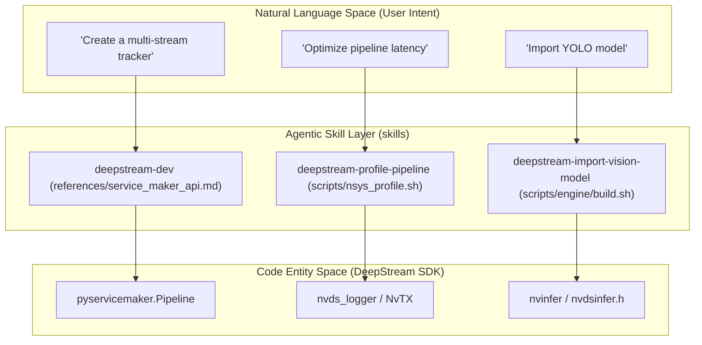
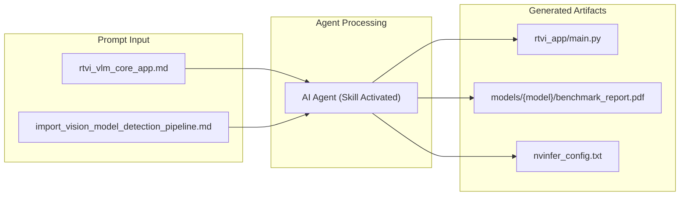

<!-- source: DeepWiki mcp.deepwiki.com · repo NVIDIA/DeepStream · page 10 AI Coding Agent Skills & Example Prompts · fetched 2026-10-26 -->

# 10. AI Coding Agent Skills & Example Prompts

Relevant source files

The following files were used as context for generating this wiki page:

- [example_prompts/import_vision_model_detection_pipeline.md](example_prompts/import_vision_model_detection_pipeline.md)
- [example_prompts/msgconv_kafka.md](example_prompts/msgconv_kafka.md)
- [example_prompts/multi_stream_tracker.md](example_prompts/multi_stream_tracker.md)
- [example_prompts/nvdsanalytics_config_sample.md](example_prompts/nvdsanalytics_config_sample.md)
- [example_prompts/nvdsdynamicsrcbin_app.md](example_prompts/nvdsdynamicsrcbin_app.md)
- [example_prompts/rtvi_vlm_core_app.md](example_prompts/rtvi_vlm_core_app.md)
- [example_prompts/rtvi_vlm_openapi_spec.md](example_prompts/rtvi_vlm_openapi_spec.md)
- [example_prompts/rtvi_vlm_openapi_spec.png](example_prompts/rtvi_vlm_openapi_spec.png)
- [example_prompts/single_view_3d_tracker.md](example_prompts/single_view_3d_tracker.md)
- [example_prompts/video_infer_app.md](example_prompts/video_infer_app.md)
- [example_prompts/video_object_count.md](example_prompts/video_object_count.md)
- [example_prompts/video_parallel_infer_app.md](example_prompts/video_parallel_infer_app.md)
- [example_prompts/yolov26s_detection.md](example_prompts/yolov26s_detection.md)
- [skills/README.md](skills/README.md)
- [skills/deepstream-dev/.claude-plugin/plugin.json](skills/deepstream-dev/.claude-plugin/plugin.json)
- [skills/deepstream-dev/BENCHMARK.md](skills/deepstream-dev/BENCHMARK.md)
- [skills/deepstream-dev/SKILL.md](skills/deepstream-dev/SKILL.md)
- [skills/deepstream-dev/evals/evals.json](skills/deepstream-dev/evals/evals.json)
- [skills/deepstream-dev/references/best_practices.md](skills/deepstream-dev/references/best_practices.md)
- [skills/deepstream-dev/references/buffer_apis.md](skills/deepstream-dev/references/buffer_apis.md)
- [skills/deepstream-dev/references/docker_containers.md](skills/deepstream-dev/references/docker_containers.md)
- [skills/deepstream-dev/references/gstreamer_plugins.md](skills/deepstream-dev/references/gstreamer_plugins.md)
- [skills/deepstream-dev/references/kafka_messaging.md](skills/deepstream-dev/references/kafka_messaging.md)
- [skills/deepstream-dev/references/media_extractor_advanced.md](skills/deepstream-dev/references/media_extractor_advanced.md)
- [skills/deepstream-dev/skill-card.md](skills/deepstream-dev/skill-card.md)
- [skills/deepstream-dev/skill.oms.sig](skills/deepstream-dev/skill.oms.sig)
- [skills/deepstream-import-vision-model/BENCHMARK.md](skills/deepstream-import-vision-model/BENCHMARK.md)
- [skills/deepstream-import-vision-model/evals/evals.json](skills/deepstream-import-vision-model/evals/evals.json)
- [skills/deepstream-import-vision-model/skill-card.md](skills/deepstream-import-vision-model/skill-card.md)
- [skills/deepstream-import-vision-model/skill.oms.sig](skills/deepstream-import-vision-model/skill.oms.sig)

DeepStream provides a comprehensive framework for accelerating development through **AI coding assistants** (e.g., Cursor, Claude Code). This framework consists of **Agentic Skills**—structured knowledge packages that provide domain-specific context and rules to AI agents—and an **Example Prompts Catalog** for common video analytics workflows [skills/README.md:1-15]().

## 10.1. Agentic Skills Framework

An agentic skill is a collection of reference documentation, guardrails, and scripts that an AI assistant can activate to produce idiomatic DeepStream code [skills/README.md:71-75](). These skills are located in the `skills/` directory and cover the full lifecycle from model onboarding to production profiling [skills/README.md:43-56]().

### Available Skills Reference
The repository includes nine primary skills categorized by their operational mode:

| Skill | Mode | Primary Role |
| :--- | :--- | :--- |
| `deepstream-dev` | Reference-rich | Hand-authoring `pyservicemaker` pipelines with API docs. |
| `deepstream-generate-pipeline` | Retrieval | Building `gst-launch` strings from 270+ verified samples. |
| `deepstream-profile-pipeline` | Measure-then-derive | Nsight Systems profiling and HW ceiling measurement. |
| `deepstream-import-vision-model` | Autonomous | End-to-end model onboarding (ONNX to PDF report). |
| `deepstream-run-mv3dt` | Operations | Running the Multi-View 3D Tracking reference app. |
| `deepstream-sop` | Microservice | Scaffold for GEBD + VLM industrial compliance apps. |
| `amc-setup-*` | Runbook | Deployment and validation of AutoMagicCalib stacks. |

Sources: [skills/README.md:79-90](), [skills/deepstream-dev/skill-card.md:1-15]()

### Mapping Natural Language to Code Entities
The following diagram illustrates how the `deepstream-dev` skill bridges user intent to the DeepStream SDK's underlying C/Python libraries.

**Natural Language to Code Mapping**

Sources: [skills/README.md:79-86](), [skills/deepstream-dev/skill-card.md:21-35]()

For a detailed breakdown of each skill's reference documents and scripts, see **[Available Skills Reference](#10.1)**.

---

## 10.2. Example Prompts Catalog

The `example_prompts/` directory contains pre-structured prompts designed to work with the `deepstream-dev` and `deepstream-import-vision-model` skills. These prompts provide the necessary constraints to generate production-ready application scaffolds [skills/README.md:57-67]().

### Common Workflow Examples
*   **Model Onboarding**: Automates model acquisition, TensorRT engine building, and benchmarking [example_prompts/import_vision_model_detection_pipeline.md:1-10]().
*   **VLM Integration**: Implements multi-modal Vision-Language Model pipelines for video summarization using Kafka for output [example_prompts/rtvi_vlm_core_app.md:1-11]().
*   **3D Tracking**: Configures `nvtracker` with camera projection matrices for physical world state estimation [example_prompts/single_view_3d_tracker.md:1-6]().

### Prompt-to-Artifact Flow
This diagram shows how the `example_prompts/` are processed by the agent to generate specific DeepStream artifacts.

**Prompt Execution Workflow**

Sources: [example_prompts/rtvi_vlm_core_app.md:17-18](), [example_prompts/import_vision_model_detection_pipeline.md:17-21](), [skills/deepstream-import-vision-model/evals/evals.json:7-15]()

For a full list of prompts including parallel inference, object counting, and Kafka messaging, see **[Example Prompts Catalog](#10.2)**.

---

## 10.3. Installation & Prerequisites

While code generation does not require specialized hardware, running the generated DeepStream applications requires a specific environment [skills/README.md:15-19]():

*   **OS**: Ubuntu 24.04 (x86_64 or Jetson) [skills/README.md:25]().
*   **Python**: Version 3.12+ with the `pyservicemaker` package [skills/README.md:22]().
*   **Hardware**: NVIDIA GPU with driver 595+ [skills/README.md:23]().
*   **SDK**: DeepStream 9.1 with CUDA 13.2 and TensorRT 10.16 [skills/README.md:24]().

**Note on Model Import**: The `deepstream-import-vision-model` skill requires additional tools such as `trtexec`, `mediainfo`, and an `optimum`-capable Python virtual environment [skills/README.md:27]().

Sources: [skills/README.md:9-36]()

---

