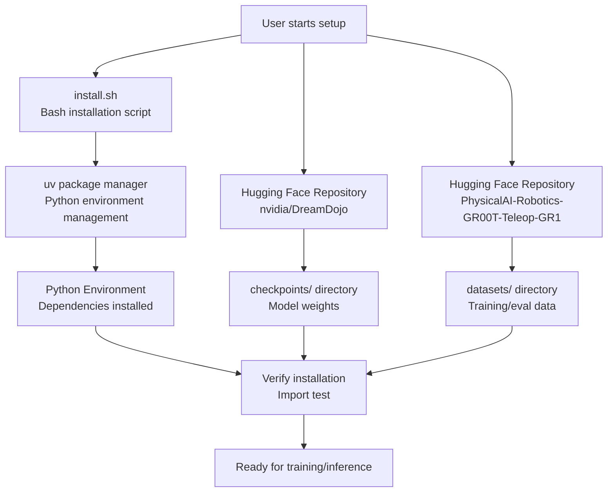
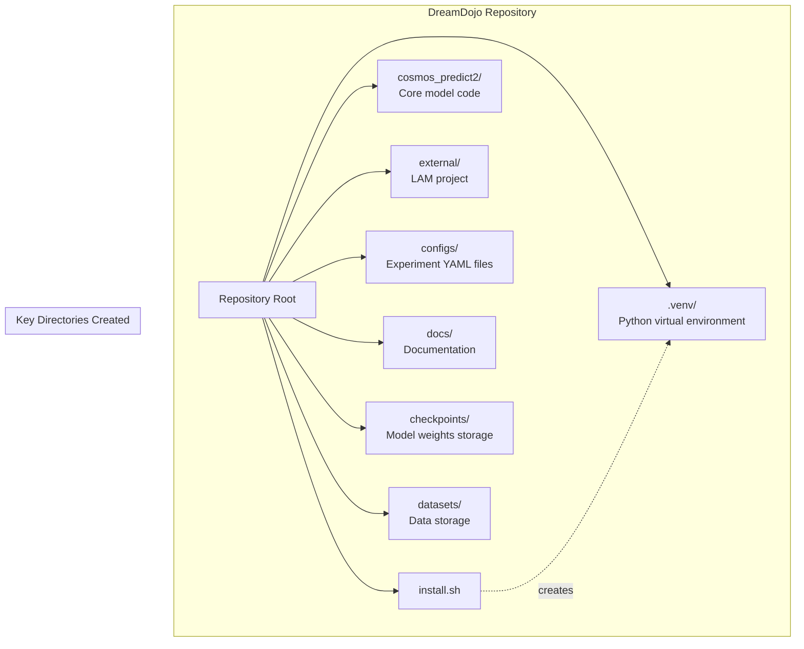
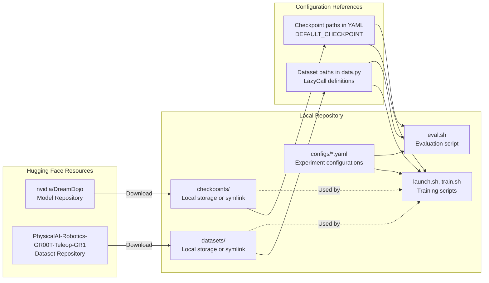

<!-- source: DeepWiki mcp.deepwiki.com · repo NVIDIA/DreamDojo · page 2 Getting Started · fetched 2026-10-26 -->

# Getting Started

<details>
<summary>Relevant source files</summary>

The following files were used as context for generating this wiki page:

- [checkpoints/README.md](checkpoints/README.md)
- [datasets/README.md](datasets/README.md)
- [docs/PRETRAIN.md](docs/PRETRAIN.md)
- [docs/SETUP.md](docs/SETUP.md)

</details>


This guide walks through the initial setup process for DreamDojo, covering environment configuration, dependency installation, and resource acquisition. After completing these steps, you will have a working DreamDojo environment ready for training or inference.

For detailed information about training workflows, see [Training Pipeline](#4). For evaluation procedures, see [Evaluation](#7). For advanced configuration options, see [Configuration System](#5).

## Purpose and Scope

This page covers:
- Installing Python dependencies using the `uv` package manager.
- Setting up the DreamDojo environment via `install.sh`.
- Downloading pretrained model checkpoints from Hugging Face.
- Downloading datasets for training and evaluation.
- Verifying the installation and directory structure.

## Prerequisites

DreamDojo requires:
- **Hardware**: NVIDIA H100 80GB GPUs (tested configuration) [docs/SETUP.md:5-5]().
- **Operating System**: Linux (recommended).
- **Network Access**: Internet connection for downloading dependencies and Hugging Face resources.

## Environment Setup Process

The following diagram shows the complete setup workflow and the relationship between setup components:

**Setup Workflow Diagram**


**Sources**: [docs/SETUP.md:1-17]()

### Step 1: Install Dependencies

DreamDojo uses [uv](https://docs.astral.sh/uv) for Python environment management [docs/SETUP.md:5-5](). The repository provides an automated installation script:

```bash
bash install.sh
```

The `install.sh` script performs the following operations:
1. Installs or updates the `uv` package manager.
2. Creates a Python virtual environment.
3. Installs all required dependencies from package specifications.
4. Configures PyTorch with CUDA support for H100 GPUs.

For more details, see [Environment Setup](#2.1).

**Sources**: [docs/SETUP.md:3-9]()

### Step 2: Environment Structure

After running `install.sh`, the following environment structure is created:

**Directory Structure Overview**


**Sources**: [docs/SETUP.md:1-17](), [checkpoints/README.md:1-1](), [datasets/README.md:1-1]()

## Obtaining Pretrained Resources

### Model Checkpoints

DreamDojo provides pretrained checkpoints for both 2B and 14B parameter models on Hugging Face [docs/PRETRAIN.md:13-14]().

| Model Size | Checkpoint Type | Description |
|------------|----------------|-------------|
| 2B | Pretrained | Base model trained on 44k hours of human video |
| 2B | Post-trained | GR-1, G1, AgiBot, YAM robot-specific variants |
| 14B | Pretrained | Larger base model for improved quality |
| 14B | Post-trained | Robot-specific 14B variants |

**Download Location**: [Hugging Face nvidia/DreamDojo](https://huggingface.co/nvidia/DreamDojo) [checkpoints/README.md:1-1]()

**Placement**: Download checkpoints to the `checkpoints/` directory in the repository root, or create a symbolic link [checkpoints/README.md:1-1]().

For details, see [Downloading Models and Datasets](#2.2).

**Sources**: [checkpoints/README.md:1-1](), [docs/PRETRAIN.md:13-14]()

### Datasets

The repository provides the GR-1 post-training dataset and evaluation sets [docs/SETUP.md:11-13]().

| Dataset | Purpose | Contents |
|---------|---------|----------|
| GR-1 Post-training | Robot-specific training | Teleoperation data for GR-1 robot |
| In-lab Evaluation | Performance testing | 10 robotics tasks (pick-and-place, folding, puzzles) |
| EgoDex | Dexterity evaluation | Egocentric dexterous manipulation |
| DreamDojo-HV | Long-horizon evaluation | Extended video generation scenarios |

**Download Location**: [Hugging Face PhysicalAI-Robotics-GR00T-Teleop-GR1](https://huggingface.co/datasets/nvidia/PhysicalAI-Robotics-GR00T-Teleop-GR1) [datasets/README.md:1-1]()

**Placement**: Download datasets to the `datasets/` directory or create a symbolic link [datasets/README.md:1-1]().

For details, see [Downloading Models and Datasets](#2.2).

**Sources**: [datasets/README.md:1-1](), [docs/SETUP.md:11-13]()

## Resource Organization

The following diagram shows how external resources integrate with the local repository structure:

**Resource Integration Diagram**


**Sources**: [checkpoints/README.md:1-1](), [datasets/README.md:1-1](), [docs/SETUP.md:11-17]()

## Directory Structure After Setup

After completing the setup steps, your repository should have the following structure:

```
DreamDojo/
├── install.sh                          # Environment setup script
├── .venv/                             # Python virtual environment (created by uv)
├── checkpoints/                       # Model checkpoint storage
│   ├── README.md                      # Instructions for checkpoint download
│   └── [downloaded checkpoint files]  # 2B/14B pretrained and post-trained models
├── datasets/                          # Dataset storage
│   ├── README.md                      # Instructions for dataset download
│   └── [downloaded dataset files]     # GR-1, evaluation sets
├── configs/                           # Experiment configuration files
│   ├── 2b_480_640_pretrain.yaml      # 2B pretraining config
│   ├── 2b_480_640_gr1.yaml           # 2B GR-1 post-training config
│   └── [other experiment configs]
├── cosmos_predict2/                   # Core model implementation
│   ├── _src/predict2/models/         # Model architecture
│   └── [other source directories]
├── external/                          # External dependencies
│   └── lam_project/                  # Latent Action Model
└── docs/                             # Documentation
    ├── SETUP.md                      # Setup instructions
    ├── PRETRAIN.md                   # Pretraining guide
    ├── POSTTRAIN.md                  # Post-training guide
    └── [other documentation files]
```

**Sources**: [docs/SETUP.md:1-17](), [checkpoints/README.md:1-1](), [datasets/README.md:1-1]()

## Verification

To verify your installation is complete and functional:

1. **Activate the environment**:
   ```bash
   source .venv/bin/activate
   ```

2. **Test Python imports**:
   ```python
   # Test core DreamDojo imports
   from cosmos_predict2._src.predict2.models.text2world_model_rectified_flow import Text2WorldModelRectifiedFlow
   # Verify successful import
   print("DreamDojo imports successful")
   ```

3. **Check directory structure**:
   ```bash
   # Verify checkpoint directory exists and contains models
   ls -l checkpoints/
   
   # Verify dataset directory exists and contains data
   ls -l datasets/
   ```

4. **Verify configuration files**:
   ```bash
   # List available experiment configurations
   ls configs/*.yaml
   ```

**Sources**: [docs/SETUP.md:1-17]()

## Next Steps

After completing the setup:

1. **For Latent Action Model (LAM) training**: See [Latent Action Model (LAM)](#3.3) for instructions on training the LAM subsystem.
2. **For DreamDojo pretraining**: See [Pretraining](#4.1) for launching pretraining on 44k hours of human video [docs/PRETRAIN.md:1-11](). Update the `ckpt_path` in [cosmos_predict2/_src/predict2/models/text2world_model_rectified_flow.py:6-6]() to point to your LAM checkpoint before starting.
3. **For robot-specific post-training**: See [Post-Training](#4.2) for adapting pretrained models to specific robot platforms (GR-1, G1, AgiBot, YAM).
4. **For evaluation**: See [Running Evaluations](#7.1) for generating samples from trained checkpoints using the `eval.sh` script.
5. **For configuration customization**: See [Configuration System](#5) for detailed information on the hierarchical configuration system.

**Sources**: [docs/SETUP.md:16-17](), [docs/PRETRAIN.md:1-20]()

---

