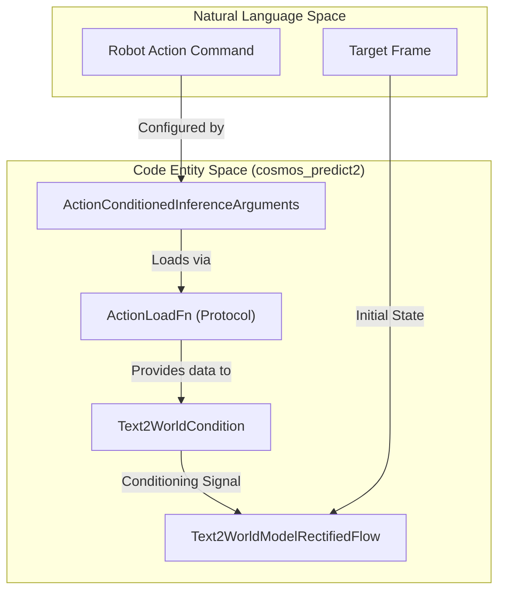
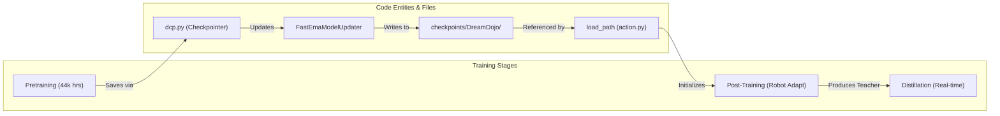

<!-- source: DeepWiki mcp.deepwiki.com · repo NVIDIA/DreamDojo · page 9 Glossary · fetched 2026-10-26 -->

# Glossary

Relevant source files

The following files were used as context for generating this wiki page:

- [README.md](README.md)
- [cosmos_predict2/_src/predict2/models/text2world_model_rectified_flow.py](cosmos_predict2/_src/predict2/models/text2world_model_rectified_flow.py)
- [cosmos_predict2/_src/predict2/networks/minimal_v4_dit.py](cosmos_predict2/_src/predict2/networks/minimal_v4_dit.py)
- [cosmos_predict2/action_conditioned_config.py](cosmos_predict2/action_conditioned_config.py)
- [docs/DISTILL.md](docs/DISTILL.md)
- [docs/ISSUES.md](docs/ISSUES.md)
- [docs/POSTTRAIN.md](docs/POSTTRAIN.md)
- [groot_dreams/data/dataset.py](groot_dreams/data/dataset.py)
- [shared_meta/AgiBot_modality.json](shared_meta/AgiBot_modality.json)

This glossary defines technical terms, architectural components, and domain-specific jargon used throughout the DreamDojo codebase. It serves as a reference for engineers to understand the mapping between high-level robotics/AI concepts and their specific implementations in the code.

## Core Model Concepts

### Rectified Flow
The primary diffusion formulation used in DreamDojo. Unlike standard Gaussian diffusion, Rectified Flow learns a straight-line trajectory between noise and data, which simplifies the sampling process and is particularly effective for high-resolution video generation.
*   **Implementation**: Managed by the `RectifiedFlow` class [cosmos_predict2/_src/predict2/schedulers/rectified_flow.py:63-63]().
*   **Scaling**: The model uses `RectifiedFlow_sCMWrapper` to handle noise scaling [cosmos_predict2/_src/predict2/models/text2world_model_rectified_flow.py:147-147]().

### Latent Action Model (LAM)
A specialized subsystem used during pretraining to extract 32-dimensional latent representations of motion from video pairs. This allows the model to learn "actions" from human videos where explicit robotic joint data is unavailable.
*   **Implementation**: Defined in the `LAM` class [cosmos_predict2/_src/predict2/models/text2world_model_rectified_flow.py:70-70]().
*   **Usage**: During pretraining, LAM features are extracted and used as conditioning [cosmos_predict2/_src/predict2/models/text2world_model_rectified_flow.py:72-72]().

### DiT (Diffusion Transformer)
The backbone architecture for the video generation model. DreamDojo uses a "Minimal DIT" variant which is a highly optimized transformer designed for spatial-temporal data.
*   **Implementation**: `MiniTrainDIT` (often referred to as `net` in configs) [cosmos_predict2/_src/predict2/networks/minimal_v4_dit.py:1-1]().
*   **Blocks**: The transformer consists of blocks that handle self-attention and cross-attention [cosmos_predict2/_src/predict2/networks/minimal_v4_dit.py:79-79]().

### Distillation (DMD2)
The process of compressing the multi-step diffusion model into a fast, real-time generator (10 FPS). This involves a three-stage pipeline: Teacher Generation, Warmup, and Self-Forcing [docs/DISTILL.md:3-7]().

---

## Robotics & Action Space

### Unified Action Space
A fixed 384-dimensional vector used to represent robot actions across different embodiments. This design allows a single model checkpoint to be compatible with multiple robots by assigning specific indices to each robot type [docs/POSTTRAIN.md:17-26]().

| Robot / Type | Index Range | Description |
| :--- | :--- | :--- |
| **GR-1** | `[0, 29)` | Fourier GR-1 standard actions |
| **GR-1 (Manus)** | `[29, 58)` | Retargeted actions from Manus gloves |
| **Unitree G1** | `[58, 101)` | G1 humanoid actions |
| **Bimanual YAM** | `[101, 147)` | YAM specific actions |
| **AgiBot** | `[147, 169)` | AgiBot specific actions |
| **MANO** | `[220, 352)` | Hand pose/mesh actions |
| **Latent Actions** | `[352, 384)` | Features extracted by the LAM |

**Sources**: [docs/POSTTRAIN.md:18-25]()

### Embodiment Tag
A string identifier used in the data pipeline to differentiate between robot platforms (e.g., "gr1", "g1", "agibot").
*   **Implementation**: `EmbodimentTag` enum [groot_dreams/data/dataset.py:16-16]().
*   **Usage**: Used to load specific metadata schemas like `AgiBot_modality.json` [shared_meta/AgiBot_modality.json:1-1]().

---

## Data & Configuration

### Modality
Refers to different types of data streams within a dataset, such as `video`, `state`, `action`, or `annotation`.
*   **Configuration**: Defined via `ModalityConfig` which specifies `delta_indices` and `modality_keys` [groot_dreams/data/dataset.py:67-73]().
*   **Mapping**: Mapped to raw data keys in files like `AgiBot_modality.json` [shared_meta/AgiBot_modality.json:2-163]().

### Delta Indices
A list of integers used to sample frames relative to a base index. For example, if the base index is $T$, and `delta_indices` are `[0, 1, 2]`, the dataloader will fetch frames at $T, T+1, T+2$ [groot_dreams/data/dataset.py:70-71]().

### LazyConfig / LazyDict
A configuration pattern where objects are not instantiated immediately. Instead, a dictionary containing the class path and arguments is passed around and instantiated only when needed.
*   **Utility**: `lazy_instantiate` [cosmos_predict2/_src/predict2/models/text2world_model_rectified_flow.py:39-39]().
*   **Usage**: The `tokenizer` and `net` are often defined as `LazyDict` in model configs [cosmos_predict2/_src/predict2/models/text2world_model_rectified_flow.py:81-83]().

---

## System Architecture Diagrams

### Diagram 1: Action Conditioning Flow
This diagram bridges the conceptual "Robot Action" to the specific code entities that process it during inference.

**Sources**: [cosmos_predict2/action_conditioned_config.py:32-58](), [cosmos_predict2/_src/predict2/models/text2world_model_rectified_flow.py:54-122]()

### Diagram 2: Training Pipeline and Checkpoint Lifecycle
This diagram illustrates how different training stages interact with the filesystem and specific classes.

**Sources**: [docs/POSTTRAIN.md:6-15](), [docs/DISTILL.md:3-7](), [cosmos_predict2/_src/predict2/models/text2world_model_rectified_flow.py:51-67]()

---

## Infrastructure & Optimization

### FSDP (Fully Sharded Data Parallel)
Used to shard model parameters, gradients, and optimizer states across GPUs to save memory.
*   **Implementation**: Configured via `fsdp_shard_size` and applied using `fully_shard` [cosmos_predict2/_src/predict2/models/text2world_model_rectified_flow.py:86-86](), [cosmos_predict2/_src/predict2/networks/minimal_v4_dit.py:42-42]().

### SAC (Selective Activation Checkpointing)
A memory optimization technique that recomputes certain activations during the backward pass instead of storing them.
*   **Implementation**: Policy functions like `predict2_2B_720_context_fn` define which operations (e.g., `flash_attn`, `mm`) to save or recompute [cosmos_predict2/_src/predict2/networks/minimal_v4_dit.py:69-110]().

### Context Parallelism (CP)
Distributes the sequence dimension of a video across multiple GPUs, enabling the processing of longer videos than would fit on a single device.
*   **Implementation**: Uses `parallel_state` from Megatron-Core and functions like `split_inputs_cp` [cosmos_predict2/_src/predict2/networks/minimal_v4_dit.py:27-60]().

**Sources**: [cosmos_predict2/_src/predict2/networks/minimal_v4_dit.py:1-165](), [cosmos_predict2/_src/predict2/models/text2world_model_rectified_flow.py:164-170]()