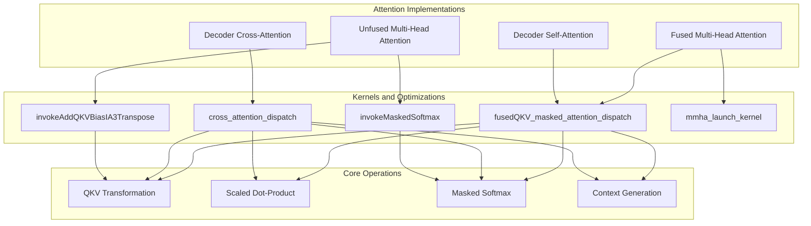
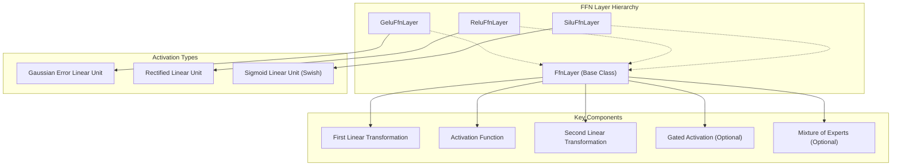
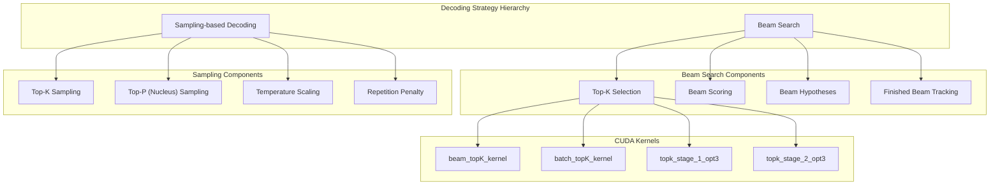
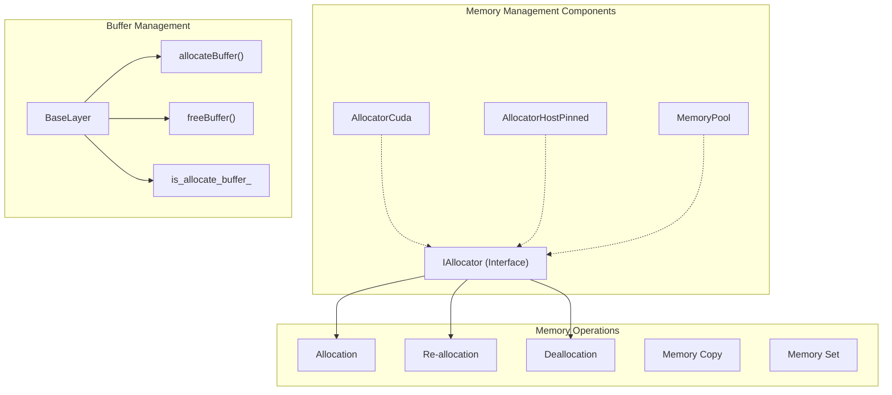
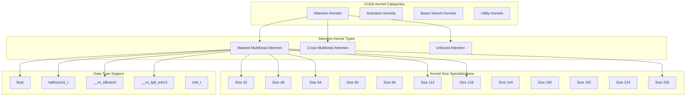

<!-- source: DeepWiki mcp.deepwiki.com · repo NVIDIA/FasterTransformer · page 4 Core Components · fetched 2026-10-26 -->

# Core Components

<details>
<summary>Relevant source files</summary>

The following files were used as context for generating this wiki page:

- [src/fastertransformer/kernels/activation_kernels.h](src/fastertransformer/kernels/activation_kernels.h)
- [src/fastertransformer/kernels/beam_search_topk_kernels.cu](src/fastertransformer/kernels/beam_search_topk_kernels.cu)
- [src/fastertransformer/kernels/decoder_masked_multihead_attention.cu](src/fastertransformer/kernels/decoder_masked_multihead_attention.cu)
- [src/fastertransformer/kernels/decoder_masked_multihead_attention/decoder_masked_multihead_attention_112.cu](src/fastertransformer/kernels/decoder_masked_multihead_attention/decoder_masked_multihead_attention_112.cu)
- [src/fastertransformer/kernels/decoder_masked_multihead_attention/decoder_masked_multihead_attention_48.cu](src/fastertransformer/kernels/decoder_masked_multihead_attention/decoder_masked_multihead_attention_48.cu)
- [src/fastertransformer/kernels/unfused_attention_kernels.cu](src/fastertransformer/kernels/unfused_attention_kernels.cu)
- [src/fastertransformer/layers/FfnLayer.cc](src/fastertransformer/layers/FfnLayer.cc)
- [src/fastertransformer/layers/FfnLayer.h](src/fastertransformer/layers/FfnLayer.h)
- [src/fastertransformer/layers/attention_layers/DecoderCrossAttentionLayer.cu](src/fastertransformer/layers/attention_layers/DecoderCrossAttentionLayer.cu)
- [src/fastertransformer/layers/attention_layers/DecoderSelfAttentionLayer.cc](src/fastertransformer/layers/attention_layers/DecoderSelfAttentionLayer.cc)
- [src/fastertransformer/utils/CMakeLists.txt](src/fastertransformer/utils/CMakeLists.txt)
- [tests/decoding/tf_fused_self_multihead_attention_unit_test.py](tests/decoding/tf_fused_self_multihead_attention_unit_test.py)

</details>


This page provides a detailed overview of the fundamental building blocks that power FasterTransformer. These core components serve as the foundation for all model implementations in the library, offering high-performance primitives for transformer-based architectures.

For information about specific model implementations built on these components, see [Models](#3). For optimization techniques applied to these components, see [Optimization Techniques](#5).

## Overview of Core Components

```mermaid
graph TD
    subgraph "Core Components"
        direction TB
        Attention["Attention Mechanisms"]
        FFN["Feed-Forward Networks"]
        Decode["Decoding Strategies"]
        Memory["Memory Management"]
        Kernels["CUDA Kernels"]
    end

    Attention --> Kernels
    FFN --> Kernels
    Decode --> Kernels
    Memory --> Kernels

    subgraph "Attention Types"
        SelfAttn["Self-Attention"]
        CrossAttn["Cross-Attention"]
        FusedMHA["Fused Multi-Head Attention"]
        UnfusedMHA["Unfused Multi-Head Attention"]
    end

    subgraph "FFN Types"
        GeluFFN["GELU Feed-Forward"]
        ReluFFN["ReLU Feed-Forward"]
        SiluFFN["SiLU Feed-Forward"]
        GatedFFN["Gated Activations"]
    end

    subgraph "Decoding"
        BeamSearch["Beam Search"]
        Sampling["Sampling Strategies"]
        TopK["Top-K Selection"]
        TopP["Top-P (Nucleus) Sampling"]
    end

    Attention --- SelfAttn
    Attention --- CrossAttn
    Attention --- FusedMHA
    Attention --- UnfusedMHA

    FFN --- GeluFFN
    FFN --- ReluFFN
    FFN --- SiluFFN
    FFN --- GatedFFN

    Decode --- BeamSearch
    Decode --- Sampling
    BeamSearch --- TopK
    Sampling --- TopK
    Sampling --- TopP
```



Sources:
- [src/fastertransformer/kernels/unfused_attention_kernels.cu:1-290](src/fastertransformer/kernels/unfused_attention_kernels.cu:1-290)
- [src/fastertransformer/kernels/decoder_masked_multihead_attention.cu:1-139](src/fastertransformer/kernels/decoder_masked_multihead_attention.cu:1-139)
- [src/fastertransformer/layers/attention_layers/DecoderSelfAttentionLayer.cc:1-200](src/fastertransformer/layers/attention_layers/DecoderSelfAttentionLayer.cc:1-200)
- [src/fastertransformer/layers/attention_layers/DecoderCrossAttentionLayer.cu:1-200](src/fastertransformer/layers/attention_layers/DecoderCrossAttentionLayer.cu:1-200)
- [src/fastertransformer/layers/FfnLayer.h:1-232](src/fastertransformer/layers/FfnLayer.h:1-232)
- [src/fastertransformer/kernels/beam_search_topk_kernels.cu:1-200](src/fastertransformer/kernels/beam_search_topk_kernels.cu:1-200)

## Attention Mechanisms

Attention mechanisms are fundamental components in transformer architectures, allowing models to focus on relevant parts of the input. FasterTransformer provides multiple optimized implementations of attention with different trade-offs between flexibility and performance.



### Fused vs Unfused Attention

FasterTransformer offers two main approaches to implementing attention:

1. **Fused Multi-Head Attention (Optimized)**: Combines multiple operations (QKV transformation, attention calculation, softmax, context generation) into a single kernel for maximum performance. Used primarily in decoder layers.

2. **Unfused Multi-Head Attention (Flexible)**: Implements attention as a sequence of separate operations, offering more flexibility at the cost of some performance.

### Self-Attention and Cross-Attention

The library provides specialized implementations for both self-attention and cross-attention:

1. **Decoder Self-Attention**: Handles attention within a decoder layer, where tokens attend to previous tokens in the sequence. Includes masking to prevent attending to future tokens.

2. **Cross-Attention**: Manages attention between a decoder layer and the outputs of an encoder, allowing the decoder to focus on relevant parts of the input sequence.

### Key Implementation Details

- **QKV Transformation**: Converts inputs to query, key, and value matrices
  ```cpp
  invokeAddQKVBiasIA3Transpose<T>(
      q_buf, k_buf, v_buf, Q, bias_Q, K, bias_K, V, bias_V,
      batch_size, seq_len, head_num, size_per_head, ia3_tasks,
      ia3_key_weights, ia3_value_weights, stream);
  ```

- **Masked Softmax**: Computes softmax with support for attention masks and position biases
  ```cpp
  invokeMaskedSoftmax<T, T_IN>(param, stream);
  ```

- **Fused Self-Attention Dispatch**: Entry point for optimized self-attention
  ```cpp
  fusedQKV_masked_attention_dispatch<T>(
      qkv_buf, qkv_bias, relative_attention_bias,
      key_cache, value_cache, cache_indir, context_buf,
      finished, sequence_lengths, /* ... *);
  ```

- **Cross-Attention Dispatch**: Entry point for cross-attention
  ```cpp
  cross_attention_dispatch<T>(
      query_buf, Q_bias, key_cache, K_bias, value_cache, V_bias,
      length, context_buf, finished, /* ... *);
  ```

Sources:
- [src/fastertransformer/kernels/unfused_attention_kernels.cu:25-290](src/fastertransformer/kernels/unfused_attention_kernels.cu:25-290)
- [src/fastertransformer/layers/attention_layers/DecoderSelfAttentionLayer.cc:36-147](src/fastertransformer/layers/attention_layers/DecoderSelfAttentionLayer.cc:36-147)
- [src/fastertransformer/layers/attention_layers/DecoderCrossAttentionLayer.cu:30-547](src/fastertransformer/layers/attention_layers/DecoderCrossAttentionLayer.cu:30-547)
- [src/fastertransformer/kernels/decoder_masked_multihead_attention.cu:25-90](src/fastertransformer/kernels/decoder_masked_multihead_attention.cu:25-90)

## Feed-Forward Networks

Feed-Forward Networks (FFNs) are essential components in transformer architectures, typically consisting of two linear transformations with an activation function in between. FasterTransformer provides optimized implementations for different activation functions and architecture variants.



### FFN Variants

FasterTransformer implements several variants of Feed-Forward Networks:

1. **Base FFN Layer** (`FfnLayer<T>`): Provides the core functionality for all FFN implementations
2. **GELU FFN** (`GeluFfnLayer<T>`): Uses Gaussian Error Linear Unit activation
3. **ReLU FFN** (`ReluFfnLayer<T>`): Uses Rectified Linear Unit activation
4. **SiLU FFN** (`SiluFfnLayer<T>`): Uses Sigmoid Linear Unit activation (also known as Swish)

### Key Features

1. **Gated Activations**: Optional gating mechanism for more expressive models (GLU, GeGLU, etc.)
   ```cpp
   bool use_gated_activation_; // Enables gated variants of activations
   ```

2. **Mixture of Experts (MoE)**: Supports MoE architecture with multiple expert FFNs
   ```cpp
   size_t expert_num_; // Number of expert networks
   ```

3. **Quantization Support**: INT8 modes for reduced memory footprint and faster inference
   ```cpp
   int int8_mode_; // 0: No quantization, 1: Weight quantized only, 2: SmoothQuant
   ```

4. **IA3 Adaptation**: Support for IA3 (Input-Adaptive Layer Normalization) task conditioning
   ```cpp
   const int* ia3_tasks; // Task identifiers for IA3 adaptation
   ```

### Implementation Details

The core forward pass of the FFN involves:

1. First linear transformation (FC1)
2. Activation function (GELU, ReLU, SiLU)
3. Second linear transformation (FC2)

For gated activations, an additional linear transformation is performed and combined with the activation output.

Key methods:
- `forward()`: Main entry point for FFN processing
- `genericActivation()`: Dispatches to the appropriate activation function
- `allocateBuffer()`: Memory management for internal buffers

Sources:
- [src/fastertransformer/layers/FfnLayer.h:33-232](src/fastertransformer/layers/FfnLayer.h:33-232)
- [src/fastertransformer/layers/FfnLayer.cc:24-715](src/fastertransformer/layers/FfnLayer.cc:24-715)
- [src/fastertransformer/kernels/activation_kernels.h:25-111](src/fastertransformer/kernels/activation_kernels.h:25-111)

## Decoding Strategies

Decoding strategies are crucial for text generation, determining how the next token is selected from the model's output distribution. FasterTransformer implements several optimized decoding methods, with a focus on beam search and sampling techniques.



### Beam Search

Beam search maintains multiple hypotheses (beams) at each decoding step, expanding each beam with potential next tokens and keeping only the top-k highest scoring sequences.

Key components:
- **Beam Scoring**: Calculates scores for beam candidates
  ```cpp
  T apply_length_penalty(T log_prob, int length, float length_penalty)
  ```

- **Top-K Selection**: Identifies the k most promising candidates
  ```cpp
  beam_topK_kernel<T, MAX_K, THREADBLOCK_SIZE><<<grid, block, 0, stream>>>(
      log_probs, topk_tmp_id_buf, topk_tmp_val_buf, finished, sequence_lengths,
      vocab_size, diversity_rate, length_penalty);
  ```

- **Beam Hypotheses**: Tracks completed sequences and their scores
  ```cpp
  BeamHypotheses beam_hyps; // Structure for managing beam hypotheses
  ```

### Sampling Strategies

Sampling techniques introduce randomness to generate more diverse text by selecting tokens probabilistically.

1. **Top-K Sampling**: Samples from the k most probable tokens
2. **Top-P (Nucleus) Sampling**: Samples from the smallest set of tokens whose cumulative probability exceeds p
3. **Temperature Scaling**: Adjusts the sharpness of the probability distribution

### Implementation Optimizations

- **Two-Stage Processing**: Many kernels use a two-stage approach for efficiency
  ```cpp
  // Stage 1: Find top-k candidates per thread block
  topk_stage_1_opt3<T, BLOCK_SIZE_, BLOCKS_PER_BEAM_><<<grid, block, 0, stream>>>(/* ... *);
  
  // Stage 2: Find global top-k candidates
  topk_stage_2_opt3<T, BLOCK_SIZE_, BLOCKS_PER_BEAM_><<<batch_size, block, smem_size, stream>>>(/* ... *);
  ```

- **CUB Integration**: Uses NVIDIA's CUB library for efficient reductions
  ```cpp
  typedef cub::BlockReduce<TopK<T, MAX_K>, THREADBLOCK_SIZE> BlockReduce;
  ```

- **Early Termination**: Efficiently handles finished sequences
  ```cpp
  if (finished != nullptr && finished[row_id] == true) {
      // Skip processing for finished sequences
  }
  ```

Sources:
- [src/fastertransformer/kernels/beam_search_topk_kernels.cu:32-645](src/fastertransformer/kernels/beam_search_topk_kernels.cu:32-645)

## Memory Management

FasterTransformer provides specialized memory management utilities to optimize GPU memory usage and minimize memory fragmentation. These utilities are crucial for handling the large memory requirements of transformer models.



### Key Components

1. **Allocator Interface**: The `IAllocator` interface provides a common API for memory allocation:
   ```cpp
   void* reMalloc(void* ptr, size_t size, bool is_host_memory = false);
   void free(void** ptr);
   ```

2. **Buffer Management in Layers**: All layer components implement standard buffer management patterns:
   ```cpp
   void allocateBuffer(); // Allocate internal buffers
   void freeBuffer();     // Free internal buffers
   bool is_allocate_buffer_ = false; // Track allocation state
   ```

3. **Memory Utilities**: The `memory_utils` library provides specialized memory operations:
   ```cpp
   // From CMakeLists.txt
   add_library(memory_utils STATIC memory_utils.cu)
   target_link_libraries(memory_utils PUBLIC cuda_utils logger tensor cutlass_preprocessors)
   ```

### Memory Management in Attention and FFN

Both attention layers and feed-forward networks follow consistent memory management patterns:

1. **Attention Layers**: Manage key buffers like QKV, context, and caches
   ```cpp
   // In DecoderSelfAttentionLayer
   void allocateBuffer(size_t batch_size) {
       qkv_buf_ = reinterpret_cast<T*>(allocator_->reMalloc(
           qkv_buf_, type_size * batch_size * 3 * local_hidden_units_, false));
       context_buf_ = reinterpret_cast<T*>(allocator_->reMalloc(
           context_buf_, type_size * batch_size * local_hidden_units_, false));
       // ...
   }
   ```

2. **FFN Layers**: Manage intermediate buffers for activations
   ```cpp
   // In FfnLayer
   void allocateBuffer(size_t token_num, int moe_k, bool use_moe) {
       inter_buf_ = (T*)allocator_->reMalloc(
           inter_buf_, type_size * token_num * max_inter_size_, false);
       // ...
   }
   ```

3. **Conditional Buffer Release**: Optimizes memory usage with conditional buffer freeing
   ```cpp
   if (is_free_buffer_after_forward_ == true) {
       freeBuffer();
   }
   ```

Sources:
- [src/fastertransformer/utils/CMakeLists.txt:15-106](src/fastertransformer/utils/CMakeLists.txt:15-106)
- [src/fastertransformer/layers/attention_layers/DecoderSelfAttentionLayer.cc:192-249](src/fastertransformer/layers/attention_layers/DecoderSelfAttentionLayer.cc:192-249)
- [src/fastertransformer/layers/FfnLayer.cc:453-526](src/fastertransformer/layers/FfnLayer.cc:453-526)

## CUDA Kernels

CUDA kernels form the backbone of FasterTransformer's high-performance implementation, providing optimized GPU code for critical operations. These kernels are carefully tailored for different head sizes, data types, and execution patterns.



### Key Kernel Types

1. **Attention Kernels**: Optimized for different attention patterns

   - **Masked Multihead Attention**: For causal attention in decoders
     ```cpp
     mmha_launch_kernel<T, Dh, Dh_MAX, KERNEL_PARAMS_TYPE>(params, stream);
     ```

   - **Cross Attention**: For encoder-decoder attention
     ```cpp
     cross_multihead_attention(params, stream);
     ```

   - **Unfused Attention**: Component kernels for flexible attention
     ```cpp
     invokeAddQKVBiasIA3Transpose<T>(/* ... *);
     invokeMaskedSoftmax<T, T_IN>(param, stream);
     ```

2. **Activation Kernels**: Implement various activation functions

   ```cpp
   invokeGenericActivation<ActivationType, T, BT>(
       out, bias, gated_weights, gated_bias, ia3_tasks, ia3_weights,
       m, n, int8_mode, activation_in, activation_out, stream);
   ```

3. **Beam Search Kernels**: Specialized for text generation

   ```cpp
   beam_topK_kernel<T, MAX_K, THREADBLOCK_SIZE><<<grid, block, 0, stream>>>(/* ... *);
   ```

### Size Specializations

For maximum performance, kernels are specialized for different head sizes:

```cpp
switch (params.hidden_size_per_head) {
    case 32:
        mmha_launch_kernel<T, 32, 32, KERNEL_PARAMS_TYPE>(params, stream);
        break;
    case 48:
        mmha_launch_kernel<T, 48, 64, KERNEL_PARAMS_TYPE>(params, stream);
        break;
    case 64:
        mmha_launch_kernel<T, 64, 64, KERNEL_PARAMS_TYPE>(params, stream);
        break;
    // ... other sizes
    case 256:
        mmha_launch_kernel<T, 256, 256, KERNEL_PARAMS_TYPE>(params, stream);
        break;
    default:
        assert(false);
}
```

### Data Type Support

FasterTransformer kernels support multiple data types for different precision-performance trade-offs:

1. **FP32** (`float`): Full precision
2. **FP16** (`half`/`uint16_t`): Half precision
3. **BF16** (`__nv_bfloat16`): Brain floating-point format
4. **INT8**: Quantized integer operations
5. **FP8** (`__nv_fp8_e4m3`): 8-bit floating point (experimental)

Conditional compilation is used to support BF16 and FP8:

```cpp
#ifdef ENABLE_BF16
template void mmha_launch_kernel<__nv_bfloat16, 112, 128, Masked_multihead_attention_params<__nv_bfloat16>>(
    const Masked_multihead_attention_params<__nv_bfloat16>& params, const cudaStream_t& stream);
#endif

#ifdef ENABLE_FP8
template void mmha_launch_kernel<__nv_fp8_e4m3, 112, 128, Masked_multihead_attention_params<__nv_fp8_e4m3>>(
    const Masked_multihead_attention_params<__nv_fp8_e4m3>& params, const cudaStream_t& stream);
#endif
```

Sources:
- [src/fastertransformer/kernels/decoder_masked_multihead_attention.cu:25-139](src/fastertransformer/kernels/decoder_masked_multihead_attention.cu:25-139)
- [src/fastertransformer/kernels/decoder_masked_multihead_attention/decoder_masked_multihead_attention_112.cu:25-102](src/fastertransformer/kernels/decoder_masked_multihead_attention/decoder_masked_multihead_attention_112.cu:25-102)
- [src/fastertransformer/kernels/decoder_masked_multihead_attention/decoder_masked_multihead_attention_48.cu:25-100](src/fastertransformer/kernels/decoder_masked_multihead_attention/decoder_masked_multihead_attention_48.cu:25-100)
- [src/fastertransformer/kernels/unfused_attention_kernels.cu:26-752](src/fastertransformer/kernels/unfused_attention_kernels.cu:26-752)
- [src/fastertransformer/kernels/activation_kernels.h:25-111](src/fastertransformer/kernels/activation_kernels.h:25-111)
- [src/fastertransformer/kernels/beam_search_topk_kernels.cu:32-645](src/fastertransformer/kernels/beam_search_topk_kernels.cu:32-645)

---

