# Page: Overview

# Overview

<details>
<summary>Relevant source files</summary>

The following files were used as context for generating this wiki page:

- [CMakeLists.txt](CMakeLists.txt)
- [README.md](README.md)
- [cmake/Modules/FindNCCL.cmake](cmake/Modules/FindNCCL.cmake)
- [examples/pytorch/t5/translate_example.py](examples/pytorch/t5/translate_example.py)
- [src/fastertransformer/kernels/gen_relative_pos_bias.cu](src/fastertransformer/kernels/gen_relative_pos_bias.cu)
- [src/fastertransformer/kernels/gpt_kernels.cu](src/fastertransformer/kernels/gpt_kernels.cu)
- [src/fastertransformer/kernels/gpt_kernels.h](src/fastertransformer/kernels/gpt_kernels.h)
- [src/fastertransformer/kernels/stop_criteria_kernels.cu](src/fastertransformer/kernels/stop_criteria_kernels.cu)
- [src/fastertransformer/models/multi_gpu_gpt/ParallelGpt.h](src/fastertransformer/models/multi_gpu_gpt/ParallelGpt.h)
- [src/fastertransformer/th_op/common/GptOps.cc](src/fastertransformer/th_op/common/GptOps.cc)
- [src/fastertransformer/utils/cublasFP8MMWrapper.cu](src/fastertransformer/utils/cublasFP8MMWrapper.cu)
- [src/fastertransformer/utils/cublasMMWrapper.cc](src/fastertransformer/utils/cublasMMWrapper.cc)
- [tests/unittests/test_attention_kernels.cu](tests/unittests/test_attention_kernels.cu)
- [tests/unittests/test_gpt_kernels.cu](tests/unittests/test_gpt_kernels.cu)

</details>


FasterTransformer is a highly optimized library for transformer-based model inference on NVIDIA GPUs. It provides efficient implementations of popular transformer architectures with a focus on performance optimization and deployment flexibility.

> **Note**: FasterTransformer development has transitioned to [TensorRT-LLM](#). All developers are encouraged to leverage TensorRT-LLM to get the latest improvements on LLM Inference. The NVIDIA/FasterTransformer repo will stay up, but will not have further development.

## Purpose and Scope

FasterTransformer implements optimized transformer encoder and decoder components for inference workloads. The library is built on top of CUDA, cuBLAS, cuBLASLt and C++, with integration options for TensorFlow, PyTorch, and Triton Inference Server. It supports a wide range of models including BERT, GPT, T5, BLOOM, and many others.

The primary focus of FasterTransformer is to achieve maximum inference performance on NVIDIA GPUs through various optimization techniques including:
- Customized CUDA kernels for transformer operations
- Tensor and pipeline parallelism for multi-GPU execution
- Quantization (INT8, FP8) support
- Memory optimization strategies
- Optimized attention mechanisms

## Architecture Overview

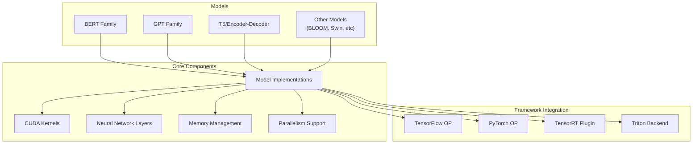

Sources: [README.md:30-32](), [README.md:82-97]()

## Directory Structure

FasterTransformer organizes its code in a hierarchical structure where lower-level components (kernels, layers) are used by higher-level components (models, framework interfaces):

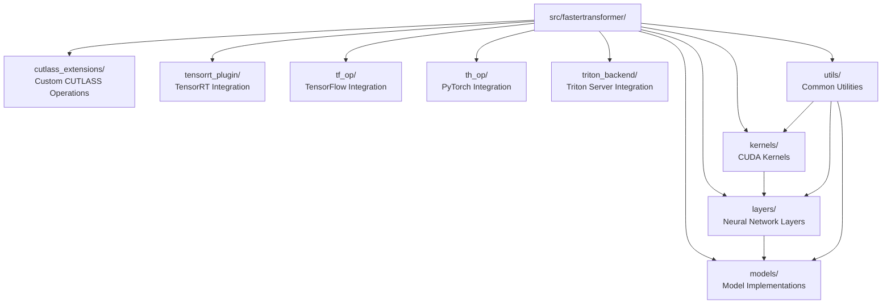

Sources: [README.md:82-97]()

## Supported Models and Features

FasterTransformer supports a wide range of models with varying levels of feature support. The table below shows the model support matrix:

| Models | Framework Support | Precision | Parallelism Support |
|--------|------------------|-----------|---------------------|
| BERT | TensorFlow, PyTorch, Triton, C++ | FP16, INT8, FP8 | Tensor and Pipeline |
| GPT/OPT | PyTorch, Triton | FP16 | Tensor and Pipeline |
| GPT-MoE | PyTorch | FP16 | Tensor and Pipeline |
| BLOOM | PyTorch, Triton | FP16 | Tensor and Pipeline |
| T5/UL2 | PyTorch, TensorFlow 2, Triton, TensorRT | FP16 | Tensor and Pipeline |
| T5-MoE | PyTorch | FP16 | Tensor and Pipeline |
| Swin Transformer | PyTorch, TensorRT | FP16, INT8 | - |
| BART/mBART | PyTorch | FP16 | Tensor and Pipeline |
| Other models | Various | Various | Various |

Sources: [README.md:34-72]()

## Core Components

### CUDA Kernel Optimizations

FasterTransformer implements numerous optimized CUDA kernels for transformer operations, including:

1. Attention mechanisms (fused multi-head attention)
2. Embedding and position encoding
3. Feed-forward networks
4. Layer normalization
5. Specialized decoding operations (beam search, sampling)

These kernels are designed to utilize GPU hardware capabilities efficiently, including Tensor Cores when FP16 precision is used on compatible hardware.

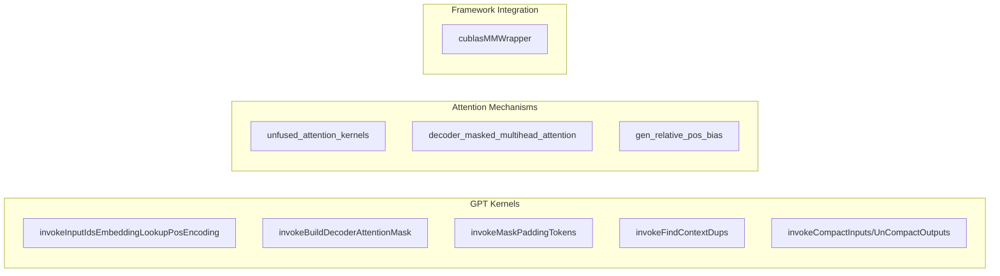

Sources: [src/fastertransformer/kernels/gpt_kernels.cu](), [src/fastertransformer/kernels/gpt_kernels.h](), [src/fastertransformer/kernels/gen_relative_pos_bias.cu](), [src/fastertransformer/utils/cublasMMWrapper.cc]()

### Matrix Multiplication Wrapper

Matrix multiplication is a core operation in transformer models. FasterTransformer provides optimized wrappers around cuBLAS operations with algorithmic selection and specialized implementations for different data types:

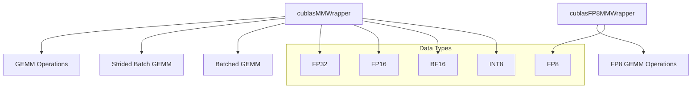

Sources: [src/fastertransformer/utils/cublasMMWrapper.cc](), [src/fastertransformer/utils/cublasFP8MMWrapper.cu]()

### Model Implementations

FasterTransformer provides optimized implementations for multiple transformer architectures. One of the key examples is the parallel GPT implementation:

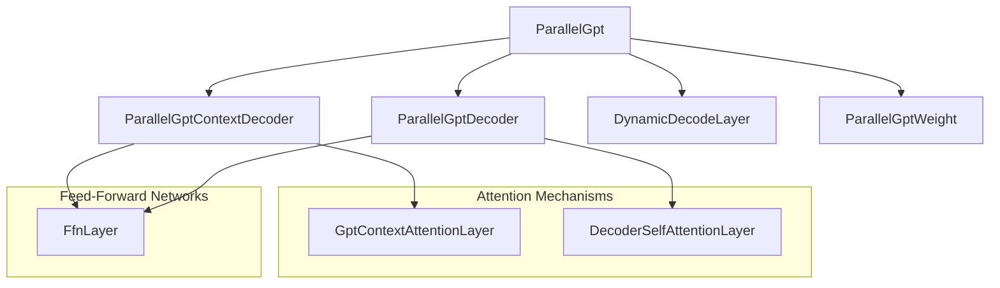

Sources: [src/fastertransformer/models/multi_gpu_gpt/ParallelGpt.h]()

## Parallelism and Scaling

FasterTransformer supports multiple parallelism strategies for handling large models and achieving high throughput:

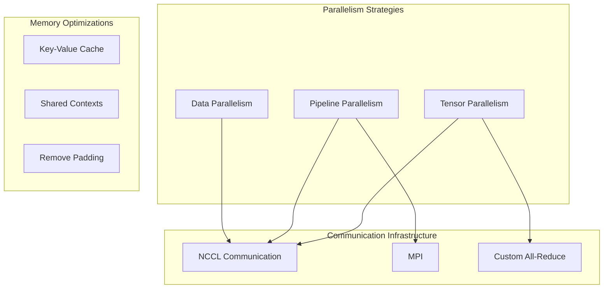

### Tensor Parallelism

Tensor parallelism divides model layers across multiple GPUs by splitting the weights along the hidden dimension. This allows for efficient distribution of computation for very large models like GPT-3.

### Pipeline Parallelism

Pipeline parallelism divides the model by assigning different layers to different GPUs. This approach is particularly useful for deep models with many layers.

### Context Sharing

FasterTransformer implements context sharing optimization to avoid redundant computation for identical inputs:

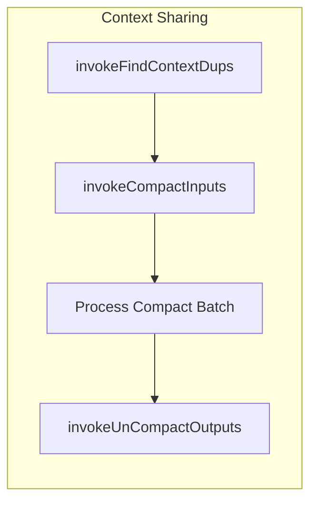

Sources: [src/fastertransformer/kernels/gpt_kernels.h:124-167](), [tests/unittests/test_gpt_kernels.cu]()

## Framework Integration

FasterTransformer can be integrated with multiple deep learning frameworks:

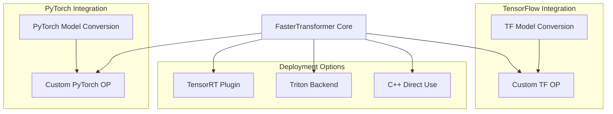

Sources: [README.md:31-32](), [README.md:87-90](), [src/fastertransformer/th_op/common/GptOps.cc]()

## Examples and Usage

FasterTransformer provides examples for different models and frameworks. For instance, the T5 translation example shows how to use FasterTransformer with PyTorch for machine translation:

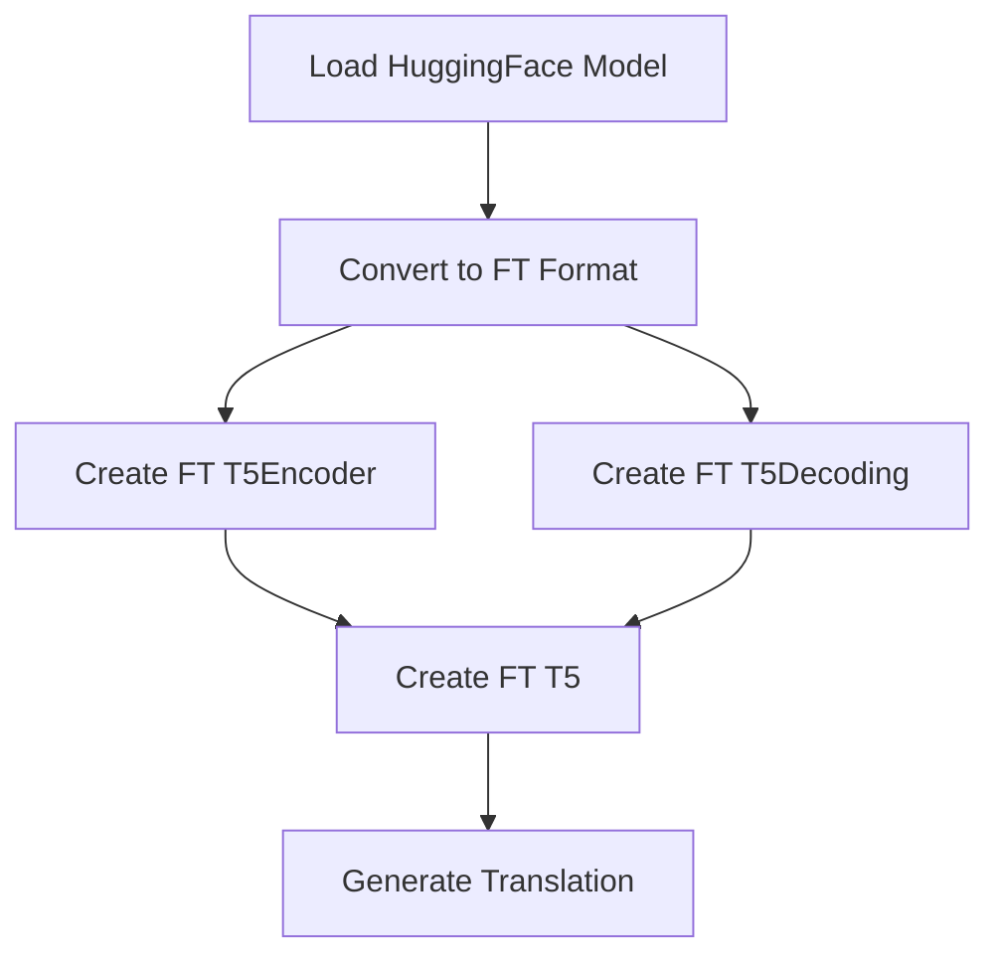

Sources: [examples/pytorch/t5/translate_example.py]()

## Global Environment Variables

FasterTransformer provides convenient environment variables for debugging and testing:

| Environment Variable | Purpose |
|---------------------|---------|
| `FT_LOG_LEVEL` | Controls the log level of debug messages |
| `FT_NVTX` | When set to "ON", inserts NVTX tags for profiling |
| `FT_DEBUG_LEVEL` | When set to "DEBUG", runs cudaDeviceSynchronize() after every kernel |

Sources: [README.md:106-113]()

## Build System

FasterTransformer uses CMake for its build system with various configuration options:

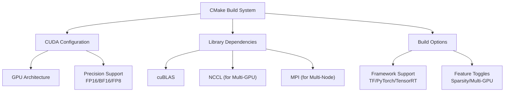

Sources: [CMakeLists.txt](), [cmake/Modules/FindNCCL.cmake]()

## Conclusion

FasterTransformer provides a comprehensive set of optimized components for transformer-based model inference. Its architecture allows for flexibility in model support, precision options, and deployment scenarios, making it suitable for a wide range of applications requiring high-performance transformer inference.

While FasterTransformer development has transitioned to TensorRT-LLM, the repository continues to offer valuable implementations and optimization techniques for transformer models.

---

# Page: Architecture

# Architecture

<details>
<summary>Relevant source files</summary>

The following files were used as context for generating this wiki page:

- [README.md](README.md)
- [src/fastertransformer/kernels/decoder_masked_multihead_attention.cu](src/fastertransformer/kernels/decoder_masked_multihead_attention.cu)
- [src/fastertransformer/kernels/decoder_masked_multihead_attention/decoder_masked_multihead_attention_112.cu](src/fastertransformer/kernels/decoder_masked_multihead_attention/decoder_masked_multihead_attention_112.cu)
- [src/fastertransformer/kernels/decoder_masked_multihead_attention/decoder_masked_multihead_attention_48.cu](src/fastertransformer/kernels/decoder_masked_multihead_attention/decoder_masked_multihead_attention_48.cu)
- [src/fastertransformer/kernels/gpt_kernels.cu](src/fastertransformer/kernels/gpt_kernels.cu)
- [src/fastertransformer/kernels/gpt_kernels.h](src/fastertransformer/kernels/gpt_kernels.h)
- [src/fastertransformer/kernels/stop_criteria_kernels.cu](src/fastertransformer/kernels/stop_criteria_kernels.cu)
- [src/fastertransformer/layers/attention_layers/DecoderCrossAttentionLayer.cu](src/fastertransformer/layers/attention_layers/DecoderCrossAttentionLayer.cu)
- [src/fastertransformer/layers/attention_layers/DecoderSelfAttentionLayer.cc](src/fastertransformer/layers/attention_layers/DecoderSelfAttentionLayer.cc)
- [src/fastertransformer/models/multi_gpu_gpt/ParallelGpt.h](src/fastertransformer/models/multi_gpu_gpt/ParallelGpt.h)
- [src/fastertransformer/th_op/common/GptOps.cc](src/fastertransformer/th_op/common/GptOps.cc)
- [src/fastertransformer/utils/CMakeLists.txt](src/fastertransformer/utils/CMakeLists.txt)
- [tests/decoding/tf_fused_self_multihead_attention_unit_test.py](tests/decoding/tf_fused_self_multihead_attention_unit_test.py)
- [tests/unittests/test_gpt_kernels.cu](tests/unittests/test_gpt_kernels.cu)

</details>


This document describes the core architecture of FasterTransformer, a library for accelerated transformer model inference. It covers the main components, their interactions, and optimization strategies employed throughout the system. For information about specific model implementations, please see [Models](#3), and for details on performance optimization techniques, see [Optimization Techniques](#5).

## Core Components and Design

FasterTransformer is architected around high-performance CUDA implementations of transformer components with a focus on inference optimization. The library provides specialized implementations for various transformer architectures such as GPT, BERT, T5, and others, while maintaining a unified framework for common operations.

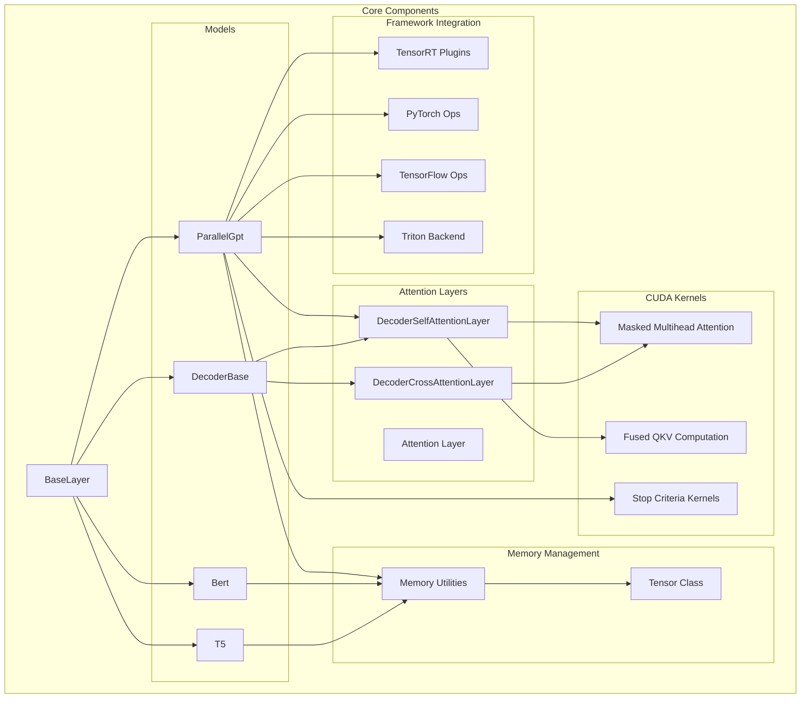

Sources: 
- [README.md:82-97]()
- [src/fastertransformer/models/multi_gpu_gpt/ParallelGpt.h:32-247]()
- [src/fastertransformer/layers/attention_layers/DecoderSelfAttentionLayer.cc:17-22]()
- [src/fastertransformer/utils/CMakeLists.txt:17-105]()

### Class Hierarchy

FasterTransformer organizes its components in a hierarchical structure with `BaseLayer` as the foundation. All model implementations and layer components inherit from this base class, which provides common functionality like memory management.

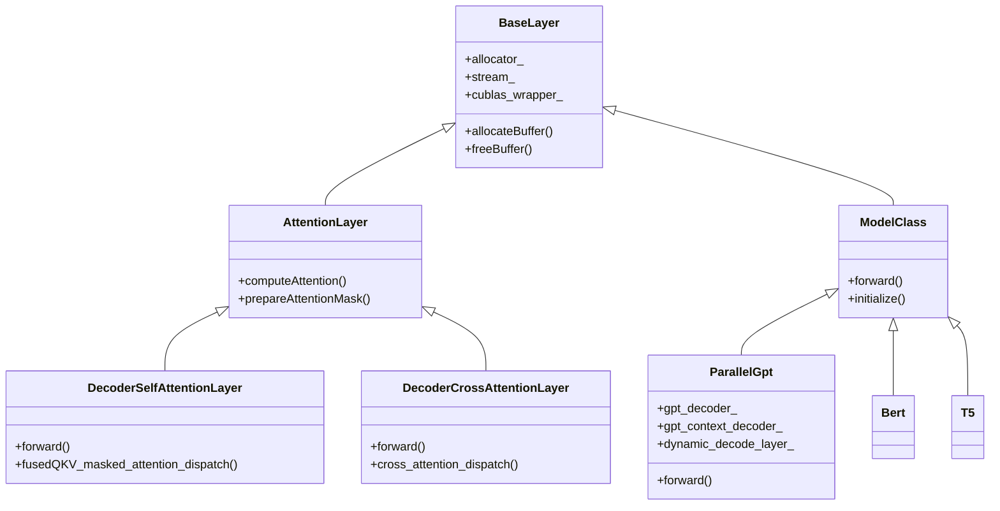

Sources:
- [src/fastertransformer/layers/attention_layers/DecoderSelfAttentionLayer.cc:192-456]()
- [src/fastertransformer/models/multi_gpu_gpt/ParallelGpt.h:32-85]()

## Memory Management

FasterTransformer implements custom memory management to optimize GPU memory utilization for transformer models.

### Memory Allocation Strategy

The library uses a custom allocator system that efficiently handles the allocation and reuse of GPU memory. Each component has `allocateBuffer()` and `freeBuffer()` methods that manage the memory required for operations.

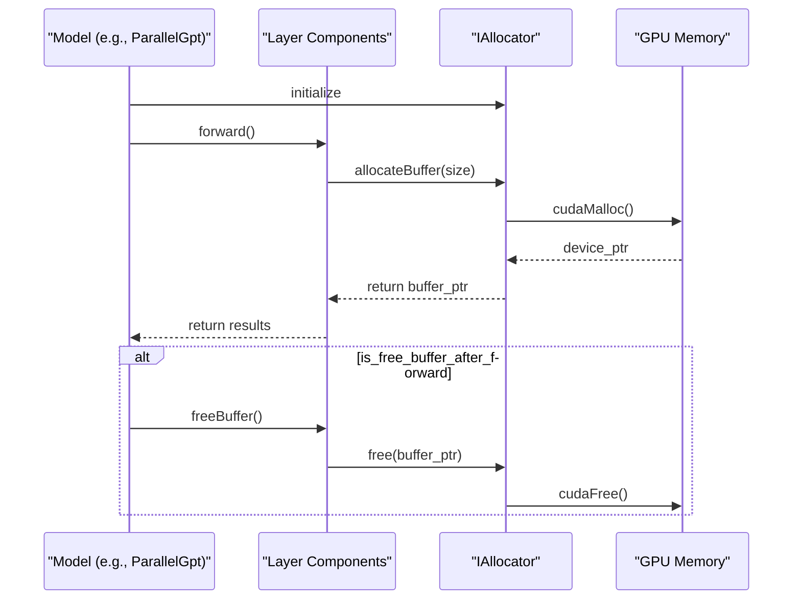

Sources:
- [src/fastertransformer/layers/attention_layers/DecoderSelfAttentionLayer.cc:192-236]()
- [src/fastertransformer/utils/CMakeLists.txt:51-54]()

## Attention Mechanisms

Attention mechanisms are core to transformer models, and FasterTransformer provides highly optimized implementations for both self-attention and cross-attention.

### Self-Attention

The self-attention mechanism allows a model to attend to different positions within its own input sequence. FasterTransformer implements optimized self-attention for decoder models.

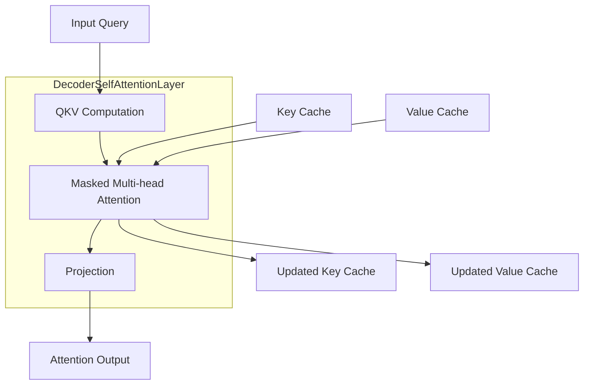

Sources:
- [src/fastertransformer/layers/attention_layers/DecoderSelfAttentionLayer.cc:459-615]()
- [src/fastertransformer/kernels/decoder_masked_multihead_attention.cu:16-139]()

### Cross-Attention

Cross-attention allows the decoder to attend to the encoder's output sequence. It's essential for encoder-decoder architectures like T5 and BART.

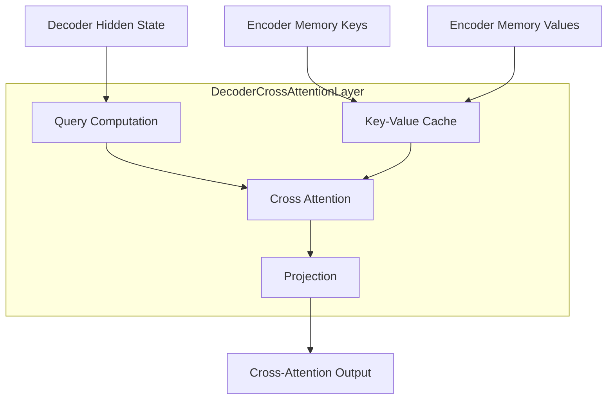

Sources:
- [src/fastertransformer/layers/attention_layers/DecoderCrossAttentionLayer.cu:33-546]()

### Attention Optimizations

FasterTransformer implements several optimizations for attention computation:

1. **Fused QKV Computation**: Computing query, key, and value projections in a single GEMM operation.
2. **Specialized kernels** for different head dimensions (e.g., 48, 64, 80, 128, etc.).
3. **Cache-optimized attention**: Efficiently using K/V caches for auto-regressive decoding.

Sources:
- [src/fastertransformer/kernels/decoder_masked_multihead_attention.cu:28-135]()
- [src/fastertransformer/kernels/decoder_masked_multihead_attention/decoder_masked_multihead_attention_112.cu:27-101]()
- [src/fastertransformer/kernels/decoder_masked_multihead_attention/decoder_masked_multihead_attention_48.cu:27-100]()

## Parallelism Strategies

FasterTransformer supports different parallelism strategies to distribute computation across multiple GPUs for large models.

### Tensor Parallelism

Tensor parallelism splits individual tensors across multiple GPUs, allowing larger model sizes to fit in GPU memory.

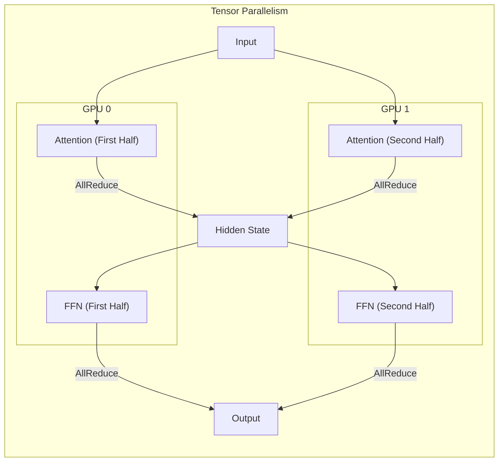

Sources:
- [src/fastertransformer/utils/CMakeLists.txt:63-68]()
- [src/fastertransformer/utils/CMakeLists.txt:83-86]()

### Pipeline Parallelism

Pipeline parallelism distributes transformer layers across multiple GPUs, with each GPU handling a subset of the layers.

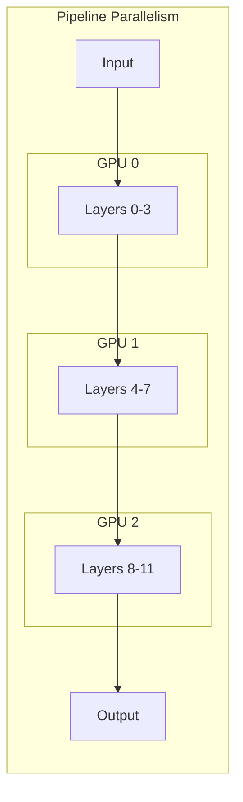

Sources:
- [src/fastertransformer/models/multi_gpu_gpt/ParallelGpt.h:62-63]()

## Data Flows and Components

The following diagram illustrates the data flow in a GPT model implemented in FasterTransformer:

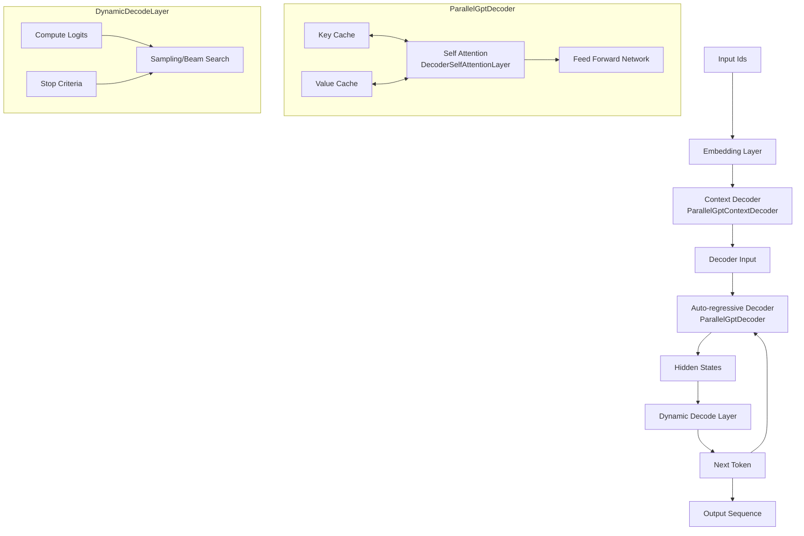

Sources:
- [src/fastertransformer/models/multi_gpu_gpt/ParallelGpt.h:84-176]()
- [src/fastertransformer/kernels/gpt_kernels.cu:29-188]()
- [src/fastertransformer/kernels/stop_criteria_kernels.cu:24-157]()

## CUDA Kernels

FasterTransformer extensively uses custom CUDA kernels to maximize performance for transformer operations:

| Kernel Category | Purpose | Key Functions |
|-----------------|---------|--------------|
| Attention Kernels | Computing self and cross attention | `masked_multihead_attention_kernel`, `cross_attention_kernel` |
| Embedding Kernels | Input embedding and position encoding | `invokeInputIdsEmbeddingLookupPosEncoding` |
| Stop Criteria Kernels | Determining when to stop generation | `invokeStopWordsCriterion`, `invokeLengthCriterion` |
| Memory Optimization | Managing shared contexts, deduplication | `invokeFindContextDups`, `invokeCompactInputs` |
| Transformation Kernels | Data layout transformations | `invokeTransposeAxis01` |

Sources:
- [src/fastertransformer/kernels/decoder_masked_multihead_attention.cu:25-135]()
- [src/fastertransformer/kernels/gpt_kernels.cu:29-103]()
- [src/fastertransformer/kernels/stop_criteria_kernels.cu:24-157]()

## Framework Integration

FasterTransformer provides integration with popular deep learning frameworks through custom operators and plugins.

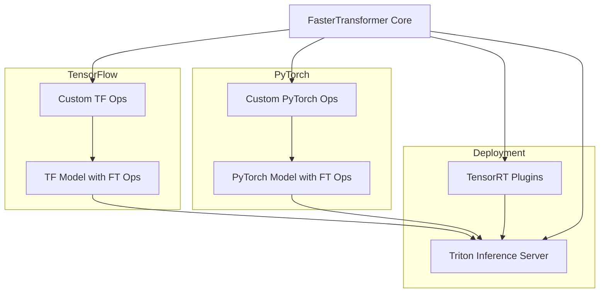

Sources:
- [README.md:82-97]()
- [src/fastertransformer/th_op/common/GptOps.cc:16-69]()
- [tests/decoding/tf_fused_self_multihead_attention_unit_test.py:104-171]()

## Performance Optimization Techniques

FasterTransformer implements several optimization techniques to maximize inference performance:

1. **Kernel Fusion**: Combining multiple operations into a single CUDA kernel to reduce memory traffic and kernel launch overhead.
2. **Context Sharing**: Reusing computations for identical input sequences in a batch.
3. **Memory Management**: Custom memory allocators and reuse strategies to minimize allocation overhead.
4. **Quantization Support**: INT8, FP8, and other reduced precision formats for faster computation.

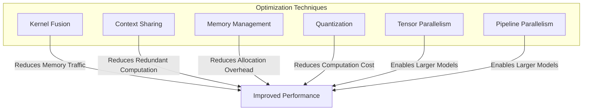

Sources:
- [README.md:28-36]()
- [src/fastertransformer/kernels/gpt_kernels.cu:106-159]()
- [tests/unittests/test_gpt_kernels.cu:42-106]()

## Unique Features

FasterTransformer introduces several unique features for efficient transformer inference:

### Context Deduplication

For batched inference, FasterTransformer can identify and deduplicate identical input contexts to avoid redundant computation.

```mermaid
flowchart LR
    subgraph "Context Deduplication"
        Input["Input Batch\n[B×Seq×H]"] --> FindDups["Find Duplicate Contexts"]
        FindDups --> CompactInputs["Compact Inputs\n[Unique×Seq×H]"]
        CompactInputs --> ProcessUnique["Process Unique Contexts"]
        ProcessUnique --> UncompactOutputs["Uncompact Outputs\n[B×Seq×H]"]
        UncompactOutputs --> Output["Output Batch"]
    end
```

Sources:
- [src/fastertransformer/th_op/common/GptOps.cc:26-62]()
- [tests/unittests/test_gpt_kernels.cu:42-106]()

### Dynamic Shape Support

FasterTransformer supports dynamic shapes for both batch size and sequence length, allowing flexible deployment across various use cases.

```mermaid
flowchart TB
    subgraph "Dynamic Shape Handling"
        CheckBatch["Check Batch Size"]
        ReallocBuffer["Reallocate Buffer if Needed"]
        ProcessInput["Process Input"]
        
        CheckBatch -->|"Batch size changed"| ReallocBuffer
        CheckBatch -->|"Batch size unchanged"| ProcessInput
        ReallocBuffer --> ProcessInput
    end
```

Sources:
- [src/fastertransformer/layers/attention_layers/DecoderSelfAttentionLayer.cc:239-249]()

## Summary

FasterTransformer provides a highly optimized architecture for transformer model inference with a focus on performance and scalability. Its key strengths include:

1. Specialized implementations for different transformer architectures
2. Optimized CUDA kernels for critical operations
3. Support for various parallelism strategies
4. Integration with popular deep learning frameworks
5. Advanced memory management techniques
6. Support for model quantization and other optimizations

These features together make FasterTransformer an efficient solution for deploying transformer models in production environments.

---

# Page: Build System

# Build System

<details>
<summary>Relevant source files</summary>

The following files were used as context for generating this wiki page:

- [CMakeLists.txt](CMakeLists.txt)
- [cmake/Modules/FindNCCL.cmake](cmake/Modules/FindNCCL.cmake)
- [examples/pytorch/t5/translate_example.py](examples/pytorch/t5/translate_example.py)
- [src/fastertransformer/kernels/decoder_masked_multihead_attention.cu](src/fastertransformer/kernels/decoder_masked_multihead_attention.cu)
- [src/fastertransformer/kernels/decoder_masked_multihead_attention/decoder_masked_multihead_attention_112.cu](src/fastertransformer/kernels/decoder_masked_multihead_attention/decoder_masked_multihead_attention_112.cu)
- [src/fastertransformer/kernels/decoder_masked_multihead_attention/decoder_masked_multihead_attention_48.cu](src/fastertransformer/kernels/decoder_masked_multihead_attention/decoder_masked_multihead_attention_48.cu)
- [src/fastertransformer/kernels/gen_relative_pos_bias.cu](src/fastertransformer/kernels/gen_relative_pos_bias.cu)
- [src/fastertransformer/layers/attention_layers/DecoderCrossAttentionLayer.cu](src/fastertransformer/layers/attention_layers/DecoderCrossAttentionLayer.cu)
- [src/fastertransformer/layers/attention_layers/DecoderSelfAttentionLayer.cc](src/fastertransformer/layers/attention_layers/DecoderSelfAttentionLayer.cc)
- [src/fastertransformer/utils/CMakeLists.txt](src/fastertransformer/utils/CMakeLists.txt)
- [src/fastertransformer/utils/cublasFP8MMWrapper.cu](src/fastertransformer/utils/cublasFP8MMWrapper.cu)
- [src/fastertransformer/utils/cublasMMWrapper.cc](src/fastertransformer/utils/cublasMMWrapper.cc)
- [tests/decoding/tf_fused_self_multihead_attention_unit_test.py](tests/decoding/tf_fused_self_multihead_attention_unit_test.py)
- [tests/unittests/test_attention_kernels.cu](tests/unittests/test_attention_kernels.cu)

</details>


The FasterTransformer build system uses CMake to provide a flexible and configurable compilation process. This page describes the build configuration options, dependencies, supported hardware architectures, and available data types to help you build FasterTransformer for your specific use case. For information about running the built models, refer to the Framework Integration guides in section [Framework Integration](#6).

## Architecture Overview

The build system consists of a set of CMake files that define build targets, dependencies, and configuration options. The main `CMakeLists.txt` at the root of the project is the primary entry point, with additional CMake files in subdirectories handling specific components.

```mermaid
flowchart TD
    subgraph "FasterTransformer Build System"
        MainCMake["CMakeLists.txt"]
        SrcCMake["src/CMakeLists.txt"]
        UtilsDir["src/fastertransformer/utils"]
        LayersDir["src/fastertransformer/layers"]
        ModelsDir["src/fastertransformer/models"]
        KernelsDir["src/fastertransformer/kernels"]

        MainCMake --> SrcCMake
        MainCMake --> |"add_subdirectory()"| UtilsDir
        MainCMake --> |"add_subdirectory()"| ExamplesCMake["examples/CMakeLists.txt"]
        MainCMake --> |"add_subdirectory()"| TestsCMake["tests/CMakeLists.txt"]
        MainCMake --> |"add_subdirectory()"| ThirdPartyCMake["3rdparty/CMakeLists.txt"]
                
        SrcCMake --> |"add_subdirectory()"| LayersDir
        SrcCMake --> |"add_subdirectory()"| ModelsDir
        SrcCMake --> |"add_subdirectory()"| KernelsDir
        SrcCMake --> |"add_subdirectory()"| UtilsDir
    end
```

Sources: [CMakeLists.txt:301-305](CMakeLists.txt:301-305)

## Build Requirements

FasterTransformer has the following build requirements:

| Requirement | Minimum Version | Notes |
|-------------|-----------------|-------|
| CMake       | 3.8             | 3.13+ required for PyTorch extensions |
| CUDA        | 10.2            | BF16 support requires CUDA 11.0+, FP8 requires CUDA 11.8+ |
| C++ Compiler| C++17 support   | |
| cuBLAS      | Included with CUDA | |
| Optional: NCCL | | Required for multi-GPU support |
| Optional: MPI | | Required for multi-GPU support |
| Optional: TensorFlow | | Required for TF integration |
| Optional: PyTorch | 1.5.0+ | Required for PyTorch integration |
| Optional: cuSPARSELt | | Required for sparsity support |

Sources: [CMakeLists.txt:14-17](CMakeLists.txt:14-17), [CMakeLists.txt:79-86](CMakeLists.txt:79-86), [CMakeLists.txt:242-255](CMakeLists.txt:242-255)

## Build Configuration Flow

```mermaid
flowchart TD
    CMakeConfig["cmake ..
    -DCMAKE_BUILD_TYPE=Release
    -DBUILD_PYT=ON
    -DBUILD_MULTI_GPU=ON
    ..."]
    
    CMakeConfig --> SetCompilerOptions["Set Compiler Options
    -std=c++17, CUDA flags"]
    
    SetCompilerOptions --> ConfigureDeps["Configure Dependencies
    CUDA, NCCL, TensorFlow, PyTorch"]
    
    ConfigureDeps --> DetectGPUArch["Detect GPU Architecture
    SM settings"]
    
    DetectGPUArch --> ConfigureDataTypes["Configure Data Types
    FP32, FP16, BF16, FP8"]
    
    ConfigureDataTypes --> BuildLibrary["Build transformer-shared Library"]
    
    BuildLibrary --> BuildExamples["Build Examples"]
    
    BuildExamples --> RunTests["Run Tests"]
```

Sources: [CMakeLists.txt:124-203](CMakeLists.txt:124-203), [CMakeLists.txt:317-456](CMakeLists.txt:317-456)

## Build Configuration Options

FasterTransformer provides numerous build options to customize the build for different use cases:

| Option | Description | Default |
|--------|-------------|---------|
| `BUILD_CUTLASS_MOE` | Builds CUTLASS kernels supporting MoE GEMM | ON |
| `BUILD_CUTLASS_MIXED_GEMM` | Builds CUTLASS kernels supporting mixed GEMM | ON |
| `BUILD_TF` | Build in TensorFlow mode | OFF |
| `BUILD_TF2` | Build in TensorFlow2 mode | OFF |
| `BUILD_PYT` | Build in PyTorch TorchScript class mode | OFF |
| `BUILD_TRT` | Build projects about TensorRT | OFF |
| `BUILD_MULTI_GPU` | Build project for multi-GPU support | OFF |
| `USE_TRITONSERVER_DATATYPE` | Build triton backend for triton server | OFF |
| `SPARSITY_SUPPORT` | Build project with Ampere sparsity feature | OFF |
| `BUILD_FAST_MATH` | Build in fast math mode | ON |
| `USE_NVTX` | Enable NVTX profiling | ON |
| `MEASURE_BUILD_TIME` | Measure the build time of each module | OFF |
| `GIT_AUTOCLONE_CUTLASS` | Check CUTLASS submodule during build | ON |

Sources: [CMakeLists.txt:35-56](CMakeLists.txt:35-56), [CMakeLists.txt:75-77](CMakeLists.txt:75-77), [CMakeLists.txt:308-312](CMakeLists.txt:308-312)

### Optional Python Configuration 

When building with PyTorch integration (`BUILD_PYT=ON`), you can specify the Python path using:

```
-DPYTHON_PATH="/path/to/python"
```

This is useful when working with virtual environments or custom Python installations.

Sources: [CMakeLists.txt:241-282](CMakeLists.txt:241-282)

## Data Type Support

FasterTransformer supports multiple floating-point data types, which are enabled based on the CUDA version and build flags:

| Data Type | Description | Required CUDA Version | CMake Flag |
|-----------|-------------|------------------------|------------|
| FP32 | 32-bit floating point | Always supported | | 
| FP16 | 16-bit floating point | Always supported | | 
| BF16 | 16-bit brain floating point | CUDA 11.0+ | Added automatically with CUDA 11.0+ |
| FP8 | 8-bit floating point | CUDA 11.8+ | Added with `-DENABLE_FP8=ON` and CUDA 11.8+ |

These data types can be configured during runtime using the wrapper classes like `cublasMMWrapper`:

```mermaid
flowchart LR
    subgraph "Data Type Configuration"
        wrapper["cublasMMWrapper"]
        
        wrapper --> setFP32["setFP32GemmConfig()"]
        wrapper --> setFP16["setFP16GemmConfig()"]
        wrapper --> setBF16["setBF16GemmConfig()"]
        wrapper --> setFP8["cublasFP8MMWrapper"]
        
        setFP32 --> config1["CUDA_R_32F computation"]
        setFP16 --> config2["CUDA_R_16F with FP32 compute"]
        setBF16 --> config3["CUDA_R_16BF with FP32 compute"]
        setFP8 --> config4["FP8 with FP32 accumulation"]
    end
```

Sources: [CMakeLists.txt:19-30](CMakeLists.txt:19-30), [src/fastertransformer/utils/cublasMMWrapper.cc:330-354](src/fastertransformer/utils/cublasMMWrapper.cc:330-354), [src/fastertransformer/utils/cublasFP8MMWrapper.cu:22-76](src/fastertransformer/utils/cublasFP8MMWrapper.cu:22-76)

## GPU Architecture Support

FasterTransformer supports multiple NVIDIA GPU architectures through SM (Streaming Multiprocessor) settings. The supported architectures are:

| SM | GPU Architecture | Example GPUs |
|----|------------------|--------------|
| 52 | Maxwell | Tesla M40, GTX TITAN X |
| 60 | Pascal | Tesla P100 |
| 61 | Pascal | GTX 1080, GTX 1070 |
| 70 | Volta | Tesla V100, Titan V |
| 75 | Turing | RTX 2080, T4 |
| 80 | Ampere | A100 |
| 86 | Ampere | RTX 3090, RTX 3080 |
| 89 | Ada Lovelace | RTX 4090, RTX 4080 |
| 90 | Hopper | H100 |

You can specify which architectures to build for using the `-DSM=XX,YY,ZZ` option. Otherwise, the build system will default to targeting SM 70, 75, 80, and 86.

The build system also enables Tensor Core operations (WMMA) for architectures that support it (SM 70+).

Sources: [CMakeLists.txt:129-162](CMakeLists.txt:129-162)

## Framework Integration

FasterTransformer can be built to integrate with various ML frameworks:

```mermaid
flowchart TD
    FT["FasterTransformer Library"]
    
    FT --> PyTorch["PyTorch Extension
    -DBUILD_PYT=ON"]
    
    FT --> TensorFlow["TensorFlow Op
    -DBUILD_TF=ON
    -DTF_PATH=/path/to/tf"]
    
    FT --> TensorFlow2["TensorFlow2 Op
    -DBUILD_TF2=ON
    -DTF_PATH=/path/to/tf"]
    
    FT --> TensorRT["TensorRT Plugin
    -DBUILD_TRT=ON"]
    
    FT --> Triton["Triton Inference Server
    -DUSE_TRITONSERVER_DATATYPE=ON"]
    
    PyTorch --> PytorchExamples["examples/pytorch/"]
    TensorFlow --> TFExamples["examples/tensorflow/"]
    TensorFlow2 --> TF2Examples["examples/tensorflow/"]
    TensorRT --> TRTExamples["examples/tensorrt/"]
    Triton --> TritonExamples["examples/cpp/"]
```

Sources: [CMakeLists.txt:47-56](CMakeLists.txt:47-56), [CMakeLists.txt:108-113](CMakeLists.txt:108-113), [CMakeLists.txt:242-282](CMakeLists.txt:242-282)

## Multi-GPU Support

FasterTransformer supports multi-GPU training and inference through various parallelism strategies:

```mermaid
flowchart TD
    EnableMultiGPU["BUILD_MULTI_GPU=ON"]
    
    EnableMultiGPU --> FindMPI["Find MPI Library"]
    EnableMultiGPU --> FindNCCL["Find NCCL Library"]
    
    FindMPI --> MPIUtils["mpi_utils library"]
    FindNCCL --> NCCLUtils["nccl_utils library"]
    
    MPIUtils --> CustomAR["custom_ar_comm library"]
    NCCLUtils --> CustomAR
    
    CustomAR --> TensorParallel["Tensor Parallelism Support"]
    CustomAR --> PipelineParallel["Pipeline Parallelism Support"]
    
    TensorParallel --> MultiGPUModels["Multi-GPU Model Implementation"]
    PipelineParallel --> MultiGPUModels
```

The build system will automatically search for MPI and NCCL when `BUILD_MULTI_GPU=ON`. The FindNCCL.cmake module helps locate NCCL on your system.

Sources: [CMakeLists.txt:79-86](CMakeLists.txt:79-86), [cmake/Modules/FindNCCL.cmake:77-165](cmake/Modules/FindNCCL.cmake:77-165), [src/fastertransformer/utils/CMakeLists.txt:56-68](src/fastertransformer/utils/CMakeLists.txt:56-68)

## GEMM Configuration

FasterTransformer includes a GEMM (General Matrix Multiplication) test utility to find the optimal configurations for different matrix sizes. This is especially important for achieving maximum performance on different GPU architectures.

```mermaid
flowchart TD
    GemmTest["GEMM Test Utility
    (bin/t5_gemm)"]
    
    GemmTest --> GenerateConfig["Generate GEMM Configurations"]
    
    GenerateConfig --> GemmConfigFile["gemm_config.in File"]
    
    GemmConfigFile --> cublasAlgoMap["cublasAlgoMap"]
    
    cublasAlgoMap --> cublasMMWrapper["cublasMMWrapper"]
    
    cublasMMWrapper --> ModelInference["Optimized Model Inference"]
```

This utility is built as part of the examples and is used by the PyTorch and TensorFlow examples to find optimal GEMM configurations. For example, in the T5 example:

```bash
./bin/t5_gemm batch_size beam_width max_seq_len d_model head_num size_per_head d_ff ...
```

Sources: [examples/pytorch/t5/translate_example.py:245-254](examples/pytorch/t5/translate_example.py:245-254), [src/fastertransformer/utils/CMakeLists.txt:29-40](src/fastertransformer/utils/CMakeLists.txt:29-40)

## Kernel Specialization

FasterTransformer includes specialized CUDA kernels for different model sizes. These kernels are highly optimized for specific sizes of attention heads:

```mermaid
flowchart LR
    subgraph "Specialized Attention Kernels"
        Dispatch["Dispatcher
        mmha_launch_kernel()"]
        
        Dispatch --> Size32["Size 32, Block 32"]
        Dispatch --> Size48["Size 48, Block 64"]
        Dispatch --> Size64["Size 64, Block 64"]
        Dispatch --> Size80["Size 80, Block 128"]
        Dispatch --> Size96["Size 96, Block 128"]
        Dispatch --> Size112["Size 112, Block 128"]
        Dispatch --> Size128["Size 128, Block 128"]
        Dispatch --> Size144["Size 144, Block 256"]
        Dispatch --> Size160["Size 160, Block 256"]
        Dispatch --> Size192["Size 192, Block 256"]
        Dispatch --> Size224["Size 224, Block 256"]
        Dispatch --> Size256["Size 256, Block 256"]
    end
```

Each kernel variant is specialized for a specific attention head size and block size to achieve optimal performance.

Sources: [src/fastertransformer/kernels/decoder_masked_multihead_attention.cu:28-68](src/fastertransformer/kernels/decoder_masked_multihead_attention.cu:28-68), [src/fastertransformer/kernels/decoder_masked_multihead_attention/decoder_masked_multihead_attention_112.cu:28-71](src/fastertransformer/kernels/decoder_masked_multihead_attention/decoder_masked_multihead_attention_112.cu:28-71)

## Building FasterTransformer

### Basic Build Process

Here's a step-by-step guide for building FasterTransformer:

1. Clone the repository:
   ```bash
   git clone https://github.com/NVIDIA/FasterTransformer.git
   cd FasterTransformer
   ```

2. Create a build directory:
   ```bash
   mkdir build
   cd build
   ```

3. Configure with CMake:
   ```bash
   cmake .. -DCMAKE_BUILD_TYPE=Release
   ```

4. Build:
   ```bash
   make -j
   ```

### Advanced Configuration

For more advanced configurations, you can specify additional options:

1. Building with PyTorch support:
   ```bash
   cmake .. -DCMAKE_BUILD_TYPE=Release -DBUILD_PYT=ON
   ```

2. Building with TensorFlow support:
   ```bash
   cmake .. -DCMAKE_BUILD_TYPE=Release -DBUILD_TF=ON -DTF_PATH=/path/to/tensorflow
   ```

3. Building with multi-GPU support:
   ```bash
   cmake .. -DCMAKE_BUILD_TYPE=Release -DBUILD_MULTI_GPU=ON
   ```

4. Building with FP8 support (requires CUDA 11.8+):
   ```bash
   cmake .. -DCMAKE_BUILD_TYPE=Release -DENABLE_FP8=ON
   ```

5. Building for specific GPU architectures:
   ```bash
   cmake .. -DCMAKE_BUILD_TYPE=Release -DSM=80,86
   ```

Sources: [CMakeLists.txt:35-56](CMakeLists.txt:35-56), [CMakeLists.txt:79-86](CMakeLists.txt:79-86), [CMakeLists.txt:129-162](CMakeLists.txt:129-162)

## Common Build Issues

1. **Missing NCCL error when building with Multi-GPU support**:
   - Make sure NCCL is installed and the location is included in your `CMAKE_PREFIX_PATH`
   - You can specify NCCL location explicitly with environment variables:
     ```bash
     export NCCL_INCLUDE_DIR=/path/to/nccl/include
     export NCCL_LIB_DIR=/path/to/nccl/lib
     ```

2. **PyTorch version compatibility**:
   - FasterTransformer requires PyTorch 1.5.0 or newer for TorchScript mode
   - Older versions may cause build errors

3. **Incompatible C++ ABI between TensorFlow and FasterTransformer**:
   - TensorFlow uses the pre-C++11 ABI (`_GLIBCXX_USE_CXX11_ABI=0`)
   - TensorFlow 2 uses the C++11 ABI (`_GLIBCXX_USE_CXX11_ABI=1`)
   - Make sure to build with the matching ABI setting

4. **SM architecture not supported**:
   - Make sure to specify SM architectures compatible with your GPU
   - If no specific SM is provided, the build defaults to SM 70, 75, 80, and 86

Sources: [CMakeLists.txt:93-99](CMakeLists.txt:93-99), [CMakeLists.txt:242-282](CMakeLists.txt:242-282), [cmake/Modules/FindNCCL.cmake:93-100](cmake/Modules/FindNCCL.cmake:93-100)

## Output Structure

After building, you'll find the following outputs in your build directory:

| Path | Description |
|------|-------------|
| `lib/libtransformer-shared.so` | Main FasterTransformer shared library |
| `bin/` | Example executables and GEMM test utilities |
| `lib/lib*.a` | Static library components |
| `lib/libth_transformer.so` | PyTorch extension library (if built with PyTorch) |
| `lib/libtf_transformer.so` | TensorFlow custom op library (if built with TensorFlow) |

Sources: [CMakeLists.txt:205-207](CMakeLists.txt:205-207), [CMakeLists.txt:317-456](CMakeLists.txt:317-456)

---

# Page: Models

# Models

<details>
<summary>Relevant source files</summary>

The following files were used as context for generating this wiki page:

- [README.md](README.md)
- [docs/bert_guide.md](docs/bert_guide.md)
- [docs/decoder_guide.md](docs/decoder_guide.md)
- [docs/gpt_guide.md](docs/gpt_guide.md)
- [docs/gptj_guide.md](docs/gptj_guide.md)
- [src/fastertransformer/kernels/activation_kernels.cu](src/fastertransformer/kernels/activation_kernels.cu)
- [src/fastertransformer/kernels/gpt_kernels.cu](src/fastertransformer/kernels/gpt_kernels.cu)
- [src/fastertransformer/kernels/gpt_kernels.h](src/fastertransformer/kernels/gpt_kernels.h)
- [src/fastertransformer/kernels/stop_criteria_kernels.cu](src/fastertransformer/kernels/stop_criteria_kernels.cu)
- [src/fastertransformer/models/gptj/GptJ.h](src/fastertransformer/models/gptj/GptJ.h)
- [src/fastertransformer/models/gptj/GptJContextDecoder.cc](src/fastertransformer/models/gptj/GptJContextDecoder.cc)
- [src/fastertransformer/models/gptneox/GptNeoXContextDecoder.cc](src/fastertransformer/models/gptneox/GptNeoXContextDecoder.cc)
- [src/fastertransformer/models/multi_gpu_gpt/ParallelGpt.h](src/fastertransformer/models/multi_gpu_gpt/ParallelGpt.h)
- [src/fastertransformer/models/multi_gpu_gpt/ParallelGptContextDecoder.cc](src/fastertransformer/models/multi_gpu_gpt/ParallelGptContextDecoder.cc)
- [src/fastertransformer/th_op/common/GptOps.cc](src/fastertransformer/th_op/common/GptOps.cc)
- [tests/unittests/test_gpt_kernels.cu](tests/unittests/test_gpt_kernels.cu)

</details>


This page provides an overview of the model architectures supported by FasterTransformer, their implementations, and key characteristics. FasterTransformer contains highly optimized implementations of transformer-based models for efficient inference on NVIDIA GPUs.

## Supported Model Architectures

FasterTransformer implements various transformer-based models with optimizations for inference performance. The following diagram shows the main model types supported:

```mermaid
flowchart TD
    subgraph "FasterTransformer Models"
        Encoder["Encoder Models"]
        Decoder["Decoder Models"]
        EncoderDecoder["Encoder-Decoder Models"]
        
        Encoder --> BERT["BERT Family"]
        Encoder --> ViT["Vision Transformer"]
        Encoder --> Swin["Swin Transformer"]
        
        Decoder --> GPT["GPT Family"]
        Decoder --> BLOOM["BLOOM"]
        
        EncoderDecoder --> T5["T5 Family"]
        EncoderDecoder --> BART["BART Family"]
        EncoderDecoder --> WeNet["WeNet ASR"]
        
        BERT --> BERTBase["BERT"]
        BERT --> BERTVariants["BERT Variants\n(INT8, FP8, Sparsity)"]
        BERT --> DeBERTa["DeBERTa"]
        
        GPT --> ParallelGPT["ParallelGPT"]
        GPT --> GPTJ["GPT-J"]
        GPT --> GPTNeoX["GPT-NeoX"]
        GPT --> GPTMOE["GPT-MoE"]
        GPT --> OPT["OPT"]
    end
```

Sources: [README.md:28-71](). This support matrix shows a comprehensive list of model architectures, with details on framework support, precision, and parallelism capabilities.

## Model Architecture Components

All transformer-based models in FasterTransformer share common architectural components, although their specific implementations may vary. These components are optimized for inference performance.

```mermaid
flowchart TD
    subgraph "Model Architecture Components"
        BaseLayer["BaseLayer"]
        
        BaseLayer --> Attention["Attention Mechanisms"]
        BaseLayer --> FFN["Feed Forward Networks"]
        BaseLayer --> Embedding["Embedding & Positional Encoding"]
        
        Attention --> FusedMHA["Fused Multi-Head Attention"]
        Attention --> UnfusedMHA["Unfused Multi-Head Attention"]
        Attention --> CrossAttn["Cross Attention"]
        Attention --> SelfAttn["Self Attention"]
        
        FFN --> GeluFFN["GELU Feed-Forward Network"]
        FFN --> ReluFFN["ReLU Feed-Forward Network"]
        FFN --> SiluFFN["SiLU Feed-Forward Network"]
        
        Embedding --> TokenEmbed["Token Embedding"]
        Embedding --> PosEncoding["Positional Encoding"]
        Embedding --> PromptEmbed["Prompt Embedding"]
    end
```

Sources: [src/fastertransformer/kernels/activation_kernels.cu:50-165](), [src/fastertransformer/models/multi_gpu_gpt/ParallelGptContextDecoder.cc:28-45]()

### Key Components

1. **Attention Mechanisms**: Implementations of self-attention and cross-attention with various optimizations:
   - Fused multi-head attention for optimized performance
   - Unfused attention for flexibility
   - Support for rotary position embeddings
   - Optimized memory patterns for key/value caches

2. **Feed Forward Networks**: Different implementations based on activation functions:
   - GELU (Gaussian Error Linear Unit)
   - ReLU (Rectified Linear Unit)
   - SiLU/Swish
   - Support for gated activations (like GeGLU)

3. **Embedding Layers**:
   - Token embeddings
   - Positional encodings
   - Support for various prompt embedding techniques:
     - Prefix prompts
     - Soft prompts
     - P/Prompt tuning

## GPT Model Family

The GPT family models are generative decoder-only transformer models. FasterTransformer provides highly optimized implementations for several GPT variants.

### GPT Model Architecture and Workflow

The GPT architecture in FasterTransformer follows a two-phase process:

```mermaid
flowchart TD
    subgraph "GPT Model Workflow"
        InputIds["Input IDs\n(Context Tokens)"]
        Embedding["Token & Position Embedding"]
        ContextProcess["Context Processing Phase"]
        AutoRegressive["Auto-regressive Generation Phase"]
        Output["Generated Output IDs"]
        
        InputIds --> Embedding
        Embedding --> ContextProcess
        ContextProcess --> KVCache["Key-Value Cache"]
        ContextProcess --> AutoRegressive
        KVCache --> AutoRegressive
        AutoRegressive --> Output
        
        subgraph "Context Processing"
            ContextAttention["ParallelGptContextDecoder\nProcess all input tokens at once"]
        end
        
        subgraph "Auto-regressive Generation"
            DecoderStep["ParallelGptDecoder\nGenerate one token at a time"]
            BeamSearch["Beam Search / Sampling"]
            NextToken["Select Next Token"]
            
            DecoderStep --> BeamSearch
            BeamSearch --> NextToken
            NextToken --"Loop until complete"--> DecoderStep
        end
    end
```

Sources: [docs/gpt_guide.md:89-107](), [src/fastertransformer/models/multi_gpu_gpt/ParallelGpt.h:85-88]()

### GPT Implementations

FasterTransformer provides several implementations in the GPT family:

1. **ParallelGPT**:
   - Main implementation supporting various GPT models
   - Supports tensor and pipeline parallelism
   - Features memory optimization for very large models
   - Implements various decoding strategies (beam search, sampling)

2. **GPT-J**:
   - Implementation of EleutherAI's 6B parameter model
   - Supports rotary position embeddings
   - Similar architecture to GPT but with architectural differences

3. **GPT-NeoX**:
   - Implementation of EleutherAI's GPT-NeoX architecture
   - Supports the NeoX-style rotary embeddings
   - Epsilon value for layer normalization is configurable

4. **OPT**:
   - Support for Meta's Open Pre-trained Transformer models
   - Follows the GPT implementation architecture with OPT-specific modifications

5. **BLOOM**:
   - Supports the BigScience BLOOM models
   - Follows the GPT implementation architecture with BLOOM-specific modifications

### GPT Model Key Classes

The main classes involved in GPT model implementations are:

1. **ParallelGpt**: The main model class that handles the entire workflow
2. **ParallelGptContextDecoder**: Processes the input context/prompt tokens in parallel
3. **ParallelGptDecoder**: Generates output tokens auto-regressively
4. **DynamicDecodeLayer**: Handles beam search and sampling strategies

Sources: [src/fastertransformer/models/multi_gpu_gpt/ParallelGpt.h:31-247](), [src/fastertransformer/models/multi_gpu_gpt/ParallelGptContextDecoder.cc:25-45]()

## BERT Model Family

BERT (Bidirectional Encoder Representations from Transformers) models are encoder-only transformer models designed for representation learning.

### BERT Architecture and Workflow

```mermaid
flowchart TD
    subgraph "BERT Model Workflow"
        InputIds["Input IDs"]
        Embedding["Token & Position Embedding"]
        EncoderLayers["Encoder Layers"]
        Output["Encoder Outputs"]
        
        InputIds --> Embedding
        Embedding --> AttentionMask["Create Attention Mask"]
        AttentionMask --> StandardPath["Standard BERT Path"]
        AttentionMask --> EffectivePath["Effective FasterTransformer Path"]
        
        StandardPath --> EncoderLayers
        EffectivePath --> RemovePadding["Remove Padding"]
        RemovePadding --> EncoderLayers
        EncoderLayers --> Output
    end
```

Sources: [docs/bert_guide.md:37-66]()

### BERT Implementations

FasterTransformer offers several variants of BERT:

1. **Standard BERT**:
   - Basic BERT implementation with optimized kernels
   - Supports various sizes (BERT base, large)

2. **Effective FasterTransformer**:
   - Removes padding to optimize computation
   - Especially effective for batches with variable sequence lengths

3. **BERT with INT8 Quantization**:
   - INT8 quantization for reduced memory footprint and faster inference
   - Optimized INT8 kernels for better performance

4. **BERT with FP8**:
   - Experimental support for FP8 precision
   - Further reduces memory requirements and improves throughput on supported hardware

5. **BERT with Sparsity**:
   - Leverages sparse matrix operations on Ampere GPUs
   - Improves performance through structured sparsity

6. **DeBERTa**:
   - Implementation of DeBERTa architecture
   - Supports disentangled attention mechanism

Sources: [docs/bert_guide.md:67-102]()

## Encoder-Decoder Models

Encoder-decoder models combine an encoder that processes the input sequence and a decoder that generates the output sequence.

```mermaid
flowchart TD
    subgraph "Encoder-Decoder Model Architecture"
        InputIds["Input IDs"]
        Encoder["Encoder"]
        Decoder["Decoder"]
        Output["Output IDs"]
        
        InputIds --> Encoder
        Encoder --> EncoderOutput["Encoder Output"]
        EncoderOutput --> Decoder
        Decoder --> Output
    end
```

### T5 Family

The T5 (Text-to-Text Transfer Transformer) model treats all NLP tasks as text-to-text problems:

- Supports T5, mT5, and T5-v1.1 model variants
- Supports UL2 (Unified Language Learner) with same architecture
- T5-MoE with Mixture of Experts implementation
- Tensor and pipeline parallelism support

### BART Family

BART (Bidirectional and Auto-Regressive Transformers) is a sequence-to-sequence model:

- Supports BART and mBART model variants
- Similar architecture to T5 but with architectural differences
- Tensor and pipeline parallelism support

### WeNet (ASR)

WeNet is a speech recognition model:

- End-to-end speech recognition capability
- Custom architecture for audio processing
- Optimized for streaming audio transcription

## Parallelism Strategies

FasterTransformer implements multiple parallelism strategies to efficiently run large models across multiple GPUs and nodes:

```mermaid
flowchart TD
    subgraph "Parallelism Strategies"
        Model["Large Model"] --> TensorPara["Tensor Parallelism"]
        Model --> PipelinePara["Pipeline Parallelism"]
        Model --> DataPara["Data Parallelism"]
        
        TensorPara --> QKVSplit["Split QKV Projection\nAcross GPUs"]
        TensorPara --> FFNSplit["Split FFN\nAcross GPUs"]
        TensorPara --> AllReduce["All-Reduce for\nCommunication"]
        
        PipelinePara --> LayerSplit["Split Layers\nAcross GPUs"]
        PipelinePara --> MicroBatches["Process Micro-batches\nto Hide Communication"]
        
        DataPara --> BatchSplit["Split Batch\nAcross GPUs"]
    end
```

Sources: [docs/gpt_guide.md:199-204](), [src/fastertransformer/models/multi_gpu_gpt/ParallelGptContextDecoder.cc:186-205]()

### Tensor Parallelism

Tensor parallelism splits individual model weights across multiple GPUs:

1. **Weight Partitioning**: 
   - Self-attention weights are split by the head dimension
   - Feed-forward networks split the intermediate dimension
   - Each GPU processes a portion of the model's width

2. **Communication Pattern**:
   - All-reduce operations combine results across GPUs
   - Custom all-reduce communication optimizations for specific hardware
   - Optimized for high bandwidth intra-node communication

Sources: [docs/gpt_guide.md:199]()

### Pipeline Parallelism

Pipeline parallelism splits model layers across multiple GPUs:

1. **Layer Distribution**:
   - Model layers are distributed across GPUs
   - Each GPU processes specific transformer layers

2. **Micro-batching**:
   - Splits the input batch into micro-batches
   - Hides communication overhead by pipelining computation
   - Automatically adjusts micro-batch size for optimal performance

Sources: [docs/gpt_guide.md:200-204](), [src/fastertransformer/models/multi_gpu_gpt/ParallelGptContextDecoder.cc:186-205]()

## Optimization Techniques

FasterTransformer implements various optimization techniques to maximize performance:

### 1. Kernel Fusion

- Combines multiple small operations into single CUDA kernels
- Examples include:
  - Fused multi-head attention
  - AddBiasResidualLayerNorm fusion
  - Activation and bias addition fusion

### 2. Memory Optimization

- Reuses memory buffers between layers
- Implements efficient key-value cache management
- Removes padding from sequences to reduce computation

### 3. Custom CUDA Kernels

- Specialized kernels for transformer operations
- Optimized for specific GPU architectures
- Leverages GPU hardware features (like Tensor Cores)

### 4. Precision Options

FasterTransformer supports multiple precision options:

- **FP32**: Full precision for maximum accuracy
- **FP16**: Half precision using Tensor Cores on Volta+ GPUs
- **BF16**: Brain floating point precision on Ampere+ GPUs
- **INT8**: 8-bit integer quantization for reduced memory and higher throughput
- **FP8**: 8-bit floating point on Hopper architecture (experimental)

Sources: [docs/gpt_guide.md:197-200](), [README.md:36-71]()

## Usage Examples

Each model in FasterTransformer follows a similar pattern for inference:

1. **Model Initialization**: Configure the model with parameters like batch size, sequence length, etc.
2. **Weight Loading**: Load model weights from checkpoints
3. **Input Preparation**: Format input tensors appropriately
4. **Forward Pass**: Execute the model's `forward()` method
5. **Output Processing**: Process generated outputs

Here's an example workflow for GPT models:

```mermaid
sequenceDiagram
    participant App as Application
    participant Model as FasterTransformer Model
    participant Weight as Model Weights
    
    App->>Weight: Load weights from checkpoint
    App->>Model: Initialize model with parameters
    App->>Model: Prepare input tensors
    Model->>Model: Context processing phase
    loop Until completion
        Model->>Model: Auto-regressive generation
        Model->>App: Return intermediate tokens (optional)
    end
    Model->>App: Return final output
```

## Conclusion

FasterTransformer provides highly optimized implementations of popular transformer-based models for efficient inference. With support for various model architectures, precision options, and parallelism strategies, it enables deployment of large language models with maximum performance on NVIDIA GPUs.

The model implementations are designed with a modular architecture that shares common components while accommodating the unique aspects of each model type. The library's focus on optimization techniques like kernel fusion, memory reuse, and efficient parallelism makes it particularly suitable for serving large models in production environments.

---

# Page: GPT Models

# GPT Models

<details>
<summary>Relevant source files</summary>

The following files were used as context for generating this wiki page:

- [docs/gpt_guide.md](docs/gpt_guide.md)
- [docs/gptj_guide.md](docs/gptj_guide.md)
- [docs/gptneox_guide.md](docs/gptneox_guide.md)
- [examples/pytorch/gptneox/utils/huggingface_gptneox_convert.py](examples/pytorch/gptneox/utils/huggingface_gptneox_convert.py)
- [src/fastertransformer/models/gptj/GptJ.cc](src/fastertransformer/models/gptj/GptJ.cc)
- [src/fastertransformer/models/gptj/GptJ.h](src/fastertransformer/models/gptj/GptJ.h)
- [src/fastertransformer/models/gptj/GptJContextDecoder.cc](src/fastertransformer/models/gptj/GptJContextDecoder.cc)
- [src/fastertransformer/models/gptneox/GptNeoXContextDecoder.cc](src/fastertransformer/models/gptneox/GptNeoXContextDecoder.cc)
- [src/fastertransformer/models/multi_gpu_gpt/ParallelGpt.cc](src/fastertransformer/models/multi_gpu_gpt/ParallelGpt.cc)
- [src/fastertransformer/models/multi_gpu_gpt/ParallelGptContextDecoder.cc](src/fastertransformer/models/multi_gpu_gpt/ParallelGptContextDecoder.cc)

</details>


This document describes the GPT model implementations in FasterTransformer, focusing on their architecture, components, and optimization techniques. It covers ParallelGpt, GPT-J, and GPT-NeoX variants, their shared components, and how they're optimized for efficient inference on GPUs.

## GPT Model Architecture Overview

FasterTransformer provides optimized implementations of several GPT (Generative Pre-trained Transformer) variants designed for autoregressive text generation. These decoder-only transformer models share a common architecture with variations in specific implementation details.

```mermaid
graph TD
    subgraph "GPT Model Variants"
        ParallelGpt["ParallelGpt<T>"] --> StandardGPT["Standard GPT/GPT-3"]
        GPTJ["GptJ<T>"] --> GPTJModel["EleutherAI GPT-J (6B)"]
        GPTNeoX["GptNeoX<T>"] --> NeoXModel["EleutherAI GPT-NeoX (20B)"]
    end
```

Sources:
- [src/fastertransformer/models/multi_gpu_gpt/ParallelGpt.cc]()
- [src/fastertransformer/models/gptj/GptJ.cc]()
- [src/fastertransformer/models/gptneox/GptNeoX.cc]()

## Core Components

All GPT variants in FasterTransformer share three main components:

```mermaid
classDiagram
    class BaseLayer {
        +allocateBuffer()
        +freeBuffer()
        +forward()
    }
    
    class ParallelGpt {
        -gpt_context_decoder_
        -gpt_decoder_
        -dynamic_decode_layer_
        +initialize()
        +forward()
    }
    
    class ContextDecoder {
        -self_attention_layer_
        -ffn_layer_
        +forward()
    }
    
    class Decoder {
        -self_attention_layer_
        -ffn_layer_
        +forward()
    }
    
    class DynamicDecodeLayer {
        -TopKSampling
        -TopPSampling
        -BeamSearch
        +forward()
    }
    
    BaseLayer <|-- ParallelGpt
    BaseLayer <|-- ContextDecoder
    BaseLayer <|-- Decoder
    BaseLayer <|-- DynamicDecodeLayer
    
    ParallelGpt *-- ContextDecoder: uses
    ParallelGpt *-- Decoder: uses
    ParallelGpt *-- DynamicDecodeLayer: uses
```

1. **Context Decoder**: Processes input context tokens and generates key-value cache
   - `ParallelGptContextDecoder` (Standard GPT)
   - `GptJContextDecoder` (GPT-J)
   - `GptNeoXContextDecoder` (GPT-NeoX)

2. **Decoder**: Generates new tokens based on previous tokens and key-value cache
   - `ParallelGptDecoder` (Standard GPT)
   - `GptJDecoder` (GPT-J)
   - `GptNeoXDecoder` (GPT-NeoX)

3. **Dynamic Decode Layer**: Implements decoding strategies (beam search, sampling)
   - Shared across all variants

Sources:
- [src/fastertransformer/models/multi_gpu_gpt/ParallelGpt.cc:31-87]()
- [src/fastertransformer/models/gptj/GptJ.cc:26-74]()

## Two-Phase Generation Workflow

GPT models in FasterTransformer follow a two-phase workflow for text generation:

```mermaid
sequenceDiagram
    participant Client
    participant GPT as "GPT Model"
    participant Context as "Context Decoder"
    participant Decoder
    participant DynamicDecode as "Dynamic Decode Layer"
    
    Client->>GPT: Input tokens
    
    %% Context Phase
    GPT->>Context: Process input context
    Context->>Context: Compute self-attention
    Context->>GPT: Return key-value cache
    
    %% Generation Phase
    loop For each new token
        GPT->>Decoder: Previous tokens & K/V cache
        Decoder->>Decoder: Compute attention with cached K/V
        Decoder->>GPT: Output logits
        GPT->>DynamicDecode: Logits for decoding
        DynamicDecode->>GPT: Selected next token
        GPT->>GPT: Update sequence
    end
    
    GPT->>Client: Generated sequence
```

### Phase 1: Context Processing

The context phase efficiently processes the input prompt once instead of repeatedly:

1. Input tokens are encoded and passed to the Context Decoder
2. Self-attention is computed across the entire input sequence
3. The resulting key-value cache is stored for the generation phase

### Phase 2: Autoregressive Generation

The generation phase produces one token at a time:

1. The Decoder processes the previously generated tokens using the key-value cache
2. The logits (token probabilities) are calculated 
3. The Dynamic Decode Layer selects the next token (via beam search or sampling)
4. The process repeats until completion

Sources:
- [docs/gpt_guide.md:87-97]()
- [src/fastertransformer/models/multi_gpu_gpt/ParallelGpt.cc:532-626]()

## Model Parallelism Strategies

To handle large models, FasterTransformer implements two forms of model parallelism:

```mermaid
graph TD
    subgraph "Model Parallelism in GPT Models"
        TensorParallelism["Tensor Parallelism"] --> SplitAttention["Split Attention Heads\nAcross GPUs"]
        TensorParallelism --> SplitFFN["Split Feed-Forward\nNetwork Across GPUs"]
        
        PipelineParallelism["Pipeline Parallelism"] --> SplitLayers["Split Transformer\nLayers Across GPUs"]
        PipelineParallelism --> Microbatches["Process Microbatches\nto Hide Communication"]
    end
```

1. **Tensor Parallelism**:
   - Splits individual layers across multiple GPUs
   - Follows Megatron-LM approach (dividing attention heads and FFN)
   - Requires all-reduce operations between GPUs
   - Preferred method within a single node

2. **Pipeline Parallelism**:
   - Distributes model layers across GPUs or nodes
   - Different layers run on different GPUs
   - Uses microbatches to hide communication latency
   - Preferred method across multiple nodes

Sources:
- [docs/gpt_guide.md:196-201]()
- [src/fastertransformer/models/multi_gpu_gpt/ParallelGptContextDecoder.cc:186-213]()

## Key Optimizations

FasterTransformer implements several optimizations to improve GPT inference performance:

1. **Kernel Fusion**:
   - Combines multiple operations into single CUDA kernels
   - Reduces memory bandwidth and kernel launch overhead
   - Includes fused self-attention and specialized fused operators

2. **Memory Optimization**:
   - Reuses memory buffers across decoder layers
   - Removes padding tokens to reduce computation
   - Optimizes key-value cache storage

3. **Quantization Support**:
   - FP16/BF16: Reduces memory usage while maintaining accuracy
   - INT8 weight-only: Further reduces memory for weight matrices
   - FP8 (experimental): Even more efficient precision format

Sources:
- [docs/gpt_guide.md:196-202]()
- [src/fastertransformer/models/multi_gpu_gpt/ParallelGptContextDecoder.cc:94-147]()

## Model Variant Differences

While sharing the same base architecture, each GPT variant has specific implementation differences:

### ParallelGpt (Standard GPT)
- Most feature-rich implementation
- Supports extensive model parallelism
- Handles very large models (up to 530B parameters)
- Supports the most optimizations (INT8, FP8, etc.)

### GPT-J
- Implements rotary position embeddings (RoPE)
- Specialized for EleutherAI's 6B parameter model
- Modified attention mechanism and layer structure

### GPT-NeoX
- Implements NeoX-style rotary embeddings
- Uses parallel residual connections
- Specifically optimized for the 20B parameter model

Sources:
- [docs/gptj_guide.md:21-25]()
- [docs/gptneox_guide.md:17-24]()
- [src/fastertransformer/models/gptj/GptJContextDecoder.cc:134-143]()
- [src/fastertransformer/models/gptneox/GptNeoXContextDecoder.cc:133-169]()

## Input and Output Tensors

The GPT models use a flexible tensor-based interface:

### Input Tensors

| Name | Shape | Description |
|------|-------|-------------|
| `input_ids` | [batch_size, max_input_length] | Input token IDs |
| `input_lengths` | [batch_size] | Length of each input sequence |
| `output_seq_len` | [batch_size] | Desired generation length |
| `runtime_top_k` | [1] or [batch_size] | Top-K sampling parameter (optional) |
| `runtime_top_p` | [1] or [batch_size] | Top-P sampling parameter (optional) |
| `temperature` | [1] or [batch_size] | Sampling temperature (optional) |
| `repetition_penalty` | [1] or [batch_size] | Penalty for repeated tokens (optional) |

### Output Tensors

| Name | Shape | Description |
|------|-------|-------------|
| `output_ids` | [batch_size, beam_width, max_output_seq_len] | Generated token IDs |
| `sequence_length` | [batch_size, beam_width] | Length of each sequence |
| `output_log_probs` | [batch_size, beam_width, output_len] | Log probabilities (optional) |
| `cum_log_probs` | [batch_size, beam_width] | Cumulative sequence log probability (optional) |

Sources:
- [docs/gpt_guide.md:157-193]()
- [docs/gptj_guide.md:64-98]()
- [src/fastertransformer/models/multi_gpu_gpt/ParallelGpt.cc:532-626]()

## Supported Features

FasterTransformer's GPT models support numerous features:

### Data Types
- FP32, FP16, BF16 for all models
- INT8 weight-only quantization (ParallelGpt)
- FP8 (experimental, ParallelGpt)

### Decoding Strategies
- Greedy search
- Beam search with configurable beam width
- Top-K sampling
- Top-P (nucleus) sampling
- Temperature scaling
- Repetition penalty

### Additional Features
- Multi-GPU and multi-node inference
- Checkpoint converters for various formats
- Stop token detection
- Bad words list filtering
- Prompt learning (prefix tuning, p-tuning)

```mermaid
graph TD
    subgraph "GPT Model Features"
        DataTypes["Data Types"] --> FP32["FP32"]
        DataTypes --> FP16["FP16/BF16"]
        DataTypes --> INT8["INT8 Weight-Only"]
        DataTypes --> FP8["FP8 (Experimental)"]
        
        Decoding["Decoding Strategies"] --> Greedy["Greedy Search"]
        Decoding --> Beam["Beam Search"]
        Decoding --> TopK["Top-K Sampling"]
        Decoding --> TopP["Top-P Sampling"]
        
        Optimizations["Optimizations"] --> TensorPara["Tensor Parallelism"]
        Optimizations --> PipelinePara["Pipeline Parallelism"]
        Optimizations --> KernelFusion["Kernel Fusion"]
        Optimizations --> MemOpt["Memory Optimizations"]
    end
```

Sources:
- [docs/gpt_guide.md:53-85]()
- [docs/gptj_guide.md:110-125]()
- [docs/gptneox_guide.md:35-48]()

## Framework Integration

FasterTransformer supports integration with multiple frameworks:

1. **PyTorch**:
   - Custom operators for seamless integration
   - Converter utilities for HuggingFace models

2. **TensorFlow**:
   - Custom operators for TensorFlow models
   - Support for TensorFlow checkpoints

3. **Triton Inference Server**:
   - Dedicated backend for deployment
   - Optimized for production environments

Sources:
- [docs/gpt_guide.md:199-200]()
- [examples/pytorch/gptneox/utils/huggingface_gptneox_convert.py]()

## Model Initialization and Usage

The initialization process for GPT models follows this pattern:

```mermaid
graph LR
    subgraph "GPT Model Usage Flow"
        Init["1. Initialize Model\nwith Configuration"] --> LoadWeights["2. Load Converted\nWeights"]
        LoadWeights --> PrepareInputs["3. Prepare Input\nTensors"]
        PrepareInputs --> Forward["4. Call forward()"]
        Forward --> ProcessOutput["5. Process Generated\nTokens"]
    end
```

1. Initialize the model with parameters:
   - Model dimensions (head_num, size_per_head, etc.)
   - Parallelism configuration
   - Decoding parameters

2. Load weights from converted checkpoints:
   - HuggingFace models
   - Megatron-LM models
   - Custom formats

3. Prepare input tensors with prompt tokens and generation parameters

4. Call the forward method to generate text

5. Process the output tokens (convert to text)

Sources:
- [src/fastertransformer/models/multi_gpu_gpt/ParallelGpt.cc:273-353]()
- [src/fastertransformer/models/gptj/GptJ.cc:212-327]()
- [docs/gpt_guide.md:116-124]()

---

# Page: BERT Models

# BERT Models

<details>
<summary>Relevant source files</summary>

The following files were used as context for generating this wiki page:

- [docs/bert_guide.md](docs/bert_guide.md)
- [docs/decoder_guide.md](docs/decoder_guide.md)
- [src/fastertransformer/kernels/activation_kernels.cu](src/fastertransformer/kernels/activation_kernels.cu)
- [src/fastertransformer/layers/TensorParallelGeluFfnLayer.cc](src/fastertransformer/layers/TensorParallelGeluFfnLayer.cc)
- [src/fastertransformer/layers/TensorParallelReluFfnLayer.cc](src/fastertransformer/layers/TensorParallelReluFfnLayer.cc)
- [src/fastertransformer/layers/TensorParallelSiluFfnLayer.cc](src/fastertransformer/layers/TensorParallelSiluFfnLayer.cc)
- [src/fastertransformer/layers/attention_layers/TensorParallelDecoderCrossAttentionLayer.cc](src/fastertransformer/layers/attention_layers/TensorParallelDecoderCrossAttentionLayer.cc)
- [src/fastertransformer/layers/attention_layers/TensorParallelDecoderSelfAttentionLayer.cc](src/fastertransformer/layers/attention_layers/TensorParallelDecoderSelfAttentionLayer.cc)
- [src/fastertransformer/layers/attention_layers/TensorParallelDisentangledAttentionLayer.cc](src/fastertransformer/layers/attention_layers/TensorParallelDisentangledAttentionLayer.cc)
- [src/fastertransformer/layers/attention_layers/TensorParallelGptContextAttentionLayer.cc](src/fastertransformer/layers/attention_layers/TensorParallelGptContextAttentionLayer.cc)
- [src/fastertransformer/layers/attention_layers/TensorParallelUnfusedAttentionLayer.cc](src/fastertransformer/layers/attention_layers/TensorParallelUnfusedAttentionLayer.cc)
- [src/fastertransformer/models/bert/Bert.cc](src/fastertransformer/models/bert/Bert.cc)

</details>


This page documents the BERT (Bidirectional Encoder Representations from Transformers) model implementation in FasterTransformer. It covers the architecture, optimization techniques, available variants, and usage patterns. For information about GPT models, see [GPT Models](#3.1), and for encoder-decoder architectures like T5, see [T5 and Encoder-Decoder Models](#3.3).

## BERT Architecture in FasterTransformer

The BERT model in FasterTransformer is a highly optimized implementation of the encoder-only transformer architecture. It consists of multiple transformer layers, each containing self-attention mechanisms and feed-forward networks.

```mermaid
flowchart TD
    subgraph BERT["Bert Class"]
        direction TB
        input["Input Tensor"] --> remove_padding["Remove Padding (optional)"]
        remove_padding --> bert_input["BERT Input Buffer"]
        
        subgraph layer["For each transformer layer"]
            layer_norm1["Layer Normalization"] --> attn["Self-Attention"]
            attn --> attn_out["Attention Output Buffer"]
            attn_out --> add_bias_residual1["Add Bias & Residual"]
            add_bias_residual1 --> layer_norm2["Layer Normalization"]
            layer_norm2 --> ffn["Feed Forward Network"]
            ffn --> add_bias_residual2["Add Bias & Residual"]
        end
        
        bert_input --> layer
        layer --> bert_out["BERT Output Buffer"]
        bert_out --> rebuild_padding["Rebuild Padding (optional)"]
        rebuild_padding --> output["Output Tensor"]
    end
```

The core components of BERT include:

1. **Attention Mechanisms**: 
   - Supports both fused and unfused attention implementations
   - Different attention types (FUSED_MHA, UNFUSED_MHA, FUSED_PADDED_MHA, UNFUSED_PADDED_MHA)

2. **Feed-Forward Networks**: 
   - Configurable with different activation functions (GELU, ReLU)
   - Supports tensor parallel computation

3. **Layer Normalization**:
   - Supports both pre-layer normalization and post-layer normalization

Sources: [src/fastertransformer/models/bert/Bert.cc:22-91](https://github.com/NVIDIA/FasterTransformer/blob/master/src/fastertransformer/models/bert/Bert.cc), [docs/bert_guide.md:38-67](https://github.com/NVIDIA/FasterTransformer/blob/master/docs/bert_guide.md)

## Execution Flow

```mermaid
flowchart TD
    subgraph Forward["BERT Forward Pass"]
        direction TB
        
        input_processing["Process Inputs:
        - input_hidden_state
        - sequence_lengths"]
        
        attention_mask["Create Attention Mask"]
        
        subgraph attn_mask_path["Attention Mask Path"]
            direction LR
            unfused_padding["UNFUSED_PADDED_MHA:
            Build encoder attention mask"]
            
            fused_padding["FUSED_PADDED_MHA:
            Build TRT padding offset"]
        end
        
        subgraph remove_padding_path["Remove Padding Path"]
            direction LR
            get_padding["Get Padding Offset"]
            remove_pad["Remove Padding from Input"]
            unfused_no_pad["UNFUSED_MHA:
            Remove padding before attention"]
            
            fused_no_pad["FUSED_MHA:
            Get TRT padding offset"]
        end
        
        input_processing --> attention_type{"Attention Type?"}
        attention_type -->|UNFUSED_PADDED_MHA| unfused_padding
        attention_type -->|FUSED_PADDED_MHA| fused_padding
        attention_type -->|UNFUSED_MHA| get_padding
        attention_type -->|FUSED_MHA| get_padding
        
        get_padding --> remove_pad
        
        subgraph transformer_layers["For each layer"]
            direction TB
            layer_check{"Is Valid Layer for 
            Current Parallel ID?"}
            
            layer_compute["Layer Processing:
            1. Self-attention
            2. Add bias & residual
            3. Layer normalization
            4. Feed-forward network
            5. Add bias & residual"]
            
            pipeline_comm{"Is Pipeline Parallel?"}
            data_transfer["Transfer data between pipeline stages"]
            
            layer_check -->|Yes| layer_compute
            layer_check -->|No| skip_layer[Skip layer]
            layer_compute --> pipeline_comm
            pipeline_comm -->|Yes| data_transfer
        end
        
        attention_mask --> transformer_layers
        unfused_padding --> transformer_layers
        fused_padding --> transformer_layers
        remove_pad --> transformer_layers
        
        final_layer_norm["Final Layer Normalization 
        (for pre-layernorm)"]
        
        rebuild_padding["Rebuild Padding on Output 
        (for UNFUSED_MHA & FUSED_MHA)"]
        
        tensor_parallel_sync["Tensor Parallel Synchronization
        (AllReduce if multiple GPUs)"]
        
        transformer_layers --> final_layer_norm
        final_layer_norm --> rebuild_padding
        rebuild_padding --> tensor_parallel_sync
    end
```

Sources: [src/fastertransformer/models/bert/Bert.cc:316-706](https://github.com/NVIDIA/FasterTransformer/blob/master/src/fastertransformer/models/bert/Bert.cc)

## Key Optimizations

FasterTransformer implements several optimizations to accelerate BERT inference:

### 1. Effective FasterTransformer

Effective FasterTransformer removes padding from input sequences to avoid computing on unnecessary tokens, which improves performance when the average sequence length is much shorter than the maximum sequence length.

```mermaid
flowchart LR
    subgraph Standard["Standard BERT"]
        direction TB
        input1[/"Input Batch with Padding"/] --> compute1["Compute on ALL tokens"]
        compute1 --> output1[/"Output"/]
    end
    
    subgraph Effective["Effective FasterTransformer"]
        direction TB
        input2[/"Input Batch with Padding"/] --> remove["Remove Padding"]
        remove --> compact[/"Compact Token Sequence"/]
        compact --> compute2["Compute ONLY on valid tokens"]
        compute2 --> restored[/"Restored Token Sequence"/]
        restored --> rebuild["Rebuild Padding"]
        rebuild --> output2[/"Output"/]
    end
```

Sources: [docs/bert_guide.md:49-65](https://github.com/NVIDIA/FasterTransformer/blob/master/docs/bert_guide.md)

### 2. Quantization Options

FasterTransformer supports multiple precision modes for BERT:

| Precision | Description | GPU Requirements |
|-----------|-------------|------------------|
| FP32      | Full precision floating point | Any CUDA-capable GPU |
| FP16      | Half precision floating point | Pascal+ (better on Volta+) |
| BF16      | Brain floating point | Ampere+ |
| INT8      | 8-bit integer quantization | Turing+ (T4, A100, etc.) |
| FP8       | 8-bit floating point (experimental) | Hopper+ (H100) |

There are two INT8 quantization modes available:

| Feature | int8_mode == 1 | int8_mode == 2 |
|---------|----------------|----------------|
| Quantize residual | No | Yes |
| INT8 output GEMM | No | Yes |
| Per-channel quantization for weights | Yes | No |
| Typical use case | Higher accuracy | Better performance |

Sources: [docs/bert_guide.md:109-120](https://github.com/NVIDIA/FasterTransformer/blob/master/docs/bert_guide.md)

### 3. Kernel Fusion and Optimization

```mermaid
flowchart TD
    subgraph Original["Original Operations"]
        add_bias["Add Bias"] --> add_residual["Add Residual"]
        add_residual --> layer_norm["Layer Normalization"]
    end
    
    subgraph Optimized["Fused Operations"]
        fused["AddBiasResidualLayerNorm Kernel"]
    end
    
    subgraph Attention["Attention Optimizations"]
        fused_mha["Fused Multi-Head Attention"]
        unfused_mha["Unfused Multi-Head Attention"]
    end
    
    subgraph Activation["Activation Functions"]
        gelu["GELU Activation"]
        relu["ReLU Activation"]
        silu["SiLU Activation"]
    end
```

Sources: [src/fastertransformer/kernels/activation_kernels.cu:27-125](https://github.com/NVIDIA/FasterTransformer/blob/master/src/fastertransformer/kernels/activation_kernels.cu), [docs/bert_guide.md:55-56](https://github.com/NVIDIA/FasterTransformer/blob/master/docs/bert_guide.md)

### 4. Model Parallelism Support

FasterTransformer BERT supports both tensor parallelism (splitting model weights across GPUs) and pipeline parallelism (distributing layers across GPUs).

```mermaid
flowchart TD
    subgraph TensorParallelism["Tensor Parallelism"]
        direction TB
        input_tp["Input Tensor"] --> split["Split across hidden dimension"]
        split --> tp_gpu1["GPU 1: Partial computation"]
        split --> tp_gpu2["GPU 2: Partial computation"]
        tp_gpu1 --> all_reduce["AllReduce / Communication"]
        tp_gpu2 --> all_reduce
        all_reduce --> output_tp["Output Tensor"]
    end
    
    subgraph PipelineParallelism["Pipeline Parallelism"]
        direction TB
        input_pp["Input Tensor"] --> pp_gpu1["GPU 1: Layers 1-3"]
        pp_gpu1 --> transfer["Transfer activation"]
        transfer --> pp_gpu2["GPU 2: Layers 4-6"]
        pp_gpu2 --> output_pp["Output Tensor"]
    end
```

The tensor parallelism implementation includes specialized classes:
- `TensorParallelGeluFfnLayer`
- `TensorParallelReluFfnLayer`
- `TensorParallelSiluFfnLayer`
- `TensorParallelUnfusedAttentionLayer`

Sources: [src/fastertransformer/layers/TensorParallelGeluFfnLayer.cc](https://github.com/NVIDIA/FasterTransformer/blob/master/src/fastertransformer/layers/TensorParallelGeluFfnLayer.cc), [src/fastertransformer/layers/TensorParallelReluFfnLayer.cc](https://github.com/NVIDIA/FasterTransformer/blob/master/src/fastertransformer/layers/TensorParallelReluFfnLayer.cc), [src/fastertransformer/layers/attention_layers/TensorParallelUnfusedAttentionLayer.cc](https://github.com/NVIDIA/FasterTransformer/blob/master/src/fastertransformer/layers/attention_layers/TensorParallelUnfusedAttentionLayer.cc)

## BERT Class Interface

The BERT model class accepts the following key parameters:

### Constructor Arguments

| Parameter | Description |
|-----------|-------------|
| head_num | Number of attention heads |
| size_per_head | Size of each attention head |
| inter_size | Intermediate size of the feed-forward network |
| num_layer | Number of transformer layers |
| sm | Compute capability of the GPU |
| q_scaling | Query scaling factor for attention |
| attention_type | Type of attention implementation (FUSED_MHA, UNFUSED_MHA, etc.) |
| sparse | Whether to use sparse GEMM operations |
| activation_type | Activation function type (GELU, RELU) |
| layernorm_type | Layer normalization type (pre or post) |
| tensor_para | Tensor parallelism configuration |
| pipeline_para | Pipeline parallelism configuration |

### Input Tensors

| Name | Shape | Description |
|------|-------|-------------|
| input_hidden_state | [batch_size, sequence_length, hidden_dimension] | The input embeddings or features |
| sequence_lengths | [batch_size] | The lengths of input sequences |

### Output Tensors

| Name | Shape | Description |
|------|-------|-------------|
| output_hidden_state | [batch_size, sequence_length, hidden_dimension] | The output features after transformer processing |

Sources: [src/fastertransformer/models/bert/Bert.cc:93-133](https://github.com/NVIDIA/FasterTransformer/blob/master/src/fastertransformer/models/bert/Bert.cc), [docs/bert_guide.md:69-106](https://github.com/NVIDIA/FasterTransformer/blob/master/docs/bert_guide.md)

## Usage Example

FasterTransformer provides multiple interfaces to use BERT:

1. **C++ API**: Direct integration through the native C++ interface
2. **TensorFlow API**: Integration with TensorFlow using custom operators
3. **PyTorch API**: Integration with PyTorch using TorchScript custom classes

### Basic C++ Usage Pattern

1. Generate GEMM configuration for optimal performance
```bash
./bin/bert_gemm <batch_size> <seq_len> <head_num> <size_per_head> <data_type> <int8_mode>
```

2. Run BERT inference
```bash
./bin/bert_example <batch_size> <num_layers> <seq_len> <head_num> <size_per_head> <data_type> <is_remove_padding> <int8_mode>
```

Sources: [docs/bert_guide.md:232-295](https://github.com/NVIDIA/FasterTransformer/blob/master/docs/bert_guide.md)

## Supported Configurations and Limitations

FasterTransformer BERT supports the following configurations:

- Batch size: ≤ 4096
- Sequence length: ≤ 4096 (for INT8 mode=1, must be multiple of 32 when length > 384)
- Size per head: Even number and < 128
- Head number: Any number satisfying head_num * size_per_head ≤ 1024 for FP32, or ≤ 2048 for FP16
- Data types: FP32, FP16, BF16, INT8, and FP8 (experimental)
- Any number of layers (limited by available memory)

Sources: [docs/bert_guide.md:42-48](https://github.com/NVIDIA/FasterTransformer/blob/master/docs/bert_guide.md)

## Integration with Machine Learning Frameworks

FasterTransformer BERT can be integrated with popular ML frameworks:

```mermaid
flowchart LR
    subgraph FasterTransformer["FasterTransformer BERT"]
        bert_cpp["C++ Implementation"]
    end
    
    subgraph Framework_Integration["Framework Integration"]
        tf_op["TensorFlow Custom Op"]
        pt_op["PyTorch TorchScript Class"]
        trt_plugin["TensorRT Plugin"]
        triton["Triton Inference Server"]
    end
    
    subgraph Applications["Applications"]
        bert_finetune["BERT Fine-tuning"]
        squad["Question Answering (SQuAD)"]
        mrpc["Paraphrase Detection (MRPC)"]
        inference["Inference Service"]
    end
    
    bert_cpp --> tf_op
    bert_cpp --> pt_op
    bert_cpp --> trt_plugin
    bert_cpp --> triton
    
    tf_op --> bert_finetune
    tf_op --> squad
    pt_op --> mrpc
    triton --> inference
    trt_plugin --> inference
```

Sources: [docs/bert_guide.md:232-413](https://github.com/NVIDIA/FasterTransformer/blob/master/docs/bert_guide.md)

## Performance Optimizations and Considerations

When using BERT in FasterTransformer, consider the following for optimal performance:

1. **Generate optimal GEMM configuration**: Always generate a `gemm_config.in` file for your specific hardware and model configuration.

2. **Choose the right precision**: Lower precision (FP16, BF16, INT8) offers faster inference but with potential accuracy tradeoffs.

3. **Use Effective FasterTransformer**: When your input sequences have variable lengths with significant padding, removing padding can provide substantial speedups.

4. **Leverage tensor parallelism**: For large models, distributing computation across multiple GPUs can improve throughput.

5. **Select appropriate attention type**: Different attention implementations have different performance characteristics based on sequence length and batch size.

6. **Hardware considerations**:
   - Turing or newer GPUs (T4, A100, etc.) for INT8 support
   - Ampere or newer GPUs for BF16 support
   - Hopper (H100) for FP8 support

Sources: [docs/bert_guide.md:183-194](https://github.com/NVIDIA/FasterTransformer/blob/master/docs/bert_guide.md), [docs/bert_guide.md:232-413](https://github.com/NVIDIA/FasterTransformer/blob/master/docs/bert_guide.md)

---

# Page: T5 and Encoder-Decoder Models

# T5 and Encoder-Decoder Models

<details>
<summary>Relevant source files</summary>

The following files were used as context for generating this wiki page:

- [src/fastertransformer/models/t5/T5Decoding.cc](src/fastertransformer/models/t5/T5Decoding.cc)
- [src/fastertransformer/models/wenet/WenetEncoder.cc](src/fastertransformer/models/wenet/WenetEncoder.cc)
- [src/fastertransformer/tensorrt_plugin/wenet/DecoderPlugin.cc](src/fastertransformer/tensorrt_plugin/wenet/DecoderPlugin.cc)
- [src/fastertransformer/tensorrt_plugin/wenet/EncoderPlugin.cc](src/fastertransformer/tensorrt_plugin/wenet/EncoderPlugin.cc)
- [src/fastertransformer/tensorrt_plugin/wenet/EncoderPlugin.h](src/fastertransformer/tensorrt_plugin/wenet/EncoderPlugin.h)
- [src/fastertransformer/utils/cuda_utils.h](src/fastertransformer/utils/cuda_utils.h)
- [src/fastertransformer/utils/wenet_conv2d.h](src/fastertransformer/utils/wenet_conv2d.h)

</details>


This document provides a technical overview of T5 (Text-to-Text Transfer Transformer) and other encoder-decoder models implemented in FasterTransformer. The focus is on the architecture, key components, decoding process, and integration with other system elements. For information about other model types like GPT or BERT, see their respective pages ([GPT Models](#3.1) and [BERT Models](#3.2)).

## 1. Encoder-Decoder Model Overview

Encoder-decoder models in FasterTransformer consist of two primary components: an encoder that processes the input sequence and produces a representation, and a decoder that generates the output sequence based on this representation. The library includes implementations of several encoder-decoder architectures:

- **T5**: Text-to-Text Transfer Transformer for generalized text tasks
- **BART**: Bidirectional Auto-Regressive Transformers for text generation
- **Wenet**: An end-to-end speech recognition framework

```mermaid
graph TD
    subgraph "Encoder-Decoder Models Architecture"
        Input["Input Sequence"] --> Encoder
        Encoder --> EncoderOutput["Encoder Output\n(Hidden States)"]
        EncoderOutput --> Decoder
        PreviousOutput["Previous Output Tokens"] --> Decoder
        Decoder --> OutputProbabilities["Output Probabilities"]
        OutputProbabilities --> TokenGeneration["Token Generation"]
    end
```

Sources: [src/fastertransformer/models/t5/T5Decoding.cc:17-42](). [src/fastertransformer/models/wenet/WenetEncoder.cc:17-42]().

## 2. T5 Implementation

T5 is implemented through a set of specialized classes that handle the encoding and decoding processes with support for various optimization techniques.

### 2.1 T5Decoding Class

The `T5Decoding` class serves as the main entry point for T5 inference. It coordinates the decoding process, manages memory, and handles the generation of output sequences.

```mermaid
classDiagram
    class T5Decoding {
        -T5Decoder* decoder_
        -DynamicDecodeLayer* dynamic_decode_layer_
        -TensorMap input_tensors_map
        -TensorMap output_tensors_map
        +initialize()
        +allocateBuffer()
        +forward()
        +setOutputTensors()
    }
    
    T5Decoding --> T5Decoder: uses
    T5Decoding --> DynamicDecodeLayer: uses
    T5Decoding --> T5DecodingWeight: references
```

Key components:
- **Constructor**: Initializes model parameters like head count, size per head, vocabulary size, and parallelism settings
- **Buffer Management**: Allocates and manages memory for tensors used during decoding
- **Forward Pass**: Orchestrates the entire decoding process

Sources: [src/fastertransformer/models/t5/T5Decoding.cc:218-294](). [src/fastertransformer/models/t5/T5Decoding.cc:25-133]().

### 2.2 Decoding Process

The T5 decoding process follows these steps:

1. Initialize buffers and prepare input tensors
2. Build relative attention bias matrices
3. For each step in the sequence generation:
   - Embed the input tokens
   - Process through the decoder layers
   - Generate logits for next token prediction
   - Select tokens using beam search or sampling
4. Finalize output sequences

```mermaid
sequenceDiagram
    participant Input as Input Tensors
    participant T5Decoding as T5Decoding
    participant T5Decoder as T5Decoder
    participant DynDecode as DynamicDecodeLayer
    participant Output as Output Tensors
    
    Input->>T5Decoding: encoder_output, encoder_sequence_length
    T5Decoding->>T5Decoding: allocateBuffer()
    T5Decoding->>T5Decoding: invokeBuildRelativeAttentionBias()
    
    loop For each decoding step
        T5Decoding->>T5Decoder: forward()
        T5Decoder->>T5Decoding: return decoder_output
        T5Decoding->>DynDecode: forward()
        DynDecode->>T5Decoding: update output_ids
    end
    
    T5Decoding->>Output: output_ids, sequence_length
```

The decoding process handles both beam search (for higher quality outputs by maintaining multiple candidates) and sampling strategies (for diverse outputs).

Sources: [src/fastertransformer/models/t5/T5Decoding.cc:354-388](). [src/fastertransformer/models/t5/T5Decoding.cc:560-672]().

### 2.3 Memory Management

T5Decoding carefully manages GPU memory through strategic allocation of buffers for various components:

- **Key Cache and Value Cache**: Stores attention keys and values for efficient decoding
- **Encoder Output Tiles**: For beam search, replicates encoder outputs for each beam
- **Output Buffers**: Stores generated token IDs and associated metadata

Memory is allocated based on batch size, beam width, sequence length, and model dimensions to optimize performance while minimizing memory usage.

Sources: [src/fastertransformer/models/t5/T5Decoding.cc:66-152](). [src/fastertransformer/models/t5/T5Decoding.cc:154-207]().

## 3. Implementation Details

### 3.1 Input and Output Handling

The T5 implementation accepts these inputs:
- `encoder_output`: Hidden states from the encoder [batch_size, mem_max_seq_len, memory_hidden_dimension]
- `encoder_sequence_length`: Length of each input sequence [batch_size]
- Optional parameters for controlling generation (stop words, beam search settings, etc.)

It produces these outputs:
- `output_ids`: Generated token IDs [batch_size, beam, max_seq_len]
- `sequence_length`: Length of each generated sequence [batch_size, beam]
- Optional outputs like log probabilities and cumulative scores

Sources: [src/fastertransformer/models/t5/T5Decoding.cc:566-596]().

### 3.2 Parallelism Support

T5 supports two key parallelism strategies:

1. **Tensor Parallelism**: Splits model weights across multiple GPUs to handle larger models
2. **Pipeline Parallelism**: Distributes transformer layers across multiple GPUs

```mermaid
graph TD
    subgraph "T5 Parallelism"
        subgraph "Tensor Parallelism"
            TP_GPU1["GPU 1\n(Partial Weights)"]
            TP_GPU2["GPU 2\n(Partial Weights)"]
        end
        
        subgraph "Pipeline Parallelism"
            PP_GPU1["GPU 1\n(Layers 1-N/2)"]
            PP_GPU2["GPU 2\n(Layers N/2-N)"]
        end
        
        Input --> TP_GPU1
        Input --> TP_GPU2
        
        Input --> PP_GPU1
        PP_GPU1 --> PP_GPU2
        PP_GPU2 --> Output
    end
```

When using pipeline parallelism, the implementation includes methods for communicating between pipeline stages, such as `sendTensorsToFirstPipelineNode()`.

Sources: [src/fastertransformer/models/t5/T5Decoding.cc:487-559]().

## 4. Wenet: Automatic Speech Recognition

Wenet is an encoder-decoder model specialized for automatic speech recognition (ASR). It extends the encoder-decoder architecture with specific components for processing speech input.

### 4.1 Wenet Architecture

```mermaid
graph TD
    subgraph "Wenet Architecture"
        SpeechInput["Speech Input"] --> WenetEncoder
        WenetEncoder --> EncoderOutput["Encoder Output"]
        EncoderOutput --> WenetDecoder
        WenetDecoder --> TextOutput["Text Output"]
        
        subgraph "WenetEncoder Modules"
            ConvModule["Convolutional Module"]
            RelPositionAttention["Relative Position\nAttention"]
            ConformerConvLayer["Conformer Conv Layer"]
            FFNModule["Feed-Forward Network"]
        end
    end
```

The Wenet implementation includes:
- **Encoder**: Processes speech features using conformer blocks (self-attention + convolution)
- **Decoder**: Generates text from the encoded speech representation
- **CTC Layer**: For alignment between speech and text

Sources: [src/fastertransformer/models/wenet/WenetEncoder.cc:17-96](). [src/fastertransformer/models/wenet/WenetEncoder.cc:281-621]().

### 4.2 TensorRT Integration

FasterTransformer provides TensorRT plugins for Wenet, enabling efficient deployment in TensorRT-based inference systems:

- **WenetEncoderPlugin**: Wraps the WenetEncoder for TensorRT integration
- **WenetDecoderPlugin**: Wraps the WenetDecoder for TensorRT integration

These plugins translate between TensorRT's tensor formats and FasterTransformer's internal representations, while preserving the optimizations of the native implementation.

Sources: [src/fastertransformer/tensorrt_plugin/wenet/EncoderPlugin.cc:17-65](). [src/fastertransformer/tensorrt_plugin/wenet/DecoderPlugin.cc:17-65]().

## 5. Core Components and Implementation Details

### 5.1 Attention Mechanisms

The encoder-decoder models use specialized attention mechanisms:

- **Self-Attention**: Within encoder or decoder layers (tokens attending to other tokens in the same sequence)
- **Cross-Attention**: Decoder attends to encoder outputs
- **Relative Position Attention**: Used in Wenet for modeling relative positions in speech

For T5, the implementation supports relative position bias through the `invokeBuildRelativeAttentionBias()` function.

Sources: [src/fastertransformer/models/t5/T5Decoding.cc:673-682]().

### 5.2 Feed-Forward Networks

All encoder-decoder models include feed-forward networks after attention layers. FasterTransformer supports multiple activation functions:

- **Gelu**: Used in T5
- **Relu**: Alternative activation function
- **Silu**: Used in some Wenet configurations

Sources: [src/fastertransformer/models/wenet/WenetEncoder.cc:44-82]().

### 5.3 Convolution in Wenet

Wenet uses convolution layers for processing speech features, implemented with cuDNN for performance:

```mermaid
graph LR
    subgraph "Wenet Convolution Process"
        Input["Speech Features"] --> Conv1["First Conv Layer"]
        Conv1 --> Conv2["Second Conv Layer"]
        Conv2 --> FC["Fully Connected Layer"]
        FC --> EncoderInput["Encoder Input"]
    end
```

The convolution implementation includes:
- **2D Convolution**: For processing speech spectrograms
- **ReLU Activation**: After convolution operations
- **Layer Normalization**: Optional normalization in convolution modules

Sources: [src/fastertransformer/utils/wenet_conv2d.h:28-195]().

## 6. Performance Considerations

### 6.1 Memory Optimization

The implementations include several memory optimizations:
- **Buffer Reuse**: Buffers are allocated once and reused across forward passes
- **Padding Removal**: Options to remove padding for more efficient computation
- **Customized Memory Allocation**: Memory is allocated based on exact batch size and sequence length requirements

### 6.2 CUDA Optimization

GPU operations are carefully optimized:
- **CUDA Streams**: Operations are scheduled on CUDA streams for overlapping computation
- **cuBLAS Integration**: Optimized matrix multiplications through cuBLAS
- **Kernel Fusion**: Multiple operations combined into single CUDA kernels where possible

Source: [src/fastertransformer/utils/cuda_utils.h:17-175]().

## 7. Summary

FasterTransformer's encoder-decoder model implementations provide highly optimized versions of T5, BART, and Wenet for inference. The implementation focuses on:

1. Efficient memory usage through careful buffer management
2. Parallel execution using tensor and pipeline parallelism
3. Support for different generation strategies (beam search, sampling)
4. Integration with TensorRT for deployment
5. Specialized optimizations for different model architectures

These implementations enable efficient deployment of encoder-decoder models for various sequence-to-sequence tasks, from text generation to speech recognition.

---

# Page: Core Components

# Core Components

<details>
<summary>Relevant source files</summary>

The following files were used as context for generating this wiki page:

- [src/fastertransformer/kernels/activation_kernels.h](src/fastertransformer/kernels/activation_kernels.h)
- [src/fastertransformer/kernels/beam_search_topk_kernels.cu](src/fastertransformer/kernels/beam_search_topk_kernels.cu)
- [src/fastertransformer/kernels/decoder_masked_multihead_attention.cu](src/fastertransformer/kernels/decoder_masked_multihead_attention.cu)
- [src/fastertransformer/kernels/decoder_masked_multihead_attention/decoder_masked_multihead_attention_112.cu](src/fastertransformer/kernels/decoder_masked_multihead_attention/decoder_masked_multihead_attention_112.cu)
- [src/fastertransformer/kernels/decoder_masked_multihead_attention/decoder_masked_multihead_attention_48.cu](src/fastertransformer/kernels/decoder_masked_multihead_attention/decoder_masked_multihead_attention_48.cu)
- [src/fastertransformer/kernels/unfused_attention_kernels.cu](src/fastertransformer/kernels/unfused_attention_kernels.cu)
- [src/fastertransformer/layers/FfnLayer.cc](src/fastertransformer/layers/FfnLayer.cc)
- [src/fastertransformer/layers/FfnLayer.h](src/fastertransformer/layers/FfnLayer.h)
- [src/fastertransformer/layers/attention_layers/DecoderCrossAttentionLayer.cu](src/fastertransformer/layers/attention_layers/DecoderCrossAttentionLayer.cu)
- [src/fastertransformer/layers/attention_layers/DecoderSelfAttentionLayer.cc](src/fastertransformer/layers/attention_layers/DecoderSelfAttentionLayer.cc)
- [src/fastertransformer/utils/CMakeLists.txt](src/fastertransformer/utils/CMakeLists.txt)
- [tests/decoding/tf_fused_self_multihead_attention_unit_test.py](tests/decoding/tf_fused_self_multihead_attention_unit_test.py)

</details>


This page provides a detailed overview of the fundamental building blocks that power FasterTransformer. These core components serve as the foundation for all model implementations in the library, offering high-performance primitives for transformer-based architectures.

For information about specific model implementations built on these components, see [Models](#3). For optimization techniques applied to these components, see [Optimization Techniques](#5).

## Overview of Core Components

```mermaid
graph TD
    subgraph "Core Components"
        direction TB
        Attention["Attention Mechanisms"]
        FFN["Feed-Forward Networks"]
        Decode["Decoding Strategies"]
        Memory["Memory Management"]
        Kernels["CUDA Kernels"]
    end

    Attention --> Kernels
    FFN --> Kernels
    Decode --> Kernels
    Memory --> Kernels

    subgraph "Attention Types"
        SelfAttn["Self-Attention"]
        CrossAttn["Cross-Attention"]
        FusedMHA["Fused Multi-Head Attention"]
        UnfusedMHA["Unfused Multi-Head Attention"]
    end

    subgraph "FFN Types"
        GeluFFN["GELU Feed-Forward"]
        ReluFFN["ReLU Feed-Forward"]
        SiluFFN["SiLU Feed-Forward"]
        GatedFFN["Gated Activations"]
    end

    subgraph "Decoding"
        BeamSearch["Beam Search"]
        Sampling["Sampling Strategies"]
        TopK["Top-K Selection"]
        TopP["Top-P (Nucleus) Sampling"]
    end

    Attention --- SelfAttn
    Attention --- CrossAttn
    Attention --- FusedMHA
    Attention --- UnfusedMHA

    FFN --- GeluFFN
    FFN --- ReluFFN
    FFN --- SiluFFN
    FFN --- GatedFFN

    Decode --- BeamSearch
    Decode --- Sampling
    BeamSearch --- TopK
    Sampling --- TopK
    Sampling --- TopP
```

Sources:
- [src/fastertransformer/kernels/unfused_attention_kernels.cu:1-290](src/fastertransformer/kernels/unfused_attention_kernels.cu:1-290)
- [src/fastertransformer/kernels/decoder_masked_multihead_attention.cu:1-139](src/fastertransformer/kernels/decoder_masked_multihead_attention.cu:1-139)
- [src/fastertransformer/layers/attention_layers/DecoderSelfAttentionLayer.cc:1-200](src/fastertransformer/layers/attention_layers/DecoderSelfAttentionLayer.cc:1-200)
- [src/fastertransformer/layers/attention_layers/DecoderCrossAttentionLayer.cu:1-200](src/fastertransformer/layers/attention_layers/DecoderCrossAttentionLayer.cu:1-200)
- [src/fastertransformer/layers/FfnLayer.h:1-232](src/fastertransformer/layers/FfnLayer.h:1-232)
- [src/fastertransformer/kernels/beam_search_topk_kernels.cu:1-200](src/fastertransformer/kernels/beam_search_topk_kernels.cu:1-200)

## Attention Mechanisms

Attention mechanisms are fundamental components in transformer architectures, allowing models to focus on relevant parts of the input. FasterTransformer provides multiple optimized implementations of attention with different trade-offs between flexibility and performance.

```mermaid
graph TD
    subgraph "Attention Implementations"
        FusedMHA["Fused Multi-Head Attention"]
        UnfusedMHA["Unfused Multi-Head Attention"]
        SelfAttn["Decoder Self-Attention"]
        CrossAttn["Decoder Cross-Attention"]
    end

    subgraph "Core Operations"
        QKVTransform["QKV Transformation"]
        ScaleDotProduct["Scaled Dot-Product"]
        MaskedSoftmax["Masked Softmax"]
        ContextGeneration["Context Generation"]
    end

    subgraph "Kernels and Optimizations"
        FusedQKV["fusedQKV_masked_attention_dispatch"]
        CrossAttnDispatch["cross_attention_dispatch"]
        InvokeQKVBias["invokeAddQKVBiasIA3Transpose"]
        InvokeSoftmax["invokeMaskedSoftmax"]
        MmhaKernel["mmha_launch_kernel"]
    end

    FusedMHA --> FusedQKV
    FusedMHA --> MmhaKernel
    UnfusedMHA --> InvokeQKVBias
    UnfusedMHA --> InvokeSoftmax
    SelfAttn --> FusedQKV
    CrossAttn --> CrossAttnDispatch

    FusedQKV --> QKVTransform
    FusedQKV --> ScaleDotProduct
    FusedQKV --> MaskedSoftmax
    FusedQKV --> ContextGeneration

    CrossAttnDispatch --> QKVTransform
    CrossAttnDispatch --> ScaleDotProduct
    CrossAttnDispatch --> MaskedSoftmax
    CrossAttnDispatch --> ContextGeneration

    InvokeQKVBias --> QKVTransform
    InvokeSoftmax --> MaskedSoftmax
```

### Fused vs Unfused Attention

FasterTransformer offers two main approaches to implementing attention:

1. **Fused Multi-Head Attention (Optimized)**: Combines multiple operations (QKV transformation, attention calculation, softmax, context generation) into a single kernel for maximum performance. Used primarily in decoder layers.

2. **Unfused Multi-Head Attention (Flexible)**: Implements attention as a sequence of separate operations, offering more flexibility at the cost of some performance.

### Self-Attention and Cross-Attention

The library provides specialized implementations for both self-attention and cross-attention:

1. **Decoder Self-Attention**: Handles attention within a decoder layer, where tokens attend to previous tokens in the sequence. Includes masking to prevent attending to future tokens.

2. **Cross-Attention**: Manages attention between a decoder layer and the outputs of an encoder, allowing the decoder to focus on relevant parts of the input sequence.

### Key Implementation Details

- **QKV Transformation**: Converts inputs to query, key, and value matrices
  ```cpp
  invokeAddQKVBiasIA3Transpose<T>(
      q_buf, k_buf, v_buf, Q, bias_Q, K, bias_K, V, bias_V,
      batch_size, seq_len, head_num, size_per_head, ia3_tasks,
      ia3_key_weights, ia3_value_weights, stream);
  ```

- **Masked Softmax**: Computes softmax with support for attention masks and position biases
  ```cpp
  invokeMaskedSoftmax<T, T_IN>(param, stream);
  ```

- **Fused Self-Attention Dispatch**: Entry point for optimized self-attention
  ```cpp
  fusedQKV_masked_attention_dispatch<T>(
      qkv_buf, qkv_bias, relative_attention_bias,
      key_cache, value_cache, cache_indir, context_buf,
      finished, sequence_lengths, /* ... *);
  ```

- **Cross-Attention Dispatch**: Entry point for cross-attention
  ```cpp
  cross_attention_dispatch<T>(
      query_buf, Q_bias, key_cache, K_bias, value_cache, V_bias,
      length, context_buf, finished, /* ... *);
  ```

Sources:
- [src/fastertransformer/kernels/unfused_attention_kernels.cu:25-290](src/fastertransformer/kernels/unfused_attention_kernels.cu:25-290)
- [src/fastertransformer/layers/attention_layers/DecoderSelfAttentionLayer.cc:36-147](src/fastertransformer/layers/attention_layers/DecoderSelfAttentionLayer.cc:36-147)
- [src/fastertransformer/layers/attention_layers/DecoderCrossAttentionLayer.cu:30-547](src/fastertransformer/layers/attention_layers/DecoderCrossAttentionLayer.cu:30-547)
- [src/fastertransformer/kernels/decoder_masked_multihead_attention.cu:25-90](src/fastertransformer/kernels/decoder_masked_multihead_attention.cu:25-90)

## Feed-Forward Networks

Feed-Forward Networks (FFNs) are essential components in transformer architectures, typically consisting of two linear transformations with an activation function in between. FasterTransformer provides optimized implementations for different activation functions and architecture variants.

```mermaid
graph TD
    subgraph "FFN Layer Hierarchy"
        BaseFFN["FfnLayer (Base Class)"]
        GeluFFN["GeluFfnLayer"]
        ReluFFN["ReluFfnLayer"]
        SiluFFN["SiluFfnLayer"]
    end

    subgraph "Key Components"
        FC1["First Linear Transformation"]
        Activation["Activation Function"]
        FC2["Second Linear Transformation"]
        Gated["Gated Activation (Optional)"]
        MoE["Mixture of Experts (Optional)"]
    end

    subgraph "Activation Types"
        GELU["Gaussian Error Linear Unit"]
        ReLU["Rectified Linear Unit"]
        SiLU["Sigmoid Linear Unit (Swish)"]
    end

    BaseFFN --> FC1
    BaseFFN --> Activation
    BaseFFN --> FC2
    BaseFFN --> Gated
    BaseFFN --> MoE
    
    GeluFFN --> GELU
    ReluFFN --> ReLU
    SiluFFN --> SiLU
    
    GeluFFN -.-> BaseFFN
    ReluFFN -.-> BaseFFN
    SiluFFN -.-> BaseFFN
```

### FFN Variants

FasterTransformer implements several variants of Feed-Forward Networks:

1. **Base FFN Layer** (`FfnLayer<T>`): Provides the core functionality for all FFN implementations
2. **GELU FFN** (`GeluFfnLayer<T>`): Uses Gaussian Error Linear Unit activation
3. **ReLU FFN** (`ReluFfnLayer<T>`): Uses Rectified Linear Unit activation
4. **SiLU FFN** (`SiluFfnLayer<T>`): Uses Sigmoid Linear Unit activation (also known as Swish)

### Key Features

1. **Gated Activations**: Optional gating mechanism for more expressive models (GLU, GeGLU, etc.)
   ```cpp
   bool use_gated_activation_; // Enables gated variants of activations
   ```

2. **Mixture of Experts (MoE)**: Supports MoE architecture with multiple expert FFNs
   ```cpp
   size_t expert_num_; // Number of expert networks
   ```

3. **Quantization Support**: INT8 modes for reduced memory footprint and faster inference
   ```cpp
   int int8_mode_; // 0: No quantization, 1: Weight quantized only, 2: SmoothQuant
   ```

4. **IA3 Adaptation**: Support for IA3 (Input-Adaptive Layer Normalization) task conditioning
   ```cpp
   const int* ia3_tasks; // Task identifiers for IA3 adaptation
   ```

### Implementation Details

The core forward pass of the FFN involves:

1. First linear transformation (FC1)
2. Activation function (GELU, ReLU, SiLU)
3. Second linear transformation (FC2)

For gated activations, an additional linear transformation is performed and combined with the activation output.

Key methods:
- `forward()`: Main entry point for FFN processing
- `genericActivation()`: Dispatches to the appropriate activation function
- `allocateBuffer()`: Memory management for internal buffers

Sources:
- [src/fastertransformer/layers/FfnLayer.h:33-232](src/fastertransformer/layers/FfnLayer.h:33-232)
- [src/fastertransformer/layers/FfnLayer.cc:24-715](src/fastertransformer/layers/FfnLayer.cc:24-715)
- [src/fastertransformer/kernels/activation_kernels.h:25-111](src/fastertransformer/kernels/activation_kernels.h:25-111)

## Decoding Strategies

Decoding strategies are crucial for text generation, determining how the next token is selected from the model's output distribution. FasterTransformer implements several optimized decoding methods, with a focus on beam search and sampling techniques.

```mermaid
graph TD
    subgraph "Decoding Strategy Hierarchy"
        BeamSearch["Beam Search"]
        Sampling["Sampling-based Decoding"]
    end

    subgraph "Beam Search Components"
        TopK["Top-K Selection"]
        BeamScoring["Beam Scoring"]
        BeamHypotheses["Beam Hypotheses"]
        FinishedBeams["Finished Beam Tracking"]
    end

    subgraph "Sampling Components"
        TopKSampling["Top-K Sampling"]
        TopPSampling["Top-P (Nucleus) Sampling"]
        Temperature["Temperature Scaling"]
        RepetitionPenalty["Repetition Penalty"]
    end

    subgraph "CUDA Kernels"
        BeamTopK["beam_topK_kernel"]
        BatchTopK["batch_topK_kernel"]
        TopKStage1["topk_stage_1_opt3"]
        TopKStage2["topk_stage_2_opt3"]
    end

    BeamSearch --> TopK
    BeamSearch --> BeamScoring
    BeamSearch --> BeamHypotheses
    BeamSearch --> FinishedBeams
    
    Sampling --> TopKSampling
    Sampling --> TopPSampling
    Sampling --> Temperature
    Sampling --> RepetitionPenalty
    
    TopK --> BeamTopK
    TopK --> BatchTopK
    TopK --> TopKStage1
    TopK --> TopKStage2
```

### Beam Search

Beam search maintains multiple hypotheses (beams) at each decoding step, expanding each beam with potential next tokens and keeping only the top-k highest scoring sequences.

Key components:
- **Beam Scoring**: Calculates scores for beam candidates
  ```cpp
  T apply_length_penalty(T log_prob, int length, float length_penalty)
  ```

- **Top-K Selection**: Identifies the k most promising candidates
  ```cpp
  beam_topK_kernel<T, MAX_K, THREADBLOCK_SIZE><<<grid, block, 0, stream>>>(
      log_probs, topk_tmp_id_buf, topk_tmp_val_buf, finished, sequence_lengths,
      vocab_size, diversity_rate, length_penalty);
  ```

- **Beam Hypotheses**: Tracks completed sequences and their scores
  ```cpp
  BeamHypotheses beam_hyps; // Structure for managing beam hypotheses
  ```

### Sampling Strategies

Sampling techniques introduce randomness to generate more diverse text by selecting tokens probabilistically.

1. **Top-K Sampling**: Samples from the k most probable tokens
2. **Top-P (Nucleus) Sampling**: Samples from the smallest set of tokens whose cumulative probability exceeds p
3. **Temperature Scaling**: Adjusts the sharpness of the probability distribution

### Implementation Optimizations

- **Two-Stage Processing**: Many kernels use a two-stage approach for efficiency
  ```cpp
  // Stage 1: Find top-k candidates per thread block
  topk_stage_1_opt3<T, BLOCK_SIZE_, BLOCKS_PER_BEAM_><<<grid, block, 0, stream>>>(/* ... *);
  
  // Stage 2: Find global top-k candidates
  topk_stage_2_opt3<T, BLOCK_SIZE_, BLOCKS_PER_BEAM_><<<batch_size, block, smem_size, stream>>>(/* ... *);
  ```

- **CUB Integration**: Uses NVIDIA's CUB library for efficient reductions
  ```cpp
  typedef cub::BlockReduce<TopK<T, MAX_K>, THREADBLOCK_SIZE> BlockReduce;
  ```

- **Early Termination**: Efficiently handles finished sequences
  ```cpp
  if (finished != nullptr && finished[row_id] == true) {
      // Skip processing for finished sequences
  }
  ```

Sources:
- [src/fastertransformer/kernels/beam_search_topk_kernels.cu:32-645](src/fastertransformer/kernels/beam_search_topk_kernels.cu:32-645)

## Memory Management

FasterTransformer provides specialized memory management utilities to optimize GPU memory usage and minimize memory fragmentation. These utilities are crucial for handling the large memory requirements of transformer models.

```mermaid
graph TD
    subgraph "Memory Management Components"
        Allocator["IAllocator (Interface)"]
        CudaAllocator["AllocatorCuda"]
        HostAllocator["AllocatorHostPinned"]
        MemPool["MemoryPool"]
    end

    subgraph "Memory Operations"
        Malloc["Allocation"]
        ReMalloc["Re-allocation"]
        Free["Deallocation"]
        MemCpy["Memory Copy"]
        MemSet["Memory Set"]
    end

    subgraph "Buffer Management"
        BaseLayer["BaseLayer"]
        AllocateBuf["allocateBuffer()"]
        FreeBuf["freeBuffer()"]
        IsAllocate["is_allocate_buffer_"]
    end

    Allocator --> Malloc
    Allocator --> ReMalloc
    Allocator --> Free
    
    CudaAllocator -.-> Allocator
    HostAllocator -.-> Allocator
    MemPool -.-> Allocator
    
    BaseLayer --> AllocateBuf
    BaseLayer --> FreeBuf
    BaseLayer --> IsAllocate
```

### Key Components

1. **Allocator Interface**: The `IAllocator` interface provides a common API for memory allocation:
   ```cpp
   void* reMalloc(void* ptr, size_t size, bool is_host_memory = false);
   void free(void** ptr);
   ```

2. **Buffer Management in Layers**: All layer components implement standard buffer management patterns:
   ```cpp
   void allocateBuffer(); // Allocate internal buffers
   void freeBuffer();     // Free internal buffers
   bool is_allocate_buffer_ = false; // Track allocation state
   ```

3. **Memory Utilities**: The `memory_utils` library provides specialized memory operations:
   ```cpp
   // From CMakeLists.txt
   add_library(memory_utils STATIC memory_utils.cu)
   target_link_libraries(memory_utils PUBLIC cuda_utils logger tensor cutlass_preprocessors)
   ```

### Memory Management in Attention and FFN

Both attention layers and feed-forward networks follow consistent memory management patterns:

1. **Attention Layers**: Manage key buffers like QKV, context, and caches
   ```cpp
   // In DecoderSelfAttentionLayer
   void allocateBuffer(size_t batch_size) {
       qkv_buf_ = reinterpret_cast<T*>(allocator_->reMalloc(
           qkv_buf_, type_size * batch_size * 3 * local_hidden_units_, false));
       context_buf_ = reinterpret_cast<T*>(allocator_->reMalloc(
           context_buf_, type_size * batch_size * local_hidden_units_, false));
       // ...
   }
   ```

2. **FFN Layers**: Manage intermediate buffers for activations
   ```cpp
   // In FfnLayer
   void allocateBuffer(size_t token_num, int moe_k, bool use_moe) {
       inter_buf_ = (T*)allocator_->reMalloc(
           inter_buf_, type_size * token_num * max_inter_size_, false);
       // ...
   }
   ```

3. **Conditional Buffer Release**: Optimizes memory usage with conditional buffer freeing
   ```cpp
   if (is_free_buffer_after_forward_ == true) {
       freeBuffer();
   }
   ```

Sources:
- [src/fastertransformer/utils/CMakeLists.txt:15-106](src/fastertransformer/utils/CMakeLists.txt:15-106)
- [src/fastertransformer/layers/attention_layers/DecoderSelfAttentionLayer.cc:192-249](src/fastertransformer/layers/attention_layers/DecoderSelfAttentionLayer.cc:192-249)
- [src/fastertransformer/layers/FfnLayer.cc:453-526](src/fastertransformer/layers/FfnLayer.cc:453-526)

## CUDA Kernels

CUDA kernels form the backbone of FasterTransformer's high-performance implementation, providing optimized GPU code for critical operations. These kernels are carefully tailored for different head sizes, data types, and execution patterns.

```mermaid
graph TD
    subgraph "CUDA Kernel Categories"
        AttnKernels["Attention Kernels"]
        ActivationKernels["Activation Kernels"]
        BeamSearchKernels["Beam Search Kernels"]
        UtilityKernels["Utility Kernels"]
    end

    subgraph "Attention Kernel Types"
        MaskedMHA["Masked Multihead Attention"]
        CrossMHA["Cross Multihead Attention"]
        UnfusedAttention["Unfused Attention"]
    end

    subgraph "Kernel Size Specializations"
        Size32["Size 32"]
        Size48["Size 48"]
        Size64["Size 64"]
        Size80["Size 80"]
        Size96["Size 96"]
        Size112["Size 112"]
        Size128["Size 128"]
        Size144["Size 144"]
        Size160["Size 160"]
        Size192["Size 192"]
        Size224["Size 224"]
        Size256["Size 256"]
    end

    subgraph "Data Type Support"
        Float["float"]
        Half["half/uint16_t"]
        BF16["__nv_bfloat16"]
        FP8["__nv_fp8_e4m3"]
        INT8["int8_t"]
    end

    AttnKernels --> MaskedMHA
    AttnKernels --> CrossMHA
    AttnKernels --> UnfusedAttention
    
    MaskedMHA --> Size32
    MaskedMHA --> Size48
    MaskedMHA --> Size64
    MaskedMHA --> Size112
    MaskedMHA --> Size128
    MaskedMHA --> Size256
    
    MaskedMHA --> Float
    MaskedMHA --> Half
    MaskedMHA --> BF16
    MaskedMHA --> FP8
```

### Key Kernel Types

1. **Attention Kernels**: Optimized for different attention patterns

   - **Masked Multihead Attention**: For causal attention in decoders
     ```cpp
     mmha_launch_kernel<T, Dh, Dh_MAX, KERNEL_PARAMS_TYPE>(params, stream);
     ```

   - **Cross Attention**: For encoder-decoder attention
     ```cpp
     cross_multihead_attention(params, stream);
     ```

   - **Unfused Attention**: Component kernels for flexible attention
     ```cpp
     invokeAddQKVBiasIA3Transpose<T>(/* ... *);
     invokeMaskedSoftmax<T, T_IN>(param, stream);
     ```

2. **Activation Kernels**: Implement various activation functions

   ```cpp
   invokeGenericActivation<ActivationType, T, BT>(
       out, bias, gated_weights, gated_bias, ia3_tasks, ia3_weights,
       m, n, int8_mode, activation_in, activation_out, stream);
   ```

3. **Beam Search Kernels**: Specialized for text generation

   ```cpp
   beam_topK_kernel<T, MAX_K, THREADBLOCK_SIZE><<<grid, block, 0, stream>>>(/* ... *);
   ```

### Size Specializations

For maximum performance, kernels are specialized for different head sizes:

```cpp
switch (params.hidden_size_per_head) {
    case 32:
        mmha_launch_kernel<T, 32, 32, KERNEL_PARAMS_TYPE>(params, stream);
        break;
    case 48:
        mmha_launch_kernel<T, 48, 64, KERNEL_PARAMS_TYPE>(params, stream);
        break;
    case 64:
        mmha_launch_kernel<T, 64, 64, KERNEL_PARAMS_TYPE>(params, stream);
        break;
    // ... other sizes
    case 256:
        mmha_launch_kernel<T, 256, 256, KERNEL_PARAMS_TYPE>(params, stream);
        break;
    default:
        assert(false);
}
```

### Data Type Support

FasterTransformer kernels support multiple data types for different precision-performance trade-offs:

1. **FP32** (`float`): Full precision
2. **FP16** (`half`/`uint16_t`): Half precision
3. **BF16** (`__nv_bfloat16`): Brain floating-point format
4. **INT8**: Quantized integer operations
5. **FP8** (`__nv_fp8_e4m3`): 8-bit floating point (experimental)

Conditional compilation is used to support BF16 and FP8:

```cpp
#ifdef ENABLE_BF16
template void mmha_launch_kernel<__nv_bfloat16, 112, 128, Masked_multihead_attention_params<__nv_bfloat16>>(
    const Masked_multihead_attention_params<__nv_bfloat16>& params, const cudaStream_t& stream);
#endif

#ifdef ENABLE_FP8
template void mmha_launch_kernel<__nv_fp8_e4m3, 112, 128, Masked_multihead_attention_params<__nv_fp8_e4m3>>(
    const Masked_multihead_attention_params<__nv_fp8_e4m3>& params, const cudaStream_t& stream);
#endif
```

Sources:
- [src/fastertransformer/kernels/decoder_masked_multihead_attention.cu:25-139](src/fastertransformer/kernels/decoder_masked_multihead_attention.cu:25-139)
- [src/fastertransformer/kernels/decoder_masked_multihead_attention/decoder_masked_multihead_attention_112.cu:25-102](src/fastertransformer/kernels/decoder_masked_multihead_attention/decoder_masked_multihead_attention_112.cu:25-102)
- [src/fastertransformer/kernels/decoder_masked_multihead_attention/decoder_masked_multihead_attention_48.cu:25-100](src/fastertransformer/kernels/decoder_masked_multihead_attention/decoder_masked_multihead_attention_48.cu:25-100)
- [src/fastertransformer/kernels/unfused_attention_kernels.cu:26-752](src/fastertransformer/kernels/unfused_attention_kernels.cu:26-752)
- [src/fastertransformer/kernels/activation_kernels.h:25-111](src/fastertransformer/kernels/activation_kernels.h:25-111)
- [src/fastertransformer/kernels/beam_search_topk_kernels.cu:32-645](src/fastertransformer/kernels/beam_search_topk_kernels.cu:32-645)

---

# Page: Attention Mechanisms

# Attention Mechanisms

<details>
<summary>Relevant source files</summary>

The following files were used as context for generating this wiki page:

- [3rdparty/trt_fused_multihead_attention/fused_multihead_attention_v2.h](3rdparty/trt_fused_multihead_attention/fused_multihead_attention_v2.h)
- [3rdparty/trt_fused_multihead_attention/fused_multihead_attention_v2_fp16_512_32_kernel.sm75.cpp](3rdparty/trt_fused_multihead_attention/fused_multihead_attention_v2_fp16_512_32_kernel.sm75.cpp)
- [3rdparty/trt_fused_multihead_attention/fused_multihead_attention_v2_fp16_512_32_kernel.sm80.cpp](3rdparty/trt_fused_multihead_attention/fused_multihead_attention_v2_fp16_512_32_kernel.sm80.cpp)
- [3rdparty/trt_fused_multihead_attention/fused_multihead_attention_v2_fp16_512_64_kernel.sm80.cpp](3rdparty/trt_fused_multihead_attention/fused_multihead_attention_v2_fp16_512_64_kernel.sm80.cpp)
- [3rdparty/trt_fused_multihead_attention/qkvToContext.cu](3rdparty/trt_fused_multihead_attention/qkvToContext.cu)
- [src/fastertransformer/kernels/activation_kernels.h](src/fastertransformer/kernels/activation_kernels.h)
- [src/fastertransformer/kernels/beam_search_topk_kernels.cu](src/fastertransformer/kernels/beam_search_topk_kernels.cu)
- [src/fastertransformer/kernels/decoder_masked_multihead_attention.cu](src/fastertransformer/kernels/decoder_masked_multihead_attention.cu)
- [src/fastertransformer/kernels/decoder_masked_multihead_attention/decoder_masked_multihead_attention_112.cu](src/fastertransformer/kernels/decoder_masked_multihead_attention/decoder_masked_multihead_attention_112.cu)
- [src/fastertransformer/kernels/decoder_masked_multihead_attention/decoder_masked_multihead_attention_48.cu](src/fastertransformer/kernels/decoder_masked_multihead_attention/decoder_masked_multihead_attention_48.cu)
- [src/fastertransformer/kernels/unfused_attention_kernels.cu](src/fastertransformer/kernels/unfused_attention_kernels.cu)
- [src/fastertransformer/layers/FfnLayer.cc](src/fastertransformer/layers/FfnLayer.cc)
- [src/fastertransformer/layers/FfnLayer.h](src/fastertransformer/layers/FfnLayer.h)
- [src/fastertransformer/layers/attention_layers/DecoderCrossAttentionLayer.cu](src/fastertransformer/layers/attention_layers/DecoderCrossAttentionLayer.cu)
- [src/fastertransformer/layers/attention_layers/DecoderSelfAttentionLayer.cc](src/fastertransformer/layers/attention_layers/DecoderSelfAttentionLayer.cc)
- [src/fastertransformer/layers/attention_layers/GptContextAttentionLayer.cc](src/fastertransformer/layers/attention_layers/GptContextAttentionLayer.cc)
- [src/fastertransformer/layers/attention_layers/GptContextAttentionLayer.h](src/fastertransformer/layers/attention_layers/GptContextAttentionLayer.h)
- [src/fastertransformer/utils/CMakeLists.txt](src/fastertransformer/utils/CMakeLists.txt)
- [tests/decoding/tf_fused_self_multihead_attention_unit_test.py](tests/decoding/tf_fused_self_multihead_attention_unit_test.py)

</details>


This page documents the attention mechanism implementations in FasterTransformer, which serve as the core building blocks for all transformer-based models. Attention mechanisms are responsible for computing relationships between tokens and are a fundamental operation in transformer architectures. For model-specific implementations of attention, see [Models](#3).

## Attention Types and Implementations

FasterTransformer implements several variants of attention mechanisms optimized for different use cases:

```mermaid
flowchart TD
    subgraph "Attention Implementations"
        direction TB
        FMA["Fused Multi-head Attention"] --> |"High Performance"| FA["Flash Attention"]
        FMA --> |"Standard"| TFA["TensorRT Fused Attention"]
        
        UFMA["Unfused Multi-head Attention"] --> |"Flexible"| QKV["QKV+Softmax+MatMul\nSeparate Operations"]
        
        subgraph "Attention Types"
            direction LR
            SA["Self Attention"]
            CA["Cross Attention"]
            MHA["Masked Multi-head Attention"]
        end
        
        FMA --- SA
        FMA --- CA
        FMA --- MHA
        UFMA --- SA
        UFMA --- CA
        UFMA --- MHA
    end
    
    subgraph "Layer Implementations"
        DSA["DecoderSelfAttentionLayer"]
        DCA["DecoderCrossAttentionLayer"]
        GPTCA["GptContextAttentionLayer"]
    end
    
    SA --> DSA
    SA --> GPTCA
    CA --> DCA
    MHA --> DSA
    MHA --> DCA
```

Sources:
- [src/fastertransformer/layers/attention_layers/DecoderSelfAttentionLayer.cc]()
- [src/fastertransformer/layers/attention_layers/DecoderCrossAttentionLayer.cu]()
- [src/fastertransformer/kernels/unfused_attention_kernels.cu]()
- [3rdparty/trt_fused_multihead_attention/qkvToContext.cu]()

### Fused vs Unfused Attention

FasterTransformer provides two main implementation approaches for attention:

#### Fused Multi-head Attention

Fused attention combines multiple operations (QK^T calculation, softmax, and attention-value multiplication) into a single CUDA kernel, dramatically reducing memory traffic and improving performance. The fused implementation is optimized for specific model sizes and hardware capabilities.

```mermaid
flowchart LR
    QKV["QKV\nBuffers"] --> FusedKernel["Fused Attention Kernel"]
    FusedKernel --> Context["Context\nOutput"]
    
    subgraph "Single Kernel Operation"
        FusedKernel
    end
```

Key implementation:
- `Fused_multihead_attention_params_v2` structure in [3rdparty/trt_fused_multihead_attention/fused_multihead_attention_v2.h:24-115]() defines the parameters for fused attention
- `qkvToContext` function in [3rdparty/trt_fused_multihead_attention/qkvToContext.cu]() performs the fused operation

Sources:
- [3rdparty/trt_fused_multihead_attention/fused_multihead_attention_v2.h]()
- [3rdparty/trt_fused_multihead_attention/qkvToContext.cu]()

#### Unfused Multi-head Attention

Unfused attention separates the operations into discrete steps, allowing for more flexibility but typically with lower performance compared to fused implementations.

```mermaid
flowchart LR
    Q["Query"] --> QK["Q·K^T\nCalculation"]
    K["Key"] --> QK
    QK --> Softmax["Softmax\nOperation"]
    Softmax --> AV["Attention·Value\nMatrix Multiply"]
    V["Value"] --> AV
    AV --> Context["Context\nOutput"]
```

Key implementations:
- `invokeAddQKVBiasIA3Transpose` [src/fastertransformer/kernels/unfused_attention_kernels.cu:132-228]() handles the QKV bias addition and transpose
- `softmax_kernel` [src/fastertransformer/kernels/unfused_attention_kernels.cu:255-332]() calculates softmax on attention scores

Sources:
- [src/fastertransformer/kernels/unfused_attention_kernels.cu]()

## Self-Attention vs. Cross-Attention

### Self-Attention

Self-attention relates different positions of a single sequence to compute a representation of the sequence. It's used in both encoder and decoder layers.

```mermaid
flowchart TD
    subgraph "DecoderSelfAttentionLayer Implementation"
        direction TB
        Input["Input Sequence"] --> QKV["QKV Projection"]
        QKV --> SA["Self-Attention\nEach token attends to itself\nand other tokens"]
        SA --> Output["Output Sequence"]
        
        Mask["Causal Mask (opt)"] --> SA
    end
```

Key implementation:
- `fusedQKV_masked_attention_dispatch` [src/fastertransformer/layers/attention_layers/DecoderSelfAttentionLayer.cc:36-146]() dispatches the self-attention computation

Sources:
- [src/fastertransformer/layers/attention_layers/DecoderSelfAttentionLayer.cc]()

### Cross-Attention

Cross-attention relates different positions of two separate sequences. In encoder-decoder models, the decoder uses cross-attention to attend to encoder outputs.

```mermaid
flowchart TD
    subgraph "DecoderCrossAttentionLayer Implementation"
        direction TB
        Query["Decoder Query"] --> Q["Query Projection"]
        EncOutput["Encoder Output"] --> KV["Key-Value Projections"]
        
        Q --> CA["Cross-Attention\nDecoder tokens attend to\nencoder outputs"]
        KV --> CA
        
        CA --> Output["Output"]
    end
```

Key implementation:
- `cross_attention_dispatch` [src/fastertransformer/layers/attention_layers/DecoderCrossAttentionLayer.cu:361-504]() coordinates cross-attention computation

Sources:
- [src/fastertransformer/layers/attention_layers/DecoderCrossAttentionLayer.cu]()

## Masked Multi-head Attention

Masked attention prevents attending to future tokens in auto-regressive models like GPT.

```mermaid
flowchart TD
    subgraph "Masked Multi-head Attention"
        direction TB
        Input["Input Sequence"] --> QKV["QKV Projections"]
        QKV --> Attn["Attention Calculation"]
        CausalMask["Causal Mask\n(Lower Triangular)"] --> Attn
        Attn --> MHAOutput["Multi-head\nAttention Output"]
        
        subgraph "Head 1"
            Attn1["Attn\nHead 1"]
        end
        
        subgraph "Head 2"
            Attn2["Attn\nHead 2"]
        end
        
        subgraph "Head N"
            AttnN["Attn\nHead N"]
        end
        
        QKV --> Attn1
        QKV --> Attn2
        QKV --> AttnN
        
        Attn1 --> Concat["Concatenate"]
        Attn2 --> Concat
        AttnN --> Concat
        
        Concat --> MHAOutput
    end
```

Key implementations:
- `masked_multihead_attention` [src/fastertransformer/kernels/decoder_masked_multihead_attention.cu:72-82]() for fp32
- `masked_multihead_attention` [src/fastertransformer/kernels/decoder_masked_multihead_attention.cu:79-91]() for fp16

Sources:
- [src/fastertransformer/kernels/decoder_masked_multihead_attention.cu]()
- [src/fastertransformer/kernels/decoder_masked_multihead_attention/decoder_masked_multihead_attention_48.cu]()
- [src/fastertransformer/kernels/decoder_masked_multihead_attention/decoder_masked_multihead_attention_112.cu]()

## Attention Parameters and Data Structures

The main data structures for attention mechanisms are:

### Fused Attention Parameters

The `Fused_multihead_attention_params_v2` structure [3rdparty/trt_fused_multihead_attention/fused_multihead_attention_v2.h:24-115]() contains all parameters needed for the fused attention operation, including:

```
struct Fused_multihead_attention_params_v2 {
    // The QKV matrices
    void* qkv_ptr;
    // The mask for implementing dropout
    void* packed_mask_ptr;
    // The output matrix
    void* o_ptr;
    
    // Various strides and dimensions
    int64_t qkv_stride_in_bytes;
    int64_t packed_mask_stride_in_bytes;
    int64_t o_stride_in_bytes;
    
    // Dimensions
    int b, h, s, d;
    
    // Scaling factors
    uint32_t scale_bmm1, scale_softmax, scale_bmm2;
    
    // Additional parameters for variations
    bool enable_i2f_trick;
    int* cu_seqlens;
    bool interleaved;
    
    // ... other parameters for specific implementations
}
```

Sources:
- [3rdparty/trt_fused_multihead_attention/fused_multihead_attention_v2.h]()

### Masked Multihead Attention Parameters

Similar structures exist for masked multihead attention:

```
template<typename T>
struct Masked_multihead_attention_params {
    // QKV inputs and outputs
    const T* q;
    const T* k;
    const T* v;
    const T* q_bias;
    const T* k_bias;
    const T* v_bias;
    T* k_cache;
    T* v_cache;
    T* out;
    
    // Various dimensions and parameters
    int batch_size;
    int head_num;
    int sequence_length;
    int hidden_size_per_head;
    float inv_sqrt_dh;
    
    // ... other parameters for variations
}
```

Sources:
- [src/fastertransformer/kernels/decoder_masked_multihead_attention.h]()

## Attention Implementation Details

### Key Computation Steps

The attention mechanism in transformer models follows this general computation pattern:

1. **Project input** to Query (Q), Key (K), and Value (V) representations
2. **Compute attention scores**: Q·K^T / sqrt(d_k)
3. **Apply scaling and optional mask**
4. **Apply softmax** to get attention weights
5. **Multiply** attention weights with Value matrix to get the output context

In code, these steps are implemented differently based on the attention type:

#### Fused Implementation

For fused attention, all steps are combined in a single kernel, as seen in `qkvToContext.cu`. The main execution happens in the `run` method [3rdparty/trt_fused_multihead_attention/qkvToContext.cu:265-281]().

#### Unfused Implementation

For unfused attention, the steps are broken down:

1. **QKV Computation**: `invokeAddQKVBiasIA3Transpose` [src/fastertransformer/kernels/unfused_attention_kernels.cu:132-228]()
2. **Attention and Softmax**: `softmax_kernel` [src/fastertransformer/kernels/unfused_attention_kernels.cu:255-332]()

### Specialized Variations

FasterTransformer includes specialized implementations for different model sizes and hardware capabilities:

- Various head sizes (32, 48, 64, 80, 96, 112, 128, etc.)
- Different GPU architectures (SM 70, SM 75, SM 80, SM 86, SM 89)
- Tensor precision (FP16, FP32, BF16, INT8)

Sources:
- [src/fastertransformer/kernels/decoder_masked_multihead_attention.cu]()
- [src/fastertransformer/kernels/decoder_masked_multihead_attention/decoder_masked_multihead_attention_48.cu]()
- [src/fastertransformer/kernels/decoder_masked_multihead_attention/decoder_masked_multihead_attention_112.cu]()
- [3rdparty/trt_fused_multihead_attention/fused_multihead_attention_v2.h]()

## Optimization Techniques

FasterTransformer implements several optimization techniques to improve attention performance:

```mermaid
flowchart TD
    subgraph "Attention Optimizations"
        direction TB
        KF["Kernel Fusion"] --> |"Reduces Memory Traffic"| FM["Fused Multihead Attention"]
        FA["Flash Attention"] --> |"For Long Sequences"| MEF["Memory-Efficient Attention"]
        QT["Quantization"] --> |"Reduces Precision"| I8["INT8 Mode"]
        TP["Tensor Parallelism"] --> |"Distributes Attention"| MP["Multi-GPU Acceleration"]
        
        subgraph "Memory & Performance"
            MEF
            FM
            I8
            MP
        end
    end
```

### Kernel Fusion

FasterTransformer uses kernel fusion to combine multiple operations into a single CUDA kernel, reducing memory traffic and increasing performance.

The class `FusedMHARunnerFP16v2` in [3rdparty/trt_fused_multihead_attention/qkvToContext.cu]() implements the fused multihead attention kernel.

### Flash Attention

For long sequences, FasterTransformer uses Flash Attention, which optimizes attention computation by utilizing the GPU's memory hierarchy efficiently.

This is implemented as a flag in the fused attention parameters [3rdparty/trt_fused_multihead_attention/qkvToContext.cu:158-159]():
```cpp
use_flash_attention = (params.s >= 512);
params.force_unroll = use_flash_attention;
```

### INT8 Mode

FasterTransformer supports different INT8 modes for quantization:

- `int8_mode_ == 0`: No INT8 quantization
- `int8_mode_ == 1`: Weight quantized only gemm for GPT
- `int8_mode_ == 2`: SmoothQuant optimization

Sources:
- [3rdparty/trt_fused_multihead_attention/qkvToContext.cu]()
- [src/fastertransformer/kernels/unfused_attention_kernels.cu]()
- [src/fastertransformer/layers/attention_layers/DecoderSelfAttentionLayer.cc]()

## Attention in Different Model Types

Different models use attention mechanisms differently:

| Model Type | Attention Usage |
|------------|-----------------|
| GPT/Decoder-only | Uses masked self-attention to prevent attending to future tokens |
| BERT/Encoder-only | Uses bidirectional self-attention where each token can attend to all other tokens |
| T5/Encoder-Decoder | Uses self-attention in both encoder and decoder, plus cross-attention in decoder |

### GPT Context Attention

```mermaid
flowchart TD
    subgraph "GptContextAttentionLayer"
        direction TB
        Input["Input Embeddings"] --> QKV["QKV Projection"]
        QKV --> FMHA["Fused Masked\nMulti-head Attention"]
        Mask["Attention Mask"] --> FMHA
        FMHA --> Out["Attention Output"]
        Out --> KVCache["K/V Cache\nStored for Decoding"]
    end
```

Sources:
- [src/fastertransformer/layers/attention_layers/GptContextAttentionLayer.cc]()
- [src/fastertransformer/layers/attention_layers/GptContextAttentionLayer.h]()

### Decoder Self-Attention

```mermaid
flowchart TD
    subgraph "DecoderSelfAttentionLayer"
        direction TB
        Input["Current Token"] --> Q["Query Projection"]
        Q --> Attn["Self-Attention\nwith Previous Tokens"]
        KeyCache["Key Cache\nfrom Previous Tokens"] --> Attn
        ValueCache["Value Cache\nfrom Previous Tokens"] --> Attn
        Attn --> Out["Attention Output"]
        Attn --> UpdatedKVCache["Updated K/V Cache"]
    end
```

Sources:
- [src/fastertransformer/layers/attention_layers/DecoderSelfAttentionLayer.cc]()

### Decoder Cross-Attention

```mermaid
flowchart TD
    subgraph "DecoderCrossAttentionLayer"
        direction TB
        DecoderInput["Decoder Hidden State"] --> Q["Query Projection"]
        EncoderOutput["Encoder Output"] --> K["Key Projection"]
        EncoderOutput --> V["Value Projection"]
        
        Q --> Attn["Cross-Attention"]
        K --> Attn
        V --> Attn
        
        Attn --> Out["Attention Output"]
    end
```

Sources:
- [src/fastertransformer/layers/attention_layers/DecoderCrossAttentionLayer.cu]()

## Advanced Features

### Relative Position Bias

Some attention implementations support relative position bias, which adds a bias term based on the relative positions of tokens:

```cpp
if (linear_bias_slopes != nullptr) {
    qk_bias += static_cast<float>(linear_bias_slope * (ki - qi));
}
```

Sources:
- [src/fastertransformer/kernels/unfused_attention_kernels.cu:293-298]()

### Rotary Position Embeddings

For models like GPT-J and GPT-NeoX, rotary position embeddings are supported as an alternative to absolute positional encodings.

This is handled in the attention parameters with:
```cpp
params.rotary_embedding_dim = rotary_embedding_dim;
params.neox_rotary_style = neox_rotary_style;
```

Sources:
- [src/fastertransformer/layers/attention_layers/DecoderSelfAttentionLayer.cc:116-117]()

## Integration with Other Components

The attention mechanisms are integrated with other FasterTransformer components:

```mermaid
flowchart TB
    subgraph "FasterTransformer Components"
        direction TB
        Attn["Attention Mechanisms"]
        FFN["Feed Forward Networks"]
        Decode["Decoding Strategies"]
        Model["Model Implementations"]
        
        Attn --> |"Outputs\nFeatures"| FFN
        FFN --> |"Completes\nTransformer Block"| Model
        Model --> |"Uses for\nGeneration"| Decode
        Decode --> |"Updates\nInputs"| Attn
    end
```

Sources:
- [src/fastertransformer/layers/FfnLayer.h]()
- [src/fastertransformer/layers/attention_layers/GptContextAttentionLayer.cc]()
- [src/fastertransformer/layers/attention_layers/DecoderSelfAttentionLayer.cc]()

## Performance Considerations

When using attention mechanisms in FasterTransformer, consider:

1. **Fused vs. Unfused**: Fused attention is typically faster but less flexible
2. **INT8 Quantization**: Can significantly improve performance with minimal accuracy impact
3. **Head Size Compatibility**: Ensure your model's head size matches one of the optimized implementations (32, 48, 64, 80, 96, 112, 128, 144, 160, 192, 224, 256)
4. **Flash Attention**: Automatically enabled for sequence lengths ≥ 512
5. **GPU Architecture**: Different optimizations exist for different NVIDIA architectures (SM 70, 75, 80, 86, 89)

Sources:
- [src/fastertransformer/layers/attention_layers/DecoderSelfAttentionLayer.cc:280-282]()
- [3rdparty/trt_fused_multihead_attention/qkvToContext.cu:158-159]()

---

# Page: Feed Forward Networks

# Feed Forward Networks

<details>
<summary>Relevant source files</summary>

The following files were used as context for generating this wiki page:

- [docs/bert_guide.md](docs/bert_guide.md)
- [docs/decoder_guide.md](docs/decoder_guide.md)
- [src/fastertransformer/kernels/activation_kernels.cu](src/fastertransformer/kernels/activation_kernels.cu)
- [src/fastertransformer/kernels/activation_kernels.h](src/fastertransformer/kernels/activation_kernels.h)
- [src/fastertransformer/kernels/beam_search_topk_kernels.cu](src/fastertransformer/kernels/beam_search_topk_kernels.cu)
- [src/fastertransformer/kernels/unfused_attention_kernels.cu](src/fastertransformer/kernels/unfused_attention_kernels.cu)
- [src/fastertransformer/layers/FfnLayer.cc](src/fastertransformer/layers/FfnLayer.cc)
- [src/fastertransformer/layers/FfnLayer.h](src/fastertransformer/layers/FfnLayer.h)
- [src/fastertransformer/layers/TensorParallelGeluFfnLayer.cc](src/fastertransformer/layers/TensorParallelGeluFfnLayer.cc)
- [src/fastertransformer/layers/TensorParallelReluFfnLayer.cc](src/fastertransformer/layers/TensorParallelReluFfnLayer.cc)
- [src/fastertransformer/layers/TensorParallelSiluFfnLayer.cc](src/fastertransformer/layers/TensorParallelSiluFfnLayer.cc)
- [src/fastertransformer/layers/attention_layers/TensorParallelDecoderCrossAttentionLayer.cc](src/fastertransformer/layers/attention_layers/TensorParallelDecoderCrossAttentionLayer.cc)
- [src/fastertransformer/layers/attention_layers/TensorParallelDecoderSelfAttentionLayer.cc](src/fastertransformer/layers/attention_layers/TensorParallelDecoderSelfAttentionLayer.cc)
- [src/fastertransformer/layers/attention_layers/TensorParallelDisentangledAttentionLayer.cc](src/fastertransformer/layers/attention_layers/TensorParallelDisentangledAttentionLayer.cc)
- [src/fastertransformer/layers/attention_layers/TensorParallelGptContextAttentionLayer.cc](src/fastertransformer/layers/attention_layers/TensorParallelGptContextAttentionLayer.cc)
- [src/fastertransformer/layers/attention_layers/TensorParallelUnfusedAttentionLayer.cc](src/fastertransformer/layers/attention_layers/TensorParallelUnfusedAttentionLayer.cc)
- [src/fastertransformer/models/bert/Bert.cc](src/fastertransformer/models/bert/Bert.cc)

</details>


This document describes the Feed Forward Network (FFN) components in FasterTransformer. FFN layers are a crucial part of transformer architectures, positioned after attention mechanisms to process and transform features. For information about attention mechanisms, see [Attention Mechanisms](#4.1).

## Overview

Feed Forward Networks in transformer models typically consist of two linear transformations with a non-linear activation function in between. FasterTransformer implements different variants of FFNs with multiple activation functions and supports various optimization techniques including tensor parallelism, integer quantization, and sparsity.

```mermaid
flowchart TD
    subgraph "FFN Layer Structure"
        Input["Input Features\n[token_num, hidden_dim]"]
        FC1["First Linear Layer\ninter_size = 4 * hidden_dim"]
        Act["Activation Function\n(Gelu/Relu/Silu)"]
        FC2["Second Linear Layer\nhidden_dim"]
        Output["Output Features\n[token_num, hidden_dim]"]
        
        Input --> FC1
        FC1 --> Act
        Act --> FC2
        FC2 --> Output
    end
```

Sources: [src/fastertransformer/layers/FfnLayer.h](src/fastertransformer/layers/FfnLayer.h), [src/fastertransformer/layers/FfnLayer.cc](src/fastertransformer/layers/FfnLayer.cc)

## Class Hierarchy

FasterTransformer implements multiple FFN variants with different activation functions and optimization strategies. The base `FfnLayer` class provides common functionality, while specialized child classes implement specific activation functions.

```mermaid
classDiagram
    BaseLayer <|-- FfnLayer
    FfnLayer <|-- GeluFfnLayer
    FfnLayer <|-- ReluFfnLayer
    FfnLayer <|-- SiluFfnLayer
    
    BaseLayer <|-- TensorParallelGeluFfnLayer
    GeluFfnLayer <-- TensorParallelGeluFfnLayer
    
    BaseLayer <|-- TensorParallelReluFfnLayer
    ReluFfnLayer <-- TensorParallelReluFfnLayer
    
    BaseLayer <|-- TensorParallelSiluFfnLayer
    SiluFfnLayer <-- TensorParallelSiluFfnLayer
    
    class BaseLayer {
        +stream_
        +cublas_wrapper_
        +allocator_
    }
    
    class FfnLayer {
        +inter_buf_
        +inter_buf_2_
        +hidden_units_
        +inter_size_
        +use_gated_activation_
        +forward()
        +genericActivation()
    }
    
    class GeluFfnLayer {
        +getActivationType()
    }
    
    class ReluFfnLayer {
        +getActivationType()
    }
    
    class SiluFfnLayer {
        +getActivationType()
    }
    
    class TensorParallelGeluFfnLayer {
        +tensor_para_
        +do_all_reduce_
    }
```

Sources: [src/fastertransformer/layers/FfnLayer.h:33-134](src/fastertransformer/layers/FfnLayer.h:33-134), [src/fastertransformer/layers/TensorParallelGeluFfnLayer.cc](src/fastertransformer/layers/TensorParallelGeluFfnLayer.cc), [src/fastertransformer/layers/TensorParallelReluFfnLayer.cc](src/fastertransformer/layers/TensorParallelReluFfnLayer.cc), [src/fastertransformer/layers/TensorParallelSiluFfnLayer.cc](src/fastertransformer/layers/TensorParallelSiluFfnLayer.cc)

## Activation Functions

FasterTransformer supports several activation functions for FFN layers. Each activation type has a corresponding implementation in the `activation_kernels.cu` file.

| Activation Name | Description | Code Structure | Gated Variant |
| --------------- | ----------- | ------------- | ------------- |
| GELU | Gaussian Error Linear Unit, smooth approximation of ReLU | `GeluActivation<T>` | GeGLU |
| ReLU | Rectified Linear Unit, max(0, x) | `ReluActivation<T>` | ReGLU |
| SiLU | Sigmoid Linear Unit, x * sigmoid(x) | `SiluActivation<T>` | SiGLU |
| Identity | No activation, f(x) = x | `IdentityActivation<T>` | N/A |

Each activation type has specialized kernels for different data types (FP32, FP16, BF16) with optimizations for tensor core operations where applicable.

Sources: [src/fastertransformer/kernels/activation_kernels.cu:28-165](src/fastertransformer/kernels/activation_kernels.cu:28-165), [src/fastertransformer/kernels/activation_kernels.h:26-110](src/fastertransformer/kernels/activation_kernels.h:26-110), [src/fastertransformer/utils/activation_types.h](src/fastertransformer/utils/activation_types.h)

## Data Flow in FFN Forward Pass

The core functionality of the FFN layer is implemented in the `forward` method, which processes input tensors through two matrix multiplications with an activation in between.

```mermaid
flowchart LR
    subgraph "FfnLayer::forward method"
        direction TB
        input["Input Tensor\nffn_input"]
        gemm1["First GEMM\ninput × intermediate_weight"]
        bias1["Add Bias\nintermediate_weight.bias"]
        act["Apply Activation\nGeluActivation/ReluActivation/SiluActivation"]
        gemm2["Second GEMM\ninter_buf × output_weight"]
        output["Output Tensor\nffn_output"]
        
        input --> gemm1
        gemm1 --> bias1
        bias1 --> act
        act --> gemm2
        gemm2 --> output
        
        ia3["IA3 Weight Adaptation\n(Optional)"]
        act --> ia3 --> gemm2
        
        gated["Gated Activation Path\n(if use_gated_activation_)"]
        gemm1_gate["Parallel GEMM\ninput × intermediate_weight2"]
        bias1 --> gated
        gemm1_gate --> gated
        gated --> gemm2
    end
```

Sources: [src/fastertransformer/layers/FfnLayer.cc:171-305](src/fastertransformer/layers/FfnLayer.cc:171-305)

### Key Steps in Forward Pass:

1. **First Linear Transformation**: 
   - Multiply input tensor with intermediate weight matrix (`intermediate_weight.kernel`)
   - Result is stored in `inter_buf_`
   - For gated activations, a parallel computation with `intermediate_weight2.kernel` is stored in `inter_buf_2_`

2. **Activation Function**:
   - Add bias to the intermediate result
   - Apply non-linear activation function (GELU/ReLU/SiLU)
   - For gated activations, element-wise multiply the activated result with the gating signal

3. **Second Linear Transformation**:
   - Multiply activated intermediate result with output weight matrix (`output_weight.kernel`)
   - Result is stored in the output tensor

Sources: [src/fastertransformer/layers/FfnLayer.cc:33-180](src/fastertransformer/layers/FfnLayer.cc:33-180)

## Tensor-Parallel FFN Layers

To enable efficient multi-GPU training and inference, FasterTransformer implements tensor-parallel variants of FFN layers. These layers split the computation across multiple GPUs and use all-reduce operations to gather results.

```mermaid
flowchart TD
    subgraph "Tensor Parallel FFN (4 GPUs)"
        direction TB
        input["Input Features\n[token_num, hidden_dim]"]
        
        subgraph "GPU 0"
            fc1_0["FC1 (Slice 0)\n[hidden_dim, inter_size/4]"]
            act_0["Activation"]
            fc2_0["FC2 (Slice 0)\n[inter_size/4, hidden_dim]"]
        end
        
        subgraph "GPU 1"
            fc1_1["FC1 (Slice 1)\n[hidden_dim, inter_size/4]"]
            act_1["Activation"]
            fc2_1["FC2 (Slice 1)\n[inter_size/4, hidden_dim]"]
        end
        
        subgraph "GPU 2"
            fc1_2["FC1 (Slice 2)\n[hidden_dim, inter_size/4]"]
            act_2["Activation"]
            fc2_2["FC2 (Slice 2)\n[inter_size/4, hidden_dim]"]
        end
        
        subgraph "GPU 3"
            fc1_3["FC1 (Slice 3)\n[hidden_dim, inter_size/4]"]
            act_3["Activation"]
            fc2_3["FC2 (Slice 3)\n[inter_size/4, hidden_dim]"]
        end
        
        allreduce["All-Reduce Sum"]
        output["Output Features\n[token_num, hidden_dim]"]
        
        input --> fc1_0 & fc1_1 & fc1_2 & fc1_3
        fc1_0 --> act_0 --> fc2_0 --> allreduce
        fc1_1 --> act_1 --> fc2_1 --> allreduce
        fc1_2 --> act_2 --> fc2_2 --> allreduce
        fc1_3 --> act_3 --> fc2_3 --> allreduce
        allreduce --> output
    end
```

The key aspects of tensor-parallel FFN layers are:

1. **Weight Partitioning**: 
   - The intermediate size dimension is divided by the number of GPUs
   - Each GPU processes a slice of the FFN weights

2. **Activation Function**:
   - Each GPU applies the activation function to its local portion

3. **All-Reduce Communication**:
   - After the second linear transformation, results from all GPUs are combined using an all-reduce operation
   - Custom all-reduce implementations can be used for better performance

Sources: [src/fastertransformer/layers/TensorParallelGeluFfnLayer.cc:22-66](src/fastertransformer/layers/TensorParallelGeluFfnLayer.cc:22-66), [src/fastertransformer/layers/TensorParallelReluFfnLayer.cc:22-66](src/fastertransformer/layers/TensorParallelReluFfnLayer.cc:22-66), [src/fastertransformer/layers/TensorParallelSiluFfnLayer.cc:22-62](src/fastertransformer/layers/TensorParallelSiluFfnLayer.cc:22-62)

## Optimization Techniques

FasterTransformer implements several optimization techniques to improve the performance of FFN layers:

### 1. INT8 Quantization

FFN layers support three INT8 modes:
- `int8_mode = 0`: No quantization (default)
- `int8_mode = 1`: Weight-only quantization for reduced memory footprint
- `int8_mode = 2`: SmoothQuant with per-tensor scales

INT8 quantization reduces memory bandwidth requirements and can leverage INT8 tensor cores on NVIDIA GPUs.

### 2. Fusion of Operations

FasterTransformer fuses multiple operations to reduce kernel launches and memory traffic:
- Bias addition and activation are fused in the `genericActivation` function
- In some cases, GEMM, bias, and activation are fused in a single operation

### 3. Sparsity Support

When enabled and supported by hardware (NVIDIA Ampere GPUs), sparsity can accelerate matrix multiplications:
- Uses specialized sparse GEMM operations via the cublas wrapper
- Particularly effective for the large intermediate matrices in FFN layers

### 4. Gated Activations

Gated activation variants (GeGLU, ReGLU, SiGLU) use a parallel path to compute a gating signal:
- Two parallel linear projections from the input
- One branch applies the activation function while the other acts as a gate
- Results are multiplied element-wise before the second linear transformation

Sources: [src/fastertransformer/layers/FfnLayer.cc:171-305](src/fastertransformer/layers/FfnLayer.cc:171-305), [src/fastertransformer/kernels/activation_kernels.cu:155-244](src/fastertransformer/kernels/activation_kernels.cu:155-244)

## Usage in Transformer Models

FFN layers are typically used as part of transformer blocks, alternating with attention layers. In the BERT implementation, FFN layers are selected based on the specified activation type:

```mermaid
flowchart TD
    subgraph "Transformer Block"
        attention["Self-Attention Layer"]
        ln1["Layer Normalization"]
        ffn["Feed Forward Network\n(Gelu/Relu/Silu)"]
        ln2["Layer Normalization"]
        
        attention --> ln1 --> ffn --> ln2
    end
```

The initialization code in `Bert.cc` demonstrates how the FFN layer is selected based on the activation type:

```
if (activation_type_ == ActivationType::Gelu) {
    ffn_layer_ = new TensorParallelGeluFfnLayer<T>(...);
}
else if (activation_type_ == ActivationType::Relu) {
    ffn_layer_ = new TensorParallelReluFfnLayer<T>(...);
}
```

Sources: [src/fastertransformer/models/bert/Bert.cc:53-90](src/fastertransformer/models/bert/Bert.cc:53-90)

## Conclusion

Feed Forward Networks in FasterTransformer are implemented with a focus on performance and flexibility. They support various activation functions, optimization techniques, and parallel execution strategies to efficiently handle transformer models of different sizes and configurations.

The modular design allows for easy extension with new activation functions or optimization techniques, while maintaining compatibility with the overall transformer architecture.

---

# Page: Decoding Strategies

# Decoding Strategies

<details>
<summary>Relevant source files</summary>

The following files were used as context for generating this wiki page:

- [src/fastertransformer/kernels/beam_search_penalty_kernels.cu](src/fastertransformer/kernels/beam_search_penalty_kernels.cu)
- [src/fastertransformer/kernels/beam_search_topk_kernels.h](src/fastertransformer/kernels/beam_search_topk_kernels.h)
- [src/fastertransformer/kernels/decoding_kernels.cu](src/fastertransformer/kernels/decoding_kernels.cu)
- [src/fastertransformer/kernels/decoding_kernels.h](src/fastertransformer/kernels/decoding_kernels.h)
- [src/fastertransformer/kernels/online_softmax_beamsearch_kernels.cu](src/fastertransformer/kernels/online_softmax_beamsearch_kernels.cu)
- [src/fastertransformer/layers/DynamicDecodeLayer.cc](src/fastertransformer/layers/DynamicDecodeLayer.cc)
- [src/fastertransformer/layers/beam_search_layers/BaseBeamSearchLayer.cu](src/fastertransformer/layers/beam_search_layers/BaseBeamSearchLayer.cu)
- [src/fastertransformer/layers/beam_search_layers/BeamSearchLayer.cu](src/fastertransformer/layers/beam_search_layers/BeamSearchLayer.cu)
- [src/fastertransformer/layers/beam_search_layers/OnlineBeamSearchLayer.cu](src/fastertransformer/layers/beam_search_layers/OnlineBeamSearchLayer.cu)
- [src/fastertransformer/models/bart/BartDecoding.cc](src/fastertransformer/models/bart/BartDecoding.cc)
- [src/fastertransformer/models/bart/BartEncoder.cc](src/fastertransformer/models/bart/BartEncoder.cc)
- [src/fastertransformer/models/bert_fp8/BertFP8.cc](src/fastertransformer/models/bert_fp8/BertFP8.cc)
- [src/fastertransformer/models/bert_int8/BertINT8.cc](src/fastertransformer/models/bert_int8/BertINT8.cc)
- [src/fastertransformer/models/deberta/Deberta.cc](src/fastertransformer/models/deberta/Deberta.cc)
- [src/fastertransformer/models/gptneox/GptNeoX.cc](src/fastertransformer/models/gptneox/GptNeoX.cc)

</details>


This document provides a comprehensive explanation of the decoding strategies implemented in FasterTransformer. Decoding strategies are methods used to generate text from transformer models by selecting output tokens at each generation step. These strategies are critical for controlling how the model generates text, balancing between quality, diversity, and computational efficiency.

## Overview of Decoding Architecture

The decoding architecture in FasterTransformer is built around a central `DynamicDecodeLayer` class that coordinates different decoding strategies and provides a unified interface.

```mermaid
flowchart TD
    subgraph "DynamicDecodeLayer"
        coord["Decoding Coordinator"]
        
        subgraph "Beam Search Methods"
            online["OnlineBeamSearchLayer"]
            beam["BeamSearchLayer (deprecated)"]
        end
        
        subgraph "Sampling Methods"
            topk["TopKSamplingLayer"]
            topp["TopPSamplingLayer"]
        end
        
        coord --> |"beam_width > 1"| online
        coord --> |"beam_width = 1"| sampling
        sampling --> topk
        sampling --> topp
    end
    
    subgraph "Kernels"
        topk_kernel["invokeTopkBeamSearch"]
        softmax["invokeLogProbAddCumLogProb"]
        penalties["invokeAddBiasApplyPenalties"]
    end
    
    online --> topk_kernel
    beam --> topk_kernel
    topk --> topk_kernel
    topp --> topk_kernel
```

Sources: 
- [src/fastertransformer/layers/DynamicDecodeLayer.cc:28-107]()
- [src/fastertransformer/layers/DynamicDecodeLayer.cc:190-446]()

## Decision Flow for Decoding Strategy Selection

Decoding strategy selection in FasterTransformer depends primarily on the `beam_width` parameter:

```mermaid
flowchart TD
    start["Model Output Logits"] --> decide{"beam_width > 1?"}
    decide -->|"Yes"| beam["Beam Search Decoding"]
    decide -->|"No"| sample["Sampling Decoding"]
    
    beam --> has_div{"Has diversity_rate?"}
    has_div -->|"Yes"| diverse["Diverse Beam Search"]
    has_div -->|"No"| standard["Standard Beam Search"]
    
    sample --> check_params{"Check runtime parameters"}
    check_params -->|"top_k > 0"| topk["Top-K Sampling"]
    check_params -->|"top_p > 0"| topp["Top-P Sampling"]
    check_params -->|"Both"| combined["Combined Top-K & Top-P"]
```

Sources:
- [src/fastertransformer/layers/DynamicDecodeLayer.cc:284-386]() (Beam search path)
- [src/fastertransformer/layers/DynamicDecodeLayer.cc:387-446]() (Sampling path)

## Beam Search Decoding

Beam search maintains multiple hypotheses (beams) at each decoding step, selecting the top-k most probable sequences to continue exploring.

### Standard Beam Search

Standard beam search in FasterTransformer is implemented primarily through the `OnlineBeamSearchLayer`, despite the existence of a legacy `BeamSearchLayer` class. The algorithm:

1. Computes log probabilities for all possible next tokens for each beam
2. Adds these to the cumulative log probabilities of current beams
3. Selects the top-k (where k is the beam width) token-beam combinations
4. Updates the sequence with the selected tokens

```mermaid
sequenceDiagram
    participant L as Logits
    participant BS as BeamSearch
    participant S as Sequences
    
    L->>BS: Forward model logits
    BS->>BS: Add log probabilities to cumulative scores
    BS->>BS: Select top-k beam-token combinations
    BS->>S: Update sequences with new tokens
    BS->>BS: Check for finished sequences
    BS->>S: Update parent indices for tracing
```

Sources:
- [src/fastertransformer/layers/beam_search_layers/OnlineBeamSearchLayer.cu:89-176]()
- [src/fastertransformer/layers/beam_search_layers/BeamSearchLayer.cu:172-269]()

### Diverse Beam Search

Diverse beam search adds a diversity penalty to promote variety in the generated sequences. This is controlled by the `diversity_rate` parameter:

```
score = log_prob - diversity_rate * beam_index
```

A higher diversity rate encourages more diverse outputs by penalizing tokens that appear in multiple beams.

Sources:
- [src/fastertransformer/kernels/online_softmax_beamsearch_kernels.cu:157-158]()
- [src/fastertransformer/layers/beam_search_layers/BaseBeamSearchLayer.cu:238-241]()

### Tracking Beam Hypotheses

FasterTransformer uses a specialized structure called `BeamHypotheses` to track and manage beam candidates:

```mermaid
classDiagram
    class BeamHypotheses {
        +int* output_ids_tgt
        +int* sequence_lengths_tgt
        +float* cum_log_probs
        +float* normed_scores
        +float* log_probs
        +float* min_normed_scores
        +int* num_beams
        +bool* is_done
        +const int* output_ids_src
        +const int* parent_ids_src
        +int step
        +int batch_size
        +float length_penalty
    }
```

This structure keeps track of:
- Finished sequences that have met ending criteria
- Scores normalized by length penalty
- Traceback information to reconstruct sequences

Sources:
- [src/fastertransformer/kernels/beam_search_topk_kernels.h:31-58]()
- [src/fastertransformer/kernels/online_softmax_beamsearch_kernels.cu:169-237]()

## Sampling Strategies

When beam width is 1, FasterTransformer uses sampling strategies to generate text with controlled randomness.

### Top-K Sampling

Top-K sampling restricts token selection to the k most probable tokens, then samples from this reduced set according to their relative probabilities:

1. Find the k tokens with highest probability
2. Normalize their probabilities
3. Sample one token from this distribution

Top-K sampling is effective at eliminating low-probability, potentially nonsensical outputs while maintaining reasonable diversity.

Sources:
- [src/fastertransformer/layers/DynamicDecodeLayer.cc:80-92]()
- [src/fastertransformer/layers/DynamicDecodeLayer.cc:443]()

### Top-P (Nucleus) Sampling

Top-P sampling, also known as nucleus sampling, selects from the smallest set of tokens whose cumulative probability exceeds threshold p:

1. Sort tokens by probability
2. Keep adding tokens to the selection until their cumulative probability exceeds p
3. Normalize probabilities within this set
4. Sample one token from the distribution

This method adaptively adjusts the candidate pool size based on the confidence of the model's predictions.

Sources:
- [src/fastertransformer/layers/DynamicDecodeLayer.cc:94-107]()
- [src/fastertransformer/layers/DynamicDecodeLayer.cc:444]()

### Temperature Scaling

Temperature scaling controls the randomness of sampling by modifying the probability distribution:

```
p(token) = exp(logit/temperature) / sum(exp(logits/temperature))
```

- Lower temperature (< 1.0): Makes distribution more peaked, more deterministic
- Higher temperature (> 1.0): Makes distribution more uniform, more random

Sources:
- [src/fastertransformer/kernels/beam_search_penalty_kernels.cu:25-97]()

## Decoding Penalties and Constraints

FasterTransformer implements several mechanisms to control the quality and characteristics of generated text.

### Length Penalty

Length penalty adjusts scores to favor shorter or longer sequences:

```
score = log_prob / (length)^length_penalty
```

- length_penalty > 0: Favors longer sequences
- length_penalty < 0: Favors shorter sequences
- length_penalty = 0: No penalty

Sources:
- [src/fastertransformer/kernels/online_softmax_beamsearch_kernels.cu:36-44]()

### Repetition Penalty

Repetition penalty discourages the model from repeating tokens that have already appeared in the generated sequence:

```mermaid
flowchart TD
    start["Compute Logits"] --> penalize["Apply Repetition Penalty"]
    penalize --> check{"Repetition Type?"}
    check -->|"Multiplicative"| mult["logit = logit > 0 ? \nlogit/penalty : logit*penalty"]
    check -->|"Additive"| add["logit = logit - penalty"]
    mult --> next["Continue Decoding"]
    add --> next
```

The algorithm tracks previously generated tokens and applies a penalty to their probabilities when they appear again.

Sources:
- [src/fastertransformer/kernels/beam_search_penalty_kernels.cu:88-154]()
- [src/fastertransformer/kernels/beam_search_penalty_kernels.cu:210-254]()

### Minimum Length Constraint

FasterTransformer can enforce a minimum sequence length by masking the end token until the minimum length is reached:

```
if (sequence_length + 1 - max_input_length < min_length) {
    logits[end_id] = -FLT_MAX;  // Mask the end token
}
```

Sources:
- [src/fastertransformer/kernels/beam_search_penalty_kernels.cu:156-173]()
- [src/fastertransformer/kernels/beam_search_penalty_kernels.cu:258-266]()

### Bad Words List

FasterTransformer can prohibit certain tokens from being generated using a bad words list:

```mermaid
sequenceDiagram
    participant D as DynamicDecodeLayer
    participant K as BanBadWordsKernel
    participant L as Logits
    
    D->>K: Provide bad_words_list
    K->>L: Set logits of bad words to -FLT_MAX
    L->>D: Return masked logits
```

This functionality masks out the probability of selected tokens, ensuring they won't be chosen during generation.

Sources:
- [src/fastertransformer/layers/DynamicDecodeLayer.cc:247-283]()

## Implementation of Key Components

### Dynamic Decode Layer

The `DynamicDecodeLayer` acts as the central coordinator for all decoding strategies:

```mermaid
classDiagram
    class DynamicDecodeLayer {
        -OnlineBeamSearchLayer* online_beamsearch_decode_
        -BeamSearchLayer* beamsearch_decode_
        -TopKSamplingLayer* topk_decode_
        -TopPSamplingLayer* topp_decode_
        +initialize()
        +forward(TensorMap* output_tensors, TensorMap* input_tensors)
        +setup(size_t batch_size, size_t beam_width, TensorMap* runtime_args)
        -hasDiffRuntimeArgs(TensorMap* input_tensors)
    }
```

It initializes different decoding strategies during construction and selects the appropriate one at runtime based on input parameters.

Sources:
- [src/fastertransformer/layers/DynamicDecodeLayer.cc:28-109]()
- [src/fastertransformer/layers/DynamicDecodeLayer.cc:152-190]()

### CUDA Kernels for Decoding

FasterTransformer implements highly optimized CUDA kernels for key decoding operations:

1. **Log probability calculation** - Computes softmax and adds to cumulative log probabilities
2. **Top-K selection** - Efficiently finds top-k candidates from large vocabularies
3. **Penalties application** - Applies various penalties to the logits
4. **State updates** - Updates sequence states including parent indices and finished flags

These kernels are designed for high performance on NVIDIA GPUs, with careful attention to memory access patterns and parallel execution.

Sources:
- [src/fastertransformer/kernels/decoding_kernels.cu:23-102]()
- [src/fastertransformer/kernels/online_softmax_beamsearch_kernels.cu:36-268]()
- [src/fastertransformer/kernels/beam_search_penalty_kernels.cu:24-267]()

## Usage and Configuration

The decoding strategies can be configured through various parameters passed to the `DynamicDecodeLayer`:

| Parameter | Type | Description |
|-----------|------|-------------|
| `beam_width` | int | Number of beams for beam search (1 = sampling) |
| `top_k` | int | Number of top tokens to consider in top-k sampling |
| `top_p` | float | Probability threshold for nucleus sampling (0.0-1.0) |
| `temperature` | float | Controls randomness of sampling (> 0.0) |
| `repetition_penalty` | float | Penalty for repeated tokens (≥ 1.0) |
| `presence_penalty` | float | Alternative penalty applied to all previously present tokens |
| `len_penalty` | float | Controls preference for sequence length |
| `beam_search_diversity_rate` | float | Controls diversity in beam search |
| `random_seed` | int | Seed for sampling randomness |
| `min_length` | int | Minimum sequence length before considering end token |

These parameters can be set dynamically for each batch, allowing flexible control over generation characteristics.

Sources:
- [src/fastertransformer/layers/DynamicDecodeLayer.cc:153-170]()
- [src/fastertransformer/layers/DynamicDecodeLayer.cc:196-221]()

## Conclusion

FasterTransformer's decoding strategies provide a comprehensive suite of options for controlling text generation from transformer models. The implementation balances flexibility with performance, allowing users to select and fine-tune the decoding approach most appropriate for their specific needs.

For more details on how these decoding strategies integrate with specific models like GPT, BART, or T5, refer to the respective model implementations in the codebase.

---

# Page: Optimization Techniques

# Optimization Techniques

<details>
<summary>Relevant source files</summary>

The following files were used as context for generating this wiki page:

- [README.md](README.md)
- [docs/gpt_guide.md](docs/gpt_guide.md)
- [docs/gptj_guide.md](docs/gptj_guide.md)
- [src/fastertransformer/kernels/gpt_kernels.cu](src/fastertransformer/kernels/gpt_kernels.cu)
- [src/fastertransformer/kernels/gpt_kernels.h](src/fastertransformer/kernels/gpt_kernels.h)
- [src/fastertransformer/kernels/stop_criteria_kernels.cu](src/fastertransformer/kernels/stop_criteria_kernels.cu)
- [src/fastertransformer/models/gptj/GptJ.h](src/fastertransformer/models/gptj/GptJ.h)
- [src/fastertransformer/models/gptj/GptJContextDecoder.cc](src/fastertransformer/models/gptj/GptJContextDecoder.cc)
- [src/fastertransformer/models/gptneox/GptNeoXContextDecoder.cc](src/fastertransformer/models/gptneox/GptNeoXContextDecoder.cc)
- [src/fastertransformer/models/multi_gpu_gpt/ParallelGpt.h](src/fastertransformer/models/multi_gpu_gpt/ParallelGpt.h)
- [src/fastertransformer/models/multi_gpu_gpt/ParallelGptContextDecoder.cc](src/fastertransformer/models/multi_gpu_gpt/ParallelGptContextDecoder.cc)
- [src/fastertransformer/th_op/common/GptOps.cc](src/fastertransformer/th_op/common/GptOps.cc)
- [tests/unittests/test_gpt_kernels.cu](tests/unittests/test_gpt_kernels.cu)

</details>


This document outlines the key optimization techniques implemented in FasterTransformer to achieve high-performance inference for transformer-based models. These optimizations enable efficient execution of large language models across different hardware configurations, from single GPUs to multi-node deployments. For model-specific optimizations, see [Model Parallelism](5.1) and [Quantization](5.2).

## Memory Optimization Techniques

FasterTransformer implements several memory optimization strategies to reduce VRAM requirements, enabling larger models and batch sizes.

```mermaid
graph TD
    subgraph "Memory Optimization Techniques"
        MemReuse["Buffer Reuse"]
        RemovePadding["Padding Removal"]
        SharedContexts["Shared Contexts"]
        KVCache["Key-Value Cache Management"]
    end
    
    MemReuse -->|"Reduces peak memory"| ReducedFootprint["Reduced Memory Footprint"]
    RemovePadding --> |"Eliminates wasted computation"| ReducedFootprint
    SharedContexts --> |"Deduplicates identical inputs"| ReducedFootprint
    KVCache --> |"Optimizes memory access"| ReducedFootprint
    
    ReducedFootprint --> LargerModels["Support for Larger Models"]
    ReducedFootprint --> LargerBatch["Larger Batch Sizes"]
    ReducedFootprint --> HigherThroughput["Higher Throughput"]
```

### Buffer Reuse

FasterTransformer minimizes memory usage by reusing intermediate buffers whenever possible:

- The decoder layer reuses the same buffer for intermediate computations across layers instead of allocating separate buffers for each layer.
- The `is_free_buffer_after_forward` flag controls whether buffers are freed after the forward pass, which helps balance memory usage against allocation overhead.

This approach is especially valuable for large models with many layers, as it reduces memory requirements by a factor proportional to the number of layers.

```cpp
// Buffer allocation with reuse pattern
void allocateBuffer() {
    // Allocate buffers once
    decoder_normed_input_ = allocator_->reMalloc(decoder_normed_input_, size);
    // Reuse the same buffer for normed output
    normed_self_attn_output_ = decoder_normed_input_;  // reuse the buffer
}
```

Sources: [src/fastertransformer/models/multi_gpu_gpt/ParallelGptContextDecoder.cc:94-133]()

### Padding Removal

For variable-length inputs, FasterTransformer removes padding tokens from the computation to avoid wasting compute resources:

- The `invokeRemovePadding` kernel removes padding tokens before processing, creating a compact representation.
- After computation, padding is restored to maintain the expected output format.
- This optimization is controlled via the `remove_padding` parameter.

```cpp
// Remove padding before computation
invokeRemovePadding(decoder_layer_output_,
                   decoder_input + ite * local_batch_size * seq_len * hidden_units_,
                   padding_offset_,
                   h_token_num,
                   hidden_units_,
                   stream_);
```

Sources: [src/fastertransformer/models/multi_gpu_gpt/ParallelGptContextDecoder.cc:297-301]()

### Shared Contexts Optimization

This optimization detects duplicate input contexts in a batch and processes them only once:

1. The `invokeFindContextDups` kernel identifies duplicate contexts in the batch
2. Creates a compact batch containing only unique contexts
3. Processes the compact batch
4. Maps the results back to the original batch structure

The `shared_contexts_ratio` parameter controls when this optimization is activated - if the compact size is less than `ratio * batch_size`, the optimized implementation is used.

```cpp
// Find duplicate contexts to create compact batch
invokeFindContextDups(shared_contexts,
                     batch_to_compact,
                     compact_to_batch,
                     compact_size,
                     input_ids,
                     batch_size,
                     1, // beam_width
                     input_seq_len,
                     stream);
```

Sources: [src/fastertransformer/kernels/gpt_kernels.h:124-132](), [tests/unittests/test_gpt_kernels.cu:43-105]()

### Memory-Limited Attention

The `memory_len` parameter limits the tokens used in attention computation, reducing memory usage at the potential cost of generation quality:

```cpp
// Optional memory_len parameter in input_tensors
memory_len = input_tensors->at("memory_len").getVal<uint32_t>();
```

This allows handling very long sequences even with limited GPU memory by constraining the attention window.

Sources: [src/fastertransformer/models/multi_gpu_gpt/ParallelGpt.h:113]()

## Parallelism Techniques

FasterTransformer supports model parallelism to distribute large models across multiple GPUs, enabling inference for models too large to fit in a single GPU's memory.

```mermaid
graph TD
    subgraph "Parallelism Strategies"
        TP["Tensor Parallelism"]
        PP["Pipeline Parallelism"]
        CustomAR["Custom All-Reduce"]
    end
    
    TP --> |"Split within layers"| MLP["Split MLP Layers"]
    TP --> |"Split attention heads"| Attention["Split Attention Heads"]
    
    PP --> |"Split across layers"| Layers["Split Model Layers"]
    PP --> |"Minimize communication"| MicroBatches["Process Micro-Batches"]
    
    CustomAR --> |"Optimize communication"| OptimizedComm["8-GPU Optimized Communication"]
    
    MLP --> SpeedGain["Performance Gain"]
    Attention --> SpeedGain
    Layers --> SpeedGain
    MicroBatches --> SpeedGain
    OptimizedComm --> SpeedGain
```

### Tensor Parallelism

Tensor parallelism splits individual model layers across multiple GPUs:

- Attention heads are distributed across GPUs
- MLP (feed-forward) layers are partitioned across GPUs
- Each GPU processes a portion of the layer and synchronizes via all-reduce operations

This implementation follows the Megatron-LM approach, splitting weights of matrix multiplications to reduce communication overhead.

```cpp
// Tensor-parallel attention layer initialization
self_attention_layer_ = new TensorParallelGptContextAttentionLayer<T>(
    max_batch_size_,
    max_seq_len_,
    head_num_,
    size_per_head_,
    tensor_para_,
    stream_,
    cublas_wrapper_,
    allocator_,
    true,
    is_free_buffer_after_forward_,
    is_qk_buf_float_,
    sparse_,
    int8_mode_,
    custom_all_reduce_comm_,
    enable_custom_all_reduce_);
```

Sources: [src/fastertransformer/models/multi_gpu_gpt/ParallelGptContextDecoder.cc:29-43]()

### Pipeline Parallelism

Pipeline parallelism distributes model layers across multiple GPUs:

- The model is split vertically, with different GPUs handling different layers
- Data flows through the GPUs in a pipeline
- Micro-batches are used to hide communication overhead

The `isValidLayerParallelId`, `isFirstLayerParallelId`, and `isLastLayerParallelId` methods manage the layer assignment for pipeline parallelism.

```cpp
// Layer assignment for pipeline parallelism
bool isValidLayerParallelId(uint l) {
    int local_num_layer = (int)(ceil(num_layer_ * 1.0f / pipeline_para_.world_size_));
    return l < num_layer_ && (l >= local_num_layer * pipeline_para_.rank_)
           && (l < local_num_layer * (pipeline_para_.rank_ + 1));
}
```

Sources: [src/fastertransformer/models/multi_gpu_gpt/ParallelGptContextDecoder.cc:186-191]()

### Custom All-Reduce Communication

For specific hardware configurations, FasterTransformer implements customized all-reduce operations to optimize communication:

- Only supported for 8-way tensor parallelism currently
- Requires CUDA with cudaMallocAsync
- Provides specialized communication patterns optimized for GPU topologies

```cpp
// Usage of custom all-reduce communication
custom_all_reduce_comm_ = custom_all_reduce_comm;
enable_custom_all_reduce_ = enable_custom_all_reduce;
```

Sources: [src/fastertransformer/models/multi_gpu_gpt/ParallelGpt.h:65-66]()

## Kernel Optimization Techniques

FasterTransformer employs various kernel optimizations to maximize GPU utilization and minimize latency.

```mermaid
graph TD
    subgraph "Kernel Optimizations"
        FusedMHA["Fused Multi-Head Attention"]
        KernelFusion["Operation Fusion"]
        HalfAccum["Half-Precision Accumulation"]
    end
    
    FusedMHA --> |"Reduces memory transfers"| ReducedMemCopy["Reduced Memory Bandwidth"]
    KernelFusion --> |"Fewer kernel launches"| ReducedLaunches["Reduced Kernel Launches"]
    HalfAccum --> |"Faster computation"| FastMath["Faster Math Operations"]
    
    ReducedMemCopy --> LatencyReduction["Latency Reduction"]
    ReducedLaunches --> LatencyReduction
    FastMath --> LatencyReduction
```

### Fused Multi-Head Attention

Fused Multi-Head Attention (FMHA) combines multiple operations of the attention mechanism into a single kernel:

- Controlled via the `FMHA_ENABLE` environment variable
- Reduces memory bandwidth requirements by avoiding intermediate writes to global memory
- Uses FP16 accumulation for improved performance with minimal accuracy impact

```
FMHA_ENABLE=ON ./bin/gpt_example  # Enable fused multi-head attention
```

Sources: [docs/gpt_guide.md:202-208](), [docs/gptj_guide.md:102-108]()

### Half-Precision Accumulation

The library provides options to control precision of accumulation in attention computations:

- `CONTEXT_ATTENTION_BMM1_HALF_ACCUM` environment variable controls precision of QK matrix multiplication
- By default, FP32 accumulation is used for higher accuracy
- Setting to "ON" enables FP16 accumulation for better performance

```cpp
// Configuration for half-precision accumulation
const bool is_context_qk_buf_float_ =
    (std::getenv("CONTEXT_ATTENTION_BMM1_HALF_ACCUM") == nullptr ||
     std::string(std::getenv("CONTEXT_ATTENTION_BMM1_HALF_ACCUM")) != "ON");
```

Sources: [src/fastertransformer/models/multi_gpu_gpt/ParallelGpt.h:68-70]()

### Operation Fusion

Multiple operations are fused together when possible to reduce kernel launch overhead and memory transfers:

- Fusion of bias addition with activation functions
- Combined softmax with dropout operations
- Specialized kernels for sequence operations

```cpp
// Example of operation fusion in embedding lookup
start_id_embedding_position_lookups_kernel<T, OUTPUT_ID, PROMPT_SRC><<<grid, block, 0, stream>>>(
    from_tensor, output_ids, embedding_table, pos_table,
    prompt_param, input_ids, start_step, length, max_length,
    batch_size, hidden_units);
```

Sources: [src/fastertransformer/kernels/gpt_kernels.cu:32-104]()

## Quantization Techniques

FasterTransformer supports various quantization methods to reduce model size and improve inference speed.

```mermaid
graph TD
    subgraph "Quantization Methods"
        INT8["INT8 Quantization"]
        FP8["FP8 Support"]
        WeightOnly["Weight-Only Quantization"]
        SmoothQuant["SmoothQuant"]
    end
    
    INT8 --> |"Reduces memory bandwidth"| MemoryReduction["Reduced Memory Requirements"]
    FP8 --> |"Hopper architecture"| HardwareAccel["Hardware Acceleration"]
    WeightOnly --> |"Preserves activation precision"| BalancedPerf["Balanced Performance"]
    SmoothQuant --> |"Calibrated quantization"| ReducedError["Reduced Quantization Error"]
    
    MemoryReduction --> Performance["Improved Performance"]
    HardwareAccel --> Performance
    BalancedPerf --> Performance
    ReducedError --> Performance
```

### INT8 Quantization

INT8 quantization reduces memory bandwidth requirements and enables faster computation:

- Weight-only quantization (int8_mode = 1)
- Weight and activation quantization (int8_mode = 2)
- Optimized for specific hardware architectures (Volta and newer)

```cpp
// INT8 mode configuration
int8_mode_ = int8_mode;
```

Sources: [src/fastertransformer/models/multi_gpu_gpt/ParallelGpt.h:72](), [docs/gpt_guide.md:61-73]()

### FP8 Support (Experimental)

FP8 quantization leverages the latest hardware capabilities:

- Supported on Hopper architecture and later
- Experimental feature marked in the documentation
- Provides significant speedup with minimal accuracy loss
- Supports both GPT and BERT models

```
// FP8 support mentioned in the readme
FP8 (after Hopper)
```

Sources: [README.md:36]()

### Weight-Only Quantization

Weight-only quantization provides a balance between performance and accuracy:

- Only model weights are quantized, activations remain in higher precision
- Works best for small batch sizes (typically less than 32 or 64)
- Hidden sizes must be a multiple of 64 after tensor parallelism splitting
- Available for FP16/BF16 compute

Sources: [docs/gpt_guide.md:65-68]()

### SmoothQuant

SmoothQuant is a calibration-based quantization technique:

- Mentioned as supported for GPT models
- Balances quantization between activations and weights
- Reduces quantization error by scaling difficult-to-quantize outliers

Sources: [docs/gpt_guide.md:73]()

## Inference Optimization

FasterTransformer implements several optimizations specifically for efficient inference.

```mermaid
graph TD
    subgraph "Inference Optimizations"
        KVCache["K/V Cache Management"]
        StopCriteria["Stop Criteria"]
        LengthPenalty["Length Penalty"]
        RepPenalty["Repetition Penalty"]
    end
    
    KVCache --> |"Avoids recomputation"| CacheEfficiency["Efficient Token Generation"]
    StopCriteria --> |"Prevents unnecessary computation"| EarlyStop["Early Stopping"]
    LengthPenalty --> |"Controls output length"| BetterQuality["Improved Output Quality"]
    RepPenalty --> |"Reduces repetition"| BetterQuality
    
    CacheEfficiency --> OverallPerf["Overall Performance"]
    EarlyStop --> OverallPerf
    BetterQuality --> OverallPerf
```

### K/V Cache Management

The key-value cache is a critical optimization for autoregressive generation:

- Stores intermediate key and value states to avoid recomputation
- Specialized layout for efficient memory access
- Support for variable sequence lengths
- Optimized for both context processing and token generation phases

```cpp
// K/V cache tensor allocation
Tensor& k_cache = output_tensors->at("key_cache");
Tensor& v_cache = output_tensors->at("value_cache");
```

Sources: [src/fastertransformer/models/multi_gpu_gpt/ParallelGptContextDecoder.cc:377-378]()

### Stop Criteria and Early Stopping

FasterTransformer implements various stopping mechanisms to avoid unnecessary computation:

- End token detection
- Stop words list support (detecting specific token sequences)
- Maximum length criteria
- Efficient kernel implementation for batch early stopping

```cpp
// Stop words criteria implementation
void invokeStopWordsCriterion(const int*   output_ids,
                              const int*   parent_ids,
                              const int*   stop_words,
                              bool*        finished,
                              size_t       id_offset,
                              size_t       stop_words_len,
                              int          batch_size,
                              int          beam_width,
                              int          step,
                              cudaStream_t stream)
```

Sources: [src/fastertransformer/kernels/stop_criteria_kernels.cu:24-104]()

### Length and Repetition Penalties

FasterTransformer provides configurable penalties to improve generation quality:

- Length penalty encourages either shorter or longer outputs
- Repetition penalty reduces token repetition
- Presence penalty (alternative to repetition penalty)
- Min length penalty to ensure outputs meet minimum length requirements

```cpp
// Length and repetition penalty parameters
repetition_penalty = input_tensors->at("repetition_penalty").getVal<float>();
presence_penalty = input_tensors->at("presence_penalty").getVal<float>();
min_length = input_tensors->at("min_length").getVal<int>();
```

Sources: [docs/gptj_guide.md:81-83]()

### Interactive Generation

For chat applications and interactive use cases, FasterTransformer supports stateful generation:

- Maintains state between generation calls
- Supports session length limits
- Memory window management for very long conversations
- Continue generation flag for seamless interaction

```cpp
// Interactive generation parameters
session_len = input_tensors->at("session_len").getVal<uint32_t>();
continue_gen = input_tensors->at("continue_gen").getVal<bool>();
```

Sources: [src/fastertransformer/models/multi_gpu_gpt/ParallelGpt.h:112-113]()

## Implementation Code Map

Below is a code entity map showing how the key optimization techniques are implemented across different components in FasterTransformer:

```mermaid
graph TD
    subgraph "Core Optimization Components"
        ParallelGpt["ParallelGpt\nsrc/fastertransformer/models/multi_gpu_gpt/ParallelGpt"]
        GptDecoder["GptDecoder\nsrc/fastertransformer/models/multi_gpu_gpt/ParallelGptDecoder"]
        GptContextDecoder["GptContextDecoder\nsrc/fastertransformer/models/multi_gpu_gpt/ParallelGptContextDecoder"]
        GptKernels["GPT Kernels\nsrc/fastertransformer/kernels/gpt_kernels.cu"]
        StopKernels["Stop Criteria Kernels\nsrc/fastertransformer/kernels/stop_criteria_kernels.cu"]
    end
    
    ParallelGpt --> |"Controls model execution"| SharedContexts["shared_contexts_ratio_\nCompact batch optimization"]
    ParallelGpt --> |"Memory management"| MemOpt["allocateBuffer()\nBuffer allocation and reuse"]
    ParallelGpt --> |"Parallelism config"| Parallel["tensor_para_ & pipeline_para_\nModel parallelism"]
    
    GptContextDecoder --> |"Decoder optimization"| RemovePad["invokeRemovePadding()\nPadding removal"]
    GptContextDecoder --> |"Parallelism implementation"| LayerParallel["isValidLayerParallelId()\nPipeline parallelism"]
    
    GptKernels --> |"Context optimization"| FindDups["invokeFindContextDups()\nDuplicate detection"]
    GptKernels --> |"Memory efficiency"| CompactInputs["invokeCompactInputs()\nCompact batch processing"]
    
    StopKernels --> |"Generation efficiency"| StopWords["invokeStopWordsCriterion()\nEarly stopping"]
    StopKernels --> |"Output control"| LengthControl["invokeLengthCriterion()\nLength handling"]
```

Sources: [src/fastertransformer/models/multi_gpu_gpt/ParallelGpt.h](), [src/fastertransformer/models/multi_gpu_gpt/ParallelGptContextDecoder.cc](), [src/fastertransformer/kernels/gpt_kernels.cu](), [src/fastertransformer/kernels/stop_criteria_kernels.cu]()

---

# Page: Model Parallelism

# Model Parallelism

<details>
<summary>Relevant source files</summary>

The following files were used as context for generating this wiki page:

- [docs/gpt_guide.md](docs/gpt_guide.md)
- [docs/gptj_guide.md](docs/gptj_guide.md)
- [src/fastertransformer/kernels/custom_ar_kernels.cu](src/fastertransformer/kernels/custom_ar_kernels.cu)
- [src/fastertransformer/kernels/custom_ar_kernels.h](src/fastertransformer/kernels/custom_ar_kernels.h)
- [src/fastertransformer/layers/TensorParallelGeluFfnLayer.cc](src/fastertransformer/layers/TensorParallelGeluFfnLayer.cc)
- [src/fastertransformer/layers/TensorParallelReluFfnLayer.cc](src/fastertransformer/layers/TensorParallelReluFfnLayer.cc)
- [src/fastertransformer/layers/TensorParallelSiluFfnLayer.cc](src/fastertransformer/layers/TensorParallelSiluFfnLayer.cc)
- [src/fastertransformer/layers/attention_layers/TensorParallelDecoderCrossAttentionLayer.cc](src/fastertransformer/layers/attention_layers/TensorParallelDecoderCrossAttentionLayer.cc)
- [src/fastertransformer/layers/attention_layers/TensorParallelDecoderSelfAttentionLayer.cc](src/fastertransformer/layers/attention_layers/TensorParallelDecoderSelfAttentionLayer.cc)
- [src/fastertransformer/layers/attention_layers/TensorParallelDisentangledAttentionLayer.cc](src/fastertransformer/layers/attention_layers/TensorParallelDisentangledAttentionLayer.cc)
- [src/fastertransformer/layers/attention_layers/TensorParallelGptContextAttentionLayer.cc](src/fastertransformer/layers/attention_layers/TensorParallelGptContextAttentionLayer.cc)
- [src/fastertransformer/layers/attention_layers/TensorParallelUnfusedAttentionLayer.cc](src/fastertransformer/layers/attention_layers/TensorParallelUnfusedAttentionLayer.cc)
- [src/fastertransformer/models/bert/Bert.cc](src/fastertransformer/models/bert/Bert.cc)
- [src/fastertransformer/models/gptj/GptJ.h](src/fastertransformer/models/gptj/GptJ.h)
- [src/fastertransformer/models/gptj/GptJContextDecoder.cc](src/fastertransformer/models/gptj/GptJContextDecoder.cc)
- [src/fastertransformer/models/gptneox/GptNeoXContextDecoder.cc](src/fastertransformer/models/gptneox/GptNeoXContextDecoder.cc)
- [src/fastertransformer/models/multi_gpu_gpt/ParallelGptContextDecoder.cc](src/fastertransformer/models/multi_gpu_gpt/ParallelGptContextDecoder.cc)

</details>


This page explains how FasterTransformer implements model parallelism strategies to distribute large transformer models across multiple GPUs, enabling efficient training and inference of models too large to fit on a single device. For information on pipeline parallelism implementation specifically, see sections below. For quantization techniques to reduce memory usage, see [Quantization](#5.2).

## Introduction to Model Parallelism

Large language models like GPT-3 (175B parameters) require approximately 350GB of memory even with half-precision weights, exceeding the capacity of even the largest individual GPUs. FasterTransformer addresses this challenge by implementing two primary forms of model parallelism:

1. **Tensor Parallelism (TP)**: Splits individual layers across multiple GPUs by partitioning the underlying tensors
2. **Pipeline Parallelism (PP)**: Distributes different layers of the model across multiple GPUs

These techniques can be used independently or combined to scale models efficiently across hardware resources.

```mermaid
flowchart TD
    subgraph "Model Parallelism Techniques"
        TP["Tensor Parallelism"]
        PP["Pipeline Parallelism"]
        Combined["Combined TP+PP"]
    end
    
    subgraph "Key Components"
        TPCA["TensorParallel\nAttention Layers"]
        TPFF["TensorParallel\nFFN Layers"]
        PP_Logic["Pipeline Scheduling\nLogic"]
        Custom_AR["Custom AllReduce\nOperations"]
    end
    
    TP --> TPCA
    TP --> TPFF
    TP --> Custom_AR
    PP --> PP_Logic
    Combined --> TP
    Combined --> PP
    
    subgraph "Supported Models"
        GPT["GPT Models"]
        BERT["BERT Models"]
        T5["T5/BART Models"]
    end
    
    TPCA --> GPT
    TPCA --> BERT
    TPCA --> T5
    TPFF --> GPT
    TPFF --> BERT
    TPFF --> T5
    PP_Logic --> GPT
    PP_Logic --> BERT
    PP_Logic --> T5
```

Sources: [docs/gpt_guide.md:196-203](). [src/fastertransformer/models/bert/Bert.cc:273-295](), [src/fastertransformer/models/multi_gpu_gpt/ParallelGptContextDecoder.cc:186-212]()

## Tensor Parallelism

Tensor parallelism divides operations within a single transformer layer across multiple GPUs. FasterTransformer implements tensor parallelism following the approach from the Megatron paper, which splits both self-attention blocks and feed-forward networks.

### Implementation Details

The key insight of tensor parallelism is that neural network operations can be partitioned across devices with minimal communication overhead:

```mermaid
flowchart LR
    subgraph "Self-Attention Implementation"
        direction TB
        QKV["QKV Projection\n[batch_size, seq_len, 3 * hidden_size]"]
        Split["Split across tensor parallel dimension"]
        Local_Attn["Local Attention Computation"]
        AllReduce["AllReduce Results"]
        Linear_Out["Output Projection"]
        
        QKV --> Split
        Split --> Local_Attn
        Local_Attn --> AllReduce
        AllReduce --> Linear_Out
    end
    
    subgraph "Feed-Forward Network Implementation"
        direction TB
        Linear1["First Linear Layer\nSplit by Row"]
        Activation["Activation Function\n(GELU/ReLU)"]
        Linear2["Second Linear Layer\nSplit by Column"]
        AR_FFN["AllReduce Results"]
        
        Linear1 --> Activation
        Activation --> Linear2
        Linear2 --> AR_FFN
    end
```

FasterTransformer implements tensor parallelism through specialized layer classes that handle:
1. Weight partitioning
2. Local computation
3. All-reduce communication

Each tensor-parallel layer handles a portion of the computation and communicates only when necessary, typically using efficient all-reduce operations.

Sources: [src/fastertransformer/layers/TensorParallelGeluFfnLayer.cc:23-66](), [src/fastertransformer/layers/attention_layers/TensorParallelGptContextAttentionLayer.cc:23-60]()

### Tensor Parallelism Architecture

The following diagram illustrates how the model weights are split across GPUs in tensor parallelism:

```mermaid
flowchart TD
    subgraph "Original Model Layer"
        direction LR
        W1["W1 Layer Weight\n[hidden_size, 4*hidden_size]"]
        ACT["Activation Function\n(GELU/ReLU)"]
        W2["W2 Layer Weight\n[4*hidden_size, hidden_size]"]
        
        W1 --> ACT --> W2
    end
    
    subgraph "Tensor Parallel Implementation (World Size = 2)"
        direction TB
        subgraph "GPU 0"
            W1_0["W1 Shard 0\n[hidden_size, 2*hidden_size]"]
            ACT_0["Activation"]
            W2_0["W2 Shard 0\n[2*hidden_size, hidden_size]"]
            
            W1_0 --> ACT_0 --> W2_0
        end
        
        subgraph "GPU 1"
            W1_1["W1 Shard 1\n[hidden_size, 2*hidden_size]"]
            ACT_1["Activation"]
            W2_1["W2 Shard 1\n[2*hidden_size, hidden_size]"]
            
            W1_1 --> ACT_1 --> W2_1
        end
        
        AllReduce["AllReduce\nNCCL/Custom Comm"]
        W2_0 --> AllReduce
        W2_1 --> AllReduce
    end
```

Sources: [src/fastertransformer/layers/TensorParallelGeluFfnLayer.cc:68-106](), [src/fastertransformer/layers/TensorParallelReluFfnLayer.cc:32-66]()

### Key Classes for Tensor Parallelism

FasterTransformer provides specialized classes for tensor parallelism:

| Class | Purpose |
|-------|---------|
| `TensorParallelGptContextAttentionLayer` | Implements tensor parallelism for GPT context attention |
| `TensorParallelDecoderSelfAttentionLayer` | Implements tensor parallelism for decoder self-attention |
| `TensorParallelDecoderCrossAttentionLayer` | Implements tensor parallelism for cross-attention in encoder-decoder models |
| `TensorParallelGeluFfnLayer` | Implements tensor parallelism for feed-forward networks with GELU activation |
| `TensorParallelReluFfnLayer` | Implements tensor parallelism for feed-forward networks with ReLU activation |
| `TensorParallelSiluFfnLayer` | Implements tensor parallelism for feed-forward networks with SiLU activation |

These classes handle the partitioning of weights, local computation, and communication for their respective operations.

Sources: [src/fastertransformer/layers/attention_layers/TensorParallelGptContextAttentionLayer.cc:63-140](), [src/fastertransformer/layers/TensorParallelGeluFfnLayer.cc:68-106]()

## Pipeline Parallelism

Pipeline parallelism distributes layers across multiple GPUs, with each GPU responsible for a subset of the model's layers. This approach is particularly effective for very deep models.

### Implementation Details

Pipeline parallelism divides the model into sequential stages, with each stage assigned to a different GPU. This is implemented through functions that determine which layers belong to which pipeline stage:

```mermaid
flowchart TD
    subgraph "Pipeline Parallelism Implementation"
        direction TB
        Determine["Determine Layer Assignment"]
        isValid["isValidLayerParallelId()"]
        isFirst["isFirstLayerParallelId()"]
        isLast["isLastLayerParallelId()"]
        Comm["Handle Communication\nbetween Pipeline Stages"]
        
        Determine --> isValid
        Determine --> isFirst
        Determine --> isLast
        isValid --> Comm
        isFirst --> Comm
        isLast --> Comm
    end
```

Each GPU processes its assigned layers and communicates with adjacent GPUs in the pipeline. The implementation calculates the local number of layers for each pipeline stage and manages the required communication.

Sources: [src/fastertransformer/models/bert/Bert.cc:273-303](), [src/fastertransformer/models/gptj/GptJContextDecoder.cc:106-132]()

### Pipeline Parallelism Architecture

The following diagram shows how a model is divided across GPUs using pipeline parallelism:

```mermaid
flowchart LR
    subgraph "Original Model (12 Layers)"
        direction TB
        L1["Layer 1"]
        L2["Layer 2"]
        L3["Layer 3"]
        L4["Layer 4"]
        L5["Layer 5"]
        L6["Layer 6"]
        L7["Layer 7"]
        L8["Layer 8"]
        L9["Layer 9"]
        L10["Layer 10"]
        L11["Layer 11"]
        L12["Layer 12"]
        
        L1 --> L2 --> L3 --> L4 --> L5 --> L6 --> L7 --> L8 --> L9 --> L10 --> L11 --> L12
    end
    
    subgraph "Pipeline Parallel Implementation (4 GPUs)"
        direction TB
        subgraph "GPU 0 (Pipeline Stage 0)"
            PL1["Layer 1"]
            PL2["Layer 2"]
            PL3["Layer 3"]
            
            PL1 --> PL2 --> PL3
        end
        
        subgraph "GPU 1 (Pipeline Stage 1)"
            PL4["Layer 4"]
            PL5["Layer 5"]
            PL6["Layer 6"]
            
            PL4 --> PL5 --> PL6
        end
        
        subgraph "GPU 2 (Pipeline Stage 2)"
            PL7["Layer 7"]
            PL8["Layer 8"]
            PL9["Layer 9"]
            
            PL7 --> PL8 --> PL9
        end
        
        subgraph "GPU 3 (Pipeline Stage 3)"
            PL10["Layer 10"]
            PL11["Layer 11"]
            PL12["Layer 12"]
            
            PL10 --> PL11 --> PL12
        end
        
        PL3 --> |"NCCL Communication"| PL4
        PL6 --> |"NCCL Communication"| PL7
        PL9 --> |"NCCL Communication"| PL10
    end
```

The implementation handles:
1. Assignment of layers to pipeline stages
2. Communication between stages
3. Special handling for first and last layers in each stage

Sources: [src/fastertransformer/models/multi_gpu_gpt/ParallelGptContextDecoder.cc:186-212](), [src/fastertransformer/models/gptneox/GptNeoXContextDecoder.cc:106-132]()

## Implementation Mechanisms

### Layer Assignment

Each GPU only processes its assigned subset of layers, determined by the following helper functions:

```cpp
bool isValidLayerParallelId(uint l) {
    int local_num_layer = (int)(ceil(num_layer_ * 1.0f / pipeline_para_.world_size_));
    return l < num_layer_ && (l >= local_num_layer * pipeline_para_.rank_)
           && (l < local_num_layer * (pipeline_para_.rank_ + 1));
}

bool isFirstLayerParallelId(uint l) {
    int local_num_layer = (int)(ceil(num_layer_ * 1.0f / pipeline_para_.world_size_));
    return l < num_layer_ && (l == local_num_layer * pipeline_para_.rank_);
}

bool isLastLayerParallelId(uint l) {
    int local_num_layer = (int)(ceil(num_layer_ * 1.0f / pipeline_para_.world_size_));
    return l < num_layer_ && (l == local_num_layer * (pipeline_para_.rank_ + 1) - 1);
}
```

These functions determine which layers should be processed by the current GPU and handle special cases for the first and last layers of each pipeline stage.

Sources: [src/fastertransformer/models/bert/Bert.cc:273-295](), [src/fastertransformer/models/gptj/GptJContextDecoder.cc:106-132]()

### Communication Patterns

Communication in pipeline parallelism occurs primarily between adjacent GPUs:

```mermaid
sequenceDiagram
    participant GPU0 as "GPU 0 (Rank 0)"
    participant GPU1 as "GPU 1 (Rank 1)"
    participant GPU2 as "GPU 2 (Rank 2)"
    participant GPU3 as "GPU 3 (Rank 3)"
    
    Note over GPU0,GPU3: Forward Pass
    
    GPU0->>GPU1: Send output of last layer
    Note over GPU1: Process layers
    GPU1->>GPU2: Send output of last layer
    Note over GPU2: Process layers
    GPU2->>GPU3: Send output of last layer
    Note over GPU3: Process layers
    
    Note over GPU0,GPU3: Communication happens with NCCL primitives
```

The code uses NCCL operations for communication:
- `ftNcclSend` to send data to the next pipeline stage
- `ftNcclRecv` to receive data from the previous stage
- `ftNcclAllGather` for tensor parallelism within each pipeline stage

Sources: [src/fastertransformer/models/bert/Bert.cc:466-479](), [src/fastertransformer/models/gptj/GptJContextDecoder.cc:322-331]()

## Custom All-Reduce Communication

FasterTransformer implements custom all-reduce operations to optimize communication for tensor parallelism, especially for large models.

### Implementation Details

The custom all-reduce implementation provides two algorithms:
1. One-shot all-reduce for small data sizes
2. Two-shot all-reduce for larger data sizes

```mermaid
flowchart TD
    subgraph "Custom All-Reduce Implementation"
        direction TB
        Size["Determine Data Size"]
        
        Size -->|"Small Data (<=threshold)"| OneShot["One-Shot Algorithm\noneShotAllReduceKernel"]
        Size -->|"Large Data (>threshold)"| TwoShot["Two-Shot Algorithm\ntwoShotAllReduceKernel"]
        
        OneShot --> Result["Reduced Result"]
        TwoShot --> Result
    end
```

The implementation selects the appropriate algorithm based on the size of data being reduced, with a threshold defined in `DEFALUT_ALGO_AR_SIZE_THRESHOLD`.

Sources: [src/fastertransformer/kernels/custom_ar_kernels.cu:371-388](), [src/fastertransformer/kernels/custom_ar_kernels.h:26-32]()

### Integration with Tensor Parallel Layers

The custom all-reduce operations are integrated with tensor parallel layers through a common interface:

```mermaid
flowchart TD
    subgraph "Custom All-Reduce Integration"
        direction TB
        Layer["Tensor Parallel Layer"]
        Check["Check if Custom All-Reduce\nis Enabled"]
        
        Layer --> Check
        Check -->|"Enabled"| Custom["Use Custom All-Reduce"]
        Check -->|"Disabled"| Standard["Use Standard NCCL\nftNcclAllReduceSum"]
        
        Custom --> Result["Reduced Result"]
        Standard --> Result
    end
```

Each tensor parallel layer checks if custom all-reduce is enabled and available, and uses it when possible to optimize communication.

Sources: [src/fastertransformer/layers/TensorParallelGeluFfnLayer.cc:42-65](), [src/fastertransformer/layers/attention_layers/TensorParallelGptContextAttentionLayer.cc:40-60]()

## Combined Model Parallelism

FasterTransformer supports combining tensor and pipeline parallelism for maximum scalability. This is particularly useful for very large models like GPT-3 175B.

### Architecture Diagram

```mermaid
flowchart TD
    subgraph "Combined Tensor and Pipeline Parallelism"
        direction TB
        subgraph "Pipeline Stage 0"
            direction LR
            subgraph "TP Group 0 (Layers 1-3)"
                TP0_0["GPU 0\nTP Rank 0\nPP Rank 0"]
                TP0_1["GPU 1\nTP Rank 1\nPP Rank 0"]
                TP0_0 ---|"Tensor Parallel\nAll-Reduce"| TP0_1
            end
        end
        
        subgraph "Pipeline Stage 1"
            direction LR
            subgraph "TP Group 1 (Layers 4-6)"
                TP1_0["GPU 2\nTP Rank 0\nPP Rank 1"]
                TP1_1["GPU 3\nTP Rank 1\nPP Rank 1"]
                TP1_0 ---|"Tensor Parallel\nAll-Reduce"| TP1_1
            end
        end
        
        TP0_0 --->|"Pipeline\nCommunication"| TP1_0
        TP0_1 --->|"Pipeline\nCommunication"| TP1_1
    end
```

In this setup:
- Horizontal communication is for tensor parallelism (within pipeline stages)
- Vertical communication is for pipeline parallelism (between stages)

Sources: [docs/gpt_guide.md:94-106](), [src/fastertransformer/models/multi_gpu_gpt/ParallelGptContextDecoder.cc:320-331]()

### Implementation Logic

The combined approach requires careful coordination of both tensor and pipeline parallel operations:

```mermaid
flowchart LR
    subgraph "Implementation Flow"
        direction TB
        Init["Initialize Tensor and\nPipeline Parallel Groups"]
        Assign["Assign Layers to\nPipeline Stages"]
        Split["Split Layer Operations\nwith Tensor Parallelism"]
        Forward["Forward Pass with\nDual Parallelism"]
        
        Init --> Assign --> Split --> Forward
    end
```

Key considerations in the implementation:
1. Each GPU has both a tensor parallel rank and a pipeline parallel rank
2. Layer assignments depend on pipeline parallel rank
3. Tensor operations are split based on tensor parallel rank
4. Communication patterns must account for both types of parallelism

Sources: [src/fastertransformer/models/bert/Bert.cc:466-479](), [src/fastertransformer/models/multi_gpu_gpt/ParallelGptContextDecoder.cc:416-444]()

## Practical Usage

### Configuration

Model parallelism is configured through parameters in configuration files or directly in code:

```ini
# Example configuration for GPT model
tensor_para_size=8
pipeline_para_size=2
```

These parameters determine how the model is distributed:
- `tensor_para_size`: Number of GPUs for tensor parallelism
- `pipeline_para_size`: Number of pipeline stages

Sources: [docs/gpt_guide.md:418-438]()

### Performance Considerations

When using model parallelism, consider the following trade-offs:

| Parallelism Type | Advantages | Disadvantages |
|------------------|------------|---------------|
| Tensor Parallelism | - Lower communication volume for large batch sizes<br>- Better utilization of GPU compute | - More frequent communication<br>- Requires high-speed interconnect |
| Pipeline Parallelism | - Less frequent communication<br>- Works well with slower interconnects | - Potential for "bubbles" in the pipeline<br>- Lower GPU utilization for small batches |
| Combined | - Maximizes scalability for very large models<br>- Balance between communication patterns | - More complex implementation<br>- Requires careful tuning |

Sources: [docs/gpt_guide.md:196-203]()

### Recommendations

The documentation recommends:
- Use tensor parallelism within nodes (where GPUs are connected by NVLink or similar high-speed interconnects)
- Use pipeline parallelism between nodes (where connection speeds may be slower)
- For very large models like GPT-3 175B, combine both approaches

Sources: [docs/gpt_guide.md:196-203]()

## Implementation Examples

### GPT Model Implementation

Large GPT models use both tensor and pipeline parallelism for inference:

```mermaid
flowchart TD
    subgraph "GPT Model Implementation"
        direction TB
        Init["Initialize Parallel Parameters"]
        Split["Split Model across GPUs"]
        Process["Process Input in Parallel"]
        Generate["Generate Tokens in Parallel"]
        
        Init --> Split --> Process --> Generate
    end
```

The implementation adjusts the number of micro-batches automatically to optimize the pipeline and minimize "bubbles".

Sources: [docs/gpt_guide.md:109-123](), [docs/gpt_guide.md:432-440]()

### BERT Model Implementation

BERT models can also leverage model parallelism:

```mermaid
flowchart TD
    subgraph "BERT Model Implementation"
        direction TB
        Encoder["Encoder Layers"]
        Split["Split Layers across Pipeline Stages"]
        TPAttn["Tensor Parallel Attention"]
        TPFFN["Tensor Parallel FFN"]
        
        Encoder --> Split
        Split --> TPAttn --> TPFFN
    end
```

The implementation includes specialized handling for first and last layers in each pipeline stage.

Sources: [src/fastertransformer/models/bert/Bert.cc:466-479]()

---

# Page: Quantization

# Quantization

<details>
<summary>Relevant source files</summary>

The following files were used as context for generating this wiki page:

- [CMakeLists.txt](CMakeLists.txt)
- [cmake/Modules/FindNCCL.cmake](cmake/Modules/FindNCCL.cmake)
- [examples/pytorch/t5/translate_example.py](examples/pytorch/t5/translate_example.py)
- [src/fastertransformer/kernels/gen_relative_pos_bias.cu](src/fastertransformer/kernels/gen_relative_pos_bias.cu)
- [src/fastertransformer/layers/TensorParallelGeluFfnLayer.cc](src/fastertransformer/layers/TensorParallelGeluFfnLayer.cc)
- [src/fastertransformer/layers/TensorParallelReluFfnLayer.cc](src/fastertransformer/layers/TensorParallelReluFfnLayer.cc)
- [src/fastertransformer/layers/TensorParallelSiluFfnLayer.cc](src/fastertransformer/layers/TensorParallelSiluFfnLayer.cc)
- [src/fastertransformer/layers/attention_layers/TensorParallelDecoderCrossAttentionLayer.cc](src/fastertransformer/layers/attention_layers/TensorParallelDecoderCrossAttentionLayer.cc)
- [src/fastertransformer/layers/attention_layers/TensorParallelDecoderSelfAttentionLayer.cc](src/fastertransformer/layers/attention_layers/TensorParallelDecoderSelfAttentionLayer.cc)
- [src/fastertransformer/layers/attention_layers/TensorParallelDisentangledAttentionLayer.cc](src/fastertransformer/layers/attention_layers/TensorParallelDisentangledAttentionLayer.cc)
- [src/fastertransformer/layers/attention_layers/TensorParallelGptContextAttentionLayer.cc](src/fastertransformer/layers/attention_layers/TensorParallelGptContextAttentionLayer.cc)
- [src/fastertransformer/layers/attention_layers/TensorParallelUnfusedAttentionLayer.cc](src/fastertransformer/layers/attention_layers/TensorParallelUnfusedAttentionLayer.cc)
- [src/fastertransformer/models/bert/Bert.cc](src/fastertransformer/models/bert/Bert.cc)
- [src/fastertransformer/models/gptj/GptJ.cc](src/fastertransformer/models/gptj/GptJ.cc)
- [src/fastertransformer/models/multi_gpu_gpt/ParallelGpt.cc](src/fastertransformer/models/multi_gpu_gpt/ParallelGpt.cc)
- [src/fastertransformer/utils/cublasFP8MMWrapper.cu](src/fastertransformer/utils/cublasFP8MMWrapper.cu)
- [src/fastertransformer/utils/cublasMMWrapper.cc](src/fastertransformer/utils/cublasMMWrapper.cc)
- [tests/unittests/test_attention_kernels.cu](tests/unittests/test_attention_kernels.cu)

</details>


This document describes the quantization support in FasterTransformer, including available quantization types, implementation details, and usage guidelines. Quantization is a technique that reduces the numerical precision of model parameters and activations to improve inference performance and reduce memory usage.

## Overview

FasterTransformer supports multiple quantization approaches to optimize model inference performance and memory footprint. These techniques allow models to run faster while maintaining reasonable accuracy, making them particularly valuable for large-scale transformer deployments.

```mermaid
flowchart TD
    subgraph "Quantization Techniques"
        direction LR
        FP32["FP32\nBaseline Precision"]
        
        subgraph "Reduced Precision"
            FP16["FP16\nHalf Precision"]
            BF16["BF16\nBfloat16"]
            FP8["FP8\n8-bit Floating Point"]
        end
        
        subgraph "Integer Quantization"
            INT8["INT8\n8-bit Integer"]
            W_INT8["Weight-only INT8"]
            SmoothQuant["SmoothQuant"]
        end
        
        FP32 --> FP16
        FP32 --> BF16
        FP32 --> FP8
        FP32 --> INT8
        INT8 --> W_INT8
        INT8 --> SmoothQuant
    end
```

Sources: [CMakeLists.txt:23-29](), [src/fastertransformer/utils/cublasMMWrapper.cc:331-344](), [src/fastertransformer/utils/cublasFP8MMWrapper.cu:27-53]()

## Supported Quantization Types

### FP16/BF16 Quantization

FasterTransformer supports FP16 (half precision) by default, which reduces memory usage by half compared to FP32 while maintaining good numerical stability for most transformer models. BF16 (Brain Floating Point) is supported on CUDA 11.0 and later, offering a balance between FP16 and FP32 with better dynamic range than FP16.

```mermaid
graph TD
    subgraph "Floating-Point Precision"
        direction LR
        FP32["FP32\n32 bits\n1 sign, 8 exponent, 23 mantissa"]
        BF16["BF16\n16 bits\n1 sign, 8 exponent, 7 mantissa"]
        FP16["FP16\n16 bits\n1 sign, 5 exponent, 10 mantissa"]
        FP8["FP8\n8 bits\n1 sign, 4 exponent, 3 mantissa\n(E4M3 format)"]
    end

    FP32 --> BF16
    FP32 --> FP16
    FP16 --> FP8
```

To enable BF16 support:
- CUDA 11.0 or later is required
- The support is automatically enabled when a compatible CUDA version is detected
- For FP16 and BF16, specific wrapper functions are provided in the cublasMMWrapper class

Sources: [CMakeLists.txt:19-22](), [src/fastertransformer/utils/cublasMMWrapper.cc:337-353]()

### INT8 Quantization

INT8 quantization represents weights and/or activations using 8-bit integers, which can reduce memory usage and improve computational efficiency by up to 4x compared to FP32. FasterTransformer supports multiple INT8 quantization schemes:

1. **Weight-Only Quantization**: Only the weights are quantized to INT8 while activations remain in higher precision
2. **Full INT8 Quantization**: Both weights and activations are quantized to INT8
3. **SmoothQuant**: A technique that scales activations to improve quantization accuracy

INT8 support is particularly optimized for BERT-like encoder models, with kernels specifically designed for efficient INT8 operations.

Sources: [src/fastertransformer/models/bert/Bert.cc:30-56]()

### FP8 Quantization

FP8 (8-bit floating point) support was added for newer GPU architectures (requiring CUDA 11.8 or later). FP8 provides a good balance between integer quantization and floating-point representation, with implementations primarily in the E4M3 format (4 bits for exponent, 3 bits for mantissa).

To enable FP8 support:
- CUDA 11.8 or later is required
- Set the CMake option `ENABLE_FP8=ON`
- FP8 functionality is implemented through the `cublasFP8MMWrapper` class

Sources: [CMakeLists.txt:24-30](), [src/fastertransformer/utils/cublasFP8MMWrapper.cu:23-75](), [CMakeLists.txt:432-456]()

## Implementation Details

### Data Type Management

FasterTransformer implements flexible data type handling across components, with the core data type conversion and management capabilities in the following components:

```mermaid
graph TD
    subgraph "Data Type Management"
        CublasWrapper["cublasMMWrapper\nBase matrix multiply wrapper\nsupports FP32/FP16/BF16"]
        FP8Wrapper["cublasFP8MMWrapper\nExtended wrapper for FP8 operations"]
        
        DataTypeConversion["Data Type Conversion Kernels\nconvert_and_copy()"]
        
        GemmConfigs["GEMM Configuration\nDataType selection and optimization"]
        
        CublasWrapper --> FP8Wrapper
        CublasWrapper --> DataTypeConversion
        CublasWrapper --> GemmConfigs
    end
```

The `cublasMMWrapper` and `cublasFP8MMWrapper` classes provide interfaces to cuBLAS and cublasLt libraries, handling precision-specific settings and optimizations. Matrix multiply operations are optimized based on the selected data type.

Sources: [src/fastertransformer/utils/cublasMMWrapper.cc:30-381](), [src/fastertransformer/utils/cublasFP8MMWrapper.cu:23-210]()

### Quantization Implementation by Model Type

Different model architectures have specific quantization implementations optimized for their structure:

| Model Type | Supported Quantization | Implementation Details |
|------------|------------------------|------------------------|
| BERT       | INT8, FP16, BF16, FP8  | Full model INT8 support with dedicated quantized kernels |
| GPT        | FP16, BF16, limited INT8 | Primarily FP16/BF16 with some INT8 support |
| T5         | FP16, BF16            | Primarily supports reduced precision floating point |

Each model implements quantization through specialized layer implementations and kernel selections based on the chosen precision.

Sources: [src/fastertransformer/models/bert/Bert.cc:25-55](), [src/fastertransformer/models/multi_gpu_gpt/ParallelGpt.cc:340-349]()

### Quantization Kernels

For INT8 quantization, FasterTransformer includes specialized kernels for common operations:

- `activation_int8_kernels`: INT8-specific activation functions
- `layernorm_int8_kernels`: Layer normalization for INT8 tensors
- `quantization_int8_kernels`: Quantization/dequantization operations
- `softmax_int8_kernels`: Softmax with INT8 inputs
- `transpose_int8_kernels`: Specialized transpose for INT8 tensors
- `int8_gemm`: INT8 matrix multiplication

For FP8 quantization, specialized kernels are enabled when the ENABLE_FP8 flag is set:

- `activation_fp8_kernels`
- `layernorm_fp8_kernels`
- `unfused_attention_fp8_kernels`
- `fp8_qgmma_1x1_utils`

Sources: [CMakeLists.txt:368-414](), [CMakeLists.txt:432-455]()

## Hardware Considerations

Quantization performance and support depends on the underlying GPU architecture:

```mermaid
graph TD
    subgraph "Hardware Support"
        direction LR
        
        volta["Volta (SM70)\nFP16 support"]
        turing["Turing (SM75)\nFP16, INT8 support"]
        ampere["Ampere (SM80/86)\nFP16, BF16, INT8 support"]
        hopper["Hopper (SM90)\nFP16, BF16, INT8, FP8 support"]
        
        volta --> turing --> ampere --> hopper
    end
```

- **FP16**: Supported on all NVIDIA architectures since Volta (SM 70+)
- **BF16**: Supported on Ampere (SM 80+) and newer architectures
- **INT8**: Best performance on Turing (SM 75+) and newer architectures
- **FP8**: Requires Hopper architecture (SM 90) for hardware acceleration

FP8 support requires CUDA 11.8 or newer, and is enabled through the CUDA_PTX_FP8_F2FP_ENABLED flag.

Sources: [CMakeLists.txt:129-180](), [CMakeLists.txt:189-195]()

## Usage Guidelines

### Enabling Quantization

#### FP16/BF16

FP16 is enabled by default and can be selected through the API. BF16 is automatically enabled with CUDA 11.0+ and can be selected using:

```cpp
// Set data type to BF16
wrapper->setBF16GemmConfig();
```

#### INT8

For INT8 quantization, the model must be calibrated first. INT8 mode is typically selected when constructing a model instance:

```cpp
// Example of initializing BERT with INT8 quantization
int int8_mode = 1;  // 0: no INT8, 1: weight-only, 2: full quantization
Bert<half> bert(batch_size, 
                seq_len, 
                head_num, 
                size_per_head, 
                inter_size, 
                num_layer, 
                sm,
                q_scaling,
                stream, 
                cublas_wrapper, 
                allocator, 
                false,
                attention_type,
                false,
                activation_type,
                layernorm_type,
                tensor_para,
                pipeline_para,
                custom_all_reduce_comm,
                enable_custom_all_reduce,
                int8_mode);
```

#### FP8

FP8 support requires both enabling it at compile time and selecting it at runtime:

1. Compile with FP8 support: `cmake -DENABLE_FP8=ON ...`
2. Use FP8-specific implementations (e.g., `cublasFP8MMWrapper` instead of `cublasMMWrapper`)

Sources: [src/fastertransformer/utils/cublasMMWrapper.cc:330-354](), [src/fastertransformer/models/bert/Bert.cc:93-133]()

### Performance Expectations

Quantization offers significant performance improvements and memory savings:

| Quantization Type | Memory Reduction | Relative Performance | Accuracy Impact |
|-------------------|-----------------|----------------------|----------------|
| FP16              | 2x              | 1.5-2x               | Minimal        |
| BF16              | 2x              | 1.5-2x               | Minimal        |
| INT8 (weight-only)| 4x (weights)    | 1.5-2.5x             | Small          |
| INT8 (full)       | 4x              | 2-3x                 | Moderate       |
| FP8               | 4x              | 2-3x                 | Small-Moderate |

The actual performance improvements depend on the specific hardware, model architecture, and batch size.

## Related Resources

- For model parallelism optimization techniques, see [Model Parallelism](#5.1)
- For memory optimization techniques, see [Memory Optimization](#5.3)

---

# Page: Memory Optimization

# Memory Optimization

<details>
<summary>Relevant source files</summary>

The following files were used as context for generating this wiki page:

- [README.md](README.md)
- [examples/cpp/multi_gpu_gpt/gpt_example_utils.cc](examples/cpp/multi_gpu_gpt/gpt_example_utils.cc)
- [src/fastertransformer/kernels/gpt_kernels.cu](src/fastertransformer/kernels/gpt_kernels.cu)
- [src/fastertransformer/kernels/gpt_kernels.h](src/fastertransformer/kernels/gpt_kernels.h)
- [src/fastertransformer/kernels/stop_criteria_kernels.cu](src/fastertransformer/kernels/stop_criteria_kernels.cu)
- [src/fastertransformer/models/gptj/GptJ.cc](src/fastertransformer/models/gptj/GptJ.cc)
- [src/fastertransformer/models/multi_gpu_gpt/ParallelGpt.cc](src/fastertransformer/models/multi_gpu_gpt/ParallelGpt.cc)
- [src/fastertransformer/models/multi_gpu_gpt/ParallelGpt.h](src/fastertransformer/models/multi_gpu_gpt/ParallelGpt.h)
- [src/fastertransformer/th_op/common/GptOps.cc](src/fastertransformer/th_op/common/GptOps.cc)
- [src/fastertransformer/utils/gemm_test/decoding_gemm_func.cc](src/fastertransformer/utils/gemm_test/decoding_gemm_func.cc)
- [src/fastertransformer/utils/gemm_test/gpt_gemm_func.cc](src/fastertransformer/utils/gemm_test/gpt_gemm_func.cc)
- [src/fastertransformer/utils/gemm_test/gpt_gemm_func.h](src/fastertransformer/utils/gemm_test/gpt_gemm_func.h)
- [src/fastertransformer/utils/gemm_test/t5_gemm_func.cc](src/fastertransformer/utils/gemm_test/t5_gemm_func.cc)
- [tests/unittests/test_gpt_kernels.cu](tests/unittests/test_gpt_kernels.cu)

</details>


This page explains the memory optimization techniques used in FasterTransformer to reduce memory footprint and improve performance during inference. Memory usage is a critical aspect of transformer-based models, particularly for large language models (LLMs) where model size and sequence length can quickly consume available GPU resources.

For related optimization topics, see [Model Parallelism](#5.1) and [Quantization](#5.2).

## Memory Management Overview

FasterTransformer employs several key memory optimization techniques:

```mermaid
flowchart TD
    subgraph "Memory Optimization Techniques"
        direction TB
        A["Buffer Management"] --> A1["Allocation Strategies"]
        A --> A2["Free-after-forward Option"]
        A --> A3["Buffer Reuse"]
        
        B["Shared Contexts"] --> B1["Duplicate Detection"]
        B --> B2["Context Batching"]
        
        C["KV-Cache Optimization"] --> C1["Cache Indirection"]
        C --> C2["Memory Layout"]
        
        D["GEMM Configuration"] --> D1["Algorithm Selection"]
        D --> D2["Workspace Sizing"]
        
        E["Padding Removal"] --> E1["Input Padding Handling"]
        E --> E2["Attention Mask Optimization"]
    end
```

Sources: [src/fastertransformer/models/multi_gpu_gpt/ParallelGpt.cc:90-201](), [README.md:1-420]()

## Buffer Allocation and Management

FasterTransformer implements careful buffer management to minimize memory overhead during inference:

### Allocation Strategies

The library uses a centralized allocation system with:

1. **Single allocation point** - Buffers are allocated in the `allocateBuffer` method of model classes
2. **Reuse across inference steps** - Allocated buffers can be reused across multiple inference requests
3. **Lazy allocation** - Buffers are allocated only when needed based on batch size and sequence length

```mermaid
sequenceDiagram
    participant Model as "Model Class"
    participant Allocator as "IAllocator"
    participant Memory as "GPU Memory"
    
    Model->>Model: initialize()
    Model->>Model: allocateBuffer(batch_size, seq_len, ...)
    loop For each required buffer
        Model->>Allocator: reMalloc(buffer_ptr, size, is_cleared)
        Allocator->>Memory: Allocate/Resize memory
        Memory-->>Allocator: Return pointer
        Allocator-->>Model: Return pointer
    end
    Model->>Model: forward()
    Note over Model: Use buffers during inference
    
    alt is_free_buffer_after_forward
        Model->>Model: freeBuffer()
        Model->>Allocator: free(buffer_ptrs)
    end
```

Sources: [src/fastertransformer/models/multi_gpu_gpt/ParallelGpt.cc:96-201](), [src/fastertransformer/models/gptj/GptJ.cc:82-156]()

### Key Buffer Types

FasterTransformer allocates several types of buffers to support different operations:

| Buffer Type | Purpose | Sizing Factor |
|-------------|---------|---------------|
| Input Buffers | Store input tokens and attention masks | batch_size × max_input_len |
| Intermediate Buffers | Temporary storage for computations | batch_size × hidden_units |
| Output Buffers | Store generated tokens and log probabilities | batch_size × beam_width × max_seq_len |
| Key-Value Cache | Store attention keys and values for autoregressive generation | num_layers × batch_size × max_seq_len × hidden_units |
| Workspace Buffers | Temporary space for GEMM operations | Varies based on operation |

The `ParallelGpt` and other model implementations allocate these buffers with specific sizes based on runtime parameters:

```cpp
// Key-value cache sizing example
const size_t self_cache_size = (num_layer_ / pipeline_para_.world_size_) * batchxbeam * memory_len * hidden_units_ / tensor_para_.world_size_;
key_cache_ = (T*)(allocator_->reMalloc(key_cache_, sizeof(T) * self_cache_size * 2, true));
value_cache_ = key_cache_ + self_cache_size;
```

Sources: [src/fastertransformer/models/multi_gpu_gpt/ParallelGpt.cc:109-135](), [src/fastertransformer/models/gptj/GptJ.cc:88-119]()

### Free-After-Forward Option

FasterTransformer provides an option to automatically free buffers after the forward pass:

1. When `is_free_buffer_after_forward_` is enabled, the model releases memory after each inference
2. This reduces memory usage when processing multiple small batches sequentially
3. Disabling this option improves performance for repeated inferences at the cost of higher memory usage

The `freeBuffer` method is responsible for releasing all allocated memory:

```cpp
void ParallelGpt<T>::freeBuffer()
{
    if (is_allocate_buffer_) {
        // Free all allocated buffers
        allocator_->free((void**)(&input_attention_mask_));
        allocator_->free((void**)(&decoder_input_buf_));
        // ... many more buffer frees
        is_allocate_buffer_ = false;
    }
}
```

Sources: [src/fastertransformer/models/multi_gpu_gpt/ParallelGpt.cc:204-270](), [src/fastertransformer/models/gptj/GptJ.cc:159-209]()

## Shared Contexts Optimization

One of the most effective memory optimizations in FasterTransformer is the shared contexts feature, which detects duplicate input sequences in a batch and avoids redundant computation.

### Context Deduplication

The shared contexts optimization follows these steps:

1. **Detect duplicate contexts** - Identify identical input sequences in the batch
2. **Create compact representation** - Map the batch to a smaller set of unique contexts
3. **Process unique contexts** - Perform computation only on unique contexts
4. **Expand outputs** - Map results back to the original batch size

```mermaid
flowchart TD
    subgraph "Shared Contexts Flow"
        direction TB
        A["Input Batch\nWith Duplicates"] --> B["Find Context\nDuplications"]
        B --> C["Create Compact\nMapping Table"]
        C --> D["Process Only\nUnique Contexts"]
        D --> E["Expand Results\nTo Full Batch"]
    end
    
    subgraph "Example"
        direction TB
        I1["Input Contexts:\n[A,A,B,C,C,C]"] --> M1["Mapping:\n[0→0, 1→0, 2→1, 3→2, 4→2, 5→2]"]
        M1 --> P1["Process Only:\n[A,B,C]"]
        P1 --> O1["Expand to:\n[A,A,B,C,C,C]"]
    end
```

Sources: [src/fastertransformer/kernels/gpt_kernels.h:124-132](), [tests/unittests/test_gpt_kernels.cu:43-106](), [src/fastertransformer/th_op/common/GptOps.cc:26-63]()

### Implementation Details

The shared context optimization is implemented through a set of CUDA kernels:

1. `invokeFindContextDups` - Identifies duplicate contexts and builds mapping tables
2. `invokeCompactInputs` - Compacts inputs based on the mapping
3. `invokeUnCompactOutputs` - Expands outputs back to the original batch size

The feature is controlled by the `shared_contexts_ratio_` parameter, which can be set between 0.0 (disabled) and 1.0 (fully enabled):

```cpp
// Memory structures for shared contexts
if (shared_contexts_ratio_ > 0.0f) {
    shared_contexts_idx_  = (int*)allocator_->reMalloc(shared_contexts_idx_, batch_size * sizeof(int), false);
    batch_to_compact_idx_ = (int*)allocator_->reMalloc(batch_to_compact_idx_, batchxbeam * sizeof(int), false);
    compact_idx_          = (int*)allocator_->reMalloc(compact_idx_, batch_size * sizeof(int), false);
    compact_size_         = (int*)allocator_->reMalloc(compact_size_, sizeof(int), false);
}
```

Sources: [src/fastertransformer/models/multi_gpu_gpt/ParallelGpt.cc:190-195](), [src/fastertransformer/kernels/gpt_kernels.cu:134-202](), [tests/unittests/test_gpt_kernels.cu:108-199](), [tests/unittests/test_gpt_kernels.cu:201-336]()

## Key-Value Cache Management

Transformer decoding requires maintaining key and value states from previous tokens, which can consume significant memory for long sequences.

### Memory-Efficient KV-Cache

FasterTransformer implements several optimizations for the key-value cache:

1. **Shared memory layout** - Key and value caches are allocated in a contiguous memory block
2. **Compact representation** - Caches are stored in a format optimized for memory access patterns
3. **Cache indirection** - For beam search, uses indirection buffers instead of copying full caches

```mermaid
flowchart TD
    subgraph "Key-Value Cache Management"
        KV["Key-Value Cache"] --> Layout["Memory Layout\nOptimization"]
        KV --> Reuse["Pointer Reuse\nfor Beam Search"]
        KV --> Size["Size Optimization\nvia Tensor Parallelism"]
        
        Layout --> CL1["Contiguous Memory\nAllocation"]
        Layout --> CL2["Efficient Striding"]
        
        Reuse --> CR1["Cache Indirection\nBuffers"]
        Reuse --> CR2["Parent Id Tracking"]
        
        Size --> CS1["Split Across\nTensor Parallel GPUs"]
        Size --> CS2["Sequence Length\nPadding Removal"]
    end
```

Sources: [src/fastertransformer/models/multi_gpu_gpt/ParallelGpt.cc:134-140](), [src/fastertransformer/models/gptj/GptJ.cc:119-125]()

### Cache Allocation Strategy

The key-value cache is allocated based on model configuration:

```cpp
// Key-value cache allocation
const size_t self_cache_size = (num_layer_ / pipeline_para_.world_size_) * batchxbeam * memory_len * hidden_units_ / tensor_para_.world_size_;
key_cache_ = (T*)(allocator_->reMalloc(key_cache_, sizeof(T) * self_cache_size * 2, true));
value_cache_ = key_cache_ + self_cache_size;

// For beam search, allocate indirection buffers
if (beam_width > 1) {
    cache_indirections_[0] = (int*)(allocator_->reMalloc(
        cache_indirections_[0], sizeof(int) * batchxbeam * memory_len * 2, true));
    cache_indirections_[1] = cache_indirections_[0] + batchxbeam * memory_len;
}
```

The cache size is proportional to:
- Number of layers (divided by pipeline parallelism)
- Batch size × beam width
- Maximum sequence length
- Hidden dimension size (divided by tensor parallelism)

Sources: [src/fastertransformer/models/multi_gpu_gpt/ParallelGpt.cc:134-140](), [src/fastertransformer/models/gptj/GptJ.cc:119-125]()

## GEMM Configuration Optimization

General Matrix Multiplication (GEMM) operations are the most computation-intensive part of transformer models. FasterTransformer optimizes GEMM memory usage through careful configuration.

### Algorithm Selection

FasterTransformer includes a GEMM testing framework that determines the optimal algorithm for specific matrix dimensions:

1. Tests multiple GEMM algorithms on representative input sizes
2. Measures performance and memory usage for each algorithm
3. Stores optimal configurations in a configuration file for runtime use

```mermaid
flowchart TD
    subgraph "GEMM Optimization Process"
        G1["Define Key GEMM\nOperations"] --> G2["Test Multiple\nAlgorithms"]
        G2 --> G3["Measure Execution\nTime"]
        G3 --> G4["Select Optimal\nAlgorithm"]
        G4 --> G5["Store in\nConfiguration File"]
        G5 --> G6["Load at Runtime"]
    end
```

Sources: [src/fastertransformer/utils/gemm_test/gpt_gemm_func.cc:27-536](), [src/fastertransformer/utils/gemm_test/t5_gemm_func.cc:27-751](), [src/fastertransformer/utils/gemm_test/decoding_gemm_func.cc:22-404]()

### GEMM Memory Optimization

The GEMM configuration system optimizes several memory-related aspects:

1. **Workspace allocation** - Determines the optimal workspace size for each operation
2. **Buffer reuse** - Identifies opportunities to reuse memory across operations
3. **Algorithm selection** - Chooses algorithms with lower memory requirements

For example, in GPT models, the framework tests configurations for various GEMM operations:

```cpp
// Example GEMM configurations for GPT
// gemm 0: context from_tensor * weightQKV
M[0] = batch_size * beam_width * max_input_len;
K[0] = hidden_units;
N[0] = 3 * local_hidden_units;

// gemm 7: attr * output_kernel
M[7] = batch_size * beam_width;
K[7] = local_hidden_units;
N[7] = hidden_units;
```

Sources: [src/fastertransformer/utils/gemm_test/gpt_gemm_func.cc:107-216](), [src/fastertransformer/utils/gemm_test/gpt_gemm_func.h:25-63]()

## Padding Removal and Attention Optimization

Transformer models process sequences with varying lengths, which typically requires padding shorter sequences to match the longest sequence. FasterTransformer implements optimizations to handle this efficiently.

### Padding Removal

FasterTransformer includes strategies to avoid wasting computation on padding tokens:

1. **Tracking valid lengths** - Maintains input and sequence lengths for each request
2. **Masked computation** - Avoids unnecessary computation for padded regions
3. **Padding count tracking** - Tracks padding to optimize memory usage

```cpp
// Tracking padding counts
invokeUpdatePaddingCount(tiled_total_padding_count_,
                        input_lengths,
                        max_input_length,
                        batch_size,
                        beam_width,
                        stream);
```

Sources: [src/fastertransformer/kernels/gpt_kernels.h:184-202](), [src/fastertransformer/kernels/gpt_kernels.cu:437-468]()

### Attention Mask Optimization

Attention masks are used to prevent tokens from attending to padding or future tokens. FasterTransformer optimizes memory usage for attention masks:

1. **Efficient mask generation** - Creates attention masks directly on GPU
2. **Reuse across layers** - Avoids redundant mask storage
3. **Optimized memory layout** - Uses memory-efficient representation

```cpp
// Building efficient attention masks
invokeBuildDecoderAttentionMask(attention_mask,
                               sequence_lengths,
                               prefix_prompt_lengths,
                               batch_size,
                               max_seq_len,
                               max_prompt_length,
                               stream);
```

Sources: [src/fastertransformer/kernels/gpt_kernels.h:87-93](), [src/fastertransformer/kernels/gpt_kernels.cu:360-426]()

## Memory Optimization Usage

To leverage memory optimizations in FasterTransformer, developers can configure several parameters:

| Parameter | Description | Impact |
|-----------|-------------|--------|
| `is_free_buffer_after_forward` | Whether to free buffers after forward pass | Reduces memory footprint for infrequent use |
| `shared_contexts_ratio` | Ratio of contexts to share (0.0-1.0) | Controls context deduplication feature |
| `remove_padding` | Whether to remove padding from input | Reduces computation on padded tokens |
| `tensor_para_size` | Tensor parallelism degree | Splits KV cache across GPUs |
| `pipeline_para_size` | Pipeline parallelism degree | Splits layers across GPUs |

Example configuration:

```cpp
// Memory optimization configuration
bool is_free_buffer_after_forward = true; // Free memory after each inference
float shared_contexts_ratio = 0.8; // Enable context sharing
bool remove_padding = true; // Remove padding for efficiency

// Create model with memory optimizations
ParallelGpt<half> model(max_batch_size,
                        max_seq_len,
                        max_input_len,
                        beam_width,
                        head_num,
                        size_per_head,
                        inter_size,
                        num_layer,
                        vocab_size,
                        // ... other parameters ...
                        is_free_buffer_after_forward,
                        // ... other parameters ...
                        shared_contexts_ratio);
```

Sources: [examples/cpp/multi_gpu_gpt/gpt_example_utils.cc:97-172](), [examples/cpp/multi_gpu_gpt/gpt_example_utils.cc:173-212]()

## Memory Profiling and Optimization

To determine the optimal memory configuration for a specific use case, FasterTransformer provides utilities for memory profiling:

### GEMM Testing Framework

The GEMM testing framework helps identify optimal configurations:

```bash
# Example usage of GEMM testing
./bin/gpt_gemm_example batch_size seq_len head_num size_per_head inter_size vocab_size data_type tensor_para_size
```

This generates a configuration file with optimal GEMM algorithms for the specified dimensions.

### Memory Footprint Analysis

For advanced memory optimization, analyze the memory footprint of different components:

1. Key-value cache size: `num_layers × batch_size × seq_len × hidden_size`
2. Intermediate activations: `batch_size × hidden_size`
3. Attention memory: `batch_size × seq_len × seq_len`

Sources: [src/fastertransformer/utils/gemm_test/gpt_gemm_func.cc:27-536](), [src/fastertransformer/utils/gemm_test/gpt_gemm_func.h:52-62]()

## Conclusion

Memory optimization in FasterTransformer is critical for efficient inference, especially for large models with long sequences. The key techniques include:

1. **Efficient buffer management** - Careful allocation and reuse of memory
2. **Shared context optimization** - Deduplication of identical input sequences
3. **KV-cache optimization** - Memory-efficient key-value cache for autoregressive generation
4. **GEMM configuration** - Optimized matrix multiplication algorithms
5. **Padding removal** - Avoiding wasted computation on padding tokens

These techniques together enable FasterTransformer to run large models with reduced memory footprint, making it possible to process larger batch sizes and longer sequences on limited hardware resources.

---

# Page: Framework Integration

# Framework Integration

<details>
<summary>Relevant source files</summary>

The following files were used as context for generating this wiki page:

- [README.md](README.md)
- [examples/pytorch/gpt/utils/huggingface_bloom_convert.py](examples/pytorch/gpt/utils/huggingface_bloom_convert.py)
- [examples/pytorch/t5/utils/huggingface_t5_ckpt_convert.py](examples/pytorch/t5/utils/huggingface_t5_ckpt_convert.py)
- [src/fastertransformer/kernels/gpt_kernels.cu](src/fastertransformer/kernels/gpt_kernels.cu)
- [src/fastertransformer/kernels/gpt_kernels.h](src/fastertransformer/kernels/gpt_kernels.h)
- [src/fastertransformer/kernels/stop_criteria_kernels.cu](src/fastertransformer/kernels/stop_criteria_kernels.cu)
- [src/fastertransformer/models/multi_gpu_gpt/ParallelGpt.h](src/fastertransformer/models/multi_gpu_gpt/ParallelGpt.h)
- [src/fastertransformer/th_op/common/GptOps.cc](src/fastertransformer/th_op/common/GptOps.cc)
- [tests/unittests/test_gpt_kernels.cu](tests/unittests/test_gpt_kernels.cu)

</details>


This page describes how FasterTransformer integrates with various deep learning frameworks, including PyTorch, TensorFlow, TensorRT, and Triton Inference Server. FasterTransformer is built primarily on C++ and CUDA, with integration layers provided for these frameworks to enable easy use of its optimized transformer implementations.

For information about specific models and their implementations, see [Models](#3). For details about optimization techniques that can be applied across frameworks, see [Optimization Techniques](#5).

## Overview of Framework Integration

FasterTransformer (FT) provides multiple integration options to fit different deployment needs. Each integration approach has similar patterns but with framework-specific implementations:

```mermaid
flowchart TD
    subgraph "FasterTransformer Core"
        Models["C++ Model Implementations"]
        Kernels["CUDA Kernels"]
        Utils["Memory & Utilities"]
    end
    
    subgraph "Framework Integration"
        PyTorch["PyTorch Custom Ops"]
        TensorFlow["TensorFlow Custom Ops"]
        TensorRT["TensorRT Plugins"]
        Triton["Triton Backend"]
    end
    
    subgraph "Deployment"
        PytApp["PyTorch Applications"]
        TFApp["TensorFlow Applications"]
        TRTApp["TensorRT Applications"]
        TritonServer["Triton Inference Server"]
    end
    
    Models --> Kernels
    Models --> Utils
    
    PyTorch --> Models
    TensorFlow --> Models
    TensorRT --> Models
    Triton --> Models
    
    PyTorch --> PytApp
    TensorFlow --> TFApp
    TensorRT --> TRTApp
    Triton --> TritonServer
```

Sources: [README.md:80-97]()

Each framework integration follows a similar pattern:
1. Convert model weights from framework format to FT's optimized format
2. Create custom operators or plugins to interface with the framework
3. Invoke FT's C++ implementation through these interfaces

## Framework Support Matrix

FasterTransformer provides different levels of support for each framework and model. The table below summarizes the support status:

| Framework      | Key Features | Supported Models | Supported Optimizations |
|----------------|--------------|------------------|-------------------------|
| PyTorch        | Custom C++ extension operators | BERT, GPT, T5, Swin Transformer, ViT, Longformer, BLOOM, GPT-J, GPT-NeoX, BART/mBART | FP16, INT8, Tensor/Pipeline Parallelism, Sparsity |
| TensorFlow     | Custom operators | BERT, Encoder, Decoder, GPT, T5 | FP16, INT8 (for some models) |
| TensorRT       | Custom plugins | T5, Swin Transformer, ViT | Tensor/Pipeline Parallelism (for T5) |
| Triton Backend | Direct backend integration | GPT/OPT, BLOOM, GPT-J, GPT-NeoX, T5/UL2 | Tensor/Pipeline Parallelism |

Sources: [README.md:34-72]()

## Common Integration Workflow

All framework integrations share a common workflow for using FasterTransformer:

```mermaid
flowchart LR
    A["Framework Model\n(PyTorch/TensorFlow)"] -->|"Weight Conversion"| B["FT Binary Format"]
    B --> C["FT Model Loading"]
    C --> D["Framework Interface\n(Custom Op/Plugin)"]
    D --> E["Inference"]
    
    subgraph "Preprocessing"
        A
        B
    end
    
    subgraph "FasterTransformer Runtime"
        C
        D
        E
    end
```

Sources: [examples/pytorch/t5/utils/huggingface_t5_ckpt_convert.py:154-202](), [examples/pytorch/gpt/utils/huggingface_bloom_convert.py:382-462]()

## PyTorch Integration

PyTorch integration is implemented through C++ extensions that provide custom operators for FasterTransformer models.

### Architecture

```mermaid
flowchart TD
    subgraph "PyTorch Application"
        PythonCode["Python Client Code"]
        TorchModule["PyTorch Module"]
    end
    
    subgraph "FasterTransformer PyTorch Integration"
        THOp["th_op Extension"]
        FTWrapper["FT C++ Wrapper Classes"]
    end
    
    subgraph "FasterTransformer Core"
        FTModels["FT Model Implementations"]
        FTKernels["Optimized CUDA Kernels"]
    end
    
    PythonCode --> TorchModule
    TorchModule --> THOp
    THOp --> FTWrapper
    FTWrapper --> FTModels
    FTModels --> FTKernels
```

Sources: [src/fastertransformer/th_op/common/GptOps.cc:16-70]()

### Weight Conversion

PyTorch weights must be converted to FT's binary format before use. This conversion:

1. Reorganizes weights for tensor parallelism
2. Optimizes memory layout for efficient computation
3. Creates configuration files for model architecture and execution parameters

```mermaid
flowchart LR
    HF["Hugging Face Model"] -->|"convert_checkpoint()"| Split["Split Weights for\nTensor Parallelism"]
    Split --> Reorder["Reorder QKV Weights"]
    Reorder --> SaveBin["Save Binary Files"]
    
    subgraph "Conversions for Performance"
        FuseQKV["Fuse QKV Weights"]
        TransposeWeights["Transpose Weights"]
    end
    
    Reorder --> FuseQKV
    FuseQKV --> SaveBin
    Split --> TransposeWeights
    TransposeWeights --> SaveBin
```

Sources: [examples/pytorch/t5/utils/huggingface_t5_ckpt_convert.py:40-63](), [examples/pytorch/t5/utils/huggingface_t5_ckpt_convert.py:70-152](), [examples/pytorch/gpt/utils/huggingface_bloom_convert.py:213-252]()

### Unique Features

PyTorch integration in FasterTransformer provides several optimizations:

1. **Context deduplication**: Detecting and optimizing identical inputs to avoid redundant computation
   ```python
   # Example usage of context deduplication utility
   batch_to_compact, compact_to_batch = fastertransformer::find_context_duplications(input_ids)
   ```

2. **Custom operators for specific operations**: Optimized implementations of key operations
   ```python
   # Example of a custom operator in PyTorch
   results = fastertransformer_bert.forward(input_ids, attention_mask, ...)
   ```

Sources: [src/fastertransformer/th_op/common/GptOps.cc:26-63]()

## TensorFlow Integration

TensorFlow integration is implemented through custom operators that interface with FasterTransformer's C++ implementation.

### Architecture

```mermaid
flowchart TD
    subgraph "TensorFlow Application"
        TFCode["TensorFlow Client Code"]
        TFGraph["TensorFlow Graph"]
    end
    
    subgraph "FasterTransformer TensorFlow Integration"
        TFOp["tf_op Implementation"]
        OpKernels["Custom TF Op Kernels"]
    end
    
    subgraph "FasterTransformer Core"
        FTModels["FT Model Implementations"]
        FTKernels["Optimized CUDA Kernels"]
    end
    
    TFCode --> TFGraph
    TFGraph --> TFOp
    TFOp --> OpKernels
    OpKernels --> FTModels
    FTModels --> FTKernels
```

Sources: [README.md:80-97]()

### Key Components

The TensorFlow integration consists of:

1. Custom operators registered with TensorFlow
2. Weight conversion utilities similar to the PyTorch integration
3. Implementations of various models with TensorFlow-specific interfaces

## TensorRT Integration

TensorRT integration is implemented through plugins that allow FasterTransformer's optimized implementations to be used within TensorRT execution contexts.

### Architecture

```mermaid
flowchart TD
    subgraph "TensorRT Application"
        TRTModel["TensorRT Model"]
        Parser["ONNX Parser or Network Definition"]
    end
    
    subgraph "FasterTransformer TensorRT Integration"
        TRTPlugin["FT TensorRT Plugin"]
        PluginCreator["Plugin Creator"]
    end
    
    subgraph "FasterTransformer Core"
        FTModels["FT Model Implementations"]
        FTKernels["Optimized CUDA Kernels"]
    end
    
    TRTModel --> Parser
    Parser --> TRTPlugin
    TRTPlugin --> PluginCreator
    PluginCreator --> FTModels
    FTModels --> FTKernels
```

Sources: [README.md:80-97]()

### Supported Models

TensorRT plugins are available for specific models:
- T5
- Swin Transformer
- Vision Transformer (ViT)

These plugins allow for seamless integration within TensorRT networks while leveraging FasterTransformer's optimizations.

## Triton Inference Server Integration

FasterTransformer provides a custom backend for the Triton Inference Server, enabling direct deployment of optimized transformer models.

### Architecture

```mermaid
flowchart TD
    subgraph "Client"
        HTTPClient["HTTP/REST Client"]
        GRPCClient["gRPC Client"]
    end
    
    subgraph "Triton Inference Server"
        TritonCore["Triton Core"]
        ModelRepository["Model Repository"]
        BackendManager["Backend Manager"]
    end
    
    subgraph "FasterTransformer Triton Backend"
        FTBackend["FT Triton Backend"]
        ModelInstance["FT Model Instance"]
    end
    
    subgraph "FasterTransformer Core"
        FTModels["FT Model Implementations"]
        FTKernels["Optimized CUDA Kernels"]
    end
    
    HTTPClient --> TritonCore
    GRPCClient --> TritonCore
    TritonCore --> ModelRepository
    TritonCore --> BackendManager
    BackendManager --> FTBackend
    FTBackend --> ModelInstance
    ModelInstance --> FTModels
    FTModels --> FTKernels
```

Sources: [README.md:80-97]()

### Key Features

The Triton backend for FasterTransformer provides:

1. **Streaming generation**: Support for token-by-token streaming output
2. **Multi-GPU inference**: Distributed model execution with tensor parallelism
3. **Multi-node deployment**: Support for models that span multiple machines

## Weight Conversion Process

A critical part of using FasterTransformer with any framework is converting model weights from framework-specific formats to FT's optimized format.

### Process Flow

```mermaid
flowchart TD
    subgraph "Input"
        FrameworkModel["Framework Model Checkpoint"]
        ModelConfig["Model Configuration"]
    end
    
    subgraph "Conversion Process"
        LoadWeights["Load Weights"]
        ProcessWeights["Process Weights\n(transpose, split, etc.)"]
        GenerateConfig["Generate FT Config"]
    end
    
    subgraph "Output"
        BinaryWeights["Binary Weight Files"]
        ConfigIni["config.ini File"]
    end
    
    FrameworkModel --> LoadWeights
    ModelConfig --> LoadWeights
    LoadWeights --> ProcessWeights
    ProcessWeights --> BinaryWeights
    ModelConfig --> GenerateConfig
    GenerateConfig --> ConfigIni
```

Sources: [examples/pytorch/t5/utils/huggingface_t5_ckpt_convert.py:154-202](), [examples/pytorch/gpt/utils/huggingface_bloom_convert.py:254-306]()

### Key Transformations

During weight conversion, several important transformations occur:

1. **Weight splitting for tensor parallelism**: Dividing weights across multiple GPUs
   ```python
   # Example from T5 conversion script
   split_vals = np.split(val, factor, axis=-1)
   for j in range(factor):
       saved_path = saved_dir / f"{saved_key}.{j:d}.bin"
       split_vals[j].tofile(saved_path.as_posix())
   ```

2. **Fusing QKV weights**: Combining query, key, and value weights for optimized execution
   ```python
   # Example from T5 conversion script
   qkv = torch.cat([
       model_dict[f"decoder.block.{i}.layer.0.SelfAttention.q.weight"].T,
       model_dict[f"decoder.block.{i}.layer.0.SelfAttention.k.weight"].T,
       model_dict[f"decoder.block.{i}.layer.0.SelfAttention.v.weight"].T
   ], dim=-1)
   ```

3. **Configuration generation**: Creating config files with model parameters
   ```python
   # Example from BLOOM conversion script
   config['gpt'] = dict(
       model_name=model_config.name_or_path,
       num_layer=model_config.n_layer,
       head_num=model_config.n_head,
       # Other parameters...
   )
   ```

Sources: [examples/pytorch/t5/utils/huggingface_t5_ckpt_convert.py:49-67](), [examples/pytorch/gpt/utils/huggingface_bloom_convert.py:254-306]()

## Integration Development

When developing a new model integration for any framework, the following components are typically required:

1. **Weight conversion script**: To convert model weights to FT format
2. **Configuration handling**: To specify model architecture parameters
3. **Interface implementation**: Custom operators or plugins for the framework
4. **Examples**: Demonstration of how to use the integration

### Key Considerations

When working with framework integrations, consider:

1. **Memory optimization**: 
   - Shared contexts for avoiding redundant computation
   - Effective weight distribution for tensor parallelism

2. **Performance tuning**:
   - CUDA kernel selection based on hardware
   - Data type selection (FP16, INT8, BF16, FP8)
   - Batch size optimization

3. **Framework-specific patterns**:
   - PyTorch: Extending `torch.nn.Module` and implementing custom CUDA operations
   - TensorFlow: Creating custom ops with registered kernels
   - TensorRT: Implementing IPluginV2 interfaces
   - Triton: Implementing a backend following the Triton backend API

Sources: [src/fastertransformer/kernels/gpt_kernels.h:134-144](), [src/fastertransformer/kernels/gpt_kernels.cu:614-635]()

## Future Directions

As noted in the README, active development on FasterTransformer has transitioned to TensorRT-LLM. However, the integration patterns described in this document remain relevant for understanding how to interface optimized C++/CUDA implementations with various ML frameworks.

Sources: [README.md:1-5]()

---

# Page: PyTorch Integration

# PyTorch Integration

<details>
<summary>Relevant source files</summary>

The following files were used as context for generating this wiki page:

- [docs/gptneox_guide.md](docs/gptneox_guide.md)
- [examples/pytorch/gpt/utils/huggingface_bloom_convert.py](examples/pytorch/gpt/utils/huggingface_bloom_convert.py)
- [examples/pytorch/gptneox/gptneox_example.py](examples/pytorch/gptneox/gptneox_example.py)
- [examples/pytorch/gptneox/utils/gptneox.py](examples/pytorch/gptneox/utils/gptneox.py)
- [examples/pytorch/gptneox/utils/huggingface_gptneox_convert.py](examples/pytorch/gptneox/utils/huggingface_gptneox_convert.py)
- [examples/pytorch/t5/utils/huggingface_t5_ckpt_convert.py](examples/pytorch/t5/utils/huggingface_t5_ckpt_convert.py)
- [src/fastertransformer/models/gptneox/GptNeoXDecoderLayerWeight.h](src/fastertransformer/models/gptneox/GptNeoXDecoderLayerWeight.h)
- [src/fastertransformer/models/gptneox/GptNeoXWeight.cc](src/fastertransformer/models/gptneox/GptNeoXWeight.cc)
- [src/fastertransformer/models/gptneox/GptNeoXWeight.h](src/fastertransformer/models/gptneox/GptNeoXWeight.h)
- [src/fastertransformer/th_op/CMakeLists.txt](src/fastertransformer/th_op/CMakeLists.txt)
- [src/fastertransformer/th_op/gptneox/CMakeLists.txt](src/fastertransformer/th_op/gptneox/CMakeLists.txt)
- [src/fastertransformer/th_op/gptneox/GptNeoXOp.cc](src/fastertransformer/th_op/gptneox/GptNeoXOp.cc)
- [src/fastertransformer/th_op/gptneox/GptNeoXOp.h](src/fastertransformer/th_op/gptneox/GptNeoXOp.h)

</details>


This document describes how to integrate FasterTransformer with PyTorch applications. FasterTransformer provides PyTorch bindings that allow seamless integration with existing PyTorch workflows, enabling users to leverage optimized CUDA kernels for transformer models while maintaining a familiar PyTorch interface. For information about TensorFlow integration, see [TensorFlow Integration](#6.2).

## Overview of PyTorch Integration Architecture

FasterTransformer's PyTorch integration consists of three main components:

1. **C++ Custom CUDA Operators**: These expose FasterTransformer's optimized implementations to PyTorch
2. **Python Wrapper Classes**: Pythonic interfaces for the C++ operators
3. **Weight Conversion Utilities**: Tools to convert model weights from PyTorch/Hugging Face format to FasterTransformer's format

```mermaid
graph TD
    subgraph "PyTorch Application"
        PytorchModel["PyTorch Model"]
        PytorchTensor["PyTorch Tensors"]
    end
    
    subgraph "FasterTransformer Integration Layer"
        WrapperClass["Python Wrapper Classes<br/>(e.g., GptNeoX)"]
        WeightConverter["Weight Converters<br/>(e.g., huggingface_gptneox_convert.py)"]
    end
    
    subgraph "FasterTransformer Custom CUDA Operators"
        ThOp["PyTorch Custom Ops<br/>(e.g., GptNeoXOp)"]
        FTImpl["FT Implementation<br/>(e.g., FTGptNeoX)"]
    end
    
    subgraph "FasterTransformer Core"
        CudaKernels["Optimized CUDA Kernels"]
        ModelImpl["Model Implementation<br/>(e.g., GptNeoX)"]
        Weights["Model Weights"]
    end
    
    PytorchModel --> WrapperClass
    PytorchTensor --> WrapperClass
    HFModel["Hugging Face Model"] --> WeightConverter
    WeightConverter --> Weights
    WrapperClass --> ThOp
    ThOp --> FTImpl
    FTImpl --> ModelImpl
    ModelImpl --> CudaKernels
    Weights --> ModelImpl
```

Sources: [src/fastertransformer/th_op/gptneox/GptNeoXOp.h:18-92](), [examples/pytorch/gptneox/utils/gptneox.py:175-209]()

## Integration Architecture Details

FasterTransformer's PyTorch integration follows a layered architecture that efficiently bridges PyTorch tensors with optimized CUDA kernels.

```mermaid
classDiagram
    class CustomClassHolder {
        <<PyTorch Interface>>
    }
    
    class GptNeoXOp {
        -IFGptNeoX* ftgpt
        +forward(input_ids, input_lengths, output_len, beam_width_opt, etc.)
    }
    
    class IFGptNeoX {
        <<interface>>
        +forward(input_ids, input_lengths, output_ids, etc.)
    }
    
    class FTGptNeoX~T~ {
        -GptNeoXWeight~T~ gpt_weights_
        -head_num_, size_per_head_, etc.
        +forward(input_ids, input_lengths, output_ids, etc.)
    }
    
    class nn.Module {
        <<PyTorch>>
    }
    
    class GptNeoX {
        -weights: GptNeoXWeights
        -model: GptNeoXOp
        +forward(start_ids, start_lengths, output_len, etc.)
        +load(ckpt_path)
    }
    
    CustomClassHolder <|-- GptNeoXOp
    IFGptNeoX <|.. FTGptNeoX~T~
    GptNeoXOp *-- IFGptNeoX
    nn.Module <|-- GptNeoX
```

Sources: [src/fastertransformer/th_op/gptneox/GptNeoXOp.h:142-345](), [examples/pytorch/gptneox/utils/gptneox.py:175-318]()

## Weight Conversion Process

Before using FasterTransformer with PyTorch, you need to convert model weights to FasterTransformer's format. This conversion accommodates tensor parallelism, pipeline parallelism, and different precision types.

```mermaid
flowchart TD
    HFModel["Hugging Face Model<br/>(PyTorch format)"] --> LoadModel["Load Model<br/>(AutoModel.from_pretrained)"]
    PyTorchModel["PyTorch Model<br/>(checkpoint)"] --> LoadModel
    
    LoadModel --> ExtractWeights["Extract Weights<br/>(named_parameters)"]
    
    ExtractWeights --> ConvertPreprocess["Preprocess Weights<br/>(transpose, reshape)"]
    
    ConvertPreprocess --> |"For tensor parallel"| SplitWeights["Split Weights<br/>(np.split)"]
    
    SplitWeights --> SaveBinary["Save Binary Files<br/>(tofile)"]
    
    SaveBinary --> |"Creates directory structure"| FTWeights["FasterTransformer Weights<br/>(N-gpu directory)"]
    
    SaveBinary --> |"Saves config"| ConfigIni["config.ini<br/>(model parameters)"]
```

Sources: [examples/pytorch/gptneox/utils/huggingface_gptneox_convert.py:82-250](), [examples/pytorch/gpt/utils/huggingface_bloom_convert.py:207-478]()

### Weight Conversion Utilities

FasterTransformer provides model-specific conversion scripts, located in the `examples/pytorch/[model]/utils/` directory:

| Model | Conversion Utility | Source |
|-------|-------------------|--------|
| GPT-NeoX | `huggingface_gptneox_convert.py` | Hugging Face models |
| T5 | `huggingface_t5_ckpt_convert.py` | Hugging Face models |
| Bloom | `huggingface_bloom_convert.py` | Hugging Face models |

These utilities handle model-specific conversions, including:

- Reshaping attention weights for FasterTransformer's expected format
- Handling model-specific parameter naming and structures
- Splitting weights for tensor parallelism
- Converting weights to the specified precision (FP16 or FP32)

Example conversion command for GPT-NeoX:

```
python huggingface_gptneox_convert.py \
  -i /path/to/huggingface/model \
  -o /path/to/output/directory \
  -i_g 2 \  # tensor parallelism size (2 GPUs)
  -m_n gptneox
```

Sources: [examples/pytorch/gptneox/utils/huggingface_gptneox_convert.py:209-249](), [examples/pytorch/t5/utils/huggingface_t5_ckpt_convert.py:154-227]()

## Using FasterTransformer in PyTorch Applications

### Step 1: Convert Model Weights

First, convert your existing model to FasterTransformer's format using the appropriate conversion utility.

### Step 2: Load the FasterTransformer Library

```python
import torch
import os

# Load the shared library
torch.classes.load_library("/path/to/lib/libth_transformer.so")
```

### Step 3: Initialize the Model

```python
from examples.pytorch.gptneox.utils.gptneox import GptNeoX

# Initialize the model with configuration
model = GptNeoX(
    head_num=32,               # Number of attention heads
    size_per_head=96,          # Size per attention head
    vocab_size=50432,          # Vocabulary size
    rotary_embedding_dim=24,   # Dimension of rotary embeddings
    start_id=0,                # Start token ID
    end_id=2,                  # End token ID
    layer_num=44,              # Number of layers
    max_seq_len=2048,          # Maximum sequence length
    tensor_para_size=2,        # Tensor parallelism size
    pipeline_para_size=1,      # Pipeline parallelism size
    use_gptj_residual=True,    # Whether to use GPT-J style residual
    lib_path="./lib/libth_transformer.so",  # Path to library
    inference_data_type="fp16"  # Data type for inference
)

# Load weights from the converted checkpoint
model.load(ckpt_path="/path/to/converted/weights")
```

Sources: [examples/pytorch/gptneox/gptneox_example.py:143-154](), [examples/pytorch/gptneox/utils/gptneox.py:175-240]()

### Step 4: Execute Inference

```python
# Prepare inputs
input_ids = torch.tensor([[0, 100, 200, 300]], dtype=torch.int32)  # Example input
input_lengths = torch.tensor([4], dtype=torch.int32)  # Length of input

# Run the model
with torch.no_grad():
    output_ids = model(
        start_ids=input_ids,
        start_lengths=input_lengths,
        output_len=100,           # Length of generated output
        beam_width=1,             # Beam width (1 for greedy)
        top_k=50,                 # Top-k for sampling
        top_p=0.9,                # Top-p for sampling
        temperature=0.8,          # Temperature for sampling
        repetition_penalty=1.2    # Repetition penalty
    )

# Process outputs (e.g., decode tokens to text)
```

Sources: [examples/pytorch/gptneox/gptneox_example.py:155-176](), [examples/pytorch/gptneox/utils/gptneox.py:261-307]()

## Tensor and Pipeline Parallelism

FasterTransformer supports both tensor parallelism (splitting individual tensors across GPUs) and pipeline parallelism (splitting layers across GPUs), which can be controlled through the PyTorch interface.

```mermaid
flowchart LR
    subgraph "Tensor Parallelism (TP)"
        direction TB
        TP_GPU1["GPU 1<br/>Attention Heads 1-16"]
        TP_GPU2["GPU 2<br/>Attention Heads 17-32"]
    end

    subgraph "Pipeline Parallelism (PP)"
        direction TB
        PP_GPU1["GPU 1<br/>Layers 1-22"]
        PP_GPU2["GPU 2<br/>Layers 23-44"]
    end
    
    subgraph "Combined TP+PP (4 GPUs)"
        direction TB
        subgraph "Layers 1-22"
            TPPP_GPU1["GPU 1<br/>Heads 1-16"]
            TPPP_GPU2["GPU 2<br/>Heads 17-32"]
        end
        subgraph "Layers 23-44"
            TPPP_GPU3["GPU 3<br/>Heads 1-16"]
            TPPP_GPU4["GPU 4<br/>Heads 17-32"]
        end
    end
```

To use multi-GPU parallelism:

1. Set `tensor_para_size` and `pipeline_para_size` when initializing the model
2. Initialize the distributed process group (typically using MPI)
3. Run the model with the appropriate number of processes

```python
import torch.distributed as dist

# Initialize process group
dist.init_process_group(backend=dist.Backend.MPI)

# Total number of GPUs = tensor_para_size * pipeline_para_size
model = GptNeoX(
    # ... other args ...
    tensor_para_size=2,
    pipeline_para_size=2
)
```

Sources: [examples/pytorch/gptneox/gptneox_example.py:109-115](), [examples/pytorch/gptneox/utils/gptneox.py:217-232]()

## Supported Models

FasterTransformer's PyTorch integration supports multiple transformer models:

| Model | PyTorch Integration File | Description |
|-------|-------------------------|-------------|
| GPT-NeoX | `examples/pytorch/gptneox/utils/gptneox.py` | GPT-NeoX model with rotary positional embeddings |
| GPT/GPT-J | `examples/pytorch/gpt/utils/gpt.py` | GPT variants including GPT-J |
| T5 | `examples/pytorch/t5/utils/t5.py` | T5 encoder-decoder model |
| BERT | `examples/pytorch/bert/utils/bert.py` | BERT encoder model |
| BLOOM | `examples/pytorch/gpt/utils/bloom.py` | BLOOM language model |

Sources: [src/fastertransformer/th_op/CMakeLists.txt:22-74]()

## Precision and Performance

FasterTransformer's PyTorch integration supports different precision types:

| Precision | Configuration | Performance Impact |
|-----------|--------------|-------------------|
| FP32 | `inference_data_type="fp32"` | Highest precision, slower performance |
| FP16 | `inference_data_type="fp16"` | Balanced precision and performance (recommended for most cases) |
| INT8 | Model-dependent | Highest performance, may impact accuracy |

Performance can be further optimized by:

1. Using tensor parallelism for large models
2. Setting appropriate batch sizes
3. Using optimized GEMM configurations

## Debugging and Troubleshooting

Common issues when using FasterTransformer with PyTorch:

1. **Library Loading Errors**: 
   - Ensure `libth_transformer.so` is properly compiled and accessible
   - Check that CUDA and PyTorch versions are compatible

2. **Weight Conversion Errors**:
   - Verify model architecture parameters match between source model and FasterTransformer
   - Check tensor shapes in error messages for mismatches

3. **Runtime Errors**:
   - Ensure input tensor shapes and types match expected formats
   - Verify that tensor parallelism and pipeline parallelism configurations match the number of available GPUs

## Advanced Features

FasterTransformer's PyTorch integration supports advanced features like:

- **Custom decoding strategies**: Greedy search, beam search, top-k sampling, top-p sampling
- **Prompt tuning**: For specialized tasks without full model fine-tuning
- **Memory optimization**: Efficient memory management for large models
- **Quantization**: Support for reduced precision for improved performance

## Examples

Complete examples of PyTorch integration can be found in the following files:

- GPT-NeoX: `examples/pytorch/gptneox/gptneox_example.py`
- T5: `examples/pytorch/t5/t5_example.py`
- GPT: `examples/pytorch/gpt/gpt_example.py`

These examples demonstrate the entire workflow, from loading weights to generating output.

Sources: [examples/pytorch/gptneox/gptneox_example.py:33-226](), [docs/gptneox_guide.md:1-187]()

---

# Page: TensorFlow Integration

# TensorFlow Integration

<details>
<summary>Relevant source files</summary>

The following files were used as context for generating this wiki page:

- [docs/bert_guide.md](docs/bert_guide.md)
- [docs/decoder_guide.md](docs/decoder_guide.md)
- [examples/pytorch/gpt/utils/huggingface_bloom_convert.py](examples/pytorch/gpt/utils/huggingface_bloom_convert.py)
- [examples/pytorch/t5/utils/huggingface_t5_ckpt_convert.py](examples/pytorch/t5/utils/huggingface_t5_ckpt_convert.py)
- [src/fastertransformer/kernels/activation_kernels.cu](src/fastertransformer/kernels/activation_kernels.cu)

</details>


This document describes how to integrate and use FasterTransformer with TensorFlow. FasterTransformer provides custom TensorFlow operations that allow you to replace standard TensorFlow transformer layers with optimized CUDA implementations for improved inference performance. For information about PyTorch integration, see [PyTorch Integration](#6.1), and for TensorRT integration, see [TensorRT Integration](#6.3).

## Architecture Overview

FasterTransformer's TensorFlow integration is implemented as a set of custom operations (ops) that extend TensorFlow's existing functionality. These custom operations encapsulate the optimized CUDA kernels of FasterTransformer while maintaining a TensorFlow-compatible interface.

```mermaid
graph TD
    subgraph "TensorFlow Application"
        TFModel["TensorFlow Model"]
        TFGraph["TensorFlow Graph"]
    end

    subgraph "FasterTransformer Integration"
        CustomOps["TensorFlow Custom Ops"]
        FTKernels["FasterTransformer Kernels"]
        ModelConversion["Checkpoint Conversion"]
    end

    subgraph "FasterTransformer Core"
        Encoder["Encoder Implementation"]
        Decoder["Decoder Implementation"]
        Decoding["Decoding Process"]
        GEMM["GEMM Configuration"]
    end

    TFModel --> TFGraph
    TFGraph --> CustomOps
    CustomOps --> FTKernels
    FTKernels --> Encoder
    FTKernels --> Decoder
    FTKernels --> Decoding
    TFModel --> ModelConversion
    ModelConversion --> Encoder
    ModelConversion --> Decoder
    GEMM --> Encoder
    GEMM --> Decoder
    GEMM --> Decoding
```

Sources: 
- [docs/bert_guide.md](docs/bert_guide.md)
- [docs/decoder_guide.md](docs/decoder_guide.md)

## Integration Flow

The following diagram shows the typical workflow for using FasterTransformer with TensorFlow:

```mermaid
sequenceDiagram
    participant User
    participant TF as "TensorFlow Model"
    participant FT_Op as "FasterTransformer Op"
    participant FT_Core as "FasterTransformer Core"
    
    User->>TF: Load model
    User->>TF: Convert checkpoint (if needed)
    User->>TF: Create TensorFlow graph with FT ops
    TF->>FT_Op: Forward inputs
    FT_Op->>FT_Core: Execute optimized kernels
    FT_Core->>FT_Op: Return results
    FT_Op->>TF: Return TensorFlow tensors
    TF->>User: Return model outputs
```

Sources: 
- [docs/bert_guide.md:142-152](docs/bert_guide.md)
- [docs/decoder_guide.md:298-367](docs/decoder_guide.md)

## Building FasterTransformer with TensorFlow Support

To use FasterTransformer with TensorFlow, you need to build the library with TensorFlow support enabled. Here's how to do it:

1. Start with an appropriate container:
   ```bash
   nvidia-docker run -ti --shm-size 5g --rm nvcr.io/nvidia/tensorflow:22.09-tf1-py3 bash
   ```

2. Clone and build FasterTransformer:
   ```bash
   git clone https://github.com/NVIDIA/FasterTransformer.git
   mkdir -p FasterTransformer/build
   cd FasterTransformer/build
   git submodule init && git submodule update
   ```

3. Build with TensorFlow support:
   ```bash
   cmake -DSM=xx -DCMAKE_BUILD_TYPE=Release -DBUILD_TF=ON -DTF_PATH=/usr/local/lib/python3.8/dist-packages/tensorflow_core/ ..
   make -j12
   ```

Replace `xx` with the compute capability of your GPU (e.g., 70 for V100, 75 for T4, 80 for A100).

Sources:
- [docs/bert_guide.md:154-212](docs/bert_guide.md)

## Model Usage

### BERT Models in TensorFlow

To use FasterTransformer's BERT encoder implementation in TensorFlow:

1. Generate the GEMM configuration file:
   ```bash
   ./bin/bert_gemm 32 32 12 64 0 0
   ```

2. Run the TensorFlow example:
   ```bash
   python ../examples/tensorflow/bert/bert_example.py \
           --batch_size 32 \
           --max_seq_len 32 \
           --head_number 12 \
           --size_per_head 64 \
           --num_layer 12 \
           --data_type fp32 \
           --test_time 1
   ```

For INT8 quantization:
```bash
./bin/bert_gemm 32 32 12 64 1 1
python ../examples/tensorflow/bert/bert_example.py \
        --batch_size 32 \
        --max_seq_len 32 \
        --head_number 12 \
        --size_per_head 64 \
        --num_layer 12 \
        --data_type fp16 \
        --test_time 1 \
        --int8_mode 1
```

Sources:
- [docs/bert_guide.md:416-534](docs/bert_guide.md)

### Decoder and Translation Models in TensorFlow

To use FasterTransformer's decoder implementation in TensorFlow:

1. Generate the GEMM configuration file:
   ```bash
   ./bin/decoding_gemm 32 4 8 64 2048 30000 32 512 0
   ```

2. Run the decoder example:
   ```bash
   python ../examples/tensorflow/decoder/decoder_example.py \
           --batch_size 32 \
           --beam_width 4 \
           --head_number 8 \
           --size_per_head 64 \
           --vocab_size 30000 \
           --max_seq_len 32 \
           --num_layer 6 \
           --memory_hidden_dim 512 \
           --data_type fp32 \
           --decoder_type 1 \
           --test_time 1
   ```

For translation tasks, you can use the translation example:
```bash
python ../examples/tensorflow/decoding/translate_example.py \
        --batch_size 128 \
        --beam_width 4 \
        --max_seq_len 32 \
        --data_type fp32 \
        --beam_search_diversity_rate 0.0 \
        --sampling_topk 1 \
        --sampling_topp 0.00 \
        --test_time 012345
```

Sources:
- [docs/decoder_guide.md:298-367](docs/decoder_guide.md)
- [docs/decoder_guide.md:624-665](docs/decoder_guide.md)

## Model Conversion

FasterTransformer includes tools for converting pre-trained models from Hugging Face or other frameworks to a format compatible with FasterTransformer.

### Converting Hugging Face T5 Models

```python
python ../examples/pytorch/t5/utils/huggingface_t5_ckpt_convert.py \
        -saved_dir OUTPUT_DIR \
        -in_file INPUT_MODEL_DIR \
        -inference_tensor_para_size GPU_NUM \
        -weight_data_type WEIGHT_DATA_TYPE \
        [--encoder_only]
```

Where:
- `OUTPUT_DIR`: Directory to save the converted model
- `INPUT_MODEL_DIR`: Directory containing the Hugging Face model
- `GPU_NUM`: Number of GPUs for tensor parallelism
- `WEIGHT_DATA_TYPE`: Data type for weights (fp32 or fp16)

Sources:
- [examples/pytorch/t5/utils/huggingface_t5_ckpt_convert.py:154-225](examples/pytorch/t5/utils/huggingface_t5_ckpt_convert.py)

### Converting Hugging Face BLOOM Models

```python
python ../examples/pytorch/gpt/utils/huggingface_bloom_convert.py \
        -i INPUT_MODEL_DIR \
        -o OUTPUT_DIR \
        -tp TENSOR_PARALLEL_SIZE \
        -dt DATA_TYPE
```

Where:
- `INPUT_MODEL_DIR`: Directory containing the Hugging Face BLOOM model
- `OUTPUT_DIR`: Directory to save the converted model
- `TENSOR_PARALLEL_SIZE`: Number of GPUs for tensor parallelism
- `DATA_TYPE`: Data type for weights (fp32 or fp16)

Sources:
- [examples/pytorch/gpt/utils/huggingface_bloom_convert.py:464-480](examples/pytorch/gpt/utils/huggingface_bloom_convert.py)

## TensorFlow Custom Op Interface

The FasterTransformer TensorFlow integration provides custom ops for various transformer components. Here's an example of the BERT encoder op interface:

```mermaid
classDiagram
    class TFBertEncoderOp {
        +__init__(remove_padding, int8_mode, head_num, size_per_head, etc.)
        +build_TF_encoder_graph(input_tensor, encoder_args)
        +apply_TF_encoder(input_tensor, encoder_args)
    }
    
    class TFDecoderOp {
        +__init__(head_num, size_per_head, etc.)
        +build_TF_decoder_graph(decoder_input, memory, etc.)
        +apply_TF_decoder(decoder_input, memory, etc.)
    }
    
    class TFDecodingOp {
        +__init__(beam_width, max_seq_len, head_num, etc.)
        +build_TF_decoding_graph(memory_tensor, memory_sequence_length)
        +apply_TF_decoding(memory_tensor, memory_sequence_length)
    }
```

Sources:
- [docs/bert_guide.md:416-505](docs/bert_guide.md)
- [docs/decoder_guide.md:298-367](docs/decoder_guide.md)

## Data Types and Precision

FasterTransformer supports different data types in TensorFlow:

| Data Type | Flag Value | Description |
|-----------|------------|-------------|
| FP32      | fp32       | Full precision floating point |
| FP16      | fp16       | Half precision floating point |
| BF16      | bf16       | Brain floating point (on supported hardware) |
| INT8      | fp16 with int8_mode | INT8 quantization (requires special model) |

When using INT8 quantization, you need to:
1. Set data_type to fp16
2. Set int8_mode to 1 or 2 (different quantization schemes)
3. Use a properly quantized model

Sources:
- [docs/bert_guide.md:108-121](docs/bert_guide.md)
- [docs/bert_guide.md:286-297](docs/bert_guide.md)

## Performance Comparison

FasterTransformer can significantly improve inference performance in TensorFlow. For example, on BERT models:

| Hardware | Batch Size | Sequence Length | Precision | TensorFlow Time (ms) | FasterTransformer Time (ms) | Speedup |
|----------|------------|-----------------|-----------|----------------------|---------------------------|---------|
| A100     | 32         | 32              | FP32      | 44.49                | 22.83                     | 1.95x   |
| A100     | 32         | 32              | FP16      | 12.27                | 4.98                      | 2.46x   |
| V100     | 8          | 128             | FP16      | 32.66                | 13.89                     | 2.35x   |
| T4       | 8          | 128             | FP16      | 68.97                | 27.14                     | 2.54x   |

For translation tasks (decoder models), the speedups can be even more significant:

| Hardware | Batch Size | Beam Width | Precision | TensorFlow Time (ms) | FasterTransformer Time (ms) | Speedup |
|----------|------------|------------|-----------|----------------------|---------------------------|---------|
| A100     | 128        | 4          | FP16      | 22.75                | 5.27                      | 4.32x   |
| V100     | 128        | 4          | FP16      | 32.66                | 6.78                      | 4.82x   |
| T4       | 128        | 4          | FP16      | 47.12                | 8.34                      | 5.65x   |

Sources:
- [docs/bert_guide.md:440-447](docs/bert_guide.md)
- [docs/decoder_guide.md:789-791](docs/decoder_guide.md)

## Limitations and Considerations

When using FasterTransformer with TensorFlow, consider the following:

1. **Initialization overhead**: The first run may have additional overhead for compiling CUDA kernels.

2. **Memory management**: FasterTransformer manages its own memory buffers, which can be controlled using the `is_free_buffer_after_forward` option.

3. **Model compatibility**: Not all transformer architectures are supported. The main focus is on standard encoder-decoder architectures like BERT, GPT, and T5.

4. **Quantization**: INT8 quantization requires specific model preparation and may result in slight accuracy loss.

5. **GEMM configuration**: For optimal performance, always generate the GEMM configuration for your specific hardware and model parameters.

Sources:
- [docs/bert_guide.md:87-89](docs/bert_guide.md)
- [docs/decoder_guide.md:121-125](docs/decoder_guide.md)

---

# Page: TensorRT Integration

# TensorRT Integration

<details>
<summary>Relevant source files</summary>

The following files were used as context for generating this wiki page:

- [3rdparty/trt_fused_multihead_attention/fused_multihead_attention_v2.h](3rdparty/trt_fused_multihead_attention/fused_multihead_attention_v2.h)
- [3rdparty/trt_fused_multihead_attention/fused_multihead_attention_v2_fp16_512_32_kernel.sm75.cpp](3rdparty/trt_fused_multihead_attention/fused_multihead_attention_v2_fp16_512_32_kernel.sm75.cpp)
- [3rdparty/trt_fused_multihead_attention/fused_multihead_attention_v2_fp16_512_32_kernel.sm80.cpp](3rdparty/trt_fused_multihead_attention/fused_multihead_attention_v2_fp16_512_32_kernel.sm80.cpp)
- [3rdparty/trt_fused_multihead_attention/fused_multihead_attention_v2_fp16_512_64_kernel.sm80.cpp](3rdparty/trt_fused_multihead_attention/fused_multihead_attention_v2_fp16_512_64_kernel.sm80.cpp)
- [3rdparty/trt_fused_multihead_attention/qkvToContext.cu](3rdparty/trt_fused_multihead_attention/qkvToContext.cu)
- [src/fastertransformer/layers/attention_layers/GptContextAttentionLayer.cc](src/fastertransformer/layers/attention_layers/GptContextAttentionLayer.cc)
- [src/fastertransformer/layers/attention_layers/GptContextAttentionLayer.h](src/fastertransformer/layers/attention_layers/GptContextAttentionLayer.h)
- [src/fastertransformer/models/wenet/WenetEncoder.cc](src/fastertransformer/models/wenet/WenetEncoder.cc)
- [src/fastertransformer/tensorrt_plugin/wenet/DecoderPlugin.cc](src/fastertransformer/tensorrt_plugin/wenet/DecoderPlugin.cc)
- [src/fastertransformer/tensorrt_plugin/wenet/EncoderPlugin.cc](src/fastertransformer/tensorrt_plugin/wenet/EncoderPlugin.cc)
- [src/fastertransformer/tensorrt_plugin/wenet/EncoderPlugin.h](src/fastertransformer/tensorrt_plugin/wenet/EncoderPlugin.h)
- [src/fastertransformer/utils/wenet_conv2d.h](src/fastertransformer/utils/wenet_conv2d.h)

</details>


This page documents how FasterTransformer integrates with NVIDIA's TensorRT inference optimizer. FasterTransformer provides optimized TensorRT plugins that implement high-performance transformer model operations for inference within a TensorRT execution context. This enables accelerated transformer model inference using TensorRT's optimized execution engine while leveraging FasterTransformer's specialized transformer implementations.

## Architecture Overview

FasterTransformer's TensorRT integration is implemented through a plugin architecture, allowing FasterTransformer models to be executed as custom layers within a TensorRT inference engine.

```mermaid
flowchart TD
    subgraph "TensorRT Engine"
        TRTLayers["TensorRT Layers"]
        TRTPlugin["FasterTransformer Plugin"]
        TRTOptimizer["TensorRT Graph Optimizer"]
        
        TRTLayers --> TRTPlugin
        TRTPlugin --> TRTLayers
        TRTOptimizer --> TRTLayers
    end
    
    subgraph "FasterTransformer Components"
        FTKernels["FT CUDA Kernels"]
        FTMHA["Fused Multi-Head Attention"]
        FTModels["FT Model Implementations"]
        
        FTModels --> FTMHA
        FTMHA --> FTKernels
    end
    
    TRTPlugin --> FTModels
```

Sources: [src/fastertransformer/tensorrt_plugin/wenet/EncoderPlugin.h:76-190](), [src/fastertransformer/tensorrt_plugin/wenet/DecoderPlugin.cc:25-189]()

## Core Components

The TensorRT integration primarily consists of:

1. **TensorRT Plugins**: Custom implementations of TensorRT's `IPluginV2DynamicExt` interface that wrap FasterTransformer models
2. **Fused Multi-Head Attention**: Optimized CUDA kernels for transformer attention operations
3. **Plugin Factories**: Creator classes that generate plugin instances from serialized data

```mermaid
classDiagram
    class IPluginV2DynamicExt {
        +enqueue()
        +getOutputDimensions()
        +supportsFormatCombination()
        +configurePlugin()
        +clone()
        +serialize()
        +destroy()
    }
    
    class WenetEncoderPlugin {
        -name_ : string
        -cublasHandle_ : cublasHandle_t
        -pCublasWrapper_ : cublasMMWrapper*
        -pWenetEncoderWeightHalf_ : WenetEncoderWeight~half~*
        -pWenetEncoderHalf_ : WenetEncoder~half~*
        +forward()
        +enqueue()
        +getOutputDimensions()
    }
    
    class WenetDecoderPlugin {
        -name_ : string
        -cublasHandle_ : cublasHandle_t  
        -pWenetDecoderWeightHalf_ : WenetDecoderWeight~half~*
        -pWenetDecoderHalf_ : WenetDecoder~half~*
        +forward()
        +enqueue()
        +getOutputDimensions()
    }
    
    class FusedMultiHeadAttention {
        +run()
        +isValid()
        +getSFromMaxSeqLen()
    }
    
    IPluginV2DynamicExt <|-- WenetEncoderPlugin
    IPluginV2DynamicExt <|-- WenetDecoderPlugin
    WenetEncoderPlugin --> FusedMultiHeadAttention : uses
    WenetDecoderPlugin --> FusedMultiHeadAttention : uses
```

Sources: [src/fastertransformer/tensorrt_plugin/wenet/EncoderPlugin.h:76-190](), [src/fastertransformer/tensorrt_plugin/wenet/DecoderPlugin.cc:25-189](), [3rdparty/trt_fused_multihead_attention/fused_multihead_attention_v2.h:24-115]()

## Fused Multi-Head Attention

One of the key performance optimizations in the TensorRT integration is the use of fused multi-head attention operations. These operations combine multiple steps of the attention mechanism into a single CUDA kernel, reducing memory bandwidth requirements and improving performance.

### Parameter Structure

The fused multi-head attention implementation is based on a parameter structure that encapsulates all the necessary data for the operation:

```
struct Fused_multihead_attention_params_v2 {
    void* qkv_ptr;                      // QKV matrices
    void* packed_mask_ptr;              // Attention mask
    void* o_ptr;                        // Output matrix
    int64_t qkv_stride_in_bytes;        // Stride between rows of QKV
    int64_t packed_mask_stride_in_bytes; // Stride between mask matrices
    int64_t o_stride_in_bytes;          // Stride between rows of output
    int b, h, s, d;                     // Batch size, head num, seq len, head size
    uint32_t scale_bmm1, scale_softmax, scale_bmm2;  // Scaling factors
    bool enable_i2f_trick;              // Optional INT8 optimization
    int* cu_seqlens;                    // Sequence lengths for batching
    bool interleaved;                   // Use C/32 format
    bool force_unroll;                  // Force kernel unrolling
    void* packed_relative_position_bias_ptr; // Optional relative position bias
};
```

Sources: [3rdparty/trt_fused_multihead_attention/fused_multihead_attention_v2.h:24-115]()

### Multiple Precision Support

The integration supports multiple precision formats:

- FP16 (half-precision floating point)
- INT8 (quantized integer operations)
- FP8 (when enabled via the `ENABLE_FP8` macro)

Each precision format has specialized implementations of the fused attention mechanism.

```mermaid
flowchart TD
    subgraph "FusedMHARunner Variants"
        FP16["FusedMHARunnerFP16v2"]
        INT8["FusedMHARunnerInt8v2"]
        FP8["FusedMHARunnerFP8v2"]
    end
    
    subgraph "Kernel Selection"
        KernelRegistry["getXMMAKernelsV2()"]
        FP16Kernels["FP16 Kernels for\nDifferent GPU Architectures"]
        INT8Kernels["INT8 Kernels for\nDifferent GPU Architectures"]
        FP8Kernels["FP8 Kernels for\nDifferent GPU Architectures"]
    end
    
    FP16 --> KernelRegistry
    INT8 --> KernelRegistry
    FP8 --> KernelRegistry
    
    KernelRegistry --> FP16Kernels
    KernelRegistry --> INT8Kernels
    KernelRegistry --> FP8Kernels
```

Sources: [3rdparty/trt_fused_multihead_attention/qkvToContext.cu:62-396](), [3rdparty/trt_fused_multihead_attention/qkvToContext.cu:461-684]()

## TensorRT Plugin Implementation

FasterTransformer provides TensorRT plugins for various transformer models. Let's examine the implementation of the Wenet model plugins as examples.

### Plugin Architecture

Each plugin implements TensorRT's plugin interface, which requires implementing methods to:

1. Describe the plugin's input/output format requirements
2. Compute the plugin's output dimensions
3. Execute the plugin's computation
4. Serialize/deserialize the plugin

The plugin's execution flow consists of these key steps:

```mermaid
sequenceDiagram
    participant TRT as TensorRT Engine
    participant Plugin as FT Plugin
    participant FT as FasterTransformer Model
    participant CUDA as CUDA Kernels
    
    TRT->>Plugin: enqueue()
    Plugin->>Plugin: Convert TensorRT tensors to FasterTransformer format
    Plugin->>FT: forward()
    FT->>CUDA: Execute optimized CUDA kernels
    CUDA->>FT: Return results
    FT->>Plugin: Return processed tensors
    Plugin->>Plugin: Convert back to TensorRT format
    Plugin->>TRT: Return output tensors
```

Sources: [src/fastertransformer/tensorrt_plugin/wenet/EncoderPlugin.cc:401-490](), [src/fastertransformer/tensorrt_plugin/wenet/DecoderPlugin.cc:350-426]()

### WenetEncoder Plugin

The WenetEncoder plugin encapsulates the speech recognition encoder portion of the Wenet model. It:

1. Takes speech features and sequence length as inputs
2. Processes them through the transformer encoder
3. Returns encoder outputs, encoder output lengths, and CTC log probabilities

```
class WenetEncoderPlugin: public IPluginV2DynamicExt {
    // Fields for model parameters and resources
    cublasHandle_t cublasHandle_;
    WenetEncoderWeight<half>* pWenetEncoderWeightHalf_;
    WenetEncoder<half>* pWenetEncoderHalf_;
    
    // Methods required by TensorRT
    DimsExprs getOutputDimensions(...);
    bool supportsFormatCombination(...);
    int enqueue(...);
    // Other TensorRT plugin methods
};
```

Sources: [src/fastertransformer/tensorrt_plugin/wenet/EncoderPlugin.h:76-190](), [src/fastertransformer/tensorrt_plugin/wenet/EncoderPlugin.cc:278-332]()

### WenetDecoder Plugin

The WenetDecoder plugin implements the decoder portion of the Wenet model. It:

1. Takes encoder outputs, encoder lengths, and decoder inputs
2. Processes them through the transformer decoder
3. Returns decoder outputs and best token indices

Both plugins handle precision configuration (FP16/FP32) based on TensorRT's requirements.

Sources: [src/fastertransformer/tensorrt_plugin/wenet/DecoderPlugin.cc:185-245]()

## CNN Operations Support

The Wenet model requires 2D convolution operations, which are implemented using cuDNN. The implementation provides:

1. A wrapper around cuDNN's convolution API
2. Support for both FP16 and FP32 data types
3. ReLU activation integration

```mermaid
flowchart TD
    subgraph "Conv2D Execution"
        Input["Input Speech Features"]
        ConvDescriptor["Create cuDNN Descriptors"]
        Workspace["Allocate Workspace"]
        Execute["Execute Convolution + ReLU"]
        Output["Processed Features"]
        
        Input --> ConvDescriptor
        ConvDescriptor --> Workspace
        Workspace --> Execute
        Execute --> Output
    end
```

Sources: [src/fastertransformer/utils/wenet_conv2d.h:28-196]()

## Using FasterTransformer TensorRT Plugins

To use FasterTransformer's TensorRT plugins in an application:

1. **Register the Plugin Creators**: Register FasterTransformer's plugin factories with TensorRT
2. **Create Network with Plugins**: Add the plugins to your TensorRT network
3. **Build and Run**: Build the TensorRT engine and execute inference

### Plugin Registration Example

```cpp
// Register the plugin
auto plugin_registry = getPluginRegistry();
auto creator = plugin_registry->getPluginCreator("WenetEncoderPlugin", "1");
```

### Plugin Creation

Each plugin has a corresponding plugin creator that implements the `IPluginCreator` interface. This creator is responsible for:

1. Creating plugins with specific parameters
2. Deserializing plugins from serialized data

For example, the `WenetEncoderPluginCreator` creates instances of the `WenetEncoderPlugin` with specified parameters.

```mermaid
flowchart TD
    subgraph "Plugin Creation"
        CreatorReg["Register Plugin Creator"]
        Parse["Parse Configuration"]
        Create["Create Plugin Instance"]
        AddToNetwork["Add to TensorRT Network"]
        
        CreatorReg --> Parse
        Parse --> Create
        Create --> AddToNetwork
    end
    
    subgraph "Engine Execution"
        BuildEngine["Build TensorRT Engine"]
        CreateContext["Create Execution Context"]
        SetupIO["Setup Input/Output Buffers"]
        Execute["Execute Inference"]
        
        BuildEngine --> CreateContext
        CreateContext --> SetupIO
        SetupIO --> Execute
    end
```

Sources: [src/fastertransformer/tensorrt_plugin/wenet/EncoderPlugin.cc:430-549](), [src/fastertransformer/tensorrt_plugin/wenet/DecoderPlugin.cc:457-547]()

## Performance Considerations

The TensorRT integration is designed with performance in mind:

1. **Specialized CUDA Kernels**: Different kernels for different GPU architectures and sequence lengths
2. **Memory Management**: Careful buffer allocation to minimize memory transfers
3. **Precision Options**: Support for lower precision (FP16, INT8) for improved performance
4. **Flash Attention**: Support for the flash attention algorithm for long sequences

## Limitations and Requirements

- Requires CUDA-capable NVIDIA GPUs
- GPU architecture (compute capability) must be supported by the kernels
- Limited to specific model configurations (sequence lengths, head sizes)
- Requires TensorRT 7.0 or later

## Integration with Other TensorRT Components

The FasterTransformer plugins can be combined with other TensorRT operations in a single network, allowing for end-to-end model inference with custom transformer implementations.

Sources: [src/fastertransformer/tensorrt_plugin/wenet/EncoderPlugin.cc:46-179](), [src/fastertransformer/tensorrt_plugin/wenet/DecoderPlugin.cc:25-134]()

---

# Page: Triton Inference Server

# Triton Inference Server

<details>
<summary>Relevant source files</summary>

The following files were used as context for generating this wiki page:

- [README.md](README.md)
- [src/fastertransformer/kernels/gpt_kernels.cu](src/fastertransformer/kernels/gpt_kernels.cu)
- [src/fastertransformer/kernels/gpt_kernels.h](src/fastertransformer/kernels/gpt_kernels.h)
- [src/fastertransformer/kernels/stop_criteria_kernels.cu](src/fastertransformer/kernels/stop_criteria_kernels.cu)
- [src/fastertransformer/layers/sampling_layers/BaseSamplingLayer.cc](src/fastertransformer/layers/sampling_layers/BaseSamplingLayer.cc)
- [src/fastertransformer/models/multi_gpu_gpt/ParallelGpt.h](src/fastertransformer/models/multi_gpu_gpt/ParallelGpt.h)
- [src/fastertransformer/th_op/common/GptOps.cc](src/fastertransformer/th_op/common/GptOps.cc)
- [src/fastertransformer/triton_backend/multi_gpu_gpt/ParallelGptTritonModelInstance.cc](src/fastertransformer/triton_backend/multi_gpu_gpt/ParallelGptTritonModelInstance.cc)
- [tests/unittests/test_gpt_kernels.cu](tests/unittests/test_gpt_kernels.cu)

</details>


This document explains how to deploy FasterTransformer models using NVIDIA's Triton Inference Server for high-performance inferencing of transformer-based models in production environments. For information about other framework integrations like PyTorch, TensorFlow, or TensorRT, see their respective documentation pages: [PyTorch Integration](#6.1), [TensorFlow Integration](#6.2), and [TensorRT Integration](#6.3).

## Overview

FasterTransformer provides a custom backend for Triton Inference Server, allowing you to deploy optimized transformer models as inference services. This backend bridges between Triton's standardized inference API and FasterTransformer's highly optimized implementation, benefiting from features like tensor parallelism, pipeline parallelism, and memory optimizations.

The backend supports various models including GPT, GPT-J, GPT-NeoX, BLOOM, BERT, T5/UL2, and BART.

```mermaid
graph TD
    Client["Client Application"] -- HTTP/gRPC --> Triton["Triton Inference Server"]
    
    subgraph "Triton Server Components"
        Triton --> FT["FasterTransformer Backend"]
        FT --> ModelInstances["Model Instances"]
        
        subgraph "Model Instances"
            ModelInstances --> GptInstance["GPT Instance"]
            ModelInstances --> BertInstance["BERT Instance"]
            ModelInstances --> T5Instance["T5 Instance"]
            ModelInstances --> OtherModels["Other Models..."]
        end
    end
    
    subgraph "FasterTransformer Library"
        FT --> ParallelModels["Parallel Models"]
        ParallelModels --> ParallelGpt["ParallelGpt"]
        ParallelModels --> ParallelBert["ParallelBert"]
        ParallelModels --> ParallelT5["ParallelT5"]
        
        ParallelGpt --> Parallelism["Parallelism Strategies"]
        Parallelism --> TensorParallel["Tensor Parallelism"]
        Parallelism --> PipelineParallel["Pipeline Parallelism"]
        
        ParallelGpt --> OptimizedKernels["Optimized CUDA Kernels"]
    end
```

Sources: [README.md:31-33](), [README.md:82-97]()

## Architecture

The Triton backend architecture has several key components that work together to provide efficient model inference:

### Model Instances

Each supported model type has a dedicated model instance class that implements the Triton backend interface. For example, the `ParallelGptTritonModelInstance` class handles GPT model inference requests by:

1. Converting input tensors from Triton format to FasterTransformer format
2. Allocating necessary GPU buffers
3. Executing the model's forward pass
4. Converting output tensors back to Triton format
5. Managing resources and memory

```mermaid
classDiagram
    class ParallelGptTritonModelInstance {
        -ParallelGpt* gpt_
        -ParallelGptWeight* gpt_weight_
        -Allocator* allocator_
        +forward(input_tensors)
        +convert_inputs(input_tensors)
        +convert_outputs(output_tensors)
        +allocateBuffer(batch_size, beam_width)
        +freeBuffer()
    }
    
    class ParallelGpt {
        +forward(output_tensors, input_tensors, weights)
        +getHiddenUnits()
        +getStep()
        +registerCallback()
        +unRegisterCallback()
    }
    
    ParallelGptTritonModelInstance --> ParallelGpt: uses
    ParallelGptTritonModelInstance --> ParallelGptWeight: uses
```

Sources: [src/fastertransformer/triton_backend/multi_gpu_gpt/ParallelGptTritonModelInstance.cc:38-53](), [src/fastertransformer/triton_backend/multi_gpu_gpt/ParallelGptTritonModelInstance.cc:162-255]()

### Inference Flow

The inference process follows these steps:

```mermaid
sequenceDiagram
    participant Client
    participant Triton as "Triton Server"
    participant Backend as "FT Backend"
    participant ModelInstance as "ParallelGptTritonModelInstance"
    participant Model as "ParallelGpt"
    
    Client->>Triton: Send inference request
    Triton->>Backend: Forward request
    Backend->>ModelInstance: Call forward()
    ModelInstance->>ModelInstance: convert_inputs()
    ModelInstance->>Model: forward()
    
    opt Streaming Enabled
        Model->>ModelInstance: Register callback
    end
    
    Model->>Model: Execute inference
    
    opt Streaming Enabled
        loop For each generated token
            Model->>ModelInstance: Invoke callback
            ModelInstance->>Triton: Stream token
            Triton->>Client: Return token
        end
    end
    
    Model->>ModelInstance: Return results
    ModelInstance->>ModelInstance: convert_outputs()
    ModelInstance->>Backend: Return output tensors
    Backend->>Triton: Return response
    Triton->>Client: Send final response
```

Sources: [src/fastertransformer/triton_backend/multi_gpu_gpt/ParallelGptTritonModelInstance.cc:162-255](), [src/fastertransformer/triton_backend/multi_gpu_gpt/ParallelGptTritonModelInstance.cc:29-35]()

## Input and Output Tensors

### Input Tensors

The Triton backend accepts the following input tensors:

| Tensor Name | Shape | Type | Description |
|-------------|-------|------|-------------|
| input_ids | [batch_size, seq_len] | INT32 | Token IDs for input text |
| input_lengths | [batch_size] | INT32 | Length of each input sequence |
| request_output_len | [batch_size] | UINT32 | Requested number of tokens to generate |
| beam_width | [1] | UINT32 | Beam width for beam search (optional) |
| temperature | [1] or [batch_size] | FP32 | Temperature for sampling (optional) |
| repetition_penalty | [1] or [batch_size] | FP32 | Repetition penalty (optional) |
| bad_words_list | [batch_size, 2, ...] | INT32 | List of tokens to avoid (optional) |
| stop_words_list | [batch_size, 2, ...] | INT32 | List of tokens that end generation (optional) |
| runtime_top_k | [1] or [batch_size] | INT32 | Top-k value for sampling (optional) |
| runtime_top_p | [1] or [batch_size] | FP32 | Top-p value for sampling (optional) |
| request_prompt_embedding | [...] | FP32/FP16/BF16 | Prompt tuning embeddings (optional) |
| request_prompt_lengths | [batch_size] | INT32 | Prompt lengths (optional) |
| is_return_log_probs | [1] | BOOL | Whether to return token log probs (optional) |
| is_return_context_embeddings | [1] | BOOL | Whether to return context embeddings (optional) |
| START | [1] | INT32 | Flag to start interactive mode (optional) |

### Output Tensors

The backend produces the following output tensors:

| Tensor Name | Shape | Type | Description |
|-------------|-------|------|-------------|
| output_ids | [batch_size, beam_width, seq_len] | UINT32 | Generated token IDs |
| sequence_length | [batch_size, beam_width] | INT32 | Final sequence lengths |
| response_input_lengths | [batch_size, beam_width] | INT32 | Input lengths in response |
| output_log_probs | [batch_size, beam_width, out_len] | FP32 | Log probabilities (optional) |
| cum_log_probs | [batch_size, beam_width] | FP32 | Cumulative log probabilities (optional) |
| context_embeddings | [batch_size, beam_width, hidden_units] | FP32 | Context embeddings (optional) |

Sources: [src/fastertransformer/triton_backend/multi_gpu_gpt/ParallelGptTritonModelInstance.cc:65-144](), [src/fastertransformer/triton_backend/multi_gpu_gpt/ParallelGptTritonModelInstance.cc:201-237]()

## Key Features

### Interactive Generation

FasterTransformer's Triton backend supports interactive text generation, allowing continuous conversation with a model while maintaining context across multiple requests.

When using interactive mode:

1. Start a session with the `START` flag set to 1
2. Continue the session with subsequent requests having `START` set to 0
3. The model uses the previously generated tokens as context

This feature is especially useful for chatbot applications where conversation context needs to be maintained.

Sources: [src/fastertransformer/triton_backend/multi_gpu_gpt/ParallelGptTritonModelInstance.cc:185-190]()

### Streaming Generation

The backend supports token streaming, which returns generated tokens as they become available rather than waiting for the entire sequence to complete:

```mermaid
graph TD
    subgraph "Streaming Process"
        RegisterCallback["Register callback function"]
        GenerateToken["Generate token"]
        InvokeCallback["Invoke callback with token"]
        StreamToClient["Stream token to client"]
        CheckComplete["Check if generation complete"]
        Unregister["Unregister callback"]
        
        RegisterCallback --> GenerateToken
        GenerateToken --> InvokeCallback
        InvokeCallback --> StreamToClient
        StreamToClient --> CheckComplete
        CheckComplete -- "Not complete" --> GenerateToken
        CheckComplete -- "Complete" --> Unregister
    end
```

This streaming capability is implemented using a callback mechanism where:
1. The Triton model instance registers a callback function with the ParallelGpt model
2. When a token is generated, the callback is invoked
3. The token is streamed back to the client
4. This continues until generation is complete

Sources: [src/fastertransformer/triton_backend/multi_gpu_gpt/ParallelGptTritonModelInstance.cc:29-35](), [src/fastertransformer/triton_backend/multi_gpu_gpt/ParallelGptTritonModelInstance.cc:241-249]()

### Model Parallelism

The backend supports two forms of parallelism:

1. **Tensor Parallelism**: Splits model weights across multiple GPUs, enabling inference of larger models than can fit on a single GPU.
2. **Pipeline Parallelism**: Distributes different layers of the model across multiple GPUs, improving throughput.

These parallelism strategies can be combined to efficiently deploy very large models (hundreds of billions of parameters) across multiple GPUs and nodes.

Sources: [README.md:37-67]()

### Memory Optimizations

The backend implements several optimizations to reduce memory usage:

1. **Buffer Reuse**: Allocating buffers once and reusing them for subsequent requests
2. **Shared Context Detection**: Identifying duplicate inputs in a batch to avoid redundant computation
3. **Attention Caching**: Caching key/value tensors for efficient autoregressive generation
4. **Efficient Token Management**: Optimized handling of padding and generation states

Sources: [src/fastertransformer/kernels/gpt_kernels.cu:634-680](), [src/fastertransformer/triton_backend/multi_gpu_gpt/ParallelGptTritonModelInstance.cc:265-284]()

## Deployment

### Model Repository Structure

To deploy a FasterTransformer model with Triton, you need to set up a model repository with the following structure:

```
model_repository/
└── your_model/
    ├── 1/
    │   └── model.plan (or other model files)
    └── config.pbtxt
```

### Model Configuration

Here's a basic configuration example for a GPT model:

```
name: "gpt_model"
backend: "fastertransformer"
max_batch_size: 64

input [
  {
    name: "input_ids"
    data_type: TYPE_INT32
    dims: [ -1 ]
  },
  {
    name: "input_lengths"
    data_type: TYPE_INT32
    dims: [ 1 ]
  },
  {
    name: "request_output_len"
    data_type: TYPE_UINT32
    dims: [ 1 ]
  }
]

output [
  {
    name: "output_ids"
    data_type: TYPE_UINT32
    dims: [ -1, -1 ]
  },
  {
    name: "sequence_length"
    data_type: TYPE_INT32
    dims: [ 1 ]
  }
]

instance_group [
  {
    count: 1
    kind: KIND_GPU
    gpus: [ 0, 1 ]
  }
]

parameters [
  {
    key: "model_type"
    value: { string_value: "GPT" }
  },
  {
    key: "model_checkpoint_path"
    value: { string_value: "/models/checkpoints/gpt2" }
  },
  {
    key: "tensor_para_size"
    value: { string_value: "2" }
  },
  {
    key: "pipeline_para_size"
    value: { string_value: "1" }
  }
]
```

## Client Examples

### Python Client Example

```python
import tritonclient.http as httpclient
import numpy as np

# Create a client
client = httpclient.InferenceServerClient(url="localhost:8000")

# Prepare input data
input_ids = np.array([[101, 2054, 2003, 2026, 2171, 102]], dtype=np.int32)
input_lengths = np.array([6], dtype=np.int32)
request_output_len = np.array([20], dtype=np.uint32)

# Create inference inputs
inputs = [
    httpclient.InferInput("input_ids", input_ids.shape, "INT32"),
    httpclient.InferInput("input_lengths", input_lengths.shape, "INT32"),
    httpclient.InferInput("request_output_len", request_output_len.shape, "UINT32")
]

# Set data for inputs
inputs[0].set_data_from_numpy(input_ids)
inputs[1].set_data_from_numpy(input_lengths)
inputs[2].set_data_from_numpy(request_output_len)

# Create requested outputs
outputs = [
    httpclient.InferRequestedOutput("output_ids"),
    httpclient.InferRequestedOutput("sequence_length")
]

# Send inference request
response = client.infer("gpt_model", inputs, outputs=outputs)

# Process results
output_ids = response.as_numpy("output_ids")
sequence_length = response.as_numpy("sequence_length")
```

### Streaming Client Example

```python
import tritonclient.grpc as grpcclient
import numpy as np

# Create a client
client = grpcclient.InferenceServerClient(url="localhost:8001")

# Prepare input data
input_ids = np.array([[101, 2054, 2003, 2026, 2171, 102]], dtype=np.int32)
input_lengths = np.array([6], dtype=np.int32)
request_output_len = np.array([50], dtype=np.uint32)

# Create inference inputs
inputs = [
    grpcclient.InferInput("input_ids", input_ids.shape, "INT32"),
    grpcclient.InferInput("input_lengths", input_lengths.shape, "INT32"),
    grpcclient.InferInput("request_output_len", request_output_len.shape, "UINT32")
]

# Set data for inputs
inputs[0].set_data_from_numpy(input_ids)
inputs[1].set_data_from_numpy(input_lengths)
inputs[2].set_data_from_numpy(request_output_len)

# Define callback function for streaming
def stream_callback(result, error):
    if error:
        print(f"Error: {error}")
    else:
        # Process streamed token
        token_id = result.as_numpy("output_ids")[0][0][-1]
        print(f"Received token: {token_id}")

# Send asynchronous streaming request
client.start_stream(callback=stream_callback)
client.async_stream_infer("gpt_model", inputs)

# Wait for completion
client.stop_stream()
```

## Performance Considerations

When deploying FasterTransformer models with Triton, consider the following performance optimizations:

1. **Batch Processing**: Process multiple requests in a single batch when possible
2. **Tensor Parallelism**: Use multiple GPUs to distribute model weights
3. **Pipeline Parallelism**: Distribute model layers across GPUs
4. **Memory Management**: Allocate sufficient memory for caching and intermediate results
5. **Shared Context Optimization**: Maximize duplicate context detection in batch processing
6. **Request Batching**: Configure Triton's dynamic batching for optimal throughput

Sources: [README.md:37-67](), [src/fastertransformer/kernels/gpt_kernels.cu:634-680]()

## Limitations and Troubleshooting

- The backend requires matching data types between the client and server
- For very large models, ensure your system has sufficient GPU memory
- When using tensor or pipeline parallelism, verify that NVLink connections are properly configured
- Interactive mode may increase memory usage over time as context grows
- For optimal performance, adjust batch size and sequence length based on your specific hardware

Sources: [README.md:414-419]()

## Additional Resources

- For information about model conversion and preparation, refer to the model-specific documentation
- For details on custom CUDA kernel implementations, see the kernels directory
- For understanding inference flow, review the ParallelGpt implementation
- See examples in the repository to understand how to configure and use the Triton backend