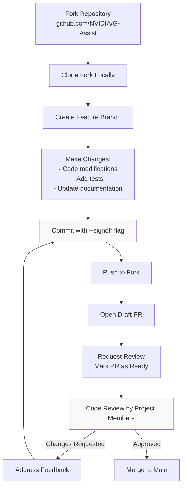
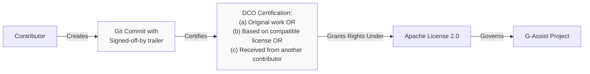
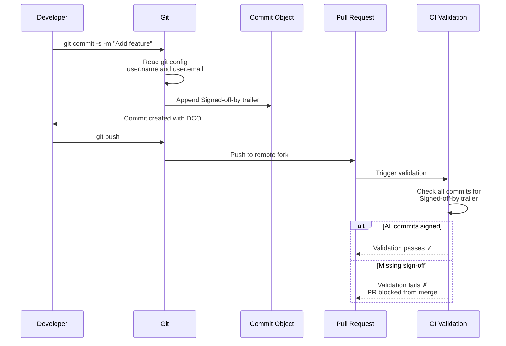
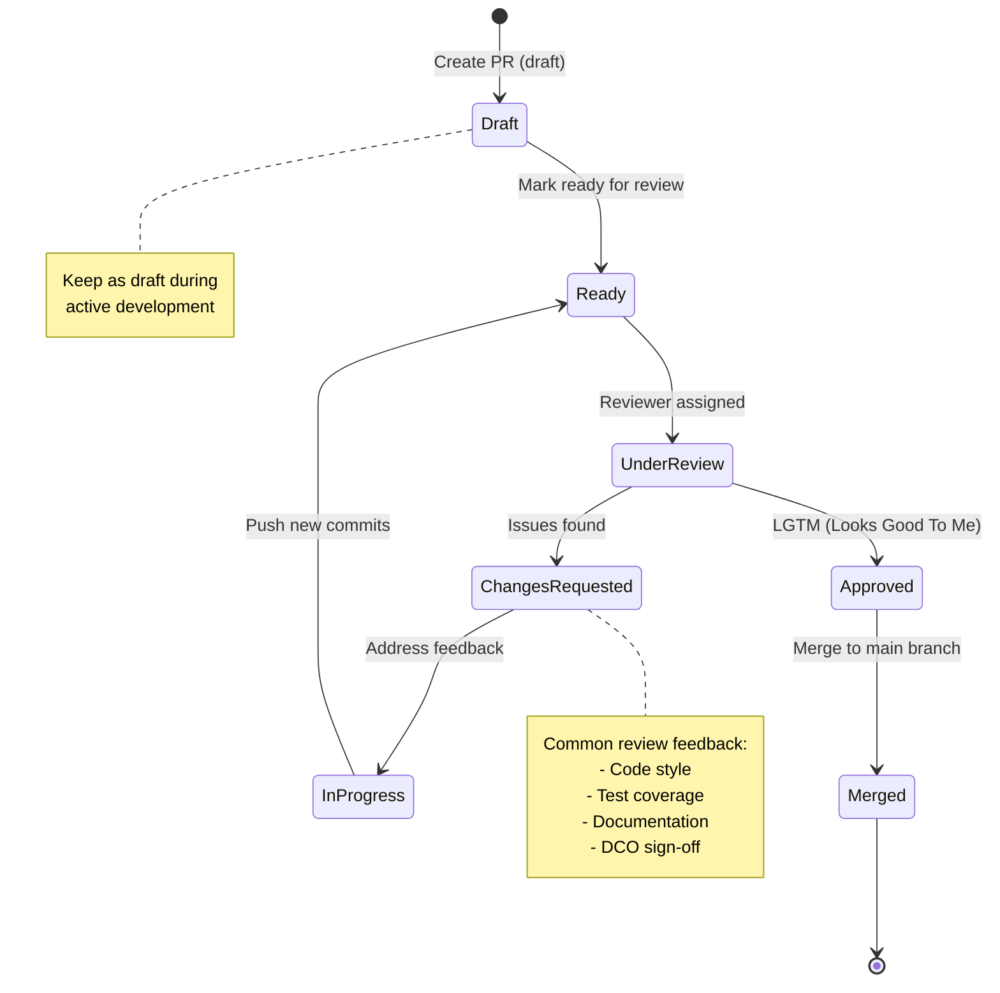

<!-- source: DeepWiki mcp.deepwiki.com · repo NVIDIA/G-Assist · page 8 Contributing · fetched 2026-10-26 -->

# Contributing

<details>
<summary>Relevant source files</summary>

The following files were used as context for generating this wiki page:

- [CONTRIBUTING.md](CONTRIBUTING.md)
- [LICENSE](LICENSE)
- [api/bindings/python/ATTRIBUTIONS.md](api/bindings/python/ATTRIBUTIONS.md)
- [api/bindings/python/CONTRIBUTING.md](api/bindings/python/CONTRIBUTING.md)
- [api/bindings/python/LICENSE](api/bindings/python/LICENSE)

</details>


This page documents the guidelines and requirements for contributing code, documentation, or plugins to the G-Assist project. It covers the submission process, code review requirements, and the Developer Certificate of Origin (DCO) that all contributors must sign.

For information about developing plugins specifically, see [Plugin Development Guide](#5). For license and attribution details, see [License and Legal](#9).

---

## Overview

The G-Assist project accepts contributions from external developers through GitHub pull requests. All contributions must be signed using the Developer Certificate of Origin to certify that contributors have the rights to submit their work under the project's Apache License 2.0.

**Sources**: [CONTRIBUTING.md:1-53](), [api/bindings/python/CONTRIBUTING.md:1-51]()

---

## Contribution Workflow

The following diagram illustrates the standard process for submitting contributions to the G-Assist repository:



### Submission Steps

| Step | Action | Command |
|------|--------|---------|
| 1 | Fork the repository | Via GitHub UI |
| 2 | Clone your fork | `git clone https://github.com/YOUR_USERNAME/G-Assist` |
| 3 | Create a feature branch | `git checkout -b feature/your-feature-name` |
| 4 | Make changes | Edit files in your local clone |
| 5 | Sign and commit | `git commit -s -m "Description"` |
| 6 | Push to your fork | `git push origin feature/your-feature-name` |
| 7 | Open a draft PR | Via GitHub UI |
| 8 | Request review | Mark PR as "Ready for review" when complete |

**Important**: Keep pull requests in draft status until they are ready for review. This signals to maintainers that the work is still in progress.

**Sources**: [CONTRIBUTING.md:3-8](), [api/bindings/python/CONTRIBUTING.md:3-8]()

---

## Developer Certificate of Origin (DCO)

All contributions to G-Assist must include a Developer Certificate of Origin sign-off. This certifies that you have the legal right to submit the contribution under the project's license terms.

### DCO Requirements

The following diagram shows the certification chain established by DCO sign-off:



### DCO Text

The Developer Certificate of Origin version 1.1 certifies that:

**(a)** The contribution was created in whole or in part by you and you have the right to submit it under the open source license indicated in the file; or

**(b)** The contribution is based upon previous work that, to the best of your knowledge, is covered under an appropriate open source license and you have the right under that license to submit that work with modifications, whether created in whole or in part by you, under the same open source license (unless you are permitted to submit under a different license), as indicated in the file; or

**(c)** The contribution was provided directly to you by some other person who certified (a), (b) or (c) and you have not modified it.

**(d)** You understand and agree that this project and the contribution are public and that a record of the contribution (including all personal information you submit with it, including your sign-off) is maintained indefinitely and may be redistributed consistent with this project or the open source license(s) involved.

**Sources**: [CONTRIBUTING.md:25-51](), [api/bindings/python/CONTRIBUTING.md:25-51]()

---

## Signing Your Commits

Every commit must be signed off to indicate DCO acceptance. Git provides a built-in mechanism for this using the `--signoff` or `-s` flag.

### Signing Process



### Sign-off Command

To sign a commit, use the `-s` or `--signoff` flag with `git commit`:

```bash
git commit -s -m "Add cool feature."
```

This automatically appends the following to your commit message:

```
Signed-off-by: Your Name <your@email.com>
```

The name and email are extracted from your git configuration (`user.name` and `user.email`).

### Verification

Contributions without proper sign-off will not be accepted. The automated CI system validates that all commits in a pull request include the `Signed-off-by` trailer. If any commit is missing this trailer, the pull request cannot be merged.

**Sources**: [CONTRIBUTING.md:10-23](), [api/bindings/python/CONTRIBUTING.md:10-23]()

---

## Code Review Process

All submissions require review before merging, including submissions from project members. The review process uses GitHub's pull request system.

### Review Workflow



### Review Criteria

Reviewers evaluate contributions based on:

| Criterion | Description |
|-----------|-------------|
| **Functionality** | Code accomplishes intended purpose without breaking existing features |
| **Code Quality** | Follows project conventions, readable, maintainable |
| **Testing** | Includes appropriate tests; all tests pass |
| **Documentation** | Updates relevant documentation (README, wiki, inline comments) |
| **DCO Compliance** | All commits properly signed with `Signed-off-by` trailer |
| **License** | New code compatible with Apache License 2.0 |
| **Dependencies** | Third-party dependencies properly attributed in ATTRIBUTIONS.md |

### Addressing Feedback

When reviewers request changes:

1. Make the requested modifications in your local branch
2. Commit the changes with sign-off: `git commit -s -m "Address review feedback"`
3. Push to your fork: `git push`
4. The pull request automatically updates with new commits
5. Respond to review comments to indicate what was changed

**Sources**: [CONTRIBUTING.md:5-8]()

---

## License and Attribution

All contributions to G-Assist are licensed under the Apache License 2.0. This applies to all code in the repository, including:

- Core G-Assist platform code
- Plugin implementations
- Python bindings (`rise` module)
- Build scripts and utilities
- Documentation

### Repository License Files

| File | Path | Purpose |
|------|------|---------|
| **Main License** | [LICENSE:1-202]() | Apache License 2.0 for entire repository |
| **Python Bindings License** | [api/bindings/python/LICENSE:1-202]() | Same license for Python bindings subdirectory |
| **Contribution Terms** | [CONTRIBUTING.md:1-53]() | DCO requirements and submission guidelines |
| **Third-party Attributions** | [api/bindings/python/ATTRIBUTIONS.md:1-799]() | Licenses for dependencies (Colorama, Flask, PyInstaller, etc.) |

### Third-Party Dependencies

When adding new dependencies to plugins or the core platform, update [api/bindings/python/ATTRIBUTIONS.md]() with:

- Dependency name
- License type
- Full license text
- Copyright holder information

Existing attributed dependencies include:

- **Colorama**: BSD 3-Clause License
- **Flask**: BSD 3-Clause License
- **Flask-Cors**: MIT License
- **PyInstaller**: GNU GPL v2 with Bootloader Exception
- **setuptools**: MIT License
- **tqdm**: MIT/MPL-2.0 dual license

**Sources**: [LICENSE:1-202](), [api/bindings/python/LICENSE:1-202](), [api/bindings/python/ATTRIBUTIONS.md:1-799]()

---

## Summary

Contributing to G-Assist requires:

1. **Fork and clone** the repository
2. **Create a feature branch** for your changes
3. **Sign all commits** using `git commit -s`
4. **Submit a draft PR** on GitHub
5. **Request review** when ready
6. **Address feedback** from reviewers
7. **Ensure DCO compliance** on all commits

The DCO sign-off certifies that you have the legal right to contribute your code under the Apache License 2.0. Pull requests without proper sign-off cannot be merged.

For questions about the contribution process, consult [GitHub Help](https://help.github.com/articles/about-pull-requests) or review the project's [CONTRIBUTING.md]() file.

**Sources**: [CONTRIBUTING.md:1-53](), [api/bindings/python/CONTRIBUTING.md:1-51]()

---

