# Page: Overview

# Overview

<details>
<summary>Relevant source files</summary>

The following files were used as context for generating this wiki page:

- [README.md](README.md)
- [api/bindings/python/README.md](api/bindings/python/README.md)
- [plugins/examples/twitch/README.md](plugins/examples/twitch/README.md)

</details>


## Purpose and Scope

This document provides a high-level overview of the G-Assist platform architecture, its core components, and the plugin ecosystem. It introduces the key systems that enable G-Assist to function as an on-device AI assistant for RTX users, including the inference engine, plugin architecture, and communication protocols.

For detailed information about specific subsystems:
- Plugin development workflows: see [Plugin Development Guide](#5)
- Python API usage: see [Python Bindings (rise module)](#4)
- Communication protocol specifications: see [Communication Protocol](#3.3)
- Individual plugin implementations: see [Plugin Examples](#6)

## What is G-Assist

G-Assist is an experimental on-device AI assistant platform that runs a Small Language Model (SLM) locally on NVIDIA RTX GPUs. The platform enables users to control PC settings, peripheral hardware, and third-party services through natural language voice or text commands delivered via the NVIDIA Overlay interface.

The system operates entirely on-device, leveraging RTX GPU acceleration for inference rather than relying on cloud-based AI services. The core architecture supports extensibility through a modular plugin system, allowing developers to add new capabilities without modifying the core platform.

**Sources:** [README.md:1-13]()

## Core System Architecture

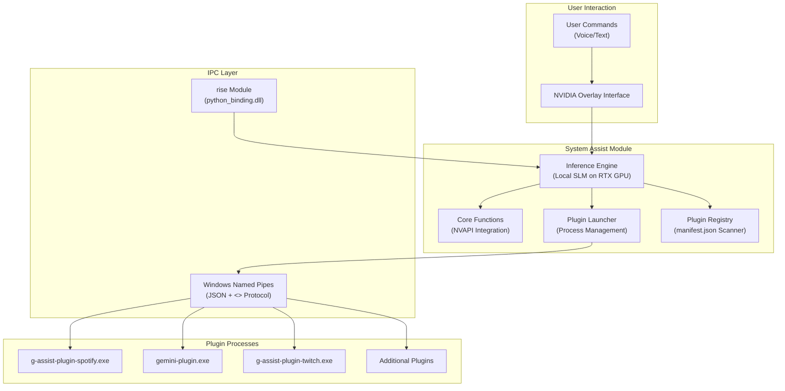

The System Assist Module consists of three primary components:

1. **Inference Engine**: Executes the local SLM on RTX hardware to analyze user commands, extract intent, and determine appropriate function routing.

2. **Core Functions**: Built-in capabilities that directly interface with NVAPI for GPU information, performance monitoring, and system control operations.

3. **Plugin Launcher**: Manages the lifecycle of plugin processes, including spawning non-persistent plugins on-demand and maintaining persistent plugin connections.

**Sources:** [README.md:120-133]()

## Plugin Discovery and Manifest System

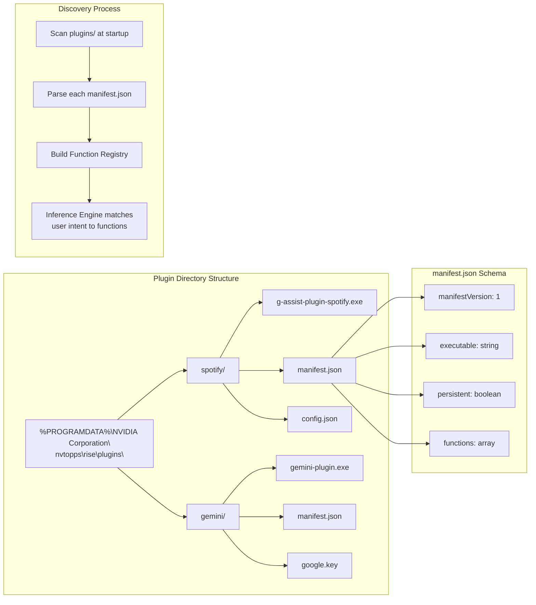

Each plugin resides in a self-contained directory under the G-Assist plugins path. The `manifest.json` file defines the contract between plugin and platform:

| Field | Type | Description |
|-------|------|-------------|
| `manifestVersion` | integer | Schema version (currently 1) |
| `executable` | string | Name of plugin executable file |
| `persistent` | boolean | Whether plugin remains active throughout G-Assist lifecycle |
| `functions` | array | List of function definitions with parameters |

At startup, the Plugin Registry scans all subdirectories under `plugins/`, parses each `manifest.json`, and constructs a searchable index mapping function descriptions, tags, and parameters to their respective plugins.

**Sources:** [README.md:141-159](), [plugins/examples/twitch/README.md:103-122]()

## Plugin Invocation Methods

G-Assist supports two distinct invocation patterns:

### Zero-Shot Function Calling

The inference engine analyzes natural language commands and automatically selects the appropriate plugin and function without explicit plugin naming:

```
User: "What are the top upcoming games for 2025?"
→ Inference Engine analyzes intent
→ Routes to gemini plugin
→ Calls search function with extracted parameters
```

The AI model uses function descriptions and tags from manifest files to determine routing.

### Direct Plugin Invocation

Users explicitly name the target plugin, and the inference engine extracts function and parameters from the remaining command:

```
User: "Hey spotify, play some jazz"
→ Plugin name "spotify" explicitly specified
→ Inference Engine selects "play" function from spotify manifest
→ Extracts genre parameter: "jazz"
```

Both invocation methods leverage the same manifest-based function registry and parameter extraction system.

**Sources:** [README.md:162-191]()

## Communication Protocol

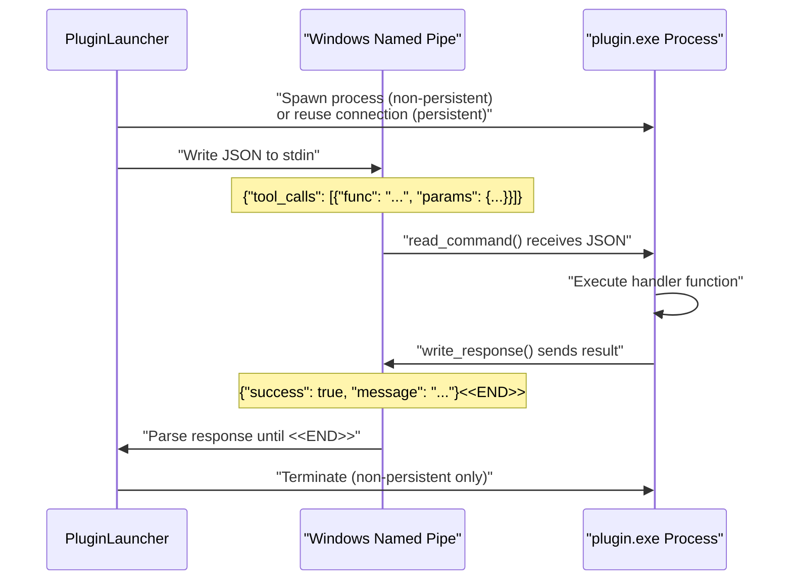

Plugins communicate with the System Assist Module through Windows Named Pipes using a JSON-based protocol. Commands follow this structure:

```json
{
  "tool_calls": [
    {
      "func": "check_twitch_live_status",
      "params": {
        "username": "nvidia"
      }
    }
  ]
}
```

Responses must include the `<<END>>` marker for message termination:

```json
{
  "success": true,
  "message": "nvidia is LIVE!\nTitle: Stream Title\nViewers: 1234"
}<<END>>
```

The pipe communication is implemented using Windows kernel32 API functions `ReadFile` and `WriteFile` for stdin/stdout handles.

**Sources:** [plugins/examples/twitch/README.md:299-367](), [plugins/examples/twitch/README.md:381-399]()

## Python Bindings Interface

The `rise` module provides a synchronous Python API for interacting with G-Assist:

| Function | Purpose |
|----------|---------|
| `rise.register_rise_client()` | Initialize connection to G-Assist, wait for READY signal |
| `rise.send_rise_command(cmd: str) -> str` | Send command and block until response received |
| `base_function_callback()` | Internal callback invoked by `python_binding.dll` for async events |

The module abstracts the underlying C++ NVAPI and RISE Backend communication through `python_binding.dll`, which exposes `register_rise_callback` and `request_rise` functions via CTypes interop.

Example usage:

```python
from rise import rise

rise.register_rise_client()
response = rise.send_rise_command("What is my GPU?")
# Response: Your GPU is an NVIDIA GeForce RTX 5090 with a Driver version of 572.83.
```

The synchronous API is implemented through polling of global state variables (`response`, `response_done`, `ready`) that are updated by the native callback function.

**Sources:** [api/bindings/python/README.md:1-67]()

## Plugin Development Lifecycle

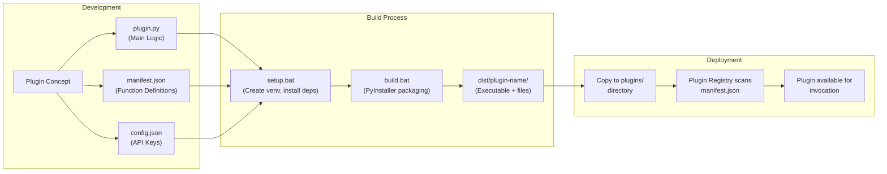

Plugin development follows a standardized workflow:

1. **Development**: Create `plugin.py` with command handlers, define functions in `manifest.json`, store credentials in `config.json`

2. **Build**: Execute `setup.bat` to create virtual environment and install dependencies from `requirements.txt`, then run `build.bat` to package with PyInstaller

3. **Deployment**: Copy the `dist/plugin-name/` directory to `%PROGRAMDATA%\NVIDIA Corporation\nvtopps\rise\plugins\`

4. **Discovery**: G-Assist automatically scans and registers the plugin at next startup

The Plugin Builder tool uses OpenAI GPT to generate initial scaffolding code, accelerating the development process.

**Sources:** [README.md:139-159](), [plugins/examples/twitch/README.md:38-59](), [plugins/examples/twitch/README.md:449-485]()

## Plugin Categories

The ecosystem includes four primary plugin categories:

| Category | Examples | Functionality |
|----------|----------|---------------|
| **AI & Search** | Gemini | Google AI integration, web search classification |
| **Media Integration** | Spotify, Twitch, Discord | Music control, stream status, message/file sharing |
| **Hardware Control** | Corsair, LogiLED, Nanoleaf | RGB lighting, peripheral illumination, smart lighting |
| **Information Services** | Weather, Stock | wttr.in API, market data via Twelve Data API |

All plugins follow the same manifest-based discovery, pipe communication protocol, and response format regardless of category.

**Sources:** [README.md:193-213]()

## Configuration and Security

Plugins store sensitive credentials in `config.json` files within their respective plugin directories. This file should be excluded from version control:

```json
{
  "TWITCH_CLIENT_ID": "your_client_id_here",
  "TWITCH_CLIENT_SECRET": "your_client_secret_here"
}
```

The configuration file path resolves to `%PROGRAMDATA%\NVIDIA Corporation\nvtopps\rise\plugins\<plugin-name>\config.json` at runtime. Log files are written to `%USERPROFILE%\<plugin-name>.log` for debugging.

**Sources:** [plugins/examples/twitch/README.md:124-130](), [plugins/examples/twitch/README.md:153-178]()

## Key Design Principles

1. **Modularity**: Plugins run as separate processes, isolating failures and enabling independent versioning
2. **Declarative Configuration**: The manifest.json system allows discovery without code execution
3. **On-Device Processing**: Local SLM inference on RTX GPUs eliminates cloud dependency
4. **Standardized Communication**: All plugins use identical JSON protocol over named pipes
5. **AI-Driven Routing**: Zero-shot function calling enables natural language command interpretation
6. **Developer Accessibility**: Python-first development with build automation reduces time to deployment

**Sources:** [README.md:1-24](), [README.md:120-133]()

---

# Page: Getting Started

# Getting Started

<details>
<summary>Relevant source files</summary>

The following files were used as context for generating this wiki page:

- [README.md](README.md)
- [api/bindings/python/README.md](api/bindings/python/README.md)
- [plugins/examples/twitch/README.md](plugins/examples/twitch/README.md)

</details>


This page provides a quick start guide for using G-Assist and developing plugins. It covers installation, basic command usage, Python bindings setup, and an overview of available plugins. For detailed architectural information, see [Architecture](#3). For comprehensive plugin development instructions, see [Plugin Development Guide](#5).

## Prerequisites

Before using G-Assist, ensure you have the following installed:

**For Users:**
- Windows operating system
- NVIDIA RTX GPU
- G-Assist core services installed (System Assist Module)
- NVIDIA Overlay interface

**For Developers:**
- Python 3.x or higher
- pip package manager
- Visual C++ Build Tools (for Python bindings)
  - Option 1: [Visual Studio Community](https://visualstudio.microsoft.com/vs/community) with "Desktop development with C++"
  - Option 2: [Visual C++ Redistributable](https://aka.ms/vs/17/release/vc_redist.x64.exe) (x64 version)

Sources: [api/bindings/python/README.md:11-42](), [README.md:53-56]()

## Installation Overview

The G-Assist platform consists of three main components that work together:

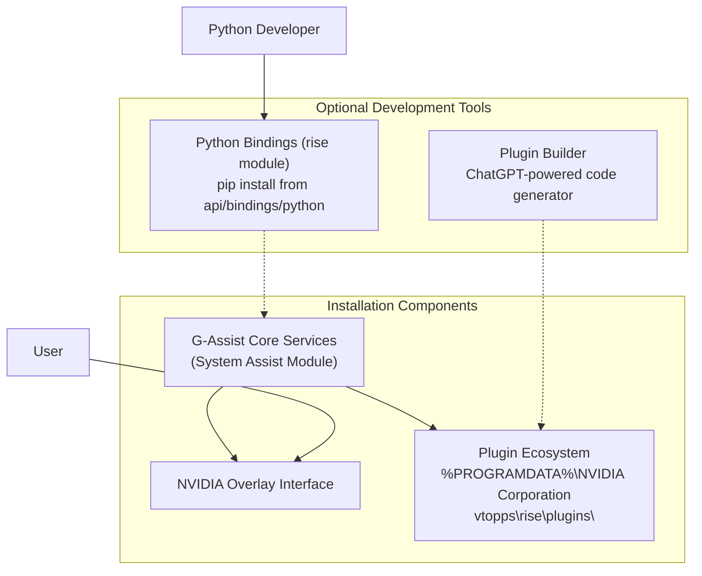

**Directory Structure:**

| Path | Contents | Purpose |
|------|----------|---------|
| `%PROGRAMDATA%\NVIDIA Corporation\nvtopps\rise\plugins\` | Plugin directories | Runtime plugin location scanned by G-Assist |
| `%USERPROFILE%\<plugin-name>.log` | Log files | Plugin execution logs |
| `api/bindings/python/` | Python source | Python bindings for programmatic access |

Sources: [README.md:143-158](), [plugins/examples/twitch/README.md:51-60]()

## Using G-Assist: Voice and Text Commands

G-Assist accepts commands through the NVIDIA Overlay interface via voice or text input. Commands are processed by the System Assist Module's inference engine, which runs a local Small Language Model (SLM) on your RTX GPU.

### Command Invocation Methods

G-Assist supports two distinct methods for invoking plugin functionality:

```mermaid
sequenceDiagram
    participant User
    participant Overlay["NVIDIA Overlay"]
    participant SAM["System Assist Module<br/>(Inference Engine)"]
    participant Registry["Plugin Registry<br/>(manifest.json scanner)"]
    participant Plugin
    
    Note over User,Plugin: Method 1: Zero-Shot Function Calling
    User->>Overlay: "/fc What are the top games for 2025?"
    Overlay->>SAM: Forward command
    SAM->>Registry: Query available functions
    Registry-->>SAM: Return function definitions
    SAM->>SAM: AI analyzes intent<br/>Selects gemini plugin<br/>Chooses search function
    SAM->>Plugin: Execute with parameters
    
    Note over User,Plugin: Method 2: Direct Plugin Invocation
    User->>Overlay: "Hey spotify, play some jazz"
    Overlay->>SAM: Forward command
    SAM->>Registry: Lookup "spotify" plugin
    Registry-->>SAM: Return spotify functions
    SAM->>SAM: AI extracts "play" function<br/>Parameters: genre=jazz
    SAM->>Plugin: Execute with parameters
```

**1. Zero-Shot Function Calling**

The AI model automatically selects the appropriate plugin and function based on user intent:

```
/fc What are the top upcoming games for 2025?
```

Process:
1. System Assist Module analyzes the natural language command
2. Inference engine matches intent to plugin function descriptions and tags in `manifest.json`
3. Extracts required parameters from the command
4. Routes to the appropriate plugin (e.g., `gemini` plugin's `search` function)

**2. Direct Plugin Invocation**

User explicitly specifies the plugin name:

```
Hey logiled, change my keyboard lights to green
/logiled change my keyboard lights to green
```

Process:
1. System identifies "logiled" as the target plugin name (matching plugin directory)
2. AI determines the appropriate function from that plugin's manifest
3. Extracts parameters from the natural language portion
4. Routes to the specified plugin (e.g., `logiled` plugin's color control function)

Sources: [README.md:163-191](), [README.md:25-28]()

### Example Commands by Plugin

| Plugin | Command Example | Function Invoked |
|--------|----------------|------------------|
| `twitch` | "Hey Twitch, is Ninja live?" | `check_twitch_live_status` |
| `spotify` | "Hey spotify, play some jazz" | Music playback control |
| `gemini` | "/fc What's the weather?" | Search with AI classification |
| `logiled` | "/logiled set keyboard to blue" | Device illumination control |
| `weather` | "/fc What's the weather in Seattle?" | `get_weather_info` |

Sources: [README.md:62-81](), [plugins/examples/twitch/README.md:64-67]()

## Python Development Quick Start

The `rise` module provides Python bindings to G-Assist's C++ APIs, enabling programmatic interaction with the System Assist Module.

### Installing the Python Bindings

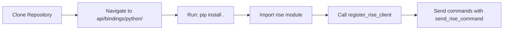

**Installation Steps:**

1. Navigate to the Python bindings directory:
```bash
cd api/bindings/python
```

2. Install the package:
```bash
pip install .
```

3. Verify installation by importing the module:
```python
from rise import rise
```

Sources: [api/bindings/python/README.md:45-49](), [README.md:30-34]()

### Basic Usage Example

The `rise` module abstracts complex asynchronous callbacks into synchronous, blocking function calls:

```python
from rise import rise

# Initialize connection to G-Assist core services
rise.register_rise_client()

# Send command and receive synchronous response
response = rise.send_rise_command("What is my GPU?")
print(f'Response: {response}')
```

**Expected Output:**
```
Response: Your GPU is an NVIDIA GeForce RTX 5090 with a Driver version of 572.83.
```

The implementation details:
- `register_rise_client()` initializes the connection to `python_binding.dll` and waits for the `READY` signal
- `send_rise_command(str)` sends the command via `request_rise` and polls the global `response_done` flag
- Response is populated by `base_function_callback` which handles `TEXT`, `GRAPH`, `PROGRESS_UPDATE` content types

For detailed API documentation including callback mechanisms and content types, see [Python Bindings API Reference](#4.1) and [Content Types and Callbacks](#4.2).

Sources: [README.md:36-49](), [api/bindings/python/README.md:52-67]()

### Interactive Chat Example

The Python bindings enable building custom interfaces. Here's a complete chat application with visual feedback:

```python
from rise import rise
import time
import sys
import threading

def thinking_bubble(stop_event):
    """Animated thinking indicator while processing"""
    while not stop_event.is_set():
        for _ in range(3):
            if stop_event.is_set():
                break
            sys.stdout.write('.')
            sys.stdout.flush()
            time.sleep(0.5)
        sys.stdout.write('\b\b\b   \b\b\b')

def main():
    rise.register_rise_client()
    
    while True:
        user_prompt = input("ME: ")
        stop_event = threading.Event()
        thinking_thread = threading.Thread(
            target=thinking_bubble, args=(stop_event,))
        thinking_thread.start()
        
        response = rise.send_rise_command(user_prompt)
        
        stop_event.set()
        thinking_thread.join()
        print(f"RISE: {response}")

if __name__ == "__main__":
    main()
```

This example demonstrates the synchronous API pattern where `send_rise_command` blocks until `response_done` is set by the callback handler.

For the complete GUI application using Flask and Electron, see [GUI Application (rise-gui.py)](#4.3).

Sources: [api/bindings/python/README.md:69-107]()

## Available Plugins

G-Assist includes several example plugins demonstrating different integration patterns. Plugins are discovered at runtime by scanning the `plugins/` directory for `manifest.json` files.

### Plugin Discovery and Loading

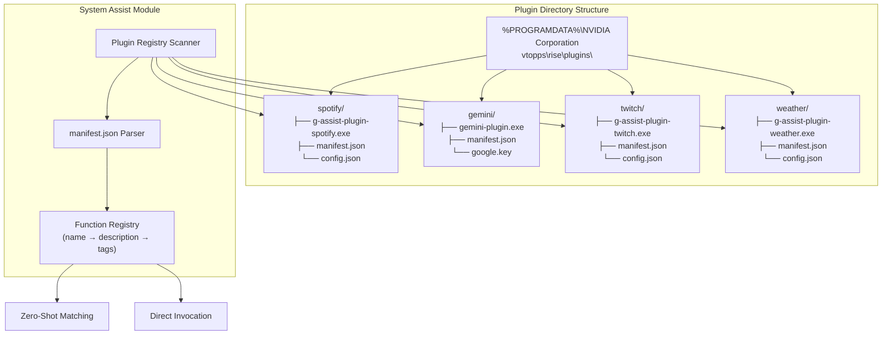

Each plugin directory contains:
- **Executable**: The plugin binary (e.g., `g-assist-plugin-<name>.exe`)
- **manifest.json**: Function definitions, descriptions, tags, and persistence settings
- **config.json**: API credentials and plugin-specific configuration (not committed to version control)

Sources: [README.md:141-160]()

### Plugin Categories

**AI & Search Integrations:**

| Plugin | Functionality | Key Functions |
|--------|--------------|---------------|
| `gemini` | Google AI + Search integration | `search` with AI classification |
| | LLM query routing | Multi-API integration pattern |

**Media Integration:**

| Plugin | Functionality | Key Functions |
|--------|--------------|---------------|
| `spotify` | Music playback control | Track play, pause, skip |
| | Playlist management | OAuth authentication pattern |
| `twitch` | Stream status checking | `check_twitch_live_status` |
| | Streamer information | OAuth token management |
| `discord` | Message sending | Text, chart, file sharing |
| | Channel integration | Webhook-based integration |

**Hardware Control:**

| Plugin | Functionality | Key Functions |
|--------|--------------|---------------|
| `logiled` | Logitech device lighting | RGB control, effect patterns |
| `corsair` | Corsair iCUE integration | RGB lighting control |
| `nanoleaf` | Smart lighting control | Room lighting automation |

**Information Services:**

| Plugin | Functionality | Key Functions |
|--------|--------------|---------------|
| `weather` | Weather information | `get_weather_info` via wttr.in API |
| `stock` | Market data retrieval | Stock price queries via Twelve Data API |

For detailed implementation guides for each plugin, see [Plugin Examples](#6).

Sources: [README.md:193-201](), [README.md:23-23]()

### Plugin Persistence Modes

Plugins operate in two modes defined by the `persistent` flag in `manifest.json`:

**Non-Persistent (persistent: false):**
- Plugin process spawned on-demand by the Plugin Launcher
- Executes command and terminates
- Example: `twitch` plugin for status checks

**Persistent (persistent: true):**
- Plugin process starts at G-Assist initialization
- Continues listening on the named pipe
- Suitable for plugins requiring state or frequent invocation
- Example: Hardware control plugins maintaining connection state

The persistence mode is specified in each plugin's manifest file at [plugins/<plugin-name>/manifest.json:7]().

Sources: [README.md:152-158]()

## Plugin Communication Protocol

Plugins communicate with G-Assist through Windows Named Pipes using a JSON-based protocol. Understanding this protocol is essential for both using and developing plugins.

### Message Flow

```mermaid
sequenceDiagram
    participant PL["Plugin Launcher"]
    participant Pipe["Windows Named Pipe<br/>(stdin/stdout)"]
    participant Plugin["Plugin Process<br/>(plugin.py main loop)"]
    
    PL->>Pipe: Write JSON command
    Note right of Pipe: {"tool_calls": [{"func": "...", "params": {...}}]}
    Pipe->>Plugin: read_command() via GetStdHandle
    Plugin->>Plugin: Parse JSON<br/>Execute function
    Plugin->>Pipe: write_response() via GetStdHandle
    Note right of Pipe: {"success": true, "message": "..."}<<END>>
    Pipe->>PL: Read response until <<END>> marker
```

**Command Format:**
```json
{
    "tool_calls": [
        {
            "func": "check_twitch_live_status",
            "params": {
                "username": "nvidia"
            }
        }
    ]
}
```

**Response Format:**
```json
{
    "success": true,
    "message": "nvidia is LIVE!\nTitle: Gaming Stream\nViewers: 1234"
}<<END>>
```

The `<<END>>` marker signals message termination and is required for proper protocol operation.

Key implementation details:
- Commands are read using `windll.kernel32.ReadFile` with `STD_INPUT_HANDLE = -10`
- Responses are written using `windll.kernel32.WriteFile` with `STD_OUTPUT_HANDLE = -11`
- Buffer size is typically `4096` bytes
- Large messages are read in chunks

For complete pipe communication implementation details, see [Communication Protocol](#3.3).

Sources: [plugins/examples/twitch/README.md:299-401](), [plugins/examples/twitch/README.md:381-399]()

## Next Steps

**For Users:**
- Explore available plugins and their commands
- Try both zero-shot and direct invocation methods
- Review plugin-specific documentation for advanced features

**For Developers:**

1. **Learn the Architecture:** See [Architecture](#3) for detailed system design
2. **Build Your First Plugin:** Follow [Plugin Development Guide](#5)
3. **Use the Plugin Builder:** Leverage the [ChatGPT-powered Plugin Builder](#5.1) for rapid scaffolding
4. **Study Examples:** Review detailed walkthroughs in [Plugin Examples](#6)
5. **Understand the Protocol:** Deep dive into [Communication Protocol](#3.3)

**Development Resources:**

| Resource | Location | Purpose |
|----------|----------|---------|
| Python Bindings | [api/bindings/python/](../../api/bindings/python) | Programmatic G-Assist access |
| Plugin Builder | [plugins/plugin-builder/](../../plugins/plugin-builder) | Automated plugin generation |
| Example Plugins | [plugins/examples/](../../plugins/examples) | Reference implementations |
| Manifest Schema | [Manifest Schema](#7.1) | Plugin configuration reference |

Sources: [README.md:211-213](), [README.md:101-118]()

---

# Page: Architecture

# Architecture

<details>
<summary>Relevant source files</summary>

The following files were used as context for generating this wiki page:

- [README.md](README.md)
- [api/bindings/python/README.md](api/bindings/python/README.md)
- [plugins/examples/twitch/README.md](plugins/examples/twitch/README.md)

</details>


This document provides a comprehensive technical overview of G-Assist's system architecture, including the core components, plugin system design, and inter-process communication mechanisms. For information about specific subsystems, see [System Assist Module](#3.1), [Plugin Architecture](#3.2), [Communication Protocol](#3.3), and [Plugin Invocation Methods](#3.4). For practical development guidance, refer to [Plugin Development Guide](#5).

## System Overview

G-Assist is architected as a modular, AI-orchestrated platform consisting of a core System Assist Module and an extensible plugin ecosystem communicating via Windows Named Pipes. The architecture follows a clear separation between the core inference engine, plugin launcher, and individual plugin processes.

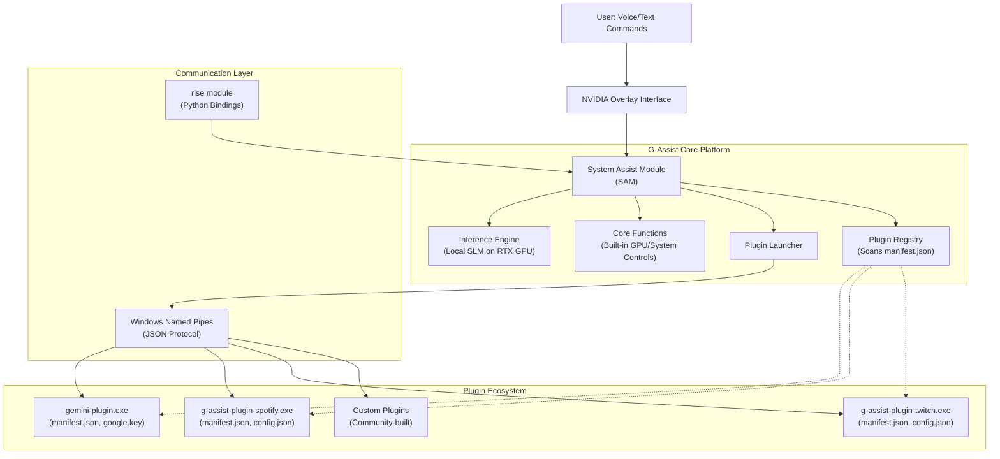

**Sources:** [README.md:122-133](), [README.md:1-23]()

## Core Components

The G-Assist platform consists of four primary architectural layers:

### System Assist Module (SAM)

The System Assist Module serves as the central orchestration layer. It integrates three key subsystems:

| Subsystem | Responsibilities |
|-----------|-----------------|
| Inference Engine | Executes local Small Language Model (SLM) on RTX GPU for intent analysis, plugin selection, and parameter extraction |
| Core Functions | Implements built-in GPU and system controls via NVAPI |
| Plugin Launcher | Manages plugin process lifecycle, spawning and terminating as needed |

The inference engine analyzes user commands to determine the appropriate action—whether to invoke built-in functions or delegate to plugins. See [System Assist Module](#3.1) for detailed implementation.

**Sources:** [README.md:122-133](), [README.md:3-13]()

### Plugin Registry

The Plugin Registry performs automatic discovery by scanning the plugin directory at `%PROGRAMDATA%\NVIDIA Corporation\nvtopps\rise\plugins\`. It parses each `manifest.json` file to build an indexed function registry used for zero-shot function calling.

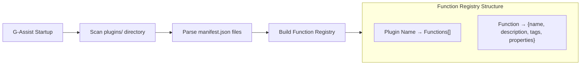

**Sources:** [README.md:143-159](), [README.md:163-166]()

### Plugin Launcher

The Plugin Launcher manages plugin process lifecycle based on the `persistent` flag in `manifest.json`:

- **Non-Persistent Plugins**: Spawned on-demand, executed, then terminated
- **Persistent Plugins**: Spawned once at startup, remain active throughout G-Assist lifecycle

**Sources:** [README.md:157]()

### Communication Layer

Two primary interfaces enable interaction with G-Assist:

1. **Windows Named Pipes**: IPC mechanism for plugin communication using JSON protocol with `<<END>>` message terminator
2. **rise Module**: Python bindings providing `register_rise_client()` and `send_rise_command()` functions for application integration

See [Communication Protocol](#3.3) for protocol specification.

**Sources:** [api/bindings/python/README.md:1-10](), [plugins/examples/twitch/README.md:297-367]()

## Plugin Architecture Structure

Each plugin resides in a self-contained directory with standardized artifacts:

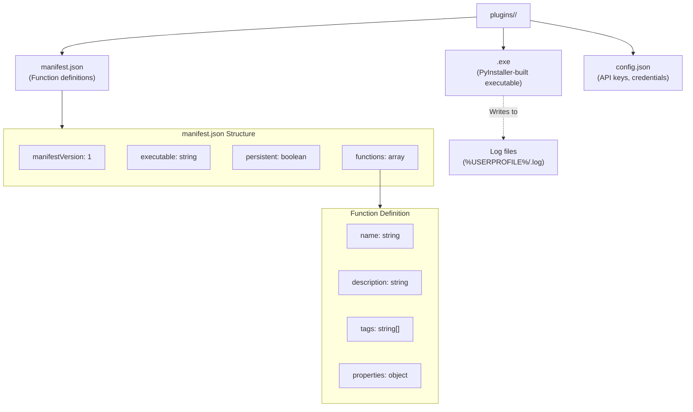

**Sources:** [README.md:143-159](), [plugins/examples/twitch/README.md:103-122]()

### Manifest Schema Components

The `manifest.json` file defines the contract between G-Assist and the plugin:

| Field | Type | Purpose |
|-------|------|---------|
| `manifestVersion` | integer | Schema version (currently 1) |
| `executable` | string | Name of the plugin executable file |
| `persistent` | boolean | Whether plugin remains active throughout G-Assist lifecycle |
| `functions` | array | List of callable functions with their signatures |

Each function definition includes:

| Field | Type | Purpose |
|-------|------|---------|
| `name` | string | Function identifier used in `tool_calls` |
| `description` | string | Natural language description for AI model matching |
| `tags` | string[] | Keywords for zero-shot function discovery |
| `properties` | object | Parameter schema defining expected inputs |

**Sources:** [README.md:151-158](), [plugins/examples/twitch/README.md:103-122]()

## Communication Protocol Flow

The plugin communication protocol uses Windows Named Pipes with a JSON-based message format. The following sequence illustrates the complete invocation lifecycle:

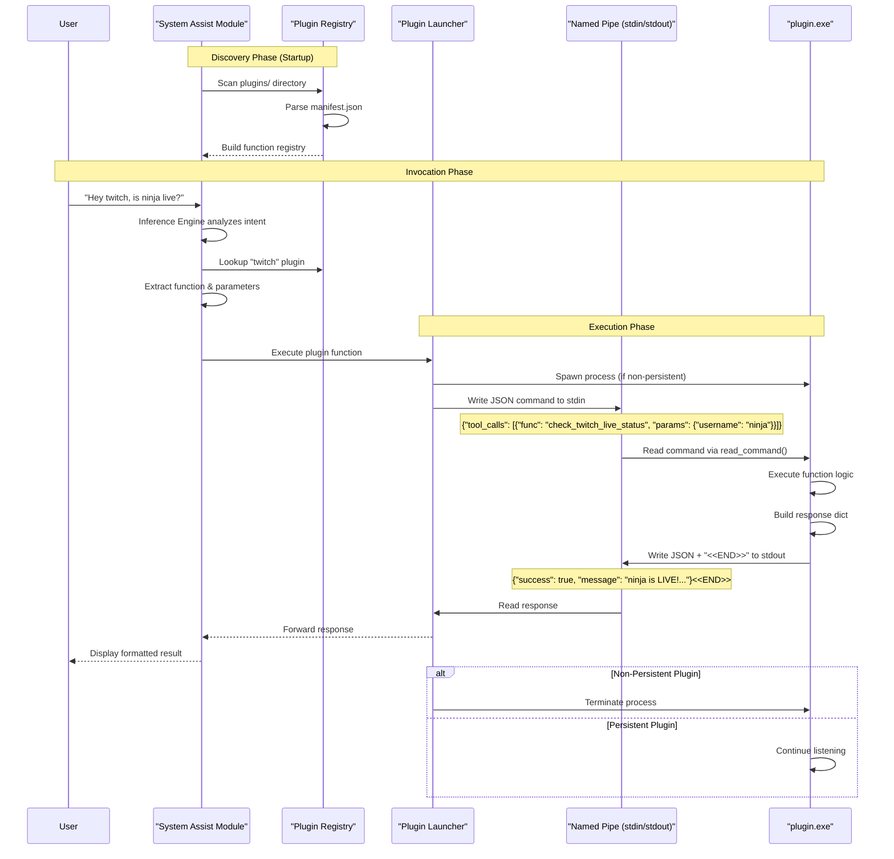

**Sources:** [README.md:163-191](), [plugins/examples/twitch/README.md:297-401]()

## Plugin Invocation Methods

G-Assist supports two distinct invocation patterns, both leveraging the inference engine for intelligent routing:

### Zero-Shot Function Calling

The AI model automatically selects the appropriate plugin and function based on user intent without explicit plugin naming:

```
User Command: "/fc What are the top upcoming games for 2025?"

Processing Flow:
1. Inference Engine analyzes intent
2. Matches to plugin functions via manifest descriptions/tags
3. Selects appropriate plugin (e.g., gemini plugin)
4. Extracts required parameters
5. Invokes plugin function
```

**Sources:** [README.md:169-178]()

### Direct Plugin Invocation

User explicitly names the target plugin, then AI determines the function and parameters:

```
User Command: "Hey spotify, play some jazz"
or
User Command: "/spotify play some jazz"

Processing Flow:
1. User specifies "spotify" plugin
2. Inference Engine determines function from spotify's manifest
3. Extracts parameters ("jazz" → search query)
4. Invokes plugin function
```

**Sources:** [README.md:179-191]()

### Command and Response Format

Plugin commands follow a standardized JSON structure using the `tool_calls` array pattern:

**Command Structure** (written to plugin stdin):
```json
{
  "tool_calls": [
    {
      "func": "check_twitch_live_status",
      "params": {
        "username": "nvidia"
      }
    }
  ]
}
```

**Response Structure** (written to plugin stdout):
```json
{
  "success": true,
  "message": "nvidia is LIVE!\nTitle: NVIDIA Gaming Stream\nGame: Cyberpunk 2077\nViewers: 1234"
}<<END>>
```

The `<<END>>` marker signals message termination and must be appended to all responses.

**Sources:** [plugins/examples/twitch/README.md:381-399](), [plugins/examples/twitch/README.md:261-268]()

## Process Lifecycle Management

The Plugin Launcher implements lifecycle management based on the `persistent` flag:

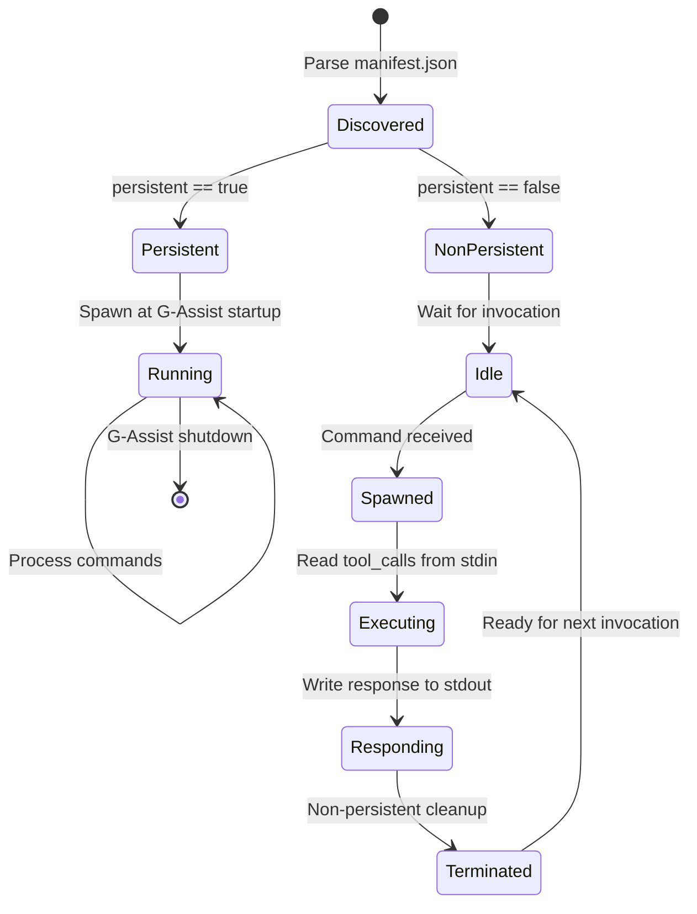

**Sources:** [README.md:157]()

## Code Implementation Bridge

The following table maps architectural components to their concrete code implementations:

| Architectural Component | Code Entity | Location |
|------------------------|-------------|----------|
| Plugin command reader | `read_command()` function | [plugins/examples/twitch/README.md:302-343]() |
| Plugin response writer | `write_response()` function | [plugins/examples/twitch/README.md:345-367]() |
| Plugin manifest | `manifest.json` file | `plugins/<name>/manifest.json` |
| Plugin configuration | `config.json` file | `plugins/<name>/config.json` |
| Plugin executable | `<plugin-name>.exe` | `plugins/<name>/<plugin-name>.exe` |
| Python bindings registration | `rise.register_rise_client()` | [api/bindings/python/README.md:56-57]() |
| Python bindings command | `rise.send_rise_command()` | [api/bindings/python/README.md:60]() |
| Windows pipe stdin handle | `STD_INPUT_HANDLE = -10` | [plugins/examples/twitch/README.md:376]() |
| Windows pipe stdout handle | `STD_OUTPUT_HANDLE = -11` | [plugins/examples/twitch/README.md:377]() |
| Message terminator | `"<<END>>"` string | [plugins/examples/twitch/README.md:354]() |

**Sources:** [plugins/examples/twitch/README.md:297-401](), [api/bindings/python/README.md:52-67]()

## Key Architectural Design Principles

### Process Isolation
Plugins execute in separate processes, ensuring:
- Crash isolation (plugin failure doesn't affect G-Assist core)
- Security boundary between untrusted plugin code and core system
- Independent resource management

### Declarative Configuration
The `manifest.json` approach enables:
- Plugin discovery without code execution
- Hot-swapping of plugins (dynamic loading/unloading)
- Version-independent plugin registry
- AI-driven function matching via descriptions and tags

### AI-Driven Orchestration
The local SLM inference engine provides:
- Natural language understanding for command interpretation
- Intelligent plugin selection via zero-shot function calling
- Parameter extraction from unstructured user input
- Context-aware routing between built-in functions and plugins

### Synchronous Python Bindings
The `rise` module abstracts async C++ APIs into synchronous Python calls by:
- Polling global state variables (`response_done`, `ready`)
- Using callbacks to update state asynchronously
- Providing blocking `send_rise_command()` for ease of use

**Sources:** [README.md:1-23](), [api/bindings/python/README.md:1-10]()

## Directory Structure

Standard installation layout for G-Assist and plugins:

```
%PROGRAMDATA%\NVIDIA Corporation\nvtopps\rise\
└── plugins/
    ├── spotify/
    │   ├── g-assist-plugin-spotify.exe
    │   ├── manifest.json
    │   └── config.json
    ├── gemini/
    │   ├── gemini-plugin.exe
    │   ├── manifest.json
    │   └── google.key
    └── twitch/
        ├── g-assist-plugin-twitch.exe
        ├── manifest.json
        └── config.json

%USERPROFILE%/
├── spotify.log
├── gemini.log
└── twitch.log
```

Plugin files reside in `%PROGRAMDATA%`, while log files are written to `%USERPROFILE%` for per-user isolation.

**Sources:** [README.md:90-97](), [plugins/examples/twitch/README.md:154-160]()

---

# Page: System Assist Module

# System Assist Module

<details>
<summary>Relevant source files</summary>

The following files were used as context for generating this wiki page:

- [README.md](README.md)
- [api/bindings/python/README.md](api/bindings/python/README.md)
- [plugins/examples/twitch/README.md](plugins/examples/twitch/README.md)

</details>


## Purpose and Scope

The System Assist Module (SAM) is the central orchestration layer of the G-Assist platform. It serves as the primary interface between user commands and plugin execution, responsible for analyzing natural language input, routing commands to appropriate handlers, and managing the plugin ecosystem lifecycle.

This document covers the internal architecture and operation of the System Assist Module, including its inference engine, core functions, and plugin management capabilities. For details on the plugin architecture itself, see [Plugin Architecture](#3.2). For communication protocol specifications, see [Communication Protocol](#3.3). For information on how commands are interpreted and routed, see [Plugin Invocation Methods](#3.4).

**Sources:** [README.md:120-133]()

## Core Components

The System Assist Module consists of four primary subsystems that work together to provide AI-driven command orchestration:

| Component | Purpose | Key Responsibilities |
|-----------|---------|---------------------|
| **Inference Engine** | AI model for command interpretation | Natural language understanding, function selection, parameter extraction |
| **Core Functions** | Built-in system capabilities | GPU information, system settings, performance metrics via NVAPI |
| **Plugin Launcher** | External plugin process management | Spawning executables, pipe setup, lifecycle control |
| **Plugin Registry** | Plugin discovery and indexing | Scanning manifest.json files, building function catalog |

**Sources:** [README.md:120-133]()

### Inference Engine

The Inference Engine runs a local Small Language Model (SLM) on the RTX GPU, providing on-device AI inference without cloud dependencies. This engine analyzes user commands to:

- **Parse natural language intent** - Convert voice or text commands into structured function calls
- **Select appropriate handlers** - Match user requests to either core functions or plugin capabilities
- **Extract parameters** - Identify and structure arguments needed for function execution
- **Enable zero-shot function calling** - Route commands to plugins without explicit plugin names

The inference engine operates continuously, processing commands as they arrive from the NVIDIA Overlay interface or through the Python bindings (`rise.send_rise_command()`).

**Sources:** [README.md:3-13](), [README.md:169-178]()

### Core Functions

Core Functions represent built-in capabilities implemented directly within the System Assist Module, without requiring external plugin processes. These functions leverage NVAPI for direct hardware and driver interaction:

- GPU identification and specification queries
- Driver version information
- System performance metrics
- Display configuration
- Power management settings

The core functions are invoked through the same inference pipeline as plugins but execute synchronously within the SAM process rather than spawning external executables.

**Sources:** [README.md:120-133](), [api/bindings/python/README.md:60-67]()

### Plugin Launcher

The Plugin Launcher manages the lifecycle of external plugin processes:

1. **Process Spawning** - Creates plugin executable processes when needed
2. **Pipe Setup** - Establishes Windows Named Pipes for stdin/stdout communication
3. **Persistence Management** - Handles both persistent (long-running) and non-persistent (on-demand) plugins based on `manifest.json` configuration
4. **Termination Control** - Closes plugin processes when no longer needed or on shutdown

The launcher references the Plugin Registry to determine which executable to spawn and whether the plugin should remain running (`persistent: true`) or be terminated after command completion (`persistent: false`).

**Sources:** [README.md:124-133](), [README.md:151-158]()

### Plugin Registry

The Plugin Registry maintains an indexed catalog of available plugins by scanning the plugins directory at startup and during runtime discovery:

```
%PROGRAMDATA%\NVIDIA Corporation\nvtopps\rise\plugins\
```

For each plugin directory discovered, the registry:

1. **Parses manifest.json** - Extracts plugin metadata, executable name, and function definitions
2. **Indexes functions** - Builds searchable mappings from function names, descriptions, and tags to plugin executables
3. **Validates schemas** - Ensures manifest structure meets required specifications
4. **Tracks plugin state** - Monitors which plugins are currently loaded and available

The registry data structure supports both zero-shot function calling (AI matches description/tags to user intent) and direct invocation (user specifies plugin name explicitly).

**Sources:** [README.md:141-160](), [README.md:165-167]()

## System Architecture

### Component Interaction Model

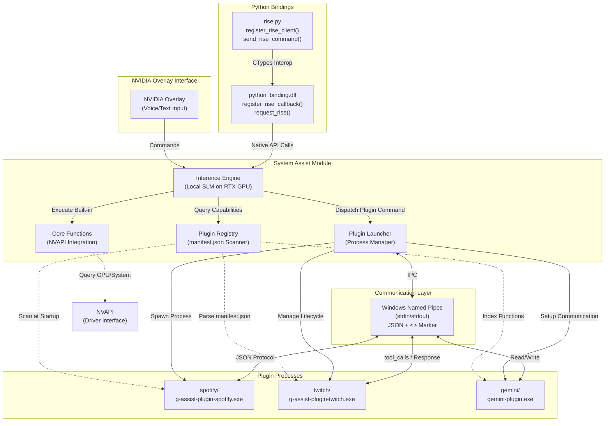

**Sources:** [README.md:120-133](), [api/bindings/python/README.md:1-20](), [plugins/examples/twitch/README.md:298-401]()

### Data Flow Architecture

```mermaid
graph LR
    subgraph "Input Sources"
        UserVoice["User Voice Command"]
        UserText["User Text Command"]
        PythonApp["Python Application<br/>rise.send_rise_command()"]
    end
    
    subgraph "System Assist Module Processing"
        CommandReceiver["Command Receiver"]
        InferenceEngine["Inference Engine<br/>(SLM Analysis)"]
        FunctionResolver["Function Resolver"]
        
        CommandReceiver --> InferenceEngine
        InferenceEngine --> FunctionResolver
        
        FunctionResolver -->|"Core Function"| CoreExecutor["Core Function Executor"]
        FunctionResolver -->|"Plugin Function"| PluginDispatcher["Plugin Dispatcher"]
    end
    
    subgraph "Execution Layer"
        CoreExecutor --> NVAPI["NVAPI Calls"]
        PluginDispatcher --> PluginLauncher["Plugin Launcher"]
        PluginLauncher --> PluginProcess["Plugin Process<br/>plugin.exe"]
        
        PluginProcess -->|"read_command()"| PipeIn["stdin Pipe"]
        PluginProcess -->|"write_response()"| PipeOut["stdout Pipe"]
    end
    
    subgraph "Response Path"
        NVAPI --> ResponseFormatter["Response Formatter"]
        PipeOut --> ResponseFormatter
        ResponseFormatter --> OutputHandler["Output Handler"]
    end
    
    UserVoice --> CommandReceiver
    UserText --> CommandReceiver
    PythonApp --> CommandReceiver
    
    OutputHandler --> DisplayOverlay["NVIDIA Overlay Display"]
    OutputHandler --> PythonResponse["Python Response Object"]
```

**Sources:** [README.md:169-190](), [plugins/examples/twitch/README.md:270-295]()

## Command Processing Pipeline

The System Assist Module processes commands through a multi-stage pipeline:

### Stage 1: Command Reception

Commands arrive at the System Assist Module through two primary interfaces:

1. **NVIDIA Overlay Interface** - Voice or text commands from the G-Assist UI
2. **Python Bindings Interface** - Programmatic commands via `rise.send_rise_command()`

Both interfaces normalize input into a common internal format for processing by the Inference Engine.

**Sources:** [README.md:40-49](), [api/bindings/python/README.md:52-67]()

### Stage 2: Intent Analysis

The Inference Engine performs natural language understanding to extract:

```
Input: "What is my GPU?"
↓ [Inference Engine Analysis]
├─ Intent: Query GPU information
├─ Function Category: Core function
├─ Target Function: get_gpu_info
└─ Parameters: {} (none required)
```

```
Input: "Hey spotify, play some jazz"
↓ [Inference Engine Analysis]
├─ Intent: Play music
├─ Plugin: spotify (explicit)
├─ Function: play_music or search_and_play
└─ Parameters: { "query": "jazz", "type": "genre" }
```

**Sources:** [README.md:169-190](), [api/bindings/python/README.md:60-67]()

### Stage 3: Function Resolution

The Function Resolver queries the Plugin Registry to match the analyzed intent to available capabilities:

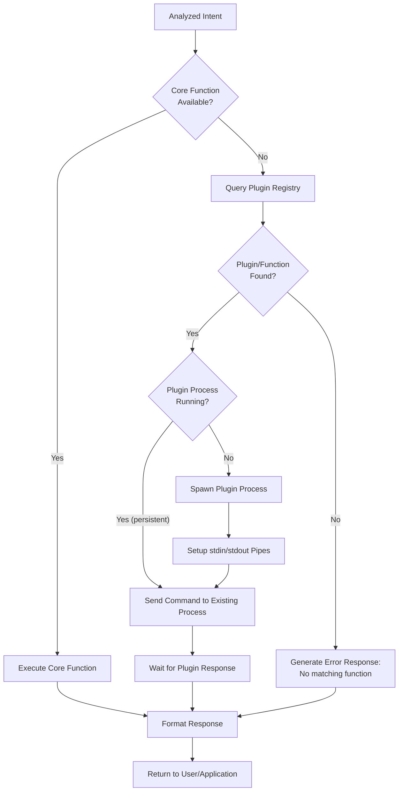

**Sources:** [README.md:169-190](), [README.md:141-160]()

### Stage 4: Execution

For **core functions**, execution occurs synchronously within the System Assist Module process, typically involving NVAPI calls.

For **plugin functions**, the Plugin Launcher:

1. Checks if plugin process is already running (for persistent plugins)
2. Spawns new process if needed (executable name from `manifest.json`)
3. Writes JSON command to stdin pipe:
   ```json
   {
       "tool_calls": [{
           "func": "check_twitch_live_status",
           "params": {
               "username": "nvidia"
           }
       }]
   }
   ```
4. Waits for response on stdout pipe (terminated by `<<END>>` marker)

**Sources:** [plugins/examples/twitch/README.md:381-399](), [README.md:151-158]()

### Stage 5: Response Handling

Plugin responses follow a standardized format:

```json
{
    "success": true,
    "message": "nvidia is LIVE!\nTitle: NVIDIA Gaming Stream\nGame: Cyberpunk 2077\nViewers: 1234"
}<<END>>
```

The System Assist Module:

1. Parses the JSON response
2. Checks the `success` field for error handling
3. Formats the `message` for display or returns it to the calling application
4. For non-persistent plugins, signals the Plugin Launcher to terminate the process

**Sources:** [plugins/examples/twitch/README.md:260-268](), [plugins/examples/twitch/README.md:393-399]()

## Plugin Lifecycle Management

### Discovery Phase

At startup, the Plugin Registry scans the plugins directory:

```
%PROGRAMDATA%\NVIDIA Corporation\nvtopps\rise\plugins\
```

For each subdirectory (e.g., `spotify/`, `twitch/`, `gemini/`), the registry:

1. Checks for `manifest.json` existence
2. Parses the manifest structure:
   - `manifestVersion`: Schema version (currently 1)
   - `executable`: Name of the plugin executable
   - `persistent`: Boolean indicating lifecycle mode
   - `functions`: Array of function definitions with names, descriptions, tags, and parameter schemas

3. Builds internal index mapping:
   - Function names → Plugin directory + executable
   - Description keywords → Function definitions
   - Tags → Function definitions

**Sources:** [README.md:141-160](), [plugins/examples/twitch/README.md:102-122]()

### Launch Phase

When a command targets a plugin function, the Plugin Launcher:

**For Non-Persistent Plugins** (`persistent: false`):
1. Spawns process: `CreateProcess(executable_path, ...)`
2. Creates anonymous pipes for stdin/stdout
3. Redirects process handles to pipes
4. Waits for process initialization
5. Sends command via stdin pipe
6. Waits for response on stdout pipe
7. Terminates process after response received

**For Persistent Plugins** (`persistent: true`):
1. On first invocation: Spawns process and keeps it running
2. Maintains pipe connections for duration of G-Assist session
3. Reuses existing process for subsequent commands
4. Process remains alive until G-Assist shutdown or explicit termination

**Sources:** [README.md:151-158](), [plugins/examples/twitch/README.md:102-122]()

### Execution Phase

During command execution, the plugin:

1. Reads command from stdin via `read_command()` function
2. Parses JSON to extract `tool_calls` array
3. Iterates through tool calls, matching `func` field to handler functions
4. Executes business logic (API calls, file operations, etc.)
5. Formats response as JSON with `success` and `message` fields
6. Writes response to stdout via `write_response()` with `<<END>>` marker

**Sources:** [plugins/examples/twitch/README.md:270-295](), [plugins/examples/twitch/README.md:298-367]()

### Termination Phase

The System Assist Module handles graceful shutdown:

1. **Shutdown Signal**: Sends `{"tool_calls": [{"func": "shutdown"}]}` to all running plugins
2. **Process Wait**: Allows plugins to clean up resources (close connections, save state)
3. **Force Termination**: If plugin doesn't exit within timeout, forcibly terminates process
4. **Pipe Cleanup**: Closes all pipe handles
5. **Registry Clear**: Releases plugin registry resources

**Sources:** [plugins/examples/twitch/README.md:270-295]()

## Communication Interfaces

### NVIDIA Overlay Interface

The NVIDIA Overlay serves as the primary user-facing interface for G-Assist. Commands flow from the overlay to the System Assist Module through an internal communication mechanism (implementation details not exposed in plugin API).

The overlay formats user voice/text input and transmits it to the SAM Command Receiver, which then invokes the Inference Engine for processing.

**Sources:** [README.md:3-13]()

### Plugin Communication Interface

The System Assist Module communicates with plugins via Windows Named Pipes using a JSON-based protocol:

**Command Format** (SAM → Plugin):
```json
{
    "tool_calls": [
        {
            "func": "function_name",
            "params": {
                "param1": "value1",
                "param2": "value2"
            }
        }
    ]
}
```

**Response Format** (Plugin → SAM):
```json
{
    "success": true,
    "message": "Response text for user"
}<<END>>
```

The `<<END>>` marker is critical for message framing, allowing the System Assist Module to detect response completion when reading from the stdout pipe.

Plugins implement this protocol using the Windows API directly:

- `GetStdHandle(STD_INPUT_HANDLE)` - Retrieve stdin pipe handle
- `ReadFile()` - Read command bytes from pipe
- `GetStdHandle(STD_OUTPUT_HANDLE)` - Retrieve stdout pipe handle  
- `WriteFile()` - Write response bytes to pipe

**Sources:** [plugins/examples/twitch/README.md:298-367](), [plugins/examples/twitch/README.md:369-380]()

### Python Bindings Interface

The `rise` Python module provides a simplified interface to the System Assist Module through `python_binding.dll`:

**Registration** (`rise.register_rise_client()`):
1. Calls `register_rise_callback()` in `python_binding.dll`
2. Registers `base_function_callback()` as callback handler
3. Waits for `READY` signal indicating SAM connection established
4. Initializes global state variables: `response`, `chart`, `response_done`, `ready`, `progress_bar`

**Command Execution** (`rise.send_rise_command(command_string)`):
1. Calls `request_rise()` in `python_binding.dll` with command text
2. Resets `response_done` flag
3. Polls `response_done` in tight loop until callback sets it
4. Returns accumulated `response` string to caller

**Callback Processing** (`base_function_callback()`):
- Invoked asynchronously by `python_binding.dll` when SAM sends data
- Handles multiple content types:
  - `NV_RISE_CONTENT_TYPE_TEXT`: Appends to `response` string
  - `NV_RISE_CONTENT_TYPE_GRAPH`: Stores chart data in `chart` variable
  - `NV_RISE_CONTENT_TYPE_PROGRESS_UPDATE`: Updates `progress_bar` value
  - `NV_RISE_CONTENT_TYPE_READY`: Sets `ready` flag
- Sets `response_done` flag when complete

The DLL layer uses CTypes structures (`NV_RISE_CALLBACK_DATA_V1`, `NV_REQUEST_RISE_SETTINGS_V1`) to bridge Python and native C++ code, providing access to NVAPI and the RISE Backend (Runtime Inference System Engine).

**Sources:** [api/bindings/python/README.md:1-67]()

## Integration Points

### NVAPI Integration

Core functions within the System Assist Module leverage NVAPI to query hardware and driver state:

- GPU identification and specifications
- Driver version information  
- Display configuration and refresh rates
- Power management and thermal monitoring
- Performance metrics and frame rate statistics

The NVAPI headers ([nvapi.h:25283]()) define the interface exposed to G-Assist for these queries.

**Sources:** [README.md:28](), [api/bindings/python/README.md:16-18]()

### External API Integration

While the System Assist Module itself doesn't directly call external APIs, it orchestrates plugins that integrate with external services:

- **Gemini Plugin**: Google AI and Search APIs
- **Spotify Plugin**: Spotify Web API with OAuth 2.0 authentication  
- **Twitch Plugin**: Twitch Helix API with client credentials flow
- **Weather Plugin**: wttr.in HTTP API
- **Stock Plugin**: Twelve Data financial API
- **Discord Plugin**: Discord webhook and bot APIs

The SAM Plugin Launcher ensures these plugins have isolated configuration files (`config.json`) for API credentials, preventing credential leakage between plugins.

**Sources:** [README.md:193-201](), [plugins/examples/twitch/README.md:130-179]()

### Agentic Framework Integration

The Python bindings enable integration with agentic AI frameworks like Langflow. The `rise` module can be imported into agent nodes, allowing G-Assist to serve as:

- A tool provider for AI agents (executing commands on behalf of agents)
- An orchestration layer for multi-step AI workflows
- A hardware control interface for AI-driven automation

Applications can combine `rise.send_rise_command()` with other AI APIs to build complex autonomous systems that leverage G-Assist's local SLM and plugin ecosystem.

**Sources:** [README.md:12-13](), [api/bindings/python/README.md:1-10]()

---

# Page: Plugin Architecture

# Plugin Architecture

<details>
<summary>Relevant source files</summary>

The following files were used as context for generating this wiki page:

- [README.md](README.md)
- [api/bindings/python/README.md](api/bindings/python/README.md)
- [plugins/examples/gemini/.gitattributes](plugins/examples/gemini/.gitattributes)
- [plugins/examples/gemini/Release/g-assist-plugin-google.exe](plugins/examples/gemini/Release/g-assist-plugin-google.exe)
- [plugins/examples/gemini/Release/manifest.json](plugins/examples/gemini/Release/manifest.json)
- [plugins/examples/gemini/gemini.py](plugins/examples/gemini/gemini.py)
- [plugins/examples/gemini/manifest.json](plugins/examples/gemini/manifest.json)
- [plugins/examples/gemini/requirements.txt](plugins/examples/gemini/requirements.txt)
- [plugins/examples/twitch/README.md](plugins/examples/twitch/README.md)

</details>


This document describes the modular plugin system in G-Assist, including the plugin directory structure, discovery mechanism, manifest specification, and plugin lifecycle modes. It focuses on how plugins are organized, discovered, and configured by the System Assist Module.

For details about how plugins communicate with G-Assist, see [Communication Protocol](#3.3). For information about how plugins are invoked by users, see [Plugin Invocation Methods](#3.4). For implementing a plugin, see [Plugin Development Guide](#5).

## Overview

G-Assist uses a plugin-based architecture where each plugin is a self-contained executable process that extends G-Assist's capabilities. Plugins are discovered at runtime through a directory scanning mechanism that reads `manifest.json` files to understand each plugin's capabilities.

The plugin system enables:
- Isolation: Each plugin runs in its own process space
- Discoverability: Plugins declare their functions through standardized manifests
- Extensibility: New plugins can be added without modifying G-Assist core
- Flexibility: Plugins can be persistent (long-running) or non-persistent (spawned on-demand)

**Sources:** [README.md:135-191]()

## Plugin Directory Structure

Each plugin resides in a dedicated subdirectory within the G-Assist plugins directory. The subdirectory name serves as the plugin's identifier for direct invocation.

### Standard Directory Layout

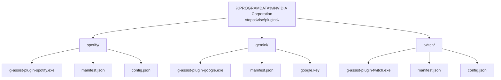

**Sources:** [README.md:143-149]()

### Plugin Directory Components

| File/Directory | Required | Purpose |
|---------------|----------|---------|
| Plugin directory name | Yes | Used as invocation identifier (e.g., "spotify" allows "Hey spotify, ...") |
| Executable (`.exe`) | Yes | Plugin process that handles commands |
| `manifest.json` | Yes | Declares plugin capabilities, functions, and metadata |
| `config.json` | No | Runtime configuration and API credentials |
| API key files | No | External service credentials (e.g., `google.key`) |

The directory name convention determines how users invoke the plugin directly. For example, a plugin in the `logiled/` directory can be invoked with "Hey logiled, change my keyboard lights to green".

**Sources:** [README.md:141-160](), [plugins/examples/twitch/README.md:51-59]()

## Plugin Discovery Process

G-Assist discovers plugins at startup by scanning the plugins directory and parsing each plugin's manifest file.

### Discovery Workflow

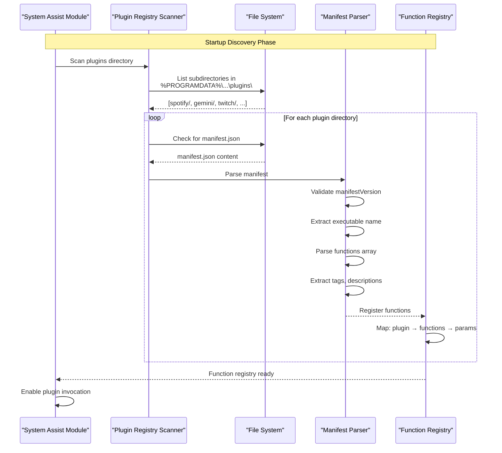

**Sources:** [README.md:162-166]()

### Discovery Details

The discovery process:

1. **Directory Enumeration**: Scans `%PROGRAMDATA%\NVIDIA Corporation\nvtopps\rise\plugins\` for subdirectories
2. **Manifest Location**: Each subdirectory must contain a `manifest.json` file
3. **Manifest Parsing**: Reads and validates the manifest structure
4. **Function Registration**: Builds an index mapping function names, descriptions, and tags to plugin executables
5. **Invocation Enablement**: Makes functions available for both zero-shot and direct invocation modes

The registry enables the System Assist Module's inference engine to match user intent to appropriate plugin functions.

**Sources:** [README.md:165-166]()

## Manifest File Specification

The `manifest.json` file is the contract between a plugin and G-Assist, declaring all functions the plugin can execute.

### Manifest Schema

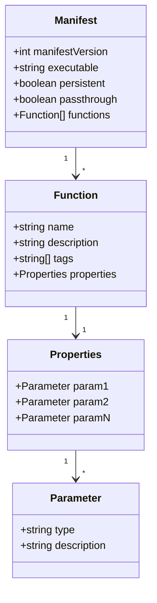

**Sources:** [README.md:152-158](), [plugins/examples/gemini/manifest.json:1-23](), [plugins/examples/twitch/README.md:103-122]()

### Manifest Fields

#### Top-Level Fields

| Field | Type | Required | Description |
|-------|------|----------|-------------|
| `manifestVersion` | integer | Yes | Schema version (currently `1`) |
| `executable` | string | Yes | Name of executable file (e.g., `"g-assist-plugin-twitch.exe"`) |
| `persistent` | boolean | Yes | If `true`, plugin remains running; if `false`, spawned per-invocation |
| `passthrough` | boolean | No | If `true`, allows streaming response chunks back to G-Assist |
| `functions` | array | Yes | Array of function definitions |

**Sources:** [README.md:152-158](), [plugins/examples/gemini/manifest.json:3-5]()

#### Function Definition Fields

Each object in the `functions` array contains:

| Field | Type | Required | Description |
|-------|------|----------|-------------|
| `name` | string | Yes | Function identifier used in `tool_calls` |
| `description` | string | Yes | Natural language description for AI matching |
| `tags` | string[] | Yes | Keywords for discovery and zero-shot invocation |
| `properties` | object | Yes | Parameter definitions |

**Sources:** [plugins/examples/twitch/README.md:110-119]()

#### Parameter Definition Fields

Each property in the `properties` object contains:

| Field | Type | Required | Description |
|-------|------|----------|-------------|
| `type` | string | Yes | Parameter type (e.g., `"string"`) |
| `description` | string | Yes | Natural language description for parameter extraction |

**Sources:** [plugins/examples/twitch/README.md:114-117]()

### Example: Twitch Plugin Manifest

```json
{
  "manifestVersion": 1,
  "executable": "g-assist-plugin-twitch.exe",
  "persistent": false,
  "functions": [
    {
      "name": "check_twitch_live_status",
      "description": "Checks if a Twitch user is live and retrieves stream details.",
      "tags": ["twitch", "live_status"],
      "properties": {
        "username": {
          "type": "string",
          "description": "The Twitch username to check."
        }
      }
    }
  ]
}
```

**Sources:** [plugins/examples/twitch/README.md:103-122]()

### Example: Gemini Plugin Manifest

```json
{
  "manifestVersion": 1,
  "executable": "g-assist-plugin-google.exe",
  "persistent": false,
  "passthrough": true,
  "functions": [
    {
      "name": "query_gemini",
      "description": "Google/Gemini tool search for real time access of general topic queries including but not limited to gaming wiki queries, weather, news, food, etc.",
      "tags": ["gemini", "google", "chat", "question", "answers", "query", "knowledge", "queries"],
      "properties": {
        "input": {
          "type": "string",
          "description": "the user's input"
        },
        "game": {
          "type": "string",
          "description": "an optional parameter that specifies which game is currently being played"
        }
      }
    }
  ]
}
```

**Sources:** [plugins/examples/gemini/manifest.json:1-23]()

### Manifest Usage in Discovery

The System Assist Module uses manifest data to:

1. **Function Matching**: Match user queries to functions using `description` and `tags` fields
2. **Parameter Extraction**: Parse user input to extract values for parameters defined in `properties`
3. **Plugin Selection**: Determine which plugin to launch based on function ownership
4. **Process Management**: Use `persistent` flag to decide whether to spawn a new process or reuse an existing one

**Sources:** [README.md:165-191]()

## Plugin Lifecycle Modes

Plugins operate in one of two lifecycle modes determined by the `persistent` field in their manifest.

### Lifecycle Mode Comparison

```mermaid
graph TB
    subgraph NonPersistent["Non-Persistent Plugin (persistent: false)"]
        NP1["User Command Received"]
        NP2["Plugin Launcher spawns process"]
        NP3["Process executes command"]
        NP4["Process writes response"]
        NP5["Process terminates"]
        
        NP1 --> NP2
        NP2 --> NP3
        NP3 --> NP4
        NP4 --> NP5
    end
    
    subgraph Persistent["Persistent Plugin (persistent: true)"]
        P1["G-Assist Startup"]
        P2["Plugin Launcher spawns process"]
        P3["Process enters listen loop"]
        P4["User Command 1 Received"]
        P5["Process executes command"]
        P6["Process writes response"]
        P7["Process returns to listen loop"]
        P8["User Command 2 Received"]
        P9["Process executes command"]
        P10["Process writes response"]
        P11["Process continues listening..."]
        
        P1 --> P2
        P2 --> P3
        P3 --> P4
        P4 --> P5
        P5 --> P6
        P6 --> P7
        P7 --> P8
        P8 --> P9
        P9 --> P10
        P10 --> P11
    end
```

**Sources:** [README.md:157]()

### Non-Persistent Plugins

**Configuration:** `"persistent": false`

**Behavior:**
- Process spawned only when function is invoked
- Process executes single command and terminates
- No state preservation between invocations
- Lower resource usage when idle

**Use Cases:**
- Stateless API queries (weather, stock prices)
- One-time operations (file conversions)
- Plugins invoked infrequently

**Example Plugins:**
- Twitch: Spawned per stream status check
- Gemini: Spawned per query

**Sources:** [README.md:157](), [plugins/examples/twitch/README.md:107](), [plugins/examples/gemini/manifest.json:4]()

### Persistent Plugins

**Configuration:** `"persistent": true`

**Behavior:**
- Process spawned at G-Assist startup
- Process runs continuously, listening for commands
- Can maintain state across invocations
- Faster response times (no spawn overhead)

**Use Cases:**
- Hardware control requiring state (RGB lighting patterns)
- Services requiring authentication persistence
- High-frequency operations
- Plugins needing startup initialization

**Example Plugins:**
- Hardware control plugins (Corsair, LogiLED, Nanoleaf)
- Services maintaining connections

**Sources:** [README.md:157]()

### Lifecycle Mode Selection

| Consideration | Non-Persistent | Persistent |
|--------------|----------------|------------|
| Resource efficiency | Better for infrequent use | Better for frequent use |
| Response latency | Higher (spawn overhead) | Lower (process ready) |
| State preservation | Not supported | Supported |
| Initialization cost | Paid per invocation | Paid once at startup |
| Idle resource usage | None | Process memory + CPU |

**Sources:** [README.md:157]()

## Plugin File Organization

Beyond the manifest, plugins typically include additional files for configuration and secrets management.

### Standard Plugin Files

```mermaid
graph TB
    PluginDir["Plugin Directory (e.g., twitch)"]
    
    PluginDir --> Exe["Executable<br/>g-assist-plugin-*.exe<br/>(Required)"]
    PluginDir --> Manifest["manifest.json<br/>(Required)"]
    PluginDir --> Config["config.json<br/>(Optional)"]
    PluginDir --> Secrets["API Keys<br/>*.key files<br/>(Optional)"]
    
    Exe --> ExeNote["Binary produced by PyInstaller<br/>or C++ compiler"]
    Manifest --> ManifestNote["Function declarations<br/>Read by Plugin Registry"]
    Config --> ConfigNote["Runtime configuration<br/>API credentials<br/>Should be in .gitignore"]
    Secrets --> SecretsNote["External service tokens<br/>Should be in .gitignore"]
```

**Sources:** [README.md:143-159](), [plugins/examples/twitch/README.md:51-59]()

### Configuration File Pattern

The `config.json` file stores runtime configuration and credentials:

**Purpose:**
- API keys and secrets
- Service endpoints
- User preferences
- Plugin-specific settings

**Location:** Same directory as plugin executable  
**Security:** Must be added to `.gitignore` to prevent credential leaks

**Example Structure:**
```json
{
  "TWITCH_CLIENT_ID": "your_client_id_here",
  "TWITCH_CLIENT_SECRET": "your_client_secret_here"
}
```

**Code Usage:** Plugins read this file at startup [plugins/examples/twitch/README.md:154-178]()

**Sources:** [README.md:158](), [plugins/examples/twitch/README.md:124-129]()

### Executable Naming Convention

Plugin executables follow the naming pattern: `g-assist-plugin-<name>.exe`

**Examples:**
- `g-assist-plugin-twitch.exe` for Twitch plugin
- `g-assist-plugin-google.exe` for Gemini plugin
- `g-assist-plugin-spotify.exe` for Spotify plugin

The executable name must match the `executable` field in `manifest.json` exactly.

**Sources:** [README.md:146](), [plugins/examples/twitch/README.md:106](), [plugins/examples/gemini/manifest.json:3]()

## Manifest-Driven Function Registry

The System Assist Module builds a function registry from all discovered manifests, enabling both zero-shot and direct invocation modes.

### Registry Construction

```mermaid
graph LR
    M1["spotify/manifest.json"]
    M2["gemini/manifest.json"]
    M3["twitch/manifest.json"]
    
    P1["Parser"]
    
    R["Function Registry"]
    
    M1 --> P1
    M2 --> P1
    M3 --> P1
    
    P1 --> R
    
    R --> F1["play_music<br/>tags: [music, play, spotify]"]
    R --> F2["query_gemini<br/>tags: [google, search, knowledge]"]
    R --> F3["check_twitch_live_status<br/>tags: [twitch, live_status]"]
    
    R --> I["Inference Engine"]
    I --> ZS["Zero-Shot Matching:<br/>User: 'Play some jazz'<br/>→ Matches 'play_music'"]
    I --> DR["Direct Invocation:<br/>User: 'Hey twitch...'<br/>→ Routes to twitch plugin"]
```

**Sources:** [README.md:165-191]()

### Registry Data Structure

For each function, the registry maintains:

| Field | Source | Use |
|-------|--------|-----|
| Function name | `manifest.json → functions[].name` | Command routing |
| Plugin directory | Directory name | Plugin identification |
| Executable path | `manifest.json → executable` | Process spawning |
| Description | `manifest.json → functions[].description` | AI intent matching |
| Tags | `manifest.json → functions[].tags` | Keyword-based search |
| Parameter schema | `manifest.json → functions[].properties` | Argument validation |
| Persistence mode | `manifest.json → persistent` | Lifecycle management |

This registry enables the System Assist Module to route user commands to appropriate plugins without hardcoded plugin logic.

**Sources:** [README.md:152-191]()

## Plugin Interface Contract

The manifest establishes a formal interface between G-Assist and plugins:

### G-Assist Responsibilities

1. Scan plugin directories at startup
2. Parse and validate manifest files
3. Build function registry
4. Match user intent to registered functions
5. Launch plugin processes according to `persistent` flag
6. Send commands with extracted parameters
7. Handle responses and stream output to users

### Plugin Responsibilities

1. Provide valid `manifest.json` with `manifestVersion: 1`
2. Implement all functions declared in manifest
3. Accept commands via stdin pipe in JSON format
4. Validate incoming parameters against manifest schema
5. Write responses to stdout pipe with `<<END>>` marker
6. Handle `initialize` and `shutdown` commands
7. Implement continuous listen loop if `persistent: true`

This contract enables plugins to be developed independently while maintaining compatibility with G-Assist core.

**Sources:** [README.md:135-191](), [plugins/examples/twitch/README.md:270-295]()

---

# Page: Communication Protocol

# Communication Protocol

<details>
<summary>Relevant source files</summary>

The following files were used as context for generating this wiki page:

- [README.md](README.md)
- [api/bindings/python/README.md](api/bindings/python/README.md)
- [plugins/examples/twitch/README.md](plugins/examples/twitch/README.md)
- [plugins/examples/twitch/plugin.py](plugins/examples/twitch/plugin.py)

</details>


## Purpose and Scope

This document describes the inter-process communication (IPC) protocol used between G-Assist's Plugin Launcher and plugin processes. The protocol is based on Windows Named Pipes with a JSON-based message format. This page covers the pipe mechanism, message structure, the `tool_calls` command format, the `<<END>>` termination marker, and implementation details for reading and writing messages.

For information about how plugins are discovered and registered, see [Plugin Architecture](#3.2). For details on how the AI model selects which plugins to invoke, see [Plugin Invocation Methods](#3.4).

## Protocol Overview

G-Assist plugins communicate with the Plugin Launcher using Windows Named Pipes connected to the plugin process's standard input (stdin) and standard output (stdout). The Plugin Launcher writes JSON-formatted commands to the plugin's stdin, and the plugin writes JSON-formatted responses to its stdout. All responses must be terminated with the `<<END>>` marker to signal message completion.

```mermaid
graph LR
    PL["Plugin Launcher"]
    Stdin["stdin pipe<br/>(STD_INPUT_HANDLE)"]
    Plugin["Plugin Process<br/>plugin.py"]
    Stdout["stdout pipe<br/>(STD_OUTPUT_HANDLE)"]
    
    PL -->|"writes JSON command"| Stdin
    Stdin --> Plugin
    Plugin -->|"read_command()"| Plugin
    Plugin -->|"write_response()"| Plugin
    Plugin -->|"writes JSON + <<END>>"| Stdout
    Stdout --> PL
```

**Sources:** [README.md:86-88](), [plugins/examples/twitch/README.md:298-401]()

## Command Message Format

Commands sent from the Plugin Launcher to plugins follow a standardized JSON structure with a `tool_calls` array. Each element in the array specifies a function to execute and its parameters.

### Command Structure

| Field | Type | Required | Description |
|-------|------|----------|-------------|
| `tool_calls` | array | Yes | Array of function calls to execute |
| `tool_calls[].func` | string | Yes | Name of the function to invoke |
| `tool_calls[].params` | object | No | Dictionary of parameters for the function |

### Example Command

```json
{
    "tool_calls": [
        {
            "func": "check_twitch_live_status",
            "params": {
                "username": "nvidia"
            }
        }
    ]
}
```

The `func` field must match one of the function names defined in the plugin's `manifest.json` file. The `params` object contains key-value pairs where keys correspond to the property names defined in the manifest's function schema.

**Sources:** [plugins/examples/twitch/README.md:381-391](), [plugins/examples/twitch/plugin.py:237-258]()

## Response Message Format

Plugins must respond with a JSON object containing a `success` field and an optional `message` field. The response must be terminated with the `<<END>>` marker.

### Response Structure

| Field | Type | Required | Description |
|-------|------|----------|-------------|
| `success` | boolean | Yes | Indicates whether the operation succeeded |
| `message` | string | No | Human-readable result message |

### Example Responses

**Successful response:**
```json
{
    "success": true,
    "message": "nvidia is LIVE!\nTitle: NVIDIA Gaming Stream\nGame: Cyberpunk 2077\nViewers: 1234"
}<<END>>
```

**Error response:**
```json
{
    "success": false,
    "message": "Failed to authenticate with Twitch"
}<<END>>
```

The `<<END>>` marker is mandatory and signals to the Plugin Launcher that the response is complete. Without this marker, the launcher will continue reading from the pipe indefinitely.

**Sources:** [plugins/examples/twitch/README.md:262-268](), [plugins/examples/twitch/README.md:393-399](), [plugins/examples/twitch/plugin.py:297-324]()

## The <<END>> Marker Protocol

The `<<END>>` marker serves as a message termination indicator in the pipe protocol. This marker solves the problem of message boundary detection in streaming protocols.

### Why <<END>> is Required

Windows Named Pipes do not have built-in message boundaries. When reading from a pipe, the receiver must know when a complete message has been received. The `<<END>>` marker provides this signal without requiring message length prefixes or complex framing protocols.

### Implementation Details

The marker is appended directly to the JSON string before encoding to bytes:

```python
json_message = json.dumps(response) + '<<END>>'
```

The Plugin Launcher reads from the plugin's stdout pipe until it encounters the `<<END>>` sequence, at which point it knows the response is complete and can parse the JSON.

**Sources:** [plugins/examples/twitch/README.md:369-372](), [plugins/examples/twitch/plugin.py:310-313]()

## Windows Pipe Implementation

Plugins use the Windows API via `ctypes` to read from stdin and write to stdout pipes. The implementation handles chunked reading for large messages and proper error handling.

### Pipe Handle Constants

```python
STD_INPUT_HANDLE = -10   # Windows constant for stdin
STD_OUTPUT_HANDLE = -11  # Windows constant for stdout
BUFFER_SIZE = 4096       # Size of read buffer in bytes
```

These constants are used with `windll.kernel32.GetStdHandle()` to obtain pipe handles.

**Sources:** [plugins/examples/twitch/plugin.py:41-48]()

### Reading Commands from Stdin

The `read_command()` function implements chunked reading from the stdin pipe:

```mermaid
flowchart TD
    Start["read_command()"]
    GetHandle["pipe = GetStdHandle(STD_INPUT_HANDLE)"]
    InitChunks["chunks = []"]
    ReadLoop["ReadFile(pipe, buffer, BUFFER_SIZE)"]
    CheckSuccess{"success?"}
    DecodeChunk["chunk = buffer.decode('utf-8')"]
    AppendChunk["chunks.append(chunk)"]
    CheckSize{"message_bytes < BUFFER_SIZE?"}
    JoinChunks["message = ''.join(chunks)"]
    ParseJSON["return json.loads(message)"]
    Error["log error, return None"]
    
    Start --> GetHandle
    GetHandle --> InitChunks
    InitChunks --> ReadLoop
    ReadLoop --> CheckSuccess
    CheckSuccess -->|"No"| Error
    CheckSuccess -->|"Yes"| DecodeChunk
    DecodeChunk --> AppendChunk
    AppendChunk --> CheckSize
    CheckSize -->|"No (continue reading)"| ReadLoop
    CheckSize -->|"Yes (end of message)"| JoinChunks
    JoinChunks --> ParseJSON
```

The function reads in chunks because messages may exceed the buffer size. The loop continues until `ReadFile()` returns fewer bytes than `BUFFER_SIZE`, indicating the end of the message.

**Sources:** [plugins/examples/twitch/plugin.py:237-295](), [plugins/examples/twitch/README.md:302-343]()

### Writing Responses to Stdout

The `write_response()` function writes JSON responses with the `<<END>>` marker:

```mermaid
flowchart TD
    Start["write_response(response)"]
    GetHandle["pipe = GetStdHandle(STD_OUTPUT_HANDLE)"]
    AddMarker["json_message = json.dumps(response) + '<<END>>'"]
    Encode["message_bytes = json_message.encode('utf-8')"]
    WriteFile["WriteFile(pipe, message_bytes, len(message_bytes))"]
    Success["return"]
    Error["log error"]
    
    Start --> GetHandle
    GetHandle --> AddMarker
    AddMarker --> Encode
    Encode --> WriteFile
    WriteFile --> Success
    WriteFile -.->|"exception"| Error
```

The response is written in a single `WriteFile()` call. The Windows kernel handles buffering if the message exceeds pipe buffer capacity.

**Sources:** [plugins/examples/twitch/plugin.py:297-324](), [plugins/examples/twitch/README.md:345-367]()

## Complete Message Flow

This diagram shows the full communication lifecycle between the Plugin Launcher and a plugin process, mapping natural language operations to specific code entities:

```mermaid
sequenceDiagram
    participant PL as "Plugin Launcher"
    participant StdinPipe as "stdin pipe"
    participant PluginMain as "main()"
    participant ReadCmd as "read_command()"
    participant FuncHandler as "check_twitch_live_status()"
    participant WriteResp as "write_response()"
    participant StdoutPipe as "stdout pipe"
    
    Note over PL,StdoutPipe: Command Transmission
    PL->>StdinPipe: "Write JSON command"
    Note right of StdinPipe: {"tool_calls": [{"func": "...", "params": {...}}]}
    
    Note over PluginMain,ReadCmd: Command Reading (plugins/examples/twitch/plugin.py:370-373)
    PluginMain->>ReadCmd: "call read_command()"
    ReadCmd->>StdinPipe: "GetStdHandle(STD_INPUT_HANDLE)"
    loop "Read chunks until message_bytes < BUFFER_SIZE"
        ReadCmd->>StdinPipe: "ReadFile(pipe, buffer, 4096)"
        StdinPipe-->>ReadCmd: "chunk data"
    end
    ReadCmd->>ReadCmd: "json.loads(''.join(chunks))"
    ReadCmd-->>PluginMain: "return command dict"
    
    Note over PluginMain,FuncHandler: Function Routing (plugins/examples/twitch/plugin.py:376-384)
    PluginMain->>PluginMain: "tool_calls = command.get('tool_calls', [])"
    PluginMain->>PluginMain: "func = tool_call.get('func')"
    PluginMain->>FuncHandler: "check_twitch_live_status(params)"
    FuncHandler->>FuncHandler: "process parameters"
    FuncHandler->>FuncHandler: "call external API"
    FuncHandler-->>PluginMain: "return response dict"
    
    Note over PluginMain,StdoutPipe: Response Writing (plugins/examples/twitch/plugin.py:392)
    PluginMain->>WriteResp: "write_response(response)"
    WriteResp->>WriteResp: "json.dumps(response) + '<<END>>'"
    WriteResp->>StdoutPipe: "GetStdHandle(STD_OUTPUT_HANDLE)"
    WriteResp->>StdoutPipe: "WriteFile(pipe, message_bytes)"
    StdoutPipe-->>PL: "JSON response + <<END>>"
    
    Note over PL: Parse response when <<END>> detected
```

**Sources:** [plugins/examples/twitch/plugin.py:348-393]()

## Error Handling in the Protocol

Both reading and writing operations include error handling to manage pipe failures, JSON parsing errors, and encoding issues.

### Read Error Scenarios

| Error Type | Detection | Handling |
|------------|-----------|----------|
| Pipe read failure | `ReadFile()` returns `False` | Log error, return `None` from `read_command()` |
| Invalid JSON | `json.loads()` raises `JSONDecodeError` | Log error with raw input, return `None` |
| Encoding errors | `decode('utf-8')` raises `UnicodeDecodeError` | Log error, return `None` |

When `read_command()` returns `None`, the main loop continues and attempts to read the next command rather than crashing the plugin.

**Sources:** [plugins/examples/twitch/plugin.py:289-295](), [plugins/examples/twitch/plugin.py:370-374]()

### Write Error Scenarios

| Error Type | Detection | Handling |
|------------|-----------|----------|
| Pipe write failure | `WriteFile()` fails | Log error via exception handler |
| Encoding errors | `encode('utf-8')` raises `UnicodeEncodeError` | Caught by exception handler |
| JSON serialization failure | `json.dumps()` raises `TypeError` | Caught by exception handler |

Write errors are logged but not propagated. The plugin continues running and can process subsequent commands.

**Sources:** [plugins/examples/twitch/plugin.py:323-324]()

## Plugin Main Loop Pattern

All plugins follow a standard main loop pattern that continuously reads commands, routes them to handlers, and writes responses:

```mermaid
flowchart TD
    Start["main()"]
    SetupLog["setup_logging()"]
    Loop["while True:"]
    ReadCmd["command = read_command()"]
    CheckNone{"command is None?"}
    GetToolCalls["tool_calls = command.get('tool_calls', [])"]
    ForEach["for tool_call in tool_calls:"]
    GetFunc["func = tool_call.get('func')"]
    GetParams["params = tool_call.get('params', {})"]
    Route["if func == 'check_twitch_live_status':"]
    CallHandler["response = check_twitch_live_status(params)"]
    Write["write_response(response)"]
    CheckShutdown{"func == 'shutdown'?"}
    Exit["return"]
    
    Start --> SetupLog
    SetupLog --> Loop
    Loop --> ReadCmd
    ReadCmd --> CheckNone
    CheckNone -->|"Yes (error)"| Loop
    CheckNone -->|"No"| GetToolCalls
    GetToolCalls --> ForEach
    ForEach --> GetFunc
    GetFunc --> GetParams
    GetParams --> Route
    Route --> CallHandler
    CallHandler --> Write
    Write --> CheckShutdown
    CheckShutdown -->|"Yes"| Exit
    CheckShutdown -->|"No"| Loop
```

This pattern ensures plugins can handle multiple commands in sequence and gracefully shutdown when requested.

**Sources:** [plugins/examples/twitch/plugin.py:348-393]()

## Protocol Conformance Requirements

For a plugin to properly integrate with G-Assist, it must:

1. **Read from stdin using Windows pipe APIs**: Use `GetStdHandle(STD_INPUT_HANDLE)` and `ReadFile()` with chunked reading [plugins/examples/twitch/plugin.py:260-287]()

2. **Write to stdout using Windows pipe APIs**: Use `GetStdHandle(STD_OUTPUT_HANDLE)` and `WriteFile()` [plugins/examples/twitch/plugin.py:311-322]()

3. **Parse incoming commands as JSON**: Extract `tool_calls` array and route to function handlers [plugins/examples/twitch/plugin.py:376-384]()

4. **Generate responses with required fields**: Include `success` boolean and optional `message` string [plugins/examples/twitch/plugin.py:156-169]()

5. **Terminate all responses with <<END>>**: Append marker before encoding and writing [plugins/examples/twitch/plugin.py:312]()

6. **Handle the shutdown command**: Exit gracefully when `func == "shutdown"` is received [plugins/examples/twitch/plugin.py:385-388]()

7. **Implement error handling**: Return `None` or log errors without crashing the process [plugins/examples/twitch/plugin.py:289-295]()

Failure to conform to these requirements will result in plugin communication failures, timeouts, or process hangs.

**Sources:** [plugins/examples/twitch/README.md:369-380](), [plugins/examples/twitch/plugin.py:237-393]()

---

# Page: Plugin Invocation Methods

# Plugin Invocation Methods

<details>
<summary>Relevant source files</summary>

The following files were used as context for generating this wiki page:

- [README.md](README.md)
- [api/bindings/python/README.md](api/bindings/python/README.md)
- [plugins/examples/twitch/README.md](plugins/examples/twitch/README.md)

</details>


## Purpose and Scope

This document explains how G-Assist determines which plugin and function to execute in response to user commands. It covers the two primary invocation methods—zero-shot function calling and direct plugin invocation—and describes how the System Assist Module's inference engine analyzes user intent to route commands appropriately.

For details on the System Assist Module's architecture, see [System Assist Module](#3.1). For information on the plugin manifest structure and function definitions, see [Plugin Architecture](#3.2). For the communication protocol used after invocation, see [Communication Protocol](#3.3).

## Invocation Methods Overview

G-Assist supports two distinct methods for invoking plugins, each optimized for different use cases:

| Method | Syntax Example | AI Role | Speed | Use Case |
|--------|---------------|---------|-------|----------|
| **Zero-Shot Function Calling** | `/fc What are the top upcoming games for 2025?` | Analyzes intent, selects plugin, chooses function, extracts parameters | Slower (full AI analysis) | When plugin is unknown or command is complex |
| **Direct Plugin Invocation** | `Hey spotify, play some jazz` or `/spotify play some jazz` | Determines function within specified plugin, extracts parameters | Faster (plugin pre-selected) | When user knows which plugin to use |

**Sources:** [README.md:163-191]()

## Zero-Shot Function Calling

### Mechanism

In zero-shot invocation, users issue natural language commands without specifying a plugin. The System Assist Module's inference engine analyzes the command and automatically determines:

1. Which plugin is most appropriate
2. Which function within that plugin to call
3. What parameter values to extract from the command

The matching process leverages the `description` and `tags` fields from each function definition in `manifest.json` files across all discovered plugins.

### Zero-Shot Invocation Flow

```mermaid
graph TD
    UserCmd["User Command: 'What are the top games for 2025?'"]
    SAM["System Assist Module<br/>Inference Engine"]
    Registry["Plugin Registry<br/>Indexed manifest.json files"]
    
    UserCmd --> SAM
    SAM --> |"Query function catalog"| Registry
    
    Registry --> |"Return candidate functions:<br/>- gemini/search_web<br/>- gemini/query_gemini"| SAM
    
    SAM --> Match["Intent Matching Algorithm<br/>Compare command to:<br/>- function descriptions<br/>- function tags<br/>- parameter descriptions"]
    
    Match --> Score["Scoring:<br/>gemini/search_web: 0.95<br/>gemini/query_gemini: 0.72"]
    
    Score --> Select["Select: gemini/search_web"]
    
    Select --> Extract["Parameter Extraction:<br/>query: 'top games for 2025'<br/>type: inferred as 'search'"]
    
    Extract --> Launch["Plugin Launcher<br/>Execute gemini plugin"]
    
    Launch --> Pipe["Send via Named Pipe:<br/>{<br/>  'tool_calls': [{<br/>    'func': 'search_web',<br/>    'params': {'query': 'top games for 2025'}<br/>  }]<br/>}"]
```

**Sources:** [README.md:169-177]()

### Example: Zero-Shot Weather Query

Consider the command: `"What's the weather like today?"`

1. **Intent Analysis**: The inference engine parses the command and identifies weather-related keywords
2. **Plugin Selection**: Scans all `manifest.json` files for functions with `tags` containing "weather" or descriptions mentioning weather information
3. **Function Matching**: Identifies `weather/get_weather_info` based on its description: "Retrieves current weather information"
4. **Parameter Extraction**: Extracts location from context (user's system location) or defaults to configured location
5. **Invocation**: Launches weather plugin with extracted parameters

### When to Use Zero-Shot

- User is unfamiliar with available plugins
- Command spans multiple possible plugins
- Natural language query is more intuitive than plugin names
- Exploratory interactions where optimal plugin is unclear

**Sources:** [README.md:169-177]()

## Direct Plugin Invocation

### Mechanism

Direct invocation allows users to explicitly specify which plugin to use by including the plugin's directory name in the command. The plugin name can be prefixed with "Hey" or "/":

- Natural: `Hey twitch, is Ninja live?`
- Command: `/twitch is Ninja live?`

The System Assist Module:
1. Extracts the plugin name from the command prefix
2. Loads only that plugin's `manifest.json`
3. Uses the inference engine to determine which function within the plugin to call
4. Extracts parameters from the remaining command text

### Direct Invocation Flow

```mermaid
graph TD
    UserCmd["User Command: 'Hey spotify, play some jazz'"]
    Parse["Command Parser<br/>Extract plugin keyword"]
    
    UserCmd --> Parse
    Parse --> |"Plugin: 'spotify'<br/>Remainder: 'play some jazz'"| SAM["System Assist Module"]
    
    SAM --> Registry["Plugin Registry<br/>Lookup 'spotify' directory"]
    
    Registry --> |"Found: %PROGRAMDATA%\NVIDIA Corporation\<br/>nvtopps\rise\plugins\spotify\<br/>manifest.json"| LoadManifest["Load Manifest<br/>Available functions:<br/>- play_track<br/>- pause_playback<br/>- skip_track<br/>- search_and_play"]
    
    LoadManifest --> AIMatch["AI Function Matching<br/>Analyze 'play some jazz' against:<br/>- play_track (exact song)<br/>- search_and_play (query)"]
    
    AIMatch --> SelectFunc["Select: search_and_play<br/>Best match for query-based playback"]
    
    SelectFunc --> ExtractParams["Parameter Extraction:<br/>query: 'jazz'<br/>type: 'genre'"]
    
    ExtractParams --> Launch["Plugin Launcher<br/>Spawn/reuse spotify plugin process"]
    
    Launch --> Pipe["Send via Named Pipe:<br/>{<br/>  'tool_calls': [{<br/>    'func': 'search_and_play',<br/>    'params': {<br/>      'query': 'jazz',<br/>      'type': 'genre'<br/>    }<br/>  }]<br/>}"]
```

**Sources:** [README.md:179-191]()

### Plugin Name Resolution

The plugin name in direct invocation maps directly to the plugin's directory name:

| User Command | Plugin Directory | Executable |
|-------------|-----------------|------------|
| `Hey twitch, ...` | `plugins/twitch/` | `g-assist-plugin-twitch.exe` |
| `/spotify ...` | `plugins/spotify/` | `g-assist-plugin-spotify.exe` |
| `Hey logiled, ...` | `plugins/logiled/` | `g-assist-plugin-logiled.exe` |

The directory name under `%PROGRAMDATA%\NVIDIA Corporation\nvtopps\rise\plugins\` serves as the invocation keyword.

**Sources:** [README.md:141-160]()

### When to Use Direct Invocation

- User knows the specific plugin needed
- Faster execution (skips multi-plugin search)
- Disambiguation when multiple plugins could match
- Scripting or automation scenarios
- Debugging specific plugin behavior

**Sources:** [README.md:179-191]()

## Intent Analysis and Plugin Selection

### Manifest-Driven Discovery

The inference engine's ability to match commands to plugins depends entirely on the metadata provided in each plugin's `manifest.json`:

```mermaid
graph TB
    subgraph "Plugin Directory: twitch/"
        ManifestT["manifest.json"]
        FuncDef["functions: [<br/>  {<br/>    name: 'check_twitch_live_status'<br/>    description: 'Checks if a Twitch user is live...'<br/>    tags: ['twitch', 'live_status']<br/>    properties: {<br/>      username: {<br/>        type: 'string'<br/>        description: 'The Twitch username to check.'<br/>      }<br/>    }<br/>  }<br/>]"]
        
        ManifestT --> FuncDef
    end
    
    subgraph "Plugin Directory: spotify/"
        ManifestS["manifest.json"]
        FuncDefS["functions: [<br/>  {<br/>    name: 'search_and_play'<br/>    description: 'Search for music and play it'<br/>    tags: ['spotify', 'music', 'play']<br/>  }<br/>]"]
        
        ManifestS --> FuncDefS
    end
    
    subgraph "System Assist Module"
        Scanner["Plugin Registry Scanner<br/>Startup: scan all manifest.json files"]
        Index["Function Index<br/>plugin -> functions -> metadata"]
        
        Scanner --> Index
    end
    
    FuncDef --> Scanner
    FuncDefS --> Scanner
    
    Index --> SearchEngine["Zero-Shot Search Engine<br/>Semantic matching:<br/>- User intent vs descriptions<br/>- Keywords vs tags<br/>- Context vs parameters"]
    
    Index --> DirectLookup["Direct Lookup<br/>Plugin name -> function list"]
```

**Sources:** [README.md:141-160](), [plugins/examples/twitch/README.md:104-122]()

### Matching Algorithm Components

While the exact inference engine implementation is proprietary, the matching process uses these manifest elements:

1. **Function Description**: Natural language explanation of what the function does
   - Example: `"Checks if a Twitch user is live and retrieves stream details"`
   - Used for semantic similarity matching

2. **Tags Array**: Keywords associated with the function
   - Example: `["twitch", "live_status"]`
   - Used for keyword-based matching and filtering

3. **Parameter Descriptions**: Explanation of each parameter
   - Example: `"The Twitch username to check"`
   - Used to guide parameter extraction

4. **Plugin Directory Name**: The invocation keyword
   - Example: `twitch` directory → "Hey twitch" commands
   - Used for direct plugin targeting

**Sources:** [plugins/examples/twitch/README.md:104-122]()

## Parameter Extraction

### Natural Language to Structured Data

After selecting a plugin and function, the inference engine extracts parameter values from the user's natural language command based on the parameter schema in `manifest.json`:

```mermaid
graph LR
    UserCmd["User Command:<br/>'Hey twitch, is Ninja live?'"]
    
    Schema["manifest.json Schema:<br/>function: check_twitch_live_status<br/>properties: {<br/>  username: {<br/>    type: 'string'<br/>    description: 'The Twitch username to check.'<br/>  }<br/>}"]
    
    AIExtract["AI Parameter Extraction<br/>1. Identify entities in command<br/>2. Match to parameter descriptions<br/>3. Type validation<br/>4. Extract: 'Ninja'"]
    
    ToolCall["JSON tool_call:<br/>{<br/>  'func': 'check_twitch_live_status',<br/>  'params': {<br/>    'username': 'Ninja'<br/>  }<br/>}"]
    
    UserCmd --> AIExtract
    Schema --> AIExtract
    AIExtract --> ToolCall
```

**Sources:** [plugins/examples/twitch/README.md:381-391]()

### Parameter Type Validation

Parameters in `manifest.json` include type information that guides extraction and validation:

| Type | Example Value | Extraction Strategy |
|------|--------------|---------------------|
| `string` | `"Ninja"` | Extract quoted text, proper nouns, or contextual phrases |
| `number` | `5` | Extract numeric literals from command |
| `boolean` | `true` | Infer from affirmative/negative language |
| `object` | `{...}` | Extract multiple related entities as nested structure |
| `array` | `["item1", "item2"]` | Extract lists from command |

### Multi-Parameter Extraction Example

For a function with multiple parameters:

```json
{
  "name": "set_lighting",
  "properties": {
    "device": {
      "type": "string",
      "description": "The device to control (keyboard, mouse, headset)"
    },
    "color": {
      "type": "string",
      "description": "The color to set (red, green, blue, etc)"
    },
    "brightness": {
      "type": "number",
      "description": "Brightness level from 0-100"
    }
  }
}
```

Command: `"Hey logiled, set my keyboard to bright green"`

Extraction:
- `device`: "keyboard" (matched "my keyboard")
- `color`: "green" (direct match)
- `brightness`: 100 (inferred from "bright" modifier)

**Sources:** [plugins/examples/twitch/README.md:104-122]()

## Complete Invocation Flow

### End-to-End Process

```mermaid
sequenceDiagram
    participant User
    participant Overlay as "NVIDIA Overlay"
    participant SAM as "System Assist Module<br/>Inference Engine"
    participant Registry as "Plugin Registry"
    participant Launcher as "Plugin Launcher"
    participant Plugin as "Plugin Process"
    
    Note over User,Plugin: Zero-Shot Invocation Example
    
    User->>Overlay: "What's the weather?"
    Overlay->>SAM: Forward command
    
    SAM->>Registry: Query all function descriptions/tags
    Registry-->>SAM: Candidate functions:<br/>weather/get_weather_info
    
    SAM->>SAM: Intent Analysis:<br/>- Semantic match: 0.98<br/>- Select: weather/get_weather_info<br/>- Extract params: location (from context)
    
    SAM->>Launcher: Execute weather/get_weather_info<br/>params: {location: "Seattle"}
    
    Launcher->>Plugin: Spawn weather.exe (non-persistent)
    Launcher->>Plugin: Write JSON to stdin pipe:<br/>{"tool_calls": [{"func": "get_weather_info", "params": {...}}]}
    
    Plugin->>Plugin: Execute function<br/>Call wttr.in API
    
    Plugin->>Launcher: Write JSON to stdout pipe:<br/>{"success": true, "message": "Seattle: Sunny, 72°F"}<<END>>
    
    Launcher->>SAM: Return response
    SAM->>Overlay: Format for display
    Overlay->>User: Show weather result
    
    Launcher->>Plugin: Terminate process (non-persistent)
    
    Note over User,Plugin: Direct Invocation Example
    
    User->>Overlay: "Hey spotify, play jazz"
    Overlay->>SAM: Forward command
    
    SAM->>SAM: Parse direct invocation:<br/>- Plugin: spotify<br/>- Command: "play jazz"
    
    SAM->>Registry: Load spotify/manifest.json
    Registry-->>SAM: Functions: play_track, search_and_play, ...
    
    SAM->>SAM: Function Selection:<br/>- Match "play jazz" to search_and_play<br/>- Extract: query="jazz"
    
    SAM->>Launcher: Execute spotify/search_and_play<br/>params: {query: "jazz"}
    
    Launcher->>Plugin: Use existing spotify.exe (persistent)
    Launcher->>Plugin: Write to stdin pipe:<br/>{"tool_calls": [{"func": "search_and_play", "params": {...}}]}
    
    Plugin->>Plugin: Execute function<br/>Call Spotify API
    
    Plugin->>Launcher: Write to stdout pipe:<br/>{"success": true, "message": "Playing: Jazz Vibes"}<<END>>
    
    Launcher->>SAM: Return response
    SAM->>Overlay: Format for display
    Overlay->>User: Show playback confirmation
    
    Note over Plugin: Persistent plugin remains running
```

**Sources:** [README.md:163-191]()

## Invocation Performance Considerations

### Zero-Shot vs Direct Performance

| Aspect | Zero-Shot | Direct Invocation |
|--------|-----------|-------------------|
| Plugin Search | Scans all manifests | Single manifest lookup |
| AI Analysis Scope | All functions across plugins | Functions within one plugin |
| Parameter Extraction | Same complexity | Same complexity |
| Typical Latency | 200-500ms | 50-150ms |
| Cache Benefits | Full function index | Plugin-specific index |

### Optimization Strategies

1. **Plugin Registry Indexing**: G-Assist builds an index of all functions at startup by scanning `manifest.json` files, enabling fast zero-shot lookups

2. **Persistent Plugin Reuse**: Plugins with `"persistent": true` in their manifest remain running, eliminating spawn overhead for subsequent invocations

3. **Function Tag Quality**: Well-chosen `tags` improve zero-shot match accuracy and reduce ambiguity

4. **Description Clarity**: Clear, distinct function descriptions help the inference engine differentiate between similar plugins

**Sources:** [README.md:141-160]()

## Best Practices for Plugin Developers

### Enabling Effective Invocation

To maximize discoverability and correct invocation of your plugin:

1. **Choose Intuitive Directory Names**
   - Use lowercase, descriptive names: `spotify`, `twitch`, `weather`
   - Avoid abbreviations unless universally known
   - Match user expectations for direct invocation

2. **Write Descriptive Function Descriptions**
   ```json
   {
     "name": "search_and_play",
     "description": "Search for music by song name, artist, album, or genre and start playback immediately"
   }
   ```
   - Include what the function does and what types of inputs it accepts
   - Use natural language that matches user queries

3. **Select Relevant Tags**
   ```json
   {
     "tags": ["music", "play", "search", "spotify", "audio"]
   }
   ```
   - Include domain keywords, action verbs, and synonyms
   - Think about how users might phrase requests

4. **Provide Parameter Context**
   ```json
   {
     "query": {
       "type": "string",
       "description": "Song name, artist name, album title, or music genre to search for"
     }
   }
   ```
   - Explain what values are valid and their format
   - Include examples in the description when helpful

**Sources:** [README.md:141-160](), [plugins/examples/twitch/README.md:104-122]()

---

# Page: Python Bindings (rise module)

# Python Bindings (rise module)

<details>
<summary>Relevant source files</summary>

The following files were used as context for generating this wiki page:

- [README.md](README.md)
- [api/bindings/python/README.md](api/bindings/python/README.md)
- [api/bindings/python/python_binding.vcxproj.user](api/bindings/python/python_binding.vcxproj.user)
- [api/bindings/python/rise-gui-example.png](api/bindings/python/rise-gui-example.png)
- [api/bindings/python/rise-gui.py](api/bindings/python/rise-gui.py)
- [api/bindings/python/rise/rise.py](api/bindings/python/rise/rise.py)
- [api/bindings/python/setup.py](api/bindings/python/setup.py)
- [plugins/examples/twitch/README.md](plugins/examples/twitch/README.md)

</details>


## Purpose and Scope

The `rise` Python module provides a high-level Python interface to G-Assist's RISE (Runtime Inference System Engine) backend. It abstracts the complexity of asynchronous C++ callbacks and native API calls into a simple, synchronous Python API that enables developers to integrate G-Assist capabilities into Python applications.

This page covers the `rise` module's architecture, core components, and usage patterns. For detailed API documentation of individual functions, see [API Reference](#4.1). For information on developing plugins that extend G-Assist functionality, see [Plugin Development Guide](#5).

**Sources**: [api/bindings/python/README.md:1-11](), [api/bindings/python/rise/rise.py:1-20]()

---

## Architecture Overview

The rise module implements a four-layer architecture that bridges Python applications to G-Assist's native C++ core:

```mermaid
graph TB
    subgraph "Application Layer"
        PyApp["Python Applications<br/>(Custom Scripts)"]
        InteractiveChat["Interactive Chat Script"]
        RiseGUI["rise-gui.py<br/>(Flask + Electron GUI)"]
    end
    
    subgraph "Python Bindings Layer: rise Module"
        RegisterClient["register_rise_client()<br/>Initializes connection,<br/>waits for READY signal"]
        SendCommand["send_rise_command()<br/>Sends commands,<br/>polls response_done"]
        Callback["base_function_callback()<br/>Handles async callbacks:<br/>TEXT, GRAPH, PROGRESS, READY"]
        GlobalState["Global State Variables:<br/>response, chart,<br/>response_done, ready,<br/>progress_bar"]
    end
    
    subgraph "CTypes Interop Layer"
        Structures["C Structure Definitions:<br/>NV_RISE_CALLBACK_DATA_V1<br/>NV_REQUEST_RISE_SETTINGS_V1<br/>NV_RISE_CALLBACK_SETTINGS_V1"]
        DLL["python_binding.dll<br/>Functions:<br/>register_rise_callback()<br/>request_rise()"]
    end
    
    subgraph "G-Assist Native Core"
        NVAPI["NVAPI Functions<br/>(GPU info, performance)"]
        RISEBackend["RISE Backend<br/>(Runtime Inference System)"]
    end
    
    PyApp --> RegisterClient
    PyApp --> SendCommand
    InteractiveChat --> RegisterClient
    InteractiveChat --> SendCommand
    RiseGUI --> RegisterClient
    RiseGUI --> SendCommand
    
    RegisterClient --> DLL
    SendCommand --> DLL
    DLL --> Callback
    Callback --> GlobalState
    SendCommand --> GlobalState
    
    DLL --> Structures
    DLL --> NVAPI
    DLL --> RISEBackend
    
    style RegisterClient fill:#f9f9f9
    style SendCommand fill:#f9f9f9
    style Callback fill:#f9f9f9
    style DLL fill:#e8e8e8
```

**Synchronous API via Polling**: The module converts asynchronous C++ callbacks into synchronous Python calls by using global state variables that are updated by `base_function_callback()` and polled by `send_rise_command()`. This design simplifies Python application development by eliminating the need for async/await patterns or threading concerns.

**Sources**: [api/bindings/python/rise/rise.py:1-288](), [api/bindings/python/README.md:1-11]()

---

## Module Structure

### File Organization

The rise module is organized as a Python package:

```
api/bindings/python/
├── rise/
│   ├── __init__.py
│   ├── rise.py                    # Core module implementation
│   └── python_binding.dll         # Native DLL for C++ interop
├── rise-gui.py                    # GUI application example
├── setup.py                       # Package installation config
└── requirements.txt               # Python dependencies
```

**Sources**: [api/bindings/python/setup.py:1-21](), [api/bindings/python/README.md:44-49]()

---

## Core API Functions

### Registration and Initialization

```mermaid
sequenceDiagram
    participant App as "Python Application"
    participant Module as "rise Module"
    participant DLL as "python_binding.dll"
    participant Core as "G-Assist Core"
    
    App->>Module: rise.register_rise_client()
    Module->>Module: Create NV_RISE_CALLBACK_SETTINGS_V1
    Module->>Module: Set callback = base_function_callback
    Module->>DLL: register_rise_callback(settings)
    DLL->>Core: Initialize RISE connection
    Core->>DLL: Callback: READY signal
    DLL->>Module: base_function_callback(READY)
    Module->>Module: Set ready = True
    Module-->>App: Returns (connection ready)
```

The `register_rise_client()` function initializes the connection to G-Assist's RISE backend:

1. **Callback Setup**: Creates `NV_RISE_CALLBACK_SETTINGS_V1` structure and assigns `base_function_callback` as the callback handler
2. **DLL Registration**: Calls `nvapi.register_rise_callback()` with the callback settings
3. **Ready Wait**: Polls the global `ready` flag until RISE signals readiness via a `NV_RISE_CONTENT_TYPE_READY` callback
4. **Version Encoding**: Uses bitwise OR to encode version: `ctypes.sizeof(structure) | (1 << 16)`

**Implementation**: [api/bindings/python/rise/rise.py:179-205]()

**Sources**: [api/bindings/python/rise/rise.py:179-205](), [api/bindings/python/README.md:52-67]()

---

### Command Execution

```mermaid
sequenceDiagram
    participant App as "Python Application"
    participant Module as "rise Module"
    participant DLL as "python_binding.dll"
    participant Core as "G-Assist Core"
    
    App->>Module: rise.send_rise_command("What is my GPU?")
    Module->>Module: Create command JSON:<br/>{"prompt": "...", "context_assist": {}}
    Module->>Module: Create NV_REQUEST_RISE_SETTINGS_V1
    Module->>Module: Set response_done = False
    Module->>DLL: request_rise(settings)
    DLL->>Core: Forward command
    
    Core->>DLL: Callback: TEXT content (chunk 1)
    DLL->>Module: base_function_callback(TEXT, completed=0)
    Module->>Module: Append to global response
    
    Core->>DLL: Callback: TEXT content (chunk N)
    DLL->>Module: base_function_callback(TEXT, completed=1)
    Module->>Module: Append to response<br/>Set response_done = True
    
    Module->>Module: Poll: response_done == True
    Module->>Module: Copy response, reset state
    Module-->>App: Return {"completed_response": "...", "completed_chart": "..."}
```

The `send_rise_command()` function sends commands to RISE and returns responses synchronously:

1. **Command Formatting**: Wraps the prompt in a JSON object with optional `adapter` and `system_prompt` fields
2. **Request Creation**: Populates `NV_REQUEST_RISE_SETTINGS_V1` with UTF-8 encoded JSON and content type `NV_RISE_CONTENT_TYPE_TEXT`
3. **Async Execution**: Calls `nvapi.request_rise()` which returns immediately; actual processing is asynchronous
4. **Response Polling**: Blocks in a `while not response_done` loop, sleeping 1 second between checks
5. **State Reset**: Copies accumulated `response` and `chart` data, resets global state for next command

**Implementation**: [api/bindings/python/rise/rise.py:207-261]()

**Optional Parameters**:
- `adapter`: Specifies a custom adapter for the request [api/bindings/python/rise/rise.py:231-232]()
- `system_prompt`: Sets official adapter system prompt in `context_assist` [api/bindings/python/rise/rise.py:234-235]()

**Sources**: [api/bindings/python/rise/rise.py:207-261](), [README.md:36-49]()

---

## Callback System

### Content Type Enumeration

The `NV_RISE_CONTENT_TYPE` enum defines message types exchanged between RISE and the Python module:

| Content Type | Value | Purpose |
|-------------|-------|---------|
| `NV_RISE_CONTENT_TYPE_TEXT` | 1 | Standard text responses from RISE |
| `NV_RISE_CONTENT_TYPE_GRAPH` | 2 | Chart or graph data (JSON format) |
| `NV_RISE_CONTENT_TYPE_CUSTOM_BEHAVIOR` | 3 | Custom behavior triggers |
| `NV_RISE_CONTENT_TYPE_INSTALLING` | 5 | Installation status updates |
| `NV_RISE_CONTENT_TYPE_PROGRESS_UPDATE` | 6 | Progress percentage or messages |
| `NV_RISE_CONTENT_TYPE_READY` | 7 | RISE system ready signal |
| `NV_RISE_CONTENT_TYPE_DOWNLOAD_REQUEST` | 8 | Initiates download/installation |

**Implementation**: [api/bindings/python/rise/rise.py:42-63]()

**Sources**: [api/bindings/python/rise/rise.py:42-63]()

---

### Callback Handler Flow

```mermaid
flowchart TD
    Start["base_function_callback(data_ptr)"] --> Extract["Extract data from<br/>NV_RISE_CALLBACK_DATA_V1"]
    Extract --> CheckType{"Check<br/>contentType"}
    
    CheckType -->|"READY"| Ready["Check completed flag"]
    Ready --> ReadySet["Set global ready = True<br/>Print 'RISE is ready'<br/>Close progress_bar"]
    
    CheckType -->|"TEXT"| Text["Decode content as UTF-8<br/>Append to global response"]
    Text --> TextDone{"completed == 1?"}
    TextDone -->|"Yes"| SetDone["Set response_done = True"]
    TextDone -->|"No"| End
    
    CheckType -->|"GRAPH"| Graph["Decode content as UTF-8<br/>Append to global chart"]
    Graph --> GraphDone{"completed == 1?"}
    GraphDone -->|"Yes"| SetDone
    GraphDone -->|"No"| End
    
    CheckType -->|"DOWNLOAD_REQUEST"| Download["Call intiate_rise_install()<br/>Create progress_bar with tqdm"]
    
    CheckType -->|"PROGRESS_UPDATE"| Progress["Decode content"]
    Progress --> IsDigit{"Content is digit?"}
    IsDigit -->|"Yes"| UpdateBar["Update progress_bar.n<br/>Refresh display"]
    IsDigit -->|"No"| CloseBar["Close progress_bar<br/>Print message"]
    
    SetDone --> End["Return"]
    ReadySet --> End
    Download --> End
    UpdateBar --> End
    CloseBar --> End
    End --> Done["Callback Complete"]
```

**Callback Mechanism**: The `base_function_callback()` function is invoked asynchronously by the native DLL whenever RISE sends data. It updates global state variables that are polled by synchronous functions like `send_rise_command()`.

**Implementation**: [api/bindings/python/rise/rise.py:102-154]()

**Sources**: [api/bindings/python/rise/rise.py:102-154]()

---

### Global State Management

The module maintains several global variables for inter-function communication:

| Variable | Type | Purpose | Updated By | Read By |
|----------|------|---------|------------|---------|
| `nvapi` | `ctypes.CDLL` | Handle to python_binding.dll | Module load | All API calls |
| `callback_settings` | `NV_RISE_CALLBACK_SETTINGS_V1` | Callback configuration | `register_rise_client()` | DLL |
| `response` | `str` | Accumulated text response | `base_function_callback()` | `send_rise_command()` |
| `chart` | `str` | Accumulated graph data | `base_function_callback()` | `send_rise_command()` |
| `response_done` | `bool` | Response completion flag | `base_function_callback()` | `send_rise_command()` |
| `ready` | `bool` | RISE readiness flag | `base_function_callback()` | `register_rise_client()` |
| `progress_bar` | `tqdm` or `None` | Progress visualization | `base_function_callback()` | `base_function_callback()` |

**Declarations**: [api/bindings/python/rise/rise.py:32-39]()

**Thread Safety**: The module is **not thread-safe**. The global state design assumes single-threaded, sequential command execution. Concurrent calls to `send_rise_command()` will result in race conditions.

**Sources**: [api/bindings/python/rise/rise.py:32-39]()

---

## Native Interop Layer

### CTypes Structure Definitions

The module defines C-compatible structures for communication with `python_binding.dll`:

```mermaid
classDiagram
    class NV_CLIENT_CALLBACK_SETTINGS_SUPER_V1 {
        +pCallbackParam: c_void_p
        +rsvd: uint8[64]
    }
    
    class NV_RISE_CALLBACK_DATA_V1 {
        +super: NV_CLIENT_CALLBACK_SETTINGS_SUPER_V1
        +contentType: c_int
        +content: char[4096]
        +completed: c_int
    }
    
    class NV_REQUEST_RISE_SETTINGS_V1 {
        +version: c_int
        +contentType: c_int
        +content: char[4096]
        +completed: uint8
        +reserved: uint8[32]
    }
    
    class NV_RISE_CALLBACK_SETTINGS_V1 {
        +version: c_int
        +super: NV_CLIENT_CALLBACK_SETTINGS_SUPER_V1
        +callback: NV_RISE_CALLBACK_V1
        +reserved: uint8[32]
    }
    
    NV_RISE_CALLBACK_DATA_V1 *-- NV_CLIENT_CALLBACK_SETTINGS_SUPER_V1
    NV_RISE_CALLBACK_SETTINGS_V1 *-- NV_CLIENT_CALLBACK_SETTINGS_SUPER_V1
```

**Key Structures**:

1. **`NV_RISE_CALLBACK_DATA_V1`**: Carries callback data from DLL to Python
   - `contentType`: Message type from `NV_RISE_CONTENT_TYPE` enum
   - `content`: Up to 4096 bytes of UTF-8 encoded data
   - `completed`: Flag indicating final chunk of multi-part message
   - **Implementation**: [api/bindings/python/rise/rise.py:72-77]()

2. **`NV_REQUEST_RISE_SETTINGS_V1`**: Carries command data from Python to DLL
   - `version`: Encoded structure size and version number
   - `contentType`: Request type (typically `TEXT`)
   - `content`: JSON-encoded command
   - **Implementation**: [api/bindings/python/rise/rise.py:80-86]()

3. **`NV_RISE_CALLBACK_SETTINGS_V1`**: Callback registration configuration
   - `callback`: Function pointer to `base_function_callback`
   - **Implementation**: [api/bindings/python/rise/rise.py:94-99]()

**Callback Function Type**: Defined as `NV_RISE_CALLBACK_V1 = ctypes.CFUNCTYPE(None, ctypes.POINTER(NV_RISE_CALLBACK_DATA_V1))` [api/bindings/python/rise/rise.py:90-91]()

**Sources**: [api/bindings/python/rise/rise.py:66-99]()

---

### DLL Loading and Function Signatures

```mermaid
flowchart LR
    LoadPath["Determine DLL path:<br/>SCRIPT_DIR/python_binding.dll"]
    LoadDLL["ctypes.CDLL(LIB_PATH)"]
    CheckError{"OSError?"}
    VCError["Check for VC++ Runtime error"]
    PrintHelp["Print download URL:<br/>https://aka.ms/vs/17/release/<br/>vc_redist.x64.exe"]
    Exit["sys.exit(1)"]
    Config["Configure function signatures:<br/>register_rise_callback<br/>request_rise"]
    
    LoadPath --> LoadDLL
    LoadDLL --> CheckError
    CheckError -->|"Yes"| VCError
    VCError --> PrintHelp
    PrintHelp --> Exit
    CheckError -->|"No"| Config
```

**DLL Loading**: The module locates `python_binding.dll` relative to the rise.py script location and loads it using `ctypes.CDLL` [api/bindings/python/rise/rise.py:157-169]()

**Function Signatures**:
```python
nvapi.register_rise_callback.argtypes = [ctypes.POINTER(NV_RISE_CALLBACK_SETTINGS_V1)]
nvapi.register_rise_callback.restype = ctypes.c_int

nvapi.request_rise.argtypes = [ctypes.POINTER(NV_REQUEST_RISE_SETTINGS_V1)]
nvapi.request_rise.restype = ctypes.c_int
```

Both functions return integer status codes; 0 indicates success [api/bindings/python/rise/rise.py:171-174]()

**Error Handling**: The module detects missing Visual C++ Runtime dependencies and provides user-friendly error messages with download links [api/bindings/python/rise/rise.py:161-168]()

**Sources**: [api/bindings/python/rise/rise.py:157-174](), [api/bindings/python/README.md:20-42]()

---

## Usage Patterns

### Basic Command Execution

**Minimal Example**:
```python
from rise import rise

# Initialize connection
rise.register_rise_client()

# Send command and get response
response = rise.send_rise_command("What is my GPU?")
print(response['completed_response'])
```

**Example Output**:
```
RISE is ready
Your GPU is an NVIDIA GeForce RTX 5090 with a Driver version of 572.83.
```

**Sources**: [README.md:36-49](), [api/bindings/python/README.md:52-67]()

---

### Interactive Chat Application

The repository includes an interactive chat example with visual feedback:

```mermaid
flowchart TD
    Init["rise.register_rise_client()"]
    Loop["while True"]
    GetInput["user_prompt = input()"]
    StartThread["Start thinking_bubble thread"]
    SendCmd["response = rise.send_rise_command(user_prompt)"]
    StopThread["stop_event.set()<br/>thinking_thread.join()"]
    PrintResp["print response with color"]
    
    Init --> Loop
    Loop --> GetInput
    GetInput --> StartThread
    StartThread --> SendCmd
    SendCmd --> StopThread
    StopThread --> PrintResp
    PrintResp --> Loop
```

**Key Features**:
- **Threaded Animation**: Uses `threading.Thread` to display animated "thinking dots" while waiting for response
- **Colored Output**: Uses `colorama` library for color-coded user/assistant messages
- **Event Synchronization**: Employs `threading.Event` to cleanly stop animation thread

**Implementation**: [api/bindings/python/README.md:69-107]()

**Sources**: [api/bindings/python/README.md:69-107]()

---

### Advanced: Using Adapters and System Prompts

The `send_rise_command()` function supports optional parameters for customization:

```python
response = rise.send_rise_command(
    command="Analyze this data",
    adapter="custom_adapter_name",
    system_prompt="You are a data analysis assistant."
)
```

**Parameters**:
- `adapter`: Routes the command to a specific adapter/plugin [api/bindings/python/rise/rise.py:231-232]()
- `system_prompt`: Sets the system-level prompt for the official adapter [api/bindings/python/rise/rise.py:234-235]()

**JSON Command Structure**:
```json
{
    "prompt": "Analyze this data",
    "adapter": "custom_adapter_name",
    "context_assist": {
        "officialAdapterSystemPrompt": "You are a data analysis assistant."
    }
}
```

**Sources**: [api/bindings/python/rise/rise.py:207-241]()

---

## Installation and Dependencies

### Package Installation

The rise module is distributed as a Python package using setuptools:

**Installation Command**:
```bash
cd api/bindings/python
pip install .
```

**Package Configuration**: [api/bindings/python/setup.py:1-21]()

**Package Metadata**:
- **Name**: `gassist`
- **Version**: `0.0.1`
- **Binary Inclusion**: Includes `python_binding.dll` via `package_data`
- **Dependencies**: `tqdm`, `flask`, `flask-cors`, `colorama`

**Sources**: [api/bindings/python/setup.py:1-21](), [api/bindings/python/README.md:44-49]()

---

### System Requirements

**Prerequisites**:
1. **Python**: Version 3.x [api/bindings/python/README.md:12-15]()
2. **G-Assist Core Services**: Must be installed and running on the system
3. **Visual C++ Runtime**: Required for DLL loading
   - Option 1: Visual Studio Community with "Desktop development with C++" workload
   - Option 2: Standalone VC++ Redistributable (x64) from Microsoft

**Visual C++ Runtime Error Handling**:
The module automatically detects missing runtime components and provides installation guidance [api/bindings/python/rise/rise.py:161-168]()

**Sources**: [api/bindings/python/README.md:11-42]()

---

## Application Examples

### GUI Application (rise-gui.py)

A web-based chat interface built with Flask and Electron that demonstrates rise module integration. For detailed documentation, see [GUI Application (rise-gui.py)](#4.3).

**Architecture**:
- **Backend**: Flask server with `/api/send-message` endpoint
- **Frontend**: React UI with dark theme and NVIDIA branding
- **Desktop Integration**: Optional Electron wrapper for native desktop experience

**Key Implementation**: [api/bindings/python/rise-gui.py:1-50]()

**Sources**: [api/bindings/python/rise-gui.py:1-1456](), [api/bindings/python/README.md:109-138]()

---

## Relationship to Other Components

### Integration with Plugin System

The rise module operates at a different layer than the plugin system:

```mermaid
graph TB
    subgraph "Python Applications using rise module"
        PyApp["Custom Python Apps"]
        GUI["rise-gui.py"]
    end
    
    subgraph "G-Assist Core"
        SAM["System Assist Module"]
        Launcher["Plugin Launcher"]
    end
    
    subgraph "Plugin Ecosystem"
        Spotify["Spotify Plugin"]
        Gemini["Gemini Plugin"]
        Weather["Weather Plugin"]
    end
    
    PyApp -->|"rise.send_rise_command()"| SAM
    GUI -->|"rise.send_rise_command()"| SAM
    SAM -->|"Orchestrates"| Launcher
    Launcher -->|"Windows Named Pipes"| Spotify & Gemini & Weather
```

**Complementary Roles**:
- **Rise Module**: Enables Python applications to send commands to G-Assist and receive responses
- **Plugins**: Extend G-Assist functionality by implementing specific commands (e.g., Spotify control, weather queries)

**Communication Flow**: Python apps use rise module → G-Assist Core interprets command → Plugin Launcher invokes appropriate plugin → Response flows back through rise module

**Sources**: [README.md:108-134](), [api/bindings/python/README.md:1-11]()

---

## Error Handling and Troubleshooting

### Common Issues

**DLL Loading Failures**:
```
❌ Missing Visual C++ Redistributable (x64)
Download and install it from:
https://aka.ms/vs/17/release/vc_redist.x64.exe
```
**Solution**: Install Visual C++ Runtime or Visual Studio with C++ workload [api/bindings/python/rise/rise.py:161-168]()

**Registration Failures**:
```python
ret = nvapi.register_rise_callback(ctypes.byref(callback_settings))
if ret != 0:
    print('Registration Failed')
```
**Cause**: G-Assist core services not running or incompatible version [api/bindings/python/rise/rise.py:196-198]()

**Command Send Failures**:
```python
ret = nvapi.request_rise(content)
if ret != 0:
    print(f'Send RISE command failed with {ret}')
    return None
```
**Cause**: RISE backend not ready or malformed command JSON [api/bindings/python/rise/rise.py:243-246]()

**Sources**: [api/bindings/python/rise/rise.py:161-168](), [api/bindings/python/rise/rise.py:196-198](), [api/bindings/python/rise/rise.py:243-246]()

---

## Performance Considerations

### Polling Overhead

The synchronous API implementation uses polling with 1-second intervals:

```python
while not response_done:
    time.sleep(1)
```

**Implications**:
- **Minimum Latency**: Commands take at least 1 second to complete (even if RISE responds instantly)
- **CPU Usage**: Minimal due to sleep intervals
- **Responsiveness**: Suitable for interactive applications but not real-time systems

**Location**: [api/bindings/python/rise/rise.py:248-249]()

### State Reset Pattern

After each command, global state is copied and reset:

```python
response_done = False
completed_response = response
completed_chart = chart
response = ''
chart = ''
```

**Purpose**: Prevents data leakage between sequential commands [api/bindings/python/rise/rise.py:251-255]()

**Sources**: [api/bindings/python/rise/rise.py:248-256]()

---

## Related Documentation

- **[API Reference](#4.1)**: Detailed function signatures, parameters, and return values
- **[Content Types and Callbacks](#4.2)**: Deep dive into callback mechanism and content type handling
- **[GUI Application (rise-gui.py)](#4.3)**: Complete documentation of the sample GUI application
- **[Native Bindings (python_binding.dll)](#4.4)**: Technical details of the C++ DLL interface
- **[Plugin Development Guide](#5)**: Creating custom G-Assist plugins
- **[Communication Protocol](#3.3)**: Windows Named Pipes protocol used by plugins

**Sources**: Table of Contents structure

---

# Page: API Reference

# API Reference

<details>
<summary>Relevant source files</summary>

The following files were used as context for generating this wiki page:

- [api/bindings/python/python_binding.vcxproj.user](api/bindings/python/python_binding.vcxproj.user)
- [api/bindings/python/rise-gui-example.png](api/bindings/python/rise-gui-example.png)
- [api/bindings/python/rise-gui.py](api/bindings/python/rise-gui.py)
- [api/bindings/python/rise/rise.py](api/bindings/python/rise/rise.py)
- [api/bindings/python/setup.py](api/bindings/python/setup.py)

</details>


This page provides complete API documentation for the `rise` Python module, which serves as the primary interface for Python applications to communicate with the G-Assist (RISE) backend. This page covers function signatures, parameters, return types, and data structures exposed by the module.

For implementation details of the callback mechanism and content type handling, see [Content Types and Callbacks](#4.2). For information on the native DLL interface, see [Native Bindings (python_binding.dll)](#4.4). For a complete GUI application example using this API, see [GUI Application (rise-gui.py)](#4.3).

## Module Overview

The `rise` module is located at [api/bindings/python/rise/rise.py:1-288]() and provides a Python wrapper around the native `python_binding.dll`. It manages asynchronous communication with the RISE backend using a callback-based architecture with synchronous polling for responses.

**Key Architecture Pattern**: The API uses **global state variables** updated by asynchronous C callbacks, with synchronous Python functions that poll these variables until completion.

```mermaid
graph TB
    subgraph "Python Application Layer"
        App["Python Application"]
    end
    
    subgraph "rise Module API"
        RegisterFunc["register_rise_client()"]
        SendFunc["send_rise_command(command, adapter, system_prompt)"]
        InstallFunc["intiate_rise_install()"]
        GlobalState["Global State Variables:<br/>response, chart, response_done,<br/>ready, progress_bar"]
    end
    
    subgraph "Callback Layer"
        CallbackFunc["base_function_callback(data_ptr)"]
        CallbackSettings["NV_RISE_CALLBACK_SETTINGS_V1"]
    end
    
    subgraph "CTypes Interface"
        RequestStruct["NV_REQUEST_RISE_SETTINGS_V1"]
        CallbackStruct["NV_RISE_CALLBACK_DATA_V1"]
        DLL["python_binding.dll"]
    end
    
    subgraph "Native RISE Backend"
        NVAPI["register_rise_callback()<br/>request_rise()"]
        RISECore["RISE Engine"]
    end
    
    App --> RegisterFunc
    App --> SendFunc
    App --> InstallFunc
    
    RegisterFunc --> CallbackSettings
    SendFunc --> RequestStruct
    InstallFunc --> RequestStruct
    
    CallbackSettings --> DLL
    RequestStruct --> DLL
    
    DLL --> NVAPI
    NVAPI --> RISECore
    
    RISECore -.->|"Async Callback"| NVAPI
    NVAPI -.-> DLL
    DLL -.-> CallbackFunc
    CallbackFunc -.->|"Updates"| GlobalState
    
    SendFunc -->|"Polls"| GlobalState
    RegisterFunc -->|"Polls"| GlobalState
```

**Sources**: [api/bindings/python/rise/rise.py:1-288]()

## Core API Functions

### register_rise_client()

Initializes the connection to the RISE service and blocks until the service signals readiness.

**Function Signature**:
```python
def register_rise_client() -> None
```

**Location**: [api/bindings/python/rise/rise.py:179-205]()

**Parameters**: None

**Returns**: None

**Raises**: 
- `AttributeError`: If there is an error accessing the RISE API functions

**Behavior**:
1. Creates a `NV_RISE_CALLBACK_SETTINGS_V1` structure and assigns `base_function_callback` as the callback handler [api/bindings/python/rise/rise.py:192]()
2. Sets the version field using `sizeof` and bit-shifting: `ctypes.sizeof(NV_RISE_CALLBACK_SETTINGS_V1) | (1 << 16)` [api/bindings/python/rise/rise.py:193]()
3. Calls native `nvapi.register_rise_callback()` [api/bindings/python/rise/rise.py:195]()
4. Polls the global `ready` variable in a loop with 1-second sleep intervals until RISE signals ready [api/bindings/python/rise/rise.py:200-201]()

**Global State Modified**:
- Sets `callback_settings` structure [api/bindings/python/rise/rise.py:176]()
- Polls `ready` flag (set by callback) [api/bindings/python/rise/rise.py:38]()

**Usage Pattern**:
```python
import rise

# Initialize connection - blocks until ready
rise.register_rise_client()
# RISE is now ready to accept commands
```

**Sources**: [api/bindings/python/rise/rise.py:179-205]()

---

### send_rise_command()

Sends a text command to RISE and blocks until a complete response is received.

**Function Signature**:
```python
def send_rise_command(command: str, adapter: str = '', system_prompt: str = '') -> Optional[dict]
```

**Location**: [api/bindings/python/rise/rise.py:207-261]()

**Parameters**:

| Parameter | Type | Default | Description |
|-----------|------|---------|-------------|
| `command` | `str` | Required | The text command/query to send to RISE |
| `adapter` | `str` | `''` | Optional adapter specification to route the command to a specific plugin |
| `system_prompt` | `str` | `''` | Optional system prompt override for context injection |

**Returns**: 
- `dict` with keys:
  - `'completed_response'`: Text response from RISE
  - `'completed_chart'`: Chart/graph data if applicable
- `None` if an error occurs

**Raises**: 
- `AttributeError`: If there is an error accessing the RISE API

**Behavior**:
1. Constructs a JSON command object with `prompt` and `context_assist` fields [api/bindings/python/rise/rise.py:226-229]()
2. Optionally adds `adapter` field if specified [api/bindings/python/rise/rise.py:231-232]()
3. Optionally adds `officialAdapterSystemPrompt` to context if `system_prompt` provided [api/bindings/python/rise/rise.py:234-235]()
4. Creates `NV_REQUEST_RISE_SETTINGS_V1` structure with encoded JSON [api/bindings/python/rise/rise.py:237-241]()
5. Calls native `nvapi.request_rise()` [api/bindings/python/rise/rise.py:243]()
6. Polls global `response_done` flag with 1-second sleep intervals [api/bindings/python/rise/rise.py:248-249]()
7. Captures accumulated `response` and `chart` values, resets global state, and returns [api/bindings/python/rise/rise.py:251-256]()

**Global State Modified**:
- Polls `response_done` flag [api/bindings/python/rise/rise.py:37]()
- Reads `response` and `chart` strings [api/bindings/python/rise/rise.py:35-36]()
- Resets state variables after reading [api/bindings/python/rise/rise.py:251-255]()

**Command Object Format**:
```json
{
  "prompt": "user command text",
  "context_assist": {
    "officialAdapterSystemPrompt": "optional system prompt"
  },
  "adapter": "optional adapter name"
}
```

**Usage Examples**:
```python
# Basic query
response = rise.send_rise_command("What's the weather in San Francisco?")
print(response['completed_response'])

# Query with adapter
response = rise.send_rise_command("play some jazz", adapter="spotify")

# Query with system prompt override
response = rise.send_rise_command(
    "analyze this data", 
    system_prompt="You are a data analyst expert"
)
```

**Sources**: [api/bindings/python/rise/rise.py:207-261]()

---

### intiate_rise_install()

Initiates the RISE installation/download process. This function triggers RISE to download and install itself if not already present.

**Function Signature**:
```python
def intiate_rise_install() -> None
```

**Location**: [api/bindings/python/rise/rise.py:263-288]()

**Parameters**: None

**Returns**: None

**Raises**: 
- `AttributeError`: If there is an error accessing the RISE API

**Behavior**:
1. Creates `NV_REQUEST_RISE_SETTINGS_V1` structure with `contentType` set to `NV_RISE_CONTENT_TYPE_DOWNLOAD_REQUEST` [api/bindings/python/rise/rise.py:276-279]()
2. Calls native `nvapi.request_rise()` [api/bindings/python/rise/rise.py:281]()
3. Progress is tracked asynchronously via callback updates to the global `progress_bar` [api/bindings/python/rise/rise.py:39]()

**Global State Modified**:
- `progress_bar` (updated by callback) [api/bindings/python/rise/rise.py:39]()

**Note**: This function is typically called automatically by the callback handler when RISE sends a `NV_RISE_CONTENT_TYPE_DOWNLOAD_REQUEST` signal [api/bindings/python/rise/rise.py:140-142]().

**Sources**: [api/bindings/python/rise/rise.py:263-288]()

---

## Data Structures

### CTypes Structures

The module defines several CTypes structures for C/C++ interoperability with the native DLL.

#### NV_CLIENT_CALLBACK_SETTINGS_SUPER_V1

Base structure for callback settings. Used as a parent structure for callback configuration.

**Location**: [api/bindings/python/rise/rise.py:66-69]()

**Fields**:

| Field | Type | Size | Description |
|-------|------|------|-------------|
| `pCallbackParam` | `ctypes.c_void_p` | Platform-dependent | Pointer to callback parameter |
| `rsvd` | `ctypes.c_uint8 * 64` | 64 bytes | Reserved space |

**Sources**: [api/bindings/python/rise/rise.py:66-69]()

---

#### NV_RISE_CALLBACK_DATA_V1

Structure containing callback data passed from RISE to Python via the callback function.

**Location**: [api/bindings/python/rise/rise.py:72-77]()

**Fields**:

| Field | Type | Size | Description |
|-------|------|------|-------------|
| `super` | `NV_CLIENT_CALLBACK_SETTINGS_SUPER_V1` | - | Base callback settings |
| `contentType` | `ctypes.c_int` | 4 bytes | Content type enum value (see `NV_RISE_CONTENT_TYPE`) |
| `content` | `ctypes.c_char * 4096` | 4096 bytes | Buffer containing response content |
| `completed` | `ctypes.c_int` | 4 bytes | Flag indicating if response is complete (1) or partial (0) |

**Usage**: This structure is passed as a pointer to `base_function_callback()` [api/bindings/python/rise/rise.py:102]()

**Sources**: [api/bindings/python/rise/rise.py:72-77]()

---

#### NV_REQUEST_RISE_SETTINGS_V1

Structure for RISE request settings sent from Python to the native backend.

**Location**: [api/bindings/python/rise/rise.py:80-86]()

**Fields**:

| Field | Type | Size | Description |
|-------|------|------|-------------|
| `version` | `ctypes.c_int` | 4 bytes | Version field (size-encoded) |
| `contentType` | `ctypes.c_int` | 4 bytes | Type of content being sent |
| `content` | `ctypes.c_char * 4096` | 4096 bytes | Buffer containing command/request content |
| `completed` | `ctypes.c_uint8` | 1 byte | Completion flag |
| `reserved` | `ctypes.c_uint8 * 32` | 32 bytes | Reserved space |

**Usage**: Created in `send_rise_command()` and `intiate_rise_install()` to package requests [api/bindings/python/rise/rise.py:237-241](), [api/bindings/python/rise/rise.py:276-279]()

**Sources**: [api/bindings/python/rise/rise.py:80-86]()

---

#### NV_RISE_CALLBACK_SETTINGS_V1

Structure for configuring the callback mechanism with RISE.

**Location**: [api/bindings/python/rise/rise.py:94-99]()

**Fields**:

| Field | Type | Description |
|-------|------|-------------|
| `version` | `ctypes.c_int` | Version field |
| `super` | `NV_CLIENT_CALLBACK_SETTINGS_SUPER_V1` | Base callback settings |
| `callback` | `NV_RISE_CALLBACK_V1` | Function pointer to callback handler |
| `reserved` | `ctypes.c_uint8 * 32` | Reserved space |

**Callback Type**: Defined as `NV_RISE_CALLBACK_V1 = ctypes.CFUNCTYPE(None, ctypes.POINTER(NV_RISE_CALLBACK_DATA_V1))` [api/bindings/python/rise/rise.py:90-91]()

**Usage**: Created in `register_rise_client()` to register the callback [api/bindings/python/rise/rise.py:192-193]()

**Sources**: [api/bindings/python/rise/rise.py:94-99](), [api/bindings/python/rise/rise.py:90-91]()

---

### Enumerations

#### NV_RISE_CONTENT_TYPE

IntEnum defining content types for RISE communication. Controls how content is interpreted and processed.

**Location**: [api/bindings/python/rise/rise.py:42-63]()

**Values**:

| Enum Value | Integer | Description |
|------------|---------|-------------|
| `NV_RISE_CONTENT_TYPE_INVALID` | 0 | Invalid/uninitialized type |
| `NV_RISE_CONTENT_TYPE_TEXT` | 1 | Standard text response |
| `NV_RISE_CONTENT_TYPE_GRAPH` | 2 | Graph/chart data |
| `NV_RISE_CONTENT_TYPE_CUSTOM_BEHAVIOR` | 3 | Custom behavior handler |
| `NV_RISE_CONTENT_TYPE_CUSTOM_BEHAVIOR_RESULT` | 4 | Custom behavior result |
| `NV_RISE_CONTENT_TYPE_INSTALLING` | 5 | Installation status |
| `NV_RISE_CONTENT_TYPE_PROGRESS_UPDATE` | 6 | Progress information (percentage) |
| `NV_RISE_CONTENT_TYPE_READY` | 7 | System ready signal |
| `NV_RISE_CONTENT_TYPE_DOWNLOAD_REQUEST` | 8 | Download initiation request |

**Usage in Callback**: The `base_function_callback()` function switches on `contentType` to determine response handling [api/bindings/python/rise/rise.py:122-153]()

For detailed information on how each content type is processed, see [Content Types and Callbacks](#4.2).

**Sources**: [api/bindings/python/rise/rise.py:42-63]()

---

## Global State Variables

The `rise` module maintains global state variables that are updated asynchronously by the callback function and polled synchronously by API functions.

**Location**: [api/bindings/python/rise/rise.py:32-39]()

| Variable | Type | Purpose | Updated By | Read By |
|----------|------|---------|------------|---------|
| `nvapi` | `ctypes.CDLL` | DLL handle | Module initialization | All API functions |
| `callback_settings` | `NV_RISE_CALLBACK_SETTINGS_V1` | Callback configuration | `register_rise_client()` | Callback system |
| `callback` | Function pointer | Unused legacy variable | - | - |
| `response` | `str` | Accumulated text response | `base_function_callback()` | `send_rise_command()` |
| `chart` | `str` | Accumulated chart data | `base_function_callback()` | `send_rise_command()` |
| `response_done` | `bool` | Response completion flag | `base_function_callback()` | `send_rise_command()` |
| `ready` | `bool` | RISE ready status | `base_function_callback()` | `register_rise_client()` |
| `progress_bar` | `tqdm.tqdm` or `None` | Progress visualization | `base_function_callback()` | Display only |

**Thread Safety**: These global variables are accessed from both the native callback thread and the main Python thread. The module relies on Python's GIL (Global Interpreter Lock) for thread safety during variable access.

**Sources**: [api/bindings/python/rise/rise.py:32-39]()

---

## Callback Function

### base_function_callback()

The primary asynchronous callback function invoked by the native DLL when RISE sends data back to Python.

**Function Signature**:
```python
def base_function_callback(data_ptr: ctypes.POINTER(NV_RISE_CALLBACK_DATA_V1)) -> None
```

**Location**: [api/bindings/python/rise/rise.py:102-154]()

**Parameters**:
- `data_ptr`: Pointer to `NV_RISE_CALLBACK_DATA_V1` structure containing callback data

**Returns**: None

**Processing Logic**:

```mermaid
graph TB
    Start["base_function_callback(data_ptr)"]
    Extract["Extract data.contentType"]
    
    Ready{{"contentType ==<br/>READY?"}}
    Text{{"contentType ==<br/>TEXT?"}}
    Graph{{"contentType ==<br/>GRAPH?"}}
    Download{{"contentType ==<br/>DOWNLOAD_REQUEST?"}}
    Progress{{"contentType ==<br/>PROGRESS_UPDATE?"}}
    
    ReadyAction["Set ready = True<br/>Print 'RISE is ready'<br/>Close progress_bar"]
    TextAction["Append to response<br/>If completed: response_done = True"]
    GraphAction["Append to chart<br/>If completed: response_done = True"]
    DownloadAction["Call intiate_rise_install()<br/>Create progress_bar"]
    ProgressAction["Update progress_bar<br/>with percentage"]
    
    Start --> Extract
    Extract --> Ready
    Ready -->|Yes| ReadyAction
    Ready -->|No| Text
    Text -->|Yes| TextAction
    Text -->|No| Graph
    Graph -->|Yes| GraphAction
    Graph -->|No| Download
    Download -->|Yes| DownloadAction
    Download -->|No| Progress
    Progress -->|Yes| ProgressAction
    Progress -->|No| End["Return"]
    
    ReadyAction --> End
    TextAction --> End
    GraphAction --> End
    DownloadAction --> End
    ProgressAction --> End
```

**Content Type Handling**:

| Content Type | Action | Line Numbers |
|--------------|--------|--------------|
| `READY` | Sets `ready = True`, prints message, closes progress bar | [122-128]() |
| `TEXT` | Appends decoded content to `response`, sets `response_done` if completed | [130-133]() |
| `GRAPH` | Appends decoded content to `chart`, sets `response_done` if completed | [134-138]() |
| `DOWNLOAD_REQUEST` | Calls `intiate_rise_install()`, creates progress bar | [140-142]() |
| `PROGRESS_UPDATE` | Updates or creates progress bar with percentage | [144-153]() |

**Sources**: [api/bindings/python/rise/rise.py:102-154]()

---

## DLL Initialization and Configuration

The module loads the native DLL and configures function signatures at import time.

**DLL Loading**:
```python
SCRIPT_DIR = os.path.dirname(os.path.abspath(__file__))
LIB_PATH = os.path.join(SCRIPT_DIR, "python_binding.dll")
nvapi = ctypes.CDLL(LIB_PATH)
```
**Location**: [api/bindings/python/rise/rise.py:157-160]()

**Error Handling**: If DLL loading fails due to missing Visual C++ Redistributable, provides helpful error message [api/bindings/python/rise/rise.py:162-168]()

**Function Signature Configuration**:

```mermaid
graph LR
    subgraph "Python rise Module"
        Config["Function Signature<br/>Configuration"]
    end
    
    subgraph "Configured Native Functions"
        RegCallback["register_rise_callback()<br/>Args: POINTER(NV_RISE_CALLBACK_SETTINGS_V1)<br/>Returns: c_int"]
        ReqRise["request_rise()<br/>Args: POINTER(NV_REQUEST_RISE_SETTINGS_V1)<br/>Returns: c_int"]
    end
    
    subgraph "python_binding.dll"
        NativeReg["Native: register_rise_callback"]
        NativeReq["Native: request_rise"]
    end
    
    Config -->|"argtypes, restype"| RegCallback
    Config -->|"argtypes, restype"| ReqRise
    
    RegCallback --> NativeReg
    ReqRise --> NativeReq
```

**register_rise_callback Configuration**: [api/bindings/python/rise/rise.py:171-172]()
```python
nvapi.register_rise_callback.argtypes = [ctypes.POINTER(NV_RISE_CALLBACK_SETTINGS_V1)]
nvapi.register_rise_callback.restype = ctypes.c_int
```

**request_rise Configuration**: [api/bindings/python/rise/rise.py:173-174]()
```python
nvapi.request_rise.argtypes = [ctypes.POINTER(NV_REQUEST_RISE_SETTINGS_V1)]
nvapi.request_rise.restype = ctypes.c_int
```

**Return Value Convention**: Both functions return `0` on success, non-zero on failure [api/bindings/python/rise/rise.py:196-198](), [api/bindings/python/rise/rise.py:244-246]()

**Sources**: [api/bindings/python/rise/rise.py:157-174]()

---

## Error Handling

### Function Return Values

All API functions follow a consistent error handling pattern:

**register_rise_client()**:
- Prints `'Registration Failed'` if `nvapi.register_rise_callback()` returns non-zero [api/bindings/python/rise/rise.py:196-198]()
- Catches `AttributeError` and prints error message [api/bindings/python/rise/rise.py:203-204]()

**send_rise_command()**:
- Prints `'Send RISE command failed with {ret}'` and returns `None` if `nvapi.request_rise()` fails [api/bindings/python/rise/rise.py:244-246]()
- Catches `AttributeError`, prints error, and returns `None` [api/bindings/python/rise/rise.py:258-260]()

**intiate_rise_install()**:
- Prints `'Send RISE INSTALL failed with {ret}'` if `nvapi.request_rise()` fails [api/bindings/python/rise/rise.py:282-284]()
- Catches `AttributeError` and prints error message [api/bindings/python/rise/rise.py:286-287]()

### DLL Loading Errors

Special handling for missing Visual C++ Redistributable dependencies [api/bindings/python/rise/rise.py:162-168]():

```python
except OSError as e:
    if "vcruntime" in str(e).lower() or "msvcp" in str(e).lower() or "cannot load" in str(e).lower():
        print("\n❌ Missing Visual C++ Redistributable (x64)")
        print("Download and install it from:")
        print("https://aka.ms/vs/17/release/vc_redist.x64.exe\n")
        sys.exit(1)
    else:
        raise  # re-raise unexpected errors
```

**Sources**: [api/bindings/python/rise/rise.py:162-204](), [api/bindings/python/rise/rise.py:244-260](), [api/bindings/python/rise/rise.py:282-287]()

---

## Version Encoding

Both callback settings and request settings use a special version encoding scheme that combines structure size with version number:

**Encoding Formula**:
```python
version = ctypes.sizeof(Structure) | (1 << 16)
```

This encodes the structure size in the lower 16 bits and version `1` in bit 16.

**Used In**:
- `register_rise_client()`: [api/bindings/python/rise/rise.py:193]()
- `send_rise_command()`: [api/bindings/python/rise/rise.py:240]()
- `intiate_rise_install()`: [api/bindings/python/rise/rise.py:278]()

**Purpose**: Allows the native layer to validate structure sizes and detect version mismatches between Python bindings and DLL.

**Sources**: [api/bindings/python/rise/rise.py:193](), [api/bindings/python/rise/rise.py:240](), [api/bindings/python/rise/rise.py:278]()

---

## Typical API Usage Flow

```mermaid
sequenceDiagram
    participant App as "Python Application"
    participant API as "rise Module API"
    participant Global as "Global State"
    participant Callback as "base_function_callback"
    participant DLL as "python_binding.dll"
    participant RISE as "RISE Backend"
    
    Note over App,RISE: Initialization Phase
    App->>API: register_rise_client()
    API->>DLL: register_rise_callback(settings)
    DLL->>RISE: Register callback
    
    RISE-->>DLL: READY signal
    DLL-->>Callback: Invoke with READY
    Callback->>Global: Set ready = True
    
    API->>Global: Poll ready flag (1s intervals)
    Global-->>API: ready = True
    API-->>App: Return (ready)
    
    Note over App,RISE: Command Execution Phase
    App->>API: send_rise_command("query")
    API->>DLL: request_rise(command_json)
    DLL->>RISE: Send request
    
    RISE-->>DLL: Response chunk (TEXT, completed=0)
    DLL-->>Callback: Invoke with data
    Callback->>Global: Append to response
    
    RISE-->>DLL: Response chunk (TEXT, completed=1)
    DLL-->>Callback: Invoke with data
    Callback->>Global: Append to response<br/>Set response_done = True
    
    API->>Global: Poll response_done (1s intervals)
    Global-->>API: response_done = True
    API->>Global: Read response, chart
    API->>Global: Reset state
    API-->>App: Return dict with response
```

**Sources**: [api/bindings/python/rise/rise.py:179-261]()

---

## Dependencies

The `rise` module requires the following dependencies:

| Package | Purpose | Import Location |
|---------|---------|-----------------|
| `ctypes` | C/C++ interoperability | [Line 22]() |
| `tqdm` | Progress bar visualization | [Line 28]() |
| `json` | Command serialization | [Line 27]() |
| `enum.IntEnum` | Content type enumeration | [Line 23]() |
| `os` | Path manipulation for DLL loading | [Line 24]() |
| `time` | Polling delays | [Line 25]() |
| `sys` | Error handling and exit | [Line 26]() |
| `typing` | Type hints | [Line 29]() |

**Package Installation**: Dependencies are specified in [api/bindings/python/setup.py:9-14]()

**Sources**: [api/bindings/python/rise/rise.py:22-29](), [api/bindings/python/setup.py:9-14]()

---

# Page: Content Types and Callbacks

# Content Types and Callbacks

<details>
<summary>Relevant source files</summary>

The following files were used as context for generating this wiki page:

- [api/bindings/python/python_binding.vcxproj.user](api/bindings/python/python_binding.vcxproj.user)
- [api/bindings/python/rise-gui-example.png](api/bindings/python/rise-gui-example.png)
- [api/bindings/python/rise-gui.py](api/bindings/python/rise-gui.py)
- [api/bindings/python/rise/rise.py](api/bindings/python/rise/rise.py)
- [api/bindings/python/setup.py](api/bindings/python/setup.py)

</details>


This document explains the callback mechanism used in the `rise` Python module for receiving asynchronous responses from the G-Assist RISE backend. It covers the `NV_RISE_CONTENT_TYPE` enumeration, callback data structures, the `base_function_callback` implementation, and global state management patterns used to convert asynchronous C++ callbacks into synchronous Python APIs.

For API usage documentation including `register_rise_client()` and `send_rise_command()`, see [API Reference](#4.1). For details about the native C++ DLL interface, see [Native Bindings (python_binding.dll)](#4.4).

## Callback System Overview

The `rise` module uses a callback-based architecture to receive asynchronous notifications from the G-Assist RISE backend. The callback mechanism bridges the gap between the asynchronous C++ API (via `python_binding.dll`) and a synchronous Python interface through a global state polling pattern.

The callback flow operates as follows:

```mermaid
sequenceDiagram
    participant Python as "Python Application"
    participant rise as "rise.send_rise_command()"
    participant DLL as "python_binding.dll"
    participant Callback as "base_function_callback()"
    participant State as "Global State Variables"
    participant RISE as "RISE Backend (C++)"
    
    Python->>rise: "send_rise_command('query')"
    rise->>DLL: "request_rise()"
    DLL->>RISE: "Forward request"
    
    Note over rise,State: "Polling loop begins"
    loop "Poll until response_done"
        rise->>State: "Check response_done"
    end
    
    RISE-->>DLL: "Callback with TEXT content"
    DLL-->>Callback: "Invoke base_function_callback"
    Callback->>State: "Update response += content"
    
    RISE-->>DLL: "Callback with completed=1"
    DLL-->>Callback: "Invoke base_function_callback"
    Callback->>State: "Set response_done = True"
    
    rise->>State: "Check response_done == True"
    rise->>State: "Retrieve response"
    rise->>State: "Reset state"
    rise-->>Python: "Return {'completed_response': ...}"
```

**Sources:** [api/bindings/python/rise/rise.py:102-154](), [api/bindings/python/rise/rise.py:207-261]()

## Content Types (NV_RISE_CONTENT_TYPE)

The `NV_RISE_CONTENT_TYPE` enumeration defines the types of messages that can be received from the RISE backend through callbacks. Each content type triggers different handling logic in `base_function_callback()`.

### Content Type Enumeration

[api/bindings/python/rise/rise.py:42-63]()

| Enum Value | Integer | Purpose | Handling Behavior |
|------------|---------|---------|-------------------|
| `NV_RISE_CONTENT_TYPE_INVALID` | 0 | Invalid/uninitialized content | Not handled |
| `NV_RISE_CONTENT_TYPE_TEXT` | 1 | Standard text responses from commands | Appends to global `response` string |
| `NV_RISE_CONTENT_TYPE_GRAPH` | 2 | Chart/graph data for visualization | Appends to global `chart` string |
| `NV_RISE_CONTENT_TYPE_CUSTOM_BEHAVIOR` | 3 | Special behavior triggers | Not currently handled |
| `NV_RISE_CONTENT_TYPE_CUSTOM_BEHAVIOR_RESULT` | 4 | Results from custom behaviors | Not currently handled |
| `NV_RISE_CONTENT_TYPE_INSTALLING` | 5 | Installation progress notification | Not currently handled |
| `NV_RISE_CONTENT_TYPE_PROGRESS_UPDATE` | 6 | Progress percentage or message | Updates `progress_bar` (tqdm) |
| `NV_RISE_CONTENT_TYPE_READY` | 7 | RISE system ready signal | Sets global `ready = True` |
| `NV_RISE_CONTENT_TYPE_DOWNLOAD_REQUEST` | 8 | Initiates RISE installation download | Calls `intiate_rise_install()` |

**Sources:** [api/bindings/python/rise/rise.py:42-63]()

### Content Type Usage Patterns

```mermaid
graph TB
    subgraph "Initialization Phase"
        Init["register_rise_client()"]
        Init --> WaitReady["Wait for READY signal"]
        WaitReady --> ReadyCallback["READY callback sets ready=True"]
    end
    
    subgraph "Command Execution Phase"
        SendCmd["send_rise_command()"]
        SendCmd --> TextCallback["TEXT callbacks accumulate response"]
        TextCallback --> GraphCallback["GRAPH callbacks accumulate chart"]
        GraphCallback --> Complete["completed=1 sets response_done=True"]
    end
    
    subgraph "Installation Phase"
        Download["DOWNLOAD_REQUEST callback"]
        Download --> InitInstall["intiate_rise_install()"]
        InitInstall --> Progress["PROGRESS_UPDATE callbacks"]
        Progress --> UpdateBar["Update tqdm progress_bar"]
    end
    
    ReadyCallback --> SendCmd
```

**Sources:** [api/bindings/python/rise/rise.py:102-154](), [api/bindings/python/rise/rise.py:179-205]()

## Callback Data Structures

The callback mechanism uses CTypes structures to marshal data between the native C++ layer and Python. These structures are defined using `ctypes.Structure` and match the layout of corresponding C/C++ structures in `python_binding.dll`.

### Structure Hierarchy

```mermaid
classDiagram
    class NV_CLIENT_CALLBACK_SETTINGS_SUPER_V1 {
        +c_void_p pCallbackParam
        +uint8[64] rsvd
    }
    
    class NV_RISE_CALLBACK_DATA_V1 {
        +NV_CLIENT_CALLBACK_SETTINGS_SUPER_V1 super
        +c_int contentType
        +char[4096] content
        +c_int completed
    }
    
    class NV_RISE_CALLBACK_SETTINGS_V1 {
        +c_int version
        +NV_CLIENT_CALLBACK_SETTINGS_SUPER_V1 super
        +NV_RISE_CALLBACK_V1 callback
        +uint8[32] reserved
    }
    
    class NV_REQUEST_RISE_SETTINGS_V1 {
        +c_int version
        +c_int contentType
        +char[4096] content
        +uint8 completed
        +uint8[32] reserved
    }
    
    NV_RISE_CALLBACK_DATA_V1 --> NV_CLIENT_CALLBACK_SETTINGS_SUPER_V1
    NV_RISE_CALLBACK_SETTINGS_V1 --> NV_CLIENT_CALLBACK_SETTINGS_SUPER_V1
```

**Sources:** [api/bindings/python/rise/rise.py:66-100]()

### Key Structures

#### NV_RISE_CALLBACK_DATA_V1

[api/bindings/python/rise/rise.py:72-77]()

This structure is passed to `base_function_callback()` with response data:

- **`super`**: Base callback settings structure (not directly used in Python)
- **`contentType`**: Integer value from `NV_RISE_CONTENT_TYPE` enum
- **`content`**: Byte array (4096 bytes) containing the message content (UTF-8 encoded)
- **`completed`**: Integer flag (1 = final message in sequence, 0 = more messages coming)

#### NV_RISE_CALLBACK_SETTINGS_V1

[api/bindings/python/rise/rise.py:94-99]()

Used to register the callback function with the native layer:

- **`version`**: Structure version identifier (set to `ctypes.sizeof(structure) | (1 << 16)`)
- **`super`**: Base callback settings
- **`callback`**: Function pointer to `base_function_callback` (type `NV_RISE_CALLBACK_V1`)
- **`reserved`**: Reserved bytes for future use

#### NV_REQUEST_RISE_SETTINGS_V1

[api/bindings/python/rise/rise.py:80-86]()

Used to send commands to RISE:

- **`version`**: Structure version identifier
- **`contentType`**: Content type for the request (typically `NV_RISE_CONTENT_TYPE_TEXT`)
- **`content`**: JSON-encoded command object as byte array
- **`completed`**: Always 1 for complete requests
- **`reserved`**: Reserved bytes

**Sources:** [api/bindings/python/rise/rise.py:66-100]()

## Callback Function (base_function_callback)

The `base_function_callback()` function is the core handler invoked by `python_binding.dll` when RISE backend sends responses. It receives a pointer to `NV_RISE_CALLBACK_DATA_V1` and updates global state based on the content type.

### Implementation Overview

[api/bindings/python/rise/rise.py:102-154]()

```mermaid
flowchart TD
    Start["base_function_callback(data_ptr)"]
    Start --> Extract["data = data_ptr.contents"]
    Extract --> CheckType{"contentType?"}
    
    CheckType -->|"READY"| Ready["completed==1?"]
    Ready -->|"Yes"| SetReady["ready = True<br/>print 'RISE is ready'<br/>Close progress_bar"]
    SetReady --> Return
    
    CheckType -->|"TEXT"| Text["response += content.decode('utf-8')"]
    Text --> TextComplete{"completed==1?"}
    TextComplete -->|"Yes"| SetDone1["response_done = True"]
    TextComplete -->|"No"| Return
    SetDone1 --> Return
    
    CheckType -->|"GRAPH"| Graph["chart += content.decode('utf-8')"]
    Graph --> GraphComplete{"completed==1?"}
    GraphComplete -->|"Yes"| SetDone2["response_done = True"]
    GraphComplete -->|"No"| Return
    SetDone2 --> Return
    
    CheckType -->|"DOWNLOAD_REQUEST"| DL["intiate_rise_install()<br/>progress_bar = tqdm(...)"]
    DL --> Return
    
    CheckType -->|"PROGRESS_UPDATE"| Prog["content.decode('utf-8')"]
    Prog --> IsDigit{"content.isdigit()?"}
    IsDigit -->|"Yes"| UpdateBar["progress_bar.n = int(content)<br/>progress_bar.refresh()"]
    IsDigit -->|"No"| CloseBar["progress_bar.close()<br/>print(content)"]
    UpdateBar --> Return
    CloseBar --> Return
    
    CheckType -->|"Other"| Return["return"]
    
    Return[["Return (void)"]]
```

**Sources:** [api/bindings/python/rise/rise.py:102-154]()

### Content Type Handlers

#### READY Handler

[api/bindings/python/rise/rise.py:122-128]()

Called when RISE initialization completes:
- Sets global `ready = True` to unblock `register_rise_client()`
- Prints "RISE is ready" to console
- Closes any existing progress bar

#### TEXT Handler

[api/bindings/python/rise/rise.py:130-133]()

Accumulates text response chunks:
- Decodes `content` from UTF-8 bytes
- Appends to global `response` string
- When `completed == 1`, sets `response_done = True` to unblock `send_rise_command()`

#### GRAPH Handler

[api/bindings/python/rise/rise.py:134-138]()

Accumulates chart/graph data:
- Decodes `content` from UTF-8 bytes
- Appends to global `chart` string
- When `completed == 1`, sets `response_done = True`

#### DOWNLOAD_REQUEST Handler

[api/bindings/python/rise/rise.py:140-142]()

Initiates RISE installation:
- Calls `intiate_rise_install()` to send download request
- Creates a `tqdm` progress bar with `total=100`

#### PROGRESS_UPDATE Handler

[api/bindings/python/rise/rise.py:144-153]()

Updates download/installation progress:
- If `content` is a digit string, updates `progress_bar.n` with the percentage
- If `content` is text, closes progress bar and prints the message
- Creates progress bar if one doesn't exist

**Sources:** [api/bindings/python/rise/rise.py:102-154]()

## Global State Management

The `rise` module uses global variables to maintain state across callback invocations and polling loops. This pattern converts asynchronous callbacks into a synchronous API.

### Global State Variables

[api/bindings/python/rise/rise.py:31-39]()

| Variable | Type | Purpose | Reset By |
|----------|------|---------|----------|
| `nvapi` | `ctypes.CDLL` | Reference to `python_binding.dll` | Never |
| `callback_settings` | `NV_RISE_CALLBACK_SETTINGS_V1` | Callback configuration | Never |
| `callback` | Function pointer | Reference to callback (prevents GC) | Never |
| `response` | `str` | Accumulated text response | `send_rise_command()` after return |
| `chart` | `str` | Accumulated graph data | `send_rise_command()` after return |
| `response_done` | `bool` | Flag indicating response complete | `send_rise_command()` before request |
| `ready` | `bool` | Flag indicating RISE ready | Never (set once) |
| `progress_bar` | `tqdm` or `None` | Progress bar for downloads | Closed when complete |

### State Lifecycle

```mermaid
stateDiagram-v2
    [*] --> Uninitialized: "Module Import"
    Uninitialized --> Registering: "register_rise_client()"
    
    state Registering {
        [*] --> WaitingReady
        WaitingReady --> ReadyReceived: "READY callback"
        ReadyReceived --> [*]
    }
    
    Registering --> Idle: "ready = True"
    
    state Idle {
        [*] --> IdleState
    }
    
    Idle --> SendingCommand: "send_rise_command()"
    
    state SendingCommand {
        [*] --> ResetState: "response_done = False"
        ResetState --> WaitingResponse
        WaitingResponse --> Accumulating: "TEXT/GRAPH callbacks"
        Accumulating --> Accumulating: "more chunks"
        Accumulating --> Complete: "completed = 1"
        Complete --> [*]
    }
    
    SendingCommand --> Idle: "return response"
```

**Sources:** [api/bindings/python/rise/rise.py:31-39](), [api/bindings/python/rise/rise.py:179-261]()

### Thread Safety Considerations

The global state variables are not protected by locks. The design assumes:
1. **Single-threaded access**: Only one thread calls `send_rise_command()` at a time
2. **Callback thread**: `base_function_callback()` is invoked from a separate thread by the DLL
3. **Polling pattern**: `send_rise_command()` polls `response_done` flag set by callback thread

This pattern works because:
- Boolean flag assignment (`response_done = True`) is atomic in CPython's GIL
- String concatenation (`response += content`) is protected by Python's GIL
- Only `send_rise_command()` reads the accumulated response

For multi-threaded applications, external synchronization is required.

**Sources:** [api/bindings/python/rise/rise.py:102-154](), [api/bindings/python/rise/rise.py:207-261]()

## Callback Registration

The `register_rise_client()` function initializes the callback mechanism and waits for the READY signal before returning.

### Registration Process

[api/bindings/python/rise/rise.py:179-205]()

```mermaid
sequenceDiagram
    participant App as "Application"
    participant Reg as "register_rise_client()"
    participant DLL as "python_binding.dll"
    participant CB as "base_function_callback"
    participant State as "Global State"
    
    App->>Reg: "Call"
    Reg->>Reg: "Create NV_RISE_CALLBACK_V1 wrapper"
    Reg->>Reg: "Set callback_settings.callback"
    Reg->>Reg: "Set version field"
    Reg->>DLL: "nvapi.register_rise_callback()"
    
    alt "Registration Failed"
        DLL-->>Reg: "ret != 0"
        Reg->>Reg: "print 'Registration Failed'"
        Reg-->>App: "return"
    else "Registration Success"
        DLL-->>Reg: "ret == 0"
        
        loop "Poll until ready"
            Reg->>State: "Check ready flag"
            State-->>Reg: "ready == False"
            Reg->>Reg: "time.sleep(1)"
        end
        
        Note over DLL,CB: "RISE backend sends READY"
        DLL->>CB: "Invoke callback with READY"
        CB->>State: "ready = True"
        
        Reg->>State: "Check ready flag"
        State-->>Reg: "ready == True"
        Reg-->>App: "return"
    end
```

**Sources:** [api/bindings/python/rise/rise.py:179-205]()

### Callback Wrapper Creation

The callback function pointer is created using `ctypes.CFUNCTYPE`:

[api/bindings/python/rise/rise.py:89-91]()

```python
NV_RISE_CALLBACK_V1 = ctypes.CFUNCTYPE(
    None, ctypes.POINTER(NV_RISE_CALLBACK_DATA_V1))
```

This defines a C function pointer type with:
- **Return type**: `None` (void in C)
- **Parameters**: Pointer to `NV_RISE_CALLBACK_DATA_V1`

The wrapper is created in `register_rise_client()`:

[api/bindings/python/rise/rise.py:192]()

```python
callback_settings.callback = NV_RISE_CALLBACK_V1(base_function_callback)
```

### Version Field Encoding

[api/bindings/python/rise/rise.py:193]()

The version field encodes both the structure size and version number:

```
version = ctypes.sizeof(NV_RISE_CALLBACK_SETTINGS_V1) | (1 << 16)
```

- Lower 16 bits: Structure size in bytes
- Upper 16 bits: Version number (1)

This allows the native layer to verify ABI compatibility.

**Sources:** [api/bindings/python/rise/rise.py:179-205]()

## Integration with Command Sending

The `send_rise_command()` function uses the callback mechanism to implement a synchronous API through polling.

### Polling Pattern

[api/bindings/python/rise/rise.py:207-261]()

```mermaid
flowchart TD
    Start["send_rise_command(command)"]
    Start --> Reset["response = ''<br/>chart = ''<br/>response_done = False"]
    Reset --> BuildJSON["Create command_obj JSON"]
    BuildJSON --> CreateStruct["Create NV_REQUEST_RISE_SETTINGS_V1"]
    CreateStruct --> SetFields["content = json.dumps(command_obj)<br/>contentType = TEXT<br/>version = sizeof(...)<br/>completed = 1"]
    SetFields --> Send["ret = nvapi.request_rise(content)"]
    
    Send --> CheckRet{"ret == 0?"}
    CheckRet -->|"No"| Error["print 'Send RISE command failed'<br/>return None"]
    CheckRet -->|"Yes"| Poll
    
    Poll["while not response_done:"]
    Poll --> Sleep["time.sleep(1)"]
    Sleep --> CheckDone{"response_done?"}
    CheckDone -->|"False"| Poll
    CheckDone -->|"True"| Collect
    
    Collect["completed_response = response<br/>completed_chart = chart"]
    Collect --> ResetGlobal["response = ''<br/>chart = ''<br/>response_done = False"]
    ResetGlobal --> Return["return {'completed_response': ..., 'completed_chart': ...}"]
    
    Error --> End[["End"]]
    Return --> End
```

**Sources:** [api/bindings/python/rise/rise.py:207-261]()

### Command Object Format

[api/bindings/python/rise/rise.py:226-236]()

The command is formatted as a JSON object:

```python
command_obj = {
    'prompt': command,
    'context_assist': {}
}
```

Optional fields can be added:
- **`adapter`**: Specific adapter name (if provided)
- **`context_assist.officialAdapterSystemPrompt`**: System prompt override (if provided)

### Response Format

The function returns a dictionary with two keys:

```python
{
    'completed_response': str,  # Accumulated TEXT content
    'completed_chart': str      # Accumulated GRAPH content
}
```

Both strings may be empty if the backend doesn't send those content types.

**Sources:** [api/bindings/python/rise/rise.py:207-261]()

## Usage Example

The following example demonstrates the complete callback lifecycle:

```python
from rise import rise

# Register client and wait for READY callback
rise.register_rise_client()  # Blocks until ready = True

# Send command - polls response_done flag set by TEXT callbacks
result = rise.send_rise_command("What's the weather?")

# Access accumulated response
print(result['completed_response'])  # TEXT content
print(result['completed_chart'])     # GRAPH content (if any)
```

### Callback Invocation Timeline

```mermaid
sequenceDiagram
    autonumber
    participant App as "Application"
    participant API as "send_rise_command()"
    participant State as "Global State"
    participant DLL as "python_binding.dll"
    participant CB as "base_function_callback"
    
    App->>API: "send_rise_command('query')"
    API->>State: "response_done = False"
    API->>DLL: "request_rise(JSON)"
    
    Note over API,State: "Polling loop starts"
    loop "Every 1 second"
        API->>State: "Check response_done"
        State-->>API: "False"
    end
    
    Note over DLL,CB: "Backend sends chunk 1"
    DLL->>CB: "TEXT callback, completed=0"
    CB->>State: "response += 'chunk 1'"
    
    Note over DLL,CB: "Backend sends chunk 2"
    DLL->>CB: "TEXT callback, completed=0"
    CB->>State: "response += 'chunk 2'"
    
    Note over DLL,CB: "Backend sends final chunk"
    DLL->>CB: "TEXT callback, completed=1"
    CB->>State: "response += 'final chunk'<br/>response_done = True"
    
    API->>State: "Check response_done"
    State-->>API: "True"
    API->>State: "Read response"
    State-->>API: "'chunk 1chunk 2final chunk'"
    API->>State: "Reset response, response_done"
    API-->>App: "{'completed_response': ...}"
```

**Sources:** [api/bindings/python/rise/rise.py:207-261](), [api/bindings/python/rise/rise.py:102-154]()

---

# Page: GUI Application (rise-gui.py)

# GUI Application (rise-gui.py)

<details>
<summary>Relevant source files</summary>

The following files were used as context for generating this wiki page:

- [api/bindings/python/python_binding.vcxproj.user](api/bindings/python/python_binding.vcxproj.user)
- [api/bindings/python/rise-gui-example.png](api/bindings/python/rise-gui-example.png)
- [api/bindings/python/rise-gui.py](api/bindings/python/rise-gui.py)
- [api/bindings/python/rise/rise.py](api/bindings/python/rise/rise.py)
- [api/bindings/python/setup.py](api/bindings/python/setup.py)

</details>


## Purpose and Scope

This document describes the `rise-gui.py` graphical user interface application, which provides a web-based chat interface for interacting with the G-Assist RISE system. The application consists of a Flask backend server that communicates with the RISE engine and either an Electron/React or fallback HTML frontend for user interaction.

For information about the underlying `rise` module API that this GUI uses, see [API Reference](#4.1). For details on content types and callback mechanisms, see [Content Types and Callbacks](#4.2). For native binding implementation details, see [Native Bindings (python_binding.dll)](#4.4).

**Sources:** [api/bindings/python/rise-gui.py:1-1900]()

## Architecture Overview

The `rise-gui.py` application uses a client-server architecture with a Flask backend and a web-based frontend. The Flask server acts as a bridge between the user interface and the G-Assist RISE system.

```mermaid
graph TB
    subgraph "Frontend Layer"
        Electron["Electron/React App<br/>(if npm available)"]
        HTMLFallback["HTML Fallback UI<br/>(if npm unavailable)"]
    end
    
    subgraph "Flask Backend: rise-gui.py"
        FlaskApp["Flask App<br/>app = Flask(__name__)"]
        SendMessageRoute["/api/send-message<br/>POST endpoint"]
        ElectronStarter["start_electron_app()<br/>Thread function"]
    end
    
    subgraph "RISE Python Bindings"
        RegisterClient["rise.register_rise_client()"]
        SendCommand["rise.send_rise_command()"]
    end
    
    subgraph "G-Assist Core"
        PythonBindingDLL["python_binding.dll"]
        RISEEngine["RISE Backend"]
    end
    
    Electron -->|"HTTP POST<br/>localhost:5000"| SendMessageRoute
    HTMLFallback -->|"HTTP POST<br/>localhost:5000"| SendMessageRoute
    
    FlaskApp -->|"Initializes"| RegisterClient
    SendMessageRoute -->|"Calls"| SendCommand
    
    RegisterClient -->|"CTypes"| PythonBindingDLL
    SendCommand -->|"CTypes"| PythonBindingDLL
    
    PythonBindingDLL <-->|"Native API"| RISEEngine
    
    ElectronStarter -->|"Spawns"| Electron
    ElectronStarter -.->|"Fallback"| HTMLFallback
    
    style FlaskApp fill:#90EE90
    style SendMessageRoute fill:#90EE90
    style RegisterClient fill:#4da6ff
    style SendCommand fill:#4da6ff
```

**Sources:** [api/bindings/python/rise-gui.py:1-24](), [api/bindings/python/rise-gui.py:43-119]()

## Flask Backend Server

### Initialization

The Flask server initializes at module load time and immediately registers with the RISE service:

```mermaid
sequenceDiagram
    participant Main as rise-gui.py Main
    participant Flask as Flask App
    participant RISE as rise module
    participant DLL as python_binding.dll
    
    Main->>Flask: Create Flask(__name__)
    Main->>Flask: Enable CORS
    Main->>RISE: rise.register_rise_client()
    RISE->>DLL: register_rise_callback()
    DLL-->>RISE: Callback registered
    RISE-->>Main: Wait for READY signal
    Note over Main: Server ready to accept requests
```

The initialization code registers the RISE client before starting the Flask server:

| Line Range | Function | Description |
|------------|----------|-------------|
| [13-15]() | Flask app creation | Creates Flask instance with CORS enabled |
| [18-23]() | RISE client registration | Calls `rise.register_rise_client()` and handles errors |

**Sources:** [api/bindings/python/rise-gui.py:13-24]()

### API Endpoints

#### POST /api/send-message

The primary endpoint for sending user messages to RISE:

```mermaid
graph LR
    Request["HTTP POST Request<br/>{message, adapter, system_prompt}"]
    Validate["Validate message<br/>not empty"]
    SendCmd["rise.send_rise_command()<br/>(message, adapter, system_prompt)"]
    Response["JSON Response<br/>{response: {completed_response, completed_chart}}"]
    Error["Error Response<br/>{error: str}"]
    
    Request --> Validate
    Validate -->|"Valid"| SendCmd
    Validate -->|"Empty"| Error
    SendCmd -->|"Success"| Response
    SendCmd -->|"Exception"| Error
```

**Request Schema:**
```json
{
  "message": "string (required)",
  "adapter": "string (optional)",
  "system_prompt": "string (optional)"
}
```

**Response Schema:**
```json
{
  "response": {
    "completed_response": "string",
    "completed_chart": "string (JSON)"
  }
}
```

**Error Response:**
```json
{
  "error": "string"
}
```

The endpoint implementation:

| Line Range | Logic | Description |
|------------|-------|-------------|
| [25-26]() | Route declaration | Defines POST endpoint at `/api/send-message` |
| [28-33]() | Request parsing | Extracts `message`, `adapter`, `system_prompt` from JSON body |
| [36-38]() | RISE command | Calls `rise.send_rise_command()` with parameters |
| [39]() | Success response | Returns response data as JSON |
| [40-41]() | Error handling | Returns 500 error with exception message |

**Sources:** [api/bindings/python/rise-gui.py:25-41]()

## Frontend Implementations

### Electron/React Application

The application attempts to create a full-featured Electron/React interface when npm is available:

```mermaid
graph TB
    StartElectron["start_electron_app()"]
    CreateTempDir["tempfile.mkdtemp()<br/>prefix='rise_electron_'"]
    CheckNPM["Check npm availability<br/>subprocess.run(['npm', '--version'])"]
    
    subgraph "React App Creation"
        CreateReact["npx create-react-app"]
        InstallDeps["npm install:<br/>- electron<br/>- electron-builder<br/>- axios<br/>- chart.js@4.4.2"]
        CreateElectronJS["Create public/electron.js<br/>BrowserWindow config"]
        UpdatePackageJSON["Update package.json<br/>Add electron scripts"]
        CreateAppJS["Create src/App.js<br/>React chat component"]
        CreateAppCSS["Create src/App.css<br/>NVIDIA themed styles"]
    end
    
    subgraph "HTML Fallback"
        CreateHTML["Create public/index.html<br/>Standalone interface"]
    end
    
    RunElectron["npm run electron-dev"]
    
    StartElectron --> CreateTempDir
    CreateTempDir --> CheckNPM
    CheckNPM -->|"Available"| CreateReact
    CheckNPM -->|"Not Found"| CreateHTML
    
    CreateReact --> InstallDeps
    InstallDeps --> CreateElectronJS
    CreateElectronJS --> UpdatePackageJSON
    UpdatePackageJSON --> CreateAppJS
    CreateAppJS --> CreateAppCSS
    CreateAppCSS --> RunElectron
```

**Key Components:**

| Component | File Path | Description |
|-----------|-----------|-------------|
| Main Process | `public/electron.js` | BrowserWindow configuration, window management |
| React Component | `src/App.js` | Chat interface with message handling |
| Styles | `src/App.css` | NVIDIA-themed CSS with green accent colors |
| Package Config | `package.json` | Electron scripts and dependencies |

**Sources:** [api/bindings/python/rise-gui.py:43-269]()

#### Electron Window Configuration

The Electron main process creates a frameless window with custom styling:

| Configuration | Value | Purpose |
|---------------|-------|---------|
| `width` | 1200 | Window width in pixels |
| `height` | 800 | Window height in pixels |
| `frame` | false | Removes native window frame |
| `transparent` | false | Opaque background |
| `titleBarStyle` | 'hidden' | Hides title bar |
| `backgroundColor` | '#0a0a0f' | Dark theme background |
| `nodeIntegration` | true | Enables Node.js APIs |
| `contextIsolation` | false | Allows direct Node.js access |

**Sources:** [api/bindings/python/rise-gui.py:70-90]()

#### React Chat Interface

The `App.js` component implements the chat interface:

```mermaid
graph TB
    AppComponent["App Component<br/>React.useState hooks"]
    
    subgraph "State Management"
        Messages["messages: []<br/>Chat history"]
        Input["input: string<br/>Current input"]
        Status["status: string<br/>Ready/Processing/Error"]
        IsTyping["isTyping: boolean<br/>Typing indicator"]
    end
    
    subgraph "Event Handlers"
        SendMessage["sendMessage(e)<br/>Form submit handler"]
        HandleKeyDown["handleKeyDown(e)<br/>Enter key handler"]
    end
    
    subgraph "Effects"
        ScrollToBottom["useEffect()<br/>Auto-scroll messages"]
        InitWelcome["useEffect()<br/>Show welcome message"]
    end
    
    subgraph "API Communication"
        AxiosPost["axios.post()<br/>'http://localhost:5000/api/send-message'"]
    end
    
    AppComponent --> Messages
    AppComponent --> Input
    AppComponent --> Status
    AppComponent --> IsTyping
    
    SendMessage --> AxiosPost
    AxiosPost -->|"Success"| Messages
    AxiosPost -->|"Error"| Status
    
    Messages --> ScrollToBottom
    AppComponent --> InitWelcome
```

**Sources:** [api/bindings/python/rise-gui.py:136-268]()

### HTML Fallback Interface

When npm is unavailable, a standalone HTML interface is created:

```mermaid
graph TB
    FallbackHTML["index.html<br/>Standalone interface"]
    
    subgraph "HTML Structure"
        Header["<header><br/>RISE title"]
        ChatPage["<div class='chat-page'>"]
        ChatContainer["<div class='chat-container'>"]
        MessagesDiv["<div class='messages'>"]
        InputForm["<form class='input-area'>"]
        SettingsPane["<div class='settings-pane'>"]
    end
    
    subgraph "JavaScript Functions"
        AddMessage["addMessage(type, text, chart)<br/>Appends message DOM"]
        GetScalesForData["getScalesForData(chunkData)<br/>Chart.js axis configuration"]
        EventListener["submit event listener<br/>fetch POST request"]
    end
    
    subgraph "Chart.js Integration"
        ChartCanvas["<canvas id='chart-{random}'>"]
        ChartScales["Chart scales:<br/>x, y, x1, y1 axes"]
        RenderChart["new Chart(ctx, config)"]
    end
    
    FallbackHTML --> Header
    FallbackHTML --> ChatPage
    ChatPage --> ChatContainer
    ChatPage --> SettingsPane
    
    ChatContainer --> MessagesDiv
    ChatContainer --> InputForm
    
    SettingsPane -->|"Adapter input"| EventListener
    SettingsPane -->|"System prompt"| EventListener
    
    EventListener --> AddMessage
    AddMessage --> ChartCanvas
    ChartCanvas --> GetScalesForData
    GetScalesForData --> RenderChart
```

**Key Features:**

| Feature | Implementation | Line Range |
|---------|----------------|------------|
| Message rendering | `addMessage(type, text, chart)` function | [1327-1378]() |
| Chart scales | `getScalesForData(chunkData)` function | [1221-1325]() |
| Fetch API | POST to `http://localhost:5000/api/send-message` | [1200-1219]() |
| Settings inputs | Adapter and system prompt text inputs | [1162-1172]() |

**Sources:** [api/bindings/python/rise-gui.py:759-1900]()

## Message Flow

### Request-Response Cycle

```mermaid
sequenceDiagram
    participant User as User Interface
    participant Form as Message Form
    participant Fetch as fetch/axios
    participant Flask as Flask Server<br/>/api/send-message
    participant RISE as rise.send_rise_command()
    participant DLL as python_binding.dll
    participant Core as RISE Engine
    
    User->>Form: Enter message<br/>+ adapter + system_prompt
    Form->>Form: Validate input
    Form->>Fetch: POST JSON payload
    Fetch->>Flask: HTTP POST request
    
    Flask->>Flask: Extract data from request.json
    Flask->>RISE: send_rise_command(message, adapter, system_prompt)
    
    RISE->>DLL: request_rise(NV_REQUEST_RISE_SETTINGS_V1)
    DLL->>Core: Process command
    
    Note over RISE,Core: Polling loop:<br/>while not response_done
    
    Core-->>DLL: Callback with TEXT/GRAPH content
    DLL-->>RISE: base_function_callback()
    RISE-->>RISE: Update global state:<br/>response, chart, response_done
    
    RISE-->>Flask: Return {completed_response, completed_chart}
    Flask-->>Fetch: JSON response
    Fetch-->>Form: Update UI
    Form->>User: Display message + chart
```

**Sources:** [api/bindings/python/rise-gui.py:25-41](), [api/bindings/python/rise/rise.py:207-260]()

### Message State Management

The frontend manages message state differently based on implementation:

**React Implementation:**
| State Variable | Type | Purpose |
|----------------|------|---------|
| `messages` | Array | Stores all chat messages with type and text |
| `input` | String | Current user input text |
| `status` | String | Display status: 'Ready', 'Processing', or error message |
| `isTyping` | Boolean | Shows typing indicator during API call |

**HTML Implementation:**
| DOM Element | ID | Purpose |
|-------------|-----|---------|
| Messages container | `messages` | Scrollable div containing message elements |
| Message input | `messageInput` | Text input for user messages |
| Adapter input | `adapterInput` | Optional adapter specification |
| System prompt | `systemPromptInput` | Optional system prompt override |
| Status bar | `status` | Status text display |

**Sources:** [api/bindings/python/rise-gui.py:143-197](), [api/bindings/python/rise-gui.py:1177-1220]()

## Chart Visualization

### Chart.js Integration

The application uses Chart.js 4.4.2 for rendering data visualizations returned by RISE:

```mermaid
graph TB
    ChartResponse["RISE response.completed_chart<br/>JSON string"]
    ParseJSON["JSON.parse(chart)"]
    ChartData["chunkData array:<br/>[{xUnit, yUnit, data, ...}]"]
    
    subgraph "Axis Configuration"
        GetScales["getScalesForData(chunkData)"]
        AxisX["x axis:<br/>title, unit, callback"]
        AxisY["y axis:<br/>position left, title, limits"]
        AxisX1["x1 axis (optional):<br/>position top, different unit"]
        AxisY1["y1 axis (optional):<br/>position right, different unit"]
    end
    
    subgraph "Chart Rendering"
        CreateCanvas["<canvas id='chart-{id}'>"]
        GetContext["canvas.getContext('2d')"]
        NewChart["new Chart(ctx, {<br/>type: 'line',<br/>data: datasets,<br/>options: {scales: axes}<br/>})"]
    end
    
    ChartResponse --> ParseJSON
    ParseJSON --> ChartData
    ChartData --> GetScales
    
    GetScales --> AxisX
    GetScales --> AxisY
    GetScales --> AxisX1
    GetScales --> AxisY1
    
    AxisX --> NewChart
    AxisY --> NewChart
    AxisX1 --> NewChart
    AxisY1 --> NewChart
    
    CreateCanvas --> GetContext
    GetContext --> NewChart
```

**Chart Data Structure:**

Each chart dataset in the `chunkData` array contains:

| Property | Type | Description |
|----------|------|-------------|
| `xUnit` | String | X-axis unit (e.g., "Time", "%") |
| `yUnit` | String | Y-axis unit (e.g., "FPS", "%", "Temperature") |
| `yUpperLimit` | Number (optional) | Maximum Y value |
| `yLowerLimit` | Number (optional) | Minimum Y value |
| `data` | Array | Data points for the chart |

**Sources:** [api/bindings/python/rise-gui.py:1221-1325]()

### Multi-Axis Support

The `getScalesForData()` function supports multiple datasets with different units:

```mermaid
graph LR
    Dataset0["Dataset[0]<br/>Primary data"]
    DatasetN["Dataset[n]<br/>Secondary data"]
    
    subgraph "Primary Axes"
        XAxis["x axis<br/>(bottom)"]
        YAxis["y axis<br/>(left)"]
    end
    
    subgraph "Secondary Axes"
        X1Axis["x1 axis<br/>(top)<br/>if xUnit differs"]
        Y1Axis["y1 axis<br/>(right)<br/>if yUnit differs"]
    end
    
    Dataset0 --> XAxis
    Dataset0 --> YAxis
    
    DatasetN --> X1Axis
    DatasetN --> Y1Axis
    
    XAxis -->|"Same unit"| X1Axis
    YAxis -->|"Same unit"| Y1Axis
```

**Logic:**
- First dataset (`index === 0`) uses primary axes (`x`, `y`)
- Subsequent datasets check if units differ:
  - If `xUnit` differs: create `x1` axis at top position
  - If `yUnit` differs: create `y1` axis at right position
- Axes include title, unit formatting callback, and optional limits

**Sources:** [api/bindings/python/rise-gui.py:1221-1325]()

## UI Styling and Theming

### NVIDIA Theme

The application uses NVIDIA's brand colors throughout the interface:

**CSS Custom Properties:**

| Variable | Value | Usage |
|----------|-------|-------|
| `--accent-primary` | `#76b900` | Primary NVIDIA green |
| `--accent-secondary` | `#8fd619` | Lighter NVIDIA green |
| `--bg-primary` | `#0a0a0f` | Dark background |
| `--bg-secondary` | `#0d0d12` | Slightly lighter background |
| `--text-primary` | `#e8e8e8` | Primary text color |
| `--border-color` | `rgba(118, 185, 0, 0.2)` | NVIDIA green with opacity |
| `--glow` | `0 0 10px rgba(118, 185, 0, 0.4)` | Green glow effect |

**Sources:** [api/bindings/python/rise-gui.py:274-294](), [api/bindings/python/rise-gui.py:771-791]()

### Message Styling

All messages share consistent styling:

| Style Property | Value | Purpose |
|----------------|-------|---------|
| `background-color` | `var(--msg-bg)` | Same dark background for all message types |
| `border` | `1px dashed var(--border-color)` | Dashed green border |
| `border-radius` | `var(--border-radius)` | 16px rounded corners |
| `font-style` | `italic` | Italic text |
| `opacity` | `0.9` | Slight transparency |
| `max-width` | `100%` | Full width messages |

Text alignment varies by message type:
- User messages: right-aligned
- Assistant/System messages: left-aligned

**Sources:** [api/bindings/python/rise-gui.py:447-485](), [api/bindings/python/rise-gui.py:928-945]()

## Setup and Deployment

### Dependencies

The application requires the following Python packages (defined in `setup.py`):

| Package | Version | Purpose |
|---------|---------|---------|
| `flask` | Latest | Web server framework |
| `flask-cors` | Latest | Cross-Origin Resource Sharing support |
| `tqdm` | Latest | Progress bar display (used by rise module) |
| `colorama` | Latest | Colored terminal text |

**Sources:** [api/bindings/python/setup.py:9-14]()

### Node.js Dependencies (Optional)

For the Electron/React interface:

| Package | Version | Purpose |
|---------|---------|---------|
| `electron` | Latest | Desktop application framework |
| `electron-builder` | Latest | Electron build tool |
| `concurrently` | Latest | Run multiple npm scripts |
| `wait-on` | Latest | Wait for resources before proceeding |
| `axios` | Latest | HTTP client |
| `chart.js` | 4.4.2 | Chart rendering library |

**Sources:** [api/bindings/python/rise-gui.py:65-66]()

### Running the Application

```mermaid
graph LR
    Start["python rise-gui.py"]
    InitRISE["rise.register_rise_client()"]
    StartFlask["Flask app.run()"]
    StartElectron["start_electron_app()<br/>(in thread)"]
    
    CheckNPM{"npm<br/>available?"}
    CreateElectron["Create Electron app"]
    CreateHTML["Create HTML fallback"]
    
    OpenBrowser["Open in browser<br/>http://localhost:5000"]
    
    Start --> InitRISE
    InitRISE --> StartFlask
    InitRISE --> StartElectron
    
    StartElectron --> CheckNPM
    CheckNPM -->|"Yes"| CreateElectron
    CheckNPM -->|"No"| CreateHTML
    
    CreateHTML --> OpenBrowser
```

**Execution Flow:**

1. **RISE Initialization:** [api/bindings/python/rise-gui.py:18-23]() - Registers client and waits for READY
2. **Flask Startup:** Server starts listening on `localhost:5000`
3. **Electron Thread:** [api/bindings/python/rise-gui.py:43-750]() - Attempts to create Electron app in separate thread
4. **Fallback:** [api/bindings/python/rise-gui.py:753-758]() - If npm unavailable, creates HTML interface

**Sources:** [api/bindings/python/rise-gui.py:1-1900]()

### Error Handling

The application includes error handling at multiple levels:

| Level | Error Type | Handler | Response |
|-------|------------|---------|----------|
| Initialization | RISE registration failure | Try-except block | Print error, `sys.exit(1)` |
| API endpoint | Empty message | Validation check | 400 error with message |
| API endpoint | RISE command exception | Try-except block | 500 error with exception details |
| Frontend | Fetch failure | Catch block | Display error in chat |

**Sources:** [api/bindings/python/rise-gui.py:20-23](), [api/bindings/python/rise-gui.py:32-41](), [api/bindings/python/rise-gui.py:179-196](), [api/bindings/python/rise-gui.py:1214-1218]()

---

# Page: Native Bindings (python_binding.dll)

# Native Bindings (python_binding.dll)

<details>
<summary>Relevant source files</summary>

The following files were used as context for generating this wiki page:

- [api/bindings/python/python_binding.vcxproj.user](api/bindings/python/python_binding.vcxproj.user)
- [api/bindings/python/rise-gui-example.png](api/bindings/python/rise-gui-example.png)
- [api/bindings/python/rise-gui.py](api/bindings/python/rise-gui.py)
- [api/bindings/python/rise/python_binding.dll](api/bindings/python/rise/python_binding.dll)
- [api/bindings/python/rise/rise.py](api/bindings/python/rise/rise.py)
- [api/bindings/python/setup.py](api/bindings/python/setup.py)

</details>


## Purpose and Scope

This page documents `python_binding.dll`, the native C++ dynamic link library that provides the bridge between Python applications and the G-Assist Core (RISE Backend). The DLL exposes a minimal C-compatible API that the Python `rise` module calls via CTypes, enabling Python scripts to register callbacks and send commands to the RISE inference engine running on RTX GPUs.

**Related Pages:**
- For the Python-side API (`rise.register_rise_client()`, `rise.send_rise_command()`), see [API Reference](#4.1)
- For callback handling and content types, see [Content Types and Callbacks](#4.2)
- For GUI applications using these bindings, see [GUI Application (rise-gui.py)](#4.3)

---

## Architecture Overview

The native bindings layer sits between the Python `rise` module and the G-Assist Core, handling all C/C++ interoperability through CTypes.

**Diagram: Native Bindings Architecture**

```mermaid
graph TB
    subgraph Python["Python Layer"]
        RiseModule["rise.py module"]
        Callback["base_function_callback()"]
        GlobalState["Global State<br/>response, chart, ready,<br/>response_done, progress_bar"]
    end
    
    subgraph CTypes["CTypes Interop Layer"]
        LoadDLL["ctypes.CDLL(python_binding.dll)"]
        Structures["C Structures:<br/>NV_RISE_CALLBACK_DATA_V1<br/>NV_REQUEST_RISE_SETTINGS_V1<br/>NV_RISE_CALLBACK_SETTINGS_V1"]
        FuncSigs["Function Signatures:<br/>register_rise_callback<br/>request_rise"]
    end
    
    subgraph NativeDLL["python_binding.dll (C++)"]
        RegisterFunc["register_rise_callback()"]
        RequestFunc["request_rise()"]
        NVAPILayer["NVAPI Interface Layer"]
    end
    
    subgraph GAssistCore["G-Assist Core"]
        NVAPI["NVAPI Functions:<br/>GPU info, performance"]
        RISEBackend["RISE Backend:<br/>Inference Engine<br/>Plugin Management"]
    end
    
    RiseModule -->|"ctypes.CDLL()"| LoadDLL
    LoadDLL -->|"Loads"| RegisterFunc
    LoadDLL -->|"Loads"| RequestFunc
    
    RiseModule -->|"Defines"| Structures
    RiseModule -->|"Configures"| FuncSigs
    
    FuncSigs -->|"nvapi.register_rise_callback()"| RegisterFunc
    FuncSigs -->|"nvapi.request_rise()"| RequestFunc
    
    RegisterFunc -->|"Stores callback pointer"| NVAPILayer
    RequestFunc -->|"Forwards commands"| NVAPILayer
    
    NVAPILayer -->|"Invokes async"| Callback
    Callback -->|"Updates"| GlobalState
    
    NVAPILayer <-->|"Native API calls"| NVAPI
    NVAPILayer <-->|"Command/response protocol"| RISEBackend
```

**Sources:** [api/bindings/python/rise/rise.py:1-288]()

---

## DLL Functions

The DLL exposes exactly two functions to Python through a C-compatible interface:

### Function Signatures

| Function Name | Purpose | Parameters | Return Value |
|--------------|---------|------------|--------------|
| `register_rise_callback` | Registers a callback function to receive async responses | `NV_RISE_CALLBACK_SETTINGS_V1*` | `int` (0=success) |
| `request_rise` | Sends a command to RISE | `NV_REQUEST_RISE_SETTINGS_V1*` | `int` (0=success) |

**Diagram: DLL Function Call Flow**

```mermaid
sequenceDiagram
    participant Python as rise.py
    participant CTypes as CTypes Layer
    participant DLL as python_binding.dll
    participant RISE as RISE Backend
    
    Note over Python,RISE: Initialization Phase
    Python->>CTypes: Create callback wrapper
    Python->>CTypes: Populate NV_RISE_CALLBACK_SETTINGS_V1
    CTypes->>DLL: register_rise_callback(settings)
    DLL->>RISE: Store callback pointer
    DLL-->>CTypes: Return 0 (success)
    CTypes-->>Python: ret = 0
    
    Note over Python,RISE: Async Callback Invocation
    RISE->>DLL: Invoke stored callback
    DLL->>CTypes: Call Python function pointer
    CTypes->>Python: base_function_callback(data_ptr)
    Python->>Python: Update global state
    
    Note over Python,RISE: Command Phase
    Python->>CTypes: Populate NV_REQUEST_RISE_SETTINGS_V1
    CTypes->>DLL: request_rise(settings)
    DLL->>RISE: Forward command
    DLL-->>CTypes: Return 0 (success)
    CTypes-->>Python: ret = 0
    Python->>Python: Poll response_done
```

### Function Configuration in Python

The Python module configures function signatures at load time:

[api/bindings/python/rise/rise.py:171-174]()

```python
nvapi.register_rise_callback.argtypes = [ctypes.POINTER(NV_RISE_CALLBACK_SETTINGS_V1)]
nvapi.register_rise_callback.restype = ctypes.c_int
nvapi.request_rise.argtypes = [ctypes.POINTER(NV_REQUEST_RISE_SETTINGS_V1)]
nvapi.request_rise.restype = ctypes.c_int
```

**Sources:** [api/bindings/python/rise/rise.py:171-174]()

---

## CTypes Structures

The DLL interface uses versioned structures to maintain binary compatibility across updates. All structures include a `version` field that combines structure size and version number.

### Structure Hierarchy

```mermaid
graph TB
    Base["NV_CLIENT_CALLBACK_SETTINGS_SUPER_V1<br/>Base callback settings"]
    CallbackSettings["NV_RISE_CALLBACK_SETTINGS_V1<br/>Callback registration"]
    CallbackData["NV_RISE_CALLBACK_DATA_V1<br/>Callback data payload"]
    RequestSettings["NV_REQUEST_RISE_SETTINGS_V1<br/>Command request"]
    
    Base -->|"Embedded in"| CallbackSettings
    Base -->|"Embedded in"| CallbackData
    
    CallbackSettings -->|"Passed to"| RegisterFunc["register_rise_callback()"]
    CallbackData -->|"Received in"| Callback["base_function_callback()"]
    RequestSettings -->|"Passed to"| RequestFunc["request_rise()"]
```

### Structure Definitions

**NV_CLIENT_CALLBACK_SETTINGS_SUPER_V1**

[api/bindings/python/rise/rise.py:66-69]()

```python
class NV_CLIENT_CALLBACK_SETTINGS_SUPER_V1(ctypes.Structure):
    _fields_ = [("pCallbackParam", ctypes.c_void_p),
                ("rsvd", ctypes.c_uint8 * 64)]
```

| Field | Type | Purpose |
|-------|------|---------|
| `pCallbackParam` | `void*` | Optional user data pointer |
| `rsvd` | `uint8[64]` | Reserved space for future expansion |

**NV_RISE_CALLBACK_DATA_V1**

[api/bindings/python/rise/rise.py:72-77]()

```python
class NV_RISE_CALLBACK_DATA_V1(ctypes.Structure):
    _fields_ = [("super", NV_CLIENT_CALLBACK_SETTINGS_SUPER_V1),
                ("contentType", ctypes.c_int),
                ("content", ctypes.c_char * 4096),
                ("completed", ctypes.c_int)]
```

| Field | Type | Purpose |
|-------|------|---------|
| `super` | `NV_CLIENT_CALLBACK_SETTINGS_SUPER_V1` | Base structure |
| `contentType` | `int` | `NV_RISE_CONTENT_TYPE` enum value |
| `content` | `char[4096]` | Payload data (text, progress, etc.) |
| `completed` | `int` | 1 if this is the final chunk, 0 otherwise |

**NV_REQUEST_RISE_SETTINGS_V1**

[api/bindings/python/rise/rise.py:80-86]()

```python
class NV_REQUEST_RISE_SETTINGS_V1(ctypes.Structure):
    _fields_ = [("version", ctypes.c_int),
                ("contentType", ctypes.c_int),
                ("content", ctypes.c_char * 4096),
                ("completed", ctypes.c_uint8),
                ("reserved", ctypes.c_uint8 * 32)]
```

| Field | Type | Purpose |
|-------|------|---------|
| `version` | `int` | Structure size \| (1 << 16) |
| `contentType` | `int` | `NV_RISE_CONTENT_TYPE` enum value |
| `content` | `char[4096]` | JSON command payload |
| `completed` | `uint8` | Always 1 for single-chunk commands |
| `reserved` | `uint8[32]` | Reserved space |

**NV_RISE_CALLBACK_SETTINGS_V1**

[api/bindings/python/rise/rise.py:94-99]()

```python
class NV_RISE_CALLBACK_SETTINGS_V1(ctypes.Structure):
    _fields_ = [("version", ctypes.c_int),
                ("super", NV_CLIENT_CALLBACK_SETTINGS_SUPER_V1),
                ("callback", NV_RISE_CALLBACK_V1),
                ("reserved", ctypes.c_uint8 * 32)]
```

| Field | Type | Purpose |
|-------|------|---------|
| `version` | `int` | Structure size \| (1 << 16) |
| `super` | `NV_CLIENT_CALLBACK_SETTINGS_SUPER_V1` | Base structure |
| `callback` | Function pointer | Callback function to invoke |
| `reserved` | `uint8[32]` | Reserved space |

**Version Field Encoding**

All versioned structures use the formula: `version = sizeof(struct) | (1 << 16)`

[api/bindings/python/rise/rise.py:193]()
```python
callback_settings.version = ctypes.sizeof(NV_RISE_CALLBACK_SETTINGS_V1) | (1 << 16)
```

**Sources:** [api/bindings/python/rise/rise.py:66-99](), [api/bindings/python/rise/rise.py:193](), [api/bindings/python/rise/rise.py:240]()

---

## Loading and Initialization

### DLL Discovery

The DLL is located relative to the Python module's installation directory:

[api/bindings/python/rise/rise.py:156-158]()

```python
SCRIPT_DIR = os.path.dirname(os.path.abspath(__file__))
LIB_PATH = os.path.join(SCRIPT_DIR, "python_binding.dll")
```

**Directory Structure:**

```
api/bindings/python/rise/
├── rise.py                  # Python module
└── python_binding.dll       # Native DLL (same directory)
```

### Loading Process

**Diagram: DLL Loading and Error Handling**

```mermaid
graph TD
    Start["Import rise module"]
    LoadDLL["ctypes.CDLL(python_binding.dll)"]
    CheckError{"OSError?"}
    CheckVCRT{"Contains 'vcruntime'<br/>or 'msvcp'?"}
    ShowVCRTError["Display VC++ Redistributable<br/>installation instructions"]
    Exit["sys.exit(1)"]
    ConfigureSigs["Configure function signatures"]
    InitGlobal["Initialize global variables"]
    Ready["Module ready for use"]
    
    Start --> LoadDLL
    LoadDLL --> CheckError
    CheckError -->|"Yes"| CheckVCRT
    CheckError -->|"No"| ConfigureSigs
    CheckVCRT -->|"Yes"| ShowVCRTError
    CheckVCRT -->|"No"| Exit
    ShowVCRTError --> Exit
    ConfigureSigs --> InitGlobal
    InitGlobal --> Ready
```

[api/bindings/python/rise/rise.py:159-168]()

```python
try:
    nvapi = ctypes.CDLL(LIB_PATH)
except OSError as e:
    if "vcruntime" in str(e).lower() or "msvcp" in str(e).lower() or "cannot load" in str(e).lower():
        print("\n❌ Missing Visual C++ Redistributable (x64)")
        print("Download and install it from:")
        print("https://aka.ms/vs/17/release/vc_redist.x64.exe\n")
        sys.exit(1)
    else:
        raise  # re-raise unexpected errors
```

**Sources:** [api/bindings/python/rise/rise.py:156-168]()

---

## Communication Flow

### Callback Registration

The callback mechanism enables async communication from the native layer back to Python:

**Diagram: Callback Registration Details**

```mermaid
graph LR
    PythonFunc["Python Function<br/>base_function_callback()"]
    CFuncType["NV_RISE_CALLBACK_V1<br/>ctypes.CFUNCTYPE wrapper"]
    Settings["NV_RISE_CALLBACK_SETTINGS_V1<br/>Settings structure"]
    DLLFunc["register_rise_callback()<br/>DLL function"]
    StoredPtr["Stored callback pointer<br/>in RISE Backend"]
    
    PythonFunc -->|"Wrapped by"| CFuncType
    CFuncType -->|"Stored in"| Settings
    Settings -->|"Passed to"| DLLFunc
    DLLFunc -->|"Saves"| StoredPtr
```

[api/bindings/python/rise/rise.py:189-198]()

```python
def register_rise_client() -> None:
    global nvapi, callback_settings, callback, ready
    
    try:
        callback_settings.callback = NV_RISE_CALLBACK_V1(base_function_callback)
        callback_settings.version = ctypes.sizeof(NV_RISE_CALLBACK_SETTINGS_V1) | (1 << 16)
        
        ret = nvapi.register_rise_callback(ctypes.byref(callback_settings))
        if ret != 0:
            print('Registration Failed')
            return
```

### Command Execution

Commands flow from Python through the DLL to RISE:

**Diagram: Command Execution Data Flow**

```mermaid
graph TD
    PythonCmd["Python: send_rise_command(command)"]
    BuildJSON["Build JSON object:<br/>{'prompt': command,<br/>'context_assist': {}}"]
    PopulateStruct["Populate NV_REQUEST_RISE_SETTINGS_V1:<br/>content = JSON.encode('utf-8')<br/>contentType = TEXT<br/>version = sizeof | (1<<16)"]
    CallDLL["nvapi.request_rise(content)"]
    DLLForward["DLL forwards to RISE Backend"]
    RISEProcess["RISE processes command"]
    RISECallback["RISE invokes callback(s)"]
    UpdateGlobal["base_function_callback()<br/>updates global 'response'"]
    PollWait["Python polls response_done"]
    Return["Return completed response"]
    
    PythonCmd --> BuildJSON
    BuildJSON --> PopulateStruct
    PopulateStruct --> CallDLL
    CallDLL --> DLLForward
    DLLForward --> RISEProcess
    RISEProcess --> RISECallback
    RISECallback --> UpdateGlobal
    UpdateGlobal --> PollWait
    PollWait -->|"response_done == True"| Return
    PollWait -->|"False"| PollWait
```

[api/bindings/python/rise/rise.py:226-243]()

```python
command_obj = {
    'prompt': command,
    'context_assist': {}
}

if (adapter != ''): 
    command_obj['adapter'] = adapter

if(system_prompt != ''):
    command_obj['context_assist']['officialAdapterSystemPrompt'] = system_prompt

content = NV_REQUEST_RISE_SETTINGS_V1()
content.content = json.dumps(command_obj).encode('utf-8')
content.contentType = NV_RISE_CONTENT_TYPE.NV_RISE_CONTENT_TYPE_TEXT
content.version = ctypes.sizeof(NV_REQUEST_RISE_SETTINGS_V1) | (1 << 16)
content.completed = 1

ret = nvapi.request_rise(content)
```

**Sources:** [api/bindings/python/rise/rise.py:189-260]()

---

## Content Type Handling

The DLL communicates different types of data through the `contentType` field:

| Content Type | Value | Purpose | Handled In |
|-------------|-------|---------|-----------|
| `NV_RISE_CONTENT_TYPE_INVALID` | 0 | Invalid/uninitialized | N/A |
| `NV_RISE_CONTENT_TYPE_TEXT` | 1 | Text responses | [rise.py:130-133]() |
| `NV_RISE_CONTENT_TYPE_GRAPH` | 2 | Chart/graph data | [rise.py:134-138]() |
| `NV_RISE_CONTENT_TYPE_CUSTOM_BEHAVIOR` | 3 | Custom behaviors | Not used |
| `NV_RISE_CONTENT_TYPE_CUSTOM_BEHAVIOR_RESULT` | 4 | Behavior results | Not used |
| `NV_RISE_CONTENT_TYPE_INSTALLING` | 5 | Installation status | Not used |
| `NV_RISE_CONTENT_TYPE_PROGRESS_UPDATE` | 6 | Progress percentage | [rise.py:144-153]() |
| `NV_RISE_CONTENT_TYPE_READY` | 7 | System ready signal | [rise.py:122-128]() |
| `NV_RISE_CONTENT_TYPE_DOWNLOAD_REQUEST` | 8 | Download initiation | [rise.py:140-142]() |

**Diagram: Content Type Processing**

```mermaid
graph TD
    Callback["base_function_callback(data_ptr)"]
    CheckType{"contentType?"}
    
    Ready["READY (7)"]
    Text["TEXT (1)"]
    Graph["GRAPH (2)"]
    Download["DOWNLOAD_REQUEST (8)"]
    Progress["PROGRESS_UPDATE (6)"]
    
    SetReady["Set ready = True<br/>Close progress bar"]
    AppendText["Append to response<br/>Set response_done if completed"]
    AppendGraph["Append to chart<br/>Set response_done if completed"]
    InitDownload["Call intiate_rise_install()<br/>Create progress bar"]
    UpdateProgress["Update progress bar<br/>or display message"]
    
    Callback --> CheckType
    CheckType -->|"7"| Ready
    CheckType -->|"1"| Text
    CheckType -->|"2"| Graph
    CheckType -->|"8"| Download
    CheckType -->|"6"| Progress
    
    Ready --> SetReady
    Text --> AppendText
    Graph --> AppendGraph
    Download --> InitDownload
    Progress --> UpdateProgress
```

**Sources:** [api/bindings/python/rise/rise.py:42-63](), [api/bindings/python/rise/rise.py:102-154]()

---

## Dependencies and Requirements

### Runtime Dependencies

**Required System Libraries:**

| Dependency | Purpose | Detection |
|-----------|---------|-----------|
| Visual C++ Redistributable (x64) | C++ runtime libraries (vcruntime140.dll, msvcp140.dll) | Error message on missing DLLs |
| Windows API | Native OS functions | Implicit dependency |
| NVAPI / NVIDIA drivers | GPU interface and RISE backend | Checked at runtime |

### DLL Export Table

The DLL includes these exported symbols (visible in binary):

[api/bindings/python/rise/python_binding.dll]() exports:
- `register_rise_callback`
- `request_rise`

Additional internal dependencies detected in binary:
- NVAPI functions: `nvapi_QueryInterface`, `nvapi_Direct_GetMethod`
- System DLLs: `kernel32.dll`, `advapi32.dll`, `setupapi.dll`, `gdi32.dll`

**Diagram: DLL Dependency Chain**

```mermaid
graph TD
    App["Python Application"]
    RisePy["rise.py"]
    PyBindDLL["python_binding.dll"]
    VCRT["Visual C++ Runtime<br/>vcruntime140.dll<br/>msvcp140.dll"]
    NVAPI["nvapi64.dll<br/>nvldumd.dll"]
    System["Windows System DLLs<br/>kernel32, advapi32, etc."]
    
    App --> RisePy
    RisePy -->|"ctypes.CDLL"| PyBindDLL
    PyBindDLL -->|"Requires"| VCRT
    PyBindDLL -->|"Calls"| NVAPI
    PyBindDLL -->|"Calls"| System
    NVAPI -->|"Requires"| NVIDIA["NVIDIA GPU Driver"]
```

**Sources:** [api/bindings/python/rise/rise.py:159-168](), [api/bindings/python/rise/python_binding.dll]()

---

## Error Handling

### DLL Loading Errors

The module provides user-friendly error messages for common failure modes:

[api/bindings/python/rise/rise.py:159-168]()

```python
try:
    nvapi = ctypes.CDLL(LIB_PATH)
except OSError as e:
    if "vcruntime" in str(e).lower() or "msvcp" in str(e).lower() or "cannot load" in str(e).lower():
        print("\n❌ Missing Visual C++ Redistributable (x64)")
        print("Download and install it from:")
        print("https://aka.ms/vs/17/release/vc_redist.x64.exe\n")
        sys.exit(1)
    else:
        raise  # re-raise unexpected errors
```

### Function Call Return Codes

Both DLL functions return integer status codes:

| Return Value | Meaning | Handling |
|-------------|---------|----------|
| `0` | Success | Continue operation |
| Non-zero | Error | Print error message, abort |

[api/bindings/python/rise/rise.py:195-198]()
```python
ret = nvapi.register_rise_callback(ctypes.byref(callback_settings))
if ret != 0:
    print('Registration Failed')
    return
```

[api/bindings/python/rise/rise.py:243-246]()
```python
ret = nvapi.request_rise(content)
if ret != 0:
    print(f'Send RISE command failed with {ret}')
    return None
```

### Error Handling Best Practices

**Diagram: Error Handling Flow**

```mermaid
graph TD
    Start["Function call to DLL"]
    CheckRet{"Return value == 0?"}
    Success["Continue operation"]
    LogError["Log error message"]
    CheckCritical{"Critical operation?"}
    Abort["sys.exit(1) or return None"]
    Continue["Continue with error state"]
    
    Start --> CheckRet
    CheckRet -->|"Yes"| Success
    CheckRet -->|"No"| LogError
    LogError --> CheckCritical
    CheckCritical -->|"Yes (init)"| Abort
    CheckCritical -->|"No (command)"| Continue
```

**Sources:** [api/bindings/python/rise/rise.py:159-168](), [api/bindings/python/rise/rise.py:195-198](), [api/bindings/python/rise/rise.py:243-246]()

---

## Package Distribution

### Setup Configuration

The DLL is packaged with the Python module for distribution:

[api/bindings/python/setup.py:16-19]()

```python
package_data={
    # Include the precompiled DLL file in the g-assist package.
    "gassist": ["python_binding.dll"]
},
```

### Installation

When installed via pip, the structure becomes:

```
site-packages/
└── gassist/
    ├── rise.py
    └── python_binding.dll
```

The DLL must remain in the same directory as `rise.py` for the relative path lookup to succeed.

**Sources:** [api/bindings/python/setup.py:1-21](), [api/bindings/python/rise/rise.py:156-158]()

---

## Binary Analysis

### DLL Characteristics

Based on the PE header in the binary:

| Property | Value |
|----------|-------|
| Architecture | x64 (64-bit) |
| Machine Type | AMD64 |
| Subsystem | Console |
| Compiler | MSVC (Visual Studio) |
| Build Path | `C:\Users\jamiek\source\g-assist-plugins-page\api\bindings\python\x64\Release\python_binding.pdb` |

### Embedded Resources

The DLL contains:
- Version information
- Manifest for execution level (asInvoker)
- Export table with 2 functions
- Debug PDB path reference

**Sources:** [api/bindings/python/rise/python_binding.dll]()

---

## Summary

`python_binding.dll` provides a minimal, stable ABI between Python and G-Assist Core:

1. **Two Functions**: `register_rise_callback` and `request_rise`
2. **Versioned Structures**: Binary-compatible interface with size encoding
3. **Async Callbacks**: Native layer invokes Python callbacks via function pointers
4. **Error Detection**: Automatic detection of missing Visual C++ Redistributable
5. **Package Integration**: Bundled with Python module for seamless deployment

This architecture enables Python developers to interact with RTX-accelerated AI features without managing C++ compilation or complex interop details.

---

# Page: Plugin Development Guide

# Plugin Development Guide

<details>
<summary>Relevant source files</summary>

The following files were used as context for generating this wiki page:

- [README.md](README.md)
- [api/bindings/python/README.md](api/bindings/python/README.md)
- [plugins/examples/twitch/README.md](plugins/examples/twitch/README.md)

</details>


This document provides a comprehensive technical guide for developing custom plugins for G-Assist. It covers the plugin architecture, communication protocols, file structures, and implementation patterns required to extend G-Assist's capabilities.

**Scope**: This guide focuses on the technical implementation details of plugin development. For rapid prototyping using the automated code generator, see [Quick Start with Plugin Builder](#5.1). For detailed examples of specific integration patterns, see [Plugin Examples](#6).

## Plugin Development Overview

G-Assist plugins are standalone executables that communicate with the System Assist Module via Windows Named Pipes using a JSON-based protocol. Each plugin is self-contained within its own directory and defines its capabilities through a declarative `manifest.json` file.

### Core Development Principles

1. **Process Isolation**: Each plugin runs as a separate process, ensuring security and stability
2. **Declarative Configuration**: Plugin capabilities are defined in `manifest.json`, enabling discovery without code execution
3. **Standardized Communication**: All plugins use the same pipe protocol for consistent error handling
4. **Flexible Lifecycle**: Plugins can be persistent (remain running) or non-persistent (spawned on-demand)

**Sources**: [README.md:1-23](), [README.md:135-161]()

## Plugin Architecture Components

The following diagram shows the core components of a plugin and their relationships using actual file and function names from the codebase:

```mermaid
graph TB
    subgraph "Plugin Directory Structure"
        PluginDir["plugins/&lt;plugin-name&gt;/"]
        
        Executable["g-assist-plugin-&lt;name&gt;.exe<br/>(Built from plugin.py)"]
        Manifest["manifest.json<br/>{manifestVersion, executable,<br/>persistent, functions[]}"]
        Config["config.json<br/>{API_KEY, CLIENT_ID,<br/>CLIENT_SECRET, etc.}"]
        
        PluginDir --> Executable
        PluginDir --> Manifest
        PluginDir --> Config
    end
    
    subgraph "plugin.py Implementation"
        Main["main()<br/>Main execution loop"]
        ReadCmd["read_command()<br/>→ Dict[str, Any]"]
        WriteResp["write_response(response)<br/>+ '<<END>>'"]
        Handler["execute_*_command(params)<br/>→ {'success': bool, 'message': str}"]
        Setup["setup_logging()<br/>Log to %USERPROFILE%/plugin.log"]
        LoadCfg["load_config()<br/>Read config.json"]
        
        Main --> ReadCmd
        Main --> WriteResp
        ReadCmd --> Handler
        Handler --> WriteResp
        Main --> Setup
        Main --> LoadCfg
    end
    
    subgraph "Windows Pipe Communication"
        StdIn["STD_INPUT_HANDLE = -10<br/>windll.kernel32.GetStdHandle()"]
        StdOut["STD_OUTPUT_HANDLE = -11<br/>windll.kernel32.GetStdHandle()"]
        ReadFile["windll.kernel32.ReadFile()<br/>Reads tool_calls JSON"]
        WriteFile["windll.kernel32.WriteFile()<br/>Writes response + <<END>>"]
        
        StdIn --> ReadFile
        ReadFile --> ReadCmd
        WriteResp --> WriteFile
        WriteFile --> StdOut
    end
    
    subgraph "Deployment Target"
        PluginPath["%PROGRAMDATA%\NVIDIA Corporation\<br/>nvtopps\rise\plugins\&lt;plugin-name&gt;/"]
        PluginPath -.->|"Scanned at startup"| Manifest
    end
    
    Executable --> Main
    Config --> LoadCfg
```

**Sources**: [README.md:140-161](), [plugins/examples/twitch/README.md:90-97](), [plugins/examples/twitch/README.md:270-295](), [plugins/examples/twitch/README.md:297-380]()

## Communication Protocol

The plugin communication protocol uses Windows Named Pipes with a JSON message format. The following sequence diagram illustrates the complete request-response cycle using actual function names:

```mermaid
sequenceDiagram
    participant SAM as "System Assist Module"
    participant Launcher as "Plugin Launcher"
    participant Process as "Plugin Process<br/>(plugin.py)"
    participant Pipe as "Windows Named Pipes<br/>(STD_INPUT/OUTPUT)"
    participant Handler as "execute_*_command()"
    participant API as "External API<br/>(Optional)"
    
    Note over SAM,API: Plugin Invocation Phase
    SAM->>Launcher: Launch plugin or use existing process
    Launcher->>Process: Spawn if persistent=false
    Process->>Process: main()<br/>setup_logging()<br/>load_config()
    
    Note over SAM,API: Command Execution Phase
    SAM->>Pipe: Write JSON command via stdin
    Pipe->>Process: Pipe data available
    Process->>Process: read_command()<br/>windll.kernel32.ReadFile()
    Process->>Process: Parse JSON:<br/>{"tool_calls": [{"func": "...", "params": {...}}]}
    
    Process->>Process: Extract tool_calls[0]
    Process->>Handler: Call func with params
    
    alt External API Required
        Handler->>API: HTTP Request (OAuth, REST, etc)
        API-->>Handler: API Response
    end
    
    Handler-->>Process: {"success": bool, "message": str}
    
    Process->>Process: write_response(response)<br/>Add '<<END>>' marker
    Process->>Pipe: windll.kernel32.WriteFile()
    Pipe->>Launcher: Response data
    Launcher->>SAM: Forward response
    
    alt Non-Persistent Plugin
        Launcher->>Process: Terminate after response
    else Persistent Plugin
        Process->>Process: Continue main() loop<br/>await next command
    end
```

**Message Format Examples**:

**Command** (received via `read_command()`):
```json
{
  "tool_calls": [
    {
      "func": "check_twitch_live_status",
      "params": {
        "username": "nvidia"
      }
    }
  ]
}
```

**Response** (sent via `write_response()`):
```json
{
  "success": true,
  "message": "nvidia is LIVE!\nTitle: NVIDIA Gaming Stream"
}<<END>>
```

**Sources**: [plugins/examples/twitch/README.md:297-401](), [plugins/examples/twitch/README.md:381-399]()

## manifest.json Structure

The `manifest.json` file is the contract between your plugin and G-Assist. It defines plugin metadata, lifecycle behavior, and available functions with their parameters.

```mermaid
graph TB
    subgraph "manifest.json Schema"
        Root["manifest.json"]
        
        ManVer["manifestVersion: 1<br/>(Required)"]
        Exec["executable: string<br/>(Name of .exe file)"]
        Persist["persistent: boolean<br/>(Lifecycle mode)"]
        Funcs["functions: array<br/>(Available commands)"]
        
        Root --> ManVer
        Root --> Exec
        Root --> Persist
        Root --> Funcs
    end
    
    subgraph "Function Definition Structure"
        Func["Function Object"]
        FName["name: string<br/>(Function identifier)"]
        FDesc["description: string<br/>(Natural language purpose)"]
        FTags["tags: array<br/>(Keywords for zero-shot matching)"]
        FProps["properties: object<br/>(Parameter schema)"]
        
        Func --> FName
        Func --> FDesc
        Func --> FTags
        Func --> FProps
        
        Funcs --> Func
    end
    
    subgraph "Parameter Schema"
        Param["Parameter Definition"]
        PName["parameter_name: string"]
        PType["type: string<br/>(string, number, boolean, etc.)"]
        PDesc["description: string<br/>(Purpose and format)"]
        
        FProps --> Param
        Param --> PName
        Param --> PType
        Param --> PDesc
    end
    
    subgraph "Discovery Process"
        Registry["Plugin Registry"]
        Scan["Scans plugins/ directory<br/>at G-Assist startup"]
        Parse["Parses each manifest.json"]
        Index["Builds searchable index:<br/>tags → functions → params"]
        
        Scan --> Parse
        Parse --> Registry
        Registry --> Index
    end
    
    Root -.->|"Read by"| Scan
```

**Example manifest.json**:
```json
{
  "manifestVersion": 1,
  "executable": "g-assist-plugin-twitch.exe",
  "persistent": false,
  "functions": [
    {
      "name": "check_twitch_live_status",
      "description": "Checks if a Twitch user is live and retrieves stream details.",
      "tags": ["twitch", "live_status", "streaming"],
      "properties": {
        "username": {
          "type": "string",
          "description": "The Twitch username to check."
        }
      }
    }
  ]
}
```

**Key Fields**:

| Field | Type | Purpose | Example |
|-------|------|---------|---------|
| `manifestVersion` | number | Schema version for compatibility | `1` |
| `executable` | string | Name of plugin executable file | `"g-assist-plugin-twitch.exe"` |
| `persistent` | boolean | `true`: Stay running, `false`: Spawn on-demand | `false` |
| `functions[].name` | string | Function identifier (matches `tool_calls[].func`) | `"check_twitch_live_status"` |
| `functions[].description` | string | Natural language purpose for AI matching | `"Checks if a Twitch user is live..."` |
| `functions[].tags` | array | Keywords for zero-shot function discovery | `["twitch", "live_status"]` |
| `functions[].properties` | object | Parameter schema with types and descriptions | See example above |

**Sources**: [README.md:152-158](), [plugins/examples/twitch/README.md:103-122]()

## Development Workflow

The plugin development lifecycle consists of five main phases:

```mermaid
graph LR
    subgraph "1. Setup"
        Init["Create plugin directory:<br/>plugins/&lt;plugin-name&gt;/"]
        Files["Create files:<br/>plugin.py<br/>manifest.json<br/>config.json<br/>requirements.txt"]
        Init --> Files
    end
    
    subgraph "2. Implementation"
        Code["Implement plugin.py:<br/>• main()<br/>• read_command()<br/>• write_response()<br/>• execute_*_command()"]
        Test["Local testing:<br/>python plugin.py<br/>(Manual JSON input)"]
        Code --> Test
    end
    
    subgraph "3. Build Process"
        SetupBat["setup.bat:<br/>• python -m venv venv<br/>• pip install -r requirements.txt"]
        BuildBat["build.bat:<br/>• pyinstaller --onefile<br/>• Copy manifest.json<br/>• Copy config.json"]
        Dist["Output: dist/&lt;plugin-name&gt;/<br/>• .exe<br/>• manifest.json<br/>• config.json"]
        
        SetupBat --> BuildBat
        BuildBat --> Dist
    end
    
    subgraph "4. Deployment"
        Copy["Copy dist/&lt;plugin-name&gt;/ to:<br/>%PROGRAMDATA%\NVIDIA Corporation\<br/>nvtopps\rise\plugins\"]
        Verify["Verify manifest.json<br/>executable name matches .exe"]
        Copy --> Verify
    end
    
    subgraph "5. Runtime"
        Discovery["G-Assist scans manifest.json<br/>at startup"]
        Invoke["User invokes:<br/>'Hey &lt;plugin&gt;, &lt;command&gt;'<br/>or zero-shot function call"]
        Execute["Plugin Launcher spawns/uses process<br/>Sends tool_calls via pipe"]
        
        Discovery --> Invoke
        Invoke --> Execute
    end
    
    Files --> Code
    Dist --> Copy
    Verify --> Discovery
```

**Sources**: [README.md:140-161](), [plugins/examples/twitch/README.md:449-485]()

## Core Implementation Requirements

### Required Functions

Every plugin must implement these core functions in `plugin.py`:

| Function | Signature | Purpose |
|----------|-----------|---------|
| `main()` | `def main() -> None` | Main execution loop that continuously reads commands and writes responses |
| `read_command()` | `def read_command() -> Optional[Dict[str, Any]]` | Reads JSON command from stdin pipe, returns parsed dict or None on error |
| `write_response()` | `def write_response(response: Dict[str, Any]) -> None` | Writes JSON response to stdout pipe with `<<END>>` marker |
| `execute_*_command()` | `def execute_*_command(params: Dict[str, str]) -> Dict[str, Any]` | Business logic handler for each function defined in manifest.json |
| `setup_logging()` | `def setup_logging() -> None` | Configures logging to `%USERPROFILE%/<plugin>.log` |
| `load_config()` | `def load_config() -> Dict[str, Any]` | Loads API credentials and settings from `config.json` |

**Sources**: [plugins/examples/twitch/README.md:132-295]()

### Windows Pipe Communication

Plugins communicate via Windows Named Pipes using the `ctypes` library and Windows API calls:

**Constants** (required at module level):
```python
STD_INPUT_HANDLE = -10
STD_OUTPUT_HANDLE = -11
BUFFER_SIZE = 4096
```

**read_command() Implementation Pattern**:
- Use `windll.kernel32.GetStdHandle(STD_INPUT_HANDLE)` to get stdin pipe
- Call `windll.kernel32.ReadFile()` in a loop to read chunks
- Accumulate chunks until `bytes_read < BUFFER_SIZE` (end of message)
- Parse accumulated string as JSON
- Return parsed dict or None on error

**write_response() Implementation Pattern**:
- Use `windll.kernel32.GetStdHandle(STD_OUTPUT_HANDLE)` to get stdout pipe
- Create response dict: `{"success": bool, "message": str}`
- Append `<<END>>` marker to JSON string
- Call `windll.kernel32.WriteFile()` with encoded bytes
- Log errors to plugin log file

**Sources**: [plugins/examples/twitch/README.md:297-380]()

### Configuration Management

**config.json Structure**:
```json
{
  "API_KEY": "your_api_key_here",
  "CLIENT_ID": "your_client_id",
  "CLIENT_SECRET": "your_client_secret",
  "BASE_URL": "https://api.example.com",
  "OTHER_SETTINGS": "as needed"
}
```

**Security Requirements**:
- Store `config.json` in plugin directory alongside executable
- Add `config.json` to `.gitignore` to prevent credential exposure
- Load configuration at startup using `load_config()` function
- Path to config: `os.path.join(os.environ.get("PROGRAMDATA"), "NVIDIA Corporation", "nvtopps", "rise", "plugins", "<plugin-name>", "config.json")`

**Sources**: [plugins/examples/twitch/README.md:124-130](), [plugins/examples/twitch/README.md:154-178]()

### Logging and Error Handling

**Logging Configuration**:
- Log file location: `os.path.join(os.environ.get("USERPROFILE"), "<plugin>.log")`
- Use Python's `logging` module with INFO level
- Log format: `"%(asctime)s - %(levelname)s - %(message)s"`
- Log all command receipts, responses, and errors

**Error Response Format**:
```json
{
  "success": false,
  "message": "Error description for user"
}
```

**Error Handling Best Practices**:
- Wrap all API calls in try-except blocks
- Log detailed error information to log file
- Return user-friendly error messages in response
- Never crash - return error response and continue main loop
- Handle JSON parse errors gracefully in `read_command()`

**Sources**: [plugins/examples/twitch/README.md:162-169](), [plugins/examples/twitch/README.md:337-343]()

## Build System

### Directory Structure After Build

```
dist/
└── <plugin-name>/
    ├── g-assist-plugin-<name>.exe    (PyInstaller output)
    ├── manifest.json                  (Copied from source)
    └── config.json                    (Copied from source)
```

### setup.bat Purpose

The `setup.bat` script:
1. Creates Python virtual environment: `python -m venv venv`
2. Activates environment: `call venv\Scripts\activate.bat`
3. Installs dependencies: `pip install -r requirements.txt`

### build.bat Purpose

The `build.bat` script:
1. Activates virtual environment
2. Runs PyInstaller: `pyinstaller --onefile --name g-assist-plugin-<name> --distpath "%PLUGIN_DIR%" plugin.py`
3. Copies `manifest.json` to `dist/<plugin-name>/`
4. Copies `config.json` to `dist/<plugin-name>/`

**Critical**: The executable name in `build.bat` must match the `executable` field in `manifest.json`.

**Sources**: [plugins/examples/twitch/README.md:38-48](), [plugins/examples/twitch/README.md:455-481]()

## Plugin Invocation Methods

G-Assist supports two methods for invoking plugins:

### Zero-Shot Function Calling

User provides natural language without specifying plugin:
```
/fc What are the top upcoming games for 2025?
```

**Behavior**:
- System Assist Module analyzes intent using local SLM
- Searches function registry using `description` and `tags` fields
- Automatically selects best-matching plugin and function
- Extracts parameters from natural language
- Sends `tool_calls` command to plugin

### Direct Plugin Invocation

User explicitly names the plugin:
```
Hey twitch, is ninja live?
```
or
```
/twitch is ninja live?
```

**Behavior**:
- Plugin name (directory name) used to select plugin
- AI determines appropriate function from that plugin's manifest
- Extracts parameters from command text
- Sends `tool_calls` command to plugin

**Sources**: [README.md:163-192]()

## Next Steps

For specific implementation guidance:
- [Quick Start with Plugin Builder](#5.1) - Use AI to generate plugin scaffolding
- [Plugin Structure and Files](#5.2) - Detailed file format specifications
- [Implementing Command Handlers](#5.3) - Handler patterns and business logic
- [Building and Deployment](#5.4) - Build scripts and deployment procedures
- [Error Handling and Logging](#5.5) - Best practices for production plugins
- [External API Integration](#5.6) - OAuth, REST APIs, and credential management
- [Plugin Examples](#6) - Complete working examples for reference

---

# Page: Quick Start with Plugin Builder

# Quick Start with Plugin Builder

<details>
<summary>Relevant source files</summary>

The following files were used as context for generating this wiki page:

- [plugins/plugin-builder/README.md](plugins/plugin-builder/README.md)

</details>


## Purpose and Scope

This page covers the rapid plugin development workflow using the G-Assist Plugin Builder - an OpenAI GPT-based code generation tool that creates plugin scaffolding from natural language descriptions. This guide focuses specifically on the generation and initial review phases. For detailed information about plugin structure and files, see [Plugin Structure and Files](#5.2). For building and deploying generated plugins, see [Building and Deployment](#5.4).

---

## Overview

The Plugin Builder is a Custom GPT hosted on OpenAI's platform that generates complete G-Assist plugin code from natural language descriptions. The tool automates the creation of three core artifacts:

| Artifact | Purpose | Reference |
|----------|---------|-----------|
| `plugin.py` | Main plugin logic and command handlers | [5.3](#5.3) |
| `manifest.json` | Function definitions and G-Assist interface | [7.1](#7.1) |
| `config.json` | API keys and configuration parameters | [5.6](#5.6) |

The Plugin Builder reduces development time by generating template-compliant code that follows G-Assist's communication protocol and plugin architecture patterns.

**Sources:** [plugins/plugin-builder/README.md:1-9]()

---

## Prerequisites

Before using the Plugin Builder, verify the following requirements are met:

### Required Components

1. **G-Assist Installation**
   - G-Assist must be installed at `%PROGRAMDATA%\NVIDIA Corporation\nvtopps\rise\`
   - Plugin directory must exist at `%PROGRAMDATA%\NVIDIA Corporation\nvtopps\rise\plugins\`

2. **OpenAI Access**
   - Active OpenAI account with ChatGPT Plus subscription
   - Access to Custom GPT: https://chatgpt.com/g/g-67bcb083cc0c8191b7ca74993785baad-g-assist-plugin-builder

3. **Development Environment**
   - Python 3.8+ installed
   - PyInstaller for building executables (covered in [5.4](#5.4))
   - Text editor for reviewing generated code

### Recommended Knowledge

Understanding of the following G-Assist concepts improves generation quality:
- Plugin manifest structure ([3.2](#3.2))
- Named pipe communication protocol ([3.3](#3.3))
- Function invocation patterns ([3.4](#3.4))

**Sources:** [plugins/plugin-builder/README.md:11-18]()

---

## Plugin Generation Workflow

### Workflow Diagram

```mermaid
sequenceDiagram
    participant Dev as "Developer"
    participant GPT as "Custom GPT<br/>g-assist-plugin-builder"
    participant Review as "Code Review Process"
    participant Files as "Generated Files"
    
    Dev->>GPT: "Describe plugin functionality"
    Note over Dev,GPT: Example: "Weather plugin that fetches<br/>current weather for any city"
    
    GPT->>GPT: "Analyze requirements<br/>Select template patterns"
    GPT->>Files: "Generate plugin.py"
    GPT->>Files: "Generate manifest.json"
    GPT->>Files: "Generate config.json (optional)"
    GPT->>Files: "Generate build.bat"
    
    Files-->>Dev: "Return all artifacts"
    
    Dev->>GPT: "Make sure files follow<br/>G-Assist Plugin template specs"
    Note over Dev,GPT: Validation step catches inconsistencies
    
    GPT->>GPT: "Validate against templates<br/>Fix any issues"
    GPT->>Files: "Update files if needed"
    
    Files-->>Dev: "Return validated artifacts"
    
    Dev->>Review: "Inspect generated code"
    Review->>Review: "Check imports, handlers,<br/>error handling, file paths"
    
    Review-->>Dev: "Code ready for build"
```

**Sources:** [plugins/plugin-builder/README.md:20-36]()

### Generation Process

#### Step 1: Describe Plugin Functionality

Interact with the Custom GPT at https://chatgpt.com/g/g-67bcb083cc0c8191b7ca74993785baad-g-assist-plugin-builder

Provide a clear, specific description of the plugin's purpose. Examples of effective prompts:

```
"I want to create a weather plugin that can fetch current weather for any city"
```

```
"I need a plugin that can manage a todo list with voice commands"
```

```
"Create a plugin to control Philips Hue smart lights via the Hue API"
```

The GPT will guide you through clarifying questions about:
- Required API integrations
- Expected command patterns
- Configuration parameters needed
- Response format preferences

**Sources:** [plugins/plugin-builder/README.md:25-34]()

#### Step 2: Validate Generated Files

After initial generation, execute the following validation step:

**Critical Validation Command:**
```
"Make sure the files follow the G-Assist Plugin template specifications"
```

This prompt triggers the GPT to:
- Verify `manifest.json` schema compliance ([7.1](#7.1))
- Check `plugin.py` implements required functions: `read_command()`, `write_response()`, command handlers
- Validate file path consistency between `manifest.json` (executable name) and `build.bat` (output name)
- Ensure `config.json` format matches expected structure

**Sources:** [plugins/plugin-builder/README.md:36-36]()

---

## Generated Artifacts

### File Generation Mapping

```mermaid
graph TB
    subgraph Input["Developer Input"]
        Desc["Natural Language Description"]
    end
    
    subgraph GPT["Custom GPT Processing"]
        Parse["Parse Requirements"]
        SelectTemplate["Select Code Patterns"]
        GenCode["Generate Code"]
    end
    
    subgraph Output["Generated Artifacts"]
        PluginPy["plugin.py<br/>Main logic + handlers"]
        ManifestJson["manifest.json<br/>Function definitions"]
        ConfigJson["config.json<br/>API keys/settings"]
        BuildBat["build.bat<br/>PyInstaller commands"]
        InstallMd["INSTALL.md<br/>Deployment instructions"]
    end
    
    Desc-->Parse
    Parse-->SelectTemplate
    SelectTemplate-->GenCode
    
    GenCode-->PluginPy
    GenCode-->ManifestJson
    GenCode-->ConfigJson
    GenCode-->BuildBat
    GenCode-->InstallMd
    
    PluginPy-.->"|imports|"Sys["sys.stdin/stdout"]
    PluginPy-.->"|uses|"Json["json module"]
    PluginPy-.->"|calls|"Requests["requests library"]
    
    ManifestJson-.->"|defines|"Functions["functions array"]
    ManifestJson-.->"|specifies|"Executable["executable name"]
    ManifestJson-.->"|sets|"Persistent["persistent flag"]
    
    ConfigJson-.->"|stores|"ApiKeys["api_key"]
    ConfigJson-.->"|stores|"Endpoints["api_endpoint"]
```

**Sources:** [plugins/plugin-builder/README.md:30-34]()

### Artifact Details

#### plugin.py

The main plugin file contains the following standard components:

| Component | Purpose | Location |
|-----------|---------|----------|
| `read_command()` | Reads JSON from stdin until `<<END>>` marker | See [5.3](#5.3) |
| `write_response()` | Writes JSON response with `<<END>>` marker to stdout | See [5.3](#5.3) |
| `execute_*_command()` | Handler functions for each manifest function | See [5.3](#5.3) |
| `main()` | Entry point that loops reading commands | See [5.3](#5.3) |
| Logging setup | Uses `logging` module to write to `%USERPROFILE%\plugin_name.log` | See [5.5](#5.5) |

**Sources:** [plugins/plugin-builder/README.md:39-55]()

#### manifest.json

Generated manifest follows this structure:

```json
{
  "manifestVersion": 1,
  "executable": "plugin-name.exe",
  "persistent": false,
  "functions": [
    {
      "name": "function_name",
      "description": "Detailed description for AI matching",
      "tags": ["keyword1", "keyword2"],
      "properties": {
        "param1": {
          "type": "string",
          "description": "Parameter description"
        }
      }
    }
  ]
}
```

For complete schema specification, see [7.1](#7.1).

**Sources:** [plugins/plugin-builder/README.md:30-34]()

#### config.json

Configuration file structure varies by plugin requirements. Common patterns:

```json
{
  "api_key": "",
  "api_endpoint": "https://api.example.com",
  "timeout": 30,
  "debug": false
}
```

For API integration patterns, see [5.6](#5.6).

**Sources:** [plugins/plugin-builder/README.md:30-34]()

---

## Review and Validation

### Code Review Checklist

After generation, systematically verify the following aspects:

#### Import Validation

Verify all required imports are present:

```python
import sys
import json
import logging
import os
# External libraries used by plugin logic
import requests  # for HTTP APIs
```

**Critical Check:** Ensure external dependencies are included in `requirements.txt` for build process ([5.4](#5.4)).

**Sources:** [plugins/plugin-builder/README.md:39-55]()

#### Handler Function Verification

```mermaid
graph LR
    subgraph "Verify Alignment"
        ManifestFuncs["manifest.json<br/>functions array"]
        PluginHandlers["plugin.py<br/>execute_*_command()"]
        BuildScript["build.bat<br/>--name parameter"]
    end
    
    ManifestFuncs-->|"name must match"|PluginHandlers
    ManifestFuncs-->|"executable must match"|BuildScript
    
    PluginHandlers-->|"implemented for each"|ManifestFuncs
```

**Verification Steps:**
1. For each function in `manifest.json` `functions` array, verify corresponding `execute_*_command()` exists in `plugin.py`
2. Check that all `execute_*_command()` functions are called in the command routing logic
3. Verify error handling is present in each handler (try/except blocks)

**Sources:** [plugins/plugin-builder/README.md:68-68]()

#### File Path Consistency

Common inconsistency issues:

| Issue | Location | Fix |
|-------|----------|-----|
| Executable name mismatch | `manifest.json` "executable" vs `build.bat` --name | Ensure both use same name |
| Log file path | `plugin.py` logging configuration | Verify uses `os.path.join(os.environ.get("USERPROFILE", "."), 'plugin.log')` |
| Config path | `plugin.py` config loading | Ensure uses `os.path.join(os.path.dirname(__file__), "config.json")` |

**Sources:** [plugins/plugin-builder/README.md:43-43]()

#### Response Format Validation

Ensure all response paths follow the required format:

```python
def write_response(success, message):
    response = {
        "success": success,
        "message": message
    }
    print(json.dumps(response) + "<<END>>", flush=True)
```

Verify:
- `success` field is boolean
- `message` field contains user-facing text
- Response ends with `<<END>>` marker
- `flush=True` is used to prevent buffering issues

For complete protocol specification, see [7.2](#7.2).

**Sources:** [plugins/plugin-builder/README.md:52-55]()

---

## Testing and Debugging

### Adding Logging Statements

The Plugin Builder can generate enhanced logging. Request this explicitly:

**Prompt:**
```
"Add logging statements to help with debugging"
```

**Generated Pattern:**

```python
import logging
import os

LOG_FILE = os.path.join(os.environ.get("USERPROFILE", "."), 'plugin_name.log')
logging.basicConfig(
    filename=LOG_FILE, 
    level=logging.INFO, 
    format="%(asctime)s - %(levelname)s - %(message)s"
)

logging.info('G-Assist plugin initialized.')
```

Logs are written to `%USERPROFILE%\plugin_name.log` for debugging purposes. For comprehensive logging patterns, see [5.5](#5.5).

**Sources:** [plugins/plugin-builder/README.md:57-66]()

### Local Testing

Before deploying, test the plugin's command/response cycle:

1. **Simulate stdin/stdout communication:**
   ```bash
   echo '{"tool_calls":[{"func":"function_name","params":{"param1":"value"}}]}<<END>>' | python plugin.py
   ```

2. **Verify response format:**
   - Check for valid JSON
   - Confirm `<<END>>` marker present
   - Validate `success` and `message` fields

3. **Test error cases:**
   - Missing parameters
   - Invalid parameter types
   - API failures (if external integration)

**Sources:** [plugins/plugin-builder/README.md:51-55]()

---

## Next Steps

After reviewing and validating the generated code:

1. **Build the Plugin**: Follow the build process in [Building and Deployment](#5.4) to:
   - Run `setup.bat` to create virtual environment
   - Run `build.bat` to package with PyInstaller
   - Verify `dist/` folder contains all required files

2. **Configure External Services**: If the plugin integrates with external APIs:
   - Obtain API keys
   - Update `config.json` with credentials
   - Review OAuth patterns in [External API Integration](#5.6)

3. **Deploy to G-Assist**: Copy built files to plugin directory:
   ```
   %PROGRAMDATA%\NVIDIA Corporation\nvtopps\rise\plugins\plugin-name\
   ```
   Deployment details in [5.4](#5.4).

4. **Implement Advanced Features**: Enhance generated code by reviewing:
   - Command handler patterns in [5.3](#5.3)
   - Error handling best practices in [5.5](#5.5)
   - Example implementations in [Plugin Examples](#6)

**Sources:** [plugins/plugin-builder/README.md:70-84]()

---

## Example Use Cases

The Plugin Builder supports generation for diverse plugin categories:

| Category | Example Plugins | Generated Components |
|----------|----------------|----------------------|
| Information Services | Weather, stock prices, news | API client, data formatters |
| Task Management | Todo lists, reminders, notes | Local storage, CRUD operations |
| Calendar Integration | Google Calendar, Outlook | OAuth flow, event management |
| Smart Home Control | Philips Hue, smart thermostats | Device discovery, control commands |
| Media Control | Spotify, YouTube | Playback control, playlist management |
| Custom Data Fetching | Database queries, web scraping | Connection management, parsers |

For detailed implementation examples, see [Plugin Examples](#6).

**Sources:** [plugins/plugin-builder/README.md:86-93]()

---

## Troubleshooting

### Common Generation Issues

| Issue | Cause | Solution |
|-------|-------|----------|
| Incomplete function definitions | Ambiguous requirements | Provide more specific description with example commands |
| Missing imports | GPT didn't recognize dependency | Explicitly mention required libraries in prompt |
| Inconsistent file names | Template deviation | Run validation prompt: "Make sure files follow G-Assist Plugin template specifications" |
| Missing error handling | Default template used | Request: "Add comprehensive error handling and logging" |

**Sources:** [plugins/plugin-builder/README.md:96-99]()

### Validation Failures

If the validation step reports issues:

1. **Manifest Schema Errors**: Compare generated `manifest.json` against specification in [7.1](#7.1)
2. **Missing Handler Functions**: Verify one `execute_*_command()` exists per manifest function
3. **Build Configuration Issues**: Check `build.bat` executable name matches `manifest.json` executable field
4. **Import Errors**: Ensure all imported modules are standard library or listed in `requirements.txt`

For build-specific issues, see [5.4](#5.4).

**Sources:** [plugins/plugin-builder/README.md:96-99]()

---

## Plugin Builder Limitations

The Plugin Builder automates scaffolding generation but has limitations:

| Limitation | Workaround |
|------------|-----------|
| Cannot generate custom C++ plugins | Use Python template, then manually port to C++ |
| Limited knowledge of proprietary APIs | Provide API documentation excerpts in prompt |
| May not implement complex OAuth flows | Review [5.6](#5.6) and enhance generated OAuth code |
| Cannot test external API credentials | Manual verification required during review phase |
| Generic error messages | Customize messages during review for better UX |

For complex plugins, use the Plugin Builder for initial scaffolding, then enhance with patterns from existing plugins in [6](#6).

**Sources:** [plugins/plugin-builder/README.md:1-121]()

---

# Page: Plugin Structure and Files

# Plugin Structure and Files

<details>
<summary>Relevant source files</summary>

The following files were used as context for generating this wiki page:

- [README.md](README.md)
- [api/bindings/python/README.md](api/bindings/python/README.md)
- [plugins/examples/gemini/.gitattributes](plugins/examples/gemini/.gitattributes)
- [plugins/examples/gemini/Release/g-assist-plugin-google.exe](plugins/examples/gemini/Release/g-assist-plugin-google.exe)
- [plugins/examples/gemini/Release/manifest.json](plugins/examples/gemini/Release/manifest.json)
- [plugins/examples/gemini/gemini.py](plugins/examples/gemini/gemini.py)
- [plugins/examples/gemini/manifest.json](plugins/examples/gemini/manifest.json)
- [plugins/examples/gemini/requirements.txt](plugins/examples/gemini/requirements.txt)
- [plugins/examples/twitch/README.md](plugins/examples/twitch/README.md)

</details>


This page provides a detailed breakdown of the directory structure and files that comprise a G-Assist plugin. Each plugin is a self-contained module with specific required files that enable G-Assist to discover, launch, and communicate with it.

**Purpose and Scope**: This document covers the physical file structure, the role of each file type, and how they relate to each other. For information on using the Plugin Builder to generate these files, see [Quick Start with Plugin Builder](#5.1). For implementing the actual command handling logic, see [Implementing Command Handlers](#5.3). For the build and deployment process, see [Building and Deployment](#5.4).

## Plugin Directory Structure

Each plugin resides in its own self-contained directory within the G-Assist plugins path. The directory name serves as the plugin identifier and is used for direct plugin invocation.

**Standard Directory Layout**:

```mermaid
graph TB
    PluginsRoot["%PROGRAMDATA%\NVIDIA Corporation\nvtopps\rise\plugins\"]
    
    PluginsRoot --> SpotifyDir["spotify/"]
    PluginsRoot --> GeminiDir["google/"]
    PluginsRoot --> TwitchDir["twitch/"]
    
    SpotifyDir --> SpotifyExe["g-assist-plugin-spotify.exe"]
    SpotifyDir --> SpotifyManifest["manifest.json"]
    SpotifyDir --> SpotifyConfig["config.json"]
    
    GeminiDir --> GeminiExe["g-assist-plugin-google.exe"]
    GeminiDir --> GeminiManifest["manifest.json"]
    GeminiDir --> GeminiKey["google.key"]
    GeminiDir --> GeminiConfig["config.json"]
    
    TwitchDir --> TwitchExe["g-assist-plugin-twitch.exe"]
    TwitchDir --> TwitchManifest["manifest.json"]
    TwitchDir --> TwitchConfig["config.json"]
    
    style PluginsRoot fill:#f9f9f9
    style SpotifyManifest fill:#e8f4f8
    style GeminiManifest fill:#e8f4f8
    style TwitchManifest fill:#e8f4f8
```

**Sources**: [README.md:141-159](), [plugins/examples/twitch/README.md:90-97]()

| Directory Component | Purpose | Notes |
|---------------------|---------|-------|
| `%PROGRAMDATA%\NVIDIA Corporation\nvtopps\rise\plugins\` | Root plugins directory | G-Assist scans this location at startup |
| `<plugin-name>/` | Individual plugin directory | Name used for direct invocation (e.g., "Hey spotify") |
| Plugin subdirectories | Self-contained plugin files | Each plugin is isolated from others |

The plugin directory name is critical for user-facing invocation. When a user says "Hey twitch, is ninja live?", G-Assist looks for the `twitch/` directory and launches its executable.

**Sources**: [README.md:141-161]()

## Essential Plugin Files

### manifest.json - Plugin Interface Contract

The `manifest.json` file serves as the contract between G-Assist and the plugin. G-Assist reads this file during discovery to understand the plugin's capabilities without executing any code.

**File Location**: `<plugin-directory>/manifest.json`

**manifest.json Structure**:

```mermaid
graph LR
    Manifest["manifest.json"]
    
    Manifest --> ManVer["manifestVersion: 1"]
    Manifest --> Exec["executable: string"]
    Manifest --> Persist["persistent: boolean"]
    Manifest --> Passthrough["passthrough: boolean"]
    Manifest --> Funcs["functions: array"]
    
    Funcs --> Func1["Function Object"]
    Func1 --> FName["name: string"]
    Func1 --> FDesc["description: string"]
    Func1 --> FTags["tags: array<string>"]
    Func1 --> FProps["properties: object"]
    
    FProps --> Param1["Parameter Definition"]
    Param1 --> PType["type: string"]
    Param1 --> PDesc["description: string"]
```

**Sources**: [README.md:152-159](), [plugins/examples/gemini/manifest.json:1-23]()

**Manifest Schema Properties**:

| Property | Type | Required | Description |
|----------|------|----------|-------------|
| `manifestVersion` | integer | Yes | Schema version (currently 1) |
| `executable` | string | Yes | Name of the executable file (e.g., `"g-assist-plugin-twitch.exe"`) |
| `persistent` | boolean | Yes | If `true`, plugin remains running; if `false`, launched per-command |
| `passthrough` | boolean | No | If `true`, allows streaming responses back to G-Assist |
| `functions` | array | Yes | List of callable functions exposed by the plugin |

**Sources**: [plugins/examples/gemini/manifest.json:1-5](), [plugins/examples/twitch/README.md:103-122]()

**Function Definition Schema**:

Each object in the `functions` array defines a callable function:

| Property | Type | Required | Description |
|----------|------|----------|-------------|
| `name` | string | Yes | Function identifier (used in `tool_calls`) |
| `description` | string | Yes | Natural language description for AI function selection |
| `tags` | array<string> | Yes | Keywords for zero-shot function matching |
| `properties` | object | Yes | Parameter definitions (JSON Schema format) |

**Example manifest.json from Twitch Plugin**:

```json
{
  "manifestVersion": 1,
  "executable": "g-assist-plugin-twitch.exe",
  "persistent": false,
  "functions": [
    {
      "name": "check_twitch_live_status",
      "description": "Checks if a Twitch user is live and retrieves stream details.",
      "tags": ["twitch", "live_status"],
      "properties": {
        "username": {
          "type": "string",
          "description": "The Twitch username to check."
        }
      }
    }
  ]
}
```

**Sources**: [plugins/examples/twitch/README.md:103-122]()

**Example manifest.json from Gemini Plugin**:

[plugins/examples/gemini/manifest.json:1-23]() demonstrates a more complex function with multiple parameters:

```json
{
  "manifestVersion": 1,
  "executable": "g-assist-plugin-google.exe",
  "persistent": false,
  "passthrough": true,
  "functions": [
    {
      "name": "query_gemini",
      "description": "Google/Gemini tool search for real time access...",
      "tags": ["gemini", "google", "chat", "question", "answers", "query"],
      "properties": {
        "input": {
          "type": "string",
          "description": "the user's input"
        },
        "game": {
          "type": "string",
          "description": "an optional parameter that specifies which game is currently being played"
        }
      }
    }
  ]
}
```

**Sources**: [plugins/examples/gemini/manifest.json:1-23]()

### Plugin Executable

The plugin executable is the compiled or packaged application that G-Assist launches and communicates with via Windows Named Pipes.

**File Naming Convention**: `g-assist-plugin-<plugin-name>.exe`

**Key Requirements**:
- Name must match the `executable` field in `manifest.json`
- Must implement Windows Named Pipe communication protocol
- Must handle JSON `tool_calls` format
- Must respond with JSON including `<<END>>` termination marker

**Executable Types**:

| Type | Creation Method | Example |
|------|----------------|---------|
| Python (PyInstaller) | `pyinstaller --onefile --name g-assist-plugin-twitch plugin.py` | [plugins/examples/twitch/]() |
| C++ Native | Compiled binary | [plugins/examples/gemini/Release/g-assist-plugin-google.exe]() |

**Sources**: [plugins/examples/twitch/README.md:469-477](), [README.md:146-151]()

**Communication Protocol Implementation**:

The executable must implement:

1. **Read Command** from stdin pipe: [plugins/examples/twitch/README.md:302-343]()
2. **Write Response** to stdout pipe: [plugins/examples/twitch/README.md:345-367]()
3. **Tool Calls Handler**: Process `{"tool_calls": [...]}` format [plugins/examples/gemini/gemini.py:81-110]()

### config.json - Runtime Configuration

The `config.json` file contains runtime configuration including API credentials, settings, and other plugin-specific data.

**File Location**: `<plugin-directory>/config.json`

**Security Note**: This file should be added to `.gitignore` as it contains sensitive credentials.

**Example config.json Structure**:

```json
{
  "TWITCH_CLIENT_ID": "your_client_id_here",
  "TWITCH_CLIENT_SECRET": "your_client_secret_here"
}
```

**Sources**: [plugins/examples/twitch/README.md:124-130]()

**Access Pattern in Plugin Code**:

The plugin loads configuration at runtime using a consistent pattern:

```python
CONFIG_FILE = os.path.join(
    os.environ.get("PROGRAMDATA", "."),
    r'NVIDIA Corporation\nvtopps\rise\plugins\twitch',
    'config.json'
)

def load_config():
    try:
        if os.path.exists(CONFIG_FILE):
            with open(CONFIG_FILE, "r") as file:
                return json.load(file)
    except Exception as e:
        logging.error(f"Error loading config: {e}")
    return {}
```

**Sources**: [plugins/examples/twitch/README.md:154-179](), [plugins/examples/gemini/gemini.py:36]()

**Alternative: Separate Credential Files**:

Some plugins use dedicated credential files instead of `config.json`:

- `google.key` - Contains Google API key [plugins/examples/gemini/gemini.py:35]()

This pattern is useful for single-credential plugins or when following specific API provider conventions.

**Sources**: [plugins/examples/gemini/gemini.py:35-38]()

### requirements.txt - Python Dependencies

For Python-based plugins, `requirements.txt` specifies the dependencies needed during development and build.

**File Location**: `<plugin-directory>/requirements.txt`

**Purpose**:
- Used by `setup.bat` to install dependencies in virtual environment
- Used by PyInstaller to bundle dependencies into the executable
- Ensures reproducible builds

**Example requirements.txt**:

```txt
google-genai>=1.7.0
pyinstaller==6.11.0
```

**Sources**: [plugins/examples/gemini/requirements.txt:15-16]()

**Common Dependencies**:

| Package | Purpose | Example Usage |
|---------|---------|---------------|
| `requests` | HTTP API calls | Twitch, Spotify plugins |
| `google-genai` | Google AI integration | [plugins/examples/gemini/requirements.txt:15]() |
| `pyinstaller` | Build executable | [plugins/examples/gemini/requirements.txt:16]() |

**Build Process Integration**:

The `setup.bat` script uses this file:

```batch
python -m venv venv
call venv\Scripts\activate
pip install -r requirements.txt
```

**Sources**: [plugins/examples/twitch/README.md:39-42]()

## File Relationships and Plugin Lifecycle

The following diagram illustrates how the essential files relate to each other during the plugin lifecycle:

**Plugin File Dependencies and Usage**:

```mermaid
graph TB
    subgraph "Development Time"
        ReqTxt["requirements.txt"]
        PluginPy["plugin.py"]
        ManifestDev["manifest.json<br/>(defines functions)"]
        ConfigDev["config.json<br/>(contains secrets)"]
        
        ReqTxt -->|"setup.bat installs"| Venv["venv/<br/>dependencies"]
        Venv -->|"build.bat bundles"| Exe
    end
    
    subgraph "Build Artifacts"
        Exe["g-assist-plugin-name.exe<br/>(standalone)"]
        ManifestDist["manifest.json<br/>(copied to dist)"]
        ConfigDist["config.json<br/>(copied to dist)"]
        
        PluginPy -->|"PyInstaller packages"| Exe
    end
    
    subgraph "Runtime (G-Assist)"
        Discovery["Plugin Discovery"]
        Launch["Plugin Launcher"]
        Pipe["Named Pipe<br/>Communication"]
        
        ManifestDist -->|"read by"| Discovery
        Discovery -->|"registers functions"| Registry["Function Registry"]
        Registry -->|"on command"| Launch
        Launch -->|"spawns"| Exe
        ConfigDist -->|"loaded by"| Exe
        Exe <-->|"JSON protocol"| Pipe
    end
```

**Sources**: [README.md:141-191](), [plugins/examples/twitch/README.md:450-485]()

### Startup and Discovery Phase

When G-Assist starts, it scans the plugins directory:

1. **Directory Scan**: G-Assist enumerates `%PROGRAMDATA%\NVIDIA Corporation\nvtopps\rise\plugins\`
2. **Manifest Parsing**: Each subdirectory's `manifest.json` is read [README.md:165]()
3. **Function Registry**: G-Assist builds an index of available functions and their descriptions
4. **Tag Indexing**: The `tags` array enables zero-shot function matching [plugins/examples/gemini/manifest.json:10]()

**Sources**: [README.md:165-191]()

### Plugin Execution Lifecycle

**Persistent vs Non-Persistent Plugins**:

```mermaid
stateDiagram-v2
    [*] --> CheckPersistent: "Command Received"
    
    CheckPersistent --> SpawnProcess: "persistent: false"
    CheckPersistent --> ReuseProcess: "persistent: true"
    
    SpawnProcess --> ReadConfig: "Launch executable"
    ReuseProcess --> SendCommand: "Use existing pipe"
    
    ReadConfig --> InitPipe: "Load config.json"
    InitPipe --> SendCommand: "Open stdin/stdout"
    
    SendCommand --> ProcessToolCalls: "Send tool_calls JSON"
    ProcessToolCalls --> ExecuteFunction: "Match function name"
    
    ExecuteFunction --> APICall: "Use credentials from config.json"
    APICall --> WriteResponse: "Format response"
    WriteResponse --> SendToGAssist: "Write JSON + <<END>>"
    
    SendToGAssist --> TerminateCheck: "Response sent"
    
    TerminateCheck --> Terminate: "persistent: false"
    TerminateCheck --> WaitNext: "persistent: true"
    
    Terminate --> [*]
    WaitNext --> SendCommand: "Listen for next command"
```

**Sources**: [README.md:152-159](), [plugins/examples/gemini/manifest.json:4]()

**File Usage During Execution**:

| Phase | Files Used | Purpose |
|-------|------------|---------|
| Discovery | `manifest.json` | G-Assist learns plugin capabilities |
| Launch | `manifest.json` | G-Assist reads `executable` field to spawn process |
| Initialization | `config.json`, `*.key` | Plugin loads credentials [plugins/examples/gemini/gemini.py:267-269]() |
| Communication | stdin/stdout pipes | JSON `tool_calls` and responses exchanged |
| Logging | `%USERPROFILE%\<plugin>.log` | Plugin writes debug/error logs [plugins/examples/gemini/gemini.py:38-39]() |

**Sources**: [plugins/examples/gemini/gemini.py:35-39](), [plugins/examples/gemini/gemini.py:267-283]()

## Complete Plugin File Example

**Twitch Plugin Directory Contents**:

```
plugins/twitch/
├── g-assist-plugin-twitch.exe    # Compiled executable (references config.json)
├── manifest.json                  # Defines check_twitch_live_status function
└── config.json                    # Contains TWITCH_CLIENT_ID, TWITCH_CLIENT_SECRET
```

**File Interdependencies**:

1. `manifest.json` declares `"executable": "g-assist-plugin-twitch.exe"` [plugins/examples/twitch/README.md:106]()
2. `manifest.json` defines `check_twitch_live_status` with `username` parameter [plugins/examples/twitch/README.md:110-118]()
3. `g-assist-plugin-twitch.exe` reads credentials from `config.json` at runtime [plugins/examples/twitch/README.md:171-177]()
4. When G-Assist calls `check_twitch_live_status`, the executable:
   - Receives `{"tool_calls": [{"func": "check_twitch_live_status", "params": {"username": "ninja"}}]}`
   - Loads credentials from `config.json`
   - Makes Twitch API call
   - Responds with `{"success": true, "message": "..."}<<END>>`

**Sources**: [plugins/examples/twitch/README.md:90-97](), [plugins/examples/twitch/README.md:103-122](), [plugins/examples/twitch/README.md:381-399]()

## Optional Files and Build Artifacts

### .gitattributes - Git LFS Configuration

For plugins with large executables tracked in Git LFS:

```
Release/g-assist-plugin-google.exe filter=lfs diff=lfs merge=lfs -text
Release/* filter=lfs diff=lfs merge=lfs -text
```

**Sources**: [plugins/examples/gemini/.gitattributes:1-2]()

### Build Scripts

- `setup.bat` - Creates virtual environment, installs `requirements.txt`
- `build.bat` - Runs PyInstaller, creates `dist/` directory with plugin files

These scripts are part of the development workflow but not deployed with the plugin.

**Sources**: [plugins/examples/twitch/README.md:39-48](), [plugins/examples/twitch/README.md:455-481]()

### Development Files Not Deployed

| File | Purpose | Deployment |
|------|---------|------------|
| `plugin.py` | Source code | Not deployed (bundled into .exe) |
| `requirements.txt` | Dependency list | Not deployed (dependencies bundled) |
| `setup.bat`, `build.bat` | Build automation | Not deployed |
| `venv/` | Virtual environment | Not deployed |

Only the `dist/` folder contents are deployed to G-Assist's plugins directory.

**Sources**: [plugins/examples/twitch/README.md:51-60]()

## File Path Resolution Patterns

Plugins use consistent path resolution to locate configuration files:

**Configuration Path Pattern**:

```python
CONFIG_FILE = os.path.join(
    os.environ.get("PROGRAMDATA", "."),
    r'NVIDIA Corporation\nvtopps\rise\plugins\<plugin-name>',
    'config.json'
)
```

**Log File Path Pattern**:

```python
LOG_FILE = os.path.join(
    os.environ.get("USERPROFILE", "."), 
    '<plugin-name>.log'
)
```

**Sources**: [plugins/examples/twitch/README.md:154-160](), [plugins/examples/gemini/gemini.py:35-39]()

These patterns ensure plugins can locate their configuration regardless of the current working directory when launched by G-Assist.

---

# Page: Implementing Command Handlers

# Implementing Command Handlers

<details>
<summary>Relevant source files</summary>

The following files were used as context for generating this wiki page:

- [README.md](README.md)
- [api/bindings/python/README.md](api/bindings/python/README.md)
- [plugins/examples/twitch/README.md](plugins/examples/twitch/README.md)
- [plugins/examples/twitch/plugin.py](plugins/examples/twitch/plugin.py)

</details>


This document covers the implementation of command handlers in G-Assist plugins. It explains how to implement the core functions that enable your plugin to communicate with the G-Assist platform: reading commands from Windows pipes, parsing the `tool_calls` structure, executing your plugin's logic, and writing properly formatted responses.

For information about the overall plugin structure and manifest configuration, see [Plugin Structure and Files](#5.2). For details on error handling patterns and logging, see [Error Handling and Logging](#5.5). For integration with external APIs, see [External API Integration](#5.6).

## Command Handler Architecture

A G-Assist plugin operates as a standalone process that communicates with the System Assist Module via Windows Named Pipes using a JSON-based protocol. The plugin implements a request-response pattern where it continuously reads commands from stdin, executes the appropriate function, and writes responses to stdout.

### Command Processing Flow

```mermaid
sequenceDiagram
    participant SAM as "System Assist Module"
    participant Stdin as "stdin pipe"
    participant Plugin as "Plugin Process"
    participant Handler as "Function Handler"
    participant Stdout as "stdout pipe"
    
    SAM->>Stdin: "Write JSON command"
    Stdin->>Plugin: "read_command()"
    Plugin->>Plugin: "Parse JSON"
    Plugin->>Plugin: "Extract tool_calls"
    
    loop "For each tool_call"
        Plugin->>Plugin: "Extract func, params"
        Plugin->>Handler: "Call handler function"
        Handler->>Handler: "Execute logic"
        Handler-->>Plugin: "Return response dict"
        Plugin->>Plugin: "Add <<END>> marker"
        Plugin->>Stdout: "write_response()"
        Stdout->>SAM: "JSON response + <<END>>"
    end
```

**Sources:** [plugins/examples/twitch/plugin.py:237-396](), [plugins/examples/twitch/README.md:299-401]()

## Reading Commands from the Pipe

The `read_command()` function reads JSON-formatted commands from stdin using Windows pipe handles. Commands may exceed the buffer size, requiring chunked reading until the complete message is received.

### Implementation Pattern

```mermaid
graph TB
    Start["read_command() called"] --> GetHandle["Get STD_INPUT_HANDLE"]
    GetHandle --> InitChunks["Initialize chunks = []"]
    InitChunks --> ReadLoop["ReadFile from pipe"]
    ReadLoop --> DecodeChunk["Decode UTF-8 chunk"]
    DecodeChunk --> AppendChunk["Append to chunks"]
    AppendChunk --> CheckSize{"bytes_read < BUFFER_SIZE?"}
    CheckSize -->|No| ReadLoop
    CheckSize -->|Yes| JoinChunks["Join all chunks"]
    JoinChunks --> ParseJSON["json.loads()"]
    ParseJSON --> Return["Return Dict[str, Any]"]
    ParseJSON -->|Error| LogError["Log error"]
    LogError --> ReturnNone["Return None"]
    ReadLoop -->|Error| LogError
```

**Sources:** [plugins/examples/twitch/plugin.py:237-295](), [plugins/examples/twitch/README.md:302-343]()

### Key Implementation Details

The implementation uses Windows kernel32 API functions via ctypes:

| Constant | Value | Purpose |
|----------|-------|---------|
| `STD_INPUT_HANDLE` | -10 | Windows handle for stdin |
| `BUFFER_SIZE` | 4096 | Size of read buffer in bytes |

[plugins/examples/twitch/plugin.py:41-48]()

**Reading Process:**
1. Obtain stdin handle using `windll.kernel32.GetStdHandle(STD_INPUT_HANDLE)`
2. Allocate a buffer of `BUFFER_SIZE` bytes
3. Call `windll.kernel32.ReadFile()` to read data into buffer
4. Decode the buffer slice containing actual data using UTF-8
5. Append to chunks list
6. Continue reading until `message_bytes.value < BUFFER_SIZE`
7. Join all chunks and parse as JSON

[plugins/examples/twitch/plugin.py:260-287]()

### Expected Command Format

Commands received from G-Assist follow this structure:

```json
{
    "tool_calls": [
        {
            "func": "function_name",
            "params": {
                "param1": "value1",
                "param2": "value2"
            }
        }
    ]
}
```

**Sources:** [plugins/examples/twitch/plugin.py:247-258](), [plugins/examples/twitch/README.md:381-391]()

## Parsing Tool Calls Structure

After reading the command, the plugin must extract the `tool_calls` array and iterate through each tool call to determine which function to execute.

### Tool Call Extraction Pattern

```mermaid
graph LR
    Command["command dict"] --> GetToolCalls["command.get('tool_calls', [])"]
    GetToolCalls --> Loop["for tool_call in tool_calls"]
    Loop --> ExtractFunc["func = tool_call.get('func')"]
    Loop --> ExtractParams["params = tool_call.get('params', {})"]
    ExtractFunc --> Route["Route to handler"]
    ExtractParams --> Route
    Route --> Execute["Execute function"]
```

**Sources:** [plugins/examples/twitch/plugin.py:376-392]()

### Main Loop Implementation

The main processing loop continuously reads commands and dispatches them to appropriate handlers:

[plugins/examples/twitch/plugin.py:370-392]()

The loop structure:
1. Call `read_command()` to get command dictionary
2. Handle `None` return (read failure) by continuing to next iteration
3. Extract `tool_calls` array using `command.get("tool_calls", [])`
4. Iterate through each tool call in the array
5. Extract `func` string and `params` dictionary
6. Use conditional logic to route to appropriate handler function
7. Call handler with `params` dictionary
8. Write response using `write_response()`
9. Check for shutdown command to exit loop

**Sources:** [plugins/examples/twitch/plugin.py:348-393](), [README.md:162-191]()

## Implementing Function Handlers

Function handlers are the core logic of your plugin. Each handler corresponds to a function defined in `manifest.json` and implements the actual plugin functionality.

### Function Handler Signature

```mermaid
classDiagram
    class FunctionHandler {
        +Dict~str, str~ params
        +Response execute()
    }
    class Response {
        +bool success
        +str message
    }
    FunctionHandler --> Response
    
    note for FunctionHandler "Takes params dict\nReturns response dict"
    note for Response "Standard format:\n{'success': bool,\n 'message': str}"
```

**Sources:** [plugins/examples/twitch/plugin.py:171-235]()

### Handler Implementation Pattern

Each function handler follows this pattern:

1. **Extract and Validate Parameters**
   - Use `params.get("param_name")` to extract parameters
   - Validate required parameters are present
   - Return error response if validation fails

[plugins/examples/twitch/plugin.py:197-200]()

2. **Execute Plugin Logic**
   - Perform the actual work (API calls, calculations, etc.)
   - Handle exceptions from external dependencies
   - Log significant operations

[plugins/examples/twitch/plugin.py:207-230]()

3. **Generate Response**
   - Use `generate_response(success, message)` helper function
   - Format message string for user display
   - Include relevant details in the response

[plugins/examples/twitch/plugin.py:156-169](), [plugins/examples/twitch/plugin.py:224-230]()

### Example: Twitch Stream Status Handler

The `check_twitch_live_status` function demonstrates the complete handler pattern:

```mermaid
graph TD
    Entry["check_twitch_live_status(params)"] --> ValidateUser["Validate username param"]
    ValidateUser -->|Missing| ErrorNoUser["Return error response"]
    ValidateUser -->|Present| CheckToken["Check oauth_token exists"]
    CheckToken -->|Missing| GetToken["get_oauth_token()"]
    GetToken -->|Failed| ErrorAuth["Return auth error"]
    GetToken -->|Success| MakeRequest
    CheckToken -->|Present| MakeRequest["Make API request"]
    MakeRequest --> ParseResponse["Parse JSON response"]
    ParseResponse --> CheckData{"data array empty?"}
    CheckData -->|Yes| ReturnOffline["Return OFFLINE message"]
    CheckData -->|No| ExtractInfo["Extract stream details"]
    ExtractInfo --> FormatLive["Format LIVE message"]
    FormatLive --> ReturnLive["Return success response"]
    MakeRequest -->|Exception| ErrorRequest["Log error, return failure"]
```

**Sources:** [plugins/examples/twitch/plugin.py:171-235](), [plugins/examples/twitch/README.md:230-259]()

The handler implementation at [plugins/examples/twitch/plugin.py:171-235]():
- Extracts `username` from params dictionary
- Validates required parameters and returns early if missing
- Obtains OAuth token if not cached
- Makes HTTP request to Twitch API with proper headers
- Parses response and extracts stream information
- Formats detailed message for live streams or simple offline status
- Handles exceptions and returns appropriate error responses

## Generating Responses

All plugin responses must follow a standardized format to be properly displayed by G-Assist. The response structure consists of a `success` boolean flag and an optional `message` string.

### Response Format Specification

| Field | Type | Required | Purpose |
|-------|------|----------|---------|
| `success` | boolean | Yes | Indicates if operation completed successfully |
| `message` | string | No | User-facing message to display in G-Assist |

**Sources:** [plugins/examples/twitch/README.md:261-268]()

### Response Helper Function

The `generate_response()` helper function creates standardized response dictionaries:

[plugins/examples/twitch/plugin.py:156-169]()

This function:
- Takes `success` boolean as required parameter
- Optionally includes `message` string
- Returns properly formatted response dictionary
- Ensures consistent response structure across all handlers

### Response Scenarios

```mermaid
graph LR
    Handler["Function Handler"] --> CheckResult{"Operation Result"}
    CheckResult -->|Success with data| SuccessMsg["generate_response(True, details)"]
    CheckResult -->|Success no data| SuccessNoMsg["generate_response(True, simple_msg)"]
    CheckResult -->|Validation Error| ErrorValidation["generate_response(False, error_msg)"]
    CheckResult -->|API Error| ErrorAPI["generate_response(False, api_error)"]
    SuccessMsg --> Return["Return response"]
    SuccessNoMsg --> Return
    ErrorValidation --> Return
    ErrorAPI --> Return
```

**Sources:** [plugins/examples/twitch/plugin.py:156-169](), [plugins/examples/twitch/plugin.py:171-235]()

### Example Response Messages

**Live Stream Response:**
```json
{
    "success": true,
    "message": "ninja is LIVE!\nTitle: Friday Fortnite!\nGame: Fortnite\nViewers: 45,231\nStarted At: 2024-03-14T12:34:56Z"
}
```

**Offline Response:**
```json
{
    "success": true,
    "message": "shroud is OFFLINE"
}
```

**Error Response:**
```json
{
    "success": false,
    "message": "Failed to authenticate with Twitch"
}
```

**Sources:** [plugins/examples/twitch/README.md:70-83](), [plugins/examples/twitch/README.md:393-399]()

## Writing Responses to the Pipe

The `write_response()` function sends JSON-formatted responses back to G-Assist via stdout. Responses must include the `<<END>>` termination marker to signal message completion.

### Response Writing Process

```mermaid
graph TB
    Start["write_response(response)"] --> GetHandle["Get STD_OUTPUT_HANDLE"]
    GetHandle --> Serialize["json.dumps(response)"]
    Serialize --> AddMarker["Append '<<END>>'"]
    AddMarker --> Encode["Encode as UTF-8 bytes"]
    Encode --> WriteFile["WriteFile to pipe"]
    WriteFile --> Complete["Complete"]
    WriteFile -->|Exception| LogError["Log error"]
```

**Sources:** [plugins/examples/twitch/plugin.py:297-324](), [plugins/examples/twitch/README.md:345-367]()

### Implementation Details

The implementation uses Windows kernel32 API functions:

| Constant | Value | Purpose |
|----------|-------|---------|
| `STD_OUTPUT_HANDLE` | -11 | Windows handle for stdout |

[plugins/examples/twitch/plugin.py:44-45]()

**Writing Process:**
1. Obtain stdout handle using `windll.kernel32.GetStdHandle(STD_OUTPUT_HANDLE)`
2. Serialize response dictionary to JSON string
3. Append `<<END>>` marker to signal message termination
4. Encode combined string as UTF-8 bytes
5. Call `windll.kernel32.WriteFile()` to write bytes to pipe
6. Log any errors that occur during writing

[plugins/examples/twitch/plugin.py:310-323]()

### Termination Marker Requirement

The `<<END>>` marker is **required** for proper message parsing by G-Assist:

```
{"success": true, "message": "Plugin initialized"}<<END>>
```

Without this marker, G-Assist cannot determine where the response ends, especially when responses contain newlines or special characters.

**Sources:** [plugins/examples/twitch/README.md:369-379](), [plugins/examples/twitch/plugin.py:312]()

## Main Plugin Loop

The main plugin loop ties together all command handling components into a continuous execution pattern that processes commands until the plugin receives a shutdown signal.

### Complete Plugin Execution Flow

```mermaid
graph TD
    Start["main() entry"] --> Setup["setup_logging()"]
    Setup --> Log["Log startup message"]
    Log --> Loop["while True"]
    Loop --> Read["command = read_command()"]
    Read --> CheckNull{"command is None?"}
    CheckNull -->|Yes| LogErr["Log error"]
    LogErr --> Loop
    CheckNull -->|No| Extract["Extract tool_calls array"]
    Extract --> ForEach["for tool_call in tool_calls"]
    ForEach --> GetFunc["func = tool_call.get('func')"]
    GetFunc --> GetParams["params = tool_call.get('params', {})"]
    GetParams --> Route{"Route by func"}
    Route -->|initialize| HandleInit["response = initialize()"]
    Route -->|check_twitch_live_status| HandleCheck["response = check_twitch_live_status(params)"]
    Route -->|shutdown| HandleShutdown["response = shutdown()"]
    Route -->|unknown| HandleUnknown["response = error unknown"]
    HandleInit --> Write["write_response(response)"]
    HandleCheck --> Write
    HandleUnknown --> Write
    HandleShutdown --> WriteShutdown["write_response(response)"]
    WriteShutdown --> Exit["return (exit loop)"]
    Write --> ForEach
    ForEach -->|End of tool_calls| Loop
```

**Sources:** [plugins/examples/twitch/plugin.py:348-393]()

### Main Function Implementation

The main function at [plugins/examples/twitch/plugin.py:348-393]() implements:

1. **Initialization Phase**
   - Calls `setup_logging()` to configure log file
   - Logs startup message
   - Enters infinite loop

2. **Command Reading Phase**
   - Calls `read_command()` to receive next command
   - Handles `None` return by logging error and continuing
   - Extracts `tool_calls` array from command dictionary

3. **Command Routing Phase**
   - Iterates through each tool_call in the array
   - Extracts `func` name and `params` dictionary
   - Uses conditional statements to route to appropriate handler
   - Calls handler function with params

4. **Response Phase**
   - Handler returns response dictionary
   - Calls `write_response()` to send response back
   - Special handling for shutdown command (exits after response)

5. **Error Handling**
   - Unknown function names receive error response
   - Read failures are logged but loop continues
   - Exceptions in handlers should be caught and converted to error responses

### Entry Point

The plugin entry point loads configuration and starts the main loop:

[plugins/examples/twitch/plugin.py:394-396]()

This pattern:
- Loads configuration from `config.json` into global `config` variable
- Calls `main()` to start command processing loop
- Only executes when script is run directly (not imported)

**Sources:** [plugins/examples/twitch/plugin.py:348-396]()

## Special Commands

G-Assist plugins must handle two special built-in commands: `initialize` and `shutdown`. These commands manage plugin lifecycle and are not defined in `manifest.json`.

### Initialize Command

The `initialize` function is called when the plugin first starts or when G-Assist needs to verify plugin availability.

```mermaid
graph LR
    Start["initialize() called"] --> Log["Log initialization"]
    Log --> Return["Return success response"]
    Return --> Message["Message: 'Plugin initialized successfully'"]
```

**Sources:** [plugins/examples/twitch/plugin.py:326-335]()

Implementation at [plugins/examples/twitch/plugin.py:326-335]():
- Logs initialization event
- Performs any necessary setup (if needed)
- Returns success response with initialization message
- Does not exit the main loop

### Shutdown Command

The `shutdown` function signals the plugin to perform cleanup and exit gracefully.

```mermaid
graph LR
    Start["shutdown() called"] --> Log["Log shutdown"]
    Log --> Response["Generate success response"]
    Response --> Write["write_response()"]
    Write --> Return["Return from main()"]
    Return --> Exit["Process exits"]
```

**Sources:** [plugins/examples/twitch/plugin.py:337-346](), [plugins/examples/twitch/plugin.py:385-388]()

Implementation pattern:
1. Log shutdown event at [plugins/examples/twitch/plugin.py:345]()
2. Generate success response with shutdown message
3. Return response to caller
4. Main loop handles shutdown specially by calling `write_response()` then returning at [plugins/examples/twitch/plugin.py:386-388]()
5. Returning from `main()` causes script to exit and process to terminate

### Command Routing for Special Commands

In the main loop, special commands are handled alongside regular function calls:

[plugins/examples/twitch/plugin.py:381-392]()

The routing pattern:
- `initialize` → Call `initialize()`, write response, continue loop
- `shutdown` → Call `shutdown()`, write response, **return from main()**
- Regular functions → Call handler, write response, continue loop
- Unknown function → Generate error response, continue loop

**Sources:** [plugins/examples/twitch/plugin.py:348-393]()

---

# Page: Building and Deployment

# Building and Deployment

<details>
<summary>Relevant source files</summary>

The following files were used as context for generating this wiki page:

- [plugins/examples/spotify/README.md](plugins/examples/spotify/README.md)
- [plugins/examples/spotify/plugin.py](plugins/examples/spotify/plugin.py)
- [plugins/examples/weather/README.md](plugins/examples/weather/README.md)

</details>


This page covers the build and deployment process for G-Assist plugins, including environment setup, PyInstaller packaging, and installation to the G-Assist plugin directory. For information about implementing plugin logic and command handlers, see [Implementing Command Handlers](#5.3). For details on plugin file structure and manifest configuration, see [Plugin Structure and Files](#5.2).

## Overview

The plugin build and deployment process consists of three main stages:

1. **Environment Setup**: Creating a Python virtual environment and installing dependencies via `setup.bat`
2. **Build/Package**: Using PyInstaller to create a standalone executable via `build.bat`
3. **Deployment**: Copying the built plugin to the G-Assist plugin directory

All plugins follow this standardized workflow, ensuring consistent deployment across different plugin types.

**Sources:** [plugins/examples/spotify/README.md:49-68](), [plugins/examples/weather/README.md:28-46]()

## Build Process Workflow

```mermaid
flowchart TB
    Dev["Developer: Plugin Source Code"]
    SetupBat["setup.bat"]
    Venv["venv/ Virtual Environment"]
    Requirements["requirements.txt"]
    BuildBat["build.bat"]
    PyInstaller["PyInstaller"]
    DistFolder["dist/ Folder"]
    PluginExe["plugin-name.exe"]
    SupportFiles["manifest.json, config.json, etc"]
    
    Dev --> SetupBat
    SetupBat --> Venv
    SetupBat --> Requirements
    Requirements --> Venv
    
    Venv --> BuildBat
    BuildBat --> PyInstaller
    PyInstaller --> DistFolder
    DistFolder --> PluginExe
    DistFolder --> SupportFiles
    
    subgraph "Stage 1: Environment Setup"
        SetupBat
        Venv
        Requirements
    end
    
    subgraph "Stage 2: Build & Package"
        BuildBat
        PyInstaller
    end
    
    subgraph "Stage 3: Output"
        DistFolder
        PluginExe
        SupportFiles
    end
```

**Sources:** [plugins/examples/spotify/README.md:49-59](), [plugins/examples/weather/README.md:28-39]()

## Stage 1: Environment Setup (setup.bat)

The `setup.bat` script creates an isolated Python virtual environment and installs all plugin dependencies. This ensures that plugin dependencies do not conflict with system Python packages.

### Setup Process

```mermaid
flowchart LR
    A["setup.bat Execution"]
    B["Create venv/"]
    C["Activate venv"]
    D["Install from requirements.txt"]
    E["Environment Ready"]
    
    A --> B
    B --> C
    C --> D
    D --> E
```

### Typical setup.bat Implementation

The setup script performs the following operations:

1. Creates a new virtual environment in the `venv/` directory
2. Activates the virtual environment
3. Upgrades pip to the latest version
4. Installs all packages listed in `requirements.txt`

**Sources:** [plugins/examples/spotify/README.md:50-53](), [plugins/examples/weather/README.md:29-33]()

### requirements.txt Dependencies

Common dependencies for G-Assist plugins include:

| Package | Purpose | Example Plugin |
|---------|---------|----------------|
| `requests` | HTTP API calls to external services | Spotify, Weather, Stock, Twitch |
| `spotipy` | Spotify Web API client | Spotify |
| `google-generativeai` | Google Gemini AI integration | Gemini |
| Standard library | `json`, `logging`, `os`, `ctypes` | All plugins |

**Sources:** [plugins/examples/weather/README.md:183-189]()

## Stage 2: Build and Package (build.bat)

The `build.bat` script uses PyInstaller to create a standalone executable containing the plugin code and all dependencies. This produces a single `.exe` file that can run without requiring a Python installation.

### PyInstaller Packaging Process

```mermaid
flowchart TB
    PluginPy["plugin.py Source"]
    VenvPkgs["venv/ Dependencies"]
    PyInstaller["PyInstaller"]
    AnalyzeImports["Import Analysis"]
    CollectDeps["Dependency Collection"]
    Bundle["Bundle Creation"]
    ExeFile["plugin-name.exe"]
    DistDir["dist/plugin-name/"]
    
    PluginPy --> PyInstaller
    VenvPkgs --> PyInstaller
    PyInstaller --> AnalyzeImports
    AnalyzeImports --> CollectDeps
    CollectDeps --> Bundle
    Bundle --> ExeFile
    Bundle --> DistDir
    
    subgraph "PyInstaller Process"
        AnalyzeImports
        CollectDeps
        Bundle
    end
```

### Build Output Structure

After running `build.bat`, the `dist/` directory contains the packaged plugin:

```
dist/
└── plugin-name/
    ├── plugin-name.exe          # Standalone executable
    ├── manifest.json            # Plugin capabilities definition
    ├── config.json              # Configuration (API keys, settings)
    └── [additional files]       # Plugin-specific resources
```

**Sources:** [plugins/examples/spotify/README.md:56-59](), [plugins/examples/weather/README.md:35-39]()

## Stage 3: Deployment to G-Assist

### Deployment Directory Structure

G-Assist discovers plugins by scanning the following directory structure:

```mermaid
graph TB
    ProgramData["%PROGRAMDATA%"]
    NVIDIA["NVIDIA Corporation/"]
    Nvtopps["nvtopps/"]
    Rise["rise/"]
    Plugins["plugins/"]
    
    SpotifyDir["spotify/"]
    SpotifyExe["g-assist-plugin-spotify.exe"]
    SpotifyManifest["manifest.json"]
    SpotifyConfig["config.json"]
    SpotifyAuth["auth.json"]
    
    WeatherDir["weather/"]
    WeatherExe["weather-plugin.exe"]
    WeatherManifest["manifest.json"]
    
    GeminiDir["gemini/"]
    GeminiExe["gemini-plugin.exe"]
    GeminiManifest["manifest.json"]
    GeminiKey["google.key"]
    
    ProgramData --> NVIDIA
    NVIDIA --> Nvtopps
    Nvtopps --> Rise
    Rise --> Plugins
    
    Plugins --> SpotifyDir
    Plugins --> WeatherDir
    Plugins --> GeminiDir
    
    SpotifyDir --> SpotifyExe
    SpotifyDir --> SpotifyManifest
    SpotifyDir --> SpotifyConfig
    SpotifyDir --> SpotifyAuth
    
    WeatherDir --> WeatherExe
    WeatherDir --> WeatherManifest
    
    GeminiDir --> GeminiExe
    GeminiDir --> GeminiManifest
    GeminiDir --> GeminiKey
```

**Sources:** [plugins/examples/spotify/README.md:62-65](), [plugins/examples/spotify/plugin.py:142-143](), [plugins/examples/weather/README.md:42-46]()

### Standard Deployment Path

The canonical plugin installation path is:

```
%PROGRAMDATA%\NVIDIA Corporation\nvtopps\rise\plugins\<plugin-name>\
```

This path expands to:
- Windows: `C:\ProgramData\NVIDIA Corporation\nvtopps\rise\plugins\<plugin-name>\`

### Required Files per Plugin

Each plugin directory must contain:

| File | Required | Purpose |
|------|----------|---------|
| `plugin-name.exe` | Yes | Standalone executable |
| `manifest.json` | Yes | Function definitions for G-Assist discovery |
| `config.json` | Optional | API keys, settings, configuration |
| `*.key` files | Optional | API keys for external services |
| `auth.json` | Runtime | OAuth tokens (created during auth flow) |

**Sources:** [plugins/examples/spotify/README.md:42-47](), [plugins/examples/spotify/plugin.py:142-143](), [plugins/examples/weather/README.md:48-51]()

## Deployment Installation Steps

### Manual Installation Process

```mermaid
sequenceDiagram
    participant Dev as Developer
    participant Build as build.bat
    participant Dist as dist/ Folder
    participant PluginDir as G-Assist Plugin Directory
    participant GAssist as G-Assist
    
    Dev->>Build: Run build.bat
    Build->>Dist: Create dist/plugin-name/
    Dist-->>Dev: Build complete
    
    Note over Dev,PluginDir: Manual Copy Required
    Dev->>PluginDir: Copy dist/plugin-name/ to<br/>%PROGRAMDATA%\...\plugins\
    
    Note over Dev,GAssist: Close all G-Assist instances before copying
    
    Dev->>GAssist: Restart G-Assist
    GAssist->>PluginDir: Scan plugins/ directory
    GAssist->>PluginDir: Parse manifest.json files
    GAssist-->>Dev: Plugin available
```

### Installation Commands

1. **Build the plugin:**
   ```bash
   cd plugins/examples/your-plugin
   setup.bat
   build.bat
   ```

2. **Close G-Assist instances:**
   - Close all G-Assist overlay windows
   - Ensure no `rise` processes are running

3. **Copy to plugin directory:**
   ```bash
   xcopy /E /I dist\your-plugin "%PROGRAMDATA%\NVIDIA Corporation\nvtopps\rise\plugins\your-plugin"
   ```

4. **Restart G-Assist** to load the new plugin

**Sources:** [plugins/examples/spotify/README.md:62-67](), [plugins/examples/weather/README.md:42-46]()

## Configuration File Deployment

### config.json Location

The `config.json` file must be placed in the plugin directory and contains sensitive configuration:

```
%PROGRAMDATA%\NVIDIA Corporation\nvtopps\rise\plugins\<plugin-name>\config.json
```

This file is read by the plugin at runtime via [plugins/examples/spotify/plugin.py:142]().

### config.json Structure Examples

**Spotify Plugin:**
```json
{
    "client_id": "<Your Client ID>",
    "client_secret": "<Your Client Secret>",
    "username": "<Your Spotify Username>"
}
```

The Spotify plugin reads this configuration using:
- `get_client_id()` - [plugins/examples/spotify/plugin.py:328-343]()
- `get_client_secret()` - [plugins/examples/spotify/plugin.py:345-360]()
- `get_username()` - [plugins/examples/spotify/plugin.py:362-377]()

**Sources:** [plugins/examples/spotify/README.md:40-47](), [plugins/examples/spotify/plugin.py:142-153]()

## Runtime File Generation

### auth.json (OAuth Tokens)

Some plugins generate runtime state files during operation:

```
%PROGRAMDATA%\NVIDIA Corporation\nvtopps\rise\plugins\<plugin-name>\auth.json
```

The Spotify plugin creates this file to store OAuth tokens:
- `access_token` - Short-lived API access token
- `refresh_token` - Long-lived token for refreshing access
- `auth_url` - Temporary field for completing OAuth flow

**Token Management Flow:**

```mermaid
sequenceDiagram
    participant Plugin as Spotify Plugin
    participant AuthFile as auth.json
    participant User as User
    participant Spotify as Spotify API
    
    Plugin->>AuthFile: Check for tokens
    alt Tokens exist
        AuthFile-->>Plugin: Return access_token, refresh_token
        Plugin->>Spotify: API call with access_token
        alt Token expired (401)
            Plugin->>Spotify: Refresh token request
            Spotify-->>Plugin: New access_token
            Plugin->>AuthFile: Save new access_token
        end
    else No tokens
        Plugin->>User: Open browser for authorization
        User->>User: Authorize app, copy URL
        User->>AuthFile: Manually add auth_url
        Plugin->>AuthFile: Read auth_url
        Plugin->>Spotify: Exchange code for tokens
        Spotify-->>Plugin: access_token, refresh_token
        Plugin->>AuthFile: Save tokens, remove auth_url
    end
```

**Token Functions:**
- `get_auth_state()` - [plugins/examples/spotify/plugin.py:266-325]()
- `save_auth_state()` - [plugins/examples/spotify/plugin.py:1121-1143]()
- `refresh_access_token()` - [plugins/examples/spotify/plugin.py:1078-1119]()

**Sources:** [plugins/examples/spotify/README.md:90-120](), [plugins/examples/spotify/plugin.py:143](), [plugins/examples/spotify/plugin.py:266-325]()

## Log File Deployment

### Log File Locations

Plugins write log files to the user profile directory (not the plugin directory):

```
%USERPROFILE%\<plugin-name>-plugin.log
```

**Plugin-Specific Log Paths:**

| Plugin | Log File Location |
|--------|-------------------|
| Spotify | `%USERPROFILE%\spotify-plugin.log` |
| Weather | `%USERPROFILE%\weather_plugin.log` |

### Log Configuration

Plugins configure logging at startup:

**Spotify Plugin:** [plugins/examples/spotify/plugin.py:14-15]()
```python
LOG_FILE = os.path.join(os.environ.get("USERPROFILE", "."), 'spotify-plugin.log')
logging.basicConfig(filename=LOG_FILE, level=logging.INFO, format="%(asctime)s - %(levelname)s - %(message)s")
```

The log file location is chosen to be user-writable without requiring elevated permissions, unlike the `%PROGRAMDATA%` plugin directory which may be read-only for standard users.

**Sources:** [plugins/examples/spotify/README.md:134-139](), [plugins/examples/spotify/plugin.py:14-15](), [plugins/examples/weather/README.md:69-74]()

## Verification and Testing

### Post-Deployment Verification Steps

```mermaid
flowchart TD
    Deploy["Plugin Deployed to<br/>%PROGRAMDATA%\...\plugins\"]
    Restart["Restart G-Assist"]
    CheckDiscovery["Check Plugin Discovery"]
    TestInit["Test Initialize Command"]
    TestFunc["Test Plugin Functions"]
    CheckLogs["Review Log Files"]
    
    Deploy --> Restart
    Restart --> CheckDiscovery
    CheckDiscovery -->|Success| TestInit
    CheckDiscovery -->|Failure| CheckLogs
    TestInit -->|Success| TestFunc
    TestInit -->|Failure| CheckLogs
    TestFunc -->|Success| Done["Deployment Complete"]
    TestFunc -->|Failure| CheckLogs
    CheckLogs --> Diagnose["Diagnose Issues"]
```

### Verification Checklist

1. **File Deployment**
   - ✓ Executable exists at `%PROGRAMDATA%\NVIDIA Corporation\nvtopps\rise\plugins\<plugin-name>\<plugin-name>.exe`
   - ✓ `manifest.json` exists in plugin directory
   - ✓ `config.json` exists (if required)
   - ✓ All file permissions are correct

2. **Plugin Discovery**
   - ✓ G-Assist has been restarted
   - ✓ Plugin appears in available functions
   - ✓ Check G-Assist logs for manifest parsing errors

3. **Functional Testing**
   - ✓ Test initialize command
   - ✓ Test each plugin function with valid parameters
   - ✓ Test error handling with invalid parameters
   - ✓ Review plugin log file at `%USERPROFILE%\<plugin-name>-plugin.log`

4. **Integration Testing**
   - ✓ Test zero-shot invocation (natural language without plugin name)
   - ✓ Test direct invocation (`Hey <plugin-name>, ...`)
   - ✓ Verify responses display correctly in G-Assist overlay

**Sources:** [plugins/examples/spotify/README.md:134-139](), [plugins/examples/spotify/README.md:141-143](), [plugins/examples/weather/README.md:69-74]()

## Common Deployment Issues

### Troubleshooting Guide

| Issue | Symptom | Solution |
|-------|---------|----------|
| **Plugin Not Discovered** | Plugin doesn't appear in G-Assist | - Verify manifest.json syntax<br/>- Check file location<br/>- Restart G-Assist |
| **Configuration Not Found** | Plugin errors on initialization | - Verify config.json exists<br/>- Check JSON syntax<br/>- Verify file path |
| **Permission Errors** | Plugin fails to write logs | - Check %USERPROFILE% is writable<br/>- Verify log path configuration |
| **Missing Dependencies** | Plugin crashes on startup | - Rebuild with build.bat<br/>- Verify PyInstaller bundled all modules |
| **Authentication Failures** | OAuth or API key errors | - Verify API keys in config.json<br/>- Check auth.json generation<br/>- Review authentication flow in logs |

### Log Analysis

Check plugin logs for common error patterns:

```bash
# View recent log entries
type %USERPROFILE%\plugin-name.log | more

# Search for errors
findstr /I "error" %USERPROFILE%\plugin-name.log

# Search for exceptions
findstr /I "exception" %USERPROFILE%\plugin-name.log
```

Key log entries to review:
- Plugin startup confirmation
- Configuration file loading
- Command reception and parsing
- API request/response cycles
- Error stack traces

**Sources:** [plugins/examples/spotify/README.md:141-143](), [plugins/examples/weather/README.md:69-74]()

## Deployment Architecture Summary

```mermaid
graph TB
    subgraph "Development Environment"
        Source["plugin.py<br/>manifest.json<br/>requirements.txt"]
        Setup["setup.bat"]
        Build["build.bat"]
        Dist["dist/plugin-name/"]
    end
    
    subgraph "Deployment Location: %PROGRAMDATA%"
        PluginDir["plugins/plugin-name/"]
        Exe["plugin-name.exe"]
        Manifest["manifest.json"]
        Config["config.json"]
        Auth["auth.json (runtime)"]
    end
    
    subgraph "User Profile: %USERPROFILE%"
        Logs["plugin-name.log"]
    end
    
    subgraph "G-Assist Core"
        Scanner["Plugin Registry Scanner"]
        Launcher["Plugin Launcher"]
    end
    
    Source --> Setup
    Setup --> Build
    Build --> Dist
    
    Dist -.->|Manual Copy| PluginDir
    
    PluginDir --> Exe
    PluginDir --> Manifest
    PluginDir --> Config
    PluginDir --> Auth
    
    Scanner --> Manifest
    Launcher --> Exe
    Exe --> Logs
    Config -.->|Read by| Exe
    Auth -.->|Read/Write| Exe
```

**Sources:** [plugins/examples/spotify/README.md:49-68](), [plugins/examples/spotify/plugin.py:14-15](), [plugins/examples/spotify/plugin.py:142-143]()

---

# Page: Error Handling and Logging

# Error Handling and Logging

<details>
<summary>Relevant source files</summary>

The following files were used as context for generating this wiki page:

- [plugins/examples/stock/README.md](plugins/examples/stock/README.md)
- [plugins/examples/weather/README.md](plugins/examples/weather/README.md)

</details>


## Purpose and Scope

This document covers best practices for error handling and logging in G-Assist plugins. It details standard response formats, logging configuration, error handling patterns, and debugging strategies to ensure robust plugin behavior and maintainability. For information about implementing the core command handlers that use these patterns, see [Implementing Command Handlers](#5.3). For deployment considerations, see [Building and Deployment](#5.4).

## Standard Response Format

All plugin commands must return responses conforming to a standard JSON structure, regardless of success or failure. This ensures consistent handling by the G-Assist core system.

### Success Response Structure

```json
{
    "success": true,
    "message": "Human-readable result description"
}
```

### Failure Response Structure

```json
{
    "success": false,
    "message": "Descriptive error message for the user"
}
```

The response must be written to STDOUT followed by the `<<END>>` termination marker, as implemented in the `write_response()` function.

**Sources:** [plugins/examples/stock/README.md:110-113](), [plugins/examples/weather/README.md:90-93]()

## Error Handling Architecture

### Command Processing Error Flow

```mermaid
flowchart TD
    ReadCmd["read_command()"]
    ParseJSON["Parse JSON"]
    ValidateStructure["Validate tool_calls structure"]
    ExtractFunc["Extract func and params"]
    ValidateParams["Validate parameters"]
    ExecuteCmd["execute_*_command(params)"]
    APICall["External API call"]
    ProcessResponse["Process API response"]
    WriteSuccess["write_response(success=True)"]
    WriteFailure["write_response(success=False)"]
    LogError["Log error details"]
    
    ReadCmd --> ParseJSON
    ParseJSON -->|"Parse Error"| LogError
    ParseJSON -->|"Success"| ValidateStructure
    ValidateStructure -->|"Invalid"| LogError
    ValidateStructure -->|"Valid"| ExtractFunc
    ExtractFunc --> ValidateParams
    ValidateParams -->|"Missing/Invalid"| LogError
    ValidateParams -->|"Valid"| ExecuteCmd
    ExecuteCmd --> APICall
    APICall -->|"Network Error"| LogError
    APICall -->|"Timeout"| LogError
    APICall -->|"Success"| ProcessResponse
    ProcessResponse -->|"Invalid Response"| LogError
    ProcessResponse -->|"Valid"| WriteSuccess
    LogError --> WriteFailure
    
    WriteSuccess --> End["Return to main loop"]
    WriteFailure --> End
```

This diagram illustrates the complete error handling flow from command reception through response generation, showing all potential failure points and their handling paths.

**Sources:** [plugins/examples/weather/README.md:158-168](), [plugins/examples/stock/README.md:164-169]()

### Error Handling Patterns by Layer

| Layer | Error Type | Handling Strategy | Example |
|-------|-----------|-------------------|---------|
| **Command Parsing** | JSON decode errors | Log and return failure response | Invalid JSON structure from G-Assist |
| **Structure Validation** | Missing `tool_calls` | Log and return failure response | Malformed command object |
| **Parameter Validation** | Missing required params | Log and return user-friendly message | Missing `city` parameter in weather query |
| **Parameter Validation** | Type mismatch | Log and return type error message | String provided where integer expected |
| **External API** | Network timeout | Log full error, return timeout message | API takes >10 seconds to respond |
| **External API** | HTTP errors (4xx/5xx) | Log status code, return API error message | 404 Not Found, 500 Server Error |
| **External API** | Invalid response format | Log raw response, return parsing error | Unexpected JSON structure |
| **Unexpected Exceptions** | Any unhandled exception | Log full traceback, return generic error | Runtime exceptions |

**Sources:** [plugins/examples/weather/README.md:158-168](), [plugins/examples/stock/README.md:164-169]()

## Logging Configuration

### Log File Location Standards

Plugins must write log files to the user profile directory using the `%USERPROFILE%` environment variable:

```
%USERPROFILE%\<plugin_name>_plugin.log
```

**Examples:**
- Stock plugin: `%USERPROFILE%\stock_plugin.log`
- Weather plugin: `%USERPROFILE%\weather_plugin.log`

This location ensures:
- User-specific logs (multi-user systems)
- Write permissions without elevation
- Easy access for troubleshooting

**Sources:** [plugins/examples/stock/README.md:172](), [plugins/examples/weather/README.md:170]()

### Logging Setup Example

Plugins typically configure logging in the main initialization section:

```python
import logging
import os

log_file = os.path.join(os.environ.get('USERPROFILE', ''), 'plugin_name.log')
logging.basicConfig(
    filename=log_file,
    level=logging.DEBUG,  # or logging.INFO
    format='%(asctime)s - %(levelname)s - %(message)s'
)
```

For more detailed context, include file and line information:

```python
format='%(asctime)s - %(levelname)s - [%(filename)s:%(lineno)d] - %(message)s'
```

**Sources:** [plugins/examples/stock/README.md:172-174](), [plugins/examples/weather/README.md:170-172]()

### Logging Architecture

```mermaid
flowchart TB
    subgraph Plugin["Plugin Process"]
        MainLoop["main() loop"]
        ReadCmd["read_command()"]
        ExecuteFunc["execute_*_command()"]
        APIClient["API client calls"]
        WriteResp["write_response()"]
    end
    
    subgraph LoggingSystem["Python logging Module"]
        Logger["logger instance"]
        FileHandler["FileHandler"]
        Formatter["Formatter"]
    end
    
    subgraph FileSystem["File System"]
        LogFile["%USERPROFILE%\plugin_name.log"]
    end
    
    MainLoop -->|"log.info('Plugin started')"| Logger
    ReadCmd -->|"log.debug('Received command')"| Logger
    ExecuteFunc -->|"log.info('Executing func')"| Logger
    ExecuteFunc -->|"log.error('Exception', exc_info=True)"| Logger
    APIClient -->|"log.debug('API request')"| Logger
    APIClient -->|"log.debug('API response')"| Logger
    WriteResp -->|"log.debug('Writing response')"| Logger
    
    Logger --> FileHandler
    FileHandler --> Formatter
    Formatter --> LogFile
```

**Sources:** [plugins/examples/stock/README.md:172-179](), [plugins/examples/weather/README.md:170-179]()

## Comprehensive Error Handling Implementation

### Try-Except Block Structure

All command execution functions should wrap operations in try-except blocks with specific exception handlers:

```python
def execute_command(params):
    try:
        # Validate parameters
        if not params or 'required_param' not in params:
            logging.error("Missing required parameter: required_param")
            return {"success": False, "message": "Missing required parameter"}
        
        # Type validation
        param_value = params['required_param']
        if not isinstance(param_value, str):
            logging.error(f"Invalid type for parameter: {type(param_value)}")
            return {"success": False, "message": "Invalid parameter type"}
        
        # External API call
        response = api_client.call(param_value)
        
        # Response validation
        if not response or 'expected_field' not in response:
            logging.error(f"Invalid API response: {response}")
            return {"success": False, "message": "Failed to fetch data"}
        
        # Success path
        logging.info(f"Command executed successfully")
        return {"success": True, "message": format_result(response)}
        
    except requests.Timeout:
        logging.error("Request timed out", exc_info=True)
        return {"success": False, "message": "Request timed out, please try again"}
    
    except requests.RequestException as e:
        logging.error(f"API request failed: {e}", exc_info=True)
        return {"success": False, "message": "Failed to fetch data"}
    
    except Exception as e:
        logging.error(f"Unexpected error: {e}", exc_info=True)
        return {"success": False, "message": "An unexpected error occurred"}
```

**Sources:** [plugins/examples/weather/README.md:158-168](), [plugins/examples/stock/README.md:164-169]()

## Logging Event Categories

### Essential Events to Log

| Event Category | Log Level | Information to Include | Example |
|----------------|-----------|------------------------|---------|
| **Plugin Lifecycle** | INFO | Startup, shutdown, initialization | `"Plugin initialized successfully"` |
| **Command Reception** | DEBUG | Raw command JSON, timestamp | `"Received command: {json_str}"` |
| **Function Invocation** | INFO | Function name, parameters (sanitized) | `"Executing get_stock_price with ticker=NVDA"` |
| **Parameter Validation** | ERROR | Missing/invalid parameters, expected types | `"Missing required parameter: city"` |
| **API Requests** | DEBUG | Endpoint, method, parameters | `"GET https://api.example.com/data?param=value"` |
| **API Responses** | DEBUG | Status code, response size, latency | `"API response: 200 OK, 1.2s"` |
| **Error Conditions** | ERROR | Exception type, message, full traceback | `"RequestException: Connection timeout"` |
| **Response Generation** | DEBUG | Success status, message content | `"Sending response: success=True"` |

**Sources:** [plugins/examples/stock/README.md:175-179](), [plugins/examples/weather/README.md:173-179]()

### Sensitive Data Handling

Never log sensitive information:
- API keys or authentication tokens
- User credentials
- Personal identifiable information (PII)

Use sanitization when logging parameters:

```python
def sanitize_params(params):
    """Remove sensitive data before logging"""
    safe_params = params.copy()
    if 'api_key' in safe_params:
        safe_params['api_key'] = '***REDACTED***'
    if 'password' in safe_params:
        safe_params['password'] = '***REDACTED***'
    return safe_params

logging.debug(f"Parameters: {sanitize_params(params)}")
```

**Sources:** General security best practices inferred from plugin examples

## Error Message Best Practices

### User-Facing Error Messages

Error messages returned to users should be:

1. **Clear and Non-Technical**: Avoid stack traces or internal error codes
2. **Actionable**: Suggest what the user can do to resolve the issue
3. **Consistent**: Use similar phrasing across error types

#### Good Examples

| Situation | Good Message | Poor Message |
|-----------|-------------|--------------|
| Missing parameter | `"City name is required"` | `"KeyError: 'city' not found in params dict"` |
| API timeout | `"Request timed out, please try again"` | `"requests.exceptions.Timeout at line 45"` |
| Invalid API key | `"API key is invalid. Please check your configuration"` | `"401 Unauthorized"` |
| Rate limit exceeded | `"API limit reached. Please try again later"` | `"HTTP 429 Too Many Requests"` |
| Invalid ticker symbol | `"Could not find stock symbol for that company"` | `"Symbol lookup failed: None returned"` |

**Sources:** [plugins/examples/stock/README.md:164-169](), [plugins/examples/weather/README.md:158-168]()

### Internal Log Messages

Log messages for debugging should be:

1. **Detailed**: Include full context and data (sanitized)
2. **Searchable**: Use consistent prefixes and keywords
3. **Complete**: Include stack traces for exceptions using `exc_info=True`

```python
# Good logging examples
logging.info(f"Executing get_weather_info for city: {city}")
logging.debug(f"API request to {url} with params: {sanitize_params(params)}")
logging.error(f"Failed to parse API response: {response_text}", exc_info=True)
```

**Sources:** [plugins/examples/stock/README.md:175-179](), [plugins/examples/weather/README.md:173-179]()

## Debugging Strategies

### Error Flow Debugging Map

```mermaid
flowchart LR
    subgraph UserReport["User Reports Issue"]
        UserMsg["User: 'Command failed'"]
    end
    
    subgraph LogAnalysis["Log File Analysis"]
        OpenLog["Open %USERPROFILE%\plugin_name.log"]
        SearchTimestamp["Search for timestamp near issue"]
        FindError["Locate ERROR entries"]
        CheckContext["Review DEBUG entries around error"]
    end
    
    subgraph ErrorCategories["Common Error Patterns"]
        ParseError["JSON parsing errors"]
        ParamError["Parameter validation failures"]
        APIError["External API failures"]
        TimeoutError["Request timeouts"]
        UnexpectedError["Unexpected exceptions"]
    end
    
    subgraph Resolution["Resolution Paths"]
        FixCode["Fix plugin code"]
        UpdateConfig["Update config.json"]
        UserGuidance["Provide user guidance"]
        ReportUpstream["Report upstream API issue"]
    end
    
    UserMsg --> OpenLog
    OpenLog --> SearchTimestamp
    SearchTimestamp --> FindError
    FindError --> CheckContext
    
    CheckContext --> ParseError
    CheckContext --> ParamError
    CheckContext --> APIError
    CheckContext --> TimeoutError
    CheckContext --> UnexpectedError
    
    ParseError --> FixCode
    ParamError --> UserGuidance
    APIError --> UpdateConfig
    APIError --> ReportUpstream
    TimeoutError --> ReportUpstream
    UnexpectedError --> FixCode
```

**Sources:** [plugins/examples/stock/README.md:83-95](), [plugins/examples/weather/README.md:67-74]()

### Log Analysis Checklist

When troubleshooting plugin issues:

1. **Locate the log file**: `%USERPROFILE%\<plugin_name>.log`
2. **Find the relevant time window**: Search for timestamps matching when the error occurred
3. **Identify the command**: Look for the command reception log entry
4. **Trace execution flow**: Follow DEBUG/INFO entries showing function calls
5. **Find the failure point**: Locate ERROR entries with exception details
6. **Check API interactions**: Review API request/response logs if applicable
7. **Examine parameter values**: Verify parameters were extracted correctly
8. **Review response sent**: Confirm what error message was returned to user

**Sources:** [plugins/examples/stock/README.md:83-95](), [plugins/examples/weather/README.md:67-74]()

## Implementation Checklist

### Error Handling Requirements

- [ ] All command execution functions wrapped in try-except blocks
- [ ] Specific exception handlers for expected error types
- [ ] Generic exception handler as final catch-all
- [ ] Parameter validation before processing
- [ ] Type checking for all parameters
- [ ] API response validation
- [ ] User-friendly error messages for all failure cases
- [ ] Detailed error logging with `exc_info=True`

### Logging Requirements

- [ ] Log file configured in `%USERPROFILE%` directory
- [ ] Log level set appropriately (DEBUG for development, INFO for production)
- [ ] Log format includes timestamp and level
- [ ] Plugin lifecycle events logged (startup, shutdown)
- [ ] All command invocations logged
- [ ] All API interactions logged
- [ ] All error conditions logged with full context
- [ ] Sensitive data sanitized before logging
- [ ] Log file location documented in README

**Sources:** [plugins/examples/stock/README.md:164-179](), [plugins/examples/weather/README.md:158-179]()

## Testing Error Handling

### Manual Error Testing

When developing or testing plugins, verify error handling by intentionally triggering error conditions:

1. **Missing parameters**: Omit required parameters from test commands
2. **Invalid types**: Send wrong parameter types (string instead of integer)
3. **Invalid values**: Use values that should trigger validation errors
4. **API failures**: Test with invalid API keys or unreachable endpoints
5. **Network issues**: Test behavior when network is unavailable
6. **Malformed responses**: Mock API responses with unexpected structures

Example test command for missing parameter:

```json
{
    "tool_calls": [{
        "func": "get_weather_info",
        "params": {}
    }]
}
```

Expected: Error logged and failure response returned with clear message about missing parameter.

**Sources:** [plugins/examples/stock/README.md:200-222](), [plugins/examples/weather/README.md:210-232]()

### Log Verification

After each test, verify:
1. Error was logged with appropriate level (ERROR)
2. Log message contains sufficient context to diagnose issue
3. User-facing error message is clear and actionable
4. Response format is valid JSON with `success: false`
5. Plugin continues to handle subsequent commands correctly

**Sources:** [plugins/examples/stock/README.md:172-179](), [plugins/examples/weather/README.md:170-179]()

---

# Page: External API Integration

# External API Integration

<details>
<summary>Relevant source files</summary>

The following files were used as context for generating this wiki page:

- [plugins/examples/spotify/README.md](plugins/examples/spotify/README.md)
- [plugins/examples/spotify/plugin.py](plugins/examples/spotify/plugin.py)
- [plugins/examples/twitch/plugin.py](plugins/examples/twitch/plugin.py)

</details>


## Purpose and Scope

This page documents patterns and best practices for integrating G-Assist plugins with external APIs. It covers authentication mechanisms (OAuth 2.0, API keys), credential storage, token management, request handling, and error recovery strategies.

For information about the overall plugin architecture and manifest structure, see [Plugin Architecture](#3.2). For details on implementing command handlers that use these APIs, see [Implementing Command Handlers](#5.3).

---

## Configuration Management

External API credentials are stored in `config.json` files within each plugin's directory at `%PROGRAMDATA%\NVIDIA Corporation\nvtopps\rise\plugins\<plugin-name>\config.json`.

### Configuration File Structure

```mermaid
graph LR
    subgraph "Plugin Directory"
        PluginExe["plugin.exe"]
        ConfigFile["config.json<br/>API Credentials"]
        AuthFile["auth.json<br/>OAuth Tokens"]
        ManifestFile["manifest.json"]
    end
    
    subgraph "Configuration Loading"
        GetClientID["get_client_id(config_file)"]
        GetClientSecret["get_client_secret(config_file)"]
        LoadConfig["load_config()"]
    end
    
    subgraph "Runtime State"
        GlobalVars["Global Variables:<br/>CLIENT_ID<br/>CLIENT_SECRET<br/>ACCESS_TOKEN<br/>REFRESH_TOKEN"]
    end
    
    ConfigFile -->|"Read at startup"| GetClientID
    ConfigFile -->|"Read at startup"| GetClientSecret
    ConfigFile -->|"Read at startup"| LoadConfig
    GetClientID --> GlobalVars
    GetClientSecret --> GlobalVars
    LoadConfig --> GlobalVars
    AuthFile -->|"Read/Write OAuth tokens"| GlobalVars
```

**Spotify Configuration Example**

[plugins/examples/spotify/plugin.py:142-143]() defines the configuration file path:

```python
CONFIG_FILE = os.path.join(os.environ.get("PROGRAMDATA", "."), 
    "NVIDIA Corporation", "nvtopps", "rise", "plugins", "spotify", "config.json")
```

The configuration contains API credentials:

```json
{
    "client_id": "your_spotify_client_id",
    "client_secret": "your_spotify_client_secret",
    "username": "your_spotify_username"
}
```

Configuration is loaded via helper functions [plugins/examples/spotify/plugin.py:328-377]():
- `get_client_id(config_file)` - Extracts `client_id` from configuration
- `get_client_secret(config_file)` - Extracts `client_secret` from configuration  
- `get_username(config_file)` - Extracts `username` from configuration

**Twitch Configuration Example**

[plugins/examples/twitch/plugin.py:50-54]() defines the configuration path and [plugins/examples/twitch/plugin.py:90-112]() implements `load_config()`:

```json
{
    "TWITCH_CLIENT_ID": "your_twitch_client_id",
    "TWITCH_CLIENT_SECRET": "your_twitch_client_secret"
}
```

**Sources:** [plugins/examples/spotify/plugin.py:142-143](), [plugins/examples/spotify/plugin.py:328-377](), [plugins/examples/twitch/plugin.py:50-54](), [plugins/examples/twitch/plugin.py:90-112]()

---

## Authentication Patterns

### OAuth 2.0 Authorization Code Flow

Used when plugins need to act on behalf of users and access their private data. The Spotify plugin demonstrates this pattern.

```mermaid
sequenceDiagram
    participant User
    participant Plugin
    participant Browser
    participant AuthServer as "OAuth Provider<br/>(accounts.spotify.com)"
    participant API as "Resource API<br/>(api.spotify.com)"
    
    Note over Plugin: execute_initialize_command()
    Plugin->>Plugin: "Check for existing tokens<br/>in auth.json"
    
    alt No Valid Tokens
        Plugin->>Plugin: "authorize_user()"
        Plugin->>Plugin: "get_spotify_auth_url()"
        Plugin->>Browser: "webbrowser.open(auth_url)"
        Browser->>AuthServer: "Authorization request"
        AuthServer->>User: "Login & consent screen"
        User->>AuthServer: "Approve"
        AuthServer->>Browser: "Redirect to REDIRECT_URI<br/>with authorization code"
        User->>Plugin: "Paste callback URL into auth.json"
        
        Plugin->>Plugin: "complete_auth_user(callback_url)"
        Plugin->>Plugin: "extract_code_from_url()"
        Plugin->>Plugin: "get_access_token(auth_code)"
        Plugin->>AuthServer: "POST /api/token<br/>{code, client_id, client_secret}"
        AuthServer->>Plugin: "{access_token, refresh_token}"
        Plugin->>Plugin: "save_auth_state()"
        Plugin->>Plugin: "Write tokens to auth.json"
    end
    
    Note over Plugin: Subsequent API Calls
    Plugin->>Plugin: "call_spotify_api(url, method, data)"
    Plugin->>API: "GET/POST/PUT {headers: {Authorization: Bearer token}}"
    API->>Plugin: "Response"
    
    alt Token Expired (401)
        API->>Plugin: "401 Unauthorized"
        Plugin->>Plugin: "refresh_access_token()"
        Plugin->>AuthServer: "POST /api/token<br/>{grant_type: refresh_token}"
        AuthServer->>Plugin: "New access_token"
        Plugin->>Plugin: "save_auth_state()"
        Plugin->>API: "Retry original request"
        API->>Plugin: "Success response"
    end
```

**Key Functions**

| Function | Location | Purpose |
|----------|----------|---------|
| `get_spotify_auth_url()` | [plugins/examples/spotify/plugin.py:30-40]() | Generates OAuth authorization URL with client_id, redirect_uri, and scopes |
| `authorize_user()` | [plugins/examples/spotify/plugin.py:72-79]() | Opens browser to authorization URL |
| `extract_code_from_url()` | [plugins/examples/spotify/plugin.py:42-48]() | Parses authorization code from callback URL |
| `get_access_token()` | [plugins/examples/spotify/plugin.py:50-70]() | Exchanges authorization code for access/refresh tokens |
| `complete_auth_user()` | [plugins/examples/spotify/plugin.py:82-119]() | Orchestrates token exchange and storage |
| `save_auth_state()` | [plugins/examples/spotify/plugin.py:1121-1143]() | Persists tokens to `auth.json` |

**Authorization Constants** [plugins/examples/spotify/plugin.py:17-23]():
- `REDIRECT_URI` - OAuth redirect endpoint (e.g., "https://open.spotify.com")
- `SCOPE` - Requested permissions (e.g., "user-library-read user-modify-playback-state")
- `AUTHORIZATION_URL` - "https://accounts.spotify.com/authorize"
- `AUTH_URL` - "https://accounts.spotify.com/api/token"

**Sources:** [plugins/examples/spotify/plugin.py:30-70](), [plugins/examples/spotify/plugin.py:72-119](), [plugins/examples/spotify/plugin.py:1121-1143](), [plugins/examples/spotify/README.md:90-120]()

---

### OAuth 2.0 Client Credentials Flow

Used when plugins need application-level access without user-specific data. The Twitch plugin demonstrates this pattern.

```mermaid
sequenceDiagram
    participant Plugin
    participant API as "Twitch OAuth<br/>(id.twitch.tv)"
    participant Resource as "Twitch API<br/>(api.twitch.tv)"
    
    Note over Plugin: get_oauth_token()
    Plugin->>API: "POST /oauth2/token<br/>{client_id, client_secret,<br/>grant_type: client_credentials}"
    API->>Plugin: "{access_token}"
    Plugin->>Plugin: "Store in global oauth_token"
    
    Note over Plugin: check_twitch_live_status(params)
    Plugin->>Plugin: "Check if oauth_token exists"
    alt No Token
        Plugin->>Plugin: "Call get_oauth_token()"
    end
    
    Plugin->>Resource: "GET /helix/streams<br/>{headers: {Client-ID, Authorization}}"
    Resource->>Plugin: "{data: [{stream_info}]}"
    Plugin->>Plugin: "Format response"
```

**Key Functions**

| Function | Location | Purpose |
|----------|----------|---------|
| `get_oauth_token()` | [plugins/examples/twitch/plugin.py:126-154]() | Obtains OAuth token using client credentials |
| `check_twitch_live_status()` | [plugins/examples/twitch/plugin.py:171-235]() | Uses token to query Twitch API |

**Authentication Flow** [plugins/examples/twitch/plugin.py:126-154]():

1. **Request Token**: POST to `TWITCH_OAUTH_URL` with client credentials
2. **Cache Token**: Store in global `oauth_token` variable
3. **Use Token**: Include in `Authorization: Bearer {token}` header
4. **Refresh**: Client credentials tokens don't expire frequently; re-request if needed

**Global State** [plugins/examples/twitch/plugin.py:68-69]():
```python
oauth_token: Optional[str] = None  # Cached OAuth token
```

**Sources:** [plugins/examples/twitch/plugin.py:126-154](), [plugins/examples/twitch/plugin.py:171-235](), [plugins/examples/twitch/plugin.py:60-64]()

---

## Token Management and Storage

### Token Storage Pattern

```mermaid
graph TB
    subgraph "Token Lifecycle"
        CheckTokens["Check for existing tokens<br/>get_auth_state(auth_file)"]
        LoadTokens["Load from auth.json"]
        VerifyTokens["Verify with API call"]
        UseTokens["Use in API requests"]
        RefreshTokens["refresh_access_token()"]
        SaveTokens["save_auth_state()<br/>Write to auth.json"]
    end
    
    subgraph "auth.json Structure"
        AccessToken["access_token:<br/>Short-lived API token"]
        RefreshToken["refresh_token:<br/>Long-lived renewal token"]
        AuthURL["auth_url (optional):<br/>Pending authorization URL"]
    end
    
    CheckTokens -->|"File exists"| LoadTokens
    LoadTokens -->|"Parse JSON"| AccessToken
    LoadTokens -->|"Parse JSON"| RefreshToken
    LoadTokens -->|"Pending auth"| AuthURL
    
    LoadTokens --> VerifyTokens
    VerifyTokens -->|"Valid"| UseTokens
    VerifyTokens -->|"Invalid/Expired"| RefreshTokens
    
    UseTokens -->|"401 Unauthorized"| RefreshTokens
    RefreshTokens --> SaveTokens
    SaveTokens --> AccessToken
    SaveTokens --> RefreshToken
```

**Token File Location**

Both Spotify and Twitch plugins use `auth.json` in the plugin directory:
- Spotify: `%PROGRAMDATA%\NVIDIA Corporation\nvtopps\rise\plugins\spotify\auth.json`
- Twitch: Tokens stored in memory (client credentials pattern)

**Spotify Token Storage** [plugins/examples/spotify/plugin.py:1121-1143]():

```python
def save_auth_state(access_token: str, refresh_token: str) -> None:
    auth_file = os.path.join(os.environ.get("PROGRAMDATA", "."), 
        "NVIDIA Corporation", "nvtopps", "rise", "plugins", "spotify", "auth.json")
    os.makedirs(os.path.dirname(auth_file), exist_ok=True)
    data = {
        'access_token': access_token,
        'refresh_token': refresh_token
    }
    with open(auth_file, 'w') as file:
        json.dump(data, file, indent=2)
```

**Token Loading** [plugins/examples/spotify/plugin.py:266-325]():

The `get_auth_state()` function:
1. Checks if `auth.json` exists
2. Parses JSON content
3. Handles pending `auth_url` if present (processes OAuth callback)
4. Returns tuple of `(access_token, refresh_token)`

**Sources:** [plugins/examples/spotify/plugin.py:266-325](), [plugins/examples/spotify/plugin.py:1121-1143]()

---

### Token Refresh Logic

```mermaid
flowchart TD
    APICall["call_spotify_api(url, method, data)"]
    MakeRequest["make_request()"]
    CheckStatus{"Status Code?"}
    Success["200/204<br/>Return response"]
    Unauthorized["401 Unauthorized"]
    RefreshAttempt["refresh_access_token()"]
    RefreshSuccess{"Refresh<br/>Successful?"}
    UpdateToken["Update ACCESS_TOKEN<br/>Update headers"]
    RetryRequest["Retry original request"]
    RefreshFailed["Log error<br/>Return failed response"]
    
    APICall --> MakeRequest
    MakeRequest --> CheckStatus
    CheckStatus -->|"200/204"| Success
    CheckStatus -->|"401"| Unauthorized
    Unauthorized --> RefreshAttempt
    RefreshAttempt --> RefreshSuccess
    RefreshSuccess -->|"True"| UpdateToken
    RefreshSuccess -->|"False"| RefreshFailed
    UpdateToken --> RetryRequest
    RetryRequest --> CheckStatus
```

**Automatic Token Refresh** [plugins/examples/spotify/plugin.py:499-554]():

The `call_spotify_api()` function implements automatic retry:

```python
def call_spotify_api(url: str, request_method: str, data) -> Response:
    headers = {"Authorization": f"Bearer {ACCESS_TOKEN}"}
    
    # Make initial request
    response = make_request()
    
    # If we get a 401, try refreshing the token and retry once
    if response.status_code == 401:
        if refresh_access_token():
            headers["Authorization"] = f"Bearer {ACCESS_TOKEN}"
            response = make_request()  # Retry with new token
    
    return response
```

**Refresh Token Implementation** [plugins/examples/spotify/plugin.py:1078-1119]():

```python
def refresh_access_token() -> bool:
    global ACCESS_TOKEN
    global REFRESH_TOKEN
    
    token_response = requests.post(
        AUTH_URL,
        data={
            "grant_type": "refresh_token",
            "refresh_token": REFRESH_TOKEN,
            "client_id": CLIENT_ID,
            "client_secret": CLIENT_SECRET,
        },
        headers={"Content-Type": "application/x-www-form-urlencoded"}
    )
    
    if token_response.status_code != 200:
        return False
    
    token_data = token_response.json()
    ACCESS_TOKEN = token_data['access_token']
    save_auth_state(ACCESS_TOKEN, REFRESH_TOKEN)
    return True
```

**Sources:** [plugins/examples/spotify/plugin.py:499-554](), [plugins/examples/spotify/plugin.py:1078-1119]()

---

## Making API Requests

### HTTP Request Patterns

```mermaid
graph TB
    subgraph "Request Construction"
        URL["Construct URL:<br/>BASE_URL + endpoint"]
        Headers["Set Headers:<br/>Authorization: Bearer token<br/>Content-Type: application/json"]
        Method["Select Method:<br/>GET / POST / PUT"]
        Body["Prepare Body:<br/>JSON data (optional)"]
    end
    
    subgraph "Request Execution"
        CallAPI["call_spotify_api(url, method, data)"]
        RequestsLib["requests.get() / post() / put()"]
    end
    
    subgraph "Response Handling"
        ParseStatus{"Status Code"}
        ParseJSON["response.json()"]
        ExtractData["Extract relevant fields"]
        FormatResponse["Format user message"]
    end
    
    URL --> CallAPI
    Headers --> CallAPI
    Method --> CallAPI
    Body --> CallAPI
    
    CallAPI --> RequestsLib
    RequestsLib --> ParseStatus
    ParseStatus -->|"200/204"| ParseJSON
    ParseJSON --> ExtractData
    ExtractData --> FormatResponse
```

**Spotify API Request Pattern** [plugins/examples/spotify/plugin.py:499-554]():

```python
def call_spotify_api(url: str, request_method: str, data) -> Response:
    headers = {"Authorization": f"Bearer {ACCESS_TOKEN}"}
    full_url = f"{BASE_URL}{url}"
    
    if request_method == 'GET':
        return requests.get(full_url, headers=headers)
    elif request_method == 'POST':
        return requests.post(full_url, headers=headers)
    elif request_method == 'PUT':
        headers["Content-Type"] = "application/json"
        if data != None:
            return requests.put(full_url, headers=headers, json=data)
        else: 
            return requests.put(full_url, headers=headers)
```

**Constants** [plugins/examples/spotify/plugin.py:23]():
```python
BASE_URL = "https://api.spotify.com/v1"
```

### Common API Operations

| Operation | Method | Example Function | Location |
|-----------|--------|------------------|----------|
| Get User Data | GET | `get_user_id()` | [plugins/examples/spotify/plugin.py:556-568]() |
| Get Device List | GET | `get_device()` | [plugins/examples/spotify/plugin.py:579-604]() |
| Search Content | GET | `get_track_uri()`, `get_album_uri()` | [plugins/examples/spotify/plugin.py:614-688]() |
| Control Playback | PUT | `execute_play_command()` | [plugins/examples/spotify/plugin.py:828-877]() |
| Modify State | PUT | `execute_pause_command()` | [plugins/examples/spotify/plugin.py:879-896]() |
| Skip Track | POST | `execute_next_track_command()` | [plugins/examples/spotify/plugin.py:898-915]() |

**Twitch API Request Pattern** [plugins/examples/twitch/plugin.py:171-235]():

```python
def check_twitch_live_status(params: Dict[str, str]) -> Response:
    headers = {
        "Client-ID": config.get("TWITCH_CLIENT_ID", ""),
        "Authorization": f"Bearer {oauth_token}"
    }
    response = requests.get(
        TWITCH_STREAM_URL,
        headers=headers,
        params={"user_login": username}
    )
    response_data = response.json()
    
    if "data" in response_data and response_data["data"]:
        stream_info = response_data["data"][0]
        # Process stream info
```

**Sources:** [plugins/examples/spotify/plugin.py:499-554](), [plugins/examples/spotify/plugin.py:556-688](), [plugins/examples/twitch/plugin.py:171-235]()

---

## Error Handling and Retry Logic

### Response Status Code Handling

```mermaid
flowchart TD
    APIResponse["API Response"]
    CheckStatus{"response.status_code"}
    Success200["200 OK<br/>Parse JSON data"]
    Success204["204 No Content<br/>Success, no body"]
    Unauthorized401["401 Unauthorized<br/>Token expired"]
    BadRequest400["400 Bad Request<br/>Invalid parameters"]
    NotFound404["404 Not Found<br/>Resource doesn't exist"]
    ServerError5xx["5xx Server Error<br/>API issue"]
    
    APIResponse --> CheckStatus
    CheckStatus -->|"200"| Success200
    CheckStatus -->|"204"| Success204
    CheckStatus -->|"401"| Unauthorized401
    CheckStatus -->|"400"| BadRequest400
    CheckStatus -->|"404"| NotFound404
    CheckStatus -->|"5xx"| ServerError5xx
    
    Unauthorized401 --> TokenRefresh["Attempt token refresh<br/>Retry once"]
    BadRequest400 --> LogError["Log error details"]
    NotFound404 --> LogError
    ServerError5xx --> LogError
    
    LogError --> FailureResponse["generate_failure_response()"]
    TokenRefresh --> RetrySuccess{"Retry<br/>Successful?"}
    RetrySuccess -->|"Yes"| Success200
    RetrySuccess -->|"No"| FailureResponse
```

**Status Code Handling Examples**

**Spotify Playback Commands** [plugins/examples/spotify/plugin.py:872-877]():
```python
if response is not None and (response.status_code == 204 or response.status_code == 200): 
    return generate_success_response({ 'message': 'Playback successfully started.' })
else: 
    return generate_failure_response({ 'message': f'Playback Error: {response}' })
```

**Twitch Stream Check** [plugins/examples/twitch/plugin.py:219-231]():
```python
if "data" in response_data and response_data["data"]:
    stream_info = response_data["data"][0]
    return generate_response(True, f"{username} is LIVE!\n...")
return generate_response(True, f"{username} is OFFLINE")
```

### Exception Handling Pattern

All API operation functions follow a try-except pattern:

**Spotify Command Handler** [plugins/examples/spotify/plugin.py:847-877]():
```python
def execute_play_command(params: dict) -> dict:
    try:
        device = get_device_id()
        uri = get_track_uri(params)
        response = call_spotify_api(url, request_method='PUT', data=body)
        
        if response.status_code == 204 or response.status_code == 200: 
            return generate_success_response({ 'message': 'Playback successfully started.' })
        else: 
            return generate_failure_response({ 'message': f'Playback Error: {response}' })
    except Exception as e:
        return generate_failure_response({ 'message': f'Playback Error: {e}' })
```

**Logging Errors** [plugins/examples/spotify/plugin.py:14-15]():
```python
LOG_FILE = os.path.join(os.environ.get("USERPROFILE", "."), 'spotify-plugin.log')
logging.basicConfig(filename=LOG_FILE, level=logging.INFO, format="%(asctime)s - %(levelname)s - %(message)s")
```

All errors are logged with context:
- [plugins/examples/spotify/plugin.py:633-635]() - Search errors
- [plugins/examples/spotify/plugin.py:551-552]() - API request failures
- [plugins/examples/twitch/plugin.py:234]() - API request exceptions

**Sources:** [plugins/examples/spotify/plugin.py:847-877](), [plugins/examples/spotify/plugin.py:872-877](), [plugins/examples/twitch/plugin.py:219-235](), [plugins/examples/spotify/plugin.py:14-15]()

---

## Best Practices

### Security Considerations

| Practice | Implementation | Example |
|----------|----------------|---------|
| **Never Hardcode Credentials** | Store in `config.json` | [plugins/examples/spotify/plugin.py:142]() |
| **Use Environment-Specific Paths** | Use `os.environ.get("PROGRAMDATA")` | [plugins/examples/spotify/plugin.py:142-143]() |
| **Secure Token Storage** | File permissions on `auth.json` | [plugins/examples/spotify/plugin.py:1121-1143]() |
| **Log Security Events** | Log authentication attempts | [plugins/examples/spotify/plugin.py:94]() |
| **Handle Token Expiry** | Automatic refresh on 401 | [plugins/examples/spotify/plugin.py:538-546]() |

### API Request Best Practices

1. **Use Global Constants for URLs** [plugins/examples/spotify/plugin.py:21-23]():
   ```python
   AUTHORIZATION_URL = "https://accounts.spotify.com/authorize"
   AUTH_URL = "https://accounts.spotify.com/api/token"
   BASE_URL = "https://api.spotify.com/v1"
   ```

2. **Centralize API Calls** [plugins/examples/spotify/plugin.py:499]():
   - Single function handles all HTTP methods
   - Consistent error handling
   - Automatic token refresh

3. **Parse and Validate Parameters** [plugins/examples/twitch/plugin.py:199-205]():
   ```python
   username = params.get("username")
   if not username:
       return generate_response(False, "Missing required parameter: username")
   ```

4. **Strip Non-ASCII Characters** [plugins/examples/spotify/plugin.py:1066]():
   ```python
   playlists = list(map(lambda s: ''.join(char for char in s['name'] if ord(char) < 128), items))
   ```

5. **Provide User-Friendly Messages** [plugins/examples/twitch/plugin.py:224-230]():
   ```python
   return generate_response(True, 
       f"{username} is LIVE!\n"
       f"Title: {title}\n"
       f"Game: {game_name}\n"
       f"Viewers: {stream_info['viewer_count']}"
   )
   ```

### Testing API Integration

**Manual Testing Flow** [plugins/examples/spotify/README.md:259-277]():

1. Run plugin directly: `python plugin.py`
2. Send test commands via stdin as JSON
3. Verify responses via stdout
4. Check log file for detailed traces

**Example Test Command**:
```json
{
    "tool_calls": [{
        "func": "spotify_start_playback",
        "params": {
            "type": "track",
            "name": "Yesterday",
            "artist": "The Beatles"
        }
    }]
}
```

### Common Integration Patterns

| Pattern | Use Case | Example Plugin |
|---------|----------|----------------|
| **OAuth Authorization Code** | User-specific data access | Spotify [plugins/examples/spotify/plugin.py:30-119]() |
| **OAuth Client Credentials** | Application-level access | Twitch [plugins/examples/twitch/plugin.py:126-154]() |
| **API Key Authentication** | Simple service APIs | Weather (not shown in provided files) |
| **Search and URI Resolution** | Content lookup before action | Spotify search functions [plugins/examples/spotify/plugin.py:614-711]() |
| **Device Management** | Multi-device control | Spotify device functions [plugins/examples/spotify/plugin.py:579-612]() |
| **Cached Tokens** | Minimize auth requests | Global token variables [plugins/examples/spotify/plugin.py:25-27]() |

**Sources:** [plugins/examples/spotify/plugin.py:499-554](), [plugins/examples/spotify/plugin.py:21-23](), [plugins/examples/spotify/plugin.py:1066](), [plugins/examples/twitch/plugin.py:199-205](), [plugins/examples/spotify/README.md:259-277]()

---

## Related Topics

- For overall plugin structure and files, see [Plugin Structure and Files](#5.2)
- For command handler implementation, see [Implementing Command Handlers](#5.3)
- For error handling and logging, see [Error Handling and Logging](#5.5)
- For complete examples, see [Spotify Plugin](#6.1) and [Twitch Plugin](#6.3)

---

# Page: Plugin Examples

# Plugin Examples

<details>
<summary>Relevant source files</summary>

The following files were used as context for generating this wiki page:

- [README.md](README.md)
- [api/bindings/python/README.md](api/bindings/python/README.md)
- [plugins/examples/twitch/README.md](plugins/examples/twitch/README.md)

</details>


This document provides detailed walkthroughs of the example plugins included with G-Assist, demonstrating different integration patterns and implementation approaches. These examples serve as reference implementations for common plugin development scenarios.

For general plugin development concepts and architecture, see [Plugin Architecture](#3.2). For step-by-step development instructions, see [Plugin Development Guide](#5). For building new plugins from scratch, see [Quick Start with Plugin Builder](#5.1).

## Overview of Example Plugins

The G-Assist repository includes several example plugins demonstrating different integration patterns:

| Plugin | Type | Persistent | Integration Pattern | Primary Use Case |
|--------|------|------------|-------------------|------------------|
| Spotify | Media Control | No | OAuth 2.0 + REST API | Music playback control |
| Gemini | AI/Search | No | API Key + LLM Integration | Web search and AI queries |
| Twitch | Information Service | No | OAuth Client Credentials | Stream status checking |
| Weather | Information Service | No | Public HTTP API | Weather information retrieval |
| Stock | Financial Data | No | API Key + REST API | Stock market data |
| Discord | Communication | No | Bot Token + Webhook | Message and media sharing |
| LogiLED | Hardware Control | Yes | Native SDK | Logitech device lighting |
| Corsair iCUE | Hardware Control | Yes | Native SDK | Corsair peripheral lighting |
| Nanoleaf | Smart Home | Yes | Local API + Token | Smart lighting control |

**Sources:** [README.md:193-201]()

## Plugin Architecture Patterns

The example plugins demonstrate three primary architectural patterns:

```mermaid
graph TB
    subgraph "Pattern 1: Simple API Integration"
        Weather["Weather Plugin<br/>plugin.py"]
        Stock["Stock Plugin<br/>plugin.py"]
        
        Weather -->|"HTTP GET"| WttrAPI["wttr.in API<br/>Public Endpoint"]
        Stock -->|"HTTP + API Key"| TwelveAPI["Twelve Data API<br/>Market Data"]
    end
    
    subgraph "Pattern 2: OAuth-Based Integration"
        Spotify["Spotify Plugin<br/>plugin.py"]
        Twitch["Twitch Plugin<br/>plugin.py"]
        Discord["Discord Plugin<br/>plugin.py"]
        
        Spotify -->|"OAuth 2.0 Flow"| SpotifyAuth["Spotify Auth<br/>Authorization Code"]
        SpotifyAuth -->|"Access Token"| SpotifyAPI["Spotify Web API<br/>Playback Control"]
        
        Twitch -->|"Client Credentials"| TwitchAuth["Twitch OAuth<br/>TWITCH_OAUTH_URL"]
        TwitchAuth -->|"Bearer Token"| TwitchAPI["Twitch Helix API<br/>TWITCH_STREAM_URL"]
        
        Discord -->|"Bot Token"| DiscordAPI["Discord API<br/>Message Posting"]
    end
    
    subgraph "Pattern 3: Native SDK Integration"
        LogiLED["LogiLED Plugin<br/>plugin.py"]
        Corsair["Corsair Plugin<br/>plugin.py"]
        Nanoleaf["Nanoleaf Plugin<br/>plugin.py"]
        
        LogiLED -->|"DLL Calls"| LogiSDK["LogitechLEDLib.dll<br/>Device Control"]
        Corsair -->|"iCUE SDK"| CorsairSDK["CUESDK.dll<br/>RGB Control"]
        Nanoleaf -->|"HTTP Local"| NanoleafAPI["Nanoleaf API<br/>10.x.x.x:16021"]
    end
    
    style Weather fill:#e8e8e8
    style Stock fill:#e8e8e8
    style Spotify fill:#d0d0d0
    style Twitch fill:#d0d0d0
    style Discord fill:#d0d0d0
    style LogiLED fill:#b8b8b8
    style Corsair fill:#b8b8b8
    style Nanoleaf fill:#b8b8b8
```

**Pattern Characteristics:**

- **Simple API Integration**: No authentication or API key only, single HTTP request pattern
- **OAuth-Based Integration**: Multi-step authentication flow, token management required
- **Native SDK Integration**: Direct hardware control via manufacturer SDKs, typically persistent processes

**Sources:** [README.md:193-201](), [plugins/examples/twitch/README.md:1-500]()

## Common Plugin Structure

All plugins follow a consistent file structure and communication pattern:

```mermaid
graph LR
    subgraph "Plugin Directory Structure"
        Dir["plugins/plugin-name/"]
        
        Dir --> Exe["g-assist-plugin-name.exe<br/>Compiled Executable"]
        Dir --> Manifest["manifest.json<br/>Function Definitions"]
        Dir --> Config["config.json<br/>Credentials & Settings"]
    end
    
    subgraph "Core Implementation Files"
        Source["plugin.py"]
        
        Source --> ReadCmd["read_command()<br/>STD_INPUT_HANDLE<br/>ReadFile via kernel32"]
        Source --> WriteResp["write_response()<br/>STD_OUTPUT_HANDLE<br/>WriteFile + <<END>>"]
        Source --> ExecFunc["execute_*_command()<br/>Business Logic"]
        Source --> MainLoop["main()<br/>while True loop"]
    end
    
    subgraph "Build Artifacts"
        Setup["setup.bat<br/>venv + requirements.txt"]
        Build["build.bat<br/>PyInstaller"]
        Dist["dist/plugin-name/<br/>Deployment Files"]
    end
    
    Manifest -.->|"Defines"| ExecFunc
    Config -.->|"Loaded by"| ExecFunc
    Setup --> Build
    Build --> Dist
    Dist --> Dir
```

**Core Functions Present in All Plugins:**

- `read_command()`: Reads JSON from stdin pipe using Windows API [plugins/examples/twitch/README.md:302-343]()
- `write_response()`: Writes JSON response with `<<END>>` marker [plugins/examples/twitch/README.md:345-367]()
- `execute_*_command()`: Plugin-specific business logic
- `main()`: Main execution loop handling tool_calls [plugins/examples/twitch/README.md:272-295]()

**Sources:** [README.md:141-161](), [plugins/examples/twitch/README.md:90-97]()

## Twitch Plugin

The Twitch plugin demonstrates OAuth client credentials flow and REST API integration for checking streamer status.

### Implementation Overview

**Invocation Examples:**
```
"Hey Twitch, is Ninja live?"
"Check if shroud is streaming"
"Is pokimane online right now?"
```

### Manifest Configuration

The Twitch plugin defines a single function in its manifest:

**Function Definition:** [plugins/examples/twitch/README.md:103-122]()

```json
{
  "manifestVersion": 1,
  "executable": "g-assist-plugin-twitch.exe",
  "persistent": false,
  "functions": [{
    "name": "check_twitch_live_status",
    "description": "Checks if a Twitch user is live and retrieves stream details.",
    "tags": ["twitch", "live_status"],
    "properties": {
      "username": {
        "type": "string",
        "description": "The Twitch username to check."
      }
    }
  }]
}
```

**Key Configuration:**
- `persistent: false` - Plugin spawns per-request
- Single function with string parameter
- Tags enable zero-shot function calling

**Sources:** [plugins/examples/twitch/README.md:102-122]()

### Authentication Flow

```mermaid
sequenceDiagram
    participant Plugin as "plugin.py<br/>main()"
    participant LoadConfig as "load_config()<br/>config.json"
    participant GetToken as "get_oauth_token()<br/>TWITCH_OAUTH_URL"
    participant TwitchAuth as "Twitch OAuth<br/>id.twitch.tv/oauth2/token"
    participant CheckStatus as "check_twitch_live_status()<br/>params: username"
    participant TwitchAPI as "Twitch Helix API<br/>TWITCH_STREAM_URL"
    
    Plugin->>LoadConfig: "Load credentials"
    LoadConfig-->>Plugin: "TWITCH_CLIENT_ID<br/>TWITCH_CLIENT_SECRET"
    
    Plugin->>CheckStatus: "Execute function"
    CheckStatus->>GetToken: "Request token"
    GetToken->>TwitchAuth: "POST with client_id,<br/>client_secret,<br/>grant_type=client_credentials"
    TwitchAuth-->>GetToken: "access_token"
    
    CheckStatus->>TwitchAPI: "GET /helix/streams<br/>Headers: Client-ID, Bearer token<br/>Params: user_login"
    TwitchAPI-->>CheckStatus: "Stream data or empty array"
    CheckStatus-->>Plugin: "success: true,<br/>message: formatted status"
```

**Authentication Implementation:**

The `get_oauth_token()` function implements OAuth client credentials flow [plugins/examples/twitch/README.md:195-210]():

```python
def get_oauth_token():
    response = requests.post(
        TWITCH_OAUTH_URL,
        params={
            "client_id": config.get("TWITCH_CLIENT_ID"),
            "client_secret": config.get("TWITCH_CLIENT_SECRET"),
            "grant_type": "client_credentials"
        }
    )
    return response.json().get("access_token")
```

**Sources:** [plugins/examples/twitch/README.md:182-210](), [plugins/examples/twitch/README.md:124-130]()

### Stream Status Checking

The `check_twitch_live_status()` function queries the Twitch Helix API [plugins/examples/twitch/README.md:230-259]():

**Request Format:**
- Headers: `Client-ID` and `Authorization: Bearer <token>`
- Endpoint: `https://api.twitch.tv/helix/streams`
- Query Parameter: `user_login=<username>`

**Response Handling:**
- Live stream: Returns stream details (title, game, viewer count, start time)
- Offline: Returns empty `data` array

**Response Format:** [plugins/examples/twitch/README.md:262-268]()
```json
{
  "success": true,
  "message": "ninja is LIVE!\nTitle: Friday Fortnite!\nGame: Fortnite\nViewers: 45,231"
}
```

**Sources:** [plugins/examples/twitch/README.md:213-259]()

### Windows Pipe Communication

The Twitch plugin demonstrates the standard pipe communication pattern used by all plugins:

**Constants:** [plugins/examples/twitch/README.md:374-379]()
```python
STD_INPUT_HANDLE = -10
STD_OUTPUT_HANDLE = -11
BUFFER_SIZE = 4096
```

**Reading Commands:** [plugins/examples/twitch/README.md:302-343]()

The `read_command()` function:
1. Gets stdin handle via `GetStdHandle(STD_INPUT_HANDLE)`
2. Reads data in chunks using `ReadFile`
3. Accumulates chunks until `message_bytes.value < BUFFER_SIZE`
4. Parses accumulated data as JSON

**Writing Responses:** [plugins/examples/twitch/README.md:345-367]()

The `write_response()` function:
1. Serializes response dictionary to JSON
2. Appends `<<END>>` termination marker
3. Writes to stdout using `WriteFile` via `GetStdHandle(STD_OUTPUT_HANDLE)`

**Command Format Expected:** [plugins/examples/twitch/README.md:381-391]()
```json
{
  "tool_calls": [{
    "func": "check_twitch_live_status",
    "params": {
      "username": "nvidia"
    }
  }]
}
```

**Sources:** [plugins/examples/twitch/README.md:297-402]()

### Main Execution Loop

The main loop handles continuous command processing [plugins/examples/twitch/README.md:272-295]():

```python
def main():
    setup_logging()
    logging.info("Twitch Plugin Started")
    
    while True:
        command = read_command()
        if command is None:
            continue
        
        for tool_call in command.get("tool_calls", []):
            func = tool_call.get("func")
            params = tool_call.get("params", {})
            
            if func == "check_twitch_live_status":
                response = check_twitch_live_status(params)
                write_response(response)
            elif func == "shutdown":
                return
```

**Key Behaviors:**
- Infinite loop for non-persistent plugins (handles single request then exits)
- Iterates over `tool_calls` array to support batch operations
- Special `shutdown` function for graceful termination
- Error handling via None checks

**Sources:** [plugins/examples/twitch/README.md:270-295]()

### Logging Configuration

The plugin logs to user-specific location [plugins/examples/twitch/README.md:152-169]():

**Log File Location:**
```python
LOG_FILE = os.path.join(os.environ.get("USERPROFILE", "."), 'twitch.log')
```

**Logging Setup:**
```python
def setup_logging():
    logging.basicConfig(
        filename=LOG_FILE,
        level=logging.INFO,
        format="%(asctime)s - %(levelname)s - %(message)s"
    )
```

**Log File Path:** `%USERPROFILE%\twitch.log` [plugins/examples/twitch/README.md:92-96]()

**Sources:** [plugins/examples/twitch/README.md:152-178](), [README.md:86-87]()

### Build and Deployment Process

```mermaid
graph TB
    subgraph "Development Phase"
        Source["plugin.py<br/>Main Implementation"]
        Manifest["manifest.json<br/>Function Definitions"]
        Config["config.json<br/>API Credentials"]
        Reqs["requirements.txt<br/>requests library"]
    end
    
    subgraph "Build Phase"
        Setup["setup.bat<br/>Create venv<br/>pip install -r requirements.txt"]
        Build["build.bat<br/>PyInstaller --onefile<br/>--name g-assist-plugin-twitch<br/>--distpath dist/twitch"]
    end
    
    subgraph "Deployment Phase"
        DistDir["dist/twitch/<br/>Build Output"]
        PluginDir["%PROGRAMDATA%\NVIDIA Corporation\<br/>nvtopps\rise\plugins\twitch\"]
        
        DistDir --> Exe["g-assist-plugin-twitch.exe"]
        DistDir --> ManifestDist["manifest.json"]
        DistDir --> ConfigDist["config.json"]
    end
    
    subgraph "Runtime Phase"
        Discovery["G-Assist Plugin Registry<br/>Scans manifest.json"]
        Launch["Plugin Launcher<br/>Spawns process on demand"]
        Execute["Plugin Execution<br/>Read command, execute, write response"]
    end
    
    Source --> Setup
    Reqs --> Setup
    Setup --> Build
    Build --> DistDir
    
    Manifest --> ManifestDist
    Config --> ConfigDist
    
    DistDir -.->|"Copy to"| PluginDir
    PluginDir --> Discovery
    Discovery --> Launch
    Launch --> Execute
```

**Build Script Modifications Required:** [plugins/examples/twitch/README.md:454-477]()

1. Set plugin directory name:
```batch
set PLUGIN_DIR=%DIST_DIR%\twitch
```

2. Set executable name to match manifest:
```batch
pyinstaller --onefile --name g-assist-plugin-twitch --distpath "%PLUGIN_DIR%" plugin.py
```

**Deployment Location:**
```
%PROGRAMDATA%\NVIDIA Corporation\nvtopps\rise\plugins\twitch\
```

**Sources:** [plugins/examples/twitch/README.md:38-59](), [plugins/examples/twitch/README.md:449-485]()

## Other Example Plugins

### Spotify Plugin

The Spotify plugin demonstrates full OAuth 2.0 authorization code flow with PKCE for music playback control.

**Key Features:**
- OAuth 2.0 Authorization Code flow with PKCE
- Playback control (play, pause, skip, volume)
- Playlist management
- Search functionality

**Integration Pattern:** OAuth-based with user authorization requiring browser-based consent flow.

For detailed implementation, see [Spotify Plugin](#6.1).

**Sources:** [README.md:200]()

### Gemini AI Plugin

The Gemini plugin integrates Google's Gemini AI for web search and LLM queries.

**Key Features:**
- Web search classification
- LLM query routing
- Google AI API integration
- Search result processing

**Integration Pattern:** API key-based authentication with LLM endpoint integration.

For detailed implementation, see [Gemini AI Plugin](#6.2).

**Sources:** [README.md:195]()

### Weather Plugin

The Weather plugin demonstrates simple HTTP API integration using the wttr.in service.

**Key Features:**
- Location-based weather queries
- Public API (no authentication required)
- Simple request-response pattern

**Integration Pattern:** Public HTTP API with no authentication.

For detailed implementation, see [Weather Plugin](#6.4).

**Sources:** [README.md:23]()

### Stock Market Plugin

The Stock plugin provides financial market data via the Twelve Data API.

**Key Features:**
- Real-time stock quotes
- Market data retrieval
- API key authentication

**Integration Pattern:** REST API with API key authentication.

For detailed implementation, see [Stock Market Plugin](#6.5).

**Sources:** [README.md:23]()

### Discord Plugin

The Discord plugin enables sending messages, charts, and media to Discord channels.

**Key Features:**
- Message posting
- Chart/graph sharing
- Media file uploads
- Webhook and bot token support

**Integration Pattern:** Bot token authentication with Discord API.

For detailed implementation, see [Discord Plugin](#6.6).

**Sources:** [README.md:23]()

### Hardware Control Plugins

#### LogiLED Plugin

Controls Logitech peripheral lighting via the Logitech LED SDK.

**Key Features:**
- Keyboard lighting control
- Color setting and effects
- Native DLL integration

**Characteristics:**
- `persistent: true` - Remains running for responsive control
- Direct hardware access via LogitechLEDLib.dll
- RGB color parameter handling

For detailed implementation, see [Hardware Control Plugins](#6.7).

**Sources:** [README.md:196]()

#### Corsair iCUE Plugin

Controls Corsair peripheral RGB lighting through the iCUE SDK.

**Key Features:**
- Multi-device RGB control
- iCUE SDK integration
- Lighting effect management

**Characteristics:**
- `persistent: true` - Background process for immediate response
- Native SDK calls via CUESDK.dll

For detailed implementation, see [Hardware Control Plugins](#6.7).

**Sources:** [README.md:197]()

#### Nanoleaf Plugin

Controls Nanoleaf smart lighting panels via local network API.

**Key Features:**
- Smart lighting control
- Local network communication
- Scene and brightness management

**Characteristics:**
- `persistent: true` - Maintains connection to devices
- Local HTTP API (10.x.x.x:16021)
- Token-based authentication

For detailed implementation, see [Hardware Control Plugins](#6.7).

**Sources:** [README.md:198]()

## Plugin Development Patterns Summary

| Pattern | Authentication | Persistence | Example Use Case |
|---------|---------------|-------------|------------------|
| Simple HTTP | None or API Key | Non-persistent | Weather data retrieval |
| OAuth Client Credentials | Client ID/Secret | Non-persistent | Twitch status checking |
| OAuth Authorization Code | User consent flow | Non-persistent | Spotify playback control |
| Bot Token | Static token | Non-persistent | Discord messaging |
| Native SDK | SDK initialization | Persistent | Hardware RGB control |
| Local Network | Token/Key | Persistent | Smart home device control |

**Choosing a Pattern:**
- **Simple HTTP**: Public APIs or simple API key authentication
- **OAuth Client Credentials**: App-level access without user interaction
- **OAuth Authorization Code**: User-specific data access requiring consent
- **Bot Token**: Service integration with static credentials
- **Native SDK**: Direct hardware/software control requiring low latency
- **Local Network**: Local device control over LAN

**Sources:** [plugins/examples/twitch/README.md:1-500](), [README.md:193-201]()

---

# Page: Spotify Plugin

# Spotify Plugin

<details>
<summary>Relevant source files</summary>

The following files were used as context for generating this wiki page:

- [plugins/examples/spotify/README.md](plugins/examples/spotify/README.md)
- [plugins/examples/spotify/plugin.py](plugins/examples/spotify/plugin.py)
- [plugins/examples/spotify/requirements.txt](plugins/examples/spotify/requirements.txt)

</details>


## Purpose and Scope

The Spotify Plugin enables voice and text-based control of Spotify playback through G-Assist. This plugin implements OAuth 2.0 authentication with the Spotify Web API to provide music control, playlist management, and playback information retrieval. This page covers the plugin's architecture, authentication flow, command handlers, and API integration patterns.

For general plugin development concepts, see [Plugin Development Guide](#5). For the manifest structure used by this plugin, see [Manifest Schema](#7.1). For information about the communication protocol between G-Assist and plugins, see [Communication Protocol](#3.3).

---

## Plugin Architecture Overview

The Spotify plugin follows the standard G-Assist plugin architecture with specialized handling for OAuth authentication and Spotify API integration.

```mermaid
graph TB
    subgraph "G-Assist Core"
        SAM["System Assist Module"]
        Launcher["Plugin Launcher"]
    end
    
    subgraph "Named Pipe Communication"
        STDIN["STDIN Pipe<br/>Commands from G-Assist"]
        STDOUT["STDOUT Pipe<br/>Responses to G-Assist"]
    end
    
    subgraph "Spotify Plugin Process"
        Main["main()<br/>Entry Point"]
        ReadCmd["read_command()<br/>ReadFile via kernel32"]
        WriteResp["write_response()<br/>WriteFile via kernel32"]
        
        CmdRouter["generate_command_handlers()<br/>Command Mapping"]
        
        subgraph "Authentication Layer"
            AuthUser["authorize_user()<br/>Opens browser"]
            CompleteAuth["complete_auth_user()<br/>Processes callback"]
            RefreshToken["refresh_access_token()<br/>Token refresh"]
            SaveAuth["save_auth_state()<br/>Persists tokens"]
            GetAuth["get_auth_state()<br/>Loads tokens"]
        end
        
        subgraph "Command Handlers"
            ExecInit["execute_initialize_command()"]
            ExecPlay["execute_play_command()"]
            ExecPause["execute_pause_command()"]
            ExecNext["execute_next_track_command()"]
            ExecPrev["execute_previous_track_command()"]
            ExecShuffle["execute_shuffle_command()"]
            ExecVol["execute_volume_command()"]
            ExecCurrent["execute_currently_playing_command()"]
            ExecQueue["execute_queue_track_command()"]
            ExecPlaylists["execute_get_user_playlists_command()"]
        end
        
        APIWrapper["call_spotify_api()<br/>Handles GET/POST/PUT"]
        
        subgraph "Search Helpers"
            GetTrackURI["get_track_uri()"]
            GetAlbumURI["get_album_uri()"]
            GetPlaylistURI["get_playlist_uri()"]
            GetGenericURI["get_generic_uri()"]
        end
        
        subgraph "Device Management"
            GetDevice["get_device()<br/>Active device lookup"]
            GetDeviceID["get_device_id()"]
        end
    end
    
    subgraph "External Services"
        SpotifyAuth["Spotify OAuth<br/>accounts.spotify.com"]
        SpotifyAPI["Spotify Web API<br/>api.spotify.com/v1"]
    end
    
    subgraph "File System"
        ConfigJSON["config.json<br/>Client ID/Secret"]
        AuthJSON["auth.json<br/>Access/Refresh Tokens"]
        LogFile["spotify-plugin.log<br/>%USERPROFILE%"]
    end
    
    Launcher -->|Spawns| Main
    SAM --> Launcher
    
    Main --> ReadCmd
    Main --> WriteResp
    Main --> CmdRouter
    
    STDIN --> ReadCmd
    WriteResp --> STDOUT
    
    ReadCmd -->|JSON tool_calls| CmdRouter
    
    CmdRouter --> ExecInit & ExecPlay & ExecPause & ExecNext & ExecPrev & ExecShuffle & ExecVol & ExecCurrent & ExecQueue & ExecPlaylists
    
    ExecInit --> AuthUser & GetAuth
    CompleteAuth --> SaveAuth
    GetAuth --> CompleteAuth
    
    ExecPlay & ExecPause & ExecNext & ExecPrev & ExecShuffle & ExecVol & ExecCurrent & ExecQueue & ExecPlaylists --> APIWrapper
    
    ExecPlay --> GetTrackURI & GetAlbumURI & GetPlaylistURI & GetGenericURI
    ExecQueue --> GetTrackURI
    
    APIWrapper --> GetDevice
    GetDevice --> GetDeviceID
    
    APIWrapper -->|401 Unauthorized| RefreshToken
    RefreshToken --> SaveAuth
    
    APIWrapper -->|HTTP Requests| SpotifyAPI
    AuthUser -->|Opens browser| SpotifyAuth
    CompleteAuth & RefreshToken -->|Token exchange| SpotifyAuth
    
    Main --> ConfigJSON
    GetAuth & SaveAuth --> AuthJSON
    Main --> LogFile
```

**Sources:** [plugins/examples/spotify/plugin.py:1-1147]()

---

## Configuration Files

The Spotify plugin requires two JSON configuration files stored in the plugin directory at `%PROGRAMDATA%\NVIDIA Corporation\nvtopps\rise\plugins\spotify\`.

### config.json Structure

Contains Spotify application credentials obtained from the Spotify Developer Dashboard.

| Field | Type | Description | Source |
|-------|------|-------------|--------|
| `client_id` | string | Spotify application client ID | Developer Dashboard |
| `client_secret` | string | Spotify application client secret | Developer Dashboard |
| `username` | string | Spotify username | User's Spotify account |

The configuration is loaded at startup by `get_client_id()`, `get_client_secret()`, and `get_username()` functions.

```json
{
    "client_id": "<Your Client ID>",
    "client_secret": "<Your Client Secret>",
    "username": "<Your Spotify Username>"
}
```

**Sources:** [plugins/examples/spotify/plugin.py:142-149](), [plugins/examples/spotify/plugin.py:328-377]()

### auth.json Structure

Stores OAuth tokens and authorization state. This file is created and managed automatically by the plugin.

| Field | Type | Description | Lifecycle |
|-------|------|-------------|-----------|
| `auth_url` | string (optional) | Callback URL from OAuth flow | Temporary - deleted after processing |
| `access_token` | string | Active access token | Refreshed automatically |
| `refresh_token` | string | Token for obtaining new access tokens | Persisted long-term |

The auth state is managed by `get_auth_state()`, `save_auth_state()`, and `complete_auth_user()`.

**Sources:** [plugins/examples/spotify/plugin.py:143](), [plugins/examples/spotify/plugin.py:266-325](), [plugins/examples/spotify/plugin.py:1121-1143]()

---

## OAuth 2.0 Authentication Flow

The Spotify plugin implements the Authorization Code Flow with token refresh capability.

```mermaid
sequenceDiagram
    participant User
    participant Plugin as "plugin.py<br/>main()"
    participant Browser
    participant AuthFunc as "authorize_user()<br/>complete_auth_user()"
    participant SpotifyAuth as "accounts.spotify.com<br/>OAuth Server"
    participant AuthFile as "auth.json"
    participant APIFunc as "call_spotify_api()"
    participant SpotifyAPI as "api.spotify.com/v1"
    
    Note over User,SpotifyAPI: Initial Authentication
    User->>Plugin: First command (e.g., "play jazz")
    Plugin->>AuthFile: Check get_auth_state()
    AuthFile-->>Plugin: No tokens found
    
    Plugin->>AuthFunc: authorize_user()
    AuthFunc->>Browser: webbrowser.open(auth_url)
    Browser->>SpotifyAuth: User logs in & authorizes
    SpotifyAuth-->>Browser: Redirect to callback URL with code
    
    Browser-->>User: Display redirect URL
    User->>AuthFile: Manually adds {"auth_url": "..."}
    User->>Plugin: Retries command
    
    Plugin->>AuthFile: get_auth_state() finds auth_url
    Plugin->>AuthFunc: complete_auth_user(callback_url)
    AuthFunc->>AuthFunc: extract_code_from_url(callback_url)
    AuthFunc->>SpotifyAuth: POST /api/token<br/>grant_type=authorization_code
    SpotifyAuth-->>AuthFunc: access_token + refresh_token
    
    AuthFunc->>AuthFile: save_auth_state(tokens)
    AuthFunc-->>Plugin: Success response
    
    Note over User,SpotifyAPI: Subsequent API Calls
    Plugin->>APIFunc: call_spotify_api(endpoint)
    APIFunc->>SpotifyAPI: Request with Bearer token
    SpotifyAPI-->>APIFunc: 200 OK / Response data
    APIFunc-->>Plugin: Success
    
    Note over User,SpotifyAPI: Token Refresh (When 401 Occurs)
    Plugin->>APIFunc: call_spotify_api(endpoint)
    APIFunc->>SpotifyAPI: Request with expired token
    SpotifyAPI-->>APIFunc: 401 Unauthorized
    
    APIFunc->>AuthFunc: refresh_access_token()
    AuthFunc->>SpotifyAuth: POST /api/token<br/>grant_type=refresh_token
    SpotifyAuth-->>AuthFunc: New access_token
    AuthFunc->>AuthFile: save_auth_state(new_token, refresh_token)
    
    APIFunc->>SpotifyAPI: Retry with new token
    SpotifyAPI-->>APIFunc: 200 OK
    APIFunc-->>Plugin: Success
```

### Key Authentication Functions

| Function | Location | Purpose |
|----------|----------|---------|
| `get_spotify_auth_url()` | [plugin.py:30-40]() | Generates OAuth URL with client_id and scopes |
| `authorize_user()` | [plugin.py:72-79]() | Opens browser to authorization URL |
| `extract_code_from_url()` | [plugin.py:42-48]() | Parses authorization code from callback |
| `get_access_token()` | [plugin.py:50-70]() | Exchanges code for tokens |
| `complete_auth_user()` | [plugin.py:82-119]() | Orchestrates token exchange and storage |
| `refresh_access_token()` | [plugin.py:1078-1119]() | Refreshes expired access token |
| `save_auth_state()` | [plugin.py:1121-1143]() | Persists tokens to auth.json |
| `get_auth_state()` | [plugin.py:266-325]() | Loads tokens from auth.json |

### OAuth Scopes

The plugin requests the following Spotify scopes defined at [plugin.py:18]():

```
user-library-read user-read-currently-playing user-read-playback-state 
user-modify-playback-state playlist-read-private playlist-read-collaborative
```

**Sources:** [plugins/examples/spotify/plugin.py:17-28](), [plugins/examples/spotify/plugin.py:30-119](), [plugins/examples/spotify/plugin.py:1078-1143]()

---

## Command Processing Pipeline

The plugin implements a command loop that processes JSON-formatted tool calls from G-Assist.

```mermaid
flowchart TD
    Start["main() Entry<br/>Line 121"]
    LoadConfig["Load config.json<br/>CLIENT_ID, CLIENT_SECRET<br/>Lines 147-149"]
    LoadTokens["Attempt load from auth.json<br/>get_auth_state()<br/>Lines 161-176"]
    
    Loop["Infinite Loop<br/>while True<br/>Line 178"]
    ReadInput["read_command()<br/>ReadFile from STDIN<br/>Lines 399-444"]
    ParseJSON["Parse JSON<br/>Extract tool_calls<br/>Line 186"]
    
    CheckToolCalls{"tool_calls<br/>present?"}
    
    IterateCalls["For each tool_call<br/>Line 193"]
    ExtractFunc["Extract 'func' field<br/>Line 195"]
    
    CheckInitShut{"func == 'initialize'<br/>or 'shutdown'?<br/>Line 198"}
    
    CheckAuth{"ACCESS_TOKEN<br/>== None?<br/>Line 203"}
    
    CheckAuthURL{"auth_url in<br/>auth.json?<br/>Lines 206-210"}
    
    ProcessAuthURL["execute_auth_command()<br/>with auth_url<br/>Line 210"]
    RetryOriginal["Store original_command<br/>for retry<br/>Lines 212-215"]
    
    StartNewAuth["authorize_user()<br/>Open browser<br/>Line 221"]
    ReturnInstructions["Return setup instructions<br/>to user<br/>Lines 222-236"]
    
    ExecuteCmd["Execute command:<br/>commands[cmd](params)<br/>Line 242"]
    
    RetryCheck{"original_command<br/>!= None?<br/>Line 249"}
    RetryCmd["Execute original command<br/>after auth success<br/>Lines 250-255"]
    
    WriteResp["write_response(response)<br/>WriteFile to STDOUT<br/>Line 260"]
    
    CheckShutdown{"function ==<br/>'shutdown'?<br/>Line 261"}
    Exit["sys.exit(SUCCESS)<br/>Line 264"]
    
    GenFailure["generate_failure_response()<br/>'Malformed input'<br/>Line 257"]
    
    Start --> LoadConfig
    LoadConfig --> LoadTokens
    LoadTokens --> Loop
    
    Loop --> ReadInput
    ReadInput --> ParseJSON
    ParseJSON --> CheckToolCalls
    
    CheckToolCalls -->|Yes| IterateCalls
    CheckToolCalls -->|No| GenFailure
    
    IterateCalls --> ExtractFunc
    ExtractFunc --> CheckInitShut
    
    CheckInitShut -->|Yes| ExecuteCmd
    CheckInitShut -->|No| CheckAuth
    
    CheckAuth -->|Yes| CheckAuthURL
    CheckAuth -->|No| ExecuteCmd
    
    CheckAuthURL -->|Yes| ProcessAuthURL
    CheckAuthURL -->|No| StartNewAuth
    
    ProcessAuthURL --> RetryOriginal
    RetryOriginal --> WriteResp
    
    StartNewAuth --> ReturnInstructions
    ReturnInstructions --> WriteResp
    
    ExecuteCmd --> RetryCheck
    
    RetryCheck -->|Yes| RetryCmd
    RetryCheck -->|No| WriteResp
    RetryCmd --> WriteResp
    
    GenFailure --> WriteResp
    
    WriteResp --> CheckShutdown
    CheckShutdown -->|Yes| Exit
    CheckShutdown -->|No| Loop
```

### Command Handler Mapping

The `generate_command_handlers()` function at [plugin.py:379-397]() creates the command routing dictionary:

| Command String | Handler Function | Purpose |
|----------------|------------------|---------|
| `initialize` | `execute_initialize_command()` | Plugin startup and auth |
| `shutdown` | `execute_shutdown_command()` | Plugin cleanup |
| `authorize` | `execute_auth_command()` | Manual authorization |
| `spotify_start_playback` | `execute_play_command()` | Play/resume music |
| `spotify_pause_playback` | `execute_pause_command()` | Pause playback |
| `spotify_next_track` | `execute_next_track_command()` | Skip to next track |
| `spotify_previous_track` | `execute_previous_track_command()` | Go to previous track |
| `spotify_shuffle_playback` | `execute_shuffle_command()` | Toggle shuffle mode |
| `spotify_set_volume` | `execute_volume_command()` | Adjust volume (0-100) |
| `spotify_get_currently_playing` | `execute_currently_playing_command()` | Get current track info |
| `spotify_queue_track` | `execute_queue_track_command()` | Add track to queue |
| `spotify_get_user_playlists` | `execute_get_user_playlists_command()` | List user playlists |

### Pipe Communication Functions

**read_command()** [plugin.py:399-444]()
- Uses Windows API via `ctypes`: `windll.kernel32.ReadFile()`
- Reads from `STD_INPUT_HANDLE` (-10)
- Reads in 4096-byte chunks until complete message received
- Parses JSON and returns dictionary or None

**write_response()** [plugin.py:446-473]()
- Uses Windows API via `ctypes`: `windll.kernel32.WriteFile()`
- Writes to `STD_OUTPUT_HANDLE` (-11)
- Appends `<<END>>` marker to JSON response
- Response format: `{"success": bool, "message": str}<<END>>`

**Sources:** [plugins/examples/spotify/plugin.py:121-264](), [plugins/examples/spotify/plugin.py:379-397](), [plugins/examples/spotify/plugin.py:399-473]()

---

## Spotify API Integration

The plugin abstracts Spotify Web API calls through a unified wrapper function with automatic token refresh.

```mermaid
graph TB
    subgraph "Command Layer"
        ExecPlay["execute_play_command()<br/>Lines 828-877"]
        ExecPause["execute_pause_command()<br/>Lines 879-896"]
        ExecNext["execute_next_track_command()<br/>Lines 898-915"]
        ExecVol["execute_volume_command()<br/>Lines 958-991"]
        ExecCurrent["execute_currently_playing_command()<br/>Lines 993-1020"]
        ExecQueue["execute_queue_track_command()<br/>Lines 1022-1043"]
        ExecPlaylists["execute_get_user_playlists_command()<br/>Lines 1045-1076"]
    end
    
    subgraph "API Wrapper"
        CallAPI["call_spotify_api(url, method, data)<br/>Lines 499-554"]
        
        MakeRequest["make_request()<br/>Inner function<br/>Lines 521-531"]
        
        CheckStatus{"status_code<br/>== 401?<br/>Line 538"}
        
        RefreshToken["refresh_access_token()<br/>Lines 1078-1119"]
        
        RetryRequest["Retry with new token<br/>Lines 544-546"]
    end
    
    subgraph "Search Helpers"
        GetTrackURI["get_track_uri(params)<br/>Searches tracks<br/>Lines 658-688"]
        GetAlbumURI["get_album_uri(params)<br/>Searches albums<br/>Lines 614-635"]
        GetPlaylistURI["get_playlist_uri(params)<br/>Searches playlists<br/>Lines 637-656"]
        GetGenericURI["get_generic_uri(params)<br/>Generic search<br/>Lines 690-711"]
    end
    
    subgraph "Device Management"
        GetDevice["get_device()<br/>Returns active device<br/>Lines 579-604"]
        GetDeviceID["get_device_id()<br/>Extracts device ID<br/>Lines 606-612"]
    end
    
    subgraph "Spotify Web API Endpoints"
        AuthEndpoint["/api/token<br/>Token management"]
        DevicesEndpoint["/me/player/devices<br/>Device list"]
        PlaybackEndpoint["/me/player/play<br/>Start/resume playback"]
        PauseEndpoint["/me/player/pause<br/>Pause playback"]
        NextEndpoint["/me/player/next<br/>Skip track"]
        SearchEndpoint["/search?q=...&type=...<br/>Search content"]
        CurrentEndpoint["/me/player/currently-playing<br/>Current track info"]
        QueueEndpoint["/me/player/queue<br/>Add to queue"]
        PlaylistsEndpoint["/me/playlists<br/>User playlists"]
    end
    
    ExecPlay --> GetTrackURI & GetAlbumURI & GetPlaylistURI & GetGenericURI
    ExecPlay --> GetDeviceID
    ExecPlay --> CallAPI
    
    ExecPause & ExecNext & ExecVol & ExecCurrent & ExecQueue & ExecPlaylists --> GetDeviceID
    ExecPause & ExecNext & ExecVol & ExecCurrent & ExecQueue & ExecPlaylists --> CallAPI
    
    GetTrackURI & GetAlbumURI & GetPlaylistURI & GetGenericURI --> CallAPI
    GetDevice --> CallAPI
    
    CallAPI --> MakeRequest
    MakeRequest --> CheckStatus
    
    CheckStatus -->|Yes| RefreshToken
    RefreshToken -->|Success| RetryRequest
    RetryRequest --> MakeRequest
    
    CheckStatus -->|No| ExecPlay & ExecPause & ExecNext
    
    RefreshToken --> AuthEndpoint
    GetDevice --> DevicesEndpoint
    
    CallAPI --> PlaybackEndpoint & PauseEndpoint & NextEndpoint & SearchEndpoint & CurrentEndpoint & QueueEndpoint & PlaylistsEndpoint
```

### call_spotify_api() Function

Located at [plugin.py:499-554](), this function provides:

1. **Automatic header construction** with Bearer token
2. **HTTP method abstraction** (GET, POST, PUT)
3. **Automatic token refresh** on 401 responses
4. **Retry logic** after successful refresh
5. **Error logging** for failed requests

Request flow:
```python
# Line 517-518
headers = {"Authorization": f"Bearer {ACCESS_TOKEN}"}
full_url = f"{BASE_URL}{url}"  # BASE_URL = "https://api.spotify.com/v1"

# Lines 521-531: Inner make_request() handles method routing
# Lines 534-546: Initial request, then retry with refresh if 401
```

### Search Helper Functions

All search functions use URL-encoded query parameters and return Spotify URIs:

**get_track_uri()** [plugin.py:658-688]()
- Constructs query: `track:"name" artist:"artist"`
- Returns `spotify:track:...` URI

**get_album_uri()** [plugin.py:614-635]()
- Constructs query: `album:"name" artist:"artist"`
- Returns `spotify:album:...` URI

**get_playlist_uri()** [plugin.py:637-656]()
- Searches user playlists by name
- Returns `spotify:playlist:...` URI

**get_generic_uri()** [plugin.py:690-711]()
- Fallback search without type prefix
- Used when type is ambiguous

### Device Management

**get_device()** [plugin.py:579-604]()
- Calls `/me/player/devices` endpoint
- Filters for active devices using `is_device_active()` helper [plugin.py:570-577]()
- Returns first unrestricted device

**Sources:** [plugins/examples/spotify/plugin.py:499-711](), [plugins/examples/spotify/plugin.py:828-1076]()

---

## Available Command Implementations

### Playback Control Commands

**execute_play_command()** [plugin.py:828-877]()

Handles three playback modes:

| Mode | Parameter `type` | API Endpoint | Body Format |
|------|------------------|--------------|-------------|
| Track | `track` | `/me/player/play` | `{"uris": ["spotify:track:..."]}` |
| Album | `album` | `/me/player/play` | `{"context_uri": "spotify:album:..."}` |
| Playlist | `playlist` | `/me/player/play` | `{"context_uri": "spotify:playlist:..."}` |
| Resume | None/Empty | `/me/player/play` | `null` body |

**execute_pause_command()** [plugin.py:879-896]()
- PUT request to `/me/player/pause?device_id={device}`
- Returns success if status is 204 or 200

**execute_next_track_command()** [plugin.py:898-915]()
- POST request to `/me/player/next?device_id={device}`

**execute_previous_track_command()** [plugin.py:917-934]()
- POST request to `/me/player/previous?device_id={device}`

**execute_shuffle_command()** [plugin.py:936-956]()
- PUT request to `/me/player/shuffle?device_id={device}&state={true|false}`
- Parameter: `state` (boolean)

**execute_volume_command()** [plugin.py:958-991]()
- Checks device supports volume control: `device['supports_volume']`
- PUT request to `/me/player/volume?volume_percent={0-100}&device_id={device}`
- Parameter: `volume_level` (0-100)

### Information Retrieval Commands

**execute_currently_playing_command()** [plugin.py:993-1020]()
- GET request to `/me/player/currently-playing`
- Extracts: `track_name`, `artist_name`, `is_playing` status
- Returns formatted message with track and artist

**execute_get_user_playlists_command()** [plugin.py:1045-1076]()
- GET request to `/me/playlists?limit={limit}` (default 10)
- Strips emoji/special characters: `ord(char) < 128`
- Returns newline-separated playlist names

**execute_queue_track_command()** [plugin.py:1022-1043]()
- Searches for track using `get_track_uri()`
- POST request to `/me/player/queue?uri={uri}&device_id={device}`

### Initialization Commands

**execute_initialize_command()** [plugin.py:715-784]()
1. Checks for existing tokens in `auth.json`
2. If found and valid, returns success
3. If not found or invalid, calls `authorize_user()` and returns setup instructions
4. Verifies tokens by calling `get_device_id()`

**execute_shutdown_command()** [plugin.py:787-792]()
- Returns success response immediately
- Causes main loop to exit at [plugin.py:261-262]()

**Sources:** [plugins/examples/spotify/plugin.py:715-1076]()

---

## Error Handling and Token Refresh

The plugin implements automatic recovery from authentication failures.

```mermaid
sequenceDiagram
    participant Cmd as "Command Handler"
    participant API as "call_spotify_api()"
    participant Request as "make_request()"
    participant Spotify as "Spotify API"
    participant Refresh as "refresh_access_token()"
    participant Save as "save_auth_state()"
    participant AuthFile as "auth.json"
    participant Logger as "logging"
    
    Cmd->>API: call_spotify_api(url, method, data)
    API->>API: headers = Bearer ACCESS_TOKEN
    API->>Request: make_request() inner function
    Request->>Spotify: HTTP Request with token
    
    alt Token Valid
        Spotify-->>Request: 200 OK / 204 No Content
        Request-->>API: Success response
        API-->>Cmd: Return response
    else Token Expired
        Spotify-->>Request: 401 Unauthorized
        Request-->>API: status_code == 401
        API->>Logger: Log "Received 401, attempting refresh"
        
        API->>Refresh: refresh_access_token()
        Refresh->>Spotify: POST /api/token<br/>grant_type=refresh_token
        
        alt Refresh Success
            Spotify-->>Refresh: New access_token
            Refresh->>Refresh: Update global ACCESS_TOKEN
            Refresh->>Save: save_auth_state(new_token, refresh_token)
            Save->>AuthFile: Write updated tokens
            Refresh-->>API: Return True
            
            API->>API: Update headers with new token
            API->>Request: Retry make_request()
            Request->>Spotify: HTTP Request with new token
            Spotify-->>Request: 200 OK
            Request-->>API: Success response
            API-->>Cmd: Return response
        else Refresh Failed
            Spotify-->>Refresh: Error response
            Refresh->>Logger: Log error details
            Refresh-->>API: Return False
            API->>Logger: Log "Failed to refresh token"
            API-->>Cmd: Return failed response
        end
    else Other Error
        Spotify-->>Request: 4xx / 5xx Error
        Request-->>API: Error response
        API->>Logger: Log error status and message
        API-->>Cmd: Return error response
    end
```

### Error Response Generation

**generate_failure_response()** [plugin.py:475-485]()
```python
def generate_failure_response(body:dict=None) -> dict:
    response = body.copy() if body is not None else dict()
    response['success'] = False
    return response
```

**generate_success_response()** [plugin.py:487-497]()
```python
def generate_success_response(body:dict=None) -> dict:
    response = body.copy() if body is not None else dict()
    response['success'] = True
    return response
```

### Token Refresh Implementation

Located at [plugin.py:1078-1119](), the refresh process:

1. Checks if `REFRESH_TOKEN` exists
2. POSTs to `https://accounts.spotify.com/api/token` with:
   - `grant_type: "refresh_token"`
   - `refresh_token: REFRESH_TOKEN`
   - `client_id` and `client_secret`
3. Updates global `ACCESS_TOKEN`
4. Saves new token via `save_auth_state()`
5. Returns `True` on success, `False` on failure

### Logging Configuration

Configured at [plugin.py:14-15]():
```python
LOG_FILE = os.path.join(os.environ.get("USERPROFILE", "."), 'spotify-plugin.log')
logging.basicConfig(filename=LOG_FILE, level=logging.INFO, 
                   format="%(asctime)s - %(levelname)s - %(message)s")
```

Log entries include:
- Command receipt and parsing
- Authentication state changes
- API request/response status codes
- Error stack traces
- Token refresh attempts

**Sources:** [plugins/examples/spotify/plugin.py:14-15](), [plugins/examples/spotify/plugin.py:475-497](), [plugins/examples/spotify/plugin.py:499-554](), [plugins/examples/spotify/plugin.py:1078-1143]()

---

## Deployment and Build Process

### Directory Structure

```
plugins/examples/spotify/
├── plugin.py                 # Main implementation
├── requirements.txt          # Python dependencies
├── setup.bat                 # Virtual environment setup
├── build.bat                 # PyInstaller packaging
├── manifest.json             # G-Assist plugin manifest
├── config.json               # User credentials (manual creation)
└── dist/                     # Build output directory
    └── spotify/
        ├── g-assist-plugin-spotify.exe
        ├── manifest.json
        ├── config.json       # Copied from parent
        └── [dependencies]
```

### Dependencies

From [plugins/examples/spotify/requirements.txt:1-3]():
- `spotipy==2.25.1` - Spotify Web API Python library (not directly used, may be legacy)
- `pyinstaller==6.11.0` - Packages Python to executable

### Installation Location

The built plugin is deployed to:
```
%PROGRAMDATA%\NVIDIA Corporation\nvtopps\rise\plugins\spotify\
```

This directory contains:
- `g-assist-plugin-spotify.exe` - Compiled plugin
- `manifest.json` - Function definitions for G-Assist
- `config.json` - User-provided credentials
- `auth.json` - Runtime-generated token storage

### Manifest Example

The manifest.json defines available functions for G-Assist discovery:

```json
{
  "manifestVersion": 1,
  "executable": "g-assist-plugin-spotify.exe",
  "persistent": false,
  "functions": [
    {
      "name": "spotify_start_playback",
      "description": "Start or resume Spotify playback",
      "tags": ["music", "play", "spotify"],
      "properties": {
        "type": {
          "type": "string",
          "description": "Type of content: track, album, or playlist"
        },
        "name": {
          "type": "string",
          "description": "Name of the track, album, or playlist"
        },
        "artist": {
          "type": "string",
          "description": "Artist name (optional, for better search)"
        }
      }
    }
  ]
}
```

Each function defined in the manifest corresponds to a command handler in `generate_command_handlers()`.

**Sources:** [plugins/examples/spotify/README.md:49-66](), [plugins/examples/spotify/requirements.txt:1-3]()

---

## Usage Examples

### Natural Language to Command Translation

G-Assist's inference engine maps natural language to the appropriate command handler:

| User Input | Resolved Command | Parameters |
|------------|------------------|------------|
| "Hey Spotify, play Life Itself by Glass Animals" | `spotify_start_playback` | `{type: "track", name: "Life Itself", artist: "Glass Animals"}` |
| "Hey Spotify, play reputation by Taylor Swift" | `spotify_start_playback` | `{type: "album", name: "reputation", artist: "Taylor Swift"}` |
| "Hey Spotify, pause it" | `spotify_pause_playback` | `{}` |
| "Hey Spotify, turn shuffle on" | `spotify_shuffle_playback` | `{state: true}` |
| "Hey Spotify, set volume to 30" | `spotify_set_volume` | `{volume_level: 30}` |
| "Hey Spotify, what song is playing?" | `spotify_get_currently_playing` | `{}` |
| "Hey Spotify, what are my top 5 playlists" | `spotify_get_user_playlists` | `{limit: 5}` |

### JSON Command Format

Commands sent via named pipe follow the tool_calls structure:

```json
{
  "tool_calls": [
    {
      "func": "spotify_start_playback",
      "params": {
        "type": "track",
        "name": "Yesterday",
        "artist": "The Beatles"
      }
    }
  ]
}
```

Response format:
```json
{
  "success": true,
  "message": "Playback successfully started."
}<<END>>
```

**Sources:** [plugins/examples/spotify/README.md:70-89](), [plugins/examples/spotify/plugin.py:186-259]()

---

# Page: Gemini AI Plugin

# Gemini AI Plugin

<details>
<summary>Relevant source files</summary>

The following files were used as context for generating this wiki page:

- [plugins/examples/corsair/README.md](plugins/examples/corsair/README.md)
- [plugins/examples/gemini/.gitattributes](plugins/examples/gemini/.gitattributes)
- [plugins/examples/gemini/README.md](plugins/examples/gemini/README.md)
- [plugins/examples/gemini/Release/g-assist-plugin-google.exe](plugins/examples/gemini/Release/g-assist-plugin-google.exe)
- [plugins/examples/gemini/Release/manifest.json](plugins/examples/gemini/Release/manifest.json)
- [plugins/examples/gemini/gemini.py](plugins/examples/gemini/gemini.py)
- [plugins/examples/gemini/manifest.json](plugins/examples/gemini/manifest.json)
- [plugins/examples/gemini/requirements.txt](plugins/examples/gemini/requirements.txt)

</details>


This document describes the implementation of the Gemini AI plugin, which integrates Google's Gemini language model and search capabilities into G-Assist. The plugin demonstrates intelligent query routing, streaming responses, and conversation history management.

For general plugin development concepts, see [Plugin Development Guide](#5). For information about the communication protocol used by all plugins, see [Communication Protocol](#3.3). For other plugin examples, see [Plugin Examples](#6).

## Overview

The Gemini plugin is a Python-based, non-persistent plugin that provides two primary capabilities:

1. **Search-grounded responses**: Routes queries requiring current information through Google Search
2. **Knowledge-based responses**: Handles queries using Gemini's language model without search

The plugin classifies incoming queries to determine the appropriate response path and streams results back to G-Assist in real-time.

**Sources:** [plugins/examples/gemini/README.md:1-28](), [plugins/examples/gemini/gemini.py:1-16]()

## Plugin Manifest

The plugin registers a single function `query_gemini` with G-Assist:

```json
{
  "manifestVersion": 1,
  "executable": "g-assist-plugin-google.exe",
  "persistent": false,
  "passthrough": true,
  "functions": [
    {
      "name": "query_gemini",
      "description": "Google/Gemini tool search for real time access...",
      "tags": ["gemini", "google", "chat", "question", "answers", "query"],
      "properties": {
        "input": {
          "type": "string",
          "description": "the user's input"
        },
        "game": {
          "type": "string",
          "description": "optional parameter specifying current game"
        }
      }
    }
  ]
}
```

| Manifest Field | Value | Purpose |
|---------------|-------|---------|
| `persistent` | `false` | Plugin spawns on-demand and terminates after response |
| `passthrough` | `true` | Enables context passing from G-Assist |
| `executable` | `g-assist-plugin-google.exe` | PyInstaller-packaged Python script |

**Sources:** [plugins/examples/gemini/manifest.json:1-24]()

## Architecture and Core Components

```mermaid
graph TB
    subgraph "G-Assist System"
        SAM["System Assist Module"]
        Launcher["Plugin Launcher"]
    end
    
    subgraph "Named Pipe Communication"
        InputPipe["stdin pipe"]
        OutputPipe["stdout pipe"]
    end
    
    subgraph "Gemini Plugin Process"
        Main["main()"]
        ReadCmd["read_command()"]
        WriteResp["write_response()"]
        
        subgraph "Command Handlers"
            InitCmd["execute_initialize_command()"]
            QueryCmd["execute_query_gemini_command()"]
            ShutdownCmd["execute_shutdown_command()"]
        end
        
        subgraph "Query Processing"
            Classifier["Classification Logic"]
            LLMPath["execute_llm_query()"]
            SearchPath["Google Search Tool"]
        end
        
        subgraph "Utilities"
            Convert["convert_openai_history_to_google_gemini()"]
            ExtractParts["extract_parts()"]
        end
    end
    
    subgraph "External Services"
        GeminiAPI["Google Gemini API"]
        SearchAPI["Google Search API"]
    end
    
    subgraph "Configuration"
        APIKey["google.key"]
        ConfigJSON["config.json"]
        LogFile["gemini.log"]
    end
    
    SAM --> Launcher
    Launcher --> InputPipe
    InputPipe --> ReadCmd
    ReadCmd --> Main
    
    Main --> InitCmd
    Main --> QueryCmd
    Main --> ShutdownCmd
    
    QueryCmd --> Classifier
    Classifier -->|"classifier=llm"| LLMPath
    Classifier -->|"classifier=search"| SearchPath
    
    LLMPath --> Convert
    SearchPath --> Convert
    SearchPath --> ExtractParts
    
    Convert --> GeminiAPI
    ExtractParts --> SearchAPI
    
    LLMPath --> WriteResp
    SearchPath --> WriteResp
    WriteResp --> OutputPipe
    OutputPipe --> Launcher
    
    InitCmd -.-> APIKey
    QueryCmd -.-> ConfigJSON
    Main -.-> LogFile
    
    GeminiAPI --> GeminiAPI
    SearchAPI --> GeminiAPI
```

**Sources:** [plugins/examples/gemini/gemini.py:45-112](), [plugins/examples/gemini/README.md:99-146]()

## Command Processing Loop

The `main()` function implements the plugin's command processing lifecycle:

### Main Loop Structure

```mermaid
stateDiagram-v2
    [*] --> Initialize: Plugin Starts
    Initialize --> Listening: Log startup
    
    Listening --> ReadCommand: Wait for JSON
    ReadCommand --> ParseJSON: Decode pipe data
    
    ParseJSON --> ValidateCommand: Extract tool_calls
    ValidateCommand --> RouteCommand: Check func field
    
    RouteCommand --> ExecuteInitialize: func=initialize
    RouteCommand --> ExecuteQuery: func=query_gemini
    RouteCommand --> ExecuteShutdown: func=shutdown
    RouteCommand --> ErrorResponse: Unknown command
    
    ExecuteInitialize --> WriteResponse: Load API key
    ExecuteQuery --> WriteResponse: Process query
    ExecuteShutdown --> WriteResponse: Cleanup
    ErrorResponse --> WriteResponse: Return error
    
    WriteResponse --> CheckShutdown: Send JSON + <<END>>
    CheckShutdown --> Listening: Continue loop
    CheckShutdown --> [*]: Shutdown command
```

### Command Handler Mapping

The plugin maps commands to handler functions using a dictionary:

| Command | Handler Function | Parameters |
|---------|-----------------|------------|
| `initialize` | `execute_initialize_command()` | None |
| `shutdown` | `execute_shutdown_command()` | None |
| `query_gemini` | `execute_query_gemini_command()` | `params`, `context`, `system_info` |

**Sources:** [plugins/examples/gemini/gemini.py:45-112](), [plugins/examples/gemini/gemini.py:66-70]()

## Pipe Communication Implementation

### Reading Commands

The `read_command()` function reads JSON messages from stdin using Windows API:

```mermaid
sequenceDiagram
    participant Pipe as Windows Pipe (stdin)
    participant Buffer as Read Buffer
    participant Parser as JSON Parser
    participant Handler as Command Handler
    
    Note over Pipe,Handler: Reading Phase
    Pipe->>Buffer: GetStdHandle(STD_INPUT_HANDLE)
    loop Until complete message
        Pipe->>Buffer: ReadFile(pipe, 4096 bytes)
        Buffer->>Buffer: Append chunk
        Buffer->>Buffer: Check if bytes < 4096
    end
    
    Note over Pipe,Handler: Processing Phase
    Buffer->>Parser: Decode UTF-8
    Parser->>Parser: Remove non-printable chars
    Parser->>Parser: json.loads()
    Parser->>Handler: Return dict or None
```

Key aspects of the read implementation:
- Uses `windll.kernel32.ReadFile()` for Windows pipe reading
- Reads in 4096-byte chunks until message complete
- Handles Unicode escape sequences via `raw_unicode_escape` codec
- Filters non-printable characters except newlines/tabs
- Returns `None` on JSON decode errors

**Sources:** [plugins/examples/gemini/gemini.py:133-182]()

### Writing Responses

The `write_response()` function sends JSON responses to stdout:

```mermaid
graph LR
    Response["Response Dict"] --> JSON["json.dumps()"]
    JSON --> Marker["Append '<<END>>'"]
    Marker --> Encode["UTF-8 encode"]
    Encode --> Write["WriteFile(stdout)"]
    Write --> SAM["System Assist Module"]
```

The `<<END>>` marker signals message completion to the Plugin Launcher.

**Sources:** [plugins/examples/gemini/gemini.py:184-212]()

## Query Classification and Routing

The `execute_query_gemini_command()` function implements a two-stage processing pipeline:

### Stage 1: Query Classification

```mermaid
graph TB
    Input["User Query + Context"]
    
    AugPrompt["Augmented Classification Prompt"]
    Input --> AugPrompt
    
    ClassifierLLM["Gemini API Classification Call"]
    AugPrompt --> ClassifierLLM
    
    ParseJSON["Parse JSON Response"]
    ClassifierLLM --> ParseJSON
    
    SearchPath["classifier=search"]
    LLMPath["classifier=llm"]
    ParseJSON --> SearchPath
    ParseJSON --> LLMPath
    
    SearchTool["Google Search Tool + Streaming"]
    SearchPath --> SearchTool
    
    Fallback{"Search Failed?"}
    SearchTool --> Fallback
    
    LLMQuery["execute_llm_query()"]
    LLMPath --> LLMQuery
    Fallback -->|Yes| LLMQuery
    
    Response["Stream Response Chunks"]
    SearchTool --> Response
    LLMQuery --> Response
    Fallback -->|No| Response
```

The classification prompt template:

```
Respond with "{"classifier": "search"}" if the following prompt is better 
served with a google search query of current and news events or respond 
with "{"classifier": "llm"}" if it is better served with LLM knowledge 
base where time and recent events do not have an impact.
```

**Sources:** [plugins/examples/gemini/gemini.py:348-460](), [plugins/examples/gemini/gemini.py:396-397]()

### Stage 2: Response Generation

#### Search Path Processing

For queries classified as `search`, the plugin uses Gemini's Google Search integration:

| Step | Function/API | Purpose |
|------|-------------|---------|
| 1 | `convert_openai_history_to_google_gemini(context)` | Convert OpenAI format to Gemini format |
| 2 | `extract_parts(gemini_history)` | Extract text parts from history |
| 3 | `client.models.generate_content_stream()` | Generate with Search tool enabled |
| 4 | `write_response(generate_message_response(chunk.text))` | Stream each chunk |

The search configuration uses:
```python
config=GenerateContentConfig(
    tools=[Tool(google_search=GoogleSearch())],
)
```

**Sources:** [plugins/examples/gemini/gemini.py:425-444]()

#### LLM Path Processing

For queries classified as `llm`, the `execute_llm_query()` function handles responses:

```mermaid
sequenceDiagram
    participant Query as execute_llm_query()
    participant Prompt as Prompt Builder
    participant Chat as Gemini Chat Session
    participant Stream as Response Stream
    participant Output as write_response()
    
    Query->>Prompt: Build system-augmented prompt
    Note over Prompt: Includes game info from system_info
    
    Query->>Chat: client.chats.create(history)
    Chat->>Chat: Initialize with conversation history
    
    Query->>Chat: chat.send_message_stream(aug_prompt)
    Chat->>Stream: Begin streaming response
    
    loop For each chunk
        Stream->>Output: chunk.text
        Output->>Output: generate_message_response()
        Output->>Output: write_response() + <<END>>
    end
    
    Query->>Query: Return success
```

The system prompt template injects context about installed games:

```python
aug_prompt = f"""You are a helpful AI assistant that can help with a wide 
range of topics. You are a plugin within the Nvidia G-Assist ecosystem of 
plugins. Keep your responses concise and within 100 words if possible. 
If a user is inquiring about games and Nvidia GPUs, keep in mind the list 
of games installed on the user PC including the current playing game as: 
{system_info}. {incoming_context[-1]['content']}"""
```

**Sources:** [plugins/examples/gemini/gemini.py:461-489](), [plugins/examples/gemini/gemini.py:476-477]()

## Conversation History Management

### Format Conversion

The plugin converts between OpenAI-style and Gemini-style message formats:

**OpenAI Format (G-Assist Context)**
```json
[
  {"role": "user", "content": "What is ray tracing?"},
  {"role": "assistant", "content": "Ray tracing is..."},
  {"role": "user", "content": "How does it work?"}
]
```

**Gemini Format (API Requirements)**
```json
[
  {"role": "user", "parts": [{"text": "What is ray tracing?"}]},
  {"role": "model", "parts": [{"text": "Ray tracing is..."}]},
  {"role": "user", "parts": [{"text": "How does it work?"}]}
]
```

The `convert_openai_history_to_google_gemini()` function performs this conversion:

```mermaid
graph LR
    OAI["OpenAI History List"]
    Loop["For each message"]
    RoleMap["Map role: assistant→model, user→user"]
    PartWrap["Wrap content in Part(text=...)"]
    ContentWrap["Wrap in UserContent/ModelContent"]
    GeminiList["Google Gemini History"]
    
    OAI --> Loop
    Loop --> RoleMap
    RoleMap --> PartWrap
    PartWrap --> ContentWrap
    ContentWrap --> GeminiList
```

**Sources:** [plugins/examples/gemini/gemini.py:312-330](), [plugins/examples/gemini/gemini.py:294-310]()

## Configuration and Initialization

### File Locations

| File | Path | Purpose |
|------|------|---------|
| `google.key` | `%PROGRAMDATA%\NVIDIA Corporation\nvtopps\rise\plugins\google\google.key` | API key storage |
| `config.json` | `%PROGRAMDATA%\NVIDIA Corporation\nvtopps\rise\plugins\google\config.json` | Model configuration |
| `gemini.log` | `%USERPROFILE%\gemini.log` | Runtime logging |

**Sources:** [plugins/examples/gemini/gemini.py:35-38]()

### Initialization Sequence

The `execute_initialize_command()` function loads configuration on plugin startup:

```mermaid
stateDiagram-v2
    [*] --> CheckKeyFile: Plugin starts
    CheckKeyFile --> ReadKey: File exists
    CheckKeyFile --> ErrorNoKey: File missing
    
    ReadKey --> StripWhitespace: Read google.key
    StripWhitespace --> ValidateKey: Strip newlines
    
    ValidateKey --> CreateClient: Key present
    ValidateKey --> ErrorNoKey: Key empty
    
    CreateClient --> ConfigureAPI: genai.Client(api_key=key)
    ConfigureAPI --> Success: Set global client, API_KEY
    ConfigureAPI --> ErrorAPI: Exception caught
    
    ErrorNoKey --> ReturnSuccess: Log error, return success
    ErrorAPI --> ReturnFailure: Log error, return failure
    Success --> ReturnSuccess: Ready to process queries
    
    ReturnSuccess --> [*]
    ReturnFailure --> [*]
```

Note: The function returns success even when no API key is found. This allows the plugin to start and display error messages to users on first query attempt.

**Sources:** [plugins/examples/gemini/gemini.py:256-284](), [plugins/examples/gemini/gemini.py:272-273]()

### Model Configuration

The `config.json` file allows model selection:

```json
{
  "model": "gemini-2.0-flash"
}
```

Default model is `gemini-pro` if no configuration file exists. The model setting is loaded on each query in `execute_query_gemini_command()` at [plugins/examples/gemini/gemini.py:374-378]().

**Sources:** [plugins/examples/gemini/README.md:40-46](), [plugins/examples/gemini/gemini.py:43]()

## Error Handling and Logging

### Response Generation Functions

| Function | Return Format | Use Case |
|----------|--------------|----------|
| `generate_success_response(message)` | `{"success": True, "message": "..."}` | Successful command completion |
| `generate_failure_response(message)` | `{"success": False, "message": "..."}` | Command processing errors |
| `generate_message_response(message)` | `{"message": "..."}` | Streaming response chunks |

**Sources:** [plugins/examples/gemini/gemini.py:214-254]()

### Error Recovery Strategies

```mermaid
graph TB
    QueryStart["execute_query_gemini_command()"]
    
    CheckAPI{"API_KEY exists?"}
    QueryStart --> CheckAPI
    
    NoAPI["Write error message to user"]
    CheckAPI -->|No| NoAPI
    NoAPI --> ReturnSuccess["Return success (empty)"]
    
    ValidateContext{"Context provided?"}
    CheckAPI -->|Yes| ValidateContext
    
    NoContext["Return failure response"]
    ValidateContext -->|No| NoContext
    
    Classify["Classify query"]
    ValidateContext -->|Yes| Classify
    
    SearchPath["Try Google Search Tool"]
    Classify --> SearchPath
    
    SearchFail{"Exception?"}
    SearchPath --> SearchFail
    
    FallbackLLM["Fallback to execute_llm_query()"]
    SearchFail -->|Yes| FallbackLLM
    
    StreamSuccess["Stream response"]
    SearchFail -->|No| StreamSuccess
    FallbackLLM --> StreamSuccess
    
    Classify --> LLMPath["execute_llm_query()"]
    LLMPath --> StreamSuccess
    
    CatchAll{"Unhandled Exception?"}
    StreamSuccess --> CatchAll
    
    LogTrace["Log error + stack trace"]
    CatchAll -->|Yes| LogTrace
    LogTrace --> ReturnFail["Return failure with error"]
    
    CatchAll -->|No| ReturnSuccess
```

The search-to-LLM fallback mechanism ensures queries receive responses even when search fails:

```python
try:
    # Search path
    response = client.models.generate_content_stream(...)
    for chunk in response:
        write_response(generate_message_response(chunk.text))
    return generate_success_response()
except Exception as search_error:
    logging.error(f'Search failed, falling back to LLM: {str(search_error)}')
    write_response(generate_message_response("Unable to ground search the query, falling back to LLM.\n"))
    return execute_llm_query(gemini_history, incoming_context, system_info)
```

**Sources:** [plugins/examples/gemini/gemini.py:445-449](), [plugins/examples/gemini/gemini.py:455-459]()

### Logging Configuration

Logging is configured at module level:

```python
LOG_FILE = os.path.join(os.environ.get("USERPROFILE", "."), 'gemini.log')
logging.basicConfig(filename=LOG_FILE, level=logging.INFO, 
                   format="%(asctime)s - %(levelname)s - %(message)s")
```

Key logged events:
- Plugin startup/shutdown
- Raw command input
- Response generation
- Classification decisions
- API errors with stack traces
- Search fallback triggers

**Sources:** [plugins/examples/gemini/gemini.py:38-39](), [plugins/examples/gemini/README.md:85-90]()

## Dependencies

The plugin requires the following Python packages:

```
google-genai>=1.7.0
pyinstaller==6.11.0
```

The `google-genai` package provides:
- `genai.Client`: Main API client
- `ModelContent`, `UserContent`, `Part`: Message format classes
- `GoogleSearch`, `Tool`, `GenerateContentConfig`: Search integration
- Streaming response capabilities

**Sources:** [plugins/examples/gemini/requirements.txt:15-16]()

## Build and Deployment

### Build Process

The plugin uses PyInstaller to create a standalone executable:

```bash
# Install dependencies
python -m pip install -r requirements.txt

# Build executable
pyinstaller --onefile --name gemini-plugin gemini.py
```

The build output is placed in `dist/google/` directory.

**Sources:** [plugins/examples/gemini/README.md:49-52]()

### Deployment Structure

After building, deploy these files to the plugin directory:

```
%PROGRAMDATA%\NVIDIA Corporation\nvtopps\rise\plugins\gemini\
├── gemini-plugin.exe          # Built executable
├── manifest.json              # Function definitions
├── config.json                # Model configuration
└── google.key                 # API key (user-provided)
```

**Sources:** [plugins/examples/gemini/README.md:55-66]()

## Usage Examples

The plugin responds to both direct invocation and zero-shot routing:

### Direct Invocation
```
User: Hey Google, tell me about artificial intelligence.
→ Triggers: query_gemini function
→ Path: LLM (knowledge-based)
```

```
User: /google What are the top five features in the latest major patch of RUST?
→ Triggers: query_gemini function  
→ Path: Search (current information)
```

### Zero-Shot Routing
```
User: What's the weather in Santa Clara, CA?
→ G-Assist routes to: query_gemini
→ Path: Search (real-time data)
```

**Sources:** [plugins/examples/gemini/README.md:69-78]()

## Limitations and Constraints

| Limitation | Impact |
|-----------|--------|
| Requires internet connection | Offline queries not supported |
| Google API rate limits | May throttle high-volume usage |
| No image generation | Text-only responses |
| Search API availability | Fallback to LLM if search fails |
| Context window limits | Very long conversations may be truncated |

**Sources:** [plugins/examples/gemini/README.md:79-84]()

---

# Page: Twitch Plugin

# Twitch Plugin

<details>
<summary>Relevant source files</summary>

The following files were used as context for generating this wiki page:

- [README.md](README.md)
- [api/bindings/python/README.md](api/bindings/python/README.md)
- [plugins/examples/twitch/README.md](plugins/examples/twitch/README.md)
- [plugins/examples/twitch/plugin.py](plugins/examples/twitch/plugin.py)

</details>


This page documents the Twitch stream status plugin, which integrates with the Twitch API to check whether streamers are currently live and retrieve stream information. This plugin demonstrates external API integration, OAuth token management, and Windows pipe-based IPC communication.

For general plugin development guidance, see [Plugin Development Guide](#5). For API integration patterns applicable to other services, see [External API Integration](#5.6).

## Overview

The Twitch plugin enables G-Assist to check whether a Twitch user is currently streaming and retrieve stream details including title, game, viewer count, and start time. Users can invoke the plugin using natural language commands like "Is Ninja live?" or "Check if shroud is streaming."

**Key Features:**
- Real-time stream status checking via Twitch Helix API
- OAuth 2.0 client credentials flow for authentication
- Secure credential storage in `config.json`
- Windows Named Pipes communication
- Non-persistent execution model (spawned on-demand)
- Comprehensive logging to `%USERPROFILE%\twitch.log`

**Sources:** [README.md:60-98](), [plugins/examples/twitch/README.md:1-13]()

## Plugin Structure

The plugin consists of three core files within the `plugins/twitch/` directory:

| File | Purpose | Location |
|------|---------|----------|
| `manifest.json` | Declares plugin capabilities and function schemas | `%PROGRAMDATA%\NVIDIA Corporation\nvtopps\rise\plugins\twitch\` |
| `config.json` | Stores Twitch API credentials (Client ID and Secret) | `%PROGRAMDATA%\NVIDIA Corporation\nvtopps\rise\plugins\twitch\` |
| `g-assist-plugin-twitch.exe` | Compiled plugin executable | `%PROGRAMDATA%\NVIDIA Corporation\nvtopps\rise\plugins\twitch\` |
| `twitch.log` | Runtime logging output | `%USERPROFILE%\` |

```mermaid
graph TB
    subgraph "Plugin Directory Structure"
        PluginDir["plugins/twitch/"]
        
        Manifest["manifest.json<br/>manifestVersion: 1<br/>executable: g-assist-plugin-twitch.exe<br/>persistent: false<br/>functions: check_twitch_live_status"]
        Config["config.json<br/>TWITCH_CLIENT_ID<br/>TWITCH_CLIENT_SECRET"]
        Exe["g-assist-plugin-twitch.exe<br/>Compiled from plugin.py"]
    end
    
    subgraph "Source Files"
        PluginPy["plugin.py<br/>main()<br/>check_twitch_live_status()<br/>get_oauth_token()<br/>read_command()<br/>write_response()"]
        Requirements["requirements.txt<br/>requests"]
    end
    
    subgraph "Build Process"
        SetupBat["setup.bat<br/>Creates venv<br/>Installs dependencies"]
        BuildBat["build.bat<br/>PyInstaller packaging"]
    end
    
    PluginDir --> Manifest
    PluginDir --> Config
    PluginDir --> Exe
    
    PluginPy --> SetupBat
    Requirements --> SetupBat
    SetupBat --> BuildBat
    BuildBat --> Exe
    
    Manifest -.->|"References"| Exe
    PluginPy -.->|"Loads at runtime"| Config
```

**Sources:** [README.md:90-98](), [plugins/examples/twitch/README.md:102-131]()

## Manifest Configuration

The `manifest.json` file defines the plugin's interface contract with G-Assist. It specifies the executable name, persistence model, and available functions with their parameter schemas.

```mermaid
graph LR
    subgraph "manifest.json Schema"
        ManifestRoot["manifestVersion: 1"]
        Executable["executable:<br/>g-assist-plugin-twitch.exe"]
        Persistent["persistent: false<br/>(Non-persistent plugin)"]
        Functions["functions: array"]
        
        ManifestRoot --> Executable
        ManifestRoot --> Persistent
        ManifestRoot --> Functions
    end
    
    subgraph "Function Definition"
        FuncObj["check_twitch_live_status"]
        FuncName["name:<br/>check_twitch_live_status"]
        FuncDesc["description:<br/>Checks if a Twitch user is live"]
        FuncTags["tags:<br/>['twitch', 'live_status']"]
        FuncProps["properties"]
        
        FuncObj --> FuncName
        FuncObj --> FuncDesc
        FuncObj --> FuncTags
        FuncObj --> FuncProps
    end
    
    subgraph "Parameter Schema"
        Username["username<br/>type: string<br/>description: The Twitch username"]
    end
    
    Functions --> FuncObj
    FuncProps --> Username
```

The manifest declares `persistent: false`, indicating the plugin is spawned on-demand when a command is received and terminates after responding. This differs from persistent plugins like Spotify that maintain state across multiple commands.

**Key Elements:**
- **manifestVersion:** Schema version identifier (currently `1`)
- **executable:** Must match the compiled `.exe` filename exactly
- **functions:** Array of function definitions that G-Assist uses for zero-shot function calling
- **tags:** Keywords used by G-Assist's AI model to match user intent to plugin capabilities

**Sources:** [plugins/examples/twitch/README.md:102-122]()

## Configuration Management

The plugin uses `config.json` to securely store Twitch API credentials outside the codebase. This file must be manually created and populated before deployment.

**Required Configuration Structure:**
```json
{
    "TWITCH_CLIENT_ID": "your_client_id_here",
    "TWITCH_CLIENT_SECRET": "your_client_secret_here"
}
```

**Configuration Loading Implementation:**

The `load_config()` function at [plugins/examples/twitch/plugin.py:90-112]() reads credentials from the standard plugin configuration path:

```python
CONFIG_FILE = os.path.join(
    os.environ.get("PROGRAMDATA", "."),
    r'NVIDIA Corporation\nvtopps\rise\plugins\twitch',
    'config.json'
)
```

The configuration is loaded into a global `config` dictionary at module initialization [plugins/examples/twitch/plugin.py:395]() and accessed by API functions throughout the plugin lifecycle.

**Obtaining Credentials:**
1. Register an application at the [Twitch Developer Console](https://dev.twitch.tv/console)
2. Set OAuth Redirect URLs to `http://localhost:3000`
3. Set Category to "Application Integration"
4. Copy Client ID and Client Secret from the "Manage" page

**Sources:** [plugins/examples/twitch/README.md:30-36, 124-130](), [plugins/examples/twitch/plugin.py:50-54, 90-112]()

## OAuth Authentication Flow

The plugin implements OAuth 2.0 client credentials flow to authenticate with the Twitch API. This flow obtains an access token that is used for all subsequent API requests.

```mermaid
sequenceDiagram
    participant Plugin as "Twitch Plugin"
    participant TwitchOAuth as "TWITCH_OAUTH_URL<br/>id.twitch.tv/oauth2/token"
    participant Config as "config.json"
    
    Note over Plugin: User invokes command<br/>"Is Ninja live?"
    
    Plugin->>Plugin: "check_twitch_live_status(params)"
    Plugin->>Plugin: "Check oauth_token global"
    
    alt Token Missing or Expired
        Plugin->>Plugin: "get_oauth_token()"
        Plugin->>Config: "Load TWITCH_CLIENT_ID<br/>TWITCH_CLIENT_SECRET"
        Config-->>Plugin: "Credentials"
        
        Plugin->>TwitchOAuth: "POST /oauth2/token<br/>grant_type=client_credentials<br/>client_id, client_secret"
        TwitchOAuth-->>Plugin: "{"access_token": "...",<br/>"expires_in": 3600}"
        
        Plugin->>Plugin: "oauth_token = response['access_token']"
    end
    
    Note over Plugin: Token ready for API calls
```

**Implementation Details:**

The `get_oauth_token()` function at [plugins/examples/twitch/plugin.py:126-154]() implements the authentication flow:

1. **Request Construction:** Uses `requests.post()` to send credentials to `TWITCH_OAUTH_URL` (`https://id.twitch.tv/oauth2/token`)
2. **Grant Type:** Specifies `client_credentials` for app-only authentication (no user login required)
3. **Token Storage:** Stores the `access_token` in the global `oauth_token` variable [plugins/examples/twitch/plugin.py:68-69]()
4. **Error Handling:** Logs failures and returns `None` if authentication fails

**Token Lifecycle:**
- Tokens are obtained on-demand when needed for API calls
- The global `oauth_token` variable caches the token across function calls within a single plugin execution
- Since the plugin is non-persistent, tokens are not persisted between invocations
- Token expiration is not explicitly handled; a new token is requested for each plugin spawn

**Sources:** [plugins/examples/twitch/plugin.py:126-154](), [plugins/examples/twitch/README.md:185-210]()

## Stream Status Checking

The core functionality is implemented in the `check_twitch_live_status()` function, which queries the Twitch Helix API to determine if a user is streaming.

```mermaid
graph TB
    subgraph "check_twitch_live_status Function Flow"
        Entry["check_twitch_live_status(params)"]
        ExtractUser["Extract username from params"]
        ValidateUser{"username<br/>present?"}
        CheckToken{"oauth_token<br/>exists?"}
        GetToken["get_oauth_token()"]
        ValidateToken{"Token<br/>obtained?"}
        
        BuildHeaders["Build headers:<br/>Client-ID: config['TWITCH_CLIENT_ID']<br/>Authorization: Bearer oauth_token"]
        APICall["requests.get(TWITCH_STREAM_URL,<br/>headers, params={'user_login': username})"]
        ParseResponse["Parse response.json()"]
        CheckData{"'data' array<br/>not empty?"}
        
        FormatLive["Format LIVE response:<br/>Title, Game, Viewers, Start Time"]
        FormatOffline["Format OFFLINE response"]
        ReturnError["Return error response"]
        
        Entry --> ExtractUser
        ExtractUser --> ValidateUser
        ValidateUser -->|No| ReturnError
        ValidateUser -->|Yes| CheckToken
        CheckToken -->|No| GetToken
        CheckToken -->|Yes| BuildHeaders
        GetToken --> ValidateToken
        ValidateToken -->|No| ReturnError
        ValidateToken -->|Yes| BuildHeaders
        
        BuildHeaders --> APICall
        APICall --> ParseResponse
        ParseResponse --> CheckData
        CheckData -->|Yes| FormatLive
        CheckData -->|No| FormatOffline
    end
```

**API Endpoint:** `https://api.twitch.tv/helix/streams` (defined as `TWITCH_STREAM_URL` at [plugins/examples/twitch/plugin.py:64-65]())

**Request Parameters:**
- **user_login:** The Twitch username to query (lowercased automatically by Twitch)

**Required Headers:**
- **Client-ID:** The application's Client ID from `config.json`
- **Authorization:** Bearer token format with OAuth access token

**Response Processing:**

The function at [plugins/examples/twitch/plugin.py:171-235]() handles three scenarios:

1. **User is Live:** API returns non-empty `data` array with stream information
   - Extracts: `title`, `game_name`, `viewer_count`, `started_at`
   - Strips non-ASCII characters from title and game name to prevent encoding issues [plugins/examples/twitch/plugin.py:222-223]()
   - Returns formatted multi-line response

2. **User is Offline:** API returns empty `data` array
   - Returns simple "username is OFFLINE" message

3. **API Error:** Request fails or authentication invalid
   - Logs error via `logging.error()` [plugins/examples/twitch/plugin.py:234]()
   - Returns error response with `success: False`

**Example API Response (User Live):**
```json
{
  "data": [{
    "title": "Friday Fortnite!",
    "game_name": "Fortnite",
    "viewer_count": 45231,
    "started_at": "2024-03-14T12:34:56Z"
  }]
}
```

**Sources:** [plugins/examples/twitch/plugin.py:171-235](), [plugins/examples/twitch/README.md:228-259](), [README.md:68-81]()

## Windows Pipe Communication

The plugin uses Windows Named Pipes for IPC with the G-Assist Plugin Launcher. Commands are read from stdin and responses written to stdout using the Windows API via `ctypes`.

```mermaid
sequenceDiagram
    participant Launcher as "Plugin Launcher"
    participant Stdin as "STD_INPUT_HANDLE<br/>(-10)"
    participant Plugin as "Twitch Plugin<br/>main() loop"
    participant Stdout as "STD_OUTPUT_HANDLE<br/>(-11)"
    
    Note over Launcher,Stdout: Command Transmission
    
    Launcher->>Stdin: "Write JSON command"
    Plugin->>Plugin: "read_command()"
    Plugin->>Stdin: "GetStdHandle(STD_INPUT_HANDLE)"
    
    loop "Read in chunks (BUFFER_SIZE=4096)"
        Plugin->>Stdin: "ReadFile(pipe, buffer, 4096)"
        Stdin-->>Plugin: "chunk + bytes_read"
        Plugin->>Plugin: "Append to chunks[]"
        
        alt "bytes_read < BUFFER_SIZE"
            Note over Plugin: "End of message reached"
        end
    end
    
    Plugin->>Plugin: "json.loads(''.join(chunks))"
    Plugin->>Plugin: "Execute command handler"
    Plugin->>Plugin: "write_response(response)"
    
    Note over Launcher,Stdout: Response Transmission
    
    Plugin->>Stdout: "GetStdHandle(STD_OUTPUT_HANDLE)"
    Plugin->>Plugin: "json.dumps(response) + '<<END>>'"
    Plugin->>Stdout: "WriteFile(pipe, message_bytes)"
    Stdout-->>Launcher: "JSON response with <<END>> marker"
```

**Read Implementation (`read_command()`):**

The function at [plugins/examples/twitch/plugin.py:237-295]() implements chunked reading:

1. **Handle Acquisition:** `windll.kernel32.GetStdHandle(STD_INPUT_HANDLE)` where `STD_INPUT_HANDLE = -10` [plugins/examples/twitch/plugin.py:41-42]()
2. **Chunked Reading:** Loop calls `ReadFile()` with `BUFFER_SIZE = 4096` bytes [plugins/examples/twitch/plugin.py:47-48]()
3. **Termination:** Exits loop when `message_bytes.value < BUFFER_SIZE` [plugins/examples/twitch/plugin.py:282]()
4. **Parsing:** Joins chunks and parses with `json.loads()` [plugins/examples/twitch/plugin.py:287]()
5. **Logging:** Records raw input to `twitch.log` for debugging [plugins/examples/twitch/plugin.py:286]()

**Write Implementation (`write_response()`):**

The function at [plugins/examples/twitch/plugin.py:297-324]() writes responses:

1. **Serialization:** `json.dumps(response)` converts response dictionary to JSON string [plugins/examples/twitch/plugin.py:312]()
2. **Marker Appending:** Adds `<<END>>` marker for message termination [plugins/examples/twitch/plugin.py:312]()
3. **Handle Acquisition:** `windll.kernel32.GetStdHandle(STD_OUTPUT_HANDLE)` where `STD_OUTPUT_HANDLE = -11` [plugins/examples/twitch/plugin.py:44-45]()
4. **Writing:** `WriteFile()` transmits encoded bytes [plugins/examples/twitch/plugin.py:316-321]()

**Message Format:**

**Incoming Command:**
```json
{
  "tool_calls": [{
    "func": "check_twitch_live_status",
    "params": {
      "username": "nvidia"
    }
  }]
}
```

**Outgoing Response:**
```json
{"success": true, "message": "nvidia is LIVE!\nTitle: NVIDIA Gaming Stream\nGame: Cyberpunk 2077\nViewers: 1234"}<<END>>
```

**Sources:** [plugins/examples/twitch/plugin.py:237-324](), [plugins/examples/twitch/README.md:298-401]()

## Command Processing Loop

The `main()` function at [plugins/examples/twitch/plugin.py:348-393]() implements the command processing loop that runs for the plugin's lifetime.

```mermaid
flowchart TD
    Start["main()"]
    Setup["setup_logging()<br/>Initialize LOG_FILE"]
    LogStart["logging.info('Twitch Plugin Started')"]
    
    LoopStart{"while True"}
    ReadCmd["command = read_command()"]
    CheckCmd{"command<br/>is None?"}
    LogError["logging.error('Error reading command')"]
    Continue["continue"]
    
    GetToolCalls["tool_calls = command.get('tool_calls', [])"]
    IterateLoop{"for tool_call<br/>in tool_calls"}
    
    ExtractFunc["func = tool_call.get('func')<br/>params = tool_call.get('params', {})"]
    
    RouteFunc{"Route based<br/>on func"}
    
    ExecInit["initialize()"]
    ExecCheck["check_twitch_live_status(params)"]
    ExecShutdown["shutdown()"]
    ExecUnknown["generate_response(False,<br/>'Unknown function call')"]
    
    WriteResp["write_response(response)"]
    CheckShutdown{"func ==<br/>'shutdown'?"}
    Return["return (exit)"]
    
    Start --> Setup
    Setup --> LogStart
    LogStart --> LoopStart
    LoopStart -->|Yes| ReadCmd
    ReadCmd --> CheckCmd
    CheckCmd -->|Yes| LogError
    LogError --> Continue
    Continue --> LoopStart
    CheckCmd -->|No| GetToolCalls
    GetToolCalls --> IterateLoop
    IterateLoop -->|Each tool_call| ExtractFunc
    ExtractFunc --> RouteFunc
    
    RouteFunc -->|"'initialize'"| ExecInit
    RouteFunc -->|"'check_twitch_live_status'"| ExecCheck
    RouteFunc -->|"'shutdown'"| ExecShutdown
    RouteFunc -->|"other"| ExecUnknown
    
    ExecInit --> WriteResp
    ExecCheck --> WriteResp
    ExecUnknown --> WriteResp
    ExecShutdown --> WriteResp
    
    WriteResp --> CheckShutdown
    CheckShutdown -->|Yes| Return
    CheckShutdown -->|No| IterateLoop
    IterateLoop -->|"Next tool_call"| ExtractFunc
    IterateLoop -->|"No more"| LoopStart
```

**Command Routing:**

The plugin supports three command functions:

1. **initialize:** Performs setup operations (currently minimal) [plugins/examples/twitch/plugin.py:326-335]()
2. **check_twitch_live_status:** Executes stream status check [plugins/examples/twitch/plugin.py:171-235]()
3. **shutdown:** Performs cleanup and exits the main loop [plugins/examples/twitch/plugin.py:337-346]()

**Execution Flow:**

1. **Initialization:** `setup_logging()` configures logging to `%USERPROFILE%\twitch.log` [plugins/examples/twitch/plugin.py:74-88]()
2. **Loop Entry:** Enters infinite `while True` loop [plugins/examples/twitch/plugin.py:370]()
3. **Command Reading:** Calls `read_command()` to receive JSON from pipe [plugins/examples/twitch/plugin.py:371]()
4. **Error Handling:** Continues loop if command reading fails [plugins/examples/twitch/plugin.py:372-374]()
5. **Tool Call Extraction:** Iterates over `tool_calls` array [plugins/examples/twitch/plugin.py:376-377]()
6. **Function Dispatch:** Routes to handler based on `func` field [plugins/examples/twitch/plugin.py:378-391]()
7. **Response Writing:** Calls `write_response()` for each tool call [plugins/examples/twitch/plugin.py:392]()
8. **Shutdown Handling:** Returns from `main()` on shutdown command, terminating the process [plugins/examples/twitch/plugin.py:387-388]()

**Module Initialization:**

The plugin loads configuration at module level before entering `main()` [plugins/examples/twitch/plugin.py:394-396]():
```python
if __name__ == "__main__":
    config = load_config()
    main()
```

**Sources:** [plugins/examples/twitch/plugin.py:348-396](), [plugins/examples/twitch/README.md:270-295]()

## Response Format

The plugin uses a standardized response format enforced by the `generate_response()` helper function at [plugins/examples/twitch/plugin.py:156-169]().

**Response Schema:**

| Field | Type | Required | Description |
|-------|------|----------|-------------|
| `success` | boolean | Yes | Indicates whether the operation completed successfully |
| `message` | string | No | Human-readable message describing the result or error |

**Response Generation:**

All command handlers return responses via `generate_response(success, message)`:

```python
def generate_response(success: bool, message: Optional[str] = None) -> Response:
    response = {'success': success}
    if message:
        response['message'] = message
    return response
```

**Example Responses:**

**Successful Stream Check (User Live):**
```json
{
  "success": true,
  "message": "ninja is LIVE!\nTitle: Friday Fortnite!\nGame: Fortnite\nViewers: 45231\nStarted At: 2024-03-14T12:34:56Z"
}
```

**Successful Stream Check (User Offline):**
```json
{
  "success": true,
  "message": "ninja is OFFLINE"
}
```

**Error Response (Missing Parameter):**
```json
{
  "success": false,
  "message": "Missing required parameter: username"
}
```

**Error Response (Authentication Failure):**
```json
{
  "success": false,
  "message": "Failed to authenticate with Twitch"
}
```

**Display Requirement:**

G-Assist requires responses to follow this format with `success` and `message` fields. The `message` field contents are displayed directly in the G-Assist UI, supporting multi-line strings with `\n` characters for formatting.

**Sources:** [plugins/examples/twitch/plugin.py:156-169, 171-235](), [plugins/examples/twitch/README.md:261-268]()

## Logging System

The plugin implements comprehensive logging to `%USERPROFILE%\twitch.log` for debugging and monitoring.

**Log Configuration:**

Setup performed by `setup_logging()` at [plugins/examples/twitch/plugin.py:74-88]():

```python
logging.basicConfig(
    filename=LOG_FILE,
    level=logging.INFO,
    format="%(asctime)s - %(levelname)s - %(message)s"
)
```

**Log File Location:**
- **Path:** `%USERPROFILE%\twitch.log` (defined at [plugins/examples/twitch/plugin.py:57-58]())
- **Format:** `2024-03-14 12:34:56,789 - INFO - Plugin initialized`

**Logged Events:**

| Event | Log Level | Location |
|-------|-----------|----------|
| Plugin startup | INFO | [plugins/examples/twitch/plugin.py:368]() |
| Configuration load errors | ERROR | [plugins/examples/twitch/plugin.py:111]() |
| OAuth token obtained | INFO | [plugins/examples/twitch/plugin.py:148]() |
| OAuth token failure | ERROR | [plugins/examples/twitch/plugin.py:150]() |
| Raw command input | INFO | [plugins/examples/twitch/plugin.py:286]() |
| Command read errors | ERROR | [plugins/examples/twitch/plugin.py:276, 290, 294]() |
| Stream status check errors | ERROR | [plugins/examples/twitch/plugin.py:234]() |
| Response write errors | ERROR | [plugins/examples/twitch/plugin.py:324]() |
| Initialize command | INFO | [plugins/examples/twitch/plugin.py:334]() |
| Shutdown command | INFO | [plugins/examples/twitch/plugin.py:345]() |

**Debugging Tips:**

1. **Command Issues:** Check `Raw Input:` log entries to verify JSON format [plugins/examples/twitch/plugin.py:286]()
2. **Authentication Problems:** Look for OAuth token errors and verify credentials in `config.json`
3. **API Failures:** Check for request exception logs from `check_twitch_live_status()`
4. **Pipe Communication:** Monitor read/write error messages for IPC issues

**Sources:** [plugins/examples/twitch/plugin.py:57-58, 74-88, 111, 148, 150, 234, 276, 286, 290, 294, 324, 334, 345, 368](), [plugins/examples/twitch/README.md:92-96]()

## Build and Deployment

The plugin build process uses two batch scripts to create a standalone executable suitable for deployment to G-Assist.

```mermaid
graph LR
    subgraph "Development Files"
        PluginPy["plugin.py"]
        Requirements["requirements.txt"]
        ManifestSrc["manifest.json"]
        ConfigSrc["config.json"]
    end
    
    subgraph "Build Process"
        Setup["setup.bat<br/>1. Create venv<br/>2. pip install -r requirements.txt"]
        Build["build.bat<br/>1. pyinstaller --onefile plugin.py<br/>2. Copy manifest.json<br/>3. Copy config.json"]
    end
    
    subgraph "Dist Output"
        DistDir["dist/twitch/"]
        Exe["g-assist-plugin-twitch.exe"]
        ManifestDist["manifest.json"]
        ConfigDist["config.json"]
    end
    
    subgraph "Deployment Target"
        PluginPath["%PROGRAMDATA%\NVIDIA Corporation\<br/>nvtopps\rise\plugins\twitch\"]
        DeployedExe["g-assist-plugin-twitch.exe"]
        DeployedManifest["manifest.json"]
        DeployedConfig["config.json"]
    end
    
    PluginPy --> Setup
    Requirements --> Setup
    Setup --> Build
    
    PluginPy --> Build
    ManifestSrc --> Build
    ConfigSrc --> Build
    
    Build --> DistDir
    DistDir --> Exe
    DistDir --> ManifestDist
    DistDir --> ConfigDist
    
    Exe -.->|Copy| DeployedExe
    ManifestDist -.->|Copy| DeployedManifest
    ConfigDist -.->|Copy| DeployedConfig
    
    DeployedExe --> PluginPath
    DeployedManifest --> PluginPath
    DeployedConfig --> PluginPath
```

**Step 1: Setup (`setup.bat`):**

Creates a Python virtual environment and installs dependencies:
```batch
python -m venv venv
venv\Scripts\pip install -r requirements.txt
```

Dependencies in `requirements.txt`:
- `requests` - HTTP library for Twitch API calls

**Step 2: Build (`build.bat`):**

Uses PyInstaller to create a standalone executable:
```batch
set PLUGIN_DIR=%DIST_DIR%\twitch
pyinstaller --onefile --name g-assist-plugin-twitch --distpath "%PLUGIN_DIR%" plugin.py
copy manifest.json "%PLUGIN_DIR%"
copy config.json "%PLUGIN_DIR%"
```

**Key Build Parameters:**
- `--onefile`: Bundles all dependencies into single `.exe`
- `--name g-assist-plugin-twitch`: Sets executable name to match `manifest.json`
- `--distpath`: Outputs to `dist/twitch/` subdirectory

**Step 3: Deployment:**

Copy the entire `dist/twitch/` folder to:
```
%PROGRAMDATA%\NVIDIA Corporation\nvtopps\rise\plugins\twitch\
```

**Verification Checklist:**

1. ✓ Executable name matches `manifest.json` `executable` field exactly
2. ✓ `config.json` contains valid Twitch Client ID and Secret
3. ✓ All three files are present in the target directory
4. ✓ G-Assist is restarted to discover the new plugin

**Post-Deployment:**

G-Assist automatically scans the plugins directory at startup and loads `manifest.json` to register the plugin's capabilities. The plugin will be invoked when users issue commands matching the function tags or explicit plugin name.

**Sources:** [plugins/examples/twitch/README.md:38-60, 449-485](), [README.md:90-98]()

## Usage Examples

**Direct Plugin Invocation:**
```
Hey Twitch, is Ninja live?
/twitch check if shroud is streaming
Is pokimane online right now?
```

**Zero-Shot Function Calling:**
```
/fc Check if DrLupo is streaming on Twitch
```

The AI model analyzes the intent, identifies the `check_twitch_live_status` function from the manifest's tags (`["twitch", "live_status"]`), and extracts the username parameter.

**Example User Flow:**

1. User says: "Is Ninja live?"
2. G-Assist AI routes to Twitch plugin
3. Plugin spawns, reads command:
   ```json
   {"tool_calls": [{"func": "check_twitch_live_status", "params": {"username": "ninja"}}]}
   ```
4. Plugin authenticates via `get_oauth_token()` [plugins/examples/twitch/plugin.py:126-154]()
5. Plugin calls `check_twitch_live_status({"username": "ninja"})` [plugins/examples/twitch/plugin.py:171-235]()
6. Plugin queries Twitch API at `TWITCH_STREAM_URL` [plugins/examples/twitch/plugin.py:212-216]()
7. Plugin formats response and writes to pipe [plugins/examples/twitch/plugin.py:224-230]()
8. G-Assist displays result in UI
9. Plugin process terminates (non-persistent)

**Sources:** [README.md:62-81](), [plugins/examples/twitch/README.md:64-83]()

## Extension Opportunities

The plugin provides a foundation for additional Twitch integration features:

**Potential Enhancements:**

| Feature | Implementation Approach | API Endpoint |
|---------|------------------------|--------------|
| Channel information | Query user profile data | `/helix/users` |
| Top games listing | Retrieve popular games | `/helix/games/top` |
| Clip retrieval | Fetch recent clips | `/helix/clips` |
| Stream analytics | Historical stream data | `/helix/analytics` |
| Follow notifications | User follows channel | `/helix/users/follows` |
| VOD information | Past broadcast details | `/helix/videos` |

**Development Pattern:**

1. Add new function to `manifest.json` with appropriate `name`, `description`, `tags`, and `properties`
2. Implement handler function in `plugin.py` following the pattern of `check_twitch_live_status()`
3. Add routing case in `main()` loop [plugins/examples/twitch/plugin.py:376-391]()
4. Use existing `get_oauth_token()` for authentication [plugins/examples/twitch/plugin.py:126-154]()
5. Utilize `generate_response()` for standardized responses [plugins/examples/twitch/plugin.py:156-169]()
6. Log operations for debugging [plugins/examples/twitch/plugin.py:74-88]()

**Architecture Benefits:**

The plugin's modular design with separate authentication, API calling, and response handling makes it straightforward to add new Twitch API integrations without modifying the core communication infrastructure.

**Sources:** [plugins/examples/twitch/README.md:488-493]()

---

# Page: Weather Plugin

# Weather Plugin

<details>
<summary>Relevant source files</summary>

The following files were used as context for generating this wiki page:

- [plugins/examples/weather/README.md](plugins/examples/weather/README.md)
- [plugins/examples/weather/requirements.txt](plugins/examples/weather/requirements.txt)

</details>


## Purpose and Scope

This document provides a detailed technical walkthrough of the Weather Plugin, a simple G-Assist plugin that demonstrates HTTP API integration patterns. The Weather Plugin retrieves real-time weather information from the wttr.in service and exposes it through G-Assist's natural language interface.

This plugin serves as an example of:
- Simple external API integration without authentication
- Basic JSON-based command handling
- Standard error handling and logging patterns
- PyInstaller packaging for Python plugins

For general plugin development concepts, see [Plugin Development Guide](#5). For the plugin architecture overview, see [Plugin Architecture](#3.2). For other plugin examples demonstrating different patterns (OAuth, persistent connections, hardware control), see sections [6.1](#6.1) through [6.7](#6.7).

**Sources:** [plugins/examples/weather/README.md:1-5]()

## Plugin Overview

The Weather Plugin is a non-persistent Python plugin that communicates with G-Assist via Windows Named Pipes using the standard JSON protocol. It queries the wttr.in weather service API to provide current weather conditions for any city worldwide.

**Key Characteristics:**
- **Persistence:** Non-persistent (spawned on-demand, terminates after response)
- **Language:** Python 3.6+
- **External API:** wttr.in (https://wttr.in/{city}?format=j1)
- **Authentication:** None required
- **Response Time:** Typically < 1 second per query

**Sources:** [plugins/examples/weather/README.md:79-104]()

## Architecture and Components

### Directory Structure

```
weather/
├── plugin.py                    # Main plugin logic
├── manifest.json               # G-Assist function definitions
├── requirements.txt            # Python dependencies
├── setup.bat                   # Virtual environment setup script
├── build.bat                   # PyInstaller build script
└── dist/                       # Generated after build
    └── weather/
        ├── g-assist-plugin-weather.exe
        └── manifest.json
```

**Installation Path:** `%PROGRAMDATA%\NVIDIA Corporation\nvtopps\rise\plugins\weather\`

**Sources:** [plugins/examples/weather/README.md:42-50]()

### Component Architecture

```mermaid
graph TB
    subgraph "G-Assist Core"
        SAM["System Assist Module"]
        Launcher["Plugin Launcher"]
    end
    
    subgraph "Windows Named Pipe"
        Pipe["STDIN/STDOUT<br/>JSON + <<END>> Protocol"]
    end
    
    subgraph "Weather Plugin Process"
        Main["main()<br/>Command Loop"]
        ReadCmd["read_command()<br/>Parse JSON from pipe"]
        WriteResp["write_response()<br/>Format & send response"]
        
        subgraph "Command Handlers"
            InitCmd["execute_initialize_command()<br/>Setup plugin"]
            ShutdownCmd["execute_shutdown_command()<br/>Cleanup & exit"]
            WeatherCmd["execute_get_weather_info_command(params)<br/>Fetch weather data"]
        end
        
        subgraph "API Integration"
            HTTPReq["requests.get()<br/>HTTP request to wttr.in"]
            Parser["JSON parsing<br/>Extract temp, condition, humidity"]
        end
        
        Logger["logging<br/>%USERPROFILE%\weather-plugin.log"]
    end
    
    subgraph "External Service"
        WttrAPI["wttr.in API<br/>GET /{city}?format=j1"]
    end
    
    SAM --> Launcher
    Launcher --> Pipe
    Pipe <--> ReadCmd
    WriteResp --> Pipe
    
    Main --> ReadCmd
    ReadCmd --> Main
    Main --> InitCmd
    Main --> ShutdownCmd
    Main --> WeatherCmd
    WeatherCmd --> WriteResp
    InitCmd --> WriteResp
    ShutdownCmd --> WriteResp
    
    WeatherCmd --> HTTPReq
    HTTPReq --> WttrAPI
    WttrAPI --> Parser
    Parser --> WeatherCmd
    
    Main --> Logger
    WeatherCmd --> Logger
```

**Sources:** [plugins/examples/weather/README.md:78-104]()

## Command Protocol

### Input Message Format

The plugin receives commands via STDIN in the following JSON format:

```json
{
    "tool_calls": [
        {
            "func": "get_weather_info",
            "params": {
                "city": "London"
            }
        }
    ]
}
```

**Reading Logic:** The `read_command()` function uses Windows API (`ctypes`) to read from STDIN with a 4096-byte buffer, handling chunked input for large messages.

**Sources:** [plugins/examples/weather/README.md:84-89](), [plugins/examples/weather/README.md:136-148]()

### Output Message Format

The plugin sends responses via STDOUT with the `<<END>>` termination marker:

```json
{
    "success": true,
    "message": "Partly cloudy, 15 degrees Celsius, Humidity: 65%"
}<<END>>
```

**Writing Logic:** The `write_response()` function uses Windows API to write to STDOUT and automatically appends the `<<END>>` marker.

**Sources:** [plugins/examples/weather/README.md:90-93](), [plugins/examples/weather/README.md:150-156]()

## Available Commands

### Command: `initialize`

**Purpose:** Sets up the plugin environment at startup.

**Parameters:** None

**Response:**
```json
{
    "success": true,
    "message": "Plugin initialized"
}
```

**Implementation:** [plugins/examples/weather/README.md:107-110]()

### Command: `shutdown`

**Purpose:** Gracefully terminates the plugin process.

**Parameters:** None

**Response:**
```json
{
    "success": true,
    "message": "Plugin shutdown"
}
```

**Implementation:** [plugins/examples/weather/README.md:112-115]()

### Command: `get_weather_info`

**Purpose:** Retrieves current weather conditions for a specified city.

**Parameters:**

| Parameter | Type | Required | Description |
|-----------|------|----------|-------------|
| `city` | string | Yes | Name of the city to query |

**Response:**
```json
{
    "success": true,
    "message": "Partly cloudy, 15 degrees Celsius, Humidity: 65%"
}
```

**Error Response:**
```json
{
    "success": false,
    "message": "Error: City parameter is required"
}
```

**Implementation:** [plugins/examples/weather/README.md:117-131]()

**Sources:** [plugins/examples/weather/README.md:105-132]()

## Weather Data Retrieval Flow

```mermaid
sequenceDiagram
    participant User
    participant GAssist as "G-Assist<br/>System Assist Module"
    participant Plugin as "weather plugin.py<br/>main()"
    participant ReadCmd as "read_command()"
    participant Handler as "execute_get_weather_info_command()"
    participant Wttr as "wttr.in API<br/>GET /{city}?format=j1"
    participant WriteResp as "write_response()"
    participant Log as "weather-plugin.log"
    
    User->>GAssist: "What's the weather in Tokyo?"
    GAssist->>GAssist: AI extracts:<br/>plugin=weather<br/>func=get_weather_info<br/>city=Tokyo
    GAssist->>Plugin: Spawn process (non-persistent)
    
    Plugin->>Log: Log startup
    Plugin->>ReadCmd: Read from STDIN
    ReadCmd->>Plugin: Return parsed JSON:<br/>{"tool_calls": [{"func": "get_weather_info",<br/>"params": {"city": "Tokyo"}}]}
    
    Plugin->>Handler: Call with params={"city": "Tokyo"}
    Handler->>Log: Log function call
    
    alt City parameter present
        Handler->>Wttr: GET https://wttr.in/Tokyo?format=j1<br/>Timeout: 10s
        Wttr-->>Handler: JSON response with current_condition
        Handler->>Handler: Extract:<br/>- temp_C<br/>- weatherDesc[0].value<br/>- humidity
        Handler->>Log: Log successful retrieval
        Handler->>WriteResp: {"success": true,<br/>"message": "Clear, 22 degrees Celsius, Humidity: 45%"}
    else Missing city parameter
        Handler->>Log: Log error: Missing city
        Handler->>WriteResp: {"success": false,<br/>"message": "Error: City parameter is required"}
    else HTTP Error
        Handler->>Log: Log error details
        Handler->>WriteResp: {"success": false,<br/>"message": "Error: [error description]"}
    end
    
    WriteResp->>GAssist: Write to STDOUT + <<END>>
    GAssist->>User: Display formatted weather
    Plugin->>Plugin: Process terminates (non-persistent)
```

**Sources:** [plugins/examples/weather/README.md:78-104](), [plugins/examples/weather/README.md:133-156]()

## External API Integration

### wttr.in Service

The plugin integrates with the wttr.in weather service, a console-oriented weather forecast service that provides free, unauthenticated API access.

**API Endpoint:** `https://wttr.in/{city}?format=j1`

**Request Method:** GET

**Request Headers:** None (default)

**Timeout:** 10 seconds

**Response Format:** JSON

### Example API Response

```json
{
    "current_condition": [
        {
            "temp_C": "15",
            "weatherDesc": [
                {
                    "value": "Partly cloudy"
                }
            ],
            "humidity": "65",
            "windspeedKmph": "13",
            "cloudcover": "50"
        }
    ]
}
```

### Data Extraction

The plugin extracts three key fields from the API response:

| Field | JSON Path | Description |
|-------|-----------|-------------|
| Temperature | `current_condition[0].temp_C` | Temperature in Celsius |
| Condition | `current_condition[0].weatherDesc[0].value` | Weather description |
| Humidity | `current_condition[0].humidity` | Humidity percentage |

**Implementation:** The `execute_get_weather_info_command()` function parses the JSON response and formats it into a human-readable message.

**Sources:** [plugins/examples/weather/README.md:95-103]()

## Error Handling

The Weather Plugin implements comprehensive error handling for all potential failure scenarios:

### Error Categories

```mermaid
graph TD
    Request["HTTP Request to wttr.in"]
    
    Request --> CheckParam{"city parameter<br/>present?"}
    CheckParam -->|No| ErrMissing["Error: City parameter required<br/>Log + return failure response"]
    CheckParam -->|Yes| MakeRequest["requests.get() with 10s timeout"]
    
    MakeRequest --> CheckHTTP{"HTTP request<br/>successful?"}
    CheckHTTP -->|Timeout| ErrTimeout["Error: Request timed out<br/>Log + return failure response"]
    CheckHTTP -->|Other HTTP Error| ErrHTTP["Error: [HTTP error details]<br/>Log + return failure response"]
    CheckHTTP -->|Success| ParseJSON["Parse JSON response"]
    
    ParseJSON --> CheckParse{"JSON parsing<br/>successful?"}
    CheckParse -->|No| ErrParse["Error: JSON parsing failed<br/>Log + return failure response"]
    CheckParse -->|Yes| ExtractData["Extract temp, condition, humidity"]
    
    ExtractData --> CheckExtract{"Data extraction<br/>successful?"}
    CheckExtract -->|No| ErrExtract["Error: Unexpected exception<br/>Log + return failure response"]
    CheckExtract -->|Yes| Success["Return success response<br/>with weather data"]
    
    ErrMissing --> Return["write_response()"]
    ErrTimeout --> Return
    ErrHTTP --> Return
    ErrParse --> Return
    ErrExtract --> Return
    Success --> Return
```

### Error Handling Implementation

All command execution is wrapped in try-except blocks with specific handlers for:

- **Missing Parameters:** Validates required `city` parameter before API call
- **Request Timeouts:** 10-second timeout on HTTP requests prevents hanging
- **HTTP Errors:** Catches `requests.RequestException` for network issues
- **JSON Parsing Errors:** Handles malformed API responses
- **Unexpected Exceptions:** Catch-all handler logs and returns generic error

All errors are:
1. Logged to `%USERPROFILE%\weather-plugin.log` with detailed information
2. Returned to G-Assist with `{"success": false, "message": "Error: [description]"}` format

**Sources:** [plugins/examples/weather/README.md:158-167]()

## Logging

### Log Configuration

**Log File Location:** `%USERPROFILE%\weather-plugin.log`

**Logging Level:** INFO

**Log Format:**
```
%(asctime)s - %(levelname)s - [%(filename)s:%(lineno)d] - %(message)s
```

**Example Log Entry:**
```
2024-01-15 14:32:18,543 - INFO - [plugin.py:127] - Executing get_weather_info for city: London
```

### Logged Events

The plugin logs the following events:

| Event Type | Description |
|------------|-------------|
| Command reception | Incoming JSON command from G-Assist |
| Function calls | Execution of each command handler |
| Parameter validation | Presence/absence of required parameters |
| API requests | HTTP requests to wttr.in with city name |
| Error conditions | All exceptions with stack traces |
| Response generation | Success/failure responses before sending |

**Sources:** [plugins/examples/weather/README.md:169-179]()

## Dependencies

### Python Requirements

The plugin requires Python 3.6 or higher and the following packages:

| Package | Version | Purpose |
|---------|---------|---------|
| `requests` | 2.32.2 | HTTP requests to wttr.in API |
| `pyinstaller` | 6.11.0 | Build standalone executable |

**Requirements File:** [plugins/examples/weather/requirements.txt:1-2]()

### Standard Library Modules

The plugin also uses these built-in Python modules:

- `json` - Message serialization/deserialization
- `logging` - Operation logging
- `os` - File path operations
- `ctypes` - Windows API interaction for pipe communication

**Sources:** [plugins/examples/weather/README.md:181-189]()

## Build and Deployment

### Build Process

1. **Setup Environment:**
   ```bash
   setup.bat
   ```
   - Creates Python virtual environment
   - Installs dependencies from requirements.txt

2. **Build Executable:**
   ```bash
   build.bat
   ```
   - Uses PyInstaller to create standalone executable
   - Generates `dist/weather/` folder with:
     - `g-assist-plugin-weather.exe`
     - `manifest.json`

3. **Deploy Plugin:**
   - Copy entire `dist/weather/` folder to:
     ```
     %PROGRAMDATA%\NVIDIA Corporation\nvtopps\rise\plugins\
     ```

**Sources:** [plugins/examples/weather/README.md:28-50]()

### Manifest Configuration

The `manifest.json` file defines the plugin's capabilities for G-Assist discovery:

```json
{
    "manifestVersion": 1,
    "executable": "g-assist-plugin-weather.exe",
    "persistent": false,
    "functions": [
        {
            "name": "get_weather_info",
            "description": "Get current weather conditions for any city",
            "tags": ["weather", "temperature", "forecast", "climate"],
            "properties": {
                "city": {
                    "type": "string",
                    "description": "Name of the city to check weather for"
                }
            }
        }
    ]
}
```

**Key Fields:**
- `persistent: false` - Plugin terminates after each command
- `functions` array - Defines available commands for AI matching
- `tags` - Keywords to improve zero-shot function discovery

For complete manifest schema, see [Manifest Schema](#7.1).

**Sources:** [plugins/examples/weather/README.md:197-209]()

## Usage Examples

### Natural Language Invocation

Users can query weather through natural language commands:

```
"What's the weather like in London?"
"Check the temperature in New York"
"How's the weather in Tokyo?"
```

G-Assist's AI automatically:
1. Recognizes weather-related intent
2. Matches to `weather` plugin
3. Selects `get_weather_info` function
4. Extracts city parameter
5. Executes command

### Direct Plugin Invocation

Users can explicitly target the weather plugin:

```
"Hey weather, what's the temperature in Paris?"
"/weather Check conditions in Berlin"
```

**Sources:** [plugins/examples/weather/README.md:52-65]()

## Extension Points

The Weather Plugin serves as a template for adding new functionality:

### Adding New Commands

To extend the plugin with additional commands:

1. Implement function with signature: `def new_command(params: dict = None) -> dict`
2. Add to `commands` dictionary in `main()`
3. Add error handling and logging
4. Update `manifest.json` with function definition
5. Test manually before building
6. Rebuild with `build.bat` and redeploy

**Testing Procedure:**
```bash
python plugin.py
```

Input test command:
```json
{
    "tool_calls": [{
        "func": "new_command",
        "params": {"parameter_name": "parameter_value"}
    }]
}
```

**Sources:** [plugins/examples/weather/README.md:191-232]()

### Potential Enhancements

The README suggests several enhancement opportunities:

- **Weather Forecasts:** Multi-day predictions
- **Weather Alerts:** Severe weather warnings
- **Historical Data:** Past weather conditions

These would require additional API integration or alternative weather services.

**Sources:** [plugins/examples/weather/README.md:235-239]()

## Key Takeaways

The Weather Plugin demonstrates several important patterns for G-Assist plugin development:

1. **Simple API Integration:** Shows how to integrate unauthenticated HTTP APIs
2. **Non-Persistent Pattern:** Efficient for stateless, on-demand operations
3. **Standard Error Handling:** Comprehensive error catching and logging
4. **Clean Command Structure:** Modular command handlers with clear separation
5. **Windows Pipe Communication:** Correct usage of ctypes for STDIN/STDOUT
6. **PyInstaller Packaging:** Standard Python-to-executable workflow

This plugin is ideal as a starting point for developers building similar information retrieval plugins that query external APIs without complex authentication flows.

**Sources:** [plugins/examples/weather/README.md:1-250]()

---

# Page: Stock Market Plugin

# Stock Market Plugin

<details>
<summary>Relevant source files</summary>

The following files were used as context for generating this wiki page:

- [plugins/examples/stock/README.md](plugins/examples/stock/README.md)

</details>


## Purpose and Scope

The Stock Market Plugin provides real-time stock market data integration for G-Assist, enabling users to query stock prices and company information through natural language commands. This plugin demonstrates financial API integration patterns using the Twelve Data API service.

This document covers the technical implementation of the stock plugin, including command handlers, API integration, and data flow. For general plugin development concepts, see [Plugin Development Guide](#5). For information about the plugin communication protocol, see [Communication Protocol](#3.3). For plugin structure and manifest details, see [Plugin Structure and Files](#5.2).

**Sources:** [plugins/examples/stock/README.md:1-3]()

## Architecture Overview

The stock plugin follows the standard G-Assist plugin architecture: a standalone Python process that communicates with the System Assist Module via Windows Named Pipes using a JSON-based protocol. The plugin acts as a bridge between G-Assist and the Twelve Data API, translating user queries into API requests and formatting responses for display.

### Component Architecture

```mermaid
graph TB
    subgraph "G-Assist Core"
        SAM["System Assist Module"]
        Launcher["Plugin Launcher"]
        Pipe["Windows Named Pipe<br/>(STDIN/STDOUT)"]
    end
    
    subgraph "Stock Plugin Process"
        Main["main()<br/>Command Router"]
        ReadCmd["read_command()<br/>Parse JSON from STDIN"]
        WriteResp["write_response()<br/>Write JSON + <<END>>"]
        
        subgraph "Command Handlers"
            GetPrice["execute_get_stock_price_command()<br/>Fetch current price"]
            GetTicker["execute_get_ticker_from_company_command()<br/>Lookup ticker symbol"]
        end
        
        Config["config.json<br/>TWELVE_DATA_API_KEY"]
        Logger["stock_plugin.log<br/>%USERPROFILE%"]
    end
    
    subgraph "External Services"
        TwelveDataAPI["Twelve Data API<br/>api.twelvedata.com"]
    end
    
    SAM --> Launcher
    Launcher --> Pipe
    Pipe --> ReadCmd
    ReadCmd --> Main
    Main --> GetPrice
    Main --> GetTicker
    GetPrice --> WriteResp
    GetTicker --> WriteResp
    WriteResp --> Pipe
    
    GetPrice --> TwelveDataAPI
    GetTicker --> TwelveDataAPI
    
    Config -.->|"API Key"| GetPrice
    Config -.->|"API Key"| GetTicker
    
    Main -.->|"Logs to"| Logger
    GetPrice -.->|"Logs to"| Logger
    GetTicker -.->|"Logs to"| Logger
```

The plugin operates as a non-persistent process (spawned on-demand) that:
1. Reads JSON commands from STDIN via `read_command()` [plugins/examples/stock/README.md:105-108]()
2. Routes commands to appropriate handlers in `main()` [plugins/examples/stock/README.md:183]()
3. Executes API calls to Twelve Data [plugins/examples/stock/README.md:155-162]()
4. Returns formatted JSON responses via `write_response()` [plugins/examples/stock/README.md:110-113]()

**Sources:** [plugins/examples/stock/README.md:99-113]()

## Command Protocol and Data Flow

### Command Structure

The stock plugin receives commands following the standard tool_calls protocol:

```json
{
  "tool_calls": [{
    "func": "command_name",
    "params": {
      "ticker": "NVDA",
      "company_name": "NVIDIA"
    },
    "messages": [],
    "system_info": ""
  }]
}
```

**Sources:** [plugins/examples/stock/README.md:116-128]()

### Command Execution Flow

```mermaid
sequenceDiagram
    participant User
    participant SAM as "System Assist Module"
    participant Plugin as "stock plugin.py<br/>main()"
    participant ReadCmd as "read_command()"
    participant Handler as "execute_*_command()"
    participant API as "Twelve Data API"
    participant WriteResp as "write_response()"
    
    User->>SAM: "What's NVIDIA stock price?"
    SAM->>SAM: "AI extracts: func=get_stock_price<br/>params={ticker: 'NVDA'}"
    SAM->>Plugin: "Spawn process + write JSON"
    Plugin->>ReadCmd: "Read from STDIN"
    ReadCmd->>ReadCmd: "Parse JSON with Windows API<br/>Handle chunked input"
    ReadCmd-->>Plugin: "Command dict"
    
    Plugin->>Plugin: "Route to commands[func]"
    Plugin->>Handler: "execute_get_stock_price_command(params)"
    Handler->>Handler: "Validate params (ticker/company_name)"
    Handler->>Handler: "Load TWELVE_DATA_API_KEY from config.json"
    Handler->>API: "GET /price?symbol=NVDA&apikey=..."
    API-->>Handler: "{'price': '96.91', 'change': '-4.58', ...}"
    Handler->>Handler: "Format message: 'Current price...'"
    Handler-->>Plugin: "return {'success': True, 'message': '...'}"
    
    Plugin->>WriteResp: "write_response(response)"
    WriteResp->>WriteResp: "json.dumps() + '<<END>>'"
    WriteResp->>SAM: "Write to STDOUT with Windows API"
    SAM->>User: "Display formatted response"
    
    Note over Plugin: "Log all operations to<br/>%USERPROFILE%/stock_plugin.log"
```

**Sources:** [plugins/examples/stock/README.md:105-113, 130-150]()

## Available Commands

### Stock Price Lookup

The `execute_get_stock_price_command()` handler retrieves current stock price information.

| Parameter | Type | Description |
|-----------|------|-------------|
| `ticker` | string | Stock symbol (e.g., "NVDA") |
| `company_name` | string | Company name (e.g., "NVIDIA") |

**Response Data:**
- Current/closing price
- Price change (absolute and percentage)
- Market status (open/closed)
- Timestamp of data

**Example User Query:**
- "What's the stock price for NVIDIA?"
- "/stock Check the price of AMC"

**Example Response:**
```
The current stock price for NVDA is $96.91 USD (as of 2024-03-14). Change: $-4.58 (-4.51%)
```

**Sources:** [plugins/examples/stock/README.md:133-141, 66-76]()

### Ticker Symbol Lookup

The `execute_get_ticker_from_company_command()` handler translates company names to stock ticker symbols.

| Parameter | Type | Description |
|-----------|------|-------------|
| `company_name` | string | Name of the company to lookup |

**Response Data:**
- Ticker symbol
- Exchange (NASDAQ, NYSE, etc.)
- Official company name

**Example User Query:**
- "What's the ticker symbol for GameStop?"

**Example Response:**
```
Found ticker for 'NVIDIA Corporation' on NASDAQ: NVDA
```

**Sources:** [plugins/examples/stock/README.md:144-150, 69, 79-81]()

## API Integration: Twelve Data

The plugin integrates with the Twelve Data API for market data retrieval.

### Configuration

API credentials are stored in `config.json` in the plugin directory:

```json
{
  "TWELVE_DATA_API_KEY": "your_api_key_here"
}
```

The API key is loaded by command handlers during execution. Users must obtain a free API key from [Twelve Data](https://twelvedata.com/pricing).

**Sources:** [plugins/examples/stock/README.md:54-61, 155-162]()

### API Endpoints

| Command Handler | Endpoint | Method | Purpose |
|----------------|----------|--------|---------|
| `execute_get_stock_price_command()` | `/price` | GET | Retrieve current stock price |
| `execute_get_ticker_from_company_command()` | `/symbol_search` | GET | Search for ticker by company name |

**Base URL:** `https://api.twelvedata.com`

**Sources:** [plugins/examples/stock/README.md:155-162]()

## Error Handling and Logging

### Error Handling Strategy

The plugin implements comprehensive error handling:

1. **Parameter Validation**: Type checking for all command parameters [plugins/examples/stock/README.md:168]()
2. **API Response Validation**: Verification of API response structure [plugins/examples/stock/README.md:169]()
3. **User-Friendly Messages**: Errors translated to readable messages [plugins/examples/stock/README.md:166]()
4. **Detailed Logging**: All errors logged with full context [plugins/examples/stock/README.md:167]()

**Common Error Scenarios:**
- Invalid API key: "Failed to fetch stock price" with logging of API error
- API rate limit exceeded: Logged with HTTP status code
- Invalid ticker symbol: User-friendly message about symbol not found

**Sources:** [plugins/examples/stock/README.md:164-169, 85-89]()

### Logging Configuration

**Log File Location:** `%USERPROFILE%\stock_plugin.log`

**Log Format:** `%(asctime)s - %(levelname)s - %(message)s`

**Log Level:** DEBUG

**Logged Events:**
- Command receipt and parsing [plugins/examples/stock/README.md:176]()
- API requests and responses [plugins/examples/stock/README.md:177]()
- Error details and stack traces [plugins/examples/stock/README.md:178]()
- Plugin lifecycle events (start/stop) [plugins/examples/stock/README.md:179]()

**Sources:** [plugins/examples/stock/README.md:91-95, 171-179]()

## Build and Deployment

### Build Process

The plugin uses a standard two-step build process:

**Step 1: Setup Dependencies**
```bash
setup.bat
```
- Creates Python virtual environment
- Installs packages from `requirements.txt`

**Step 2: Package Executable**
```bash
build.bat
```
- Uses PyInstaller to create standalone executable
- Outputs to `dist/stock/` directory
- Bundles all dependencies

**Sources:** [plugins/examples/stock/README.md:29-40]()

### Deployment Structure

The built plugin must be copied to:
```
%PROGRAMDATA%\NVIDIA Corporation\nvtopps\rise\plugins\stock\
```

**Required Files:**
- `stock.exe` (or configured executable name)
- `manifest.json` - Function definitions for G-Assist discovery
- `config.json` - API key configuration

**Sources:** [plugins/examples/stock/README.md:42-53]()

### Manifest Configuration

The `manifest.json` defines the plugin's capabilities for G-Assist discovery:

```json
{
  "manifestVersion": 1,
  "executable": "stock.exe",
  "persistent": false,
  "functions": [
    {
      "name": "get_stock_price",
      "description": "Get current stock price for a company",
      "tags": ["stock", "price", "market"],
      "properties": {
        "ticker": {
          "type": "string",
          "description": "Stock ticker symbol"
        },
        "company_name": {
          "type": "string",
          "description": "Company name"
        }
      }
    }
  ]
}
```

The `persistent: false` setting indicates this plugin is spawned on-demand rather than kept running continuously.

**Sources:** [plugins/examples/stock/README.md:186-199]()

## Adding New Commands

To extend the plugin with additional stock market features:

1. **Define Command Handler**: Create `execute_*_command()` function with type hints [plugins/examples/stock/README.md:183-184]()
2. **Register in Router**: Add to `commands` dictionary in `main()` [plugins/examples/stock/README.md:183]()
3. **Add Error Handling**: Implement try-except with logging [plugins/examples/stock/README.md:185]()
4. **Update Manifest**: Add function definition to `manifest.json` with name, description, tags, and properties [plugins/examples/stock/README.md:186-199]()
5. **Manual Testing**: Test via direct JSON input to `plugin.py` [plugins/examples/stock/README.md:200-222]()

**Testing Example:**
```bash
python plugin.py
```

Input initialize command:
```json
{"tool_calls": "initialize"}
```

Input test command:
```json
{
  "tool_calls": "new_command",
  "params": {
    "parameter_name": "parameter_value"
  }
}
```

**Sources:** [plugins/examples/stock/README.md:181-223]()

## Usage Examples

### Natural Language Queries

Users can invoke stock commands through various natural language patterns:

| User Input | Matched Command | Extracted Parameters |
|------------|----------------|---------------------|
| "What's the stock price for NVIDIA?" | `get_stock_price` | `company_name: "NVIDIA"` |
| "Hey stock, check the price of AMC" | `get_stock_price` | `ticker: "AMC"` |
| "/stock What's the ticker symbol for GameStop?" | `get_ticker_from_company` | `company_name: "GameStop"` |

The System Assist Module's AI engine analyzes user intent to determine the appropriate command and extract parameters, enabling flexible query patterns without hardcoded phrase matching.

**Sources:** [plugins/examples/stock/README.md:66-69]()

---

# Page: Discord Plugin

# Discord Plugin

<details>
<summary>Relevant source files</summary>

The following files were used as context for generating this wiki page:

- [plugins/examples/discord/.gitignore](plugins/examples/discord/.gitignore)
- [plugins/examples/discord/ATTRIBUTIONS.md](plugins/examples/discord/ATTRIBUTIONS.md)
- [plugins/examples/discord/CONTRIBUTING.md](plugins/examples/discord/CONTRIBUTING.md)
- [plugins/examples/discord/README.md](plugins/examples/discord/README.md)
- [plugins/examples/discord/build.bat](plugins/examples/discord/build.bat)
- [plugins/examples/discord/manifest.json](plugins/examples/discord/manifest.json)
- [plugins/examples/discord/plugin.py](plugins/examples/discord/plugin.py)
- [plugins/examples/discord/requirements.txt](plugins/examples/discord/requirements.txt)
- [plugins/examples/discord/setup.bat](plugins/examples/discord/setup.bat)

</details>


## Purpose and Scope

This document describes the Discord Plugin for G-Assist, which enables users to send messages, performance charts, Shadowplay clips, and screenshots to Discord channels through voice or text commands. The plugin operates as a persistent process, communicating with Discord's REST API to deliver content from the user's local system to configured Discord channels.

For general information about plugin architecture and manifest structure, see [Plugin Architecture](#3.2). For details on the communication protocol used by all plugins, see [Communication Protocol](#3.3). For implementation guidance on building custom plugins, see [Plugin Development Guide](#5).

## Overview

The Discord plugin is a Python-based persistent plugin that bridges G-Assist with Discord's messaging platform. It authenticates using a Discord Bot Token, monitors G-Assist command pipe for invocations, and executes Discord API operations to send text messages and upload files (CSV charts, MP4 video clips, PNG screenshots) to a specified Discord channel.

**Key Characteristics:**
- **Persistent Process**: Runs continuously, listening for commands rather than spawning per-request
- **File Discovery**: Automatically finds latest files in NVIDIA App capture directories
- **Token Authentication**: Uses Discord Bot Token stored in `config.json`
- **Windows API Integration**: Uses `kernel32.dll` for Named Pipe I/O

**Sources:** [plugins/examples/discord/README.md:1-11](), [plugins/examples/discord/manifest.json:1-51]()

## System Architecture

### Plugin in G-Assist Ecosystem

```mermaid
graph TB
    User["User: Voice/Text Command"]
    Overlay["NVIDIA Overlay"]
    SAM["System Assist Module"]
    Launcher["Plugin Launcher"]
    Pipe["Named Pipe<br/>JSON + <<END>>"]
    
    subgraph "Discord Plugin Process"
        Main["main()<br/>plugin.py:27-91"]
        ReadCmd["read_command()<br/>plugin.py:94-124"]
        WriteResp["write_response()<br/>plugin.py:127-139"]
        Init["execute_initialize_command()<br/>plugin.py:156-179"]
        SendMsg["send_message_to_discord_channel()<br/>plugin.py:187-210"]
        SendChart["send_latest_chart_to_discord_channel()<br/>plugin.py:224-246"]
        SendClip["send_latest_shadowplay_clip_to_discord_channel()<br/>plugin.py:249-271"]
        SendScreenshot["send_latest_screenshot_to_discord_channel()<br/>plugin.py:274-297"]
    end
    
    subgraph "Configuration & Logs"
        Config["config.json<br/>%PROGRAMDATA%\...\discord\"]
        Log["discord-plugin.log<br/>%USERPROFILE%\"]
    end
    
    subgraph "Discord API"
        DiscordAPI["Discord REST API v10<br/>POST /channels/{id}/messages"]
    end
    
    subgraph "File System"
        CSVDir["CSV Directory<br/>%USERPROFILE%\Videos\NVIDIA\G-Assist\"]
        VideoDir["Video Directory<br/>%USERPROFILE%\Videos\NVIDIA\{GAME_DIRECTORY}\"]
        ScreenDir["Screenshot Directory<br/>%USERPROFILE%\Videos\NVIDIA\{GAME_DIRECTORY}\"]
    end
    
    User -->|"send latest clip to discord"| Overlay
    Overlay --> SAM
    SAM --> Launcher
    Launcher <-->|IPC| Pipe
    Pipe <--> ReadCmd
    WriteResp --> Pipe
    
    Main --> ReadCmd
    Main --> WriteResp
    ReadCmd -->|Command JSON| Main
    Main -->|Route| SendMsg & SendChart & SendClip & SendScreenshot
    
    Init -.->|Loads| Config
    SendMsg & SendChart & SendClip & SendScreenshot --> DiscordAPI
    
    SendChart -.->|Finds .csv| CSVDir
    SendClip -.->|Finds .mp4| VideoDir
    SendScreenshot -.->|Finds .png| ScreenDir
    
    Main -.->|Writes| Log
    
    style Main fill:#76b900
    style Pipe fill:#ffa500
```

**Sources:** [plugins/examples/discord/plugin.py:27-91](), [plugins/examples/discord/manifest.json:1-51]()

## Configuration

### config.json Structure

The plugin requires a configuration file located at `%PROGRAMDATA%\NVIDIA Corporation\nvtopps\rise\plugins\discord\config.json`:

```json
{
    "BOT_TOKEN": "YOUR_BOT_TOKEN_HERE",
    "CHANNEL_ID": "YOUR_CHANNEL_ID_HERE",
    "GAME_DIRECTORY": "GAME_DIRECTORY_HERE"
}
```

**Configuration Parameters:**

| Parameter | Type | Description | Example |
|-----------|------|-------------|---------|
| `BOT_TOKEN` | string | Discord Bot Token from Developer Portal | `"MTIzNDU2Nzg5MDEyMzQ1Njc4.GhIjKl.MnOpQr..."` |
| `CHANNEL_ID` | string | Numeric Discord channel ID (enable Developer Mode) | `"1234567890123456789"` |
| `GAME_DIRECTORY` | string | Subdirectory name under `%USERPROFILE%\Videos\NVIDIA\` for game-specific captures | `"RUST"`, `"Desktop"` |

### Configuration Loading

The `execute_initialize_command()` function loads configuration from disk:

[plugins/examples/discord/plugin.py:156-179]()

```python
def execute_initialize_command() -> dict:
    global BOT_TOKEN
    global CHANNEL_ID
    global GAME_DIRECTORY
    try:
        with open(CONFIG_FILE, 'r') as f:
            config = json.load(f)
            BOT_TOKEN = config['BOT_TOKEN']
            CHANNEL_ID = config['CHANNEL_ID']
            GAME_DIRECTORY = config['GAME_DIRECTORY']
        logging.info('Config loaded successfully.')
        return generate_success_response('Initialize success.')
    except FileNotFoundError:
        logging.error('Config file not found, creating sample config.')
        # Creates template config.json
        return generate_failure_response('Config file not found. Sample config created.')
```

The plugin stores configuration in global variables (`BOT_TOKEN`, `CHANNEL_ID`, `GAME_DIRECTORY`) declared at module level [plugins/examples/discord/plugin.py:23-25](). The initialization is invoked before every command execution [plugins/examples/discord/plugin.py:67]().

**Sources:** [plugins/examples/discord/plugin.py:156-179](), [plugins/examples/discord/README.md:44-58]()

## Plugin Functions

### Manifest Definition

The plugin declares its capabilities in `manifest.json`:

[plugins/examples/discord/manifest.json:1-51]()

**Manifest Properties:**

| Property | Value | Description |
|----------|-------|-------------|
| `manifestVersion` | `1` | Manifest schema version |
| `executable` | `"./g-assist-plugin-discord.exe"` | Relative path to plugin executable |
| `persistent` | `true` | Plugin runs continuously, not spawned per-command |
| `functions` | Array of 4 function definitions | Command handlers exposed to G-Assist |

### Function: send_message_to_discord_channel

Sends a text message to the configured Discord channel.

**Manifest Entry:**
```json
{
  "name": "send_message_to_discord_channel",
  "description": "Send a text message to a Discord channel",
  "tags": ["discord", "message"],
  "properties": {
    "message": {
      "type": "string",
      "description": "The text content of the message"
    }
  }
}
```

**Implementation:**

[plugins/examples/discord/plugin.py:187-210]()

The function:
1. Extracts `message` parameter from `params` dict
2. Constructs Discord API v10 endpoint: `https://discord.com/api/v10/channels/{CHANNEL_ID}/messages`
3. Includes Bot Token in Authorization header: `"Bot {BOT_TOKEN}"`
4. POSTs JSON payload: `{"content": text}`
5. Returns success if HTTP 200/201, failure otherwise

**Sources:** [plugins/examples/discord/manifest.json:7-16](), [plugins/examples/discord/plugin.py:187-210]()

### Function: send_latest_chart_to_discord_channel

Uploads the most recent CSV file from G-Assist charts directory.

**Manifest Entry:**
```json
{
  "name": "send_latest_chart_to_discord_channel",
  "description": "Send the latest .csv file from the G-Assist directory to a Discord channel",
  "tags": ["discord", "file", "csv", "chart", "metrics", "performance data", "perf", "data"],
  "properties": {
    "caption": {
      "type": "string",
      "description": "[optional] An optional caption for the file attachment"
    }
  }
}
```

**Implementation:**

[plugins/examples/discord/plugin.py:224-246]()

**File Discovery Process:**

```mermaid
sequenceDiagram
    participant Cmd as Command Handler
    participant Find as find_latest_file()
    participant FS as File System
    participant Discord as Discord API
    
    Cmd->>Find: directory=CSV_DIRECTORY, extension='.csv'
    Find->>FS: os.listdir(CSV_DIRECTORY)
    FS-->>Find: List of filenames
    Find->>Find: Filter by .csv extension
    Find->>FS: os.path.getmtime() for each file
    FS-->>Find: Modification timestamps
    Find->>Find: max(files, key=os.path.getmtime)
    Find-->>Cmd: Full path to latest .csv
    
    Cmd->>Discord: POST multipart/form-data
    Note over Cmd,Discord: files={"file": open(file_path, 'rb')}<br/>data={"content": caption}
    Discord-->>Cmd: HTTP 200/201
    Cmd-->>Cmd: Return success response
```

The function uses `find_latest_file()` utility [plugins/examples/discord/plugin.py:213-221]() to locate the most recently modified CSV in `%USERPROFILE%\Videos\NVIDIA\G-Assist\` [plugins/examples/discord/plugin.py:17]().

**Sources:** [plugins/examples/discord/manifest.json:18-27](), [plugins/examples/discord/plugin.py:224-246](), [plugins/examples/discord/plugin.py:213-221]()

### Function: send_latest_shadowplay_clip_to_discord_channel

Uploads the most recent MP4 video clip from game-specific directory.

**Manifest Entry:**
```json
{
  "name": "send_latest_shadowplay_clip_to_discord_channel",
  "description": "Send the latest .mp4 Shadowplay clip from the specified directory to a Discord channel",
  "tags": ["discord", "file", "video", "shadowplay", "clip", "replay"],
  "properties": {
    "caption": {
      "type": "string",
      "description": "[optional] An option caption for the video attachment"
    }
  }
}
```

**Implementation:**

[plugins/examples/discord/plugin.py:249-271]()

**Directory Construction:**
```python
mp4_directory = os.path.join(BASE_MP4_DIRECTORY, GAME_DIRECTORY)
# Resolves to: %USERPROFILE%\Videos\NVIDIA\{GAME_DIRECTORY}
```

Where `BASE_MP4_DIRECTORY` is defined at [plugins/examples/discord/plugin.py:18]() and `GAME_DIRECTORY` is loaded from `config.json`.

**Example Paths:**
- For RUST: `C:\Users\Username\Videos\NVIDIA\RUST\`
- For Desktop: `C:\Users\Username\Videos\NVIDIA\Desktop\`

**Sources:** [plugins/examples/discord/manifest.json:29-38](), [plugins/examples/discord/plugin.py:249-271]()

### Function: send_latest_screenshot_to_discord_channel

Uploads the most recent PNG screenshot from game-specific directory.

**Manifest Entry:**
```json
{
  "name": "send_latest_screenshot_to_discord_channel",
  "description": "Send the latest .png screenshot from the specified directory to a Discord channel",
  "tags": ["discord", "file", "screenshot", "pic"],
  "properties": {
    "caption": {
      "type": "string",
      "description": "[optional] An optional caption for the screenshot attachment"
    }
  }
}
```

**Implementation:**

[plugins/examples/discord/plugin.py:274-297]()

Identical logic to `send_latest_shadowplay_clip_to_discord_channel` but searches for `.png` files instead of `.mp4` files. Uses `BASE_SCREENSHOT_DIRECTORY` [plugins/examples/discord/plugin.py:19]() which resolves to the same base path as video clips.

**Sources:** [plugins/examples/discord/manifest.json:40-49](), [plugins/examples/discord/plugin.py:274-297]()

## Command Processing Flow

### Main Loop

The plugin's main execution loop:

```mermaid
stateDiagram-v2
    [*] --> Initialize: Plugin Started
    Initialize --> Listen: Persistent Mode
    Listen --> ReadCommand: Blocking Read
    ReadCommand --> ParseJSON: Validate Input
    ParseJSON --> RouteCommand: Extract tool_calls
    
    RouteCommand --> ExecuteInit: cmd == 'initialize'
    RouteCommand --> ExecuteShutdown: cmd == 'shutdown'
    RouteCommand --> ExecuteFunction: cmd in commands dict
    RouteCommand --> GenerateError: Unknown command
    
    ExecuteInit --> LoadConfig
    LoadConfig --> WriteResponse
    
    ExecuteFunction --> InitializeFirst: Auto-init before function
    InitializeFirst --> InvokeHandler: Pass params, context, system_info
    InvokeHandler --> WriteResponse
    
    ExecuteShutdown --> WriteResponse
    WriteResponse --> CheckShutdown: response sent
    
    CheckShutdown --> Listen: cmd != 'shutdown'
    CheckShutdown --> [*]: cmd == 'shutdown'
    
    GenerateError --> WriteResponse
```

**Sources:** [plugins/examples/discord/plugin.py:27-91]()

### Command Dispatch Table

The `commands` dictionary maps command names to handler functions:

[plugins/examples/discord/plugin.py:36-43]()

```python
commands = {
    'initialize': execute_initialize_command,
    'shutdown': execute_shutdown_command,
    'send_message_to_discord_channel': send_message_to_discord_channel,
    'send_latest_chart_to_discord_channel': send_latest_chart_to_discord_channel,
    'send_latest_shadowplay_clip_to_discord_channel': send_latest_shadowplay_clip_to_discord_channel,
    'send_latest_screenshot_to_discord_channel': send_latest_screenshot_to_discord_channel,
}
```

### Tool Calls Structure

Commands from G-Assist arrive as JSON with the following structure:

```json
{
  "tool_calls": [
    {
      "func": "send_message_to_discord_channel",
      "params": {
        "message": "I'll be there in five minutes"
      },
      "messages": { /* optional context */ },
      "system_info": { /* optional system state */ }
    }
  ]
}
```

The main loop iterates over `tool_calls` array [plugins/examples/discord/plugin.py:57-72](), extracting:
- `func`: Command name [plugins/examples/discord/plugin.py:61]()
- `params`: Function parameters [plugins/examples/discord/plugin.py:68]()
- `messages`: Conversation context (optional) [plugins/examples/discord/plugin.py:69]()
- `system_info`: System state (optional) [plugins/examples/discord/plugin.py:70]()

**Sources:** [plugins/examples/discord/plugin.py:57-72]()

## Communication Protocol Implementation

### Windows Named Pipe I/O

The plugin uses Windows kernel32 API for pipe communication via `ctypes`:

#### Reading Commands

[plugins/examples/discord/plugin.py:94-124]()

**Read Algorithm:**
1. Get STDIN handle: `windll.kernel32.GetStdHandle(-10)` [plugins/examples/discord/plugin.py:96-97]()
2. Read in chunks of 4096 bytes [plugins/examples/discord/plugin.py:101]()
3. Call `ReadFile()` with buffer [plugins/examples/discord/plugin.py:104]()
4. Decode UTF-8 bytes [plugins/examples/discord/plugin.py:110]()
5. Accumulate chunks until `message_bytes.value < BUFFER_SIZE` [plugins/examples/discord/plugin.py:113-114]()
6. Parse accumulated JSON [plugins/examples/discord/plugin.py:117]()

**Error Handling:**
- Returns `None` on `ReadFile()` failure [plugins/examples/discord/plugin.py:106-108]()
- Returns `None` on JSON decode error [plugins/examples/discord/plugin.py:119-121]()
- Catches all exceptions [plugins/examples/discord/plugin.py:122-124]()

#### Writing Responses

[plugins/examples/discord/plugin.py:127-139]()

**Write Algorithm:**
1. Get STDOUT handle: `windll.kernel32.GetStdHandle(-11)` [plugins/examples/discord/plugin.py:129-130]()
2. Serialize response to JSON [plugins/examples/discord/plugin.py:131]()
3. Append termination marker: `'<<END>>'` [plugins/examples/discord/plugin.py:131]()
4. Encode to UTF-8 bytes [plugins/examples/discord/plugin.py:132]()
5. Call `WriteFile()` [plugins/examples/discord/plugin.py:136]()

**Response Format:**

```json
{"success": true, "message": "Message sent successfully."}<<END>>
```

or

```json
{"success": false, "message": "Error sending message."}<<END>>
```

**Sources:** [plugins/examples/discord/plugin.py:94-139]()

### Response Generation

Two utility functions standardize response creation:

[plugins/examples/discord/plugin.py:142-153]()

```python
def generate_failure_response(message: str = None) -> Response:
    response = { 'success': False }
    if message:
        response['message'] = message
    return response

def generate_success_response(message: str = None) -> Response:
    response = { 'success': True }
    if message:
        response['message'] = message
    return response
```

The `Response` type is defined as: `Response = dict[bool, Optional[str]]` [plugins/examples/discord/plugin.py:8]()

**Sources:** [plugins/examples/discord/plugin.py:8](), [plugins/examples/discord/plugin.py:142-153]()

## Discord API Integration

### REST API v10

The plugin uses Discord REST API version 10 with the following endpoint:

```
POST https://discord.com/api/v10/channels/{CHANNEL_ID}/messages
```

### Authentication

All requests include the Bot Token in the Authorization header:

```python
headers = {"Authorization": f"Bot {BOT_TOKEN}"}
```

[plugins/examples/discord/plugin.py:196](), [plugins/examples/discord/plugin.py:233](), [plugins/examples/discord/plugin.py:259](), [plugins/examples/discord/plugin.py:284]()

### Request Types

#### Text Messages

```python
headers = {"Authorization": f"Bot {BOT_TOKEN}", "Content-Type": "application/json"}
payload = {"content": text}
r = requests.post(url, headers=headers, json=payload)
```

[plugins/examples/discord/plugin.py:196-199]()

#### File Uploads

```python
headers = {"Authorization": f"Bot {BOT_TOKEN}"}
files = {"file": open(file_path, 'rb')}
payload = {"content": caption}
r = requests.post(url, headers=headers, data=payload, files=files)
```

[plugins/examples/discord/plugin.py:233-237]() (CSV), [plugins/examples/discord/plugin.py:259-262]() (MP4), [plugins/examples/discord/plugin.py:284-287]() (PNG)

### Response Handling

All Discord API calls check for HTTP 200 or 201 status codes:

```python
if r.status_code == 200 or r.status_code == 201:
    return generate_success_response('Message sent successfully.')
else:
    return generate_failure_response(f'Failed to send message: {r.text}')
```

The pattern appears in all Discord functions [plugins/examples/discord/plugin.py:201-206](), [plugins/examples/discord/plugin.py:239-242](), [plugins/examples/discord/plugin.py:264-267](), [plugins/examples/discord/plugin.py:289-293]().

**Sources:** [plugins/examples/discord/plugin.py:187-297]()

## File Discovery and Handling

### File Search Utility

The `find_latest_file()` function locates the most recently modified file with a given extension:

[plugins/examples/discord/plugin.py:213-221]()

```python
def find_latest_file(directory: str, extension: str) -> Optional[str]:
    try:
        files = [os.path.join(directory, f) for f in os.listdir(directory) if f.endswith(extension)]
        if not files:
            return None
        return max(files, key=os.path.getmtime)
    except Exception as e:
        logging.error(f'Error finding latest file: {str(e)}')
        return None
```

**Algorithm:**
1. List all files in directory
2. Filter by extension (`.csv`, `.mp4`, or `.png`)
3. Get modification time for each file using `os.path.getmtime()`
4. Return file with maximum modification time
5. Return `None` if directory is empty or error occurs

### Directory Constants

File paths are constructed from environment variables:

[plugins/examples/discord/plugin.py:11-19]()

| Constant | Value | Purpose |
|----------|-------|---------|
| `CSV_DIRECTORY` | `%USERPROFILE%\Videos\NVIDIA\G-Assist` | G-Assist performance charts |
| `BASE_MP4_DIRECTORY` | `%USERPROFILE%\Videos\NVIDIA` | Base directory for video clips |
| `BASE_SCREENSHOT_DIRECTORY` | `%USERPROFILE%\Videos\NVIDIA` | Base directory for screenshots |

**Game-Specific Paths:**

```python
mp4_directory = os.path.join(BASE_MP4_DIRECTORY, GAME_DIRECTORY)
screenshot_directory = os.path.join(BASE_SCREENSHOT_DIRECTORY, GAME_DIRECTORY)
```

The `GAME_DIRECTORY` variable comes from `config.json` and specifies the subdirectory name (e.g., `"RUST"`, `"Desktop"`).

**Sources:** [plugins/examples/discord/plugin.py:11-19](), [plugins/examples/discord/plugin.py:213-221](), [plugins/examples/discord/plugin.py:252](), [plugins/examples/discord/plugin.py:277]()

## Error Handling and Logging

### Logging Configuration

Logging is configured at module level:

[plugins/examples/discord/plugin.py:21]()

```python
logging.basicConfig(filename=LOG_FILE, level=logging.INFO, format="%(asctime)s - %(levelname)s - %(message)s")
```

Where `LOG_FILE` resolves to `%USERPROFILE%\discord-plugin.log` [plugins/examples/discord/plugin.py:11]().

### Log Events

The plugin logs the following events:

| Event | Log Level | Example |
|-------|-----------|---------|
| Plugin startup | INFO | `"Plugin started"` [plugins/examples/discord/plugin.py:46]() |
| Command received | INFO | `"Received input: {input}"` [plugins/examples/discord/plugin.py:55]() |
| Command processing | INFO | `"Processing command: {cmd}"` [plugins/examples/discord/plugin.py:62]() |
| Command execution | INFO | `"Executing command: {cmd} with params: {params}..."` [plugins/examples/discord/plugin.py:71]() |
| Response sent | INFO | `"Sending response: {response}"` [plugins/examples/discord/plugin.py:83]() |
| Config loaded | INFO | `"Config loaded successfully."` [plugins/examples/discord/plugin.py:166]() |
| Discord message sent | INFO | `"Sending message to Discord channel: {CHANNEL_ID}"` [plugins/examples/discord/plugin.py:192]() |
| Unknown command | WARNING | `"Unknown command: {cmd}"` [plugins/examples/discord/plugin.py:74]() |
| Malformed input | WARNING | `"Malformed input: missing function property"` [plugins/examples/discord/plugin.py:77]() |
| Read error | ERROR | `"Error reading command pipe"` [plugins/examples/discord/plugin.py:107]() |
| JSON decode error | ERROR | `"Failed to decode JSON input"` [plugins/examples/discord/plugin.py:120]() |
| Config file missing | ERROR | `"Config file not found, creating sample config."` [plugins/examples/discord/plugin.py:169]() |
| Discord API error | ERROR | `"Failed to send message: {r.text}"` [plugins/examples/discord/plugin.py:205]() |

### Exception Handling Patterns

All command handlers wrap logic in try-except blocks:

```python
def send_message_to_discord_channel(params: dict = None, context: dict = None, system_info: dict = None) -> dict:
    try:
        # Command logic
        return generate_success_response('Message sent successfully.')
    except Exception as e:
        logging.error(f'Error in send_message_to_discord_channel: {str(e)}')
        return generate_failure_response('Error sending message.')
```

This pattern appears in:
- [plugins/examples/discord/plugin.py:187-210]() (send message)
- [plugins/examples/discord/plugin.py:224-246]() (send chart)
- [plugins/examples/discord/plugin.py:249-271]() (send clip)
- [plugins/examples/discord/plugin.py:274-297]() (send screenshot)

**Sources:** [plugins/examples/discord/plugin.py:21](), [plugins/examples/discord/plugin.py:46-90](), [plugins/examples/discord/plugin.py:187-297]()

## Build and Deployment

### Build Process

The plugin uses a two-stage build process:

#### 1. Environment Setup

[plugins/examples/discord/setup.bat:1-37]()

**Actions:**
1. Detect Python executable (`python` or `python3`)
2. Create virtual environment: `python -m venv .venv`
3. Activate virtual environment
4. Install dependencies: `pip install -r requirements.txt`

**Dependencies** [plugins/examples/discord/requirements.txt:1-3]():
- `requests>=2.31.0` - Discord REST API calls
- `pywin32>=223` - Windows API bindings for Named Pipes
- `pyinstaller==6.11.0` - Executable packaging

#### 2. Executable Build

[plugins/examples/discord/build.bat:1-53]()

**Actions:**
1. Activate virtual environment
2. Create distribution directory: `dist\discord\`
3. Run PyInstaller: `pyinstaller --onefile --name g-assist-plugin-discord --distpath "dist\discord" plugin.py`
4. Copy `manifest.json` to `dist\discord\`
5. Copy `config.json` to `dist\discord\` (if exists)

**PyInstaller Options:**
- `--onefile`: Bundle into single executable
- `--name g-assist-plugin-discord`: Output filename
- `--distpath "dist\discord"`: Output directory

### Deployment Structure

After building, the `dist\discord\` directory contains:

```
dist/
└── discord/
    ├── g-assist-plugin-discord.exe
    ├── manifest.json
    └── config.json
```

This directory is copied to:
```
%PROGRAMDATA%\NVIDIA Corporation\nvtopps\rise\plugins\discord\
```

**Sources:** [plugins/examples/discord/setup.bat:1-37](), [plugins/examples/discord/build.bat:1-53](), [plugins/examples/discord/requirements.txt:1-3]()

## Usage Examples

### User Commands

The plugin responds to natural language commands that G-Assist routes based on manifest tags:

| User Input | Matched Function | Parameters Extracted |
|------------|------------------|---------------------|
| "Hey Discord, send a message saying I'll be there soon" | `send_message_to_discord_channel` | `{"message": "I'll be there soon"}` |
| "Send the latest perf chart to Discord" | `send_latest_chart_to_discord_channel` | `{"caption": ""}` |
| "Upload my latest Shadowplay clip to Discord with caption 'epic moment'" | `send_latest_shadowplay_clip_to_discord_channel` | `{"caption": "epic moment"}` |
| "Share my latest screenshot on Discord" | `send_latest_screenshot_to_discord_channel` | `{"caption": ""}` |

### Direct Testing

For development and testing, commands can be sent directly to the plugin process:

**1. Initialize:**
```json
{
  "tool_calls": [{
    "func": "initialize"
  }]
}
```

**2. Send Message:**
```json
{
  "tool_calls": [{
    "func": "send_message_to_discord_channel",
    "params": {
      "message": "Test message from G-Assist"
    }
  }]
}
```

**3. Send Chart:**
```json
{
  "tool_calls": [{
    "func": "send_latest_chart_to_discord_channel",
    "params": {
      "caption": "Performance metrics"
    }
  }]
}
```

The plugin responds with:
```json
{"success": true, "message": "Message sent successfully."}<<END>>
```

**Sources:** [plugins/examples/discord/README.md:82-88](), [plugins/examples/discord/README.md:196-218]()

## Extension Points

### Adding New Commands

To extend the plugin with additional Discord operations:

**1. Implement handler function:**
```python
def new_command(params: dict = None, context: dict = None, system_info: dict = None) -> dict:
    try:
        # Command logic
        return generate_success_response('Operation completed.')
    except Exception as e:
        logging.error(f'Error in new_command: {str(e)}')
        return generate_failure_response('Operation failed.')
```

**2. Register in command dictionary** [plugins/examples/discord/plugin.py:36-43]():
```python
commands = {
    # ... existing commands ...
    'new_command': new_command,
}
```

**3. Define in manifest.json** [plugins/examples/discord/manifest.json:5-50]():
```json
{
  "name": "new_command",
  "description": "Description of what the command does",
  "tags": ["discord", "relevant", "tags"],
  "properties": {
    "param_name": {
      "type": "string",
      "description": "Parameter description"
    }
  }
}
```

**4. Rebuild and deploy:**
```bash
build.bat
```

Copy `dist\discord\` to G-Assist plugins directory.

**Sources:** [plugins/examples/discord/README.md:176-219]()

## Security Considerations

### Token Management

The Discord Bot Token is a sensitive credential that grants full bot permissions:

- **Storage**: Stored in `config.json` at `%PROGRAMDATA%\NVIDIA Corporation\nvtopps\rise\plugins\discord\` [plugins/examples/discord/plugin.py:12-16]()
- **Access**: Readable by any user with access to `%PROGRAMDATA%` directory
- **Logging**: Token is never logged; only loaded into memory [plugins/examples/discord/plugin.py:156-179]()
- **Transmission**: Sent only to Discord API over HTTPS

### Bot Permissions

The plugin requires minimal Discord Bot permissions:
- **Send Messages** (`2048`): Required for text message posting
- **Attach Files**: Required for CSV, MP4, and PNG uploads

Configure in Discord Developer Portal under OAuth2 URL Generator [plugins/examples/discord/README.md:29-32]().

### File Access

The plugin accesses files in NVIDIA App directories:
- **Read-only**: Only reads files, never modifies or deletes
- **Latest file**: Automatically selects most recent, no directory traversal
- **User scope**: Only accesses current user's `%USERPROFILE%` directories

**Sources:** [plugins/examples/discord/plugin.py:12-16](), [plugins/examples/discord/README.md:18-41]()

---

# Page: Hardware Control Plugins

# Hardware Control Plugins

<details>
<summary>Relevant source files</summary>

The following files were used as context for generating this wiki page:

- [plugins/examples/logiled/README.md](plugins/examples/logiled/README.md)
- [plugins/examples/nanoleaf/README.md](plugins/examples/nanoleaf/README.md)

</details>


## Purpose and Scope

This page documents the hardware control plugins in the G-Assist ecosystem, which enable voice and text-based control of RGB lighting and other hardware peripherals. These plugins demonstrate integration with vendor-specific SDKs and APIs to provide unified natural language control over physical devices.

The three primary hardware control plugins covered are:
- **LogiLED Plugin**: Controls Logitech G devices via the LED Illumination SDK
- **Corsair Plugin**: Manages Corsair iCUE-compatible devices
- **Nanoleaf Plugin**: Controls Nanoleaf smart lighting panels via REST API

For general plugin development patterns, see [Plugin Development Guide](#5). For other plugin examples like Spotify or Discord, see [Plugin Examples](#6).

---

## Hardware Control Plugin Architecture

Hardware control plugins follow the standard G-Assist plugin architecture but with additional considerations for hardware SDK integration and device state management. Unlike information retrieval plugins (Weather, Stock), hardware plugins must maintain connections to physical devices and handle device-specific error conditions.

### Plugin Comparison Matrix

| Plugin | Language | SDK/API | Persistent | Device Connection | Config Required |
|--------|----------|---------|------------|-------------------|-----------------|
| LogiLED | C++ | Logitech LED Illumination SDK 9.00 | No | USB/G HUB | No |
| Corsair | C++ | Corsair iCUE SDK | No | USB/iCUE Software | No |
| Nanoleaf | Python | Nanoleaf HTTP REST API | No | WiFi (2.4GHz) | Yes (IP address) |

**Sources**: [plugins/examples/logiled/README.md:1-85](), [plugins/examples/nanoleaf/README.md:1-230]()

---

## LogiLED Plugin (Logitech G Devices)

### Overview

The LogiLED plugin provides voice and text control for Logitech G devices that support the LED Illumination SDK, including gaming keyboards, mice, and headsets. It is implemented as a C++ plugin that communicates with Logitech G HUB software.

### Architecture Diagram

```mermaid
graph TB
    subgraph "G-Assist Core"
        SAM["System Assist Module"]
        Launcher["Plugin Launcher"]
    end
    
    subgraph "LogiLED Plugin Process"
        Exe["g-assist-plugin-logiled.exe"]
        PipeReader["Pipe Reader<br/>read JSON commands"]
        PipeWriter["Pipe Writer<br/>write responses + <<END>>"]
        CmdDispatcher["Command Dispatcher"]
    end
    
    subgraph "Logitech SDK Layer"
        GHUB["Logitech G HUB<br/>Software Service"]
        SDK["LED Illumination SDK 9.00<br/>LogiLedInit()<br/>LogiLedSetLighting()"]
    end
    
    subgraph "Hardware"
        Keyboard["Logitech G Keyboard"]
        Mouse["Logitech G Mouse"]
        Headset["Logitech G Headset"]
    end
    
    SAM -->|"spawn on command"| Launcher
    Launcher <-->|"Named Pipe<br/>JSON protocol"| Exe
    Exe --> PipeReader
    Exe --> PipeWriter
    PipeReader --> CmdDispatcher
    CmdDispatcher --> PipeWriter
    
    CmdDispatcher -->|"SDK API calls"| SDK
    SDK <-->|"USB/HID"| GHUB
    GHUB -->|"Device Control"| Keyboard
    GHUB -->|"Device Control"| Mouse
    GHUB -->|"Device Control"| Headset
```

**Sources**: [plugins/examples/logiled/README.md:1-85]()

### Installation and Build Process

The LogiLED plugin requires Visual Studio 2022 and several external dependencies:

1. **Logitech G HUB** - Device driver and communication layer
2. **LED Illumination SDK 9.00** - C++ SDK for LED control
3. **JSON for Modern C++ v3.11.3** - JSON parsing library (nlohmann/json)

Installation path: `%programdata%\NVIDIA Corporation\nvtopps\rise\adapters\logiled`

Required files:
- `g-assist-plugin-logiled.exe` - Compiled plugin executable
- `manifest.json` - Function definitions and metadata

**Sources**: [plugins/examples/logiled/README.md:22-62]()

### Command Invocation Examples

The LogiLED plugin supports both direct and zero-shot invocation:

| Invocation Type | Example Command | Description |
|----------------|-----------------|-------------|
| Direct | "Hey logiled, Set my mouse to red" | Explicitly targets logiled plugin |
| Direct | "/logiled set all devices to blue" | Text-based direct invocation |
| Zero-Shot | "Change my Logitech keyboard to rainbow" | AI infers logiled plugin from context |

**Sources**: [plugins/examples/logiled/README.md:63-70]()

---

## Nanoleaf Plugin

### Overview

The Nanoleaf plugin enables control of Nanoleaf smart LED panels through natural language commands. Unlike LogiLED, it is implemented in Python and communicates with devices over WiFi using the Nanoleaf HTTP REST API.

### Architecture Diagram

```mermaid
graph TB
    subgraph "G-Assist Core"
        SAM["System Assist Module"]
        Launcher["Plugin Launcher"]
    end
    
    subgraph "Nanoleaf Plugin Process"
        Exe["g-assist-plugin-nanoleaf.exe<br/>(PyInstaller bundle)"]
        Main["nanoleaf.py main()"]
        ReadCmd["read_command()<br/>Windows API STDIN"]
        WriteResp["write_response()<br/>Windows API STDOUT"]
        CmdHandlers["generate_command_handlers()"]
        Config["config.json loader"]
    end
    
    subgraph "Command Functions"
        Init["initialize()<br/>load config, connect"]
        Shutdown["shutdown()<br/>power off device"]
        ChangeColor["nanoleaf_change_room_lights()<br/>set RGB colors"]
        ChangeProfile["nanoleaf_change_profile()<br/>set effects"]
    end
    
    subgraph "Nanoleaf API Layer"
        NLLib["nanoleafapi library"]
        HTTPClient["HTTP REST Client"]
    end
    
    subgraph "Hardware"
        Device["Nanoleaf LED Panels<br/>WiFi 2.4GHz"]
    end
    
    subgraph "Configuration"
        ConfigFile["config.json<br/>IP address"]
    end
    
    SAM -->|"spawn on command"| Launcher
    Launcher <-->|"Named Pipe"| Exe
    Exe --> Main
    Main --> ReadCmd
    Main --> WriteResp
    ReadCmd -->|"parse tool_calls"| CmdHandlers
    CmdHandlers --> Init
    CmdHandlers --> Shutdown
    CmdHandlers --> ChangeColor
    CmdHandlers --> ChangeProfile
    
    Init --> Config
    Config --> ConfigFile
    
    ChangeColor --> NLLib
    ChangeProfile --> NLLib
    Init --> NLLib
    Shutdown --> NLLib
    
    NLLib --> HTTPClient
    HTTPClient -->|"HTTP REST API"| Device
```

**Sources**: [plugins/examples/nanoleaf/README.md:86-230]()

### Command Handling Implementation

The Nanoleaf plugin implements a command-based architecture with these core functions:

#### Pipe Communication Functions

```
read_command() -> dict | None
```
Location: [plugins/examples/nanoleaf/nanoleaf.py]() (inferred from README)

- Reads JSON-formatted commands from G-Assist via Windows API STDIN
- Handles chunked input for large messages
- Returns parsed JSON or None for invalid input
- Logs parsing errors

```
write_response(response: dict) -> None
```
Location: [plugins/examples/nanoleaf/nanoleaf.py]() (inferred from README)

- Writes JSON response to STDOUT via Windows API
- Appends `<<END>>` marker to signal message completion
- Standard format: `{"success": bool, "message": Optional[str]}`

**Sources**: [plugins/examples/nanoleaf/README.md:94-104]()

#### Available Commands

| Command | Parameters | Description |
|---------|-----------|-------------|
| `initialize` | None | Loads config.json, connects to device, sets initial state |
| `shutdown` | None | Powers off device and terminates plugin |
| `nanoleaf_change_room_lights` | `{"color": str}` | Changes panel color or brightness |
| `nanoleaf_change_profile` | `{"profile": str}` | Applies predefined lighting effects |

**Sources**: [plugins/examples/nanoleaf/README.md:113-137]()

### Color Support

The Nanoleaf plugin supports a comprehensive color palette:

```
Supported Colors:
- Basic: RED, GREEN, BLUE, BLACK, WHITE, GREY/GRAY
- Extended: CYAN, MAGENTA, YELLOW, ORANGE, PURPLE/VIOLET, PINK, TEAL, BROWN
- Special: ICE_BLUE, CRIMSON, GOLD, NEON_GREEN

Special Commands:
- OFF: Powers off the device
- BRIGHT_UP: Increases brightness by 10 levels
- BRIGHT_DOWN: Decreases brightness by 10 levels
- RAINBOW: Activates rainbow effect
```

The `get_rgb_code(color: str) -> tuple[int, int, int] | None` function maps color names to RGB tuples, and `change_color(nl: Nanoleaf, color: str) -> bool` applies the color via the Nanoleaf API.

**Sources**: [plugins/examples/nanoleaf/README.md:128-151]()

### Configuration Management

Unlike LogiLED, Nanoleaf requires explicit configuration:

**config.json structure**:
```json
{
  "ip": "192.168.1.100"
}
```

The IP address must be manually configured because:
1. Nanoleaf devices connect via WiFi (2.4GHz only)
2. IP addresses are assigned by the user's router (DHCP)
3. No automatic device discovery is implemented

The configuration is validated during the `initialize` command to ensure proper IP format and device connectivity.

**Sources**: [plugins/examples/nanoleaf/README.md:40-49](), [plugins/examples/nanoleaf/README.md:105-111]()

### Logging

The Nanoleaf plugin logs all activity to `%USERPROFILE%\nanoleaf.log`, including:
- Command execution timestamps
- API call results
- Configuration loading status
- Error details with stack traces

**Sources**: [plugins/examples/nanoleaf/README.md:75-81](), [plugins/examples/nanoleaf/README.md:166-171]()

---

## Implementation Patterns

### C++ vs Python Approaches

The hardware control plugins demonstrate two implementation patterns:

#### C++ Native Plugins (LogiLED, Corsair)

**Advantages**:
- Direct SDK integration without language bridges
- Lower latency for real-time lighting effects
- Smaller runtime footprint (no Python interpreter)
- Better integration with vendor-provided C/C++ SDKs

**Requirements**:
- Visual Studio 2022 build environment
- Manual dependency management (SDK downloads, header files)
- Windows API pipe communication implementation
- JSON parsing library (nlohmann/json)

**Build Process**:
1. Configure Visual Studio solution
2. Link against vendor SDK libraries
3. Build executable
4. Deploy to adapters directory

**Sources**: [plugins/examples/logiled/README.md:47-51]()

#### Python Plugins (Nanoleaf)

**Advantages**:
- Faster development cycle (no compilation)
- Rich ecosystem of HTTP/REST libraries
- Easier JSON handling (built-in)
- Simplified error handling and logging

**Requirements**:
- Python 3.x runtime
- Virtual environment (venv)
- PyInstaller for executable bundling
- requirements.txt dependency management

**Build Process**:
1. Run `setup.bat` to create venv and install dependencies
2. Run `build.bat` to create PyInstaller bundle
3. Deploy dist/ folder contents to plugins directory

**Sources**: [plugins/examples/nanoleaf/README.md:33-54]()

### SDK Integration Pattern Diagram

```mermaid
graph LR
    subgraph "C++ SDK Integration"
        CPlugin["Plugin Executable"]
        CSDK["Vendor C/C++ SDK<br/>Static/Dynamic Linking"]
        CHardware["Hardware Driver<br/>USB/HID"]
        
        CPlugin -->|"Direct Function Calls<br/>LogiLedSetLighting()"| CSDK
        CSDK -->|"Driver Commands"| CHardware
    end
    
    subgraph "Python HTTP API Integration"
        PPlugin["Plugin Executable<br/>(PyInstaller)"]
        PLib["Python Library<br/>nanoleafapi"]
        PHTTPClient["requests / urllib"]
        PHardware["Device HTTP Server<br/>WiFi"]
        
        PPlugin -->|"Python API Calls<br/>nl.set_color()"| PLib
        PLib -->|"HTTP Library"| PHTTPClient
        PHTTPClient -->|"REST API<br/>GET/PUT/POST"| PHardware
    end
```

**Sources**: [plugins/examples/logiled/README.md:1-85](), [plugins/examples/nanoleaf/README.md:86-230]()

---

## Command Protocol for Hardware Control

### Standard Command Structure

Hardware control plugins receive commands via the standard G-Assist pipe protocol:

```json
{
  "tool_calls": [
    {
      "func": "nanoleaf_change_room_lights",
      "params": {
        "color": "red"
      }
    }
  ]
}
```

### Standard Response Structure

All hardware plugins must respond with:

```json
{
  "success": true,
  "message": "Changed Nanoleaf lights to red"
}<<END>>
```

The `<<END>>` marker signals message completion to the Plugin Launcher.

**Sources**: [plugins/examples/nanoleaf/README.md:100-104]()

### Error Handling Pattern

Hardware plugins implement consistent error handling:

```
Success Response:
generate_success_response(message: Optional[str]) -> Response
Returns: {"success": true, "message": "..."}

Failure Response:
generate_failure_response(message: Optional[str]) -> Response
Returns: {"success": false, "message": "Error details..."}
```

Common error conditions:
- Device not found / not connected
- Invalid color/command parameters
- SDK initialization failure
- API authentication failure (for HTTP-based plugins)
- Configuration file missing or invalid

**Sources**: [plugins/examples/nanoleaf/README.md:152-159](), [plugins/examples/nanoleaf/README.md:172-178]()

---

## Device State Management

### Non-Persistent Plugin Pattern

All current hardware control plugins are non-persistent, meaning:
1. Plugin spawns when command is received
2. Executes `initialize` command to establish device connection
3. Processes the user's command
4. Sends response
5. Terminates process

This pattern is suitable for hardware control because:
- Device state is maintained by the vendor software (G HUB, iCUE) or device firmware (Nanoleaf)
- Commands are discrete operations (set color, change brightness)
- No need to maintain long-lived connections

### Persistent Plugin Alternative

For hardware requiring continuous monitoring or event handling, plugins could be marked as persistent in manifest.json:

```json
{
  "manifestVersion": 1,
  "executable": "g-assist-plugin-hardware.exe",
  "persistent": true,
  "functions": [...]
}
```

This would keep the plugin process running to:
- Monitor device connection status
- Handle asynchronous device events
- Maintain authenticated sessions (OAuth tokens)

**Sources**: Inferred from plugin architecture documentation

---

## Troubleshooting Hardware Plugins

### Common Issues

| Issue | Plugin | Solution |
|-------|--------|----------|
| Commands not working | LogiLED | Verify Logitech G HUB is running and device is connected |
| Build failures | LogiLED | Ensure SDK extracted to correct path and all dependencies installed |
| Device not responding | LogiLED | Check device compatibility with LED SDK 9.00 |
| Connection failure | Nanoleaf | Verify device is on 2.4GHz WiFi network (not 5GHz) |
| IP address errors | Nanoleaf | Check router admin panel for device IP, update config.json |
| Plugin not loading | All | Verify files copied to correct directory under `%programdata%\NVIDIA Corporation\nvtopps\rise\` |

### Diagnostic Steps

1. **Check Plugin Installation**:
   - LogiLED: `%programdata%\NVIDIA Corporation\nvtopps\rise\adapters\logiled`
   - Nanoleaf: `%programdata%\NVIDIA Corporation\nvtopps\rise\plugins\nanoleaf`

2. **Verify Log Files**:
   - Nanoleaf: `%USERPROFILE%\nanoleaf.log`

3. **Test Vendor Software**:
   - LogiLED: Open Logitech G HUB and manually change lighting
   - Nanoleaf: Use Nanoleaf mobile app to control panels

4. **Restart G-Assist**: Plugin registry scans occur at startup

**Sources**: [plugins/examples/logiled/README.md:71-75](), [plugins/examples/nanoleaf/README.md:82-85]()

---

## Extending Hardware Control Plugins

### Adding New Commands to Existing Plugins

To add a new command to Nanoleaf plugin:

1. **Implement command function** with signature:
   ```python
   def new_command(nl: Nanoleaf, params: dict = None, context: dict = None) -> Response
   ```

2. **Add to command handlers dictionary** in `generate_command_handlers()`

3. **Update manifest.json** with function definition:
   ```json
   {
     "name": "new_command",
     "description": "Description of command functionality",
     "tags": ["relevant", "search", "tags"],
     "properties": {
       "parameter_name": {
         "type": "string",
         "description": "Parameter description"
       }
     }
   }
   ```

4. **Test manually** by running plugin directly and sending JSON commands

5. **Rebuild and deploy** using setup.bat and build.bat

**Sources**: [plugins/examples/nanoleaf/README.md:179-222]()

### Creating New Hardware Control Plugins

To create a plugin for new hardware:

1. **Identify SDK/API**: Determine if vendor provides C/C++ SDK or HTTP REST API
2. **Choose implementation language**: C++ for native SDKs, Python for REST APIs
3. **Use Plugin Builder**: Generate scaffolding (see [Quick Start with Plugin Builder](#5.1))
4. **Implement core functions**:
   - `initialize`: Establish device connection
   - `shutdown`: Clean up resources
   - Device-specific commands (color, brightness, effects)
5. **Create manifest.json**: Document all functions with descriptions and tags
6. **Handle configuration**: Store API keys, IP addresses, or device IDs in config.json
7. **Implement logging**: Write to `%USERPROFILE%\pluginname.log`
8. **Test thoroughly**: Device connection, error conditions, edge cases

**Sources**: Combined from [plugins/examples/logiled/README.md:1-85]() and [plugins/examples/nanoleaf/README.md:1-230]()

---

## Summary

Hardware control plugins demonstrate G-Assist's capability to bridge natural language interfaces with physical devices through standardized plugin architecture. Key characteristics:

- **Language Flexibility**: C++ for native SDK integration, Python for HTTP APIs
- **Standard Protocol**: All plugins use identical JSON pipe communication
- **Device Abstraction**: Vendor-specific complexity hidden behind simple command interfaces
- **Configuration Isolation**: Device-specific settings stored in config.json
- **Error Resilience**: Comprehensive error handling for hardware failures

The LogiLED (C++/SDK) and Nanoleaf (Python/REST) plugins serve as reference implementations for developers creating new hardware control integrations.

**Sources**: [plugins/examples/logiled/README.md:1-85](), [plugins/examples/nanoleaf/README.md:1-230]()

---

# Page: Reference

# Reference

<details>
<summary>Relevant source files</summary>

The following files were used as context for generating this wiki page:

- [README.md](README.md)
- [api/bindings/python/README.md](api/bindings/python/README.md)
- [plugins/examples/twitch/README.md](plugins/examples/twitch/README.md)

</details>


This page provides technical reference documentation for developers building G-Assist plugins. It contains complete specifications for manifest files, communication protocols, and system directory structures. This material is intended as a lookup reference rather than a tutorial.

For implementation guides and examples, see [Plugin Development Guide](#5). For information about the communication architecture, see [Communication Protocol](#3.3). For details about plugin invocation methods, see [Plugin Invocation Methods](#3.4).

## Manifest Schema

The `manifest.json` file defines a plugin's capabilities and interface with G-Assist. The system scans all `manifest.json` files in the plugins directory at startup to build the function registry.

### Schema Specification

| Field | Type | Required | Description |
|-------|------|----------|-------------|
| `manifestVersion` | integer | Yes | Schema version, currently `1` |
| `executable` | string | Yes | Name of the plugin executable file |
| `persistent` | boolean | Yes | If `true`, plugin remains running; if `false`, spawned per-invocation |
| `functions` | array | Yes | Array of function definitions exposed by the plugin |

### Function Definition Schema

Each entry in the `functions` array must contain:

| Field | Type | Required | Description |
|-------|------|----------|-------------|
| `name` | string | Yes | Function identifier used in `tool_calls` |
| `description` | string | Yes | Natural language description for AI model matching |
| `tags` | array | Yes | Keywords for zero-shot function discovery |
| `properties` | object | Yes | Parameter schema defining function inputs |

### Properties Schema

The `properties` object defines parameters using a nested structure:

| Field | Type | Required | Description |
|-------|------|----------|-------------|
| `<param_name>` | object | Yes | Parameter definition keyed by parameter name |
| `<param_name>.type` | string | Yes | Data type: `"string"`, `"integer"`, `"boolean"`, `"array"`, `"object"` |
| `<param_name>.description` | string | Yes | Natural language description for parameter extraction |

### Complete Manifest Example

```json
{
  "manifestVersion": 1,
  "executable": "g-assist-plugin-twitch.exe",
  "persistent": false,
  "functions": [
    {
      "name": "check_twitch_live_status",
      "description": "Checks if a Twitch user is live and retrieves stream details.",
      "tags": ["twitch", "live_status"],
      "properties": {
        "username": {
          "type": "string",
          "description": "The Twitch username to check."
        }
      }
    }
  ]
}
```

**Sources:** [README.md:152-158](), [plugins/examples/twitch/README.md:103-122]()

### Manifest Processing Flow

```mermaid
flowchart TD
    Start["G-Assist Startup"] --> Scan["Scan %PROGRAMDATA%\\NVIDIA Corporation\\nvtopps\\rise\\plugins\\"]
    Scan --> FindDirs["Enumerate plugin subdirectories"]
    FindDirs --> CheckManifest{"manifest.json exists?"}
    CheckManifest -->|No| Skip["Skip directory"]
    CheckManifest -->|Yes| Parse["Parse JSON"]
    Parse --> Validate{"Valid schema?"}
    Validate -->|No| LogError["Log validation error"]
    Validate -->|Yes| Extract["Extract manifestVersion, executable, persistent, functions"]
    Extract --> BuildRegistry["Add to Function Registry"]
    BuildRegistry --> IndexFuncs["Index by: name, description, tags"]
    IndexFuncs --> NextDir{"More directories?"}
    NextDir -->|Yes| FindDirs
    NextDir -->|No| Ready["G-Assist Ready"]
    Skip --> NextDir
    LogError --> NextDir
```

**Sources:** [README.md:165-166](), [plugins/examples/twitch/README.md:103-122]()

## Command and Response Formats

G-Assist communicates with plugins using JSON messages over Windows Named Pipes. All messages follow standardized schemas.

### Command Format

Commands sent from G-Assist to plugins use the following structure:

```json
{
  "tool_calls": [
    {
      "func": "function_name",
      "params": {
        "param1": "value1",
        "param2": "value2"
      }
    }
  ]
}
```

| Field | Type | Description |
|-------|------|-------------|
| `tool_calls` | array | Array of function invocations, typically contains one element |
| `tool_calls[].func` | string | Function name matching a `name` field in `manifest.json` |
| `tool_calls[].params` | object | Parameters matching the function's `properties` schema |

### Response Format

Plugin responses must follow this schema:

```json
{
  "success": true,
  "message": "Operation completed successfully"
}
```

| Field | Type | Required | Description |
|-------|------|----------|-------------|
| `success` | boolean | Yes | `true` if operation succeeded, `false` otherwise |
| `message` | string | Yes | Human-readable result or error message |

### Message Termination

All response messages must append the `<<END>>` marker immediately after the JSON object:

```
{"success": true, "message": "Result text"}<<END>>
```

The marker signals message completion to the pipe reader. Messages without this marker will cause G-Assist to hang waiting for completion.

**Sources:** [plugins/examples/twitch/README.md:381-399](), [plugins/examples/twitch/README.md:369-372]()

### Special Command: Shutdown

All plugins must handle the shutdown command:

```json
{
  "tool_calls": [
    {
      "func": "shutdown",
      "params": {}
    }
  ]
}
```

When received, the plugin should terminate gracefully. No response is required.

**Sources:** [plugins/examples/twitch/README.md:271-295]()

### Communication Protocol Constants

For plugins implemented in Python using `ctypes`, the following constants are required:

| Constant | Value | Description |
|----------|-------|-------------|
| `STD_INPUT_HANDLE` | `-10` | Windows handle for stdin pipe |
| `STD_OUTPUT_HANDLE` | `-11` | Windows handle for stdout pipe |
| `BUFFER_SIZE` | `4096` | Buffer size in bytes for pipe read operations |

**Sources:** [plugins/examples/twitch/README.md:374-379]()

### Pipe Communication Diagram

```mermaid
sequenceDiagram
    participant GL as "Plugin Launcher"
    participant Pipe as "Windows Named Pipe"
    participant Plugin as "Plugin Process"
    
    GL->>Plugin: "Spawn process (non-persistent) or connect (persistent)"
    GL->>Pipe: "Write JSON command"
    Note over Pipe: {"tool_calls": [{"func": "...", "params": {...}}]}
    Pipe->>Plugin: "ReadFile(STD_INPUT_HANDLE)"
    Plugin->>Plugin: "Parse JSON"
    Plugin->>Plugin: "Execute function logic"
    Plugin->>Pipe: "WriteFile(STD_OUTPUT_HANDLE)"
    Note over Pipe: {"success": true, "message": "..."}<<END>>
    Pipe->>GL: "Read response until <<END>>"
    
    alt Non-Persistent Plugin
        GL->>Plugin: "Terminate process"
    else Persistent Plugin
        Plugin->>Plugin: "Continue listening"
    end
```

**Sources:** [plugins/examples/twitch/README.md:299-380](), [README.md:167-191]()

## Directory Structure

### Standard Installation Paths

G-Assist uses standardized directory locations across the Windows system:

```
%PROGRAMDATA%\NVIDIA Corporation\nvtopps\rise\
├── plugins\
│   ├── spotify\
│   │   ├── g-assist-plugin-spotify.exe
│   │   ├── manifest.json
│   │   └── config.json
│   ├── gemini\
│   │   ├── gemini-plugin.exe
│   │   ├── manifest.json
│   │   └── google.key
│   └── twitch\
│       ├── g-assist-plugin-twitch.exe
│       ├── manifest.json
│       └── config.json
└── (other G-Assist core files)

%USERPROFILE%\
├── twitch.log
├── spotify.log
└── (plugin log files)
```

**Sources:** [plugins/examples/twitch/README.md:52-59](), [plugins/examples/twitch/README.md:154-161]()

### Directory Path Reference

| Path | Environment Variable | Purpose |
|------|---------------------|---------|
| `%PROGRAMDATA%\NVIDIA Corporation\nvtopps\rise\plugins\` | `%PROGRAMDATA%` | Plugin installation root directory |
| `%PROGRAMDATA%\NVIDIA Corporation\nvtopps\rise\plugins\<plugin-name>\` | `%PROGRAMDATA%` | Individual plugin directory |
| `%USERPROFILE%\` | `%USERPROFILE%` | Plugin log file location |

### Plugin Directory Contents

Each plugin directory must contain:

| File | Required | Description |
|------|----------|-------------|
| `<plugin-name>.exe` | Yes | Compiled plugin executable (name must match `manifest.json` `executable` field) |
| `manifest.json` | Yes | Plugin capability definition |
| `config.json` | No | Configuration data, API keys, credentials (must be in `.gitignore`) |
| `*.key` | No | API key files for services requiring separate key storage |
| Additional DLLs | No | Runtime dependencies not included in PyInstaller bundle |

**Sources:** [README.md:143-159](), [plugins/examples/twitch/README.md:52-60]()

### Directory Resolution in Plugin Code

Plugins should construct paths using environment variables to ensure cross-environment compatibility:

```python
import os

# Configuration file path
CONFIG_FILE = os.path.join(
    os.environ.get("PROGRAMDATA", "."),
    r'NVIDIA Corporation\nvtopps\rise\plugins\<plugin-name>',
    'config.json'
)

# Log file path
LOG_FILE = os.path.join(
    os.environ.get("USERPROFILE", "."), 
    '<plugin-name>.log'
)
```

**Sources:** [plugins/examples/twitch/README.md:154-161]()

### Build Output Structure

The PyInstaller build process generates the following structure in the `dist\` directory:

```
dist\
└── <plugin-name>\
    ├── <plugin-name>.exe
    ├── manifest.json    (copied from source)
    ├── config.json      (copied from source)
    └── (bundled dependencies)
```

This entire directory should be copied to the G-Assist plugins path for deployment.

**Sources:** [plugins/examples/twitch/README.md:51-59](), [plugins/examples/twitch/README.md:449-484]()

### Directory Structure Diagram

```mermaid
graph TB
    subgraph "System Directories"
        ProgramData["%PROGRAMDATA%"]
        UserProfile["%USERPROFILE%"]
    end
    
    subgraph "G-Assist Installation"
        RiseRoot["nvtopps/rise/"]
        PluginsDir["plugins/"]
    end
    
    subgraph "Plugin Directories"
        Plugin1["spotify/"]
        Plugin2["gemini/"]
        Plugin3["twitch/"]
    end
    
    subgraph "Plugin Contents: spotify/"
        Exe1["g-assist-plugin-spotify.exe"]
        Man1["manifest.json"]
        Cfg1["config.json"]
    end
    
    subgraph "Plugin Contents: gemini/"
        Exe2["gemini-plugin.exe"]
        Man2["manifest.json"]
        Key2["google.key"]
    end
    
    subgraph "Plugin Contents: twitch/"
        Exe3["g-assist-plugin-twitch.exe"]
        Man3["manifest.json"]
        Cfg3["config.json"]
    end
    
    subgraph "Log Files"
        Log1["spotify.log"]
        Log2["gemini.log"]
        Log3["twitch.log"]
    end
    
    ProgramData --> RiseRoot
    RiseRoot --> PluginsDir
    PluginsDir --> Plugin1
    PluginsDir --> Plugin2
    PluginsDir --> Plugin3
    
    Plugin1 --> Exe1
    Plugin1 --> Man1
    Plugin1 --> Cfg1
    
    Plugin2 --> Exe2
    Plugin2 --> Man2
    Plugin2 --> Key2
    
    Plugin3 --> Exe3
    Plugin3 --> Man3
    Plugin3 --> Cfg3
    
    UserProfile --> Log1
    UserProfile --> Log2
    UserProfile --> Log3
```

**Sources:** [README.md:143-159](), [plugins/examples/twitch/README.md:52-59]()

## Configuration File Format

The `config.json` file stores plugin-specific configuration data, typically API credentials and service endpoints.

### Standard Structure

```json
{
  "API_KEY": "your_api_key_here",
  "CLIENT_ID": "your_client_id",
  "CLIENT_SECRET": "your_client_secret",
  "ENDPOINT_URL": "https://api.example.com/v1"
}
```

### Security Requirements

- **MUST** be added to `.gitignore` to prevent credential exposure
- **MUST** reside in the plugin directory alongside `manifest.json` and the executable
- **SHOULD** be documented in plugin README with example structure
- **SHOULD NOT** contain production credentials in repository

### Loading Configuration in Python

```python
import json
import os

CONFIG_FILE = os.path.join(
    os.environ.get("PROGRAMDATA", "."),
    r'NVIDIA Corporation\nvtopps\rise\plugins\<plugin-name>',
    'config.json'
)

def load_config():
    """Load configuration from config.json"""
    try:
        if os.path.exists(CONFIG_FILE):
            with open(CONFIG_FILE, "r") as file:
                return json.load(file)
    except Exception as e:
        logging.error(f"Error loading config: {e}")
    return {}
```

**Sources:** [plugins/examples/twitch/README.md:124-130](), [plugins/examples/twitch/README.md:170-179]()

## Plugin Lifecycle States

```mermaid
stateDiagram-v2
    [*] --> Discovered: "G-Assist scans manifest.json"
    Discovered --> Idle: "Registered in function registry"
    Idle --> Spawning: "User invokes function (non-persistent)"
    Idle --> Active: "Startup launch (persistent)"
    Spawning --> Active: "Process created, pipes connected"
    Active --> Processing: "Receives tool_calls command"
    Processing --> Responding: "Executes function logic"
    Responding --> Active: "Writes response with <<END>>"
    Active --> Terminated: "Receives shutdown command"
    Active --> Terminated: "Process completes (non-persistent)"
    Terminated --> [*]
    
    note right of Discovered
        manifestVersion: 1
        executable: plugin.exe
        functions: [...]
    end note
    
    note right of Active
        Persistent: Remains running
        Non-persistent: Exits after response
    end note
```

**Sources:** [README.md:152-158](), [plugins/examples/twitch/README.md:271-295]()

## Error Response Format

When operations fail, plugins should return structured error responses:

```json
{
  "success": false,
  "message": "Detailed error description"
}
```

### Error Handling Best Practices

| Scenario | Recommended Response |
|----------|---------------------|
| Missing parameters | `"success": false, "message": "Required parameter '<param>' not provided"` |
| API authentication failure | `"success": false, "message": "Failed to authenticate with <service>"` |
| Network timeout | `"success": false, "message": "Request timed out after <n> seconds"` |
| Invalid parameter value | `"success": false, "message": "Invalid value for '<param>': expected <type>"` |
| Service unavailable | `"success": false, "message": "<Service> is currently unavailable"` |

All error messages are displayed to the user by G-Assist, so they should be clear and actionable.

**Sources:** [plugins/examples/twitch/README.md:393-399](), [plugins/examples/twitch/README.md:262-268]()

## Data Type Reference

### Manifest Property Types

The `properties` schema supports the following JSON Schema data types:

| Type | Example Value | Use Case |
|------|---------------|----------|
| `"string"` | `"hello world"` | Text parameters, usernames, URLs |
| `"integer"` | `42` | Numeric parameters, counts, IDs |
| `"boolean"` | `true` or `false` | Flags, toggles |
| `"array"` | `["item1", "item2"]` | Lists of values |
| `"object"` | `{"key": "value"}` | Nested structures |

### Parameter Extraction

The G-Assist inference engine extracts parameters from natural language commands based on the `description` field in the manifest. For example:

**Manifest:**
```json
{
  "properties": {
    "username": {
      "type": "string",
      "description": "The Twitch username to check."
    }
  }
}
```

**User Command:** "Is ninja live on Twitch?"

**Extracted Parameters:**
```json
{
  "username": "ninja"
}
```

**Sources:** [README.md:167-191](), [plugins/examples/twitch/README.md:103-122]()

## Plugin Invocation Method Reference

### Zero-Shot Function Calling

G-Assist automatically selects the appropriate plugin and function based on user intent.

**Command Prefix:** `/fc` (function calling mode)

**Example:**
```
User: /fc What are the top upcoming games for 2025?
```

**Internal Processing:**
1. Inference engine analyzes user intent
2. Matches intent to function descriptions and tags in registry
3. Selects most appropriate plugin
4. Extracts parameters from natural language
5. Constructs `tool_calls` command
6. Sends to plugin via pipe

### Direct Plugin Invocation

User explicitly specifies the plugin name.

**Command Prefix:** `Hey <plugin-name>,` or `/<plugin-name>`

**Examples:**
```
User: Hey logiled, change my keyboard lights to green
User: /logiled change my keyboard lights to green
```

**Internal Processing:**
1. Parse plugin name from command prefix
2. Lookup plugin in registry
3. Inference engine determines function from plugin's manifest
4. Extracts parameters
5. Constructs `tool_calls` command
6. Sends to plugin via pipe

**Invocation Performance Comparison:**

| Method | Latency | Use Case |
|--------|---------|----------|
| Zero-shot | Higher (requires full intent analysis) | Exploratory queries, unknown plugin |
| Direct | Lower (plugin pre-selected) | Known plugin, frequent operations |

**Sources:** [README.md:167-191]()

---

# Page: Manifest Schema

# Manifest Schema

<details>
<summary>Relevant source files</summary>

The following files were used as context for generating this wiki page:

- [README.md](README.md)
- [api/bindings/python/README.md](api/bindings/python/README.md)
- [plugins/examples/gemini/.gitattributes](plugins/examples/gemini/.gitattributes)
- [plugins/examples/gemini/Release/g-assist-plugin-google.exe](plugins/examples/gemini/Release/g-assist-plugin-google.exe)
- [plugins/examples/gemini/Release/manifest.json](plugins/examples/gemini/Release/manifest.json)
- [plugins/examples/gemini/gemini.py](plugins/examples/gemini/gemini.py)
- [plugins/examples/gemini/manifest.json](plugins/examples/gemini/manifest.json)
- [plugins/examples/gemini/requirements.txt](plugins/examples/gemini/requirements.txt)
- [plugins/examples/twitch/README.md](plugins/examples/twitch/README.md)

</details>


This document provides the complete technical specification of the `manifest.json` schema. The manifest file is the contract between G-Assist plugins and the G-Assist core system, defining plugin capabilities, function signatures, and runtime behavior. For information about implementing plugin functionality, see [Plugin Structure and Files](#5.2). For details on command and response formats, see [Command and Response Formats](#7.2).

## Overview

The `manifest.json` file enables G-Assist to discover and understand plugin capabilities without executing plugin code. At startup, G-Assist scans all plugin directories and parses their manifests to build a function registry that maps user intents to available plugin functions.

Each plugin directory must contain exactly one `manifest.json` file at its root. The System Assist Module uses the manifest to:

- Discover the plugin's executable name
- Understand available functions and their parameters
- Match user queries to appropriate plugin functions via AI-driven intent analysis
- Determine plugin lifecycle behavior (persistent vs non-persistent)

**Sources**: [README.md:142-159](), [README.md:165-191]()

## Manifest Location and Discovery

G-Assist discovers plugins by scanning the plugins directory at startup:

```mermaid
graph TB
    PluginsDir["plugins/ directory"]
    
    subgraph "Plugin: spotify"
        SpotifyDir["spotify/"]
        SpotifyManifest["manifest.json"]
        SpotifyExe["g-assist-plugin-spotify.exe"]
        SpotifyConfig["config.json"]
    end
    
    subgraph "Plugin: twitch"
        TwitchDir["twitch/"]
        TwitchManifest["manifest.json"]
        TwitchExe["g-assist-plugin-twitch.exe"]
        TwitchConfig["config.json"]
    end
    
    subgraph "Plugin: gemini"
        GeminiDir["gemini/"]
        GeminiManifest["manifest.json"]
        GeminiExe["g-assist-plugin-google.exe"]
        GeminiKey["google.key"]
    end
    
    Scanner["Plugin Scanner<br/>System Assist Module"]
    Registry["Plugin Registry<br/>Function Index"]
    
    PluginsDir --> SpotifyDir & TwitchDir & GeminiDir
    SpotifyDir --> SpotifyManifest & SpotifyExe & SpotifyConfig
    TwitchDir --> TwitchManifest & TwitchExe & TwitchConfig
    GeminiDir --> GeminiManifest & GeminiExe & GeminiKey
    
    Scanner -.->|"Scans"| PluginsDir
    SpotifyManifest --> Registry
    TwitchManifest --> Registry
    GeminiManifest --> Registry
```

**Directory Structure**:
```
%PROGRAMDATA%\NVIDIA Corporation\nvtopps\rise\plugins\
└── <plugin-name>/
    ├── manifest.json       # Required: Plugin definition
    ├── <executable>.exe    # Required: Plugin executable (name from manifest)
    └── config.json         # Optional: Runtime configuration
```

**Sources**: [README.md:142-159](), [plugins/examples/twitch/README.md:52-59]()

## Root Schema Properties

The manifest schema consists of the following root-level properties:

| Property | Type | Required | Description |
|----------|------|----------|-------------|
| `manifestVersion` | integer | Yes | Schema version. Currently must be `1`. |
| `executable` | string | Yes | Name of the plugin executable file. Must match actual file in plugin directory. |
| `persistent` | boolean | Yes | If `true`, plugin runs continuously. If `false`, plugin is spawned per-invocation. |
| `passthrough` | boolean | No | If `true`, enables special routing behavior for the plugin. |
| `functions` | array | Yes | Array of function definition objects. Must contain at least one function. |

### Example Root Structure

```json
{
  "manifestVersion": 1,
  "executable": "g-assist-plugin-twitch.exe",
  "persistent": false,
  "functions": [...]
}
```

**Sources**: [plugins/examples/twitch/README.md:103-122](), [plugins/examples/gemini/manifest.json:1-23]()

## Function Definition Schema

Each object in the `functions` array defines a callable function that G-Assist can invoke. The System Assist Module's inference engine uses function definitions to match user intents to appropriate plugin capabilities.

### Function Schema Structure

```mermaid
graph LR
    Function["Function Object"]
    Name["name: string"]
    Desc["description: string"]
    Tags["tags: string[]"]
    Props["properties: object"]
    
    Function --> Name
    Function --> Desc
    Function --> Tags
    Function --> Props
    
    Props --> Param1["parameter_name"]
    Props --> ParamN["..."]
    
    Param1 --> Type1["type: string"]
    Param1 --> Desc1["description: string"]
```

### Function Properties

| Property | Type | Required | Description |
|----------|------|----------|-------------|
| `name` | string | Yes | Function identifier. Used in tool_calls. Must be unique within plugin. |
| `description` | string | Yes | Natural language description of function purpose. Used by AI for intent matching. |
| `tags` | string[] | Yes | Keywords for search and discovery. Used in zero-shot function calling. |
| `properties` | object | Yes | Parameter definitions. Keys are parameter names, values are parameter schemas. |

**Sources**: [README.md:152-157](), [plugins/examples/twitch/README.md:108-120]()

## Parameter Schema

Each parameter in the `properties` object defines a function input. Parameter names become keys in the `params` object passed during function invocation.

### Parameter Properties

| Property | Type | Required | Description |
|----------|------|----------|-------------|
| `type` | string | Yes | Parameter data type. Supported: `"string"`, `"number"`, `"boolean"`, `"object"`, `"array"`. |
| `description` | string | Yes | Natural language description. Used by AI to extract parameter values from user input. |

### Parameter Type Mappings

The `type` field specifies how G-Assist's inference engine interprets and extracts parameter values:

```mermaid
graph TB
    UserInput["User Input:<br/>'Check if ninja is streaming'"]
    AIEngine["AI Inference Engine"]
    Extraction["Parameter Extraction"]
    
    subgraph "Manifest Definition"
        ParamDef["properties:<br/>username:<br/>type: 'string'<br/>description: 'Twitch username'"]
    end
    
    subgraph "Extracted Parameters"
        ParamsObj["params:<br/>{<br/>'username': 'ninja'<br/>}"]
    end
    
    UserInput --> AIEngine
    ParamDef -.->|"Guides extraction"| AIEngine
    AIEngine --> Extraction
    Extraction --> ParamsObj
```

**Sources**: [plugins/examples/twitch/README.md:113-118](), [plugins/examples/gemini/manifest.json:11-20]()

## Complete Schema Examples

### Example 1: Twitch Plugin (Simple Single-Parameter Function)

```json
{
  "manifestVersion": 1,
  "executable": "g-assist-plugin-twitch.exe",
  "persistent": false,
  "functions": [
    {
      "name": "check_twitch_live_status",
      "description": "Checks if a Twitch user is live and retrieves stream details.",
      "tags": ["twitch", "live_status"],
      "properties": {
        "username": {
          "type": "string",
          "description": "The Twitch username to check."
        }
      }
    }
  ]
}
```

**Sources**: [plugins/examples/twitch/README.md:103-122]()

### Example 2: Gemini Plugin (Multi-Parameter Function with Optional Fields)

```json
{
  "manifestVersion": 1,
  "executable": "g-assist-plugin-google.exe",
  "persistent": false,
  "passthrough": true,
  "functions": [
    {
      "name": "query_gemini",
      "description": "Google/Gemini tool search for real time access of general topic queries including but not limited to gaming wiki queries, weather, news, food, etc.",
      "tags": ["gemini", "google", "chat", "question", "answers", "query", "knowledge", "queries"],
      "properties": {
        "input": {
          "type": "string",
          "description": "the user's input"
        },
        "game": {
          "type": "string",
          "description": "an optional parameter that specifies which game is currently being played"
        }
      }
    }
  ]
}
```

**Sources**: [plugins/examples/gemini/manifest.json:1-23]()

## Manifest-to-Invocation Mapping

The manifest defines the contract between G-Assist and the plugin. When G-Assist invokes a function, it transforms user input into a structured command using the manifest as a schema:

```mermaid
sequenceDiagram
    participant User
    participant SAM as "System Assist Module"
    participant Registry as "Plugin Registry"
    participant Launcher as "Plugin Launcher"
    participant Plugin
    
    Note over SAM,Registry: Discovery Phase
    SAM->>Registry: Scan plugins directory
    Registry->>Registry: Parse manifest.json files
    Registry-->>SAM: Build function index
    
    Note over User,Plugin: Invocation Phase
    User->>SAM: "Is ninja live?"
    SAM->>Registry: Query functions with tags ["twitch", "live_status"]
    Registry-->>SAM: check_twitch_live_status function
    SAM->>SAM: Extract params using<br/>properties definitions
    
    SAM->>Launcher: Invoke twitch/check_twitch_live_status
    Launcher->>Plugin: Write to pipe:<br/>{<br/>"tool_calls": [{<br/>"func": "check_twitch_live_status",<br/>"params": {"username": "ninja"}<br/>}]<br/>}
    
    Plugin->>Plugin: Execute function
    Plugin->>Launcher: Response + <<END>>
    Launcher->>SAM: Forward response
    SAM->>User: Display result
```

**Command Structure Generated from Manifest**:

The `tool_calls` array contains function invocations derived from the manifest:

```json
{
  "tool_calls": [
    {
      "func": "check_twitch_live_status",
      "params": {
        "username": "ninja"
      }
    }
  ]
}
```

Where:
- `func` comes from the `name` field in the function definition
- `params` keys come from `properties` keys in the function definition
- Parameter values are extracted by AI using `description` fields as guidance

**Sources**: [README.md:165-191](), [plugins/examples/twitch/README.md:381-391]()

## Function Discovery and Matching

G-Assist uses two methods to match user input to functions, both driven by manifest data:

### Zero-Shot Function Calling

The AI model analyzes user intent and automatically selects the best matching function using:
- Function `description` fields
- Function `tags` arrays
- Parameter `description` fields

```mermaid
graph TB
    UserQuery["User: 'What are top games for 2025?'"]
    AIAnalysis["AI Intent Analysis"]
    
    subgraph "Manifest Search"
        DescMatch["Match against function<br/>descriptions"]
        TagMatch["Match against function<br/>tags arrays"]
    end
    
    subgraph "Candidates"
        Func1["gemini.query_gemini<br/>tags: ['query', 'knowledge']"]
        Func2["twitch.check_twitch_live_status<br/>tags: ['twitch', 'live_status']"]
    end
    
    Selection["Selected: gemini.query_gemini"]
    
    UserQuery --> AIAnalysis
    AIAnalysis --> DescMatch
    AIAnalysis --> TagMatch
    DescMatch --> Func1
    TagMatch --> Func1
    DescMatch -.->|"No match"| Func2
    TagMatch -.->|"No match"| Func2
    Func1 --> Selection
```

**Sources**: [README.md:169-178]()

### Direct Plugin Invocation

User explicitly names the plugin, then AI matches function within that plugin's manifest:

```mermaid
graph TB
    UserQuery["User: 'Hey twitch, is ninja live?'"]
    PluginExtract["Extract plugin name: 'twitch'"]
    PluginLookup["Lookup twitch manifest"]
    
    subgraph "Twitch Manifest Functions"
        Func1["check_twitch_live_status"]
    end
    
    FuncMatch["AI matches function using<br/>description + tags"]
    ParamExtract["AI extracts params using<br/>properties definitions"]
    
    Invocation["Invoke:<br/>twitch.check_twitch_live_status<br/>params: {username: 'ninja'}"]
    
    UserQuery --> PluginExtract
    PluginExtract --> PluginLookup
    PluginLookup --> Func1
    Func1 --> FuncMatch
    FuncMatch --> ParamExtract
    ParamExtract --> Invocation
```

**Sources**: [README.md:179-191]()

## Special Properties

### manifestVersion

Indicates the schema version. Must be set to `1` for current G-Assist implementations. Future versions may introduce breaking changes requiring different version numbers.

### persistent

Controls plugin lifecycle management:

| Value | Behavior | Use Case |
|-------|----------|----------|
| `false` | Plugin is spawned when invoked, terminated after response | Stateless operations (API queries, calculations) |
| `true` | Plugin runs continuously throughout G-Assist lifecycle | Stateful operations (monitoring, event listeners, hardware control) |

**Examples**:
- Twitch plugin uses `persistent: false` - spawned per status check
- Hardware control plugins typically use `persistent: true` - maintain device connections

**Sources**: [README.md:157](), [plugins/examples/twitch/README.md:107](), [plugins/examples/gemini/manifest.json:4]()

### passthrough

Optional property that enables special routing behavior. When `passthrough: true`, the plugin may receive additional context or system information beyond standard parameters.

**Example**: The Gemini plugin uses `passthrough: true` to receive full conversation history and system information.

**Sources**: [plugins/examples/gemini/manifest.json:5]()

## Validation Rules

The manifest must satisfy these constraints for successful plugin discovery:

1. **File Format**: Valid JSON with UTF-8 encoding
2. **Required Fields**: `manifestVersion`, `executable`, `persistent`, `functions` must be present
3. **Version Constraint**: `manifestVersion` must equal `1`
4. **Executable Match**: `executable` value must match an actual file in the plugin directory
5. **Function Array**: `functions` must be non-empty array
6. **Function Uniqueness**: All function `name` values must be unique within the plugin
7. **Parameter Names**: Parameter keys in `properties` must be valid identifiers (no spaces, special characters)
8. **Required Function Fields**: Each function must have `name`, `description`, `tags`, and `properties`

**Invalid Example** (duplicate function names):
```json
{
  "functions": [
    {"name": "query", ...},
    {"name": "query", ...}  // ERROR: Duplicate name
  ]
}
```

**Sources**: [README.md:142-159](), [plugins/examples/twitch/README.md:103-122]()

## Manifest Processing Pipeline

```mermaid
graph TB
    Start["Plugin Directory Scan"]
    Read["Read manifest.json"]
    Parse["JSON Parse"]
    Validate["Schema Validation"]
    
    subgraph "Validation Checks"
        V1["Check manifestVersion == 1"]
        V2["Check required fields"]
        V3["Validate executable exists"]
        V4["Check function name uniqueness"]
    end
    
    Registry["Add to Plugin Registry"]
    Index["Build Function Index:<br/>tags → functions<br/>descriptions → functions"]
    Ready["Available for Invocation"]
    
    Error["Log Error,<br/>Skip Plugin"]
    
    Start --> Read
    Read --> Parse
    Parse -->|"Valid JSON"| Validate
    Parse -->|"Invalid JSON"| Error
    
    Validate --> V1 & V2 & V3 & V4
    V1 & V2 & V3 & V4 -->|"All pass"| Registry
    V1 & V2 & V3 & V4 -->|"Any fail"| Error
    
    Registry --> Index
    Index --> Ready
```

**Sources**: [README.md:165-166]()

## Tags Best Practices

Tags enable effective zero-shot function calling. The inference engine uses tags to match user intents to functions.

**Effective Tag Strategies**:

1. **Domain Keywords**: Specific to the service/API (e.g., `"twitch"`, `"spotify"`, `"weather"`)
2. **Action Verbs**: Describe what the function does (e.g., `"play"`, `"search"`, `"check"`)
3. **Concept Terms**: Related concepts (e.g., `"live_status"`, `"streaming"`, `"music"`)
4. **Synonym Coverage**: Alternative terms users might say (e.g., `"query"`, `"question"`, `"ask"`)

**Example Tag Array**:
```json
"tags": ["gemini", "google", "chat", "question", "answers", "query", "knowledge", "queries"]
```

This covers:
- Service names: `"gemini"`, `"google"`
- Action types: `"chat"`, `"query"`
- Alternative terms: `"question"`, `"answers"`, `"queries"`
- Domain: `"knowledge"`

**Sources**: [plugins/examples/gemini/manifest.json:10](), [plugins/examples/twitch/README.md:112]()

## Relationship to Command Protocol

The manifest schema defines the *interface*, while the command protocol defines the *runtime behavior*. For details on how functions defined in the manifest are invoked at runtime, see [Command and Response Formats](#7.2).

**Manifest defines**: Available functions, parameter schemas, metadata
**Command protocol uses**: Function names and parameter structures from manifest

**Sources**: [README.md:142-159](), [plugins/examples/twitch/README.md:381-399]()

---

# Page: Command and Response Formats

# Command and Response Formats

<details>
<summary>Relevant source files</summary>

The following files were used as context for generating this wiki page:

- [README.md](README.md)
- [api/bindings/python/README.md](api/bindings/python/README.md)
- [plugins/examples/twitch/README.md](plugins/examples/twitch/README.md)
- [plugins/examples/twitch/plugin.py](plugins/examples/twitch/plugin.py)

</details>


This page documents the JSON message formats used for communication between G-Assist and plugins via Windows Named Pipes. These formats define the structure of commands sent from G-Assist to plugins and responses returned from plugins to G-Assist.

**Scope**: This page covers the low-level message schemas and the `<<END>>` marker protocol. For information about the Windows Named Pipes IPC mechanism itself, see [Communication Protocol](#3.3). For information about how commands are defined in manifest.json, see [Manifest Schema](#7.1). For implementation guidance on reading and writing these messages in plugin code, see [Implementing Command Handlers](#5.3).

## Command Message Format

Commands are JSON objects sent from G-Assist to plugins through stdin pipes. Each command contains one or more function calls with their associated parameters.

### Command Schema

```json
{
  "tool_calls": [
    {
      "func": "function_name",
      "params": {
        "param1": "value1",
        "param2": "value2"
      }
    }
  ]
}
```

### Field Descriptions

| Field | Type | Required | Description |
|-------|------|----------|-------------|
| `tool_calls` | Array | Yes | Array of function calls to execute. May contain multiple calls for batch processing. |
| `tool_calls[].func` | String | Yes | The name of the function to execute. Must match a function name defined in the plugin's manifest.json. |
| `tool_calls[].params` | Object | No | Dictionary of parameter key-value pairs. Keys must match the parameter names defined in the function's properties schema in manifest.json. |

### Command Flow Diagram

```mermaid
graph LR
    SAM["System Assist Module"]
    Launcher["Plugin Launcher"]
    Pipe["stdin pipe"]
    Plugin["Plugin Process"]
    Handler["Function Handler"]
    
    SAM -->|"Routes command"| Launcher
    Launcher -->|"Writes JSON"| Pipe
    Pipe -->|"read_command()"| Plugin
    Plugin -->|"Parses JSON"| Plugin
    Plugin -->|"Extracts func"| Handler
    Handler -->|"Receives params"| Handler
```

**Sources**: [README.md:162-190](), [plugins/examples/twitch/README.md:381-391](), [plugins/examples/twitch/plugin.py:237-296]()

### Command Examples

#### Single Function Call

```json
{
  "tool_calls": [
    {
      "func": "check_twitch_live_status",
      "params": {
        "username": "nvidia"
      }
    }
  ]
}
```

#### Function Call Without Parameters

```json
{
  "tool_calls": [
    {
      "func": "initialize",
      "params": {}
    }
  ]
}
```

#### Multiple Function Calls

```json
{
  "tool_calls": [
    {
      "func": "get_weather_info",
      "params": {
        "location": "San Francisco"
      }
    },
    {
      "func": "get_forecast",
      "params": {
        "location": "San Francisco",
        "days": 7
      }
    }
  ]
}
```

**Sources**: [plugins/examples/twitch/README.md:381-391](), [plugins/examples/twitch/plugin.py:248-258]()

### Plugin Command Processing

The typical pattern for processing commands in plugin code:

```mermaid
sequenceDiagram
    participant Pipe as "stdin pipe"
    participant ReadFunc as "read_command()"
    participant MainLoop as "main()"
    participant Handler as "Function Handler"
    participant WriteFunc as "write_response()"
    participant OutPipe as "stdout pipe"
    
    Pipe->>ReadFunc: "Raw JSON bytes"
    ReadFunc->>ReadFunc: "Read in chunks (4096 bytes)"
    ReadFunc->>ReadFunc: "Decode UTF-8"
    ReadFunc->>ReadFunc: "json.loads()"
    ReadFunc->>MainLoop: "Return Dict[str, Any]"
    MainLoop->>MainLoop: "Extract tool_calls array"
    loop "For each tool_call"
        MainLoop->>MainLoop: "Extract func and params"
        MainLoop->>Handler: "Call handler(params)"
        Handler->>Handler: "Process request"
        Handler->>MainLoop: "Return response dict"
        MainLoop->>WriteFunc: "write_response(response)"
        WriteFunc->>WriteFunc: "json.dumps(response)"
        WriteFunc->>WriteFunc: "Append <<END>>"
        WriteFunc->>WriteFunc: "Encode UTF-8"
        WriteFunc->>OutPipe: "Write bytes"
    end
```

**Sources**: [plugins/examples/twitch/plugin.py:237-296](), [plugins/examples/twitch/plugin.py:297-325](), [plugins/examples/twitch/plugin.py:348-393]()

## Response Message Format

Responses are JSON objects returned from plugins to G-Assist through stdout pipes. Every response must include a `success` field and should include a `message` field for user-facing output.

### Response Schema

```json
{
  "success": true,
  "message": "Operation completed successfully"
}
```

### Field Descriptions

| Field | Type | Required | Description |
|-------|------|----------|-------------|
| `success` | Boolean | Yes | Indicates whether the operation completed successfully. `true` for success, `false` for failures or errors. |
| `message` | String | Recommended | Human-readable message displayed to the user in the G-Assist interface. Should provide meaningful feedback about the operation result. |

### Response Examples

#### Success Response with Data

```json
{
  "success": true,
  "message": "ninja is LIVE!\nTitle: Friday Fortnite!\nGame: Fortnite\nViewers: 45,231\nStarted At: 2024-03-14T12:34:56Z"
}
```

#### Success Response (Simple)

```json
{
  "success": true,
  "message": "Plugin initialized successfully"
}
```

#### Error Response

```json
{
  "success": false,
  "message": "Failed to authenticate with Twitch"
}
```

#### Error Response with Missing Parameter

```json
{
  "success": false,
  "message": "Missing required parameter: username"
}
```

**Sources**: [plugins/examples/twitch/README.md:262-268](), [plugins/examples/twitch/README.md:393-399](), [plugins/examples/twitch/plugin.py:156-169](), [plugins/examples/twitch/plugin.py:171-236]()

### Response Generation Pattern

Plugins typically implement a helper function for standardized response generation:

```mermaid
graph TB
    Handler["Function Handler"]
    GenFunc["generate_response()"]
    Response["Response Dict"]
    
    Handler -->|"success=True<br/>message='data'"| GenFunc
    Handler -->|"success=False<br/>message='error'"| GenFunc
    GenFunc -->|"Constructs dict"| Response
    Response -->|"{'success': bool,<br/>'message': str}"| Response
```

**Sources**: [plugins/examples/twitch/plugin.py:156-169]()

## The <<END>> Marker Protocol

All responses written to stdout must be terminated with the `<<END>>` marker. This sentinel value signals the end of a message and allows the reader to distinguish between complete and incomplete transmissions.

### Protocol Specification

| Aspect | Specification |
|--------|---------------|
| **Marker Format** | Literal string `<<END>>` appended immediately after JSON |
| **Encoding** | UTF-8 encoded as part of the message bytes |
| **Position** | Always at the end of the response, no whitespace between JSON and marker |
| **Purpose** | Signals message completion to the pipe reader |
| **Required** | Yes - responses without this marker may not be processed |

### Message Termination Flow

```mermaid
sequenceDiagram
    participant Handler as "Function Handler"
    participant Writer as "write_response()"
    participant Pipe as "stdout pipe"
    participant Launcher as "Plugin Launcher"
    participant Buffer as "Response Buffer"
    
    Handler->>Writer: "response={'success':True,'message':'...'}"
    Writer->>Writer: "json.dumps(response)"
    Writer->>Writer: "Append '<<END>>'"
    Writer->>Writer: "Encode to UTF-8"
    Writer->>Pipe: "WriteFile(bytes)"
    Pipe->>Launcher: "Transmit bytes"
    Launcher->>Buffer: "Accumulate data"
    Launcher->>Buffer: "Detect <<END>>"
    Buffer->>Launcher: "Message complete"
    Launcher->>Launcher: "Parse JSON"
    Launcher->>Launcher: "Strip <<END>>"
```

**Sources**: [plugins/examples/twitch/README.md:352-355](), [plugins/examples/twitch/README.md:369-373](), [plugins/examples/twitch/plugin.py:297-325]()

### Implementation Example

The write_response() function demonstrates proper marker usage:

```python
# From plugins/examples/twitch/plugin.py:297-325
def write_response(response: Response) -> None:
    pipe = windll.kernel32.GetStdHandle(STD_OUTPUT_HANDLE)
    json_message = json.dumps(response) + '<<END>>'  # Append marker
    message_bytes = json_message.encode('utf-8')
    
    bytes_written = wintypes.DWORD()
    windll.kernel32.WriteFile(
        pipe,
        message_bytes,
        len(message_bytes),
        bytes_written,
        None
    )
```

**Complete Message Format**:
```
{"success":true,"message":"ninja is LIVE!\nTitle: Friday Fortnite!\nGame: Fortnite\nViewers: 45,231"}<<END>>
```

**Sources**: [plugins/examples/twitch/plugin.py:297-325](), [plugins/examples/twitch/README.md:345-367]()

## Message Reading and Writing Implementation

Plugins must implement pipe I/O functions to read commands and write responses. The reference implementation uses Windows kernel32 API through ctypes.

### Reading Commands from stdin

Commands are read in chunks to handle messages larger than the buffer size. The read loop continues until fewer bytes than the buffer size are read, indicating message completion.

```mermaid
graph TB
    Start["read_command()"]
    GetHandle["GetStdHandle(STD_INPUT_HANDLE)"]
    InitChunks["chunks = []"]
    ReadLoop{"Read next chunk"}
    ReadFile["ReadFile(pipe, buffer, BUFFER_SIZE)"]
    CheckSuccess{"success?"}
    DecodeChunk["Decode UTF-8 chunk"]
    AppendChunk["chunks.append(chunk)"]
    CheckSize{"bytes_read < BUFFER_SIZE?"}
    JoinChunks["message = ''.join(chunks)"]
    ParseJSON["json.loads(message)"]
    Return["Return Dict"]
    ErrorReturn["Return None"]
    
    Start --> GetHandle
    GetHandle --> InitChunks
    InitChunks --> ReadLoop
    ReadLoop --> ReadFile
    ReadFile --> CheckSuccess
    CheckSuccess -->|"No"| ErrorReturn
    CheckSuccess -->|"Yes"| DecodeChunk
    DecodeChunk --> AppendChunk
    AppendChunk --> CheckSize
    CheckSize -->|"No (more data)"| ReadLoop
    CheckSize -->|"Yes (complete)"| JoinChunks
    JoinChunks --> ParseJSON
    ParseJSON --> Return
```

**Key Constants**:
- `STD_INPUT_HANDLE = -10`: Windows constant for stdin handle
- `BUFFER_SIZE = 4096`: Chunk size in bytes for reading

**Sources**: [plugins/examples/twitch/plugin.py:237-296](), [plugins/examples/twitch/plugin.py:40-48](), [plugins/examples/twitch/README.md:299-367]()

### Writing Responses to stdout

Responses are written as a single operation, with the JSON message and `<<END>>` marker encoded together.

```mermaid
graph TB
    Start["write_response(response)"]
    GetHandle["GetStdHandle(STD_OUTPUT_HANDLE)"]
    Serialize["json_message = json.dumps(response)"]
    AddMarker["json_message += '<<END>>'"]
    Encode["message_bytes = json_message.encode('utf-8')"]
    WriteFile["WriteFile(pipe, message_bytes, len(message_bytes))"]
    End["Return"]
    
    Start --> GetHandle
    GetHandle --> Serialize
    Serialize --> AddMarker
    AddMarker --> Encode
    Encode --> WriteFile
    WriteFile --> End
```

**Key Constants**:
- `STD_OUTPUT_HANDLE = -11`: Windows constant for stdout handle

**Sources**: [plugins/examples/twitch/plugin.py:297-325](), [plugins/examples/twitch/plugin.py:40-48]()

### Buffer Size Considerations

| Buffer Size | Read Behavior | Write Behavior |
|-------------|---------------|----------------|
| 4096 bytes | Standard chunk size. Loop continues reading until `message_bytes.value < BUFFER_SIZE` | Single atomic write operation regardless of message size |
| < 4096 bytes | Indicates last chunk of message | N/A - writes are not chunked |
| \> 4096 bytes | Multiple read iterations required | Entire message written at once by kernel |

**Sources**: [plugins/examples/twitch/plugin.py:47-48](), [plugins/examples/twitch/plugin.py:264-283]()

## Error Handling and Validation

### Command Validation

Plugins should validate incoming commands before processing:

```mermaid
graph TB
    ReadCmd["read_command()"]
    CheckNull{"command == None?"}
    Continue["Continue loop"]
    Extract["Extract tool_calls array"]
    Loop["For each tool_call"]
    CheckFunc{"func recognized?"}
    ValidateParams["Validate params"]
    ParamsValid{"params valid?"}
    Execute["Execute function"]
    UnknownFunc["Generate error:<br/>Unknown function"]
    InvalidParams["Generate error:<br/>Invalid params"]
    WriteResp["write_response()"]
    
    ReadCmd --> CheckNull
    CheckNull -->|"Yes"| Continue
    CheckNull -->|"No"| Extract
    Extract --> Loop
    Loop --> CheckFunc
    CheckFunc -->|"No"| UnknownFunc
    CheckFunc -->|"Yes"| ValidateParams
    ValidateParams --> ParamsValid
    ParamsValid -->|"No"| InvalidParams
    ParamsValid -->|"Yes"| Execute
    Execute --> WriteResp
    UnknownFunc --> WriteResp
    InvalidParams --> WriteResp
```

**Sources**: [plugins/examples/twitch/plugin.py:348-393]()

### Common Error Response Patterns

| Error Condition | Success Value | Message Example | Code Reference |
|----------------|---------------|-----------------|----------------|
| Missing required parameter | `false` | `"Missing required parameter: username"` | [plugin.py:200]() |
| Authentication failure | `false` | `"Failed to authenticate with Twitch"` | [plugin.py:205]() |
| API request failure | `false` | `"Failed to check Twitch live status"` | [plugin.py:235]() |
| Unknown function | `false` | `"Unknown function call"` | [plugin.py:390]() |
| JSON parsing error | N/A - logged only | Logged but no response sent | [plugin.py:289-292]() |
| Pipe read error | N/A - logged only | Logged but no response sent | [plugin.py:276-277]() |

### Error Handling Example

From the Twitch plugin's parameter validation:

```python
# From plugins/examples/twitch/plugin.py:196-205
username = params.get("username")

if not username:
    return generate_response(False, "Missing required parameter: username")

if not oauth_token:
    oauth_token = get_oauth_token()
    if not oauth_token:
        return generate_response(False, "Failed to authenticate with Twitch")
```

**Sources**: [plugins/examples/twitch/plugin.py:171-236](), [plugins/examples/twitch/plugin.py:156-169]()

## Message Flow: Complete Example

This diagram shows the complete lifecycle of a command and response exchange:

```mermaid
sequenceDiagram
    participant User
    participant SAM as "System Assist Module"
    participant Launcher as "Plugin Launcher"
    participant StdinPipe as "stdin pipe"
    participant Plugin as "plugin.py main()"
    participant ReadFunc as "read_command()"
    participant Handler as "check_twitch_live_status()"
    participant TwitchAPI as "Twitch API"
    participant WriteFunc as "write_response()"
    participant StdoutPipe as "stdout pipe"
    
    User->>SAM: "Is ninja live?"
    SAM->>SAM: "AI determines:<br/>plugin=twitch<br/>func=check_twitch_live_status<br/>params={'username':'ninja'}"
    SAM->>Launcher: "Route to twitch plugin"
    Launcher->>StdinPipe: "Write:<br/>{'tool_calls':[{'func':'check_twitch_live_status',<br/>'params':{'username':'ninja'}}]}"
    
    StdinPipe->>ReadFunc: "Available bytes"
    ReadFunc->>ReadFunc: "Read chunks (4096 bytes)"
    ReadFunc->>ReadFunc: "Decode UTF-8"
    ReadFunc->>ReadFunc: "json.loads()"
    ReadFunc->>Plugin: "Return command dict"
    
    Plugin->>Plugin: "Extract tool_calls[0]"
    Plugin->>Plugin: "func='check_twitch_live_status'<br/>params={'username':'ninja'}"
    Plugin->>Handler: "check_twitch_live_status(params)"
    
    Handler->>Handler: "Validate username parameter"
    Handler->>Handler: "Get OAuth token"
    Handler->>TwitchAPI: "GET /helix/streams?user_login=ninja"
    TwitchAPI->>Handler: "Stream data JSON"
    Handler->>Handler: "Format response message"
    Handler->>Plugin: "Return {'success':True, 'message':'ninja is LIVE!...'}"
    
    Plugin->>WriteFunc: "write_response(response)"
    WriteFunc->>WriteFunc: "json.dumps(response)"
    WriteFunc->>WriteFunc: "Append '<<END>>'"
    WriteFunc->>WriteFunc: "Encode UTF-8"
    WriteFunc->>StdoutPipe: "WriteFile(bytes)"
    
    StdoutPipe->>Launcher: "Read until <<END>>"
    Launcher->>Launcher: "Parse JSON, strip <<END>>"
    Launcher->>SAM: "Forward response"
    SAM->>User: "Display: ninja is LIVE!..."
```

**Sources**: [README.md:169-190](), [plugins/examples/twitch/plugin.py:348-393](), [plugins/examples/twitch/plugin.py:171-236](), [plugins/examples/twitch/plugin.py:237-296](), [plugins/examples/twitch/plugin.py:297-325]()

## Summary

### Command Format
- JSON object with `tool_calls` array
- Each tool_call contains `func` (function name) and `params` (parameters dictionary)
- Read from stdin pipe in 4096-byte chunks
- UTF-8 encoded

### Response Format
- JSON object with required `success` boolean and recommended `message` string
- Must be terminated with `<<END>>` marker
- Written to stdout pipe as single operation
- UTF-8 encoded

### Protocol Rules
1. Commands: No termination marker required (message size implicitly determined by pipe reads)
2. Responses: **Always** append `<<END>>` marker
3. Encoding: UTF-8 for all messages
4. Errors: Return `{"success": false, "message": "error description"}`
5. Buffer: 4096 bytes standard chunk size for reading

**Sources**: [plugins/examples/twitch/plugin.py:1-397](), [plugins/examples/twitch/README.md:1-503](), [README.md:143-190]()

---

# Page: Directory Structure

# Directory Structure

<details>
<summary>Relevant source files</summary>

The following files were used as context for generating this wiki page:

- [plugins/examples/spotify/README.md](plugins/examples/spotify/README.md)
- [plugins/examples/spotify/plugin.py](plugins/examples/spotify/plugin.py)
- [plugins/examples/weather/README.md](plugins/examples/weather/README.md)

</details>


This page documents the standard directory layout for G-Assist installation, plugin directories, and file locations. Understanding this structure is essential for plugin deployment, debugging, and configuration management.

For information about plugin file contents and structure, see [Plugin Structure and Files](#5.2). For manifest file specifications, see [Manifest Schema](#7.1).

## Overview

G-Assist uses a standardized directory hierarchy with well-defined locations for:
- Core system files under `%PROGRAMDATA%`
- Plugin executables and configuration under the plugins directory
- User-specific logs under `%USERPROFILE%`
- Build artifacts in the `dist/` folder during development

## Installation Root Directory

The G-Assist system installs to a standard Windows location using environment variables:

```
%PROGRAMDATA%\NVIDIA Corporation\nvtopps\rise\
```

On typical Windows installations, this resolves to:
```
C:\ProgramData\NVIDIA Corporation\nvtopps\rise\
```

**Sources:** [plugins/examples/spotify/plugin.py:142-143](), [plugins/examples/spotify/README.md:64-65]()

### Directory Tree Structure

```mermaid
graph TD
    Root["%PROGRAMDATA%\NVIDIA Corporation\nvtopps\rise\"]
    Plugins["plugins/"]
    
    Root --> Plugins
    
    Plugins --> SpotifyDir["spotify/"]
    Plugins --> GeminiDir["gemini/"]
    Plugins --> TwitchDir["twitch/"]
    Plugins --> WeatherDir["weather/"]
    Plugins --> StockDir["stock/"]
    Plugins --> DiscordDir["discord/"]
    Plugins --> CorsairDir["corsair/"]
    Plugins --> LogiLEDDir["logitech/"]
    Plugins --> NanoleafDir["nanoleaf/"]
    
    SpotifyDir --> SpotifyExe["g-assist-plugin-spotify.exe"]
    SpotifyDir --> SpotifyManifest["manifest.json"]
    SpotifyDir --> SpotifyConfig["config.json"]
    SpotifyDir --> SpotifyAuth["auth.json"]
    
    WeatherDir --> WeatherExe["plugin.exe"]
    WeatherDir --> WeatherManifest["manifest.json"]
    
    style Root fill:#f9f9f9
    style Plugins fill:#f9f9f9
```

**Sources:** [plugins/examples/spotify/README.md:62-65](), [plugins/examples/weather/README.md:44-46]()

## Plugins Directory

All plugins are installed under a common directory:

```
%PROGRAMDATA%\NVIDIA Corporation\nvtopps\rise\plugins\
```

This directory is scanned by the Plugin Registry at startup to discover available plugins through their `manifest.json` files.

### Directory Structure Details

Each plugin occupies its own subdirectory named after the plugin:

| Plugin | Directory Path | Executable Name |
|--------|---------------|-----------------|
| Spotify | `plugins/spotify/` | `g-assist-plugin-spotify.exe` |
| Gemini | `plugins/gemini/` | `gemini-plugin.exe` |
| Twitch | `plugins/twitch/` | `g-assist-plugin-twitch.exe` |
| Weather | `plugins/weather/` | `plugin.exe` |
| Stock | `plugins/stock/` | `plugin.exe` |
| Discord | `plugins/discord/` | `plugin.exe` |

**Sources:** [plugins/examples/spotify/README.md:62-65](), [plugins/examples/weather/README.md:44-46](), High-level Diagram 5

## Individual Plugin Directory Layout

Each plugin directory contains a standard set of files:

```mermaid
graph TB
    PluginDir["plugin-name/"]
    
    PluginDir --> Executable["plugin-name.exe<br/>(Required: Main executable)"]
    PluginDir --> Manifest["manifest.json<br/>(Required: Function definitions)"]
    PluginDir --> Config["config.json<br/>(Optional: API keys, settings)"]
    PluginDir --> Auth["auth.json<br/>(Optional: OAuth tokens)"]
    PluginDir --> Keys["*.key files<br/>(Optional: API key files)"]
    PluginDir --> Deps["*.dll files<br/>(Optional: Dependencies)"]
    
    style Manifest fill:#f9f9f9
    style Executable fill:#f9f9f9
```

**Sources:** [plugins/examples/spotify/README.md:62-68](), [plugins/examples/weather/README.md:44-51]()

### Required Files

#### Executable File
- **Purpose:** Standalone plugin process that communicates via Named Pipes
- **Naming:** Plugin-specific (e.g., `g-assist-plugin-spotify.exe`, `plugin.exe`)
- **Created by:** PyInstaller during `build.bat` execution
- **Source:** Built from `plugin.py`

**Sources:** [plugins/examples/spotify/README.md:57-59]()

#### manifest.json
- **Purpose:** Declares plugin capabilities and function signatures
- **Required fields:** `manifestVersion`, `executable`, `persistent`, `functions`
- **Used by:** Plugin Registry for discovery and function matching
- **Location example:** `%PROGRAMDATA%\NVIDIA Corporation\nvtopps\rise\plugins\spotify\manifest.json`

For complete manifest specification, see [Manifest Schema](#7.1).

**Sources:** High-level Diagram 5, [plugins/examples/spotify/README.md:245-258]()

### Optional Configuration Files

#### config.json
- **Purpose:** Stores API credentials and user-configurable settings
- **Security:** Contains sensitive data (client IDs, secrets, usernames)
- **Access:** Read by plugin executable at runtime
- **Path construction:** `os.path.join(os.environ.get("PROGRAMDATA", "."), "NVIDIA Corporation", "nvtopps", "rise", "plugins", "spotify", "config.json")`

Example structure for Spotify plugin:
```json
{
    "client_id": "<Your Client ID>",
    "client_secret": "<Your Client Secret>",
    "username": "<Your Spotify Username>"
}
```

**Sources:** [plugins/examples/spotify/README.md:40-47](), [plugins/examples/spotify/plugin.py:142](), [plugins/examples/spotify/plugin.py:166-177]()

#### auth.json
- **Purpose:** Stores OAuth tokens and authentication state
- **Lifecycle:** Created after first authorization, updated on token refresh
- **Path construction:** `os.path.join(os.environ.get("PROGRAMDATA", "."), "NVIDIA Corporation", "nvtopps", "rise", "plugins", "spotify", "auth.json")`

Example structure:
```json
{
    "access_token": "...",
    "refresh_token": "..."
}
```

**Sources:** [plugins/examples/spotify/README.md:98-109](), [plugins/examples/spotify/plugin.py:143](), [plugins/examples/spotify/plugin.py:1128-1140]()

#### API Key Files
- **Format:** `.key` files (e.g., `google.key` for Gemini plugin)
- **Purpose:** Store API keys separately from config.json
- **Usage:** Plugin-specific, loaded at runtime

**Sources:** High-level Diagram 5

## Log File Locations

Plugin logs are stored in the user profile directory:

```
%USERPROFILE%\<plugin-name>-plugin.log
```

On typical Windows installations, this resolves to:
```
C:\Users\<username>\<plugin-name>-plugin.log
```

### Log File Mapping

```mermaid
graph LR
    UserProfile["%USERPROFILE%/"]
    
    UserProfile --> SpotifyLog["spotify-plugin.log"]
    UserProfile --> WeatherLog["weather-plugin.log"]
    UserProfile --> GeminiLog["gemini-plugin.log"]
    UserProfile --> TwitchLog["twitch-plugin.log"]
    
    SpotifyLog --> SpotifyCode["Configured in plugin.py:14"]
    WeatherLog --> WeatherCode["Configured in plugin.py"]
    
    style UserProfile fill:#f9f9f9
```

### Log File Configuration

Plugins configure logging using the `LOG_FILE` variable:

```python
LOG_FILE = os.path.join(os.environ.get("USERPROFILE", "."), 'spotify-plugin.log')
logging.basicConfig(filename=LOG_FILE, level=logging.INFO, 
                    format="%(asctime)s - %(levelname)s - %(message)s")
```

**Sources:** [plugins/examples/spotify/plugin.py:14-15](), [plugins/examples/spotify/README.md:135-139](), [plugins/examples/weather/README.md:70-74]()

## Build Output Directory Structure

During plugin development, the `build.bat` script creates a `dist/` folder containing deployment-ready files:

```mermaid
graph TB
    Source["Source Files"]
    Build["build.bat<br/>(PyInstaller)"]
    Dist["dist/"]
    PluginFolder["plugin-name/"]
    Install["%PROGRAMDATA%\...\plugins\"]
    
    Source --> |"Process"| Build
    Build --> |"Creates"| Dist
    Dist --> PluginFolder
    
    PluginFolder --> Exe["plugin-name.exe"]
    PluginFolder --> ManifestOut["manifest.json"]
    PluginFolder --> ConfigOut["config.json"]
    PluginFolder --> DLLs["*.dll dependencies"]
    
    PluginFolder --> |"Copy to"| Install
    
    style Build fill:#f9f9f9
    style Install fill:#f9f9f9
```

**Sources:** [plugins/examples/spotify/README.md:55-59](), [plugins/examples/weather/README.md:28-39]()

### Build Process File Locations

| Stage | Directory | Purpose |
|-------|-----------|---------|
| Source | `plugins/examples/<plugin-name>/` | Development files |
| Virtual Environment | `plugins/examples/<plugin-name>/venv/` | Isolated dependencies |
| Build Script | `plugins/examples/<plugin-name>/build.bat` | PyInstaller packaging |
| Build Output | `plugins/examples/<plugin-name>/dist/<plugin-name>/` | Deployment artifacts |
| Installation | `%PROGRAMDATA%\NVIDIA Corporation\nvtopps\rise\plugins\<plugin-name>/` | Runtime location |

**Sources:** [plugins/examples/spotify/README.md:49-68](), [plugins/examples/weather/README.md:28-46]()

## Environment Variables Used

G-Assist plugins use standard Windows environment variables for path resolution:

| Variable | Purpose | Example Value |
|----------|---------|---------------|
| `%PROGRAMDATA%` | System-wide application data | `C:\ProgramData` |
| `%USERPROFILE%` | User-specific profile directory | `C:\Users\<username>` |

### Path Construction Pattern

Plugins construct paths using `os.environ.get()` with fallback values:

```python
# Configuration file path
CONFIG_FILE = os.path.join(
    os.environ.get("PROGRAMDATA", "."), 
    "NVIDIA Corporation", 
    "nvtopps", 
    "rise", 
    "plugins", 
    "spotify", 
    "config.json"
)

# Log file path
LOG_FILE = os.path.join(
    os.environ.get("USERPROFILE", "."), 
    'spotify-plugin.log'
)
```

**Sources:** [plugins/examples/spotify/plugin.py:14](), [plugins/examples/spotify/plugin.py:142-143]()

## Directory Access and Permissions

### Plugin Installation Directory
- **Location:** `%PROGRAMDATA%\NVIDIA Corporation\nvtopps\rise\plugins\`
- **Access Level:** Typically requires administrator privileges for installation
- **Runtime Access:** Plugins read configuration files with standard user permissions
- **Best Practice:** Close all G-Assist clients before copying files to this directory

**Sources:** [plugins/examples/spotify/README.md:66-67](), [plugins/examples/weather/README.md:42-51]()

### User Log Directory
- **Location:** `%USERPROFILE%\`
- **Access Level:** Standard user permissions
- **Write Access:** Plugins write logs without elevation
- **Purpose:** Separate from system files for easier debugging

**Sources:** [plugins/examples/spotify/README.md:135-139](), [plugins/examples/weather/README.md:70-74]()

## Complete Directory Example: Spotify Plugin

This diagram shows the complete file structure for an installed Spotify plugin, mapping source locations to runtime locations:

```mermaid
graph TB
    subgraph Development["Development Environment"]
        SourceDir["plugins/examples/spotify/"]
        SourcePy["plugin.py"]
        SourceManifest["manifest.json"]
        SourceConfig["config.json.template"]
        
        SourceDir --> SourcePy
        SourceDir --> SourceManifest
        SourceDir --> SourceConfig
    end
    
    subgraph Build["Build Output (dist)"]
        DistDir["dist/spotify/"]
        DistExe["g-assist-plugin-spotify.exe"]
        DistManifest["manifest.json"]
        DistConfig["config.json"]
        
        DistDir --> DistExe
        DistDir --> DistManifest
        DistDir --> DistConfig
    end
    
    subgraph Installation["Installation Directory"]
        InstallDir["%PROGRAMDATA%\NVIDIA Corporation\<br/>nvtopps\rise\plugins\spotify\"]
        InstallExe["g-assist-plugin-spotify.exe"]
        InstallManifest["manifest.json"]
        InstallConfig["config.json"]
        InstallAuth["auth.json"]
        
        InstallDir --> InstallExe
        InstallDir --> InstallManifest
        InstallDir --> InstallConfig
        InstallDir --> InstallAuth
    end
    
    subgraph Logs["User Directory"]
        UserDir["%USERPROFILE%\"]
        LogFile["spotify-plugin.log"]
        
        UserDir --> LogFile
    end
    
    Development --> |"build.bat"| Build
    Build --> |"Copy to"| Installation
    Installation --> |"Writes to"| Logs
    
    style Development fill:#f9f9f9
    style Installation fill:#f9f9f9
```

**Sources:** [plugins/examples/spotify/README.md:49-68](), [plugins/examples/spotify/plugin.py:14](), [plugins/examples/spotify/plugin.py:142-143]()

## Path Resolution Functions

Plugins typically implement helper functions to locate configuration and authentication files:

### Configuration File Loading
```python
def get_client_id(config_file: str) -> str | None:
    """Loads the client_id from the configuration file."""
    id = None
    if os.path.exists(config_file):
        with open(config_file, 'r') as file:
            data = json.load(file)
            if 'client_id' in data:
                id = data['client_id']
    return id
```

**Sources:** [plugins/examples/spotify/plugin.py:328-343]()

### Authentication State Management
```python
def get_auth_state(auth_file: str) -> tuple[str | None, str | None]:
    """Gets the access and refresh tokens from the auth file."""
    if os.path.exists(auth_file):
        with open(auth_file, 'r') as file:
            data = json.load(file)
            access_token = data.get('access_token')
            refresh_token = data.get('refresh_token')
            return access_token, refresh_token
    return None, None
```

**Sources:** [plugins/examples/spotify/plugin.py:266-325]()

## Plugin Discovery and Registration

The Plugin Registry scans the plugins directory at startup to build an index of available functions:

```mermaid
sequenceDiagram
    participant Registry as "Plugin Registry"
    participant FS as "File System"
    participant PluginDir as "plugins/ directory"
    
    Registry->>FS: "Scan %PROGRAMDATA%\NVIDIA Corporation\<br/>nvtopps\rise\plugins\"
    FS-->>Registry: "List of subdirectories"
    
    loop For each plugin subdirectory
        Registry->>PluginDir: "Read manifest.json"
        PluginDir-->>Registry: "manifestVersion, executable,<br/>persistent, functions[]"
        Registry->>Registry: "Build function registry:<br/>plugin name → functions → params"
    end
    
    Registry->>Registry: "Index complete:<br/>All plugins ready for invocation"
```

**Sources:** High-level Diagram 5, [plugins/examples/spotify/README.md:62-65]()

## Summary

The G-Assist directory structure follows these key principles:

1. **System Files:** Centralized under `%PROGRAMDATA%\NVIDIA Corporation\nvtopps\rise\plugins\`
2. **Plugin Isolation:** Each plugin has its own subdirectory with all required files
3. **User Data:** Logs stored in `%USERPROFILE%` for easy access without elevation
4. **Configuration Separation:** Sensitive credentials in `config.json`, runtime state in `auth.json`
5. **Build Artifacts:** Intermediate `dist/` folder before deployment to system directory
6. **Discovery Pattern:** Plugin Registry scans for `manifest.json` files at startup

For details on manifest file contents, see [Manifest Schema](#7.1). For deployment procedures, see [Building and Deployment](#5.4).

---

# Page: Contributing

# Contributing

<details>
<summary>Relevant source files</summary>

The following files were used as context for generating this wiki page:

- [CONTRIBUTING.md](CONTRIBUTING.md)
- [LICENSE](LICENSE)
- [api/bindings/python/ATTRIBUTIONS.md](api/bindings/python/ATTRIBUTIONS.md)
- [api/bindings/python/CONTRIBUTING.md](api/bindings/python/CONTRIBUTING.md)
- [api/bindings/python/LICENSE](api/bindings/python/LICENSE)

</details>


This page documents the guidelines and requirements for contributing code, documentation, or plugins to the G-Assist project. It covers the submission process, code review requirements, and the Developer Certificate of Origin (DCO) that all contributors must sign.

For information about developing plugins specifically, see [Plugin Development Guide](#5). For license and attribution details, see [License and Legal](#9).

---

## Overview

The G-Assist project accepts contributions from external developers through GitHub pull requests. All contributions must be signed using the Developer Certificate of Origin to certify that contributors have the rights to submit their work under the project's Apache License 2.0.

**Sources**: [CONTRIBUTING.md:1-53](), [api/bindings/python/CONTRIBUTING.md:1-51]()

---

## Contribution Workflow

The following diagram illustrates the standard process for submitting contributions to the G-Assist repository:

```mermaid
graph TB
    Fork["Fork Repository<br/>github.com/NVIDIA/G-Assist"]
    Clone["Clone Fork Locally"]
    Branch["Create Feature Branch"]
    Code["Make Changes:<br/>- Code modifications<br/>- Add tests<br/>- Update documentation"]
    Commit["Commit with --signoff flag"]
    Push["Push to Fork"]
    Draft["Open Draft PR"]
    Review["Request Review<br/>Mark PR as Ready"]
    CodeReview["Code Review by Project Members"]
    Iterate["Address Feedback"]
    Merge["Merge to Main"]
    
    Fork --> Clone
    Clone --> Branch
    Branch --> Code
    Code --> Commit
    Commit --> Push
    Push --> Draft
    Draft --> Review
    Review --> CodeReview
    CodeReview -->|Changes Requested| Iterate
    Iterate --> Commit
    CodeReview -->|Approved| Merge
    
    style Commit fill:#f9f9f9
    style CodeReview fill:#f9f9f9
```

### Submission Steps

| Step | Action | Command |
|------|--------|---------|
| 1 | Fork the repository | Via GitHub UI |
| 2 | Clone your fork | `git clone https://github.com/YOUR_USERNAME/G-Assist` |
| 3 | Create a feature branch | `git checkout -b feature/your-feature-name` |
| 4 | Make changes | Edit files in your local clone |
| 5 | Sign and commit | `git commit -s -m "Description"` |
| 6 | Push to your fork | `git push origin feature/your-feature-name` |
| 7 | Open a draft PR | Via GitHub UI |
| 8 | Request review | Mark PR as "Ready for review" when complete |

**Important**: Keep pull requests in draft status until they are ready for review. This signals to maintainers that the work is still in progress.

**Sources**: [CONTRIBUTING.md:3-8](), [api/bindings/python/CONTRIBUTING.md:3-8]()

---

## Developer Certificate of Origin (DCO)

All contributions to G-Assist must include a Developer Certificate of Origin sign-off. This certifies that you have the legal right to submit the contribution under the project's license terms.

### DCO Requirements

The following diagram shows the certification chain established by DCO sign-off:

```mermaid
graph LR
    Contributor["Contributor"]
    Commit["Git Commit with<br/>Signed-off-by trailer"]
    Cert["DCO Certification:<br/>(a) Original work OR<br/>(b) Based on compatible license OR<br/>(c) Received from another contributor"]
    License["Apache License 2.0"]
    Project["G-Assist Project"]
    
    Contributor -->|Creates| Commit
    Commit -->|Certifies| Cert
    Cert -->|Grants Rights Under| License
    License -->|Governs| Project
    
    style Commit fill:#f9f9f9
    style Cert fill:#f9f9f9
```

### DCO Text

The Developer Certificate of Origin version 1.1 certifies that:

**(a)** The contribution was created in whole or in part by you and you have the right to submit it under the open source license indicated in the file; or

**(b)** The contribution is based upon previous work that, to the best of your knowledge, is covered under an appropriate open source license and you have the right under that license to submit that work with modifications, whether created in whole or in part by you, under the same open source license (unless you are permitted to submit under a different license), as indicated in the file; or

**(c)** The contribution was provided directly to you by some other person who certified (a), (b) or (c) and you have not modified it.

**(d)** You understand and agree that this project and the contribution are public and that a record of the contribution (including all personal information you submit with it, including your sign-off) is maintained indefinitely and may be redistributed consistent with this project or the open source license(s) involved.

**Sources**: [CONTRIBUTING.md:25-51](), [api/bindings/python/CONTRIBUTING.md:25-51]()

---

## Signing Your Commits

Every commit must be signed off to indicate DCO acceptance. Git provides a built-in mechanism for this using the `--signoff` or `-s` flag.

### Signing Process

```mermaid
sequenceDiagram
    participant Dev as Developer
    participant Git as Git
    participant Commit as Commit Object
    participant PR as Pull Request
    participant CI as CI Validation
    
    Dev->>Git: git commit -s -m "Add feature"
    Git->>Git: Read git config<br/>user.name and user.email
    Git->>Commit: Append Signed-off-by trailer
    Commit-->>Dev: Commit created with DCO
    Dev->>Git: git push
    Git->>PR: Push to remote fork
    PR->>CI: Trigger validation
    CI->>CI: Check all commits for<br/>Signed-off-by trailer
    
    alt All commits signed
        CI-->>PR: Validation passes ✓
    else Missing sign-off
        CI-->>PR: Validation fails ✗<br/>PR blocked from merge
    end
```

### Sign-off Command

To sign a commit, use the `-s` or `--signoff` flag with `git commit`:

```bash
git commit -s -m "Add cool feature."
```

This automatically appends the following to your commit message:

```
Signed-off-by: Your Name <your@email.com>
```

The name and email are extracted from your git configuration (`user.name` and `user.email`).

### Verification

Contributions without proper sign-off will not be accepted. The automated CI system validates that all commits in a pull request include the `Signed-off-by` trailer. If any commit is missing this trailer, the pull request cannot be merged.

**Sources**: [CONTRIBUTING.md:10-23](), [api/bindings/python/CONTRIBUTING.md:10-23]()

---

## Code Review Process

All submissions require review before merging, including submissions from project members. The review process uses GitHub's pull request system.

### Review Workflow

```mermaid
stateDiagram-v2
    [*] --> Draft: Create PR (draft)
    Draft --> Ready: Mark ready for review
    Ready --> UnderReview: Reviewer assigned
    UnderReview --> ChangesRequested: Issues found
    UnderReview --> Approved: LGTM (Looks Good To Me)
    ChangesRequested --> InProgress: Address feedback
    InProgress --> Ready: Push new commits
    Approved --> Merged: Merge to main branch
    Merged --> [*]
    
    note right of Draft
        Keep as draft during
        active development
    end note
    
    note right of ChangesRequested
        Common review feedback:
        - Code style
        - Test coverage
        - Documentation
        - DCO sign-off
    end note
```

### Review Criteria

Reviewers evaluate contributions based on:

| Criterion | Description |
|-----------|-------------|
| **Functionality** | Code accomplishes intended purpose without breaking existing features |
| **Code Quality** | Follows project conventions, readable, maintainable |
| **Testing** | Includes appropriate tests; all tests pass |
| **Documentation** | Updates relevant documentation (README, wiki, inline comments) |
| **DCO Compliance** | All commits properly signed with `Signed-off-by` trailer |
| **License** | New code compatible with Apache License 2.0 |
| **Dependencies** | Third-party dependencies properly attributed in ATTRIBUTIONS.md |

### Addressing Feedback

When reviewers request changes:

1. Make the requested modifications in your local branch
2. Commit the changes with sign-off: `git commit -s -m "Address review feedback"`
3. Push to your fork: `git push`
4. The pull request automatically updates with new commits
5. Respond to review comments to indicate what was changed

**Sources**: [CONTRIBUTING.md:5-8]()

---

## License and Attribution

All contributions to G-Assist are licensed under the Apache License 2.0. This applies to all code in the repository, including:

- Core G-Assist platform code
- Plugin implementations
- Python bindings (`rise` module)
- Build scripts and utilities
- Documentation

### Repository License Files

| File | Path | Purpose |
|------|------|---------|
| **Main License** | [LICENSE:1-202]() | Apache License 2.0 for entire repository |
| **Python Bindings License** | [api/bindings/python/LICENSE:1-202]() | Same license for Python bindings subdirectory |
| **Contribution Terms** | [CONTRIBUTING.md:1-53]() | DCO requirements and submission guidelines |
| **Third-party Attributions** | [api/bindings/python/ATTRIBUTIONS.md:1-799]() | Licenses for dependencies (Colorama, Flask, PyInstaller, etc.) |

### Third-Party Dependencies

When adding new dependencies to plugins or the core platform, update [api/bindings/python/ATTRIBUTIONS.md]() with:

- Dependency name
- License type
- Full license text
- Copyright holder information

Existing attributed dependencies include:

- **Colorama**: BSD 3-Clause License
- **Flask**: BSD 3-Clause License
- **Flask-Cors**: MIT License
- **PyInstaller**: GNU GPL v2 with Bootloader Exception
- **setuptools**: MIT License
- **tqdm**: MIT/MPL-2.0 dual license

**Sources**: [LICENSE:1-202](), [api/bindings/python/LICENSE:1-202](), [api/bindings/python/ATTRIBUTIONS.md:1-799]()

---

## Summary

Contributing to G-Assist requires:

1. **Fork and clone** the repository
2. **Create a feature branch** for your changes
3. **Sign all commits** using `git commit -s`
4. **Submit a draft PR** on GitHub
5. **Request review** when ready
6. **Address feedback** from reviewers
7. **Ensure DCO compliance** on all commits

The DCO sign-off certifies that you have the legal right to contribute your code under the Apache License 2.0. Pull requests without proper sign-off cannot be merged.

For questions about the contribution process, consult [GitHub Help](https://help.github.com/articles/about-pull-requests) or review the project's [CONTRIBUTING.md]() file.

**Sources**: [CONTRIBUTING.md:1-53](), [api/bindings/python/CONTRIBUTING.md:1-51]()

---

# Page: License and Legal

# License and Legal

<details>
<summary>Relevant source files</summary>

The following files were used as context for generating this wiki page:

- [CONTRIBUTING.md](CONTRIBUTING.md)
- [LICENSE](LICENSE)
- [api/bindings/python/ATTRIBUTIONS.md](api/bindings/python/ATTRIBUTIONS.md)
- [api/bindings/python/CONTRIBUTING.md](api/bindings/python/CONTRIBUTING.md)
- [api/bindings/python/LICENSE](api/bindings/python/LICENSE)
- [plugins/examples/discord/.gitignore](plugins/examples/discord/.gitignore)
- [plugins/examples/discord/ATTRIBUTIONS.md](plugins/examples/discord/ATTRIBUTIONS.md)
- [plugins/examples/discord/CONTRIBUTING.md](plugins/examples/discord/CONTRIBUTING.md)
- [plugins/examples/discord/README.md](plugins/examples/discord/README.md)

</details>


This document provides a comprehensive overview of the licensing terms, third-party attributions, and legal requirements for the G-Assist project. It covers the main project license, contribution requirements, and all open-source dependencies used throughout the codebase.

For information about contributing code to the project, see [Contributing](#8).

---

## Main Project License

The G-Assist project is licensed under the **Apache License, Version 2.0** (January 2004). This license applies to all source code, documentation, and plugin examples included in the repository unless otherwise specified.

### License Location

The full license text is located at [LICENSE:1-202]().

### Key Terms

The Apache License 2.0 grants users the following permissions:

| Permission | Description |
|------------|-------------|
| **Use** | Freedom to use the software for any purpose |
| **Modification** | Right to modify the source code |
| **Distribution** | Ability to distribute original or modified versions |
| **Patent Grant** | Express patent license from contributors |
| **Commercial Use** | No restrictions on commercial applications |

### Redistribution Requirements

When distributing the Work or Derivative Works, you must:

1. Include a copy of the Apache License 2.0 [LICENSE:95-96]()
2. Mark modified files with prominent notices [LICENSE:98-99]()
3. Retain copyright, patent, trademark, and attribution notices [LICENSE:101-105]()
4. Include a copy of the NOTICE file if present [LICENSE:107-122]()

### Warranty Disclaimer

The software is provided "AS IS" without warranties of any kind [LICENSE:144-152]():
- No warranty of MERCHANTABILITY
- No warranty of FITNESS FOR A PARTICULAR PURPOSE
- No warranty of TITLE or NON-INFRINGEMENT

### License Diagram

```mermaid
graph TB
    ApacheLicense["Apache License 2.0<br/>Version January 2004"]
    
    MainRepo["G-Assist Repository<br/>LICENSE:1-202"]
    PythonBindings["Python Bindings<br/>api/bindings/python/LICENSE"]
    Plugins["Plugin Examples<br/>Various LICENSE files"]
    
    ApacheLicense --> MainRepo
    ApacheLicense --> PythonBindings
    ApacheLicense --> Plugins
    
    MainRepo --> CoreCode["Core G-Assist Code"]
    MainRepo --> SystemAssist["System Assist Module"]
    MainRepo --> PluginLauncher["Plugin Launcher"]
    
    PythonBindings --> RiseModule["rise.py module"]
    PythonBindings --> RiseGUI["rise-gui.py"]
    PythonBindings --> BindingDLL["python_binding.dll"]
    
    Plugins --> SpotifyPlugin["Spotify Plugin"]
    Plugins --> GeminiPlugin["Gemini Plugin"]
    Plugins --> DiscordPlugin["Discord Plugin"]
    Plugins --> OtherPlugins["Other Plugins"]
```

**Sources:** [LICENSE:1-202](), [api/bindings/python/LICENSE:1-202]()

---

## Contribution Requirements

All contributions to the G-Assist project must comply with the **Developer Certificate of Origin (DCO)** requirement.

### Developer Certificate of Origin (DCO)

The DCO is a legally binding statement that certifies you have the right to submit your contribution under the project's license [CONTRIBUTING.md:12-51]().

#### DCO Version 1.1

The full DCO text is located at [CONTRIBUTING.md:25-51](). By signing off on your commits, you certify that:

1. **(a)** The contribution was created in whole or in part by you and you have the right to submit it under the open source license
2. **(b)** The contribution is based upon previous work covered under an appropriate open source license
3. **(c)** The contribution was provided to you by another person who certified (a), (b), or (c)
4. **(d)** You understand the contribution is public and will be maintained indefinitely

### Sign-Off Process

All commits must be signed off using the `--signoff` or `-s` flag [CONTRIBUTING.md:16-23]():

```bash
git commit -s -m "Add cool feature."
```

This appends the following to your commit message:

```
Signed-off-by: Your Name <your@email.com>
```

### Enforcement

**Any contribution containing commits that are not signed-off will not be accepted** [CONTRIBUTING.md:14]().

### Contributing Locations

The DCO requirement applies across all repository locations:

| Location | DCO File | Status |
|----------|----------|--------|
| Root repository | [CONTRIBUTING.md:1-53]() | Required |
| Python bindings | [api/bindings/python/CONTRIBUTING.md:1-51]() | Required |
| Discord plugin | [plugins/examples/discord/CONTRIBUTING.md:1-52]() | Required |

**Sources:** [CONTRIBUTING.md:1-53](), [api/bindings/python/CONTRIBUTING.md:1-51](), [plugins/examples/discord/CONTRIBUTING.md:1-52]()

---

## Third-Party Dependencies and Attributions

G-Assist uses several open-source libraries. All third-party attributions are documented in `ATTRIBUTIONS.md` files throughout the repository.

### Python Bindings Dependencies

The Python bindings module located at `api/bindings/python/` uses the following third-party libraries [api/bindings/python/ATTRIBUTIONS.md:1-1278]():

#### Colorama

- **License:** BSD 3-Clause "New" or "Revised" License
- **Copyright:** Copyright (c) 2010 Jonathan Hartley
- **Purpose:** Terminal color formatting for the interactive chat interface
- **License Text:** [api/bindings/python/ATTRIBUTIONS.md:6-36]()

#### Flask

- **License:** BSD 3-Clause "New" or "Revised" License  
- **Copyright:** Copyright 2010 Pallets
- **Purpose:** Web server framework for `rise-gui.py`
- **License Text:** [api/bindings/python/ATTRIBUTIONS.md:38-69]()

#### Flask-Cors

- **License:** MIT License
- **Copyright:** Copyright (C) 2025 Cory Dolphin
- **Purpose:** Cross-Origin Resource Sharing (CORS) support for Flask web server
- **License Text:** [api/bindings/python/ATTRIBUTIONS.md:71-81]()

#### PyInstaller

- **License:** GNU General Public License v2 with Bootloader Exception
- **Copyright:** Copyright (c) 2010-2023, PyInstaller Development Team
- **Purpose:** Packaging Python applications into standalone executables
- **License Text:** [api/bindings/python/ATTRIBUTIONS.md:83-494]()
- **Special Note:** The bootloader exception allows linking compiled bootloader files into combinations with other programs without GPL restrictions [api/bindings/python/ATTRIBUTIONS.md:102-111]()

### Plugin Dependencies

The Discord plugin example uses PyInstaller for building standalone executables [plugins/examples/discord/ATTRIBUTIONS.md:1-646]().

### Dependency License Matrix

```mermaid
graph LR
    subgraph "Apache 2.0 Licensed"
        GAssist["G-Assist Core"]
        Plugins["Plugin Framework"]
    end
    
    subgraph "BSD 3-Clause Licensed"
        Colorama["Colorama<br/>Terminal Colors"]
        Flask["Flask<br/>Web Framework"]
    end
    
    subgraph "MIT Licensed"
        FlaskCors["Flask-Cors<br/>CORS Support"]
    end
    
    subgraph "GPL v2 with Exception"
        PyInstaller["PyInstaller<br/>Executable Builder"]
    end
    
    GAssist --> Colorama
    GAssist --> Flask
    GAssist --> FlaskCors
    Plugins --> PyInstaller
    Flask --> FlaskCors
```

**Sources:** [api/bindings/python/ATTRIBUTIONS.md:1-1278](), [plugins/examples/discord/ATTRIBUTIONS.md:1-646]()

---

## License Compliance Requirements

### For Users

When using G-Assist, you automatically receive:
- Perpetual, worldwide, royalty-free copyright license [LICENSE:67-72]()
- Patent license for contributions [LICENSE:74-88]()
- Freedom to use, modify, and distribute under Apache 2.0 terms

### For Developers

When developing plugins or modifications:

1. **Include License Notice:** Add Apache 2.0 license header to new files
2. **Mark Modifications:** Document changes to existing files [LICENSE:98-99]()
3. **Preserve Attributions:** Retain all copyright and attribution notices [LICENSE:101-105]()
4. **Sign Commits:** Use DCO sign-off for all contributions [CONTRIBUTING.md:16-19]()

### For Distributors

When distributing G-Assist or derivative works:

1. **Distribute License:** Include a copy of the Apache License 2.0 [LICENSE:95-96]()
2. **Provide NOTICE:** Include attribution notices if present [LICENSE:107-122]()
3. **Document Changes:** Mark all modified files [LICENSE:98-99]()
4. **Include Dependencies:** Provide attributions for all third-party libraries

### License Compatibility

```mermaid
graph TD
    Apache["Apache 2.0<br/>G-Assist Core"]
    
    Compatible1["BSD 3-Clause<br/>Colorama, Flask<br/>✓ Compatible"]
    Compatible2["MIT License<br/>Flask-Cors<br/>✓ Compatible"]
    Compatible3["GPL v2 + Exception<br/>PyInstaller<br/>✓ Compatible<br/>via Bootloader Exception"]
    
    Apache --> Compatible1
    Apache --> Compatible2
    Apache --> Compatible3
    
    Note1["All dependencies are<br/>compatible with Apache 2.0<br/>for distribution"]
    
    Compatible1 -.-> Note1
    Compatible2 -.-> Note1
    Compatible3 -.-> Note1
```

**Sources:** [LICENSE:1-202](), [api/bindings/python/ATTRIBUTIONS.md:1-1278]()

---

## File Structure and License Locations

The following table shows where license and attribution files are located throughout the repository:

| Path | File Type | Purpose |
|------|-----------|---------|
| `/LICENSE` | Apache 2.0 License | Main project license [LICENSE:1-202]() |
| `/CONTRIBUTING.md` | DCO Guidelines | Contribution requirements [CONTRIBUTING.md:1-53]() |
| `/api/bindings/python/LICENSE` | Apache 2.0 License | Python bindings license [api/bindings/python/LICENSE:1-202]() |
| `/api/bindings/python/CONTRIBUTING.md` | DCO Guidelines | Python bindings contributions [api/bindings/python/CONTRIBUTING.md:1-51]() |
| `/api/bindings/python/ATTRIBUTIONS.md` | Third-Party Licenses | Python dependencies [api/bindings/python/ATTRIBUTIONS.md:1-1278]() |
| `/plugins/examples/discord/ATTRIBUTIONS.md` | Third-Party Licenses | Discord plugin dependencies [plugins/examples/discord/ATTRIBUTIONS.md:1-646]() |
| `/plugins/examples/discord/CONTRIBUTING.md` | DCO Guidelines | Discord plugin contributions [plugins/examples/discord/CONTRIBUTING.md:1-52]() |

### License File Structure Diagram

```mermaid
graph TB
    Root["Repository Root<br/>/"]
    
    RootLicense["LICENSE<br/>Apache 2.0"]
    RootContrib["CONTRIBUTING.md<br/>DCO Requirements"]
    
    ApiDir["api/bindings/python/"]
    ApiLicense["LICENSE<br/>Apache 2.0"]
    ApiContrib["CONTRIBUTING.md<br/>DCO Requirements"]
    ApiAttrib["ATTRIBUTIONS.md<br/>Colorama, Flask,<br/>Flask-Cors, PyInstaller"]
    
    PluginDir["plugins/examples/discord/"]
    PluginContrib["CONTRIBUTING.md<br/>DCO Requirements"]
    PluginAttrib["ATTRIBUTIONS.md<br/>PyInstaller"]
    
    Root --> RootLicense
    Root --> RootContrib
    Root --> ApiDir
    Root --> PluginDir
    
    ApiDir --> ApiLicense
    ApiDir --> ApiContrib
    ApiDir --> ApiAttrib
    
    PluginDir --> PluginContrib
    PluginDir --> PluginAttrib
```

**Sources:** [LICENSE:1-202](), [CONTRIBUTING.md:1-53](), [api/bindings/python/LICENSE:1-202](), [api/bindings/python/CONTRIBUTING.md:1-51](), [api/bindings/python/ATTRIBUTIONS.md:1-1278](), [plugins/examples/discord/ATTRIBUTIONS.md:1-646](), [plugins/examples/discord/CONTRIBUTING.md:1-52]()

---

## Important Legal Notices

### Trademark Notice

The Apache License does not grant permission to use trade names, trademarks, service marks, or product names of NVIDIA Corporation, except as required for reasonable and customary use in describing the origin of the work [LICENSE:139-142]().

### Patent Litigation Clause

If you institute patent litigation alleging that the Work constitutes patent infringement, any patent licenses granted under this License terminate as of the date the litigation is filed [LICENSE:82-88]().

### No Warranty

The software is provided without any warranty [LICENSE:144-152](). Users assume all risks associated with using or redistributing the Work.

### Limitation of Liability

No contributor shall be liable for damages arising from the use or inability to use the Work, including but not limited to:
- Loss of goodwill
- Work stoppage
- Computer failure or malfunction
- Commercial damages or losses

See [LICENSE:154-164]() for complete limitation of liability terms.

---

## Summary

| Component | License | DCO Required | Attribution File |
|-----------|---------|--------------|------------------|
| G-Assist Core | Apache 2.0 | Yes | N/A |
| Python Bindings | Apache 2.0 | Yes | ATTRIBUTIONS.md |
| Plugin Examples | Apache 2.0 | Yes | ATTRIBUTIONS.md (per plugin) |
| Colorama | BSD 3-Clause | N/A | Python bindings ATTRIBUTIONS.md |
| Flask | BSD 3-Clause | N/A | Python bindings ATTRIBUTIONS.md |
| Flask-Cors | MIT | N/A | Python bindings ATTRIBUTIONS.md |
| PyInstaller | GPL v2 + Exception | N/A | Multiple ATTRIBUTIONS.md files |

**Sources:** [LICENSE:1-202](), [CONTRIBUTING.md:1-53](), [api/bindings/python/ATTRIBUTIONS.md:1-1278](), [plugins/examples/discord/ATTRIBUTIONS.md:1-646]()