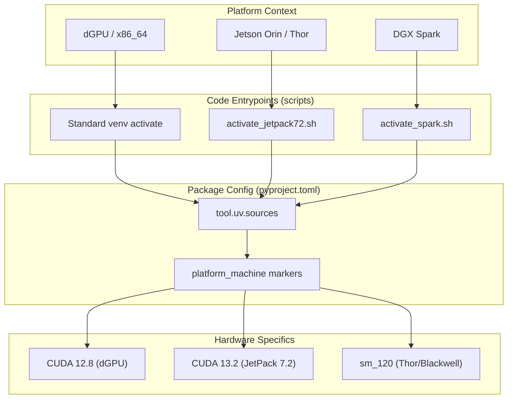
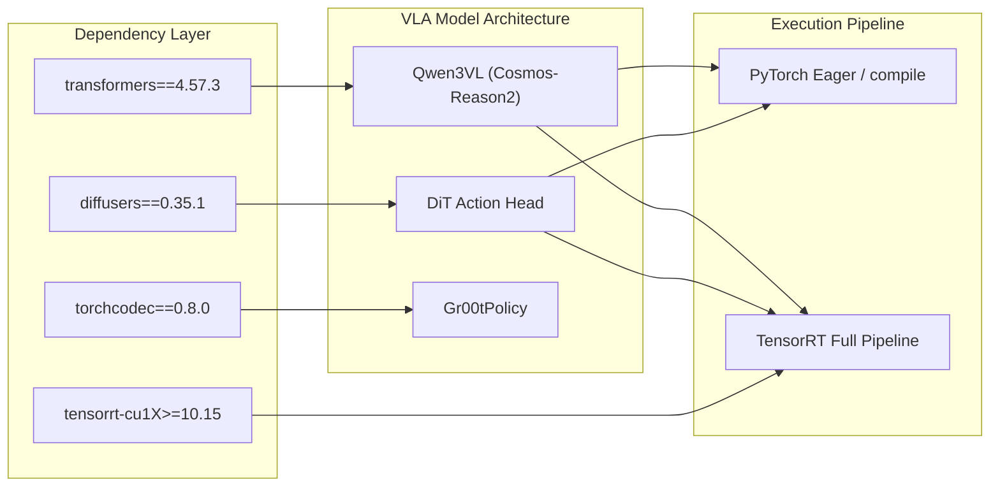

<!-- source: DeepWiki mcp.deepwiki.com · repo NVIDIA/Isaac-GR00T · page 2.1 Environment and Dependencies · fetched 2026-10-26 -->

# Environment and Dependencies

<details>
<summary>Relevant source files</summary>

The following files were used as context for generating this wiki page:

- [CLAUDE.md](CLAUDE.md)
- [getting_started/hardware_recommendation.md](getting_started/hardware_recommendation.md)
- [gr00t/eval/rollout_policy.py](gr00t/eval/rollout_policy.py)
- [pyproject.toml](pyproject.toml)
- [scripts/activate_jetpack72.sh](scripts/activate_jetpack72.sh)
- [scripts/activate_orin.sh](scripts/activate_orin.sh)
- [scripts/activate_thor.sh](scripts/activate_thor.sh)
- [scripts/deployment/build_flash_attn.sh](scripts/deployment/build_flash_attn.sh)
- [uv.lock](uv.lock)

</details>


## Purpose and Scope

This page documents the complete environment and dependency structure for the Isaac-GR00T repository. It details the transition to **uv** as the primary package manager, platform-specific requirements for NVIDIA hardware (x86_64, Jetson Orin, AGX Thor, and Spark), and the mandatory CUDA configurations for the N1.7 architecture.

---

## Python and CUDA Requirements

The Isaac-GR00T system architecture (N1.7) utilizes specific Python versions and CUDA toolkits depending on the target platform to maximize hardware acceleration. Note that for N1.7, the base Python version has been unified to **3.12** for the majority of platforms.

| Platform | Python Version | CUDA Toolkit | Primary Use Case |
| :--- | :--- | :--- | :--- |
| **dGPU (x86_64 / H100)** | `==3.12.*` | 12.8+ | Training & High-perf Inference |
| **Jetson AGX Thor** | `==3.12.*` | 13.2 (JetPack 7.2) | Next-gen Edge Deployment |
| **Jetson Orin** | `==3.12.*` | 13.2 (JetPack 7.2) | Edge Deployment |
| **DGX Spark** | `==3.12.*` | 13.0 | Mobile/Edge Deployment |

**Sources:** [pyproject.toml:10](), [uv.lock:3](), [getting_started/hardware_recommendation.md:64-67](), [scripts/activate_jetpack72.sh:9-12]()

---

## Package Management with `uv`

The repository utilizes the `uv` package manager for fast, deterministic dependency resolution. The configuration is defined in `pyproject.toml` and locked in `uv.lock`.

### Dependency Resolution Strategy
The system uses `uv sync` to align the virtual environment. Architecture-specific wheels (e.g., `flash-attn` and `torchcodec` for `aarch64`) are handled via `tool.uv.sources` and environment markers in the project file.

```bash
# Standard installation
uv sync --all-extras
```

**Sources:** [pyproject.toml:81-109](), [CLAUDE.md:16](), [CLAUDE.md:8-10]()

---

## Platform-Specific Considerations

### 1. dGPU / x86_64 (Training & Server)
Used for training the Qwen3-VL backbone and DiT action head.
*   **Key Dependencies:** `torch==2.9.0`, `deepspeed==0.17.6`, `accelerate==1.13.0`.
*   **Flash-Attn:** Uses a specific prebuilt wheel for x86_64 CUDA 12.
*   **TensorRT:** Requires `tensorrt-cu12>=10.15.1.29`.

### 2. Jetson AGX Thor & Orin (JetPack 7.2)
These platforms utilize Python 3.12 and CUDA 13.2.
*   **Environment Activation:** Users must source `scripts/activate_jetpack72.sh` (or the symlinked `scripts/activate_thor.sh`/`scripts/activate_orin.sh`) to set `TRITON_PTXAS_PATH` and `LD_LIBRARY_PATH` for `torch.compile` and TensorRT support.
*   **AArch64 Wheels:** `torchcodec==0.8.0` is sourced from local paths in `scripts/deployment/dgpu/wheels/` as it is not available on PyPI for aarch64.
*   **TensorRT:** Requires `tensorrt-cu13>=10.15.1.29`.

### 3. Flash-Attention Build System
For platforms where prebuilt wheels are unavailable, the repository includes `scripts/deployment/build_flash_attn.sh`. This script handles:
*   Pinning the CUTLASS submodule to a stable SHA (`f74fea9c`).
*   Patching `setup.py` to support specific CUDA architectures like `sm_87` (Orin) and `sm_120` (Blackwell/Thor).

**Sources:** [pyproject.toml:42-58](), [scripts/activate_jetpack72.sh:1-25](), [scripts/deployment/build_flash_attn.sh:69-80](), [getting_started/hardware_recommendation.md:23-25]()

---

## Environment Mapping and Data Flow

The following diagram bridges the platform concepts to the specific code entities responsible for environment setup.

**Diagram: Platform-to-Code Entity Mapping**



**Sources:** [pyproject.toml:87-109](), [scripts/activate_jetpack72.sh:1-5](), [scripts/activate_thor.sh:1-5](), [scripts/deployment/build_flash_attn.sh:93-113]()

---

## Core Dependency Groups

Dependencies are strictly versioned to support the N1.7 architecture (Qwen3-VL + DiT).

### Inference & Deployment Utilities
| Package | Version | Purpose |
| :--- | :--- | :--- |
| `pyzmq` | 27.0.1 | Messaging for `Gr00tPolicy` server/client communication. |
| `tensorrt-cu1X` | >=10.15.1 | High-speed inference via `build_trt_pipeline.py`. |
| `torchcodec` | 0.8.0 | Efficient video frame extraction for VLA observations. |

### Model Backbone & Head
| Package | Version | Purpose |
| :--- | :--- | :--- |
| `transformers` | 4.57.3 | Qwen3-VL (Cosmos-Reason2-2B) backbone support. |
| `diffusers` | 0.35.1 | Diffusion Transformer (DiT) implementation. |
| `flash-attn` | 2.8.3 | Attention optimization for high-resolution vision inputs. |

**Sources:** [pyproject.toml:11-59](), [CLAUDE.md:61-64]()

---

## Dependency Interaction Diagram

This diagram illustrates how specific library versions support the model components and inference pipelines.

**Diagram: Dependency and Model Component Interaction**



**Sources:** [pyproject.toml:11-59](), [getting_started/hardware_recommendation.md:13-25](), [CLAUDE.md:44-50]()

---

## Evaluation Environments

The system integrates several external simulation environments via specific factory functions in the rollout pipeline.

*   **SimplerEnv:** Integrated via `register_simpler_envs` for WidowX and Google Robot tasks.
*   **LIBERO:** Integrated via `register_libero_envs` for Panda robot manipulation.
*   **RoboCasa:** Integrated via `robocasa.utils.gym_utils.gymnasium_groot` for kitchen tasks.

**Sources:** [gr00t/eval/rollout_policy.py:112-154](), [gr00t/eval/rollout_policy.py:165-170]()

---

## Summary of Platform Activations

After performing a `uv sync`, you must source the correct activation script to ensure hardware-specific paths (like `ptxas` for `torch.compile`) are correctly configured:

*   **Jetson Orin / Thor:** `source scripts/activate_jetpack72.sh`
*   **DGX Spark:** `source scripts/activate_spark.sh`
*   **dGPU / x86_64:** `source .venv/bin/activate`

**Sources:** [scripts/activate_jetpack72.sh:1-5](), [CLAUDE.md:79]()

---

