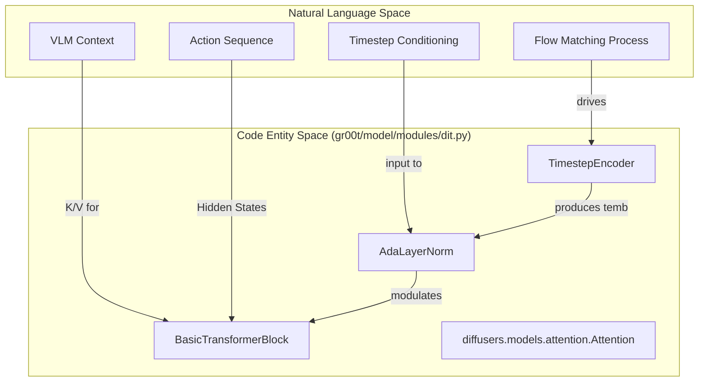
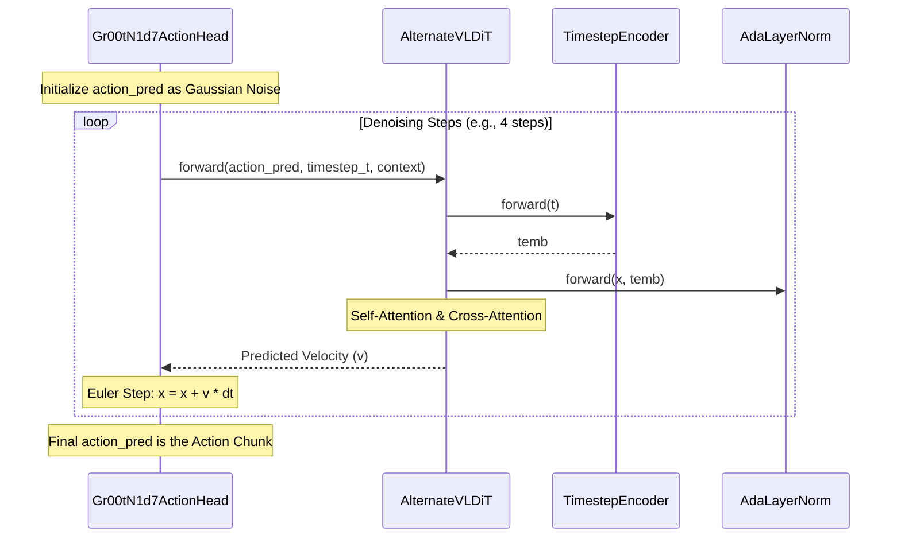
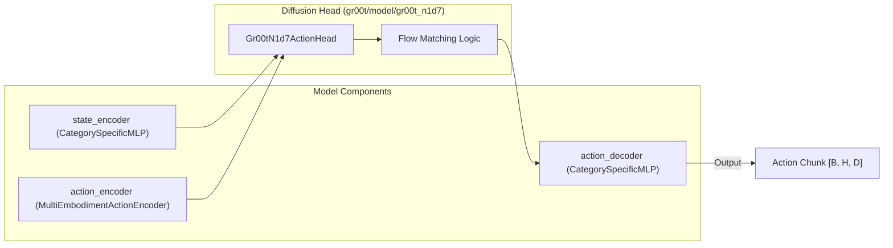

<!-- source: DeepWiki mcp.deepwiki.com · repo NVIDIA/Isaac-GR00T · page 4.3 Diffusion Transformer (DiT) and Flow Matching · fetched 2026-10-26 -->

# 4.3. Diffusion Transformer (DiT) and Flow Matching

Relevant source files

The following files were used as context for generating this wiki page:

- [getting_started/finetune_new_embodiment.md](getting_started/finetune_new_embodiment.md)
- [gr00t/model/gr00t_n1d7/gr00t_n1d7.py](gr00t/model/gr00t_n1d7/gr00t_n1d7.py)
- [gr00t/model/modules/dit.py](gr00t/model/modules/dit.py)
- [scripts/activate_spark.sh](scripts/activate_spark.sh)
- [scripts/deployment/spark/pyproject.toml](scripts/deployment/spark/pyproject.toml)
- [tests/gr00t/model/test_action_head.py](tests/gr00t/model/test_action_head.py)
- [tests/scripts/deployment/test_dit_only_forward_signature.py](tests/scripts/deployment/test_dit_only_forward_signature.py)

## Purpose and Scope

This document details the Diffusion Transformer (DiT) and Flow Matching action generation head in the Isaac-GR00T N1.7 architecture. In N1.7, the action head has been upgraded to support **Flow Matching**, a simulation-free alternative to traditional Diffusion, and features an **AlternateVLDiT** architecture that interleaves self-attention with cross-attention to the Vision-Language Model (VLM) backbone.

The DiT is responsible for taking multimodal contextual embeddings from the Qwen3-VL (Cosmos-Reason2-2B) backbone and iteratively denoising a Gaussian noise distribution into a sequence of continuous robot actions (action chunks).

**Sources:** [gr00t/model/gr00t_n1d7/gr00t_n1d7.py:38-61](), [gr00t/model/modules/dit.py:1-25]()

---

## Architecture: AlternateVLDiT

The core of the N1.7 action head is the `AlternateVLDiT` class. Unlike standard transformers, it uses a specific interleaving of attention mechanisms to ground action generation in the multimodal context provided by the backbone.

### Component Breakdown

1.  **TimestepEncoder**: Converts the continuous scalar timestep $t \in [0, 1]$ into a high-dimensional embedding using `Timesteps` projections (256 channels) and a `TimestepEmbedding` MLP [gr00t/model/modules/dit.py:61-71]().
2.  **AdaLayerNorm**: An Adaptive Layer Normalization layer that modulates the hidden states based on the timestep embedding (`temb`). It computes a scale and shift via a linear layer to condition the normalization process [gr00t/model/modules/dit.py:74-97]().
3.  **BasicTransformerBlock**: The fundamental building block of the DiT. It contains:
    *   **Self-Attention**: Models temporal dependencies within the action chunk [gr00t/model/modules/dit.py:154-163]().
    *   **Cross-Attention**: Attends to the `encoder_hidden_states` (the VLM embeddings) to ground actions in the visual/language context [gr00t/model/modules/dit.py:180-200]().
    *   **Feed-Forward Network (FFN)**: A standard MLP with configurable activation functions (e.g., GEGLU) [gr00t/model/modules/dit.py:167-174]().

### Natural Language to Code Mapping

**Sources:** [gr00t/model/modules/dit.py:61-100](), [gr00t/model/modules/dit.py:180-210]()

---

## Flow Matching Action Denoising

GR00T N1.7 utilizes **Flow Matching** for action generation. This approach defines a probability path between a noise distribution and the data distribution and trains the DiT to predict the velocity field (vector field) that transforms noise into clean actions.

### The Denoising Loop (`get_action`)

During inference, the `Gr00tN1d7ActionHead.get_action` method performs iterative refinement over a set number of timesteps (defaulting to `num_inference_timesteps`).

### Key Classes and Data Structures

*   **Gr00tN1d7ActionHead**: The top-level container that manages the diffusion process, including the `state_encoder`, `action_encoder`, and `action_decoder` [gr00t/model/gr00t_n1d7/gr00t_n1d7.py:38-82]().
*   **CategorySpecificMLP**: Used for state encoding and action decoding, allowing the model to handle multiple robot embodiments by indexing into specific MLP weights [gr00t/model/gr00t_n1d7/gr00t_n1d7.py:66-82]().
*   **MultiEmbodimentActionEncoder**: Encodes action sequences with embodiment-specific parameters [gr00t/model/gr00t_n1d7/gr00t_n1d7.py:72-76]().

**Sources:** [gr00t/model/gr00t_n1d7/gr00t_n1d7.py:38-119](), [tests/gr00t/model/test_action_head.py:127-154]()

---

## Action Chunk Generation

The DiT generates a sequence of future actions, allowing the robot to plan smooth trajectories.

### Data Flow: From Noise to Poses

The output of the DiT is a tensor of shape `[Batch, Horizon, Action_Dim]`.

1.  **Time Sampling**: During training, timesteps are sampled from a `Beta` distribution defined in the config (`noise_beta_alpha`, `noise_beta_beta`) [gr00t/model/gr00t_n1d7/gr00t_n1d7.py:112-115]().
2.  **Loss Computation**: The model minimizes the MSE between the predicted velocity and the ground truth conditional flow [tests/gr00t/model/test_action_head.py:102-118]().
3.  **Embodiment Tagging**: Actions are processed according to the `EmbodimentTag` to ensure the correct `ActionConfig` (Relative vs. Absolute) is applied [getting_started/finetune_new_embodiment.md:42-62]().

### Implementation Mapping

**Sources:** [gr00t/model/gr00t_n1d7/gr00t_n1d7.py:66-82](), [tests/gr00t/model/test_action_head.py:156-167]()

---

## Platform-Specific Optimizations

### Spark (sm121) SDPA Context
On DGX Spark (sm121 architecture), the codebase includes a specific context manager `_sdpa_context` to force the `math` backend for Scaled Dot Product Attention (SDPA). This avoids issues with memory-efficient kernels on that specific hardware [gr00t/model/modules/dit.py:29-58](). This is activated by sourcing the platform-specific script [scripts/activate_spark.sh:1-47]().

### Deployment and Signature Contracts
For TensorRT deployment, the `dit_only` export mode monkey-patches `get_action_with_features`. A strict signature contract is maintained to ensure all necessary keywords (`backbone_features`, `state_features`, `embodiment_id`, `action_input`, etc.) are correctly forwarded during inference [tests/scripts/deployment/test_dit_only_forward_signature.py:41-74]().

**Sources:** [gr00t/model/modules/dit.py:47-58](), [scripts/activate_spark.sh:22-42](), [tests/scripts/deployment/test_dit_only_forward_signature.py:41-49]()

---

