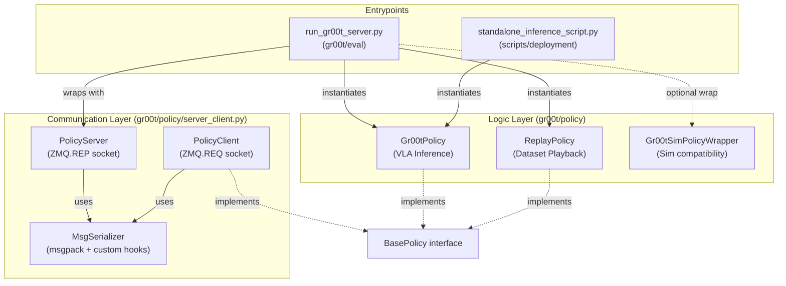
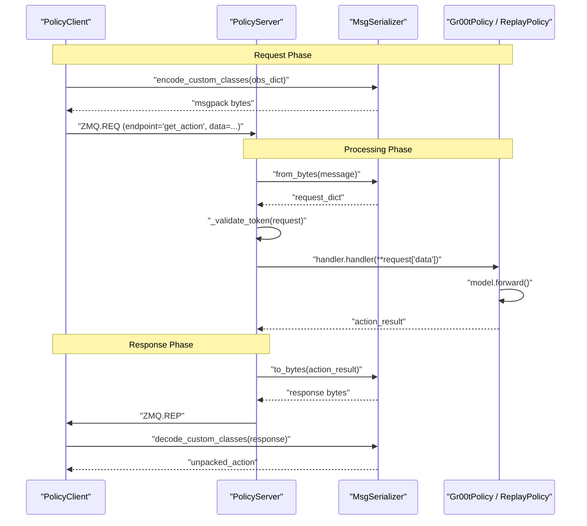

<!-- source: DeepWiki mcp.deepwiki.com · repo NVIDIA/Isaac-GR00T · page 5 Inference and Deployment · fetched 2026-10-26 -->

# Inference and Deployment

Relevant source files

The following files were used as context for generating this wiki page:

- [README.md](README.md)
- [gr00t/eval/run_gr00t_server.py](gr00t/eval/run_gr00t_server.py)
- [scripts/deployment/README.md](scripts/deployment/README.md)

This page provides technical documentation for deploying trained GR00T models for inference on robots or in simulation environments. The system primarily utilizes a **server-client architecture** built on ZeroMQ to decouple model computation from environment execution, enabling flexible deployment across different hardware configurations.

For information about training and fine-tuning models, see [Training GR00T Models](#6). For evaluation methodologies, see [Evaluation and Benchmarking](#7). For detailed API reference on the `Gr00tPolicy` class and observation formatting, see [Gr00tPolicy Interface](#4.5).

**Scope:** This page covers the high-level architecture, deployment modes, inference flow, and performance characteristics. Detailed instructions for starting servers, writing client code, and using standalone scripts are covered in sub-pages [Policy Server Architecture](#5.1), [Starting an Inference Server](#5.2), [Client Integration](#5.3), [Standalone Inference Script](#5.4), [Real-World Deployment Guide](#5.5), and [RoboLab Integration](#5.6).

---

## Deployment Architecture Overview

The GR00T inference system supports both GPU-accelerated inference servers and local standalone execution. The core communication layer is implemented in `gr00t/policy/server_client.py`, which provides a robust `PolicyServer` and `PolicyClient` implementation using `msgpack` for serialization.

### Deployment Modes

| Mode | Use Case | Primary Script | Key Classes |
|------|----------|----------------|-------------|
| **Server-Client** | Remote inference, GPU server with lightweight robot client | [gr00t/eval/run_gr00t_server.py:167-171]() | `PolicyServer`, `PolicyClient`, `Gr00tPolicy` |
| **Standalone** | Local inference, testing, single-machine deployment | [scripts/deployment/standalone_inference_script.py:55-62]() | `Gr00tPolicy` |
| **Replay (Debugging)** | Environment integration testing without a trained model | [gr00t/eval/run_gr00t_server.py:152-157]() | `ReplayPolicy`, `PolicyServer` |

The server-client mode is recommended for production deployment where GPU resources are centralized (e.g., a workstation or cloud), while standalone mode is useful for rapid prototyping.

**Sources:** [gr00t/policy/server_client.py:27-27](), [gr00t/eval/run_gr00t_server.py:54-90](), [scripts/deployment/standalone_inference_script.py:55-62]()

---

## Diagram 1: System Entity Mapping

This diagram bridges the conceptual deployment components to the specific code entities that implement them in the N1.7 stack.

**Sources:** [gr00t/policy/server_client.py:27-27](), [gr00t/eval/run_gr00t_server.py:105-110](), [gr00t/eval/run_gr00t_server.py:152-157](), [gr00t/eval/run_gr00t_server.py:163-165]()

---

## Diagram 2: Inference Request Lifecycle

This sequence illustrates how a request flows through the `PolicyServer` and `Gr00tPolicy` entities during a live robot deployment.

**Sources:** [gr00t/policy/server_client.py:27-27](), [gr00t/policy/server_client.py:69-100]()

---

## Core Components

### PolicyServer
The `PolicyServer` is a ZeroMQ-based inference server that listens for incoming requests on a specified port (default 5555). It uses a `ZMQ.REP` socket to handle requests synchronously.
- **Endpoints**: Automatically registers `ping`, `kill`, `get_action`, `reset`, and `get_modality_config`.
- **Serialization**: Uses a custom serializer to handle complex types like `numpy.ndarray` and `ModalityConfig` [gr00t/eval/run_gr00t_server.py:34-50]().

### Gr00tPolicy
The primary policy class for VLA inference. In N1.7, it handles the `Qwen3-VL` (Cosmos-Reason2-2B) backbone and the `AlternateVLDiT` action head.
- **Server Integration**: In `run_gr00t_server.py`, the `Gr00tPolicy` is instantiated with an `embodiment_tag` and `model_path` [gr00t/eval/run_gr00t_server.py:105-110]().

### PolicyClient
A client-side implementation of the `BasePolicy` interface. It abstracts the network communication, allowing robot code to call `get_action()` as if the model were local.

### ReplayPolicy
Used for system integration testing. It reads from a LeRobot dataset and "replays" the recorded actions for a given episode.
- **Activation**: Triggered in the server script by providing a `--dataset-path` instead of a `--model-path` [gr00t/eval/run_gr00t_server.py:152-157]().

---

## Inference Performance and Acceleration

GR00T N1.7 supports significant acceleration via TensorRT, which is critical for real-time robot control.

| Mode | Components Accelerated | Typical Use Case |
|------|------------------------|------------------|
| **PyTorch** | None (Eager mode) | Prototyping, debugging accuracy |
| **TRT dit_only** | DiT Action Head | Legacy N1.6 path, minimal speedup |
| **TRT full_pipeline** | Backbone (ViT+LLM) + Action Head | Recommended for dGPU, Thor, and Orin |

The `full_pipeline` mode accelerates the `Qwen3-VL` vision and text components, which otherwise dominate inference time [scripts/deployment/README.md:94-95](). Users can build these engines using the `build_trt_pipeline.py` utility [scripts/deployment/README.md:107-111]().

For detailed benchmarking on platforms like Thor, Orin, and H100, see [Hardware Recommendations and Platform-Specific Setup](#8.6).

---

## Detailed Sub-Pages

For comprehensive documentation on specific deployment aspects:

- **[Policy Server Architecture](#5.1)**: Deep dive into the ZMQ protocol, `MsgSerializer` implementation, and endpoint registration.
- **[Starting an Inference Server](#5.2)**: Step-by-step guide for using `run_gr00t_server.py` with different `EmbodimentTag` values.
- **[Client Integration](#5.3)**: How to integrate the `PolicyClient` into robot control loops and simulation environments.
- **[Standalone Inference Script](#5.4)**: Running inference without the server-client overhead using local scripts and TensorRT modes.
- **[Real-World Deployment Guide](#5.5)**: End-to-end workflow for hardware setup, teleoperation, and closed-loop testing on physical robots.
- **[RoboLab Integration](#5.6)**: Guide for deploying GR00T N1.7 within the Isaac Sim/RoboLab framework for simulated evaluation.

**Sources:** [gr00t/policy/server_client.py:1-220](), [gr00t/eval/run_gr00t_server.py:1-174](), [scripts/deployment/README.md:1-153]()

---

