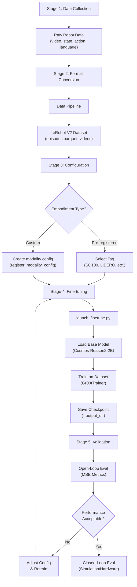
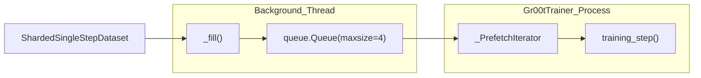
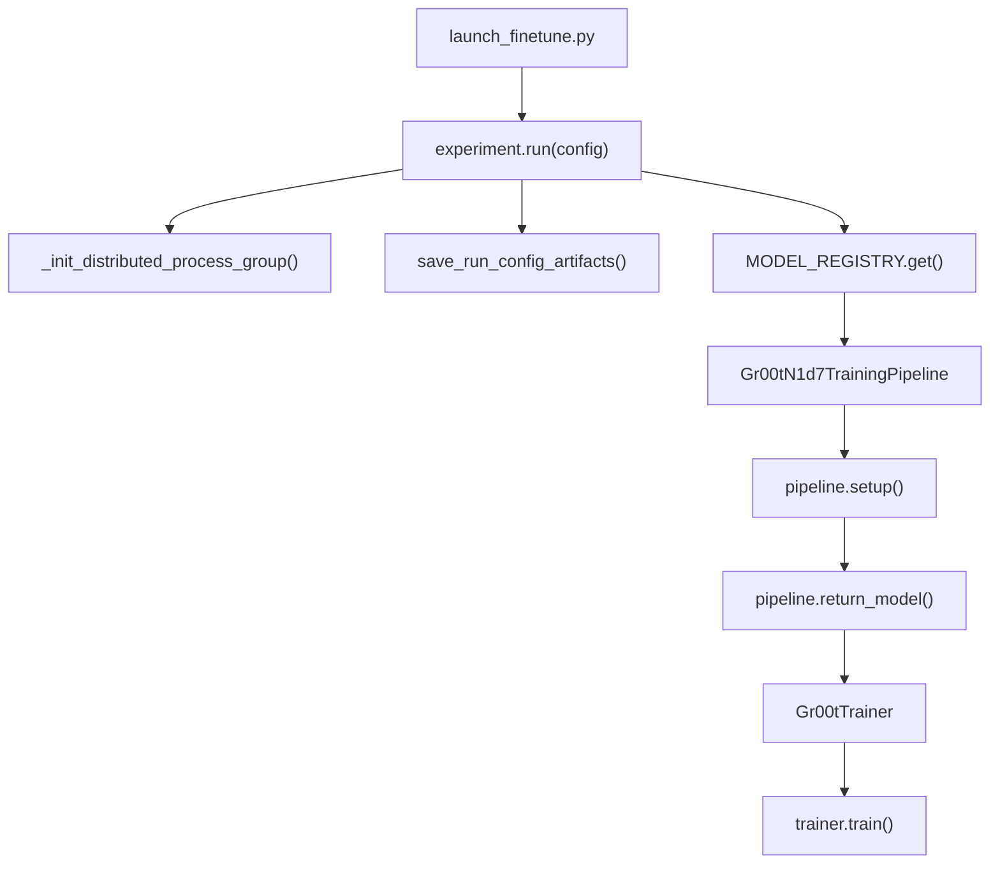

<!-- source: DeepWiki mcp.deepwiki.com · repo NVIDIA/Isaac-GR00T · page 6.2 Fine-tuning Overview · fetched 2026-10-26 -->

# Fine-tuning Overview

<details>
<summary>Relevant source files</summary>

The following files were used as context for generating this wiki page:

- [ATTRIBUTIONS.md](ATTRIBUTIONS.md)
- [examples/finetune.sh](examples/finetune.sh)
- [gr00t/configs/finetune_config.py](gr00t/configs/finetune_config.py)
- [gr00t/experiment/experiment.py](gr00t/experiment/experiment.py)
- [gr00t/experiment/launch_finetune.py](gr00t/experiment/launch_finetune.py)
- [gr00t/experiment/trainer.py](gr00t/experiment/trainer.py)

</details>


This page explains the fine-tuning process for GR00T N1.7, including when fine-tuning is needed, the overall workflow from data to trained checkpoint, and the key components involved. Fine-tuning adapts the pre-trained cross-embodiment base model to specific robot platforms, tasks, or environments using custom demonstration data.

For detailed configuration parameters, see [Fine-tuning Configuration (6.3)](). For concrete examples with specific embodiments, see [Fine-tuning Examples (6.4)](). For advanced training topics including DeepSpeed, see [Distributed Training with DeepSpeed (6.5)]().

## When Fine-tuning is Needed

The GR00T N1.7 base model is pre-trained on diverse robot data across multiple embodiments, enabling strong zero-shot performance on many tasks. However, fine-tuning is necessary when:

| Scenario | Zero-shot Viable | Fine-tuning Required |
|----------|------------------|---------------------|
| **Supported Embodiment, Pre-trained Task** | Yes - Model has seen similar data during pre-training | No - Deploy directly with zero-shot |
| **Supported Embodiment, New Task** | Sometimes - Try zero-shot first | Usually - Fine-tune for task-specific behavior |
| **Custom Robot Embodiment** | No - Embodiment not in training data | Yes - Essential for new morphology |
| **Custom Sensory Setup** | No - Camera/state configuration differs | Yes - Required for observation adaptation |
| **Domain-Specific Requirements** | No - Unique environment or constraints | Yes - Adapt to specific conditions |

Fine-tuning typically targets specific model components like the Diffusion Transformer (DiT) and multimodal projectors, while optionally unfreezing parts of the LLM backbone [gr00t/configs/finetune_config.py:48-59]().

## Fine-tuning Workflow

The complete fine-tuning workflow progresses through five stages: data collection, format conversion, configuration, training, and validation.

### End-to-End Fine-tuning Pipeline



**Sources:** [gr00t/experiment/launch_finetune.py:44-130](), [examples/finetune.sh:143-223]()

## Embodiment Configuration Paths

GR00T supports two fine-tuning paths depending on whether your robot matches a pre-registered configuration or requires a custom setup.

| Configuration Type | Description | Required Files |
|-------------------|-------------|----------------|
| **Pre-registered** | Built-in configurations for common embodiments | Dataset in LeRobot V2 format |
| **Custom** | User-defined configuration for custom robots | LeRobot V2 dataset + `.py` modality config |

### Custom Embodiment Configuration
For custom robots, use the `--modality_config_path` argument to point to a Python file defining the `ModalityConfig` [gr00t/experiment/launch_finetune.py:56-57](). The `load_modality_config` function dynamically imports this file to register the embodiment before training starts [gr00t/experiment/launch_finetune.py:31-41]().

## Fine-tuning Script Overview

Fine-tuning is executed using `launch_finetune.py`, which populates a `FinetuneConfig` object [gr00t/configs/finetune_config.py:21-181]() and passes it to the core `run()` function [gr00t/experiment/experiment.py:130]() (referenced via `run(config)` call in `launch_finetune.py`).

### Basic Fine-tuning Command (via Shell Wrapper)
The `examples/finetune.sh` script provides a convenient interface for launching jobs:

```bash
bash examples/finetune.sh \
  --base-model-path nvidia/Cosmos-Reason2-2B \
  --dataset-path /path/to/dataset \
  --embodiment-tag SO100 \
  --output-dir ./outputs/my_experiment \
  --num-gpus 1
```
**Sources:** [examples/finetune.sh:31-49]()

### Key Hyperparameters
The `FinetuneConfig` class defines several critical tuning flags:

| Parameter | Default | Description |
|-----------|---------|-------------|
| `tune_llm` | `False` | Fine-tune the language model backbone [gr00t/configs/finetune_config.py:49-50]() |
| `tune_visual` | `False` | Fine-tune the visual encoder [gr00t/configs/finetune_config.py:52-53]() |
| `tune_projector` | `True` | Fine-tune multimodal projector layers [gr00t/configs/finetune_config.py:55-56]() |
| `tune_diffusion_model` | `True` | Fine-tune the DiT action head [gr00t/configs/finetune_config.py:58-59]() |
| `state_dropout_prob` | `0.2` | Regularization for state inputs [gr00t/configs/finetune_config.py:61-64]() |

## The Gr00tTrainer Lifecycle

The training process is managed by `Gr00tTrainer`, which inherits from the Hugging Face `Trainer` but implements a custom data flow to optimize robotics workloads [gr00t/experiment/trainer.py:152-167]().

### Data Flow and Prefetching
`Gr00tTrainer` bypasses standard PyTorch `DataLoader` objects in favor of an asynchronous prefetching iterator `_PrefetchIterator` [gr00t/experiment/trainer.py:77-116]().



1.  **Initialization**: `Gr00tTrainer` sets up a `_PrefetchIterator` which starts a background worker thread [gr00t/experiment/trainer.py:89-91]().
2.  **Prefetching**: The background thread samples batches from the buffer and applies the data collator [gr00t/experiment/trainer.py:98-100]().
3.  **Consumption**: The main training loop pulls pre-collated batches from the queue, blocking only if the queue is empty [gr00t/experiment/trainer.py:113-115]().
4.  **Profiling**: The `ProfCallback` measures step completion to confirm whether the training pipeline is bottlenecked by data loading or computation [gr00t/experiment/trainer.py:16-28](), [gr00t/experiment/trainer.py:43-49]().

**Sources:** [gr00t/experiment/trainer.py:77-116](), [gr00t/experiment/experiment.py:34]()

## Execution Flow: From Script to Model

The `run()` function in `experiment.py` serves as the entry point for both pre-training and fine-tuning.



1.  **Setup**: `run()` initializes distributed process groups and logging [gr00t/experiment/experiment.py:142-157]().
2.  **Artifacts**: It saves the configuration and initial actions for reproducibility [gr00t/experiment/experiment.py:160-165]().
3.  **Model Loading**: The model is retrieved via the `MODEL_REGISTRY` and configured for fine-tuning by unfreezing specified parameters [gr00t/experiment/launch_finetune.py:78-85]().
4.  **Training**: `Gr00tTrainer` executes the loop, using `ProfCallback` to monitor performance [gr00t/experiment/trainer.py:43-49]().

**Sources:** [gr00t/experiment/experiment.py:1-165](), [gr00t/experiment/launch_finetune.py:44-130]()

---

