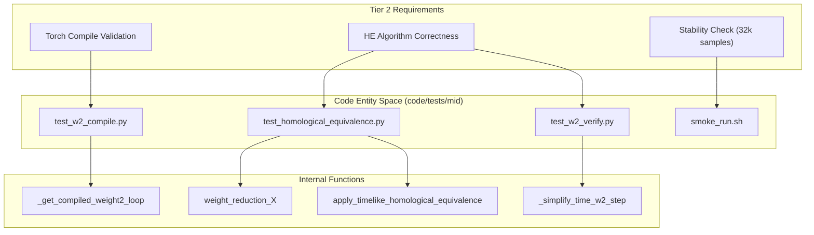
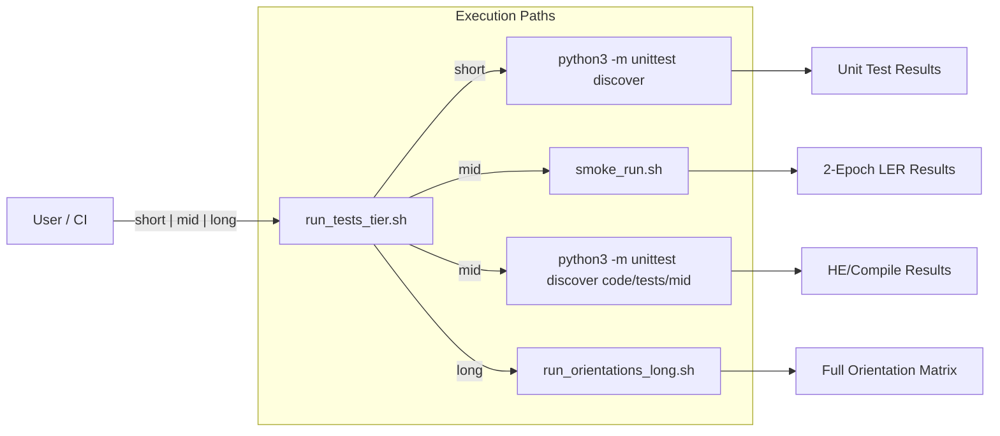

<!-- source: DeepWiki mcp.deepwiki.com · repo NVIDIA/Ising-Decoding · page 7.1 Test Suite Organization · fetched 2026-10-26 -->

# Test Suite Organization

<details>
<summary>Relevant source files</summary>

The following files were used as context for generating this wiki page:

- [code/scripts/run_tests_tier.sh](code/scripts/run_tests_tier.sh)
- [code/tests/README_TEST_TIERS.md](code/tests/README_TEST_TIERS.md)
- [code/tests/mid/test_homological_equivalence.py](code/tests/mid/test_homological_equivalence.py)
- [code/tests/mid/test_w2_compile.py](code/tests/mid/test_w2_compile.py)
- [code/tests/mid/test_w2_verify.py](code/tests/mid/test_w2_verify.py)
- [code/tests/test_boundary_detector_integration.py](code/tests/test_boundary_detector_integration.py)
- [code/tests/test_gpu.py](code/tests/test_gpu.py)
- [code/tests/test_stim_utils.py](code/tests/test_stim_utils.py)
- [code/tests/test_training_capture.py](code/tests/test_training_capture.py)
- [code/tests/test_training_distributed_logging_capture.py](code/tests/test_training_distributed_logging_capture.py)

</details>


The Ising-Decoding project utilizes a three-tier testing model designed to balance developer velocity with rigorous statistical validation. This suite ranges from fast, local unit tests to long-running, multi-GPU orientation and regression benchmarks.

## Three-Tier Test Model

The testing strategy is categorized by runtime and execution frequency, as defined in `code/tests/README_TEST_TIERS.md` [code/tests/README_TEST_TIERS.md:1-113]().

| Tier | Name | Runtime | Frequency | Focus |
| :--- | :--- | :--- | :--- | :--- |
| **Tier 1** | **Short** | < 5 min | Pre-merge (PR) | Correctness, config validation, basic integration. |
| **Tier 2** | **Mid** | 5–10 min | Post-merge (Main) | `torch.compile` validation, LER stability (32k samples). |
| **Tier 3** | **Long** | 30 min+ | Daily / On-demand | Orientation matrix (O1–O4), LER regression, scale training. |

### Test Directory Layout
- `code/tests/`: Contains Tier 1 unit tests and integration tests [code/tests/README_TEST_TIERS.md:14-21]().
- `code/tests/mid/`: Contains Tier 2 tests, specifically those exercising `torch.compile` and complex homological equivalence (HE) logic [code/tests/README_TEST_TIERS.md:42-43]().
- `code/scripts/`: Contains the shell dispatchers for executing these tiers [code/scripts/run_tests_tier.sh:1-60]().

---

## Tier 1: Short (Unit & Integration)

Tier 1 tests ensure the fundamental components of the pipeline are functional. These are executed by the `unit-tests` and `gpu-tests` CI jobs [code/tests/README_TEST_TIERS.md:26-26]().

### Key Components
- **GPU Functionality**: `test_gpu.py` exercises CUDA code paths for `dem_sampling`, `MemoryCircuitTorch` batch generation, and model forward passes [code/tests/test_gpu.py:15-184]().
- **Boundary Detectors**: `test_boundary_detector_integration.py` verifies that when `add_boundary_detectors=True`, the resulting `stim_circuit` detector count matches the expected residual syndrome size for all four orientations (XV, XH, ZV, ZH) [code/tests/test_boundary_detector_integration.py:17-175]().
- **Utilities**: Tests for `stim_utils.py` cover REPEAT block unfolding and instruction injection [code/tests/test_stim_utils.py:15-84](). Training state captures are validated in `test_training_capture.py` [code/tests/test_training_capture.py:15-51]().

**Tier 1 Execution Flow**
The `run_tests_tier.sh` script uses `unittest discover` to find all `test_*.py` files in the root test directory, excluding the `mid/` subdirectory [code/scripts/run_tests_tier.sh:18-23]().

---

## Tier 2: Mid (Optimization & Stability)

Tier 2 focuses on performance optimizations and algorithmic correctness for Homological Equivalence (HE). These tests typically require a GPU and are triggered via `run_tests_tier.sh mid` [code/scripts/run_tests_tier.sh:24-42]().

### Homological Equivalence (HE) Validation
The `test_homological_equivalence.py` suite provides exhaustive testing for spacelike and timelike HE:
- **Weight Reduction**: Validates that `weight_reduction_X` and `weight_reduction_Z` non-increasingly reduce error weights [code/tests/mid/test_homological_equivalence.py:196-215]().
- **Syndrome Invariance**: Ensures that `simplify_X` and `simplify_Z` maintain the same syndrome while reducing error counts [code/tests/mid/test_homological_equivalence.py:218-241]().
- **Timelike HE**: Validates `apply_timelike_homological_equivalence` for accepting or rejecting syndrome shifts based on parity [code/tests/mid/test_homological_equivalence.py:15-26]().

### Weight-2 Step and Compilation
- **Density Guarantee**: `test_w2_verify.py` checks that the `_simplify_time_w2_step` function maintains or decreases error density across batches [code/tests/mid/test_w2_verify.py:36-70]().
- **Torch Compilation**: `test_w2_compile.py` exercises the compiled weight-2 loop via `_get_compiled_weight2_loop` at multiple code distances ($d=5$ to $d=13$) to ensure `torch.compile` compatibility and numerical stability [code/tests/mid/test_w2_compile.py:31-104]().

**Tier 2 Logic Mapping**
The following diagram maps the high-level Tier 2 requirements to the specific code entities responsible for HE and compilation.

**Tier 2: Optimization and HE Mapping**

Sources: [code/tests/mid/test_w2_compile.py:31-104](), [code/tests/mid/test_homological_equivalence.py:15-65](), [code/tests/mid/test_w2_verify.py:36-70](), [code/scripts/run_tests_tier.sh:24-42]().

---

## Tier 3: Long (Regression & Scale)

Tier 3 runs full-scale workloads to validate the system's statistical performance. These are orchestrated by `run_orientations_long.sh` and dispatched via `run_tests_tier.sh long` [code/scripts/run_tests_tier.sh:43-49]().

### Tasks
- **Orientation Matrix**: Runs training or inference across all four orientations (O1–O4) to ensure no orientation-specific regressions [code/tests/README_TEST_TIERS.md:83-83]().
- **LER Regression**: Validates Logical Error Rate (LER) quality at large distances ($d=9, d=13$) using pre-trained models [code/tests/README_TEST_TIERS.md:84-84]().
- **Full-Epoch Training**: Executes a 1-epoch run with 2 million samples to confirm convergence and validation LER thresholds [code/tests/README_TEST_TIERS.md:85-85]().

---

## The run_tests_tier.sh Dispatcher

The `run_tests_tier.sh` script acts as the central entry point for all test tiers, handling environment setup and routing [code/scripts/run_tests_tier.sh:1-60]().

**Dispatcher Data Flow**

Sources: [code/scripts/run_tests_tier.sh:12-57](), [code/tests/README_TEST_TIERS.md:1-113]().

### Usage Examples
- **Run Short Tiers**: `bash code/scripts/run_tests_tier.sh short` [code/scripts/run_tests_tier.sh:18-23]().
- **Run Mid Tiers with Custom Samples**:
  ```bash
  PREDECODER_TRAIN_SAMPLES=65536 bash code/scripts/run_tests_tier.sh mid
  ```
  [code/scripts/run_tests_tier.sh:31-37]().
- **Run Long Training**: `ORIENTATIONS_LONG_TASK=train bash code/scripts/run_tests_tier.sh long` [code/scripts/run_tests_tier.sh:47-48]().

---

