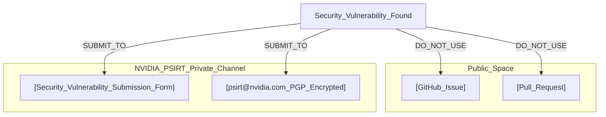

<!-- source: DeepWiki mcp.deepwiki.com · repo NVIDIA/Ising · page 4 Contributing, Security, and Licensing · fetched 2026-10-26 -->

# Contributing, Security, and Licensing

<details>
<summary>Relevant source files</summary>

The following files were used as context for generating this wiki page:

- [LICENSE](LICENSE)
- [SECURITY.md](SECURITY.md)

</details>


This page provides the governance and compliance framework for the NVIDIA Ising project. It outlines the protocols for reporting security vulnerabilities and the legal terms governing the use and redistribution of the codebase. As a central hub for quantum computing tools, maintaining a secure and legally transparent environment is critical for both contributors and users.

## Security Vulnerability Reporting

NVIDIA prioritizes the security and integrity of the Ising project. All security-related disclosures are handled through the **NVIDIA Product Security Incident Response Team (PSIRT)**. To maintain the safety of the user base, vulnerabilities must not be reported via public GitHub issues or pull requests.

If a security issue is identified, it should be submitted via the official web form or through PGP-encrypted email to `psirt@nvidia.com`. Reports should include the product version, vulnerability type, and a proof-of-concept for reproduction.

For details on the disclosure process and required report information, see **[Security Vulnerability Reporting](#4.1)**.

### Security Disclosure Workflow

The following diagram illustrates the transition from identifying a potential vulnerability in the code to the private disclosure channel.

**Figure 1: Security Reporting Path**

**Sources:**
- [SECURITY.md:1-25]()

## License: Apache 2.0

The NVIDIA Ising repository is licensed under the **Apache License, Version 2.0**. This is a permissive free software license that allows users to use the software for any purpose, distribute it, modify it, and distribute modified versions of the software under the terms of the license.

Key components of this license include:
*   **Grant of Rights:** Provides perpetual, worldwide, non-exclusive, and royalty-free copyright and patent licenses.
*   **Redistribution:** Requires that any redistributed work includes a copy of the license and attribution notices.
*   **Patent Retaliation:** Includes a clause that terminates the patent license if the user institutes patent litigation against any contributor regarding the work.
*   **No Warranty:** The software is provided on an "AS IS" BASIS, without warranties or conditions of any kind.

For a summary of the rights, obligations, and legal definitions, see **[License: Apache 2.0](#4.2)**.

### Legal Entity and Contribution Mapping

This diagram bridges the legal definitions found in the `LICENSE` file to the roles involved in the codebase lifecycle.

**Figure 2: Apache 2.0 Governance Entities**
```mermaid
classDiagram
    class "Legal_Entity" {
        +Ownership_50_percent
        +Direct_Control
    }
    class "Contributor" {
        +Submits_Work
        +Grants_Patent_License
    }
    class "Work" {
        +Source_Form
        +Object_Form
    }
    class "Derivative_Works" {
        +Editorial_Revisions
        +Annotations
    }

    "Legal_Entity" --|> "Contributor" : "Acts as"
    "Contributor" --> "Work" : "Submits Contribution"
    "Work" <|-- "Derivative_Works" : "Based on"
```
**Sources:**
- [LICENSE:8-65]()
- [LICENSE:67-88]()

## Summary Table

| Category | Policy / License | Primary Contact / Link |
| :--- | :--- | :--- |
| **Security** | Coordinated Vulnerability Disclosure | [NVIDIA PSIRT](https://www.nvidia.com/en-us/security/psirt-policies) |
| **Licensing** | Apache License 2.0 | `LICENSE` file in root |
| **Contributions** | Standard Apache Submission | [NVIDIA Ising GitHub](https://github.com/NVIDIA/Ising) |

**Sources:**
- [SECURITY.md:7-25]()
- [LICENSE:1-130]()

---

