# Page: Overview

# Overview

<details>
<summary>Relevant source files</summary>

The following files were used as context for generating this wiki page:

- [README.md](README.md)

</details>


The NVIDIA Ising project is a comprehensive ecosystem of open models, tools, and cookbooks designed to accelerate the development of quantum computing workflows. It serves as a central hub for researchers and engineers to access state-of-the-art AI solutions for critical quantum challenges, specifically focusing on **quantum device calibration** and **quantum error correction (QEC)** [README.md:1-9]().

The project is structured as a collection of modular components, including vision-language models for hardware characterization, neural network decoders for error correction, and standardized evaluation datasets [README.md:26-60]().

## Project Scope and Ecosystem

NVIDIA Ising functions as an umbrella repository that connects several specialized resources:

*   **Model Zoo**: A family of pre-trained models hosted on Hugging Face, including the `Ising-Calibration-1-35B-A3B` vision-language model and the `Ising-Decoder-SurfaceCode-1` family [README.md:26-36]().
*   **Deployment Infrastructure**: Production-ready deployment options via NVIDIA NIM (NVIDIA Inference Microservices) and hosted API endpoints on `build.nvidia.com` [README.md:39-52]().
*   **Training Frameworks**: External repositories like `Ising-Decoding` that provide the necessary source code for training and optimizing AI decoders [README.md:62-66]().
*   **Evaluation Datasets**: Standardized benchmarks such as `QCalEval` for measuring the performance of quantum calibration agents [README.md:54-58]().

### Project Architecture and Workflow

The project is organized into two primary functional pipelines:
1.  **The Calibration Pipeline**: Uses vision-language models to interpret quantum hardware diagnostics and automate device setup.
2.  **The Decoding Pipeline**: Implements AI pre-decoders to identify and correct errors in surface code quantum computers.

For a detailed breakdown of these pipelines and how the hub repository integrates them, see [Project Purpose and Architecture](#1.1).

### Repository Relationship Diagram

The following diagram illustrates how the `NVIDIA/Ising` hub connects users to various code entities and external artifacts.

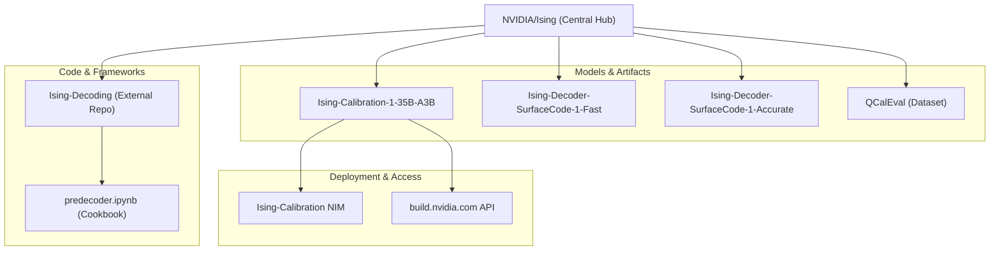
**Sources:** [README.md:9-78]()

## Core Components

The repository organizes its resources into categories that support different stages of the quantum computing lifecycle:

| Component | Entity Name | Purpose |
| :--- | :--- | :--- |
| **Calibration Model** | `Ising-Calibration-1-35B-A3B` | Vision-language model for interpreting quantum device calibration data. |
| **Decoder Models** | `Ising-Decoder-SurfaceCode-1` | AI pre-decoders (Fast and Accurate variants) for error correction. |
| **Evaluation** | `QCalEval` | Dataset for benchmarking quantum calibration agents. |
| **Training Hub** | `Ising-Decoding` | Repository containing logic for training AI-based decoders. |

**Sources:** [README.md:30-66]()

## Access and Navigation

NVIDIA Ising is designed for immediate practical application. Engineers can interact with the project through several entry points:

*   **Hugging Face**: Access model weights and datasets directly [README.md:7]().
*   **NVIDIA NIM**: Deploy the calibration model as a containerized microservice [README.md:41-44]().
*   **Cookbooks**: Follow step-by-step guides like the `Ising-Decoder-Tutorial` for training, quantization, and inference optimization [README.md:74-78]().

For instructions on how to set up your environment and access these tools, see [Getting Started and Access Points](#1.2).

### Support and Contribution

This repository serves as the primary contact point for the community. Users can report bugs, request features, or participate in discussions regarding any part of the Ising family [README.md:81-87]().

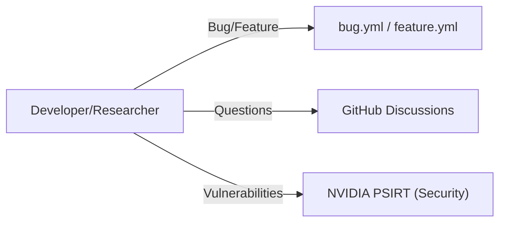
**Sources:** [README.md:81-90]()

---
**Sources:**
- [README.md:1-100]()

---

# Page: Project Purpose and Architecture

# Project Purpose and Architecture

<details>
<summary>Relevant source files</summary>

The following files were used as context for generating this wiki page:

- [README.md](README.md)

</details>


NVIDIA Ising serves as a centralized hub for open-source models, tools, and workflows designed to accelerate quantum computing development. The project focuses on two critical bottlenecks in quantum hardware operation: **Device Calibration** and **Quantum Error Correction (QEC) Decoding**. By providing pre-trained models and specialized training frameworks, NVIDIA Ising enables researchers to integrate AI-driven pipelines into the quantum control stack.

## High-Level Architecture

The repository functions as a "hub" that orchestrates a unified quantum computing workflow by tying together external sub-repositories, model weights on Hugging Face, and optimized inference containers via NVIDIA NIM.

### The Two-Pipeline Workflow

The architecture is divided into two distinct functional pipelines that address different stages of the quantum computing lifecycle:

1.  **Calibration Pipeline**: A vision-language approach to characterizing and tuning quantum devices.
2.  **Decoding Pipeline**: A high-speed inference framework for real-time error detection in surface code architectures.

### System Architecture Diagram
This diagram illustrates how the `NVIDIA/Ising` hub connects the various code entities and external artifacts.

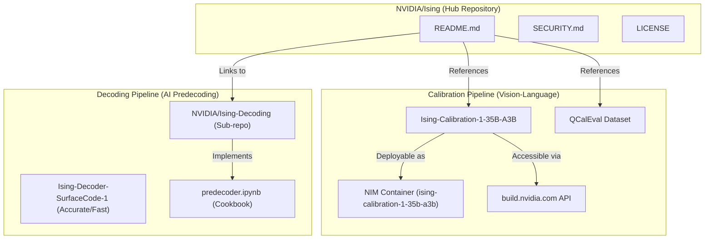
**Sources:** [README.md:1-22](), [README.md:62-67](), [README.md:74-78]()

---

## 1. Calibration Pipeline

The Calibration Pipeline is designed to automate the complex process of tuning quantum hardware parameters. This pipeline utilizes a large-scale vision-language model (VLM) to act as a "Calibration Agent."

### Key Components
*   **Model**: `Ising-Calibration-1-35B-A3B`. This 35-billion parameter model is optimized for interpreting visual data from quantum device characterization (such as spectroscopy plots) and providing calibration instructions [README.md:30-32]().
*   **Evaluation**: The `QCalEval` dataset provides a standardized benchmark for assessing the performance of AI agents in quantum calibration tasks [README.md:56-58]().
*   **Deployment**: The pipeline supports three access modes:
    *   **Direct Weights**: Available on Hugging Face [README.md:32]().
    *   **Containerized Inference**: NVIDIA NIM (NVIDIA Inference Microservice) for local deployment [README.md:41-43]().
    *   **Cloud API**: Hosted endpoint at `build.nvidia.com` for rapid integration [README.md:49-51]().

**Sources:** [README.md:26-36](), [README.md:39-43](), [README.md:47-51](), [README.md:54-58]()

---

## 2. Decoding Pipeline

The Decoding Pipeline focuses on Quantum Error Correction (QEC). It provides the tools necessary to train and deploy "Predecoders"—AI models that process syndrome data from surface codes to identify errors.

### Implementation and Data Flow
The decoding logic is primarily housed in the external `Ising-Decoding` repository, which the hub links to as the primary training framework [README.md:64-66]().

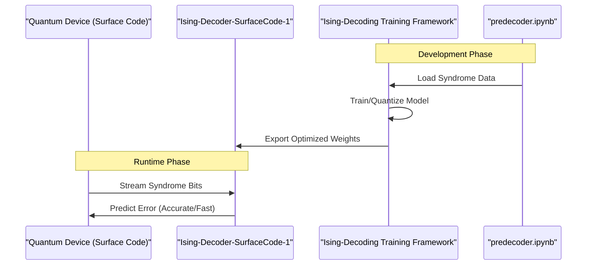

### Key Components
*   **Models**: Two variants of the `Ising-Decoder-SurfaceCode-1` are provided to balance the trade-off between error-correction accuracy and inference latency:
    *   **Accurate**: 1.79M parameters for higher fidelity [README.md:33]().
    *   **Fast**: 0.91M parameters for minimized latency [README.md:34]().
*   **Training Framework**: The `Ising-Decoding` repository provides the necessary environment to train these predecoders using syndrome data [README.md:64-66]().
*   **Optimization**: The `predecoder.ipynb` cookbook guides users through the full lifecycle: training, optimized inference, and quantization to ensure the models can run within the tight timing constraints of quantum control hardware [README.md:74-78]().

**Sources:** [README.md:30-34](), [README.md:62-67](), [README.md:74-78]()

---

## Hub Integration

The `NVIDIA/Ising` repository acts as the central management point for the entire ecosystem. While the actual training code for decoders resides in `Ising-Decoding`, the hub provides:
*   **Issue Tracking**: Centralized bug reporting and feature requests for all models and sub-repositories [README.md:81-87]().
*   **Security**: Unified security disclosure process via NVIDIA PSIRT [README.md:89]().
*   **Licensing**: Standardized Apache 2.0 licensing across the project [README.md:93-95]().

**Sources:** [README.md:9-10](), [README.md:81-95]()

---

# Page: Getting Started and Access Points

# Getting Started and Access Points

<details>
<summary>Relevant source files</summary>

The following files were used as context for generating this wiki page:

- [README.md](README.md)

</details>


This page provides a practical guide for engineers to access the NVIDIA Ising family of quantum computing tools. It covers the primary access points for models (Hugging Face, NIM containers, and API endpoints), navigation to the training frameworks, and the protocol for community engagement and support.

## Accessing Models and Artifacts

The NVIDIA Ising project distributes models and datasets through three primary channels depending on the user's infrastructure needs: pre-trained weights for local development, containerized microservices for enterprise deployment, and hosted APIs for rapid prototyping.

### 1. Hugging Face (Model Weights & Datasets)
The `nvidia-ising` collection on Hugging Face serves as the primary repository for model weights and evaluation datasets. This is the starting point for engineers looking to perform local inference or fine-tuning.

| Artifact Name | Type | Description |
| :--- | :--- | :--- |
| `Ising-Calibration-1-35B-A3B` | Model | Vision-language model for quantum device calibration. |
| `Ising-Decoder-SurfaceCode-1-Accurate` | Model | AI predecoder for surface code QEC (1.79M params). |
| `Ising-Decoder-SurfaceCode-1-Fast` | Model | AI predecoder for surface code QEC (0.91M params). |
| `QCalEval` | Dataset | Evaluation dataset for quantum calibration agents. |

Sources: [README.md:26-36](), [README.md:54-58]()

### 2. NVIDIA NIM (Containerized Deployment)
For production environments, the Calibration model is available as an **NVIDIA NIM (NVIDIA Inference Microservice)**. NIMs provide a pre-optimized, containerized runtime for deploying AI models on NVIDIA GPUs.

*   **Calibration NIM:** `ising-calibration-1-35b-a3b`
*   **Location:** NVIDIA NGC Catalog.

Sources: [README.md:39-43]()

### 3. Build.nvidia.com (API Endpoints)
Engineers can interact with the Calibration model via a hosted API endpoint without local hardware setup. This is ideal for testing the vision-language capabilities of the calibration agent before full deployment.

*   **API Endpoint:** `ising-calibration-1-35b-a3b` via `build.nvidia.com`.

Sources: [README.md:47-51]()

## Navigating the Decoding Framework

While this repository acts as the central hub, the active training and optimization logic for quantum error correction (QEC) resides in the `Ising-Decoding` repository.

### Data Flow: From Hub to Training
The following diagram illustrates how an engineer moves from the central Ising hub to the specific implementation details of the Decoding pipeline.

**Ising Ecosystem Navigation**
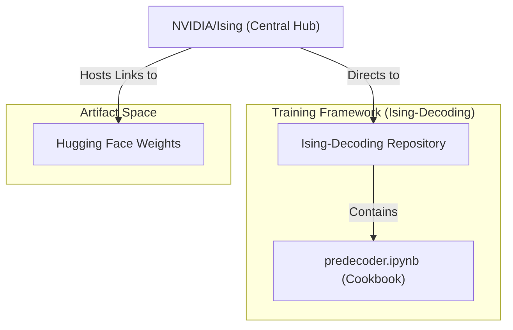
Sources: [README.md:62-66](), [README.md:74-78]()

### The Ising-Decoder Tutorial
The primary entry point for engineers working on error correction is the `predecoder.ipynb` notebook. This guide covers the full lifecycle of a surface code predecoder:
1.  **Training:** Utilizing syndrome data to train the AI models.
2.  **Inference Optimization:** Techniques for near-real-time performance.
3.  **Quantization:** Reducing the model footprint for integration with quantum control hardware.

Sources: [README.md:74-78]()

## System Access Point Mapping

This diagram bridges the conceptual "Access Points" to the specific code entities and external platforms defined in the repository.

**Access Point to Code Entity Mapping**
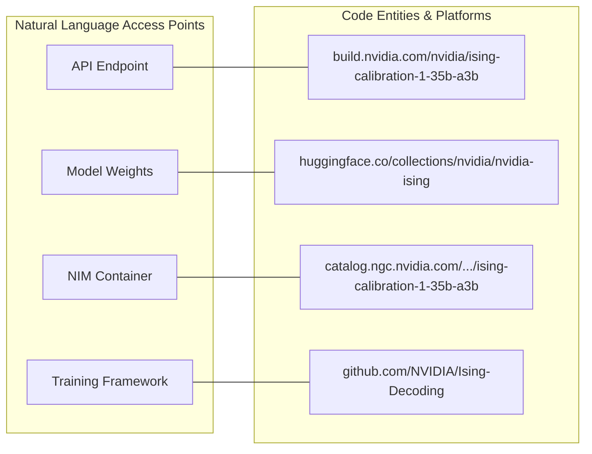
Sources: [README.md:26-36](), [README.md:39-43](), [README.md:47-51](), [README.md:62-66]()

## Support and Community Engagement

The `NVIDIA/Ising` repository serves as the centralized location for project management and support across all Ising-related sub-projects.

*   **Bug Reports:** Use the `bug.yml` template for reporting issues in the models or framework.
*   **Feature Requests:** Use the `feature.yml` template to suggest improvements.
*   **Discussions:** The GitHub Discussions tab is the primary venue for general questions and technical architecture debate.
*   **Security:** Security vulnerabilities should **not** be reported via public issues. Instead, follow the NVIDIA PSIRT process detailed in `SECURITY.md`.

Sources: [README.md:81-89]()

---

# Page: Models and Datasets

# Models and Datasets

<details>
<summary>Relevant source files</summary>

The following files were used as context for generating this wiki page:

- [README.md](README.md)

</details>


The NVIDIA Ising project provides a suite of open-source AI models and evaluation datasets designed to accelerate the development of quantum computing hardware and software. These artifacts are categorized into two primary functional areas: **Quantum Device Calibration** and **Quantum Error Correction (QEC) Decoding**.

This page provides a high-level catalog of these assets and their access points. For detailed technical specifications, deployment guides, and performance metrics, refer to the child pages linked in each section.

### AI Artifact Ecosystem

The following diagram illustrates the relationship between the published models, their respective datasets, and the deployment interfaces available within the NVIDIA Ising ecosystem.

**Diagram: Ising Model and Dataset Architecture**
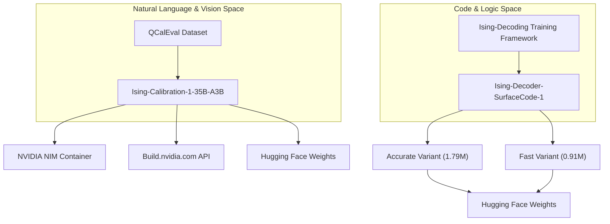
Sources: [README.md:26-58](), [README.md:64-78]()

---

## Quantum Calibration Models

Quantum device calibration is the process of tuning control parameters to ensure high-fidelity qubit operations. The Ising project introduces vision-language models (VLMs) to automate and enhance this workflow.

### Ising-Calibration-1-35B-A3B
This is a 35B-A3B parameter vision-language model specifically trained to act as an agent for quantum device calibration. It interprets visual data from quantum experiments and suggests control parameter adjustments.

*   **Primary Use Case:** Automated calibration agents for quantum hardware.
*   **Access Points:** Available as raw weights on Hugging Face, a ready-to-deploy NVIDIA NIM container, or via a hosted API endpoint on Build.nvidia.com.
*   **Evaluation:** Paired with the **QCalEval** dataset for benchmarking calibration agent performance.

For details, see [Calibration Model: Ising-Calibration-1-35B-A3B](#2.1).

**Sources:** [README.md:32-32](), [README.md:43-43](), [README.md:51-51](), [README.md:58-58]()

---

## Quantum Error Correction (QEC) Decoders

Decoding is a critical step in quantum error correction where "syndromes" (error signals) are processed to identify and correct physical qubit errors. The Ising project provides pre-trained AI decoders for the Surface Code.

### Ising-Decoder-SurfaceCode-1
The project offers two pre-trained variants of AI predecoders for surface code quantum error correction. These models are designed to be integrated into a larger decoding pipeline to provide fast, high-accuracy error identification.

| Model Variant | Parameters | Focus |
| :--- | :--- | :--- |
| **Ising-Decoder-SurfaceCode-1-Accurate** | 1.79M | Maximizing logical error suppression. |
| **Ising-Decoder-SurfaceCode-1-Fast** | 0.91M | Minimizing inference latency for real-time control. |

*   **Training Framework:** These models are developed using the [Ising-Decoding](https://github.com/NVIDIA/Ising-Decoding) repository.
*   **Optimization:** The [Ising-Decoder-Tutorial](https://github.com/NVIDIA/Ising-Decoding/blob/main/cookbook/predecoder.ipynb) provides instructions on quantizing and optimizing these models for hardware deployment.

For details, see [Decoder Models: Ising-Decoder-SurfaceCode-1](#2.2).

**Sources:** [README.md:33-34](), [README.md:66-66](), [README.md:78-78]()

---

## Summary of Published Artifacts

The following table summarizes all currently available models and datasets in the NVIDIA Ising family.

| Artifact Name | Type | Repository / Hub |
| :--- | :--- | :--- |
| `Ising-Calibration-1-35B-A3B` | VLM Model | [HuggingFace](https://huggingface.co/nvidia/Ising-Calibration-1-35B-A3B) |
| `QCalEval` | Dataset | [HuggingFace Datasets](https://huggingface.co/datasets/nvidia/QCalEval) |
| `Ising-Decoder-SurfaceCode-1-Accurate` | AI Decoder | [HuggingFace](https://huggingface.co/nvidia/Ising-Decoder-SurfaceCode-1-Accurate) |
| `Ising-Decoder-SurfaceCode-1-Fast` | AI Decoder | [HuggingFace](https://huggingface.co/nvidia/Ising-Decoder-SurfaceCode-1-Fast) |

**Sources:** [README.md:30-58]()

---

# Page: Calibration Model: Ising-Calibration-1-35B-A3B

# Calibration Model: Ising-Calibration-1-35B-A3B

<details>
<summary>Relevant source files</summary>

The following files were used as context for generating this wiki page:

- [README.md](README.md)

</details>


The `Ising-Calibration-1-35B-A3B` is a specialized vision-language model (VLM) designed to automate and optimize the calibration of quantum devices [README.md:32-32](). By interpreting visual data from quantum experiments and translating it into actionable calibration parameters, the model serves as a critical component in the NVIDIA Ising calibration pipeline.

## Model Architecture and Specifications

The model utilizes a 35B-A3B architecture, optimized for high-reasoning tasks required in quantum physics and hardware characterization [README.md:32-32](). As a vision-language model, it is capable of processing multi-modal inputs, such as qubit spectroscopy plots or Rabi oscillation graphs, to provide diagnostic feedback or parameter adjustments.

| Attribute | Specification |
| :--- | :--- |
| **Model Name** | Ising-Calibration-1-35B-A3B |
| **Type** | Vision-Language Model (VLM) |
| **Parameters** | 35B-A3B |
| **Primary Use Case** | Quantum Device Calibration |
| **Training Context** | Device characterization and automated tuning |

**Sources:**
- [README.md:32-32]()

## Deployment Options

NVIDIA provides three primary methods for deploying and interacting with the `Ising-Calibration-1-35B-A3B` model, ranging from local hosting to managed cloud APIs.

### 1. Hugging Face Weights
For researchers requiring full control over the inference environment or fine-tuning capabilities, the model weights are hosted on Hugging Face [README.md:32-32](). This allows for integration into custom Python workflows using standard libraries like `transformers`.

### 2. NVIDIA NIM (NVIDIA Inference Microservice)
The model is available as a NIM container, providing a production-ready, optimized inference environment [README.md:43-43](). NIMs encapsulate the model with an optimized inference engine (such as TensorRT-LLM) and provide a standardized API.

### 3. Build.nvidia.com API
For rapid prototyping without infrastructure management, NVIDIA provides a hosted API endpoint [README.md:51-51](). This allows users to send calibration data (images and text prompts) directly to NVIDIA-managed infrastructure.

### Deployment Architecture Diagram

The following diagram illustrates how different deployment modes bridge the gap between local quantum control software and the Ising calibration intelligence.

**Model Access and Data Flow**
```mermaid
graph TD
    subgraph "Quantum_Control_Environment"
        [Local_Control_Software]
        [Experiment_Data_Images]
    end

    subgraph "Deployment_Modes"
        [HuggingFace_Weights] --> |"Local_Inference"| [Ising-Calibration-1-35B-A3B]
        [NIM_Container] --> |"Self-Hosted_API"| [Ising-Calibration-1-35B-A3B]
        [Build_Nvidia_API] --> |"Cloud_API"| [Ising-Calibration-1-35B-A3B]
    end

    [Experiment_Data_Images] --> [Deployment_Modes]
    [Ising-Calibration-1-35B-A3B] --> |"Calibration_Parameters"| [Local_Control_Software]
```

**Sources:**
- [README.md:32-32]()
- [README.md:43-43]()
- [README.md:51-51]()

## Evaluation: QCalEval Dataset

To ensure the reliability and accuracy of the calibration model, NVIDIA provides the **QCalEval** dataset [README.md:58-58](). This dataset serves as a benchmark for evaluating AI agents tasked with quantum calibration.

*   **Purpose:** To measure the model's ability to correctly interpret quantum experimental results and suggest valid tuning steps.
*   **Content:** A collection of labeled quantum characterization data, including common failure modes and optimal calibration states.
*   **Availability:** Hosted on Hugging Face for public use [README.md:58-58]().

**Sources:**
- [README.md:58-58]()

## Calibration Workflow

The intended workflow for `Ising-Calibration-1-35B-A3B` involves a closed-loop system where the model acts as the "intelligence" layer between the quantum hardware and the control software.

### Logic Flow Diagram

This diagram maps the conceptual calibration loop to the specific entities provided in the Ising repository.

**Calibration Intelligence Loop**
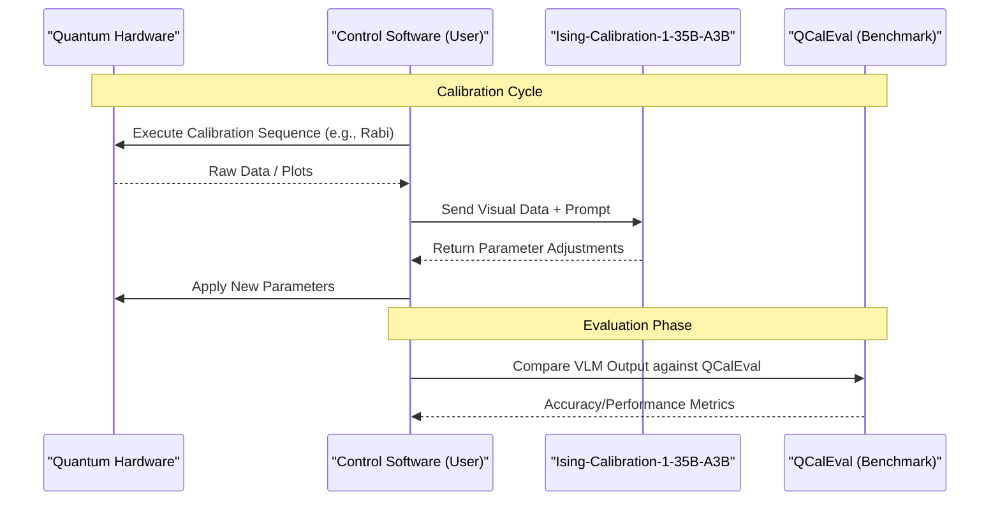

**Sources:**
- [README.md:32-32]()
- [README.md:58-58]()
- [README.md:99-99]()

---

# Page: Decoder Models: Ising-Decoder-SurfaceCode-1

# Decoder Models: Ising-Decoder-SurfaceCode-1

<details>
<summary>Relevant source files</summary>

The following files were used as context for generating this wiki page:

- [README.md](README.md)

</details>


This page provides a technical deep dive into the **Ising-Decoder-SurfaceCode-1** model family, which consists of specialized AI predecoders designed for surface code quantum error correction (QEC). These models are optimized to process syndrome data and assist in identifying error patterns in quantum processors.

## Model Variants and Architecture

The Ising project provides two distinct variants of the surface code predecoder to address the critical trade-off between decoding accuracy and execution latency. Both models are designed to integrate into the decoding pipeline to improve the reliability of quantum computations.

| Model Variant | Parameters | Primary Use Case | Hugging Face Link |
|:---|:---|:---|:---|
| **Ising-Decoder-SurfaceCode-1-Accurate** | 1.79M | Maximum error suppression; high-fidelity applications. | [HuggingFace](https://huggingface.co/nvidia/Ising-Decoder-SurfaceCode-1-Accurate) |
| **Ising-Decoder-SurfaceCode-1-Fast** | 0.91M | Low-latency requirements; near-real-time control loops. | [HuggingFace](https://huggingface.co/nvidia/Ising-Decoder-SurfaceCode-1-Fast) |

### Accuracy vs. Latency Trade-off
The **Accurate** model (1.79M parameters) provides higher expressive power for complex error correlations but requires more computational cycles. The **Fast** model (0.91M parameters) is a pruned/distilled version optimized for hardware environments where the decoding window is extremely tight, such as FPGA or specialized ASIC integration for real-time feedback [README.md:33-34]().

**Sources:**
- [README.md:33-34]()

---

## Technical Workflow: From Syndrome to Correction

The Ising-Decoder models function as "predecoders." They take syndrome measurements (the parity checks from a surface code) as input and output predicted error probabilities or simplified error representations that can be used by a backend solver.

### Data Flow and Code Entities
The following diagram illustrates the relationship between the pre-trained models, the training framework, and the tutorial resources.

**System Architecture: Ising-Decoding Pipeline**
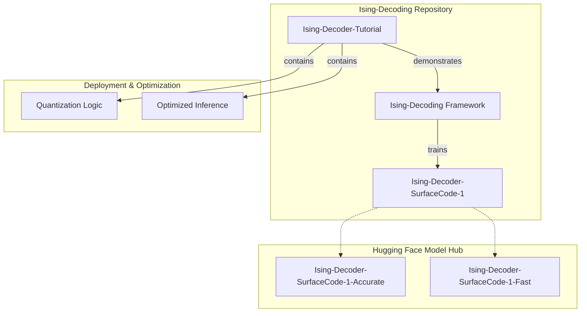

**Sources:**
- [README.md:66-66]()
- [README.md:78-78]()

---

## Implementation and Tutorials

The models are supported by a comprehensive training and optimization framework located in the [Ising-Decoding](https://github.com/NVIDIA/Ising-Decoding) repository [README.md:66-66]().

### Ising-Decoder-Tutorial (predecoder.ipynb)
The primary entry point for engineers is the `predecoder.ipynb` cookbook. This tutorial covers the end-to-end lifecycle of a surface code decoder:

1.  **Training:** How to use the `Ising-Decoding` framework to train models on synthetic or hardware-captured syndrome data [README.md:78-78]().
2.  **Quantization:** Techniques to reduce the model footprint from floating-point to integer representations (e.g., INT8 or FP8) to fit on edge-compute hardware [README.md:78-78]().
3.  **Optimized Inference:** Strategies for minimizing the time between receiving a syndrome and outputting a correction [README.md:78-78]().

**Code Entity Mapping**
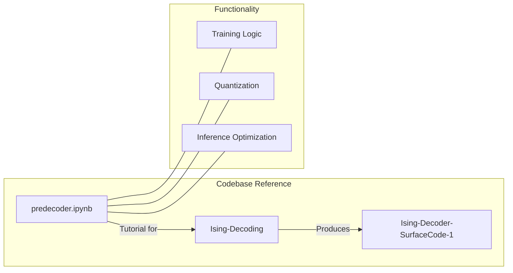

**Sources:**
- [README.md:66-66]()
- [README.md:74-78]()

---

## Deployment and Access

The Ising-Decoder models are hosted on Hugging Face as part of the NVIDIA Ising collection. Unlike the Calibration model, which is available via NIM containers and API endpoints, the Decoder models are typically downloaded as weights for local integration into custom QEC software stacks.

*   **Hugging Face Collection:** [nvidia/nvidia-ising](https://huggingface.co/collections/nvidia/nvidia-ising) [README.md:36-36]()
*   **Repository for Training:** [NVIDIA/Ising-Decoding](https://github.com/NVIDIA/Ising-Decoding) [README.md:66-66]()

**Sources:**
- [README.md:30-36]()
- [README.md:66-66]()

---

# Page: Ising-Decoding Training Framework

# Ising-Decoding Training Framework

<details>
<summary>Relevant source files</summary>

The following files were used as context for generating this wiki page:

- [README.md](README.md)

</details>


The **Ising-Decoding Training Framework** is a specialized environment designed to manage the full lifecycle of AI-based quantum error correction (QEC) decoders. While the main `NVIDIA/Ising` repository serves as a central hub for models and datasets, the actual training logic and optimization routines reside in the [Ising-Decoding](https://github.com/NVIDIA/Ising-Decoding) sub-repository [README.md:64-66]().

This framework focuses on the **Decoding Pipeline**, specifically for surface code predecoders. It provides the infrastructure to take raw syndrome data, train neural network architectures (such as the Accurate and Fast variants), and optimize them for the extreme low-latency requirements of quantum control hardware.

### System Architecture and Code Mapping

The following diagram illustrates how the logical components of the training framework map to specific code entities and external resources within the NVIDIA Ising ecosystem.

**Diagram: Decoding Framework Code Mapping**
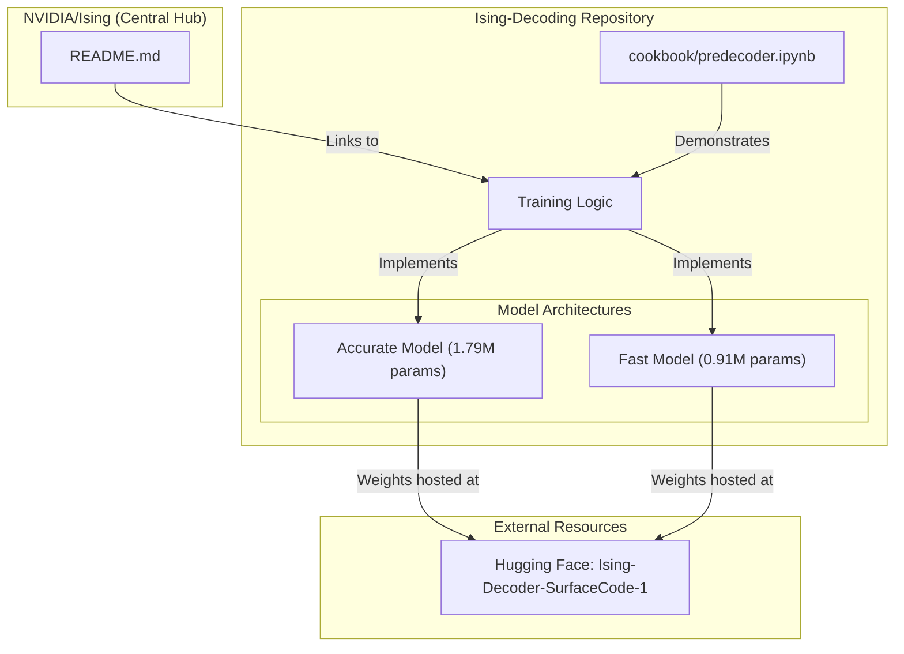
**Sources:** [README.md:30-36](), [README.md:64-66](), [README.md:74-78]()

---

### Training AI Decoders
The training workflow utilizes syndrome data to teach AI models how to predict error patterns in surface code lattices. The framework is designed to handle the specific data structures required for QEC, allowing users to train models that balance prediction accuracy with computational overhead.

The primary entry point for understanding this workflow is the `predecoder.ipynb` cookbook, which provides a step-by-step guide to the training process within the Ising-Decoding repository [README.md:74-78]().

For details, see [Training AI Decoders](#3.1).

**Sources:** [README.md:66](), [README.md:78]()

---

### Inference Optimization and Quantization
Once a model is trained, it must be optimized for deployment. Quantum error correction requires decisions to be made in "near-real-time" to prevent error propagation. The framework includes tools for:
*   **Quantization:** Reducing the precision of model weights (e.g., from FP32 to INT8) to decrease the memory footprint and increase throughput [README.md:78]().
*   **Inference Optimization:** Techniques to ensure the decoder can keep pace with the quantum hardware's cycle time.

These optimizations are critical for the "Fast" model variant (0.91M parameters), which is specifically tailored for high-speed execution [README.md:34]().

For details, see [Inference Optimization and Quantization](#3.2).

**Sources:** [README.md:33-34](), [README.md:78]()

---

### Framework Components Overview

The table below summarizes the relationship between the training framework and the artifacts it produces.

| Component | Code Entity / Link | Purpose |
| :--- | :--- | :--- |
| **Training Hub** | [Ising-Decoding Repo](https://github.com/NVIDIA/Ising-Decoding) | Central repository for training scripts and logic [README.md:66](). |
| **Step-by-Step Guide** | `cookbook/predecoder.ipynb` | Practical tutorial for training and quantizing models [README.md:78](). |
| **Accurate Variant** | `Ising-Decoder-SurfaceCode-1-Accurate` | High-fidelity model with 1.79M parameters [README.md:33](). |
| **Fast Variant** | `Ising-Decoder-SurfaceCode-1-Fast` | Latency-optimized model with 0.91M parameters [README.md:34](). |

**Sources:** [README.md:30-34](), [README.md:66](), [README.md:78]()

---

### Workflow Integration

The training framework bridges the gap between raw quantum syndrome data and deployable AI agents. The following diagram shows the lifecycle from data to optimized inference.

**Diagram: Decoding Lifecycle Workflow**
```mermaid
flowgraph LR
    DATA["Syndrome Data"] --> TRAIN["Training (Ising-Decoding)"]
    TRAIN --> MODEL["Pre-trained Model (Accurate/Fast)"]
    MODEL --> QUANT["Quantization & Optimization"]
    QUANT --> DEPLOY["Hardware-Ready Inference"]

    subgraph "Ising-Decoding Repository Scope"
        TRAIN
        QUANT
    end
```
**Sources:** [README.md:66](), [README.md:78]()

---

# Page: Training AI Decoders

# Training AI Decoders

<details>
<summary>Relevant source files</summary>

The following files were used as context for generating this wiki page:

- [README.md](README.md)

</details>


This page describes the training workflow for AI-based predecoders within the NVIDIA Ising ecosystem. The primary objective of this workflow is to transform quantum syndrome data into actionable error predictions for surface code quantum error correction.

## Workflow Overview

The training process is hosted within the [Ising-Decoding](https://github.com/NVIDIA/Ising-Decoding) repository [README.md:66-66](). This repository serves as the specialized framework for developing, training, and optimizing AI decoders. The workflow bridges the gap between raw syndrome extraction and real-time error suppression by training neural networks—specifically the `Ising-Decoder-SurfaceCode-1` variants—to recognize patterns in error syndromes [README.md:33-34]().

### Data Flow and Training Pipeline

The training pipeline utilizes syndrome data generated from surface code simulations. This data is used to train two distinct model architectures optimized for different operational requirements:
1.  **Accurate Model**: A 1.79M parameter model designed for maximum error suppression [README.md:33-33]().
2.  **Fast Model**: A 0.91M parameter model optimized for low-latency execution on quantum control hardware [README.md:34-34]().

### System Architecture: Training to Deployment

The following diagram illustrates the relationship between the training repository, the resulting model artifacts, and the final deployment endpoints.

**Figure 1: Ising-Decoding Training and Distribution Flow**
```mermaid
graph TD
    subgraph "Ising-Decoding GitHub Repository"
        [Training_Scripts] --> [predecoder.ipynb]
        [predecoder.ipynb] --> [Model_Weights_Export]
    end

    subgraph "NVIDIA Ising (Central Hub)"
        [Model_Weights_Export] -- "Published to" --> [Hugging_Face_Collection]
    end

    subgraph "Model Variants"
        [Hugging_Face_Collection] --> [Ising-Decoder-SurfaceCode-1-Accurate]
        [Hugging_Face_Collection] --> [Ising-Decoder-SurfaceCode-1-Fast]
    end

    [Ising-Decoder-SurfaceCode-1-Accurate] -.-> [Inference_Optimization]
    [Ising-Decoder-SurfaceCode-1-Fast] -.-> [Inference_Optimization]
```
**Sources:** [README.md:33-34](), [README.md:66-66](), [README.md:78-78]()

---

## The Predecoder Cookbook

The primary entry point for engineers to engage with the training framework is the `predecoder.ipynb` cookbook [README.md:78-78](). This interactive guide provides the implementation details for the entire lifecycle of an AI predecoder.

### Key Functional Areas
The cookbook covers three critical phases of the AI decoder lifecycle:
*   **Training**: Procedures for feeding syndrome data into the neural network and tuning hyperparameters for surface code performance [README.md:78-78]().
*   **Quantization**: Techniques to reduce the model footprint (e.g., converting weights to lower precision) to ensure compatibility with specialized quantum controller FPGAs or ASICs [README.md:78-78]().
*   **Optimized Inference**: Strategies for maximizing throughput and minimizing the latency of the decoding loop [README.md:78-78]().

### Mapping Training Concepts to Code Entities

The following diagram maps the logical steps of the training process to the specific resources and repositories within the Ising ecosystem.

**Figure 2: Code Entity Mapping for Decoder Training**
```mermaid
graph LR
    subgraph "Training Logic"
        [Syndrome_Data] --> [Training_Loop]
        [Training_Loop] --> [Weight_Quantization]
    end

    subgraph "Repository Entities"
        [Training_Loop] -- "Implemented in" --> [Ising-Decoding/cookbook/predecoder.ipynb]
        [Ising-Decoding/cookbook/predecoder.ipynb] -- "References" --> [Ising-Decoding_Repo]
    end

    subgraph "Artifact Entities"
        [Weight_Quantization] -- "Produces" --> [Ising-Decoder-SurfaceCode-1-Fast]
        [Weight_Quantization] -- "Produces" --> [Ising-Decoder-SurfaceCode-1-Accurate]
    end
```
**Sources:** [README.md:33-34](), [README.md:66-66](), [README.md:78-78]()

---

## Getting Started

To begin training or fine-tuning a predecoder, follow these steps:

1.  **Access the Repository**: Clone the training framework from the [Ising-Decoding GitHub](https://github.com/NVIDIA/Ising-Decoding) [README.md:66-66]().
2.  **Launch the Tutorial**: Open the `cookbook/predecoder.ipynb` notebook to walk through the training and quantization pipeline [README.md:78-78]().
3.  **Reference Pre-trained Weights**: If you do not wish to train from scratch, download the baseline weights for the `Accurate` or `Fast` models from the [NVIDIA Ising Hugging Face Collection](https://huggingface.co/collections/nvidia/nvidia-ising) [README.md:33-36]().
4.  **Feedback Loop**: Report any issues encountered during the training process via the central [Ising Issues page](https://github.com/NVIDIA/ising/issues) [README.md:85-87]().

**Sources:** [README.md:33-36](), [README.md:66-66](), [README.md:78-78](), [README.md:85-87]()

---

# Page: Inference Optimization and Quantization

# Inference Optimization and Quantization

<details>
<summary>Relevant source files</summary>

The following files were used as context for generating this wiki page:

- [README.md](README.md)

</details>


The post-training lifecycle of the NVIDIA Ising AI decoders focuses on bridging the gap between high-accuracy neural network models and the stringent latency requirements of quantum control hardware. This stage, documented primarily in the `Ising-Decoder-Tutorial`, involves reducing the computational footprint of models like `Ising-Decoder-SurfaceCode-1` through quantization and optimizing the inference execution path for near-real-time performance.

## Post-Training Optimization Lifecycle

The optimization workflow transforms a trained PyTorch model into a deployable artifact capable of processing syndrome data with minimal latency. This is critical for Surface Code quantum error correction, where the "Fast" model variant (0.91M parameters) and "Accurate" variant (1.79M parameters) must provide rapid pre-decoding feedback to the quantum controller [README.md:33-34]().

### Data Flow and Optimization Stages

The following diagram illustrates the transition from the training environment to an optimized inference runtime.

**Diagram: Model Optimization Pipeline**
```mermaid
graph TD
    subgraph "Training_Environment"
        [Ising-Decoding_Repo] --> [PyTorch_Model_Weights]
    end

    subgraph "Optimization_Lifecycle"
        [PyTorch_Model_Weights] --> [Quantization_Process]
        [Quantization_Process] --> [Optimized_Artifact]
        [Optimized_Artifact] --> [Inference_Runtime]
    end

    subgraph "Hardware_Integration"
        [Inference_Runtime] --> [Quantum_Control_System]
        [Syndrome_Data] --> [Inference_Runtime]
    end

    [Ising-Decoder-Tutorial] -- "Defines Workflow" --> [Quantization_Process]
```
**Sources:** [README.md:66-78]()

## Quantization Techniques

To reduce the model footprint and increase throughput, the Ising project utilizes quantization techniques. This process converts the high-precision floating-point weights (typically FP32) used during training into lower-precision formats.

*   **Footprint Reduction:** Quantization significantly reduces the memory requirements for the `Ising-Decoder-SurfaceCode-1` models, enabling them to fit within the limited cache or memory of specialized quantum control processors [README.md:33-34]().
*   **Throughput Considerations:** Lower precision operations (such as INT8 or FP16) allow for higher throughput on compatible hardware, which is essential for maintaining the error correction cycle speed [README.md:78]().

## Optimized Inference Strategies

The `Ising-Decoder-Tutorial` provides the implementation details for executing these models in an optimized manner. The focus is on "near-real-time" integration, where the AI pre-decoder acts as a fast heuristic to assist the primary decoder [README.md:78]().

### Implementation Entities

The following diagram maps the conceptual optimization tasks to the specific code entities and repositories provided in the NVIDIA Ising project.

**Diagram: Code Entity Mapping for Inference**
```mermaid
graph LR
    subgraph "GitHub: NVIDIA/Ising-Decoding"
        [predecoder.ipynb] -- "Implements" --> [Quantization_Logic]
        [predecoder.ipynb] -- "Demonstrates" --> [Optimized_Inference]
    end

    subgraph "Hugging_Face_Artifacts"
        [Ising-Decoder-SurfaceCode-1-Accurate] -- "Input_Weights" --> [predecoder.ipynb]
        [Ising-Decoder-SurfaceCode-1-Fast] -- "Input_Weights" --> [predecoder.ipynb]
    end

    subgraph "Execution_Output"
        [Optimized_Inference] -- "Produces" --> [Syndrome_Predictions]
    end
```
**Sources:** [README.md:30-34](), [README.md:74-78]()

## Throughput and Hardware Integration

For quantum error correction, throughput is measured by the number of syndromes processed per second. The optimization strategies documented in the `Ising-Decoding` repository are designed to minimize the overhead between the quantum device's syndrome measurement and the AI model's output [README.md:66-78]().

| Feature | Accurate Model | Fast Model |
| :--- | :--- | :--- |
| **Parameters** | 1.79M | 0.91M |
| **Optimization Focus** | Maximum Fidelity | Minimum Latency |
| **Primary Resource** | [Ising-Decoder-SurfaceCode-1-Accurate]() | [Ising-Decoder-SurfaceCode-1-Fast]() |

**Sources:** [README.md:33-34]()

The tutorial located at `Ising-Decoding/blob/main/cookbook/predecoder.ipynb` serves as the primary technical reference for engineers implementing these optimizations in their own quantum control stacks [README.md:78]().

---

# Page: Contributing, Security, and Licensing

# Contributing, Security, and Licensing

<details>
<summary>Relevant source files</summary>

The following files were used as context for generating this wiki page:

- [LICENSE](LICENSE)
- [SECURITY.md](SECURITY.md)

</details>


This page provides the governance and compliance framework for the NVIDIA Ising project. It outlines the protocols for reporting security vulnerabilities and the legal terms governing the use and redistribution of the codebase. As a central hub for quantum computing tools, maintaining a secure and legally transparent environment is critical for both contributors and users.

## Security Vulnerability Reporting

NVIDIA prioritizes the security and integrity of the Ising project. All security-related disclosures are handled through the **NVIDIA Product Security Incident Response Team (PSIRT)**. To maintain the safety of the user base, vulnerabilities must not be reported via public GitHub issues or pull requests.

If a security issue is identified, it should be submitted via the official web form or through PGP-encrypted email to `psirt@nvidia.com`. Reports should include the product version, vulnerability type, and a proof-of-concept for reproduction.

For details on the disclosure process and required report information, see **[Security Vulnerability Reporting](#4.1)**.

### Security Disclosure Workflow

The following diagram illustrates the transition from identifying a potential vulnerability in the code to the private disclosure channel.

**Figure 1: Security Reporting Path**
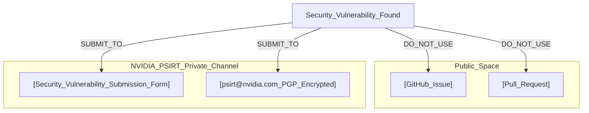
**Sources:**
- [SECURITY.md:1-25]()

## License: Apache 2.0

The NVIDIA Ising repository is licensed under the **Apache License, Version 2.0**. This is a permissive free software license that allows users to use the software for any purpose, distribute it, modify it, and distribute modified versions of the software under the terms of the license.

Key components of this license include:
*   **Grant of Rights:** Provides perpetual, worldwide, non-exclusive, and royalty-free copyright and patent licenses.
*   **Redistribution:** Requires that any redistributed work includes a copy of the license and attribution notices.
*   **Patent Retaliation:** Includes a clause that terminates the patent license if the user institutes patent litigation against any contributor regarding the work.
*   **No Warranty:** The software is provided on an "AS IS" BASIS, without warranties or conditions of any kind.

For a summary of the rights, obligations, and legal definitions, see **[License: Apache 2.0](#4.2)**.

### Legal Entity and Contribution Mapping

This diagram bridges the legal definitions found in the `LICENSE` file to the roles involved in the codebase lifecycle.

**Figure 2: Apache 2.0 Governance Entities**
```mermaid
classDiagram
    class "Legal_Entity" {
        +Ownership_50_percent
        +Direct_Control
    }
    class "Contributor" {
        +Submits_Work
        +Grants_Patent_License
    }
    class "Work" {
        +Source_Form
        +Object_Form
    }
    class "Derivative_Works" {
        +Editorial_Revisions
        +Annotations
    }

    "Legal_Entity" --|> "Contributor" : "Acts as"
    "Contributor" --> "Work" : "Submits Contribution"
    "Work" <|-- "Derivative_Works" : "Based on"
```
**Sources:**
- [LICENSE:8-65]()
- [LICENSE:67-88]()

## Summary Table

| Category | Policy / License | Primary Contact / Link |
| :--- | :--- | :--- |
| **Security** | Coordinated Vulnerability Disclosure | [NVIDIA PSIRT](https://www.nvidia.com/en-us/security/psirt-policies) |
| **Licensing** | Apache License 2.0 | `LICENSE` file in root |
| **Contributions** | Standard Apache Submission | [NVIDIA Ising GitHub](https://github.com/NVIDIA/Ising) |

**Sources:**
- [SECURITY.md:7-25]()
- [LICENSE:1-130]()

---

# Page: Security Vulnerability Reporting

# Security Vulnerability Reporting

<details>
<summary>Relevant source files</summary>

The following files were used as context for generating this wiki page:

- [SECURITY.md](SECURITY.md)

</details>


The NVIDIA Ising project adheres to a coordinated vulnerability disclosure process managed by the NVIDIA Product Security Incident Response Team (PSIRT). This page outlines the technical protocols for identifying, reporting, and resolving security vulnerabilities within the Ising codebase, including its calibration and decoding pipelines.

## Reporting Protocol and Constraints

To maintain the integrity of the security process, all potential vulnerabilities must be reported through private channels. Public disclosure via GitHub issues or pull requests is strictly prohibited to prevent the exposure of exploit vectors before a patch is available.

| Rule | Description |
| :--- | :--- |
| **No Public Issues** | Do not report security vulnerabilities through GitHub Issues [SECURITY.md:5-5](). |
| **Redirection** | If a vulnerability is reported publicly, maintainers will limit discussion and redirect the reporter to private channels [SECURITY.md:5-5](). |
| **Primary Channel** | Reports should be submitted via the official Web Form or PGP-encrypted email [SECURITY.md:10-11](). |

**Sources:**
- [SECURITY.md:1-6]()
- [SECURITY.md:7-12]()

## Data Flow: Vulnerability Disclosure Process

The following diagram illustrates the flow of security information from the initial discovery by a researcher to the ingestion by the NVIDIA PSIRT system.

### Figure 1: Vulnerability Reporting Data Flow
```mermaid
graph TD
    subgraph "Researcher_Space"
        "A[Identify Vulnerability]" --> "B{Choose Channel}"
    end

    subgraph "NVIDIA_PSIRT_Ingestion"
        "B" -- "HTTPS POST" --> "C[Web_Submission_Form]"
        "B" -- "SMTP_PGP_Encrypted" --> "D[psirt@nvidia.com]"
        "C" --> "E[PSIRT_Internal_Triage]"
        "D" --> "E"
    end

    subgraph "Code_Entity_Context"
        "E" --> "F[Assess_Ising_Repository]"
        "F" --> "G[Ising-Calibration-Pipeline]"
        "F" --> "H[Ising-Decoding-Framework]"
    end

    "G" -- "Validation" --> "I[Coordinated_Disclosure_Notice]"
    "H" -- "Validation" --> "I"
```
**Sources:**
- [SECURITY.md:9-12]()
- [SECURITY.md:20-20]()

## Required Information for Technical Reports

To ensure a timely response and effective remediation, reports must contain specific technical metadata. This allows the PSIRT team to reproduce the issue within the context of the Ising project's specific quantum computing tools.

The report must include the following entities:
1.  **Product Identification**: The specific branch or version of the Ising repository (e.g., `main` or a specific release tag) [SECURITY.md:14-14]().
2.  **Vulnerability Classification**: The technical category, such as arbitrary code execution, denial of service (DoS), or buffer overflows [SECURITY.md:15-15]().
3.  **Reproduction Steps**: Detailed instructions to trigger the vulnerability [SECURITY.md:16-16]().
4.  **Artifacts**: Proof-of-concept (PoC) scripts or exploit code [SECURITY.md:17-17]().
5.  **Impact Analysis**: An assessment of how the vulnerability affects the quantum error correction or calibration workflows [SECURITY.md:18-18]().

**Sources:**
- [SECURITY.md:13-18]()

## Secure Communication Channels

NVIDIA provides two primary methods for private disclosure. For email communications, the use of Pretty Good Privacy (PGP) is encouraged to protect sensitive exploit data in transit.

### Figure 2: Security Entity Association
```mermaid
classDiagram
    class NVIDIA_PSIRT {
        +submitWebForm()
        +receiveEncryptedEmail()
        +triageVulnerability()
    }
    class Security_Report {
        +String product_name
        +String version_branch
        +String vulnerability_type
        +Steps reproduction_instructions
        +Code proof_of_concept
        +String potential_impact
    }
    class Encryption_Layer {
        +PGP_Public_Key
        +Secure_Socket_Layer
    }

    NVIDIA_PSIRT ..> Security_Report : "Requires"
    Security_Report ..> Encryption_Layer : "Protected by"
    NVIDIA_PSIRT : psirt@nvidia.com
```

### Channel Details
*   **Web Submission**: [Security Vulnerability Submission Form](https://www.nvidia.com/object/submit-security-vulnerability.html) [SECURITY.md:10-10]().
*   **Encrypted Email**: Send to `psirt@nvidia.com` using the [NVIDIA Public PGP Key](https://www.nvidia.com/en-us/security/pgp-key) [SECURITY.md:11-12]().

**Sources:**
- [SECURITY.md:9-12]()
- [SECURITY.md:24-25]()

## Response and Acknowledgement

NVIDIA follows a coordinated vulnerability disclosure policy. While a formal bug bounty program is not currently active for this repository, NVIDIA provides public acknowledgement for researchers whose reports lead to a security fix [SECURITY.md:20-20]().

Further information regarding the lifecycle of a security report can be found at the [NVIDIA Product Security Portal](https://www.nvidia.com/en-us/security) [SECURITY.md:24-25]().

**Sources:**
- [SECURITY.md:20-20]()
- [SECURITY.md:24-25]()

---

# Page: License: Apache 2.0

# License: Apache 2.0

<details>
<summary>Relevant source files</summary>

The following files were used as context for generating this wiki page:

- [LICENSE](LICENSE)

</details>


The NVIDIA Ising repository is governed by the **Apache License, Version 2.0**. This is a permissive free software license that allows users to use the software for any purpose, distribute it, modify it, and distribute modified versions of the software under the terms of the license, without concern for royalties [LICENSE:2-11]().

## Rights Granted

The license provides two primary grants of rights to users ("You") of the Work:

### 1. Copyright License
Each contributor grants a perpetual, worldwide, non-exclusive, no-charge, royalty-free, irrevocable copyright license [LICENSE:67-69](). This allows for:
* Reproduction and distribution of the `Work` or `Derivative Works` [LICENSE:70-72]().
* Preparation of `Derivative Works` [LICENSE:70]().
* Public display and performance [LICENSE:71]().

### 2. Patent License
Contributors grant a perpetual, worldwide, non-exclusive, no-charge, royalty-free, irrevocable patent license to make, use, sell, and import the `Work` [LICENSE:74-78](). This grant applies specifically to patent claims licensable by the contributor that are necessarily infringed by their `Contribution(s)` alone or in combination with the `Work` [LICENSE:79-82]().

### Patent Retaliation Clause
To protect the community, the patent license includes a termination clause. If a user institutes patent litigation against any entity alleging that the `Work` constitutes patent infringement, then any patent licenses granted to that user under this license for that `Work` shall terminate as of the date the litigation is filed [LICENSE:82-88]().

**Sources:** [LICENSE:67-88]()

## Redistribution Requirements

Users may redistribute the `Work` or `Derivative Works` in any medium, provided they meet the following conditions:

| Condition | Requirement Detail |
| :--- | :--- |
| **License Copy** | You must provide a copy of the Apache 2.0 License to any recipients [LICENSE:95-97](). |
| **Change Notices** | Any modified files must carry prominent notices stating that the files were changed [LICENSE:98-99](). |
| **Notice Retention** | You must retain all copyright, patent, trademark, and attribution notices from the Source form of the Work [LICENSE:101-103](). |
| **NOTICE File** | If the Work includes a `NOTICE` file, Derivative Works must include a readable copy of those attribution notices [LICENSE:107-111](). |

**Sources:** [LICENSE:90-123]()

## Legal Entities and Contributions

The license defines the relationship between the `Licensor` (NVIDIA/Contributors) and the `Legal Entity` (the user).

### Contribution Flow and Definitions
The following diagram maps the natural language definitions of the license to the entities involved in the codebase lifecycle.

**Diagram: License Entity Relationships**
```mermaid
graph TD
    subgraph "Natural Language Space"
        User["'You' (Legal Entity)"]
        WorkDef["'Work' (Authorship)"]
        DerivDef["'Derivative Works'"]
    end

    subgraph "Code Entity Space"
        Repo["NVIDIA/Ising Repository"]
        SourceCode["Source Form (Code/Docs)"]
        ObjectCode["Object Form (Compiled/NIM)"]
        ModFiles["Modified Files (with Change Notices)"]
    end

    User -- "Exercises permissions" --> Repo
    WorkDef -- "Includes" --> SourceCode
    WorkDef -- "Includes" --> ObjectCode
    SourceCode -- "Modified into" --> ModFiles
    ModFiles -- "Qualifies as" --> DerivDef
    Repo -- "Governed by" --> LicenseFile["LICENSE File"]
```
**Sources:** [LICENSE:8-65]()

## Disclaimer of Warranty and Limitation of Liability

The license provides the work on an "AS IS" BASIS, without warranties or conditions of any kind [LICENSE:171-175]().

*   **No Warranty:** Contributors provide no guarantees regarding title, non-infringement, merchantability, or fitness for a particular purpose [LICENSE:175-180]().
*   **Limitation of Liability:** In no event and under no legal theory shall any contributor be liable for damages, including direct, indirect, special, incidental, or consequential damages arising out of the use or inability to use the Work [LICENSE:182-192]().

**Sources:** [LICENSE:171-198]()

## Applying the License to Your Work

To apply the Apache 2.0 license to new works, the following boilerplate should be attached to the files, replacing the brackets with your own identifying information:

**Diagram: License Application Workflow**
```mermaid
graph LR
    subgraph "Implementation Steps"
        A["Create Source File"] --> B["Insert Boilerplate"]
        B --> C["Specify Year"]
        C --> D["Specify Owner Name"]
        D --> E["Include LICENSE file"]
    end

    subgraph "Code Components"
        B --- CodeBlock["Copyright [yyyy] [name of copyright owner]"]
        E --- FileRef["/LICENSE"]
    end
```
**Sources:** [LICENSE:200-218]()

---

# Page: Glossary

# Glossary

<details>
<summary>Relevant source files</summary>

The following files were used as context for generating this wiki page:

- [LICENSE](LICENSE)
- [README.md](README.md)
- [SECURITY.md](SECURITY.md)

</details>


This glossary provides definitions for codebase-specific terms, quantum computing concepts, and NVIDIA product names used throughout the NVIDIA Ising project. It serves as a technical reference for engineers onboarding to the calibration and decoding pipelines.

## Core Project Terms

| Term | Definition |
|:---|:---|
| **NVIDIA Ising** | The central hub and family of tools, models, and cookbooks designed to accelerate quantum computing workflows, specifically focusing on device calibration and error correction [README.md:1-9](). |
| **Ising-Calibration** | A vision-language model (VLM) pipeline used to automate the calibration of quantum devices by interpreting visual data from quantum experiments [README.md:32-33](). |
| **Ising-Decoding** | A dedicated repository and training framework used to develop AI-based decoders for Quantum Error Correction (QEC) [README.md:66-67](). |
| **Predecoder** | A specialized AI model (Fast or Accurate variants) that processes syndrome data before or in conjunction with a full quantum error correction decoder [README.md:33-34](). |
| **QCalEval** | An evaluation dataset specifically curated for benchmarking quantum calibration agents [README.md:58-59](). |

**Sources:** [README.md:1-79]()

## Quantum Computing Concepts

| Term | Definition |
|:---|:---|
| **Surface Code** | A specific type of topological quantum error-correcting code where qubits are arranged on a 2D lattice. The Ising project provides decoders specifically for this architecture [README.md:33-34](). |
| **Syndrome** | The output of parity measurements in a quantum error-correcting code. These "syndromes" indicate where errors may have occurred without collapsing the quantum state of the data qubits. |
| **Decoding** | The process of identifying the most likely physical errors that occurred on a quantum processor based on the observed measurement syndromes. |
| **Calibration** | The process of tuning control parameters (pulses, frequencies) of a quantum processor to ensure high-fidelity gate operations. |

**Sources:** [README.md:3-34](), [README.md:78-79]()

## NVIDIA Product Names & Infrastructure

| Term | Definition |
|:---|:---|
| **NIM (NVIDIA Inference Microservice)** | A set of easy-to-use cloud-native microservices designed to accelerate the deployment of generative AI models. The `Ising-Calibration-1-35B-A3B` model is provided as a NIM [README.md:41-43](). |
| **Build.nvidia.com** | An API endpoint and hosted interface for testing and integrating NVIDIA models without local infrastructure setup [README.md:51-52](). |
| **NGC (NVIDIA GPU Cloud)** | The container registry where Ising NIMs are hosted [README.md:43-43](). |
| **PSIRT** | NVIDIA's Product Security Incident Response Team, responsible for handling security vulnerability reports [SECURITY.md:20-20](). |

**Sources:** [README.md:39-52](), [SECURITY.md:20-25]()

## System Architecture Mapping

The following diagrams bridge the natural language concepts of the Ising project to the specific code entities and repositories.

### Calibration Pipeline Entity Mapping
This diagram maps the calibration workflow to the specific model identifiers and API endpoints used in the codebase.

```mermaid
graph TD
    subgraph "Natural Language Space"
        A["Quantum Device Calibration"]
        B["Visual Experiment Data"]
    end

    subgraph "Code Entity Space"
        direction LR
        C["Ising-Calibration-1-35B-A3B"]
        D["QCalEval Dataset"]
        E["build.nvidia.com/nvidia/ising-calibration-1-35b-a3b"]
        F["catalog.ngc.nvidia.com/.../ising-calibration-1-35b-a3b"]
    end

    A -->|"Uses Model"| C
    B -->|"Evaluated by"| D
    C -->|"Accessed via API"| E
    C -->|"Deployed via NIM"| F
```
**Sources:** [README.md:32-58]()

### Decoding Framework Entity Mapping
This diagram maps the decoding components to their respective repositories and implementation files.

```mermaid
graph TD
    subgraph "Natural Language Space"
        G["Surface Code Decoding"]
        H["Model Optimization"]
    end

    subgraph "Code Entity Space"
        I["Ising-Decoding Repository"]
        J["Ising-Decoder-SurfaceCode-1-Accurate"]
        K["Ising-Decoder-SurfaceCode-1-Fast"]
        L["predecoder.ipynb"]
    end

    G -->|"Implemented in"| I
    I -->|"Contains Models"| J
    I -->|"Contains Models"| K
    H -->|"Tutorialized in"| L
    L -->|"Optimizes"| J
    L -->|"Optimizes"| K
```
**Sources:** [README.md:33-34](), [README.md:66-78]()

## Legal and Security Abbreviations

| Abbreviation | Full Term | Description |
|:---|:---|:---|
| **Apache 2.0** | Apache License, Version 2.0 | The permissive software license governing the Ising repository [LICENSE:2-4](). |
| **PGP** | Pretty Good Privacy | Encryption standard used for secure communication with the NVIDIA PSIRT team [SECURITY.md:12-12](). |
| **CVD** | Coordinated Vulnerability Disclosure | The policy under which NVIDIA acknowledges externally reported security issues [SECURITY.md:20-20](). |

**Sources:** [LICENSE:1-11](), [SECURITY.md:1-20]()