# Page: LogSage Overview

# LogSage Overview

<details>
<summary>Relevant source files</summary>

The following files were used as context for generating this wiki page:

- [.cruft.json](.cruft.json)
- [README.md](README.md)
- [logsage/__init__.py](logsage/__init__.py)
- [logsage/auto_resume_policy/README.md](logsage/auto_resume_policy/README.md)

</details>


LogSage is an LLM-powered toolkit designed to analyze AI training job logs, attribute root causes for failures, and recommend auto-resume policies to minimize wasted GPU time [README.md:1-7](). By leveraging classical log parsing alongside NVIDIA NIM (NVIDIA Inference Microservices), LogSage automates the triage of complex failures in large-scale GPU clusters [logsage/auto_resume_policy/README.md:3-7]().

## Purpose and Scope

Training jobs in high-performance computing environments often fail due to a variety of factors, including hardware malfunctions, networking issues, configuration errors, or data corruption. Manual analysis of these logs is time-consuming and costly [README.md:23-24]().

LogSage provides a structured pipeline to:
*   **Extract and De-duplicate**: Identify critical error patterns and stack traces from SLURM or application logs while removing noise [README.md:27]().
*   **Attribute Root Causes**: Categorize failures into domains such as Hardware, Software, Configuration, or Communication [README.md:5]().
*   **Recommend Actions**: Suggest whether to `RESTART` the job, `STOP` for manual intervention, or perform `TEMPORAL-ISOLATION` of suspected faulty nodes [logsage/auto_resume_policy/README.md:68]().
*   **Improve Availability**: Reduce GPU downtime by providing automated, high-confidence recovery hints [README.md:30]().

For a step-by-step guide on setting up the environment and running your first analysis, see [Getting Started](#1.1).

## Key Capabilities

LogSage exposes its functionality through both a FastAPI web server and a Command-Line Interface (CLI) [README.md:71-84]().

| Capability | Description | Code Entities |
| :--- | :--- | :--- |
| **Error Extraction** | Parses logs to find unique error signatures using clustering. | `return_application_errors()` |
| **LLM Attribution** | Uses NVIDIA NIM to classify errors with natural language reasoning. | `get_proposed_solution_cat()` |
| **Policy Engine** | Decides on the recovery strategy based on attribution confidence. | `get_proposed_solution_policies()` |
| **Node Isolation** | Identifies specific nodes or ranks that should be cordoned. | `get_cordon_nodes()` |
| **Session Management** | Manages log ingestion via unique Attribution IDs. | `generate_attribution_id()` |

The behavior of these capabilities is governed by environment variables and constants. For a full list of settings, see [Configuration Reference](#1.2).

## High-Level Architecture

LogSage bridges the gap between raw log data (Code Entity Space) and actionable intelligence (Natural Language Space). The system processes logs through a series of transformations, often caching LLM results to improve performance.

### Log Processing Flow
The following diagram illustrates how log data moves from ingestion to the final recommendation.

**Title: LogSage Data Transformation Pipeline**
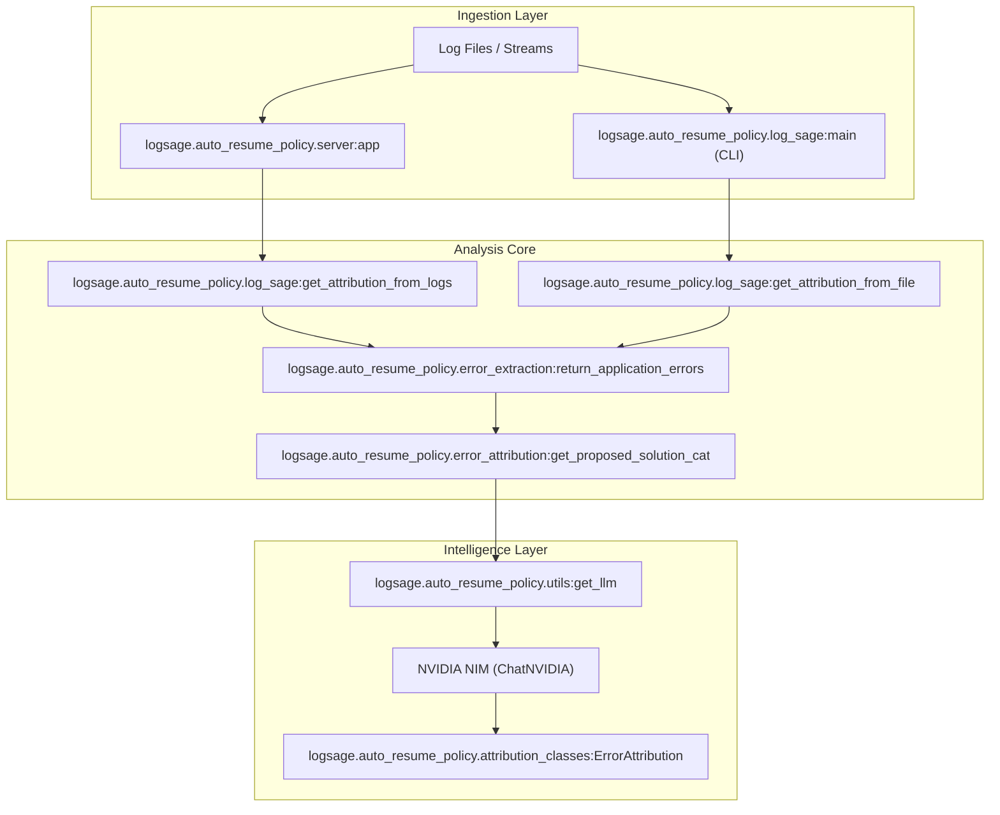
Sources: [logsage/auto_resume_policy/README.md:17-23](), [logsage/auto_resume_policy/README.md:74-111](), [README.md:71-76]()

### Component Interaction
LogSage maintains internal state for log accumulation and utilizes specialized Pydantic models for data validation.

**Title: System Component Associations**
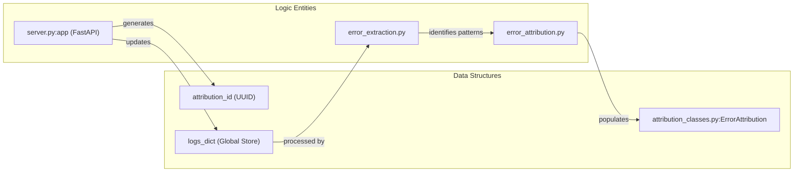
Sources: [logsage/auto_resume_policy/README.md:114-145](), [logsage/auto_resume_policy/README.md:200-211]()

## Major Components

### Auto-Resume Policy Engine
The core logic resides in `logsage/auto_resume_policy/`. It handles the lifecycle of an analysis request, from the initial `POST /errors/attribution_id` to the final policy recommendation [logsage/auto_resume_policy/README.md:65-69](). It utilizes `logs_lock` to ensure thread-safety during concurrent log ingestion [logsage/auto_resume_policy/README.md:188]().

### LLM Integration
LogSage integrates with NVIDIA AI Endpoints using `ChatNVIDIA`. The system is designed with robustness in mind, featuring fallback model logic and automated retries in `get_llm()` [logsage/auto_resume_policy/README.md:56-68](). To optimize costs and latency, it employs an `LRUCache` (stored in `cache_dict`) to avoid redundant LLM calls for identical error patterns [logsage/auto_resume_policy/README.md:184]().

### Security and Sanitization
To ensure the output is safe for web-based dashboards, LogSage includes XSS filtering for LLM-generated text [logsage/auto_resume_policy/README.md:49](). It also implements path safety checks to prevent unauthorized file access during log reading [logsage/auto_resume_policy/README.md:194]().

## Child Pages
*   [Getting Started](#1.1): Installation and basic usage.
*   [Configuration Reference](#1.2): Detailed environment variable documentation.

Sources: [README.md:1-124](), [logsage/auto_resume_policy/README.md:1-211](), [logsage/__init__.py:1-7]()

---

# Page: Getting Started

# Getting Started

<details>
<summary>Relevant source files</summary>

The following files were used as context for generating this wiki page:

- [.python-version](.python-version)
- [Makefile](Makefile)
- [README.md](README.md)
- [pyproject.toml](pyproject.toml)
- [requirements.txt](requirements.txt)

</details>


This page provides a comprehensive guide for setting up LogSage, an LLM-powered toolkit designed to analyze AI training job logs, attribute root causes, and recommend auto-resume policies. It covers prerequisites, installation methods, environment configuration, and basic usage of the API and CLI components.

## Prerequisites

Before installing LogSage, ensure your environment meets the following requirements:

*   **Python**: Version 3.11 or higher is required [pyproject.toml:33](), [.python-version:1]().
*   **Poetry**: Recommended for dependency management and virtual environment handling [README.md:36]().
*   **NVIDIA API Key**: Required for production environments to interact with NVIDIA AI Endpoints (LLM) [README.md:89]().
*   **JFROG Token**: Required if you need to pull internal NVIDIA packages from private PyPI repositories [Makefile:166-167]().

## Installation

LogSage can be installed using Poetry (for development) or pip (for usage as a library).

### Using Poetry (Development)
The `Makefile` provides a streamlined installation process that updates `pyproject.toml` with your local Python version and installs all development dependencies.

```bash
make install
```
*Implementation Detail:* The `make install` target executes `setup-pyproject` to sync Python versions [Makefile:73](), configures Poetry to create virtual environments within the project directory [Makefile:75-76](), and installs all extras including development tools [Makefile:79]().

### Using pip
To install LogSage as a package from the NVIDIA shared PyPI:

```bash
python3 -m venv myenv
source myenv/bin/activate
pip install -U logsage --index-url=https://urm.nvidia.com/artifactory/api/pypi/nv-shared-pypi-local/simple --extra-index-url https://pypi.org/simple
```
[README.md:45-50]()

## Environment Variables

Configuration is managed via Pydantic settings in `logsage/auto_resume_policy/config.py` [README.md:88]().

| Variable | Description | Default |
| :--- | :--- | :--- |
| `NVIDIA_API_KEY` | API key for NVIDIA AI Endpoints (Required for LLM) | None |
| `DEBUG` | Enable debug logging and features | `true` (local) |
| `FAST_API_ROOT_PATH` | Root path for FastAPI when behind a proxy | `""` |
| `LOGSAGE_VERBOSE` | Enables detailed logging for the CLI | `false` |

**Sources:** [README.md:88-91](), [logsage/auto_resume_policy/config.py]()

## Running the API Server

The LogSage API is built with FastAPI and provides endpoints for log ingestion and error attribution.

### Local Execution
You can start the server using the provided wrapper module or directly via `uvicorn`:

```bash
# Method 1: Using the wrapper
python -m logsage.auto_resume_policy.run_server

# Method 2: Direct uvicorn execution
uvicorn logsage.auto_resume_policy.server:app --host 0.0.0.0 --port 8000 --reload
```
[README.md:52-57]()

### Data Flow: API Attribution Lifecycle
The following diagram illustrates how the system processes a request from log ingestion to policy recommendation.

**LogSage API Request Pipeline**
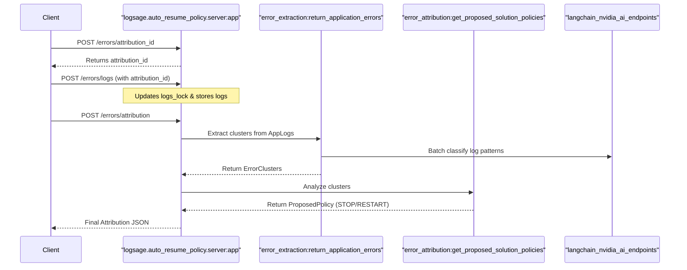
**Sources:** [README.md:71-84](), [logsage/auto_resume_policy/server.py](), [pyproject.toml:35]()

## Command-Line Interface (CLI)

LogSage provides CLI utilities to analyze local log files without requiring a running server.

### Basic Usage
The CLI allows users to pass application and system logs for immediate analysis.

```bash
# Analyze a local log file
python -m logsage.auto_resume_policy.log_sage --app-log training.log --full-analysis
```

### CLI Components and Code Mapping
The CLI bridges the gap between raw text files and the internal Pydantic models used for attribution.

**CLI Entity Mapping**
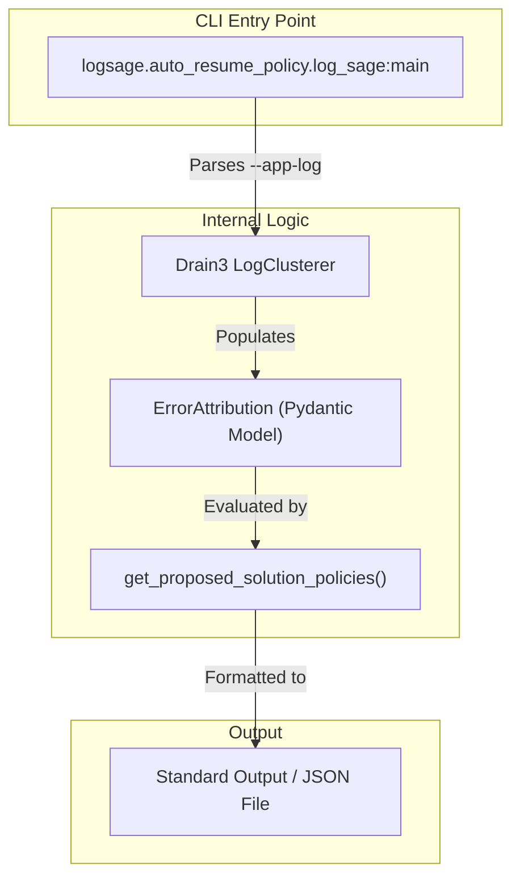
**Sources:** [README.md:65-70](), [pyproject.toml:45](), [logsage/auto_resume_policy/log_sage.py]()

## Verification and Testing

After installation, verify the setup by running the test suite:

```bash
# Run all tests
make test

# Run tests with coverage report
make test-coverage
```
[Makefile:121-136](), [README.md:95-100]()

The test suite uses `pytest` and is configured in `pyproject.toml` to target the `tests/` directory and generate coverage reports [pyproject.toml:201-212]().

**Sources:**
* [README.md:32-62]() - Quickstart and setup instructions.
* [Makefile:72-82]() - Installation logic.
* [pyproject.toml:32-57]() - Dependencies and tool configuration.
* [README.md:71-84]() - API endpoint definitions.

---

# Page: Configuration Reference

# Configuration Reference

<details>
<summary>Relevant source files</summary>

The following files were used as context for generating this wiki page:

- [logsage/auto_resume_policy/config.py](logsage/auto_resume_policy/config.py)
- [logsage/auto_resume_policy/consts.py](logsage/auto_resume_policy/consts.py)

</details>


This page provides a technical reference for the configuration management system in LogSage. Configuration is handled primarily through environment variables and static constants, which control LLM behavior, log processing thresholds, and error attribution logic.

## Configuration Architecture

The configuration system is split into two components:
1.  **Dynamic Configuration (`Config` class):** Consumes environment variables for runtime environment setup (API keys, model selection).
2.  **Static Constants (`consts.py`):** Defines architectural limits, domain-specific hardware keywords, and confidence thresholds for the attribution engine.

### Data Flow Diagram
The following diagram illustrates how configuration data flows from the environment and static files into the core logic of LogSage.

**Configuration Data Flow**
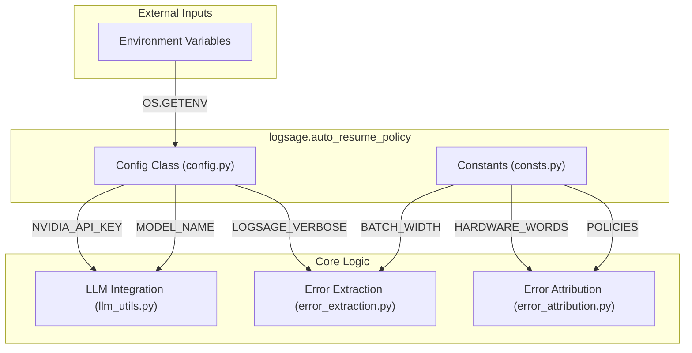
Sources: [logsage/auto_resume_policy/config.py:20-28](), [logsage/auto_resume_policy/consts.py:16-98]()

---

## Runtime Configuration (Config Class)

The `Config` class in `logsage/auto_resume_policy/config.py` manages settings that typically change between deployment environments (e.g., Development vs. Production).

### Environment Variables

| Variable | Type | Default | Description |
| :--- | :--- | :--- | :--- |
| `NVIDIA_API_KEY` | `str` | `""` | API key for authenticating with NVIDIA NIM endpoints [logsage/auto_resume_policy/config.py:24](). |
| `MODEL_NAME` | `str` | `""` | The specific LLM model name to invoke (e.g., `meta/llama-3.1-70b-instruct`) [logsage/auto_resume_policy/config.py:25](). |
| `MODEL_FUNCTION_ID` | `str` | `""` | Function ID for the specific NIM deployment [logsage/auto_resume_policy/config.py:26](). |
| `LOGSAGE_ATTRIBUTION` | `bool` | `true` | Enables or disables the error attribution logic [logsage/auto_resume_policy/config.py:21](). |
| `LOGSAGE_VERBOSE` | `bool` | `true` | Enables verbose logging output during processing [logsage/auto_resume_policy/config.py:22](). |
| `LOGSAGE_ISOLATION` | `bool` | `true` | Enables node isolation (cordoning) recommendations [logsage/auto_resume_policy/config.py:23](). |
| `PERSONAL_ENDPOINT` | `bool` | `true` | Flag to indicate if a personal/custom endpoint is being used [logsage/auto_resume_policy/config.py:27](). |

### Validation Logic
The `Config.validate()` method is called during initialization to ensure that mandatory LLM parameters are present. It raises a `ValueError` if `NVIDIA_API_KEY`, `MODEL_NAME`, or `MODEL_FUNCTION_ID` are missing [logsage/auto_resume_policy/config.py:29-38]().

Sources: [logsage/auto_resume_policy/config.py:19-38]()

---

## System Constants (consts.py)

Constants define the "guardrails" of the system, including token limits and the heuristics used to identify hardware failures.

### Processing & LLM Limits
These values control the scale of log ingestion and LLM concurrency.

| Constant | Value | Description |
| :--- | :--- | :--- |
| `BATCH_WIDTH` | `1000` | Number of tokens per batch for log segmenting [logsage/auto_resume_policy/consts.py:16](). |
| `CONTEXT_SIZE` | `100,000` | Maximum token context length for the LLM analysis window [logsage/auto_resume_policy/consts.py:17](). |
| `BATCH_LLM_CALLS` | `50` | Maximum number of concurrent LLM calls allowed [logsage/auto_resume_policy/consts.py:18](). |
| `NUMBER_LAST_LINES` | `1,000,000` | Max lines to read from the end of the log file (-1 for all) [logsage/auto_resume_policy/consts.py:19](). |

### Hardware & Isolation Logic
These constants define how LogSage interprets cluster architecture and failure thresholds.

| Constant | Value | Description |
| :--- | :--- | :--- |
| `DOMAIN_SIZE` | `8` | GPUs per domain (e.g., 8 for Hopper, 4 for Blackwell) [logsage/auto_resume_policy/consts.py:21](). |
| `ISOLATION_COUNT` | `2` | Max number of nodes to recommend for isolation per failure [logsage/auto_resume_policy/consts.py:22](). |
| `HARDWARE_THR_CATEGORY` | `40` | Confidence threshold (0-100) to categorize an error as Hardware [logsage/auto_resume_policy/consts.py:95](). |
| `HARDWARE_THR_LINE` | `60` | Confidence threshold for specific log line hardware attribution [logsage/auto_resume_policy/consts.py:96](). |

Sources: [logsage/auto_resume_policy/consts.py:16-22](), [logsage/auto_resume_policy/consts.py:95-96]()

---

## Heuristic Word Lists

LogSage uses several pre-defined lists of keywords in `consts.py` to perform initial log filtering and assist the LLM in classification.

### Keyword Categories
1.  **`ERROR_WORDS`**: High-level indicators of failures (e.g., `segmentation fault`, `cuda failure`) [logsage/auto_resume_policy/consts.py:26-38]().
2.  **`HARDWARE_WORDS`**: Specific strings indicating physical component failure (e.g., `uncorrectable ECC error`, `GPU is lost`) [logsage/auto_resume_policy/consts.py:42-53]().
3.  **`NOT_HARDWARE_WORDS`**: Strings that look like hardware errors but are usually software/timeout issues (e.g., `NCCL work timeout`) [logsage/auto_resume_policy/consts.py:55-63]().
4.  **`BENIGN_WORDS`**: Common log noise that should be ignored during error extraction (e.g., `NCCL INFO`, `srun: Job step aborted`) [logsage/auto_resume_policy/consts.py:65-86]().

**Heuristic Matching Process**
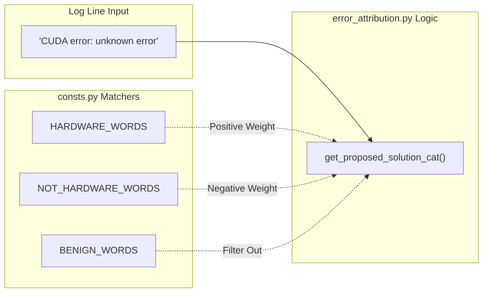
Sources: [logsage/auto_resume_policy/consts.py:42-86](), [logsage/auto_resume_policy/error_attribution.py:100-150]() (implied logic).

---

## Security & Filtering

LogSage includes a toggle for Cross-Site Scripting (XSS) protection on LLM outputs.
*   **`XSS_FILTERING`**: Set to `True` by default in `consts.py`. This ensures that any HTML-like tags generated by the LLM are escaped before being returned via the API or CLI [logsage/auto_resume_policy/consts.py:24]().

Sources: [logsage/auto_resume_policy/consts.py:24]()

---

# Page: Core Architecture

# Core Architecture

<details>
<summary>Relevant source files</summary>

The following files were used as context for generating this wiki page:

- [logsage/auto_resume_policy/attribution_classes.py](logsage/auto_resume_policy/attribution_classes.py)
- [logsage/auto_resume_policy/log_sage.py](logsage/auto_resume_policy/log_sage.py)
- [logsage/auto_resume_policy/main.py](logsage/auto_resume_policy/main.py)

</details>


The LogSage **Auto-Resume-Policy** pipeline is a multi-stage system designed to automate the diagnosis of GPU cluster job failures. It transforms raw, unstructured log data into actionable remediation policies (e.g., `RESTART`, `STOP`, or `TEMPORAL-ISOLATION`) by combining traditional log parsing techniques with Large Language Model (LLM) classification.

### Pipeline Overview

The pipeline operates in three primary phases:
1.  **Ingestion & Extraction**: Raw log lines are processed to identify error signatures, rank/node information, and training progress (iterations/checkpoints).
2.  **Analysis & Attribution**: Extracted errors are categorized (Hardware vs. Software, Network vs. Compute) using LLM-based reasoning and regex heuristics.
3.  **Policy Recommendation**: Based on the attribution and confidence scores, the system suggests a resume strategy and identifies nodes that may require cordoning.

### High-Level Data Flow

The following diagram illustrates how log data transitions from the raw input stage through the internal processing logic to the final policy output.

**LogSage Pipeline Architecture**
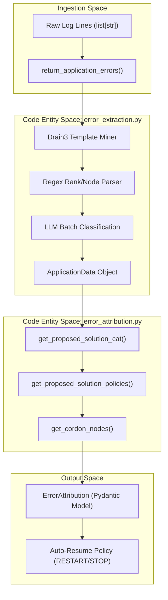
**Sources:** [logsage/auto_resume_policy/log_sage.py:185-204](), [logsage/auto_resume_policy/error_extraction.py:532-540](), [logsage/auto_resume_policy/error_attribution.py:311-325]()

---

### 1. Error Extraction Pipeline
The entry point for log analysis is `return_application_errors()`. This stage is responsible for reducing the volume of log data by clustering similar lines using the **Drain3** algorithm and identifying unique error patterns. It also extracts critical metadata such as MPI ranks and node identifiers to track where failures occurred.

Key responsibilities:
*   **Log Clustering**: Collapsing thousands of repetitive log lines into unique templates.
*   **Iteration Detection**: Determining if the job was making progress before the crash.
*   **Checkpoint Detection**: Identifying if a valid state was saved prior to failure.

For details, see [Error Extraction Pipeline](#2.1).

**Sources:** [logsage/auto_resume_policy/error_extraction.py:532-650](), [logsage/auto_resume_policy/attribution_classes.py:47-81]()

---

### 2. Error Attribution and Policy Recommendation
Once errors are extracted, they are passed to the attribution engine. The system uses a combination of `get_proposed_solution_cat()` and `get_proposed_solution_policies()` to determine the root cause.

The engine classifies errors into categories such as:
*   **Hardware**: Correctable/Uncorrectable ECC errors, NVLink failures.
*   **Software**: Segmentation faults, Python exceptions, configuration errors.
*   **Network**: Timeout errors, InfiniBand (IB) failures.

If an error is attributed to a specific node with high confidence, the system may recommend a `TEMPORAL-ISOLATION` or `STOP` policy and list the offending nodes in the `cordon_nodes` field.

For details, see [Error Attribution and Policy Recommendation](#2.2).

**Sources:** [logsage/auto_resume_policy/error_attribution.py:311-450](), [logsage/auto_resume_policy/error_attribution.py:557-610]()

---

### 3. LLM Integration and Prompts
LogSage leverages NVIDIA NIM (via `langchain-nvidia-ai-endpoints`) to perform nuanced classification of log templates that regex cannot handle. The `get_llm()` function initializes the connection, while `retry_operation()` ensures resilience against API rate limits or transient network issues.

The system uses specialized prompts defined in `prompts.py` to:
1.  Distinguish between hardware and software errors.
2.  Summarize complex tracebacks.
3.  Assign confidence scores to different failure categories.

For details, see [LLM Integration and Prompts](#2.3).

**Sources:** [logsage/auto_resume_policy/log_sage.py:59-98](), [logsage/auto_resume_policy/utils.py:155-185]()

---

### 4. Data Models and Caching
LogSage uses Pydantic models to ensure type safety across the pipeline. The `ApplicationData` class serves as the primary container for extracted features, while `ErrorAttribution` defines the final schema returned to the user or API client.

To optimize performance and reduce API costs, an `LRUCache` is utilized to store LLM classification results for frequently occurring log templates.

**System Component Interaction**
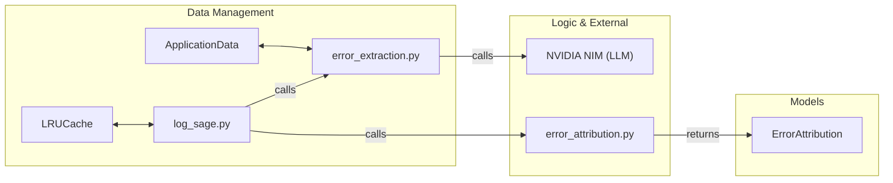

For details, see [Data Models and Caching](#2.4).

**Sources:** [logsage/auto_resume_policy/attribution_classes.py:22-45](), [logsage/auto_resume_policy/attribution_classes.py:83-89]()

---

# Page: Error Extraction Pipeline

# Error Extraction Pipeline

<details>
<summary>Relevant source files</summary>

The following files were used as context for generating this wiki page:

- [logsage/auto_resume_policy/consts.py](logsage/auto_resume_policy/consts.py)
- [logsage/auto_resume_policy/error_extraction.py](logsage/auto_resume_policy/error_extraction.py)
- [logsage/auto_resume_policy/utils.py](logsage/auto_resume_policy/utils.py)

</details>


The Error Extraction Pipeline is a core component of LogSage responsible for transforming raw, unstructured application logs into structured error data. It utilizes a multi-stage process involving log pre-processing, template mining (clustering), heuristic filtering, and Large Language Model (LLM) classification to identify significant application-level failures while filtering out noise.

The primary entry point for this pipeline is the `return_application_errors()` function in `logsage/auto_resume_policy/error_extraction.py` [[logsage/auto_resume_policy/error_extraction.py:539-541]]().

## Pipeline Architecture and Data Flow

The pipeline follows a sequential flow from raw log ingestion to structured error attribution.

### Logical Flow Diagram

"LogSage Error Extraction Pipeline"
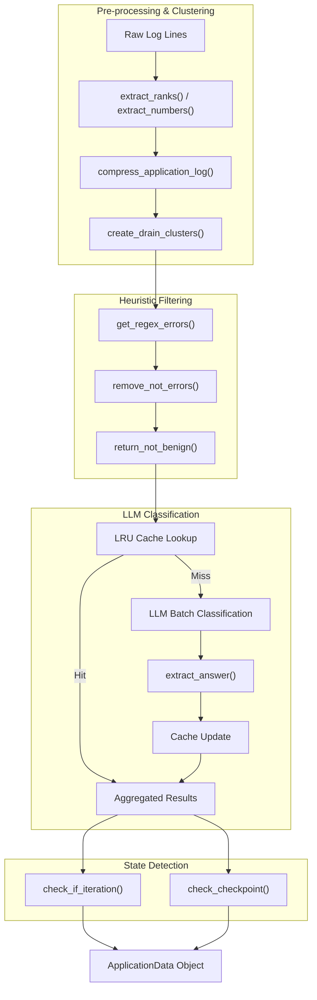
**Sources:** [[logsage/auto_resume_policy/error_extraction.py:539-740]](), [[logsage/auto_resume_policy/utils.py:441-470]]()

## Log Pre-processing and Rank Parsing

Before clustering, LogSage normalizes log lines to improve template matching accuracy.

1.  **Rank and Node Extraction**: The functions `extract_ranks()` and `extract_numbers()` use regex to identify MPI ranks (e.g., `[rank0]:`) and map them to physical nodes based on the `DOMAIN_SIZE` constant [[logsage/auto_resume_policy/error_extraction.py:70-113]]().
2.  **Compression**: `compress_application_log()` removes repetitive lines and applies transformations like `convert_paths_to_token()`, `convert_hex_to_special_token()`, and `replace_quoted_text_with_token()` to reduce the search space for the clustering engine [[logsage/auto_resume_policy/utils.py:441-470]]().
3.  **Tokenization**: Punctuation is padded with spaces via `add_spaces_around_punctuation()` to ensure the clustering algorithm treats them as distinct tokens [[logsage/auto_resume_policy/utils.py:177-191]]().

**Sources:** [[logsage/auto_resume_policy/error_extraction.py:70-131]](), [[logsage/auto_resume_policy/utils.py:121-220]](), [[logsage/auto_resume_policy/consts.py:21]]()

## Log Clustering with Drain3

LogSage uses the **Drain3** algorithm to group similar log lines into templates. This significantly reduces the number of LLM calls required by processing one representative line per cluster.

| Parameter | Value | Description |
| :--- | :--- | :--- |
| `drain_sim_th` | 0.4 | Similarity threshold for clustering [[logsage/auto_resume_policy/error_extraction.py:184]]() |
| `depth` | 4 | Depth of the fixed-depth tree [[logsage/auto_resume_policy/error_extraction.py:185]]() |
| `max_clusters` | 100 | Upper limit of clusters to process [[logsage/auto_resume_policy/error_extraction.py:186]]() |

The `create_drain_clusters()` function initializes a `TemplateMiner` and iterates through the pre-processed logs to generate `cluster_id`s and `template_mined` strings [[logsage/auto_resume_policy/error_extraction.py:163-234]]().

**Sources:** [[logsage/auto_resume_policy/error_extraction.py:20-21]](), [[logsage/auto_resume_policy/error_extraction.py:163-234]]()

## Heuristic and Regex Filtering

To minimize LLM token usage, LogSage applies several layers of heuristic filters defined in `consts.py`:

*   **Regex Detection**: `get_regex_errors()` scans for high-priority patterns like `ERROR_WORDS` (e.g., "runtimeerror", "cuda failure") [[logsage/auto_resume_policy/utils.py:330-353]]().
*   **Benign Filtering**: `return_not_benign()` removes lines containing known harmless strings defined in `BENIGN_WORDS` (e.g., "NCCL INFO", "srun: Job step aborted") [[logsage/auto_resume_policy/utils.py:382-402]]().
*   **Not-Error Removal**: `remove_not_errors()` filters out common false positives like "last enqueued NCCL work" using the `NOT_HARDWARE_WORDS` list [[logsage/auto_resume_policy/utils.py:356-379]]().

**Sources:** [[logsage/auto_resume_policy/consts.py:26-86]](), [[logsage/auto_resume_policy/utils.py:330-402]]()

## LLM Batch Classification

Representative lines from the remaining clusters are sent to an LLM for final validation.

### LLM Implementation Space
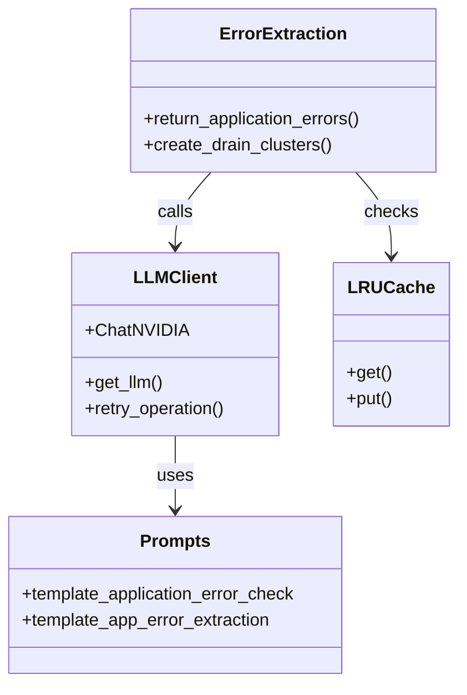
**Sources:** [[logsage/auto_resume_policy/error_extraction.py:25]](), [[logsage/auto_resume_policy/error_extraction.py:539-541]](), [[logsage/auto_resume_policy/attribution_classes.py:112-140]]()

### Caching and Batching
1.  **LRU Cache**: LogSage uses an `LRUCache` (default size 1000) to store previous LLM classification results for specific log templates, avoiding redundant API calls [[logsage/auto_resume_policy/error_extraction.py:581-583]](), [[logsage/auto_resume_policy/attribution_classes.py:112-140]]().
2.  **Batch Processing**: Log lines are batched according to `BATCH_WIDTH` and processed concurrently up to `BATCH_LLM_CALLS` [[logsage/auto_resume_policy/consts.py:16-18]]().
3.  **Prompting**: The system uses `template_application_error_check` to ask the LLM if a line represents a critical crash or error [[logsage/auto_resume_policy/error_extraction.py:41-42]]().

**Sources:** [[logsage/auto_resume_policy/error_extraction.py:581-630]](), [[logsage/auto_resume_policy/attribution_classes.py:112-140]](), [[logsage/auto_resume_policy/consts.py:16-18]]()

## Iteration and Checkpoint Detection

The pipeline also detects the operational state of the application:

*   **Iteration Detection**: `check_if_iteration()` uses `template_app_iteration` to identify if the application was actively training and at what iteration/step the failure occurred [[logsage/auto_resume_policy/utils.py:650-681]]().
*   **Checkpoint Detection**: `check_checkpoint()` uses `template_app_checkpointing` to determine if a checkpoint was successfully saved before the crash [[logsage/auto_resume_policy/utils.py:684-715]]().

**Sources:** [[logsage/auto_resume_policy/error_extraction.py:37-40]](), [[logsage/auto_resume_policy/utils.py:650-715]]()

## The `return_application_errors()` Function

This function orchestrates the entire process. It accepts raw log lines and returns an `ApplicationData` object.

**Key Steps in `return_application_errors()`:**
1.  Filters logs to the last `NUMBER_LAST_LINES` [[logsage/auto_resume_policy/error_extraction.py:553]]().
2.  Extracts ranks and identifies unique nodes [[logsage/auto_resume_policy/error_extraction.py:557-562]]().
3.  Performs Drain3 clustering and identifies error candidates via regex and LLM [[logsage/auto_resume_policy/error_extraction.py:570-630]]().
4.  Consolidates errors into a unique list and determines if the job had successfully started training [[logsage/auto_resume_policy/error_extraction.py:680-720]]().
5.  Returns a populated `ApplicationData` object containing `errors`, `nodes`, `iterations`, and `checkpoint_saved` status [[logsage/auto_resume_policy/error_extraction.py:732-740]]().

**Sources:** [[logsage/auto_resume_policy/error_extraction.py:539-740]](), [[logsage/auto_resume_policy/attribution_classes.py:46-56]]()

---

# Page: Error Attribution and Policy Recommendation

# Error Attribution and Policy Recommendation

<details>
<summary>Relevant source files</summary>

The following files were used as context for generating this wiki page:

- [logsage/auto_resume_policy/consts.py](logsage/auto_resume_policy/consts.py)
- [logsage/auto_resume_policy/error_attribution.py](logsage/auto_resume_policy/error_attribution.py)
- [logsage/auto_resume_policy/prompts.py](logsage/auto_resume_policy/prompts.py)

</details>


The **Error Attribution and Policy Recommendation** module is the decision-making engine of LogSage. It consumes clustered and classified error data from the extraction pipeline to determine the root cause of a job failure (e.g., hardware vs. software), identify faulty infrastructure components, and suggest an automated recovery policy (RESTART, STOP, or TEMPORAL-ISOLATION).

## Core Logic and Decision Flow

The attribution process follows a hierarchical approach:
1.  **Categorization**: Assigning confidence scores to various error types (Hardware, Numerical Instability, etc.).
2.  **Infrastructure Analysis**: Specifically identifying if the failure stems from Compute or Networking.
3.  **Cordoning**: Identifying specific nodes that should be isolated.
4.  **Policy Generation**: Recommending a resume strategy based on the categorized risk.

### Data Flow: From Extraction to Attribution

The following diagram illustrates how raw log data is transformed into structured attribution via `error_attribution.py`.

**Attribution System Architecture**

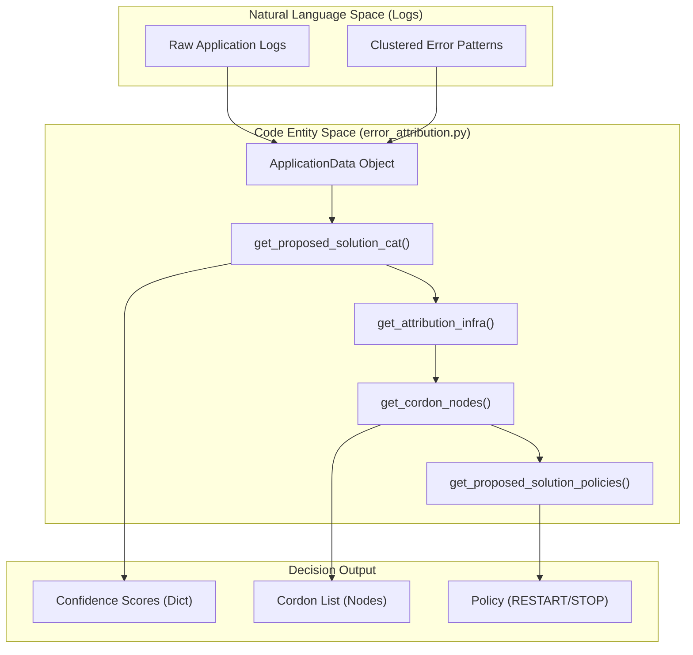
**Sources:** [logsage/auto_resume_policy/error_attribution.py:157-163](), [logsage/auto_resume_policy/attribution_classes.py:53-70]()

---

## Hardware vs. Software Categorization

The function `get_proposed_solution_cat()` is the primary entry point for high-level classification. It uses the `template_hardware_category_prompt` to instruct the LLM to distribute 100 confidence points across categories like `HARDWARE`, `NUMERICAL INSTABILITY`, and `DATA LOADING`.

### Confidence Thresholds
LogSage uses predefined constants to drive logic based on LLM confidence:
*   **`HARDWARE_THR_CATEGORY`**: If the total confidence for the "HARDWARE" category exceeds this value (default: 40), the system leans toward hardware-specific recovery actions. [logsage/auto_resume_policy/consts.py:95-95]()
*   **`HARDWARE_THR_LINE`**: Used when evaluating individual log lines for hardware signatures. [logsage/auto_resume_policy/consts.py:96-96]()

### Key Categories Defined in Prompts
| Category | Code Reference (Prompt) | Description |
| :--- | :--- | :--- |
| **HARDWARE** | `template_hardware_category_prompt` | GPU loss, ECC errors, NIC failures, or socket timeouts. |
| **NUMERICAL INSTABILITY** | `template_hardware_category_prompt` | NaNs, Infs, or loss divergence. |
| **LACK OF RESOURCE** | `template_hardware_category_prompt` | Disk full or memory exhaustion (distinct from hardware failure). |
| **COMPUTE COMMUNICATION** | `template_compute_networking_prompt` | Distinguishes between GPU-to-GPU (Compute) and NIC/Switch (Networking). |

**Sources:** [logsage/auto_resume_policy/error_attribution.py:157-230](), [logsage/auto_resume_policy/prompts.py:150-180](), [logsage/auto_resume_policy/consts.py:95-96]()

---

## Infrastructure Classification: Networking vs. Compute

When a hardware issue is suspected, `get_attribution_infra()` and `get_proposed_solution_cat()` work together to narrow down the faulty subsystem.

*   **Compute Classification**: Identified when errors involve CUDA kernels, GPU initialization, or internal GPU memory errors.
*   **Networking Classification**: Identified when errors involve InfiniBand (`ibv_modify_qp`), NCCL timeouts, or RDMA protocol failures.

The system uses `template_compute_networking_prompt` to force the LLM to choose between these two domains, which informs whether the "Cordon" logic should target individual nodes or entire network groups.

**Sources:** [logsage/auto_resume_policy/error_attribution.py:125-154](), [logsage/auto_resume_policy/prompts.py:177-185]()

---

## Cordon Node Detection

The `get_cordon_nodes()` function identifies which specific nodes are likely responsible for the failure.

### Implementation Logic
1.  **Global Analysis**: If the job is large, it uses `cordon_node_global_template_num` to let the LLM see a summarized view of all failing nodes. [logsage/auto_resume_policy/error_attribution.py:270-300]()
2.  **One-on-One Analysis**: For smaller sets or ambiguous cases, `cordon_node_global_1o1_template_num` is used to compare pairs of nodes. [logsage/auto_resume_policy/error_attribution.py:305-320]()
3.  **Isolation Limits**: The number of nodes recommended for cordoning is capped by `ISOLATION_COUNT` (default: 2) to prevent over-aggressive cluster depletion. [logsage/auto_resume_policy/consts.py:22-22]()

**Cordoning Decision Flow**

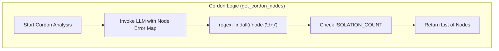
**Sources:** [logsage/auto_resume_policy/error_attribution.py:252-363](), [logsage/auto_resume_policy/consts.py:22-22]()

---

## Policy Recommendation Logic

The final output of the attribution pipeline is a policy recommendation generated by `get_proposed_solution_policies()`.

### Decision Matrix
The recommendation depends on three factors:
1.  **Training Status**: Was the job already training or still in the "init" phase? (`app_data.training_started`).
2.  **Checkpoint Status**: Was a checkpoint successfully saved recently? (`app_data.checkpoint_saved`).
3.  **Hardware Confidence**: Is the `HARDWARE` category score > `HARDWARE_THR_CATEGORY`?

| Training Started | Checkpoint Saved | Hardware Detected | Policy Result | LLM Prompt Used |
| :--- | :--- | :--- | :--- | :--- |
| Yes | Yes | No | **RESTART** | `suggest_yes_checkpoint_restart` |
| Yes | No | Yes | **STOP** | `suggest_no_checkpoint_stop` |
| No | N/A | Yes | **STOP** | `suggest_no_checkpoint_stop` |
| Yes | Yes | Yes | **RESTART** (with Cordon) | `suggest_yes_checkpoint_restart` |

### Temporal Isolation
If `LOGSAGE_ISOLATION` is enabled and hardware is detected, the policy includes a "TEMPORAL-ISOLATION" instruction. This triggers the system to cordon the identified nodes before attempting the restart.

**Sources:** [logsage/auto_resume_policy/error_attribution.py:366-485](), [logsage/auto_resume_policy/prompts.py:200-250](), [logsage/auto_resume_policy/consts.py:93-93]()

---

## Key Functions Reference

### `get_proposed_solution_cat`
[logsage/auto_resume_policy/error_attribution.py:157-250]()
*   **Role**: Orchestrates the initial categorization of the failure.
*   **Inputs**: `ApplicationData` (containing error lists and training status).
*   **Outputs**: A dictionary of category scores and a summary string.

### `get_cordon_nodes`
[logsage/auto_resume_policy/error_attribution.py:252-363]()
*   **Role**: Extracts specific node hostnames from the error context that are deemed "faulty" by the LLM.
*   **Constraint**: Uses `ISOLATION_COUNT` to limit the impact on cluster capacity.

### `get_proposed_solution_policies`
[logsage/auto_resume_policy/error_attribution.py:366-485]()
*   **Role**: Maps the technical diagnosis to an actionable business policy (`RESTART` vs `STOP`).
*   **Logic**: Heavy reliance on whether the job had successfully reached a "started" state and whether it had saved progress.

**Sources:** [logsage/auto_resume_policy/error_attribution.py:1-485]()

---

# Page: LLM Integration and Prompts

# LLM Integration and Prompts

<details>
<summary>Relevant source files</summary>

The following files were used as context for generating this wiki page:

- [logsage/auto_resume_policy/log_sage.py](logsage/auto_resume_policy/log_sage.py)
- [logsage/auto_resume_policy/prompts.py](logsage/auto_resume_policy/prompts.py)
- [logsage/auto_resume_policy/utils.py](logsage/auto_resume_policy/utils.py)

</details>


LogSage utilizes Large Language Models (LLMs) to perform complex log analysis tasks that traditional regex-based parsing cannot handle, such as distinguishing between benign warnings and critical errors, identifying training iterations, and recommending hardware-vs-software attribution. The system integrates with **NVIDIA NIM** (NVIDIA Inference Microservices) using the `langchain-nvidia-ai-endpoints` library.

## LLM Initialization and Lifecycle

The initialization of the LLM is managed by the `get_llm()` function. LogSage supports both standard NVIDIA API endpoints and private "Personal Endpoints" (custom NIM deployments).

### Initialization Logic (`get_llm`)
The `get_llm()` function [logsage/auto_resume_policy/log_sage.py:59-98]() performs the following steps:
1.  **Configuration Check**: It reads settings from the `Config` object, including `NVIDIA_API_KEY`, `MODEL_NAME`, and `PERSONAL_ENDPOINT` [logsage/auto_resume_policy/log_sage.py:72-81]().
2.  **Model Registration**: If `PERSONAL_ENDPOINT` is enabled, it uses `register_model` from `langchain_nvidia_ai_endpoints` to map a custom `MODEL_FUNCTION_ID` to the local model name [logsage/auto_resume_policy/log_sage.py:73-80]().
3.  **Instance Creation**: It creates a `ChatNVIDIA` instance with `temperature=0.0` to ensure deterministic output, which is critical for classification tasks [logsage/auto_resume_policy/log_sage.py:64-70]().
4.  **Model Fallback**: If a specific model name is read from a local state file but fails to initialize, the system attempts to fall back to the default `MODEL_NAME` defined in the environment [logsage/auto_resume_policy/log_sage.py:87-96]().

### Error Handling and Retries
LLM operations are wrapped in the `retry_operation()` utility [logsage/auto_resume_policy/utils.py:53-104](). This function provides:
*   **Fixed Backoff**: Retries the operation up to 5 times with a 0.5s delay [logsage/auto_resume_policy/utils.py:64-102]().
*   **Dynamic Model Switching**: If a `MODEL_LIST` is provided in the environment, the system will circularly iterate through available models upon exhaustion of retries for a single model, updating a local state file via `handle_text_file()` to track the currently active model [logsage/auto_resume_policy/utils.py:82-98]().

### LLM Connectivity and Fallback Flow
The following diagram illustrates how `get_llm` and `retry_operation` interact with the `ChatNVIDIA` client and the environment configuration.

**LLM Initialization and Retry Flow**
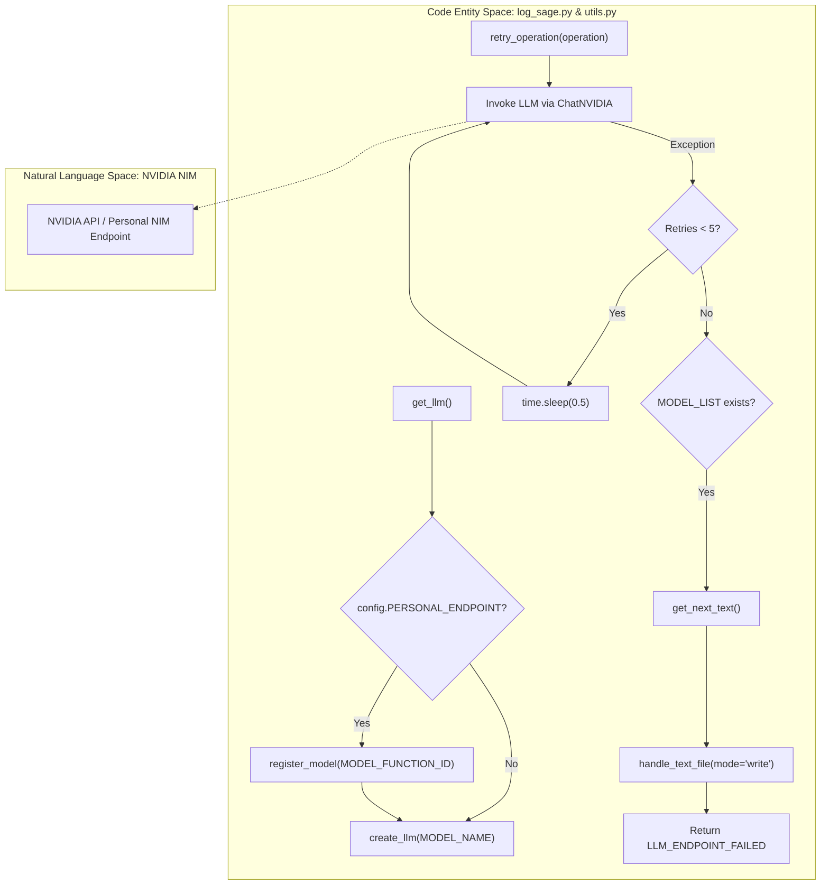
Sources: [logsage/auto_resume_policy/log_sage.py:59-98](), [logsage/auto_resume_policy/utils.py:53-104]()

## Prompt Library (`prompts.py`)

LogSage uses a structured library of prompt templates to guide the LLM's reasoning. These templates are designed for high precision, often requiring "yes/no" or numeric confidence scores to facilitate programmatic parsing of the results.

| Template Name | Purpose | Expected Output |
| :--- | :--- | :--- |
| `template_app_error_extraction_validation` | Filters raw log lines to identify actual errors vs. benign warnings. | "yes" or "no" |
| `template_app_iteration` | Identifies training steps, epochs, or validation progress. | "yes" or "no" |
| `template_app_checkpointing` | Detects successful checkpoint saves. | "yes" or "no" |
| `template_app_error_cat` | Assigns a 0-100 confidence score for Hardware failure. | Integer (0-100) |
| `template_hardware_category_prompt` | Categorizes errors into Hardware, Numerical Instability, Misconfiguration, etc. | Confidence distribution |
| `template_proposed_solution_policies` | Recommends actions: RESTART, STOP, or TEMPORAL-ISOLATION. | Action string |

### Logic Constraints in Prompts
The prompts include explicit exclusion rules to reduce false positives. For example, `template_app_error_extraction_validation` explicitly instructs the LLM to return "no" for `mpi/pmix` related errors or `srun` task exits, while returning "yes" for `NCCL`, `OFI`, or `Infiniband` issues [logsage/auto_resume_policy/prompts.py:31-67]().

Sources: [logsage/auto_resume_policy/prompts.py:16-179]()

## Data Flow and Output Sanitization

When logs are processed, the LLM outputs are integrated back into the LogSage data models. Because LLM outputs are potentially untrusted or may contain characters that break downstream UI rendering, LogSage applies XSS (Cross-Site Scripting) sanitization.

### Integration Flow
1.  **Extraction**: `return_application_errors()` calls the LLM using `template_app_error_extraction_validation` to find unique errors [logsage/auto_resume_policy/log_sage.py:185]().
2.  **Sanitization**: If `XSS_FILTERING` is enabled in `consts.py`, the `sanitize_xss()` function (using the `nh3` library) is applied to all unique error strings before they are stored in the `ErrorAttribution` object [logsage/auto_resume_policy/log_sage.py:188-191]().
3.  **Attribution**: The unique errors are then passed to `get_proposed_solution_cat()`, which uses `template_hardware_category_prompt` to determine the root cause [logsage/auto_resume_policy/log_sage.py:203-210]().

**LLM Data Integration and Sanitization**
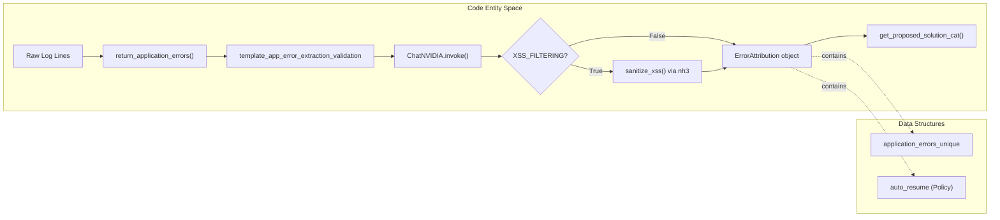
Sources: [logsage/auto_resume_policy/log_sage.py:185-210](), [logsage/auto_resume_policy/utils.py:372-383](), [logsage/auto_resume_policy/consts.py:34]()

## Key Functions Reference

### `get_llm()`
*   **Location**: [logsage/auto_resume_policy/log_sage.py:59]()
*   **Role**: Factory function for the `ChatNVIDIA` instance. Handles endpoint registration for custom NIMs and ensures deterministic settings (`temperature=0.0`).

### `retry_operation(operation, max_retries=5)`
*   **Location**: [logsage/auto_resume_policy/utils.py:53]()
*   **Role**: Robustness wrapper for LLM calls. Implements retry logic and model-switching if the primary endpoint fails.

### `sanitize_xss(text)`
*   **Location**: [logsage/auto_resume_policy/utils.py:372]()
*   **Role**: Uses the `nh3` library to strip potentially malicious HTML/JS from LLM-generated strings or log content before returning it to the user or API.

Sources: [logsage/auto_resume_policy/log_sage.py:59-98](), [logsage/auto_resume_policy/utils.py:53-104](), [logsage/auto_resume_policy/utils.py:372-383]()

---

# Page: Data Models and Caching

# Data Models and Caching

<details>
<summary>Relevant source files</summary>

The following files were used as context for generating this wiki page:

- [logsage/auto_resume_policy/attribution_classes.py](logsage/auto_resume_policy/attribution_classes.py)
- [logsage/auto_resume_policy/log_sage.py](logsage/auto_resume_policy/log_sage.py)

</details>


This section provides a technical reference for the data structures and caching mechanisms used throughout LogSage. The system relies on Pydantic models for type-safe data exchange across its API and internal pipelines, and implements a custom Least Recently Used (LRU) cache to optimize interactions with LLM endpoints.

## Pydantic Data Models

LogSage uses Pydantic `BaseModel` classes to define the schema for request payloads, internal data processing, and API responses. These models ensure validation and provide a consistent interface for the error extraction and attribution logic.

### Attribution and Job Models

These models carry the results of the log analysis, including identified errors and recommended resume policies.

| Class Name | Description | Key Attributes |
| :--- | :--- | :--- |
| `ErrorAttribution` | Standard response container for log analysis results. | `application_errors_full`, `application_errors_unique`, `auto_resume`, `attribution` |
| `ErrorAttributionWithJobId` | Extension of `ErrorAttribution` that includes a specific Job ID. | Inherits from `ErrorAttribution` + `job_id` |
| `AttributionID` | A simple wrapper for passing unique analysis identifiers. | `attribution_id` |
| `AttributionRequest` | Model used for requesting an existing attribution result via ID. | `attribution_id` |

Sources: [logsage/auto_resume_policy/attribution_classes.py:83-121]()

### Log Management Models

These models facilitate the ingestion and streaming of log data through the FastAPI service.

| Class Name | Description | Key Attributes |
| :--- | :--- | :--- |
| `AppLogs` | Container for a list of raw log lines. | `lines` (list of strings) |
| `AppLogsLen` | Used to report the size/length of the log buffer. | `lines_len` |
| `LogsRequest` | Request schema for retrieving logs associated with an ID. | `attribution_id`, `log_stream` |
| `JobLogsResult` | Metadata container for logs associated with a specific cluster. | `job_id`, `cluster_name`, `log_lines` |

Sources: [logsage/auto_resume_policy/attribution_classes.py:100-129]()

## Internal Data Containers

Beyond Pydantic models, LogSage utilizes standard Python classes for complex internal state management during the extraction pipeline.

### ApplicationData
The `ApplicationData` class is the primary container used by `return_application_errors()` in `error_extraction.py`. It aggregates raw errors, unique clusters, iteration patterns, and training status.

*   **Role**: Acts as the "source of truth" for a single log analysis session.
*   **Key Fields**:
    *   `application_errors_list_unique`: Deduplicated errors after Drain3 clustering.
    *   `tm_text_unique`: Unique text messages extracted from the logs.
    *   `iteration_patterns`: Detected training progress markers.
    *   `checkpoint_saved`: Boolean indicating if a model checkpoint was detected.

Sources: [logsage/auto_resume_policy/attribution_classes.py:47-81]()

## Caching Implementation

To minimize latency and reduce costs associated with LLM API calls, LogSage implements an `LRUCache`. This cache is used to store the results of log line classifications.

### LRUCache Class
The `LRUCache` uses an `OrderedDict` to maintain the order of element access, ensuring that the least recently used items are evicted when the capacity is reached.

*   **`get(key)`**: Retrieves a value and moves the key to the end (most recent). Returns `-1` on a miss. [logsage/auto_resume_policy/attribution_classes.py:27-31]()
*   **`put(key, value)`**: Inserts or updates a value, moving it to the end. If the length exceeds `self.capacity`, it pops the first item (least recent). [logsage/auto_resume_policy/attribution_classes.py:33-37]()

### Global Cache Instances
In `log_sage.py`, several global structures manage the lifecycle of analysis data:

1.  **`cache_dict`**: An `LRUCache` instance with a capacity of 1,000,000 entries, primarily used for log line classification. [logsage/auto_resume_policy/log_sage.py:49]()
2.  **`logs_dict`**: A dictionary mapping `attribution_id` to a nested dict containing `logs` (list) and `timestamp` (float). [logsage/auto_resume_policy/log_sage.py:52]()
3.  **`attributionid_jobid_dict`**: Maps unique attribution IDs to external Job IDs. [logsage/auto_resume_policy/log_sage.py:53]()

Sources: [logsage/auto_resume_policy/log_sage.py:40-55]()

## Data Flow and Entity Mapping

The following diagrams illustrate how Natural Language concepts (Logs, Errors, Jobs) map to specific Code Entities and how data flows through the caching layer.

### Log Attribution Data Flow
This diagram shows the relationship between API request models and the internal `ApplicationData` container.

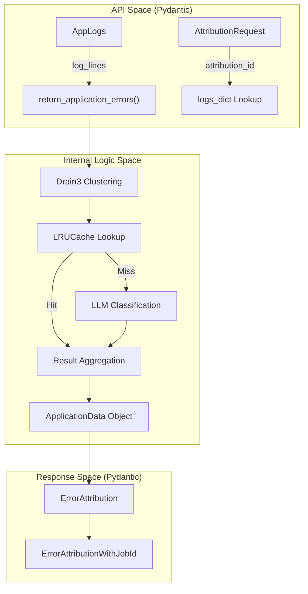
Sources: [logsage/auto_resume_policy/log_sage.py:185-204](), [logsage/auto_resume_policy/attribution_classes.py:47-98]()

### Entity Mapping: Natural Language to Code
This diagram maps conceptual system requirements to the specific classes defined in `attribution_classes.py`.

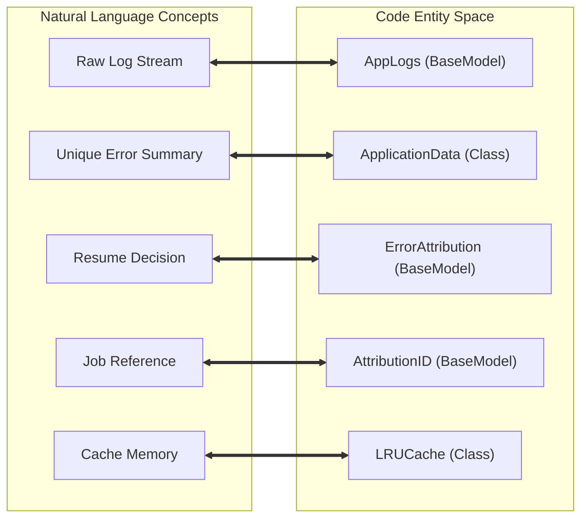
Sources: [logsage/auto_resume_policy/attribution_classes.py:22-125]()

## Mocking for Testing

The `FakeListLLM` class is a specialized data container used during unit testing to simulate LLM behavior without making network calls. It implements the `Runnable` interface from `langchain_core`.

*   **`batch(inputs)`**: Returns a pre-configured response from `_batch_responses` and increments the internal stage counter. [logsage/auto_resume_policy/attribution_classes.py:142-146]()
*   **`invoke(input)`**: Returns a single response from `_invoke_response`. [logsage/auto_resume_policy/attribution_classes.py:148-152]()

Sources: [logsage/auto_resume_policy/attribution_classes.py:135-153]()

---

# Page: API and CLI Interfaces

# API and CLI Interfaces

<details>
<summary>Relevant source files</summary>

The following files were used as context for generating this wiki page:

- [README.md](README.md)
- [logsage/auto_resume_policy/log_sage.py](logsage/auto_resume_policy/log_sage.py)
- [logsage/auto_resume_policy/main.py](logsage/auto_resume_policy/main.py)

</details>


LogSage provides two primary interfaces for interacting with its log analysis and error attribution engine: a **FastAPI-based HTTP server** for programmatic integration and a **Command-Line Interface (CLI)** for local file analysis. Both interfaces leverage the same underlying logic to extract error patterns, attribute root causes, and recommend auto-resume policies.

### Interface Overview

The FastAPI server is designed for high-throughput, multi-user environments where logs are streamed or uploaded via RESTful calls [logsage/auto_resume_policy/server.py:1-240](). The CLI is optimized for developers and researchers who need to analyze local log files quickly without deploying a full service [logsage/auto_resume_policy/main.py:16-20]().

| Feature | FastAPI Server | CLI Tool |
| :--- | :--- | :--- |
| **Primary Use Case** | Production pipelines / Web services | Local debugging / Manual triage |
| **State Management** | Centralized `logs_dict` with 24h expiry | Stateless (per-execution) |
| **Input Format** | JSON / HTTP POST | Local file paths (`--app-log`) |
| **Concurrency** | Thread-safe with `logs_lock` | Single-process |
| **Main Entry Point** | `run_server.py` or `server.py` | `main.py` or `log_sage.py` |

**Sources:** [README.md:63-85](), [logsage/auto_resume_policy/log_sage.py:39-55](), [logsage/auto_resume_policy/main.py:16-37]()

---

### System Interface Mapping

The following diagram bridges the high-level interface concepts to the specific code entities that implement them.

**Diagram: Interface to Code Entity Mapping**
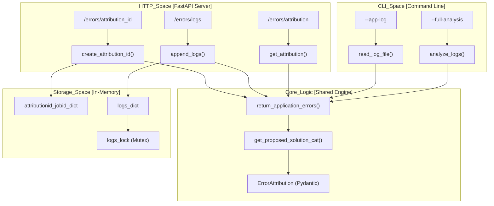
**Sources:** [logsage/auto_resume_policy/server.py:111-218](), [logsage/auto_resume_policy/main.py:69-132](), [logsage/auto_resume_policy/log_sage.py:39-55]()

---

### FastAPI Server and Endpoints

The FastAPI service enables a multi-step workflow for log analysis. It maintains an internal state using `logs_dict` to store log fragments until a user requests a final attribution.

*   **Attribution Lifecycle**: Users first generate an `AttributionID`, append log lines to it via subsequent requests, and finally trigger the LLM analysis.
*   **Thread Safety**: The server uses a global `logs_lock` (a `threading.Lock`) to ensure data integrity during log ingestion and the 24-hour cleanup cycle [logsage/auto_resume_policy/log_sage.py:39-43]().
*   **Health and Versioning**: Standard endpoints like `GET /healthz` and `GET /version` are provided for deployment monitoring [README.md:77-80]().

For detailed request/response schemas and lifecycle management, see [FastAPI Server and Endpoints](#3.1).

**Sources:** [logsage/auto_resume_policy/server.py:111-218](), [logsage/auto_resume_policy/log_sage.py:39-55]()

---

### Command-Line Interface (CLI)

The CLI tool, primarily located in `main.py`, provides a direct interface for analyzing log files on disk. It supports several flags to control the depth of analysis and the types of recommendations generated.

*   **Log Parsing**: Reads files via `read_log_file()` and processes them through the standard `return_application_errors()` pipeline [logsage/auto_resume_policy/main.py:69-89]().
*   **Cordon Checks**: Can specifically look for hardware-related failures that justify node isolation using `get_cordon_nodes()` [logsage/auto_resume_policy/main.py:113-118]().
*   **LLM Configuration**: Allows overriding environment variables via the `--api-key` argument [logsage/auto_resume_policy/main.py:56-58]().

For a full list of arguments and example commands, see [Command-Line Interface (CLI)](#3.2).

**Sources:** [logsage/auto_resume_policy/main.py:42-66](), [logsage/auto_resume_policy/main.py:135-181]()

---

### Component Interaction

The following diagram illustrates how the public interfaces interact with the core logic and the NVIDIA LLM backend.

**Diagram: Request Flow from Interface to LLM**
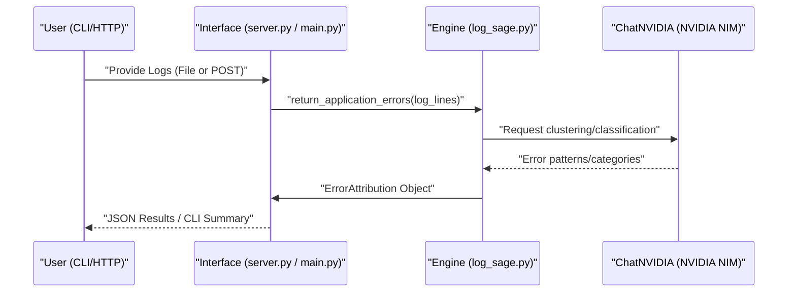
**Sources:** [logsage/auto_resume_policy/log_sage.py:182-205](), [logsage/auto_resume_policy/main.py:155-179](), [logsage/auto_resume_policy/error_extraction.py:36-40]()

---

# Page: FastAPI Server and Endpoints

# FastAPI Server and Endpoints

<details>
<summary>Relevant source files</summary>

The following files were used as context for generating this wiki page:

- [logsage/auto_resume_policy/attribution_classes.py](logsage/auto_resume_policy/attribution_classes.py)
- [logsage/auto_resume_policy/log_sage.py](logsage/auto_resume_policy/log_sage.py)
- [logsage/auto_resume_policy/main.py](logsage/auto_resume_policy/main.py)

</details>


The LogSage FastAPI server provides a RESTful interface for analyzing GPU cluster job logs. It enables remote clients to submit log lines asynchronously, generate unique attribution IDs, and retrieve LLM-powered error analysis and remediation policies. The server is designed for high-throughput environments, employing thread-safe log buffering and automated cleanup mechanisms.

## Endpoint Overview

The server exposes five primary endpoints to manage the lifecycle of a log analysis request.

| Method | Endpoint | Description |
| :--- | :--- | :--- |
| `GET` | `/healthz` | Liveness probe returning a simple "ok" status. |
| `GET` | `/version` | Returns the current version of the LogSage service. |
| `POST` | `/errors/attribution_id` | Generates a new unique `attribution_id` for a specific `job_id`. |
| `POST` | `/errors/logs` | Appends log lines to the buffer associated with an `attribution_id`. |
| `POST` | `/errors/attribution` | Triggers the analysis pipeline for a given `attribution_id` and returns results. |

Sources: `logsage/auto_resume_policy/log_sage.py`

## Request and Response Schemas

LogSage uses Pydantic models to enforce strict data validation for all API interactions. These models are defined in `attribution_classes.py`.

### Attribution ID Generation
- **Request**: `NewAttributionRequest` [logsage/auto_resume_policy/attribution_classes.py:131-133]()
- **Response**: `AttributionID` [logsage/auto_resume_policy/attribution_classes.py:114-116]()

### Log Ingestion
- **Request**: `LogsRequest` [logsage/auto_resume_policy/attribution_classes.py:126-129](). This includes the `attribution_id` and the `log_stream` (base64 or raw string).
- **Response**: `AppLogsLen` [logsage/auto_resume_policy/attribution_classes.py:122-124](), returning the total number of lines currently stored for that ID.

### Analysis Results
- **Request**: `AttributionRequest` [logsage/auto_resume_policy/attribution_classes.py:118-120]()
- **Response**: `ErrorAttributionWithJobId` [logsage/auto_resume_policy/attribution_classes.py:91-97](), containing:
    - `application_errors_full`: List of all detected errors.
    - `application_errors_unique`: Deduplicated error list.
    - `auto_resume`: The recommended action (e.g., RESTART, STOP).
    - `attribution`: The root cause classification.
    - `job_id`: The original job identifier.

Sources: `logsage/auto_resume_policy/attribution_classes.py`

## Attribution-ID Lifecycle

The server manages state using an `attribution_id` which acts as a session token for log accumulation.

### 1. Generate (`/errors/attribution_id`)
When a client starts a new analysis session, the server generates a UUID [logsage/auto_resume_policy/log_sage.py:20](). It maps this ID to the provided `job_id` in `attributionid_jobid_dict` [logsage/auto_resume_policy/log_sage.py:53]() and initializes an entry in `logs_dict` [logsage/auto_resume_policy/log_sage.py:52]().

### 2. Append (`/errors/logs`)
Clients send chunks of logs to this endpoint. The server retrieves the existing list from `logs_dict`, appends the new lines, and updates the timestamp [logsage/auto_resume_policy/log_sage.py:431-435]().

### 3. Retrieve (`/errors/attribution`)
Once all logs are uploaded, the client calls this endpoint. The server:
1.  Retrieves the full log buffer from `logs_dict`.
2.  Passes the logs to `return_application_errors()` [logsage/auto_resume_policy/error_extraction.py:516]() for extraction.
3.  Calls `get_proposed_solution_cat()` [logsage/auto_resume_policy/error_attribution.py:343]() to determine the policy.
4.  Returns the final `ErrorAttributionWithJobId` object.

### Data Flow and Code Entity Mapping
The following diagram maps the API lifecycle to the internal Python dictionaries and functions.

**Diagram: Attribution Lifecycle Mapping**
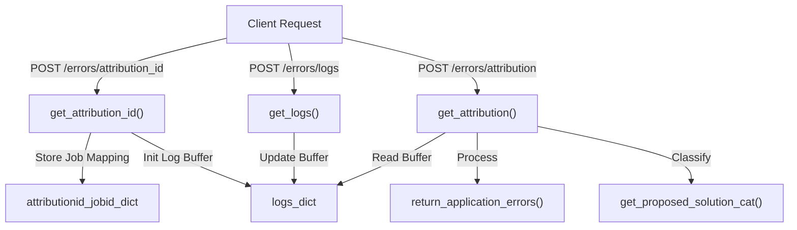
Sources: `logsage/auto_resume_policy/log_sage.py`, `logsage/auto_resume_policy/error_extraction.py`, `logsage/auto_resume_policy/error_attribution.py`

## Thread-Safety and Resource Management

### The `logs_lock`
Because the FastAPI server handles concurrent requests, access to the global `logs_dict` and `attributionid_jobid_dict` is protected by a `threading.Lock` named `logs_lock` [logsage/auto_resume_policy/log_sage.py:40](). This ensures that simultaneous log appends or cleanup operations do not cause race conditions or data corruption.

### 24-Hour Log Expiry
To prevent memory exhaustion, the server implements an automated cleanup mechanism.
- **`LOG_EXPIRY_SECONDS`**: Set to 86,400 seconds (24 hours) [logsage/auto_resume_policy/log_sage.py:43]().
- **Cleanup Logic**: Every time a new `attribution_id` is requested or a cleanup is triggered, the server iterates through `logs_dict`. It compares the current time against the stored timestamp for each ID [logsage/auto_resume_policy/log_sage.py:408-418](). Entries older than the expiry threshold are deleted.

**Diagram: Thread-Safe Log Management**
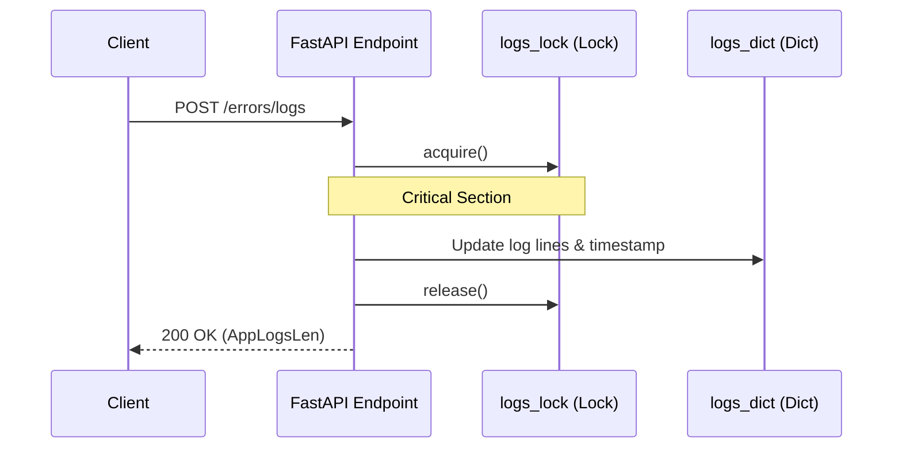
Sources: `logsage/auto_resume_policy/log_sage.py`

## Internal Cache and Configuration
The server utilizes several global structures to optimize performance:
- **`cache_dict`**: An `LRUCache` instance (capacity 1,000,000) used by the extraction pipeline to store LLM classification results for log clusters [logsage/auto_resume_policy/log_sage.py:49]().
- **`Config`**: Loads environment variables such as `NVIDIA_API_KEY` and `MODEL_NAME` to initialize the `ChatNVIDIA` LLM client [logsage/auto_resume_policy/log_sage.py:56-59]().

Sources: `logsage/auto_resume_policy/log_sage.py`, `logsage/auto_resume_policy/config.py`

---

# Page: Command-Line Interface (CLI)

# Command-Line Interface (CLI)

<details>
<summary>Relevant source files</summary>

The following files were used as context for generating this wiki page:

- [logsage/auto_resume_policy/log_sage.py](logsage/auto_resume_policy/log_sage.py)
- [logsage/auto_resume_policy/main.py](logsage/auto_resume_policy/main.py)

</details>


The LogSage Command-Line Interface (CLI) provides a direct entry point for developers and operators to analyze GPU cluster job logs without deploying the full FastAPI service. It facilitates log parsing, error extraction via LLMs, and automated remediation recommendations (e.g., RESTART, STOP, or CORDON) directly from the terminal.

## Entry Points

LogSage defines two primary scripts for CLI interaction:
1.  **`main.py`**: The primary user-facing CLI tool for analyzing local log files and generating JSON reports.
2.  **`log_sage.py`**: Contains the core logic for processing logs from files and managing the LLM lifecycle, used by both the CLI and the API.

### CLI Architecture and Data Flow

The CLI follows a linear pipeline from argument parsing to result serialization. It bridges the gap between raw text logs and structured error attribution models.

**CLI Execution Flow**

```mermaid
graph TD
    A["main.py: main()"] --> B["argparse: setup_argparse()"]
    B --> C["read_log_file()"]
    C --> D["return_application_errors()"]
    D --> E["get_proposed_solution_cat()"]
    E --> F{"cordon-check?"}
    F -- "Yes" --> G["get_cordon_nodes()"]
    F -- "No" --> H{"full-analysis?"}
    G --> H
    H -- "Yes" --> I["get_proposed_solution_policies()"]
    H -- "No" --> J["Output Results"]
    I --> J
    J --> K["JSON Output / Console Log"]
```

**Sources:** [logsage/auto_resume_policy/main.py:42-66](), [logsage/auto_resume_policy/main.py:135-185]()

---

## Argument Parsing Reference

The CLI uses `argparse` to handle configuration. Arguments can override environment variables defined in `Config`.

| Argument | Type | Required | Description |
| :--- | :--- | :--- | :--- |
| `-a`, `--app-log` | `str` | Yes | Path to the application log file to be analyzed. |
| `-s`, `--sys-log` | `str` | No | Path to the system log file for cross-referencing. |
| `-o`, `--output` | `str` | No | File path to save the analysis results in JSON format. |
| `--api-key` | `str` | No | NVIDIA API Key for LLM access. Overrides `NVIDIA_API_KEY` env var. |
| `--full-analysis`| `flag`| No | Triggers `get_proposed_solution_policies()` for detailed remediation. |
| `--cordon-check` | `flag`| No | Triggers `get_cordon_nodes()` to identify failing hardware. |
| `--verbose` | `flag`| No | (Used in `log_sage.py`) Enables detailed logging of the attribution process. |
| `--isolation` | `flag`| No | (Used in `log_sage.py`) Enables isolation-specific analysis modes. |
| `--attribution` | `flag`| No | (Used in `log_sage.py`) Enables detailed root-cause attribution. |

**Sources:** [logsage/auto_resume_policy/main.py:42-66](), [logsage/auto_resume_policy/log_sage.py:142-154]()

---

## Implementation Details

### LLM Initialization
The CLI initializes the LLM through `get_llm()` in `log_sage.py`. It utilizes `langchain_nvidia_ai_endpoints.ChatNVIDIA` and supports both standard NIM endpoints and `PERSONAL_ENDPOINT` configurations defined in the `Config` class.

**LLM Configuration Mapping**

```mermaid
graph LR
    subgraph "Code Entities"
        main["main.py"]
        ls["log_sage.py"]
        cfg["Config class"]
        cn["ChatNVIDIA"]
    end

    subgraph "Logic"
        main -- "sets ENV" --> cfg
        ls -- "calls" --> cfg
        ls -- "get_llm()" --> cn
        cn -- "uses" --> api["NVIDIA_API_KEY"]
    end
```

**Sources:** [logsage/auto_resume_policy/log_sage.py:59-98](), [logsage/auto_resume_policy/main.py:140-150]()

### Error Extraction and Attribution
The core logic resides in `analyze_logs()` within `main.py`, which orchestrates the following calls:
1.  **`return_application_errors`**: Parses the log lines, applies Drain3 clustering, and identifies unique error patterns [logsage/auto_resume_policy/main.py:87-89]().
2.  **`get_proposed_solution_cat`**: Categorizes the errors (e.g., Hardware, Software, Network) and provides a confidence score [logsage/auto_resume_policy/main.py:108-110]().
3.  **`get_cordon_nodes`**: If `--cordon-check` is active, it analyzes error distribution across ranks/nodes to recommend cordoning [logsage/auto_resume_policy/main.py:115-117]().

---

## Example Invocations

### Basic Analysis
Analyze a single log file and print the summary to the console:
```bash
python -m logsage.auto_resume_policy.main --app-log training_job.log
```

### Full Hardware Diagnosis
Perform a comprehensive analysis, checking for nodes that require cordoning, and save the output to a JSON file:
```bash
python -m logsage.auto_resume_policy.main \
    --app-log error.log \
    --full-analysis \
    --cordon-check \
    --output results.json
```

### Overriding API Credentials
Run the analysis using a specific API key without modifying the environment:
```bash
python -m logsage.auto_resume_policy.main \
    --app-log cluster.log \
    --api-key "nvapi-..."
```

---

## Output Format

The CLI provides two types of output:
1.  **Console Logs**: Human-readable summaries of error counts, categories, and recommended actions using the `uvicorn.error` logger [logsage/auto_resume_policy/main.py:158-173]().
2.  **JSON Export**: If `--output` is specified, a structured JSON object containing:
    *   `error_count`: Total errors found.
    *   `error_analysis`: Categorization and confidence scores.
    *   `cordon_recommendation`: List of nodes suggested for removal from the cluster.
    *   `policy_recommendation`: Detailed remediation steps (RESTART/STOP).

**Sources:** [logsage/auto_resume_policy/main.py:91-132](), [logsage/auto_resume_policy/main.py:175-179]()

---

# Page: Testing

# Testing

<details>
<summary>Relevant source files</summary>

The following files were used as context for generating this wiki page:

- [Makefile](Makefile)
- [tests/README.md](tests/README.md)
- [tests/TEST_COVERAGE_SUMMARY.md](tests/TEST_COVERAGE_SUMMARY.md)

</details>


The LogSage test suite provides comprehensive validation of the auto-resume policy pipeline, covering data models, log processing utilities, LLM integration, and API endpoints. The suite is built using `pytest` and emphasizes high coverage through extensive mocking of external dependencies like LLMs and file systems.

### Testing Strategy and Scope

The testing architecture is designed to validate the transition from raw log data to structured policy recommendations. It ensures that the "Natural Language Space" of log messages is correctly parsed and categorized into the "Code Entity Space" used by the recommendation engine.

#### System Mapping: Log Processing to Code Entities
The following diagram illustrates how the test suite validates the transformation of log data into actionable entities.

**Log Transformation Validation**
```mermaid
graph TD
    subgraph "Natural Language Space (Logs)"
        A["Raw Log Lines"]
        B["Error Messages"]
    end

    subgraph "Processing Logic (Unit Tests)"
        C["Drain3 Clustering"]
        D["LLM Classification"]
        E["Regex Extraction"]
    end

    subgraph "Code Entity Space (Pydantic Models)"
        F["AppLogs"]
        G["ErrorAttribution"]
        H["AttributionID"]
    end

    A --> C
    C --> F
    B --> D
    D --> G
    E --> H
    F --> G
```
**Sources:** [tests/README.md:1-15](), [tests/TEST_COVERAGE_SUMMARY.md:9-22]()

---

### Test Suite Structure

The test suite is organized by module, ensuring that each component of the `auto_resume_policy` package is isolated and verified.

| Category | Targeted Files | Key Components Tested |
| :--- | :--- | :--- |
| **Data Models** | `test_attribution_classes.py` | `LRUCache`, `ApplicationData`, `ErrorAttribution`, `FakeListLLM` |
| **Utilities** | `test_utils.py` | Tokenization, similarity scoring, log compression, batching |
| **Extraction** | `test_error_extraction.py` | Drain3 clustering, rank parsing, LLM-based error detection |
| **Attribution** | `test_error_attribution.py` | Policy logic, hardware/software categorization, cordon detection |
| **API/Lifecycle** | `test_server.py`, `test_log_sage.py` | FastAPI endpoints, Attribution ID lifecycle, log expiration |

For a detailed breakdown of individual test files and their coverage, see **[Unit Tests](#4.1)**.

**Sources:** [tests/README.md:17-27](), [tests/TEST_COVERAGE_SUMMARY.md:5-57]()

---

### Execution and Infrastructure

LogSage utilizes `Poetry` for dependency management and `make` for standardized test execution. The infrastructure supports generating coverage reports in both terminal and XML formats for CI/CD integration.

#### Testing Workflow
```mermaid
graph LR
    subgraph "Developer Environment"
        M["make test"] --> P["pytest"]
        MC["make test-coverage"] --> COV["pytest-cov"]
    end

    subgraph "Artifacts"
        COV --> XML["coverage.xml"]
        COV --> HTML["htmlcov/"]
        P --> J["report.xml (JUnit)"]
    end

    subgraph "CI/CD Pipeline"
        XML --> G["GitLab CI"]
        J --> G
    end
```

**Key Commands:**
*   `make test`: Runs the standard test suite. [Makefile:121-123]()
*   `make test-coverage`: Executes tests and generates `coverage.xml` and terminal summaries. [Makefile:129-138]()
*   `make test-html`: Generates JUnit XML reports. [Makefile:125-127]()

For details on configuration and CI/CD integration, see **[Test Infrastructure and CI Integration](#4.2)**.

**Sources:** [Makefile:121-141](), [tests/TEST_COVERAGE_SUMMARY.md:58-71]()

---

### Coverage and Quality Goals

The project maintains high standards for code quality through:
1.  **Mocking**: External LLM calls are replaced with `FakeListLLM` to ensure deterministic tests and avoid API costs. [tests/TEST_COVERAGE_SUMMARY.md:21-21](), [tests/TEST_COVERAGE_SUMMARY.md:74-74]()
2.  **Edge Case Validation**: Tests explicitly target empty log files, malformed JSON, and network timeout scenarios. [tests/TEST_COVERAGE_SUMMARY.md:77-78]()
3.  **Integration Testing**: The `FastAPI TestClient` is used to verify the full request/response cycle for the server. [tests/TEST_COVERAGE_SUMMARY.md:79-79]()

**Sources:** [tests/README.md:28-35](), [tests/TEST_COVERAGE_SUMMARY.md:72-80]()

---

## Child Pages
*   **[Unit Tests](#4.1)**: Deep dive into the specific tests for data models, utility functions, and the core attribution logic.
*   **[Test Infrastructure and CI Integration](#4.2)**: Technical details on `pytest` configuration, `pyproject.toml` settings, and GitLab CI job definitions.

---

# Page: Unit Tests

# Unit Tests

<details>
<summary>Relevant source files</summary>

The following files were used as context for generating this wiki page:

- [tests/test_attribution_classes.py](tests/test_attribution_classes.py)
- [tests/test_error_attribution.py](tests/test_error_attribution.py)
- [tests/test_error_extraction.py](tests/test_error_extraction.py)
- [tests/test_error_extraction_comprehensive.py](tests/test_error_extraction_comprehensive.py)
- [tests/test_log_sage.py](tests/test_log_sage.py)
- [tests/test_utils.py](tests/test_utils.py)

</details>


The LogSage unit test suite ensures the reliability of the Auto-Resume-Policy pipeline by verifying individual components such as log parsing, LLM integration, data modeling, and policy recommendation logic. The tests use a combination of standard `unittest` and `pytest` frameworks, employing extensive mocking to simulate LLM responses and log data.

## 1. Data Models and Cache Testing
The file `tests/test_attribution_classes.py` validates the Pydantic models and the Least Recently Used (LRU) cache implementation used for storing log analysis results.

### LRUCache Implementation
The `LRUCache` is tested for its eviction policy and basic operations to ensure it correctly manages memory when handling large volumes of log data.
*   **Initialization**: Verifies capacity setting and internal `OrderedDict` state [tests/test_attribution_classes.py:42-48]().
*   **Eviction Logic**: Confirms that the least recently used item is removed when the cache exceeds capacity [tests/test_attribution_classes.py:61-80]().
*   **Update Behavior**: Ensures that updating an existing key moves it to the "most recently used" position [tests/test_attribution_classes.py:81-99]().

### Pydantic Models
Tests ensure that the data containers correctly enforce types and handle default values for the attribution pipeline.
*   **ApplicationData**: Validates storage of unique errors, tracebacks, and training status [tests/test_attribution_classes.py:133-157]().
*   **ErrorAttribution**: Tests both default initialization and explicit value assignment for fields like `auto_resume` and `attribution_verbose` [tests/test_attribution_classes.py:162-192]().

**Sources:** [tests/test_attribution_classes.py:1-192]()

---

## 2. Text Processing and Utility Testing
`tests/test_utils.py` and `tests/test_error_extraction.py` cover the sanitization and transformation of raw log strings into structured tokens.

### Tokenization and Sanitization
| Function | Test Case | Expected Behavior |
| :--- | :--- | :--- |
| `convert_numbers_to_token` | `test_convert_numbers_to_token` | Replaces digits with `<NUMBER>` [tests/test_utils.py:57-66]() |
| `replace_quoted_text_with_token` | `test_replace_quoted_text_with_token` | Replaces text in quotes with `<TEXT>` [tests/test_utils.py:83-89]() |
| `convert_hex_to_special_token` | `test_convert_hex_to_special_token` | Replaces `0x...` addresses with `<HEX>` [tests/test_utils.py:104-110]() |
| `add_spaces_around_punctuation`| `test_add_spaces_around_punctuation` | Inserts spaces to improve tokenizer performance [tests/test_utils.py:90-96]() |

### Log Compression and Similarity
Tests verify the logic used to reduce log volume before LLM processing:
*   **Batch Creation**: `test_create_batches_long` ensures that log lines are split into chunks that fit within LLM context limits [tests/test_utils.py:146-158]().
*   **Similarity Scoring**: `test_similarity_score` and `test_count_shared_words` validate the overlap calculation between different log templates [tests/test_utils.py:163-170]().

**Sources:** [tests/test_utils.py:1-170](), [tests/test_error_extraction.py:21-75]()

---

## 3. Error Extraction and Clustering
`tests/test_error_extraction_comprehensive.py` focuses on the logic that identifies ranks, nodes, and unique error clusters within the `return_application_errors()` workflow.

### Rank and Node Parsing
The system must correctly identify which GPU rank or node produced a specific error line.
*   **Rank Extraction**: `test_extract_ranks` verifies that strings like `0: Error` or `[rank0]` are correctly parsed into rank IDs [tests/test_error_extraction_comprehensive.py:37-43]().
*   **Rank Prepending**: `test_add_rank_in_beginning` ensures that if a rank is found later in a line, it is moved to the front for easier clustering [tests/test_error_extraction_comprehensive.py:79-88]().

### LLM-Based Validation
Since clustering might identify benign patterns as errors, the system uses LLM "check" functions:
*   **check_real_error**: Mocks an LLM response to verify if a candidate string is a legitimate software/hardware error [tests/test_error_extraction_comprehensive.py:93-102]().
*   **check_crash**: Validates if the overall log context indicates an application-level crash [tests/test_error_extraction_comprehensive.py:103-117]().

**Sources:** [tests/test_error_extraction_comprehensive.py:34-117]()

---

## 4. Policy Recommendation and Attribution
`tests/test_error_attribution.py` contains complex integration tests that use `FakeListLLM` to verify the logic in `get_proposed_solution_policies()`.

### Policy Logic Flow
This diagram illustrates how the test suite maps natural language log scenarios to the `ErrorAttribution` code entities.

**Diagram: Log Scenario to Policy Mapping**
```mermaid
graph TD
    subgraph "Natural Language Space (Log Scenarios)"
        A["'Disk quota exceeded'"]
        B["'Cannot re-initialize CUDA'"]
        C["'Size mismatch'"]
    end

    subgraph "Code Entity Space (error_attribution.py)"
        D["get_proposed_solution_policies()"]
        E["POLICIES (consts.py)"]
        F["FakeListLLM"]
    end

    subgraph "Outcome Space"
        G["'DONT RESTART'"]
        H["'RESTART'"]
    end

    A --> D
    B --> D
    C --> D
    F -- "Mocks LLM Decision" --> D
    E -- "Provides Policy Definitions" --> D
    D -- "test_auto_resume_disk_full" --> G
    D -- "test_auto_resume_cuda_multiprocessing" --> G
    D -- "test_auto_resume_checkpoint_exception" --> G
```
**Sources:** [tests/test_error_attribution.py:44-160]()

### Specific Policy Tests
*   **Disk Full**: Validates that "Disk quota exceeded" results in a `DONT RESTART` policy to prevent infinite loops [tests/test_error_attribution.py:47-92]().
*   **CUDA Multiprocessing**: Ensures that "Cannot re-initialize CUDA" is flagged for manual intervention [tests/test_error_attribution.py:93-136]().
*   **Cordon Node Logic**: `get_cordon_nodes` is tested to ensure it correctly identifies hardware-faulty nodes from the log stream [tests/test_error_attribution.py:20-25]().

---

## 5. Lifecycle and API Integration
`tests/test_log_sage.py` tests the end-to-end lifecycle of an attribution request, from ID generation to final retrieval.

### Attribution ID Lifecycle
This diagram tracks the state of log data as it moves through the `log_sage.py` functions during a test execution.

**Diagram: Attribution ID Lifecycle in Tests**
```mermaid
sequenceDiagram
    participant T as test_log_sage.py
    participant L as log_sage.py
    participant D as logs_dict (Memory)

    T->>L: generate_attribution_id(MOCK_JOB_ID)
    L->>D: Create entry with UUID
    L-->>T: Return AttributionID object
    
    T->>L: append_logs(attr_id, MOCK_LOG_LINES)
    L->>D: Update log list for ID
    
    T->>L: get_attribution_from_attribution_id(attr_id)
    L->>L: return_application_errors()
    L->>L: get_proposed_solution_cat()
    L->>D: Delete ID (Cleanup)
    L-->>T: Return ErrorAttributionWithJobId
```
**Sources:** [tests/test_log_sage.py:29-169]()

### Key Integration Tests
*   **Success Path**: `test_get_attribution_from_logs_success` mocks both the extraction and categorization layers to verify the assembly of the `ErrorAttribution` object [tests/test_log_sage.py:99-109]().
*   **Empty Logs**: `test_get_attribution_from_logs_no_errors` ensures the system returns a graceful "Errors not found" status instead of failing [tests/test_log_sage.py:111-135]().
*   **Invalid IDs**: `test_get_attribution_from_attribution_id_invalid_id` verifies that the system handles "Bad jobid" scenarios for non-existent or expired attribution IDs [tests/test_log_sage.py:170-181]().

**Sources:** [tests/test_log_sage.py:99-181]()

---

# Page: Test Infrastructure and CI Integration

# Test Infrastructure and CI Integration

<details>
<summary>Relevant source files</summary>

The following files were used as context for generating this wiki page:

- [.gitlab/ci/test.yml](.gitlab/ci/test.yml)
- [Makefile](Makefile)
- [pyproject.toml](pyproject.toml)
- [tests/TEST_COVERAGE_SUMMARY.md](tests/TEST_COVERAGE_SUMMARY.md)

</details>


This page details the automation, configuration, and execution environment for the LogSage test suite. The infrastructure is designed to ensure high code quality through comprehensive coverage reporting, standardized linting, and automated validation within the GitLab CI/CD pipeline.

## Pytest Configuration

LogSage uses `pytest` as its primary testing framework. The configuration is centralized in `pyproject.toml`, defining how tests are discovered and executed.

### Test Discovery and Markers
The suite is configured to look for tests in the `tests/` directory [pyproject.toml:202-202](). It identifies test files using the patterns `test_*.py` and `*_test.py` [pyproject.toml:203-203](). 

Key configuration settings include:
*   **Strict Markers**: The `--strict-markers` flag is enabled to ensure all custom markers used in tests are explicitly registered [pyproject.toml:211-211]().
*   **Naming Conventions**: Classes must start with `Test` and functions with `test_` to be picked up by the runner [pyproject.toml:204-205]().

### Coverage and Reporting
The project enforces rigorous coverage tracking using `pytest-cov`. The default options (`addopts`) automatically trigger coverage analysis for the `logsage` package whenever tests are run [pyproject.toml:207-207]().

| Report Format | Configuration | Purpose |
| :--- | :--- | :--- |
| **Terminal** | `--cov-report=term-missing` | Shows lines missing coverage in the console [pyproject.toml:209-209](). |
| **XML** | `--cov-report=xml` | Generates `coverage.xml` for CI/CD integration [pyproject.toml:210-210](). |
| **HTML** | `--cov-report=html` | Generates a navigable web report in `htmlcov/` [pyproject.toml:208-208](). |
| **JUnit** | `--junitxml=report.xml` | Standardized test result format for GitLab CI [Makefile:134-134](). |

**Sources:** [pyproject.toml:201-212](), [Makefile:129-136]()

---

## Makefile Targets

The `Makefile` provides a high-level interface for developers to execute the test suite without manually managing `poetry run` arguments.

### Core Test Commands
*   **`make test`**: Executes the full suite using `pytest` [Makefile:121-122]().
*   **`make test-html`**: Executes tests and generates a JUnit XML report [Makefile:125-126]().
*   **`make test-coverage`**: The primary target for CI and local validation. It runs tests with coverage enabled, disables warnings, and outputs both XML and terminal reports [Makefile:129-137]().

### Supporting Infrastructure Targets
*   **`make setup-pyproject`**: Dynamically updates `pyproject.toml` with the local Python version and validates that the version is at least 3.11 [Makefile:52-66]().
*   **`make install`**: Sets up the local development environment, including `poetry` installation with dev dependencies and pre-commit hook registration [Makefile:72-81]().

**Sources:** [Makefile:52-81](), [Makefile:121-141]()

---

## CI Integration

LogSage is integrated into GitLab CI via a modular configuration. The test execution is defined in `.gitlab/ci/test.yml`.

### GitLab CI Job Definition: `test`
The `test` job is responsible for validating every merge request and push to the main branch.

Title: GitLab CI Test Job Flow
```mermaid
graph TD
    subgraph "GitLab CI Runner"
        A["Trigger (Push/MR)"] --> B["Environment Setup (.python-job)"]
        B --> C["make test-coverage"]
        C --> D["Parse Coverage Percent"]
        C --> E["Generate Artifacts"]
    end

    subgraph "Artifacts"
        E --> F["JUnit: report.xml"]
        E --> G["Cobertura: coverage.xml"]
    end

    subgraph "GitLab UI"
        D --> H["Display Coverage Badge"]
        F --> I["Test Summary Tab"]
        G --> J["Merge Request Diff Annotations"]
    end
```
**Sources:** [.gitlab/ci/test.yml:1-12](), [tests/TEST_COVERAGE_SUMMARY.md:98-102]()

### Implementation Details
*   **Execution**: The job executes `make test-coverage` [`.gitlab/ci/test.yml:5-5`]().
*   **Coverage Regex**: GitLab extracts the total coverage percentage from the terminal output using the regex `/TOTAL.*? (100(?:\.0+)?\%|[1-9]?\d(?:\.\d+)?\%)$/` [`.gitlab/ci/test.yml:6-6`]().
*   **Artifact Mapping**:
    *   JUnit reports are mapped to `report.xml` for the GitLab "Tests" tab [`.gitlab/ci/test.yml:9-9`]().
    *   Cobertura XML reports are mapped to `coverage.xml` to enable inline code coverage visualization in Merge Requests [`.gitlab/ci/test.yml:10-12`]().
*   **Rules**: Tests run on all tags, pushes to `main` (excluding version bumps), and all merge request events [`.gitlab/ci/test.yml:13-19`]().

**Sources:** [.gitlab/ci/test.yml:1-20]()

---

## Adding New Tests

Contributors should follow the established patterns to maintain the 100% coverage goal for core classes [tests/TEST_COVERAGE_SUMMARY.md:11-11]().

### Test Organization
Tests are categorized by the module they target:
*   `test_attribution_classes.py`: For Pydantic models and the `LRUCache` [tests/TEST_COVERAGE_SUMMARY.md:9-21]().
*   `test_utils.py`: For text processing and log compression utilities [tests/TEST_COVERAGE_SUMMARY.md:23-35]().
*   `test_error_extraction_comprehensive.py`: For the Drain3 clustering and LLM retry logic [tests/TEST_COVERAGE_SUMMARY.md:37-47]().

### Testing Standards
Title: Test Implementation Pattern (AAA)
```mermaid
graph LR
    subgraph "AAA Pattern"
        Arrange["'Arrange': Set up Mocks & Fixtures"]
        Act["'Act': Invoke Target Function"]
        Assert["'Assert': Verify Results/Side Effects"]
    end

    Arrange --> Act
    Act --> Assert

    subgraph "Code Entities"
        Arrange -.-> M["unittest.mock"]
        Arrange -.-> F["pytest.fixture"]
        Act -.-> S["logsage.auto_resume_policy"]
    end
```
**Sources:** [tests/TEST_COVERAGE_SUMMARY.md:72-78](), [tests/TEST_COVERAGE_SUMMARY.md:90-94]()

### Guidelines for New Contributions
1.  **Mocking**: Use `unittest.mock` for external dependencies like LLM calls or file I/O to ensure tests remain hermetic [tests/TEST_COVERAGE_SUMMARY.md:74-74]().
2.  **Edge Cases**: Always include tests for empty inputs, malformed log lines, and large file handling [tests/TEST_COVERAGE_SUMMARY.md:77-77]().
3.  **Linting**: Run `make lint` and `make format` before committing. The `ruff` configuration in `pyproject.toml` enforces strict rules, though some (like `S101` for asserts) are relaxed specifically for the `tests/` directory [pyproject.toml:161-175]().
4.  **Verification**: Locally run `make test-coverage` to ensure no regressions in coverage metrics before pushing to GitLab [Makefile:129-138]().

**Sources:** [tests/TEST_COVERAGE_SUMMARY.md:60-80](), [pyproject.toml:161-175]()

---

# Page: Developer Tooling and CI/CD

# Developer Tooling and CI/CD

<details>
<summary>Relevant source files</summary>

The following files were used as context for generating this wiki page:

- [.gitlab-ci.yml](.gitlab-ci.yml)
- [.pre-commit-config.yaml](.pre-commit-config.yaml)
- [Makefile](Makefile)

</details>


This section provides an overview of the infrastructure supporting the LogSage development lifecycle. The project employs a standardized toolchain to ensure code quality, type safety, and automated delivery. The workflow is centered around a containerized development environment, a comprehensive suite of pre-commit hooks for local validation, and a multi-stage GitLab CI/CD pipeline for testing and distribution.

## Development Environment Setup

LogSage is designed to be developed within a consistent environment to eliminate "works on my machine" issues. The primary entry point for developers is the `Makefile`, which orchestrates the setup of a [Poetry](https://python-poetry.org) virtual environment and local configuration [Makefile:72-82]().

Key components of the setup include:
*   **VS Code Dev Containers**: A pre-configured environment using a `Dockerfile` and `devcontainer.json` to provide all system dependencies, including `zsh` and `powerlevel10k`.
*   **Poetry Management**: Dependency resolution and virtual environment isolation are handled by Poetry [Makefile:75-79]().
*   **Automated Configuration**: The `make install` target automatically updates `pyproject.toml` based on the local Python version and configures private NVIDIA PyPI repositories [Makefile:52-67, 164-171]().

For detailed instructions on environment variables and container setup, see [Development Environment Setup](#5.1).

**Sources:** [Makefile:1-171]()

## Linting, Formatting, and Pre-commit Hooks

The project enforces strict code quality standards through an automated toolchain integrated into the Git workflow via `pre-commit`.

| Tool | Purpose | Configuration |
| :--- | :--- | :--- |
| **Ruff** | Replaces Black, isort, and Pylint for high-speed linting and formatting. | [.pre-commit-config.yaml:16-23]() |
| **MyPy** | Static type checking to ensure type safety across Pydantic models. | [.pre-commit-config.yaml:25-29]() |
| **detect-secrets** | Scans for accidentally committed credentials or API keys. | [.pre-commit-config.yaml:41-45]() |
| **Prettier** | Formats non-Python files like YAML and Markdown. | [.pre-commit-config.yaml:32-38]() |
| **licensecheck** | Validates 3rd-party licenses against `LICENSE-3rd-party.txt`. | [Makefile:118-119]() |

Developers can trigger these checks manually using `make lint`, `make format`, or `make hooks` [Makefile:91-113]().

For details on specific rule configurations and hook stages, see [Linting, Formatting, and Pre-commit Hooks](#5.2).

**Sources:** [.pre-commit-config.yaml:1-54](), [Makefile:91-119]()

## CI/CD Pipeline

The LogSage CI/CD pipeline is defined in `.gitlab-ci.yml` and utilizes a modular structure located in the `.gitlab/` directory [`.gitlab-ci.yml:1-9`](). The pipeline ensures that every contribution meets the project's quality bar before it can be merged or released.

### Pipeline Architecture: Code to Artifact

The following diagram illustrates how code moves from a developer's machine through the automated validation and release stages.

**LogSage CI/CD Flow**
```mermaid
graph TD
    subgraph "Local_Dev_Space"
        A["git commit"] --> B["pre-commit hooks"]
        B -- "ruff/mypy/secrets" --> C["git push"]
    end

    subgraph "GitLab_CI_Pipeline"
        C --> D["Stage: test"]
        D --> D1["job: pytest (test-coverage)"]
        D1 --> E{ "Branch/Tag?" }
        
        E -- "Main Branch" --> F["Merge Ready"]
        E -- "Version Tag (v*)" --> G["Stage: deploy"]
        
        G --> G1["job: build_wheel (poetry build)"]
        G1 --> G2["job: publish (twine/poetry)"]
    end

    subgraph "Artifact_Registry"
        G2 --> H["GitLab Package Registry"]
        G2 --> I["NVIDIA Private PyPI"]
    end

    style D1 stroke-width:2px
    style G1 stroke-width:2px
```
**Sources:** [.gitlab-ci.yml:1-9](), [Makefile:129-136, 160-162]()

### Release Automation
Version management is handled via `bump2version`, which synchronizes version strings across the codebase and creates Git tags [Makefile:142-158](). When a tag is pushed, the pipeline triggers the `deploy` stage to build the wheel package and publish it to the configured registries [Makefile:160-162]().

For a deep dive into pipeline job definitions and registry authentication, see [CI/CD Pipeline](#5.3).

**Sources:** [Makefile:142-162](), [.gitlab-ci.yml:1-3]()

## Developer Tooling Summary

The following table maps common developer tasks to their corresponding `Makefile` targets:

| Task | Command | Code Reference |
| :--- | :--- | :--- |
| **Full Setup** | `make install` | [Makefile:72-82]() |
| **Run Tests** | `make test-coverage` | [Makefile:129-136]() |
| **Lint/Format** | `make lint && make format` | [Makefile:94-108]() |
| **Check Secrets** | `make secrets` | [Makefile:114-117]() |
| **Version Bump** | `make bump-patch` | [Makefile:142-147]() |
| **Build Package** | `make build` | [Makefile:160-163]() |

**Sources:** [Makefile:1-163]()

---

# Page: Development Environment Setup

# Development Environment Setup

<details>
<summary>Relevant source files</summary>

The following files were used as context for generating this wiki page:

- [.devcontainer/Dockerfile](.devcontainer/Dockerfile)
- [.devcontainer/devcontainer.json](.devcontainer/devcontainer.json)
- [.dockerignore](.dockerignore)
- [.editorconfig](.editorconfig)
- [Makefile](Makefile)

</details>


This page provides technical details for setting up a local or containerized development environment for LogSage. The project utilizes VS Code Dev Containers to provide a consistent, reproducible environment pre-configured with all necessary system dependencies, Python tooling, and shell customizations.

## Containerized Development (VS Code Dev Containers)

The primary development method for LogSage is through VS Code Dev Containers. This ensures that every developer uses the same Python version, system libraries, and tool configurations.

### Dockerfile Implementation
The environment is based on `mcr.microsoft.com/devcontainers/python:3.12-bullseye` [[.devcontainer/Dockerfile:1-1]](). The `Dockerfile` explicitly installs `poetry` via `pip` to manage Python dependencies and virtual environments [[.devcontainer/Dockerfile:4-4]]().

### DevContainer Configuration
The `.devcontainer/devcontainer.json` file defines the orchestration of the development environment:

*   **Features**: It includes standard utilities, Git LFS support, Docker-in-Docker for potential container testing, and the `powerlevel10k` zsh theme [[.devcontainer/devcontainer.json:9-14]]().
*   **Mounts**: To facilitate seamless Git operations, the developer's local `.ssh` directory and `.gitconfig` are bind-mounted into the container at `/home/vscode/` [[.devcontainer/devcontainer.json:15-18]]().
*   **Post-Creation**: Upon container startup, it automatically executes `make install` and `make hooks` to initialize the environment [[.devcontainer/devcontainer.json:19-19]]().
*   **VS Code Settings**: It enforces the use of the `.venv` created by Poetry as the default interpreter [[.devcontainer/devcontainer.json:25-25]()] and sets `zsh` as the default terminal [[.devcontainer/devcontainer.json:28-33]]().

### Environment Initialization Flow

The following diagram illustrates the transition from the host machine to a fully initialized "Code Entity Space" within the container.

**Diagram: Dev Container Initialization Flow**
```mermaid
graph TD
    subgraph "Host Space"
        A[".ssh / .gitconfig"] -->|Bind Mount| B["Container"]
    end

    subgraph "Container Space (Code Entity Space)"
        B --> C["postCreateCommand"]
        C --> D["make install"]
        D --> E["setup-pyproject"]
        E --> F["poetry install --with dev"]
        F --> G[".venv/bin/python"]
        C --> H["make hooks"]
        H --> I["pre-commit install"]
        
        subgraph "Shell Environment"
            J["/bin/zsh"] --> K["powerlevel10k"]
        end
    end

    style G stroke-width:4px
    style I stroke-width:4px
```
**Sources:** [[.devcontainer/devcontainer.json:1-43]](), [[Makefile:72-82]]()

## Local Environment and Dependency Management

If not using Dev Containers, the environment can be set up manually using the `Makefile`.

### Poetry Virtual Environment
LogSage uses Poetry for dependency resolution. The `make install` target performs the following sequence:
1.  **setup-pyproject**: Detects the local Python version and updates `pyproject.toml` metadata to match the environment (requiring at least Python 3.11) [[Makefile:52-67]]().
2.  **Configuration**: Sets `virtualenvs.in-project` to `true`, ensuring the `.venv` directory is created inside the project root [[Makefile:75-76]]().
3.  **Installation**: Runs `poetry install --with dev --all-extras`, which installs both core dependencies and development tools like `ruff`, `mypy`, and `pytest` [[Makefile:79-79]]().
4.  **Requirements Export**: Generates a `requirements.txt` file for compatibility with systems not using Poetry [[Makefile:83-89]]().

### Makefile Automation
The `Makefile` serves as the central entry point for all development tasks:

| Target | Description | Code Reference |
| :--- | :--- | :--- |
| `make install` | Full environment setup (Poetry + Hooks) | [[Makefile:72-82]]() |
| `make hooks` | Manually run pre-commit hooks on all files | [[Makefile:91-92]]() |
| `make lint` | Run `ruff` linter with auto-fix enabled | [[Makefile:94-96]]() |
| `make test` | Execute the `pytest` suite | [[Makefile:121-123]]() |
| `make build` | Build the distribution wheel via `poetry build` | [[Makefile:160-162]]() |

**Sources:** [[Makefile:1-163]]()

## Editor Standards and Formatting

LogSage enforces strict coding standards via `.editorconfig` and VS Code settings to ensure consistency across different editors and operating systems.

### .editorconfig Standards
The project defines the following formatting rules [[.editorconfig:1-25]]():
*   **General**: UTF-8 charset, LF line endings, and a final newline at the end of files.
*   **Python**: 4-space indentation.
*   **Makefile**: Tab-based indentation (required by Make syntax).
*   **Markdown**: Trailing whitespace is preserved (to support Markdown line breaks).

### VS Code Integration
The `.devcontainer/devcontainer.json` file reinforces these standards by setting `files.insertFinalNewline` and `files.eol` specifically for the VS Code workspace [[.devcontainer/devcontainer.json:26-27]](). It also pre-installs essential extensions:
*   `ms-python.python`: Core Python support.
*   `ms-vscode.makefile-tools`: Integration for the `Makefile` targets.
*   `ms-python.debugpy`: Debugging support [[.devcontainer/devcontainer.json:36-40]]().

**Sources:** [[.editorconfig:1-25]](), [[.devcontainer/devcontainer.json:20-42]]()

## Shell and CLI Experience

The development environment is optimized for an interactive CLI experience.

### Shell Customization
The Dev Container defaults to `zsh` [[.devcontainer/devcontainer.json:28-33]()] and includes the `powerlevel10k` feature [[.devcontainer/devcontainer.json:13-13]](). This provides immediate visual feedback on the state of the Git repository and the active Python virtual environment.

### Git Integration
To prevent sensitive files or build artifacts from entering the repository, a comprehensive `.dockerignore` is maintained. This file excludes `.venv`, `__pycache__`, and IDE-specific directories (`.vscode`, `.idea`) from being copied into container layers during builds [[.dockerignore:1-39]]().

**Diagram: CLI and Environment Interaction**
```mermaid
graph LR
    subgraph "User Interface"
        A["Terminal (zsh)"] -- "powerlevel10k" --> B["Contextual Prompt"]
    end

    subgraph "Development Tools"
        B --> C["make targets"]
        C --> D["poetry run pytest"]
        C --> E["ruff check"]
        C --> F["poetry build"]
    end

    subgraph "File System Entities"
        D --> G["tests/"]
        E --> H["log_sage/"]
        F --> I["dist/*.whl"]
    end
```
**Sources:** [[.devcontainer/devcontainer.json:13-33]](), [[Makefile:121-162]](), [[.dockerignore:1-39]]()

---

# Page: Linting, Formatting, and Pre-commit Hooks

# Linting, Formatting, and Pre-commit Hooks

<details>
<summary>Relevant source files</summary>

The following files were used as context for generating this wiki page:

- [.gitlab/ci/hooks.yml](.gitlab/ci/hooks.yml)
- [.pre-commit-config.yaml](.pre-commit-config.yaml)
- [Makefile](Makefile)
- [pyproject.toml](pyproject.toml)

</details>


This page describes the code quality toolchain used in LogSage to ensure consistency, security, and type safety across the codebase. The project employs a modern Python stack centered around `ruff` for linting and formatting, `mypy` for static type analysis, and `pre-commit` to automate these checks during the development lifecycle.

## Overview of the Toolchain

LogSage utilizes several specialized tools to maintain a high standard of code quality. These are orchestrated via a `.pre-commit-config.yaml` file and exposed through `Makefile` targets for manual execution.

| Tool | Purpose | Configuration |
| :--- | :--- | :--- |
| **Ruff** | Replaces Black, isort, and Pylint for extremely fast linting and formatting. | `[tool.ruff]` in `pyproject.toml` |
| **MyPy** | Performs static type checking to catch type-related bugs. | `[tool.mypy]` in `pyproject.toml` |
| **detect-secrets** | Scans for accidentally committed credentials or API keys. | `.pre-commit-config.yaml` |
| **licensecheck** | Validates that third-party dependencies comply with project licensing. | `Makefile` |
| **Pre-commit** | Manages git hooks to run all the above before commits or pushes. | `.pre-commit-config.yaml` |

### Code Quality Execution Flow

The following diagram illustrates how a developer's changes flow through the validation layers before reaching the remote repository.

**Developer Workflow and Validation Layers**
```mermaid
graph TD
    subgraph "Local Environment"
        A["Developer Code Changes"] --> B["git commit"]
        B --> C{"pre-commit hooks"}
        C -->|"ruff check"| D["Linting & Fixes"]
        C -->|"ruff format"| E["Formatting"]
        C -->|"check-yaml"| F["Schema Validation"]
        D & E & F --> G["Commit Successful"]
    end

    subgraph "Git Push Stage"
        G --> H["git push"]
        H --> I{"pre-push hooks"}
        I -->|"detect-secrets"| J["Security Scan"]
        J --> K["Remote Push"]
    end

    subgraph "CI Pipeline"
        K --> L[".gitlab/ci/hooks.yml"]
        L --> M["make hooks"]
        M --> N["Full Project Lint/Check"]
    end
```
**Sources:** [.pre-commit-config.yaml:1-54](), [.gitlab/ci/hooks.yml:1-12](), [Makefile:91-113]()

---

## Ruff: Linting and Formatting

LogSage has consolidated its Python linting and formatting into `ruff`. It is configured to target Python 3.11+ [pyproject.toml:85-86]().

### Linting Rules
The project enables a comprehensive set of rules including:
*   **E/W**: Pycodestyle errors and warnings [pyproject.toml:98-99]().
*   **F**: Pyflakes for logical errors [pyproject.toml:100]().
*   **I**: Isort for import sorting [pyproject.toml:101]().
*   **S**: Flake8-bandit for security analysis [pyproject.toml:110]().
*   **PL**: Pylint parity [pyproject.toml:106]().
*   **D**: Pydocstyle using the Google-style convention [pyproject.toml:109, 198-199]().

### Formatting
The formatter is configured to use double quotes and a line length of 120 characters [pyproject.toml:85, 156](). Specific rules that conflict with the formatter, such as `COM812` (trailing commas) and `Q000` (quote preference), are explicitly ignored in the linting configuration to prevent oscillations [pyproject.toml:129-131]().

**Sources:** [pyproject.toml:84-158]()

---

## Pre-commit Hook Configuration

The `.pre-commit-config.yaml` file defines the hooks that run automatically. Hooks are categorized into different stages to balance developer speed with security.

### Hook Stages
1.  **Commit Stage**: Runs `ruff`, `ruff-format`, and basic file checks (YAML, large files) [(.pre-commit-config.yaml:16-23)]().
2.  **Pre-push Stage**: Runs `detect-secrets` to prevent credentials from leaving the local machine [(.pre-commit-config.yaml:41-45)]().

### Secret Detection
The `detect-secrets` hook excludes specific files that often contain false positives or non-sensitive configuration, such as `.env` templates, test directories, and lock files [(.pre-commit-config.yaml:46-53)](). Developers can mark intentional false positives using the `pragma: allowlist secret` inline comment [(.pre-commit-config.yaml:40)]().

**Sources:** [.pre-commit-config.yaml:1-54]()

---

## Makefile Integration

The `Makefile` provides a standardized interface for running quality tools, which is used both locally and by the GitLab CI pipeline.

| Target | Command | Description |
| :--- | :--- | :--- |
| `make hooks` | `pre-commit run --all-files` | Runs all configured hooks on the entire repository [Makefile:91-92](). |
| `make lint` | `ruff check --fix .` | Runs the linter and applies safe automatic fixes [Makefile:94-96](). |
| `make format` | `ruff format .` | Reformats all Python files in the repository [Makefile:106-108](). |
| `make secrets` | `detect-secrets scan .` | Performs a manual scan for secrets [Makefile:114-116](). |
| `make update-licensecheck` | `licensecheck --file LICENSE-3rd-party.txt` | Updates the third-party license manifest [Makefile:118-119](). |

### Environment Setup
The `make install` target handles the initialization of the toolchain by installing the `pre-commit` hooks into the local `.git` directory for both `pre-commit` and `pre-push` stages [Makefile:72-81]().

**Sources:** [Makefile:72-119]()

---

## CI/CD Enforcement

Code quality is enforced in the GitLab CI pipeline via the `hooks` job defined in `.gitlab/ci/hooks.yml`.

**CI Hook Execution Entity Mapping**
```mermaid
graph LR
    subgraph "GitLab CI Entity Space"
        JOB[".gitlab/ci/hooks.yml: hooks job"]
    end

    subgraph "Code Entity Space"
        JOB -->|"executes"| MK["Makefile: hooks target"]
        MK -->|"calls"| PC["pre-commit run --all-files"]
        PC -->|"triggers"| RUFF["ruff check/format"]
        PC -->|"triggers"| SEC["detect-secrets"]
    end
```

The CI job runs on every push to `main`, every merge request, and every tag [(.gitlab/ci/hooks.yml:6-12)](). It ensures that even if a developer bypasses local hooks (e.g., using `--no-verify`), the code must still pass all quality checks before being merged.

**Sources:** [.gitlab/ci/hooks.yml:1-13](), [Makefile:91-92]()

---

# Page: CI/CD Pipeline

# CI/CD Pipeline

<details>
<summary>Relevant source files</summary>

The following files were used as context for generating this wiki page:

- [.bumpversion.cfg](.bumpversion.cfg)
- [.gitlab-ci.yml](.gitlab-ci.yml)
- [.gitlab/cd/build-publish-wheel.yml](.gitlab/cd/build-publish-wheel.yml)
- [.gitlab/ci/hooks.yml](.gitlab/ci/hooks.yml)
- [.gitlab/ci/test.yml](.gitlab/ci/test.yml)
- [.gitlab/common.yml](.gitlab/common.yml)

</details>


The LogSage CI/CD pipeline is designed to automate the validation, testing, and distribution of the codebase. It leverages GitLab CI/CD with a modular configuration structure to ensure code quality through automated hooks, comprehensive test coverage, and automated package distribution to the GitLab Package Registry.

### Pipeline Architecture and Modular Structure

The pipeline is defined using a modular `include` strategy in the root configuration file. This separation of concerns allows for easier maintenance of individual stages (Continuous Integration vs. Continuous Deployment) and shared job templates.

The pipeline is divided into two primary stages:
1.  **test**: Handles code quality checks (hooks) and unit testing with coverage reporting.
2.  **deploy**: Handles the building and publishing of the Python wheel.

**Pipeline Component Map**
| File | Role | Key Entities |
| :--- | :--- | :--- |
| `.gitlab-ci.yml` | Entry point | `stages`, `include` |
| `.gitlab/common.yml` | Shared Job Templates | `.python-job`, `.docker-job` |
| `.gitlab/ci/hooks.yml` | Quality Gates | `hooks` job, `make hooks` |
| `.gitlab/ci/test.yml` | Validation | `test` job, `make test-coverage` |
| `.gitlab/cd/build-publish-wheel.yml` | Distribution | `build-publish-wheel` job, `twine` |

**Sources:**
- [.gitlab-ci.yml:1-9]()
- [.gitlab/common.yml:1-27]()

---

### Shared Environment: .python-job

Most pipeline jobs inherit from the `.python-job` template. This template standardizes the execution environment using `python:3.11-bullseye` and ensures that the dependency management layer (`poetry`) is initialized before any scripts run.

The `before_script` routine performs the following:
1.  Installs `poetry` via the official installer [[.gitlab/common.yml:11-11]]().
2.  Updates the system `PATH` to include the poetry binary [[.gitlab/common.yml:12-12]]().
3.  Executes `make install` to synchronize the virtual environment based on `poetry.lock` [[.gitlab/common.yml:14-14]]().

**Sources:**
- [.gitlab/common.yml:3-15]()

---

### Continuous Integration (CI) Logic

The CI phase consists of two parallel jobs that gate the codebase against regressions and style violations.

#### 1. Hooks Job
The `hooks` job executes the pre-commit suite in a non-interactive environment. This ensures that all linting, formatting (Ruff), and security scans (detect-secrets) pass before code can be merged.
- **Command**: `make hooks` [[.gitlab/ci/hooks.yml:5-5]]().
- **Triggers**: Runs on tags, pushes to `main` (excluding version bumps), and merge request events [[.gitlab/ci/hooks.yml:7-12]]().

#### 2. Test Job
The `test` job runs the full suite of `pytest` unit tests and generates coverage metrics.
- **Execution**: Calls `make test-coverage` [[.gitlab/ci/test.yml:5-5]]().
- **Coverage Extraction**: Uses a regex to capture the total percentage from the stdout [[.gitlab/ci/test.yml:6-6]]().
- **Artifacts**: Produces `junit` reports for GitLab's test visualization and `cobertura` XML for inline MR coverage visualization [[.gitlab/ci/test.yml:7-12]]().

**Sources:**
- [.gitlab/ci/hooks.yml:1-13]()
- [.gitlab/ci/test.yml:1-20]()

---

### Continuous Deployment (CD) and Distribution

LogSage uses a tag-gated deployment strategy. When a git tag (e.g., `v0.0.6`) is pushed, the pipeline triggers the distribution workflow.

#### Build and Publish Workflow
The `build-publish-wheel` job is responsible for packaging the source code and uploading it to the GitLab Package Registry.
1.  **Dependencies**: Installs `build` and `twine` [[.gitlab/cd/build-publish-wheel.yml:5-5]]().
2.  **Packaging**: Runs `make build`, which invokes `poetry build` to create `.whl` and `.tar.gz` files in the `dist/` directory [[.gitlab/cd/build-publish-wheel.yml:6-6]]().
3.  **Authentication**: Uses the `CI_JOB_TOKEN` for seamless authentication with the GitLab API [[.gitlab/cd/build-publish-wheel.yml:7-7]]().
4.  **Upload**: Uploads the artifacts to the project's PyPI repository [[.gitlab/cd/build-publish-wheel.yml:7-7]]().

**Sources:**
- [.gitlab/cd/build-publish-wheel.yml:1-14]()

---

### Versioning with bump2version

LogSage utilizes `bump2version` to maintain semantic versioning consistency across the project. This tool ensures that the version string is updated simultaneously in the configuration files and the source code.

**Version Synchronization Logic**
The `.bumpversion.cfg` file tracks the version in two primary locations:
1.  `pyproject.toml`: The `version` key used by Poetry for packaging [[.bumpversion.cfg:9-11]]().
2.  `logsage/__init__.py`: The `__version__` variable used for runtime version reporting [[.bumpversion.cfg:13-15]]().

**Code Entity Association: Versioning Pipeline**
The following diagram illustrates how the `bump2version` configuration maps to code entities and the CI/CD flow.

```mermaid
graph TD
    subgraph "Natural Language Space"
        VER["Version Release (e.g. 0.0.6)"]
    end

    subgraph "Code Entity Space"
        BVC[".bumpversion.cfg"]
        PT["pyproject.toml"]
        INIT["logsage/__init__.py"]
        TAG["Git Tag (v{new_version})"]
    end

    subgraph "CI/CD Execution"
        BPW["build-publish-wheel"]
        TWINE["twine upload"]
    end

    VER -->|Invokes| BVC
    BVC -->|Updates| PT
    BVC -->|Updates| INIT
    BVC -->|Creates| TAG
    TAG -->|Triggers| BPW
    BPW -->|Uses| TWINE
```

**Sources:**
- [.bumpversion.cfg:1-16]()
- [.gitlab/cd/build-publish-wheel.yml:8-10]()

---

### Pipeline Data Flow

The following diagram traces the flow of data from a code commit through the modular CI/CD stages to the final package registry.

```mermaid
graph LR
    subgraph "Source Control"
        PUSH["git push / merge request"]
        GTAG["git tag v*"]
    end

    subgraph "Stage: test"
        HOOKS["Job: hooks"]
        TEST["Job: test"]
    end

    subgraph "Stage: deploy"
        BUILD["Job: build-publish-wheel"]
    end

    subgraph "Registry"
        GPR["GitLab Package Registry"]
    end

    PUSH --> HOOKS
    PUSH --> TEST
    GTAG --> HOOKS
    GTAG --> TEST
    
    HOOKS -->|needs| BUILD
    TEST -->|needs| BUILD
    
    BUILD -->|make build| DIST["dist/*.whl"]
    DIST -->|twine upload| GPR
```

**Sources:**
- [.gitlab-ci.yml:1-3]()
- [.gitlab/ci/hooks.yml:1-13]()
- [.gitlab/ci/test.yml:1-20]()
- [.gitlab/cd/build-publish-wheel.yml:1-14]()

---

# Page: Project Governance and Packaging

# Project Governance and Packaging

<details>
<summary>Relevant source files</summary>

The following files were used as context for generating this wiki page:

- [CODEOWNERS](CODEOWNERS)
- [CONTRIBUTING.md](CONTRIBUTING.md)
- [LICENSE-3rd-party.txt](LICENSE-3rd-party.txt)
- [LICENSE.txt](LICENSE.txt)
- [SECURITY.md](SECURITY.md)

</details>


This page provides a high-level overview of the administrative, legal, and distribution frameworks governing the LogSage project. It covers how the community contributes to the codebase, the licensing terms for the software and its dependencies, and the mechanisms used for versioning and distributing the package.

## 6.1 Contributing Guide

LogSage follows a structured contribution process to ensure code quality and maintainability. Contributors are expected to follow specific branching strategies and commit conventions linked to JIRA project `NAIS` [CONTRIBUTING.md:104-106](). The project utilizes a `CODEOWNERS` file to automatically assign reviewers based on the areas of the codebase being modified [CODEOWNERS:1-2]().

Key aspects of the contribution workflow include:
*   **Branch Naming**: Branches must follow the pattern `NAIS-<ID>-<description>` [CONTRIBUTING.md:110-113]().
*   **Quality Gates**: Every contribution must pass pre-commit hooks (linting, formatting, and secret detection) and the full test suite [CONTRIBUTING.md:122-130]().
*   **Dependency Management**: New dependencies must be added and pinned using Poetry [CONTRIBUTING.md:144-152]().

For details, see [Contributing Guide](#6.1).

**Sources:** [CONTRIBUTING.md:104-152](), [CODEOWNERS:1-2]()

## 6.2 Licensing and Security

LogSage is released under the **Apache License 2.0** [LICENSE.txt:2-5](). This permissive license allows for broad use, modification, and distribution. Because LogSage integrates various third-party libraries (such as `FastAPI`, `Pydantic`, `LangChain`, and `Drain3`), it maintains a dedicated file to track the licenses of these dependencies [LICENSE-3rd-party.txt:1-95]().

Security is managed through a formal policy. Vulnerabilities should not be reported via public issues but rather through the official NVIDIA PSIRT channels [SECURITY.md:5-11](). The project also employs automated tools like `detect-secrets` and `licensecheck` to maintain a secure and compliant codebase [CONTRIBUTING.md:124-130]().

For details, see [Licensing and Security](#6.2).

### Licensing Relationship Diagram
This diagram illustrates how the core LogSage project relates to its third-party dependencies and their respective licenses.

```mermaid
graph TD
    subgraph "LogSage Project Space"
        LS["LogSage Core"] -- "Licensed Under" --> A2["Apache 2.0"]
        LS -- "References" --> L3P["LICENSE-3rd-party.txt"]
    end

    subgraph "Dependency Space"
        L3P -- "MIT" --> LC["langchain-nvidia-ai-endpoints"]
        L3P -- "BSD 3-Clause" --> PD["pandas"]
        L3P -- "Apache 2.0" --> DR["drain3"]
        L3P -- "MIT" --> FA["fastapi"]
    end

    style LS stroke-width:4px
```
**Sources:** [LICENSE.txt:2-5](), [LICENSE-3rd-party.txt:1-95](), [SECURITY.md:5-20]()

## 6.3 Versioning and Package Distribution

LogSage uses **Semantic Versioning** (SemVer) and automates the release process using `bump2version` [CONTRIBUTING.md:15-17](). The project is packaged as a Python wheel using `Poetry` [CONTRIBUTING.md:34-40]().

The distribution pipeline is integrated into the GitLab CI/CD environment:
1.  **Build**: The `make build` command triggers `poetry build` to generate distribution archives.
2.  **Versioning**: Version numbers are tracked in `.bumpversion.cfg` and `pyproject.toml`.
3.  **Registry**: Packages are published to NVIDIA's private PyPI repositories (Artifactory) and the GitLab Package Registry for consumption by other internal services.

For details, see [Versioning and Package Distribution](#6.3).

### Distribution Flow Diagram
This diagram bridges the developer actions to the resulting artifacts and distribution points.

```mermaid
graph LR
    subgraph "Development Space"
        B2V["bump2version"] -- "Updates" --> CFG[".bumpversion.cfg"]
        CFG -- "Syncs" --> PPT["pyproject.toml"]
    end

    subgraph "Build & Distribution Space"
        PPT -- "poetry build" --> WHL["LogSage-*.whl"]
        WHL -- "twine upload" --> ART["NVIDIA Artifactory"]
        WHL -- "CI/CD" --> GPR["GitLab Package Registry"]
    end

    subgraph "Code Entities"
        MK["Makefile"] -- "make build" --> WHL
    end
```
**Sources:** [CONTRIBUTING.md:15-17](), [CONTRIBUTING.md:34-40]()

---

# Page: Contributing Guide

# Contributing Guide

<details>
<summary>Relevant source files</summary>

The following files were used as context for generating this wiki page:

- [.bumpversion.cfg](.bumpversion.cfg)
- [CODEOWNERS](CODEOWNERS)
- [CONTRIBUTING.md](CONTRIBUTING.md)

</details>


This guide outlines the standards and procedures for contributing to LogSage. We value high-quality code, clear ownership, and rigorous testing to maintain the reliability of the Auto-Resume-Policy pipeline.

## Branching Strategy

LogSage follows a strict branching policy linked to the **NAIS** (Networking AI Security) JIRA project.

### Format Requirements
All branches must follow the regex pattern: `^(NAIS-(0|[1-9][0-9]*))-[a-z0-9\-]{2,30}$` [CONTRIBUTING.md:110-110]().

1.  **Ticket Number**: Must start with `NAIS-` followed by the JIRA ID (e.g., `NAIS-123`). Use `NAIS-0` for minor changes without a ticket [CONTRIBUTING.md:113-113]().
2.  **Descriptive Name**: 2-30 characters of lowercase letters, numbers, and dashes [CONTRIBUTING.md:114-114]().

**Examples:**
*   `NAIS-1234-add-authentication-logging`
*   `NAIS-567-update-readme`

Sources: [CONTRIBUTING.md:104-121]()

## Commit and PR Process

### Development Workflow
The typical workflow involves setting up a virtual environment and installing dependencies via `make install`, which configures both Poetry and pre-commit hooks [CONTRIBUTING.md:43-54]().

### Pre-commit Hooks
Before committing, contributors must run pre-commit checks to ensure linting and security standards are met:
*   `make hooks`: Runs all pre-commit checks [CONTRIBUTING.md:128-128]().
*   `make lint`: Runs the `ruff` linter [CONTRIBUTING.md:134-134]().
*   `make format`: Formats code according to project standards.

### Pull Requests (PR)
*   **AI Reviews**: LogSage uses **CodeRabbit** for automated AI code reviews [CONTRIBUTING.md:12-12]().
*   **Signing**: Contributors must sign their work (DCO) to certify they have the right to submit the code [CONTRIBUTING.md:21-21]().
*   **File Size**: Files must not exceed **2MB**. Larger files (models/datasets) must be handled via **Git LFS** [CONTRIBUTING.md:154-159]().

Sources: [CONTRIBUTING.md:43-181]()

## Code Ownership and Review

The project uses a `CODEOWNERS` file to automatically assign reviewers based on the file paths modified in a PR. This ensures that domain experts (e.g., those familiar with the `error_extraction` logic) review relevant changes.

### Review Expectations
*   **Responsibility**: Contributors are responsible for responding to feedback and ongoing maintenance of their contributions [CONTRIBUTING.md:27-27]().
*   **Standards**: Code must adhere to the rules defined in `.editorconfig` and the `ruff` configuration in `pyproject.toml`.

Sources: [CODEOWNERS:1-2](), [CONTRIBUTING.md:23-28]()

## Versioning and Releases

LogSage uses **Semantic Versioning** (SemVer). Versioning is managed via `bump2version`.

### Version Configuration
The `.bumpversion.cfg` file synchronizes the version string across multiple files:
*   `pyproject.toml`: `version = "{version}"` [.bumpversion.cfg:9-11]()
*   `logsage/__init__.py`: `__version__ = "{version}"` [.bumpversion.cfg:13-15]()

### Release Process
1.  Update the version: `bump2version [major|minor|patch]`.
2.  This creates a commit and a git tag (e.g., `v0.0.6`) [.bumpversion.cfg:1-7]().
3.  The CI pipeline detects the tag and triggers the deployment stage to publish the wheel to the package registry.

### Dependency Management
Dependencies must be pinned using Poetry. For example:
`poetry add requests = "^1.2.3"` [CONTRIBUTING.md:151-151]().

Sources: [.bumpversion.cfg:1-16](), [CONTRIBUTING.md:142-152]()

## Testing Standards

All contributions must include tests. LogSage uses `pytest` with a focus on coverage and HTML reporting.

### Test Commands
| Command | Purpose |
| :--- | :--- |
| `make test` | Runs all tests in the `tests/` directory [CONTRIBUTING.md:195-195](). |
| `make test-coverage` | Runs tests and generates a terminal coverage report. |
| `make test-html` | Generates a detailed HTML coverage report. |

### Implementation Details
The test suite utilizes specialized tools like `FakeListLLM` to mock LLM responses in `test_attribution_classes.py` and `test_error_extraction.py`.

Sources: [CONTRIBUTING.md:188-202]()

## Technical Contribution Flow

The following diagram illustrates the relationship between the contribution tools and the codebase entities.

### Contribution Tooling to Code Entity Mapping
```mermaid
graph TD
    subgraph "Contribution Space (Local)"
        A["Developer"] -- "make install" --> B["Poetry Environment"]
        B -- "make hooks" --> C["ruff / mypy"]
        B -- "make test" --> D["pytest"]
    end

    subgraph "Code Entity Space (Repository)"
        C -- "Validates" --> E["logsage/"]
        E -- "Version in" --> F["logsage/__init__.py"]
        D -- "Exercises" --> G["tests/"]
        H[".bumpversion.cfg"] -- "Updates" --> F
        H -- "Updates" --> I["pyproject.toml"]
    end

    subgraph "Governance"
        J["CODEOWNERS"] -- "Assigns" --> K["Reviewers"]
        K -- "Approves" --> L["GitLab PR"]
    end
```
Sources: [.bumpversion.cfg:1-16](), [CONTRIBUTING.md:43-130](), [CODEOWNERS:1-2]()

### CI/CD and Versioning Data Flow
```mermaid
graph LR
    subgraph "Version Update"
        BV["bump2version"] --> CFG[".bumpversion.cfg"]
        CFG --> INIT["logsage/__init__.py"]
        CFG --> PYP["pyproject.toml"]
    end

    subgraph "Pipeline Execution"
        INIT -- "vX.Y.Z" --> TAG["Git Tag"]
        TAG --> CI["GitLab CI"]
        CI -- "poetry build" --> WHL["Wheel Artifact"]
        WHL --> REG["Package Registry"]
    end
```
Sources: [.bumpversion.cfg:1-16](), [CONTRIBUTING.md:15-17]()

---

# Page: Licensing and Security

# Licensing and Security

<details>
<summary>Relevant source files</summary>

The following files were used as context for generating this wiki page:

- [LICENSE-3rd-party.txt](LICENSE-3rd-party.txt)
- [LICENSE.txt](LICENSE.txt)
- [Makefile](Makefile)
- [SECURITY.md](SECURITY.md)

</details>


This page details the legal and security frameworks governing the LogSage codebase. It covers the primary Apache 2.0 license, the management of third-party dependencies, and the official NVIDIA protocols for vulnerability reporting.

## Licensing Framework

LogSage is released under the **Apache License, Version 2.0**. This license provides a perpetual, worldwide, non-exclusive, no-charge, royalty-free, irrevocable copyright license to reproduce, prepare derivative works of, and distribute the software [LICENSE.txt:67-72]().

### Core License Terms
The Apache 2.0 license includes specific requirements for redistribution and contribution:
*   **Redistribution**: Any redistributed copies must include a copy of the license and prominent notices for modified files [LICENSE.txt:95-99]().
*   **Patent Grant**: Contributors grant a patent license to users, which terminates if the user institutes patent litigation against any contributor regarding the work [LICENSE.txt:74-88]().
*   **Contributions**: Unless stated otherwise, any contribution submitted for inclusion is governed by the terms of the Apache 2.0 license [LICENSE.txt:131-135]().

### Third-Party Dependency Management
LogSage relies on several third-party libraries with various permissive licenses (MIT, BSD 3-Clause, and Apache 2.0). These are tracked in `LICENSE-3rd-party.txt`.

| Dependency | License | Purpose |
| :--- | :--- | :--- |
| `langchain` | MIT | LLM orchestration and NVIDIA AI integration [LICENSE-3rd-party.txt:1-3]() |
| `pandas` | BSD 3-Clause | Structured data manipulation [LICENSE-3rd-party.txt:22-24]() |
| `fastapi` | MIT | Web framework for API services [LICENSE-3rd-party.txt:40-42]() |
| `drain3` | Apache 2.0 | Streaming log template mining [LICENSE-3rd-party.txt:80-82]() |
| `pydantic` | MIT | Settings management and data validation [LICENSE-3rd-party.txt:66-68]() |

**Sources:** [LICENSE.txt:1-135](), [LICENSE-3rd-party.txt:1-95]()

## License Compliance Automation

The project uses the `licensecheck` tool to ensure `LICENSE-3rd-party.txt` remains synchronized with the actual dependencies defined in the environment.

### License Update Workflow
The `Makefile` provides a specific target to refresh the third-party license file. This is typically executed during the release preparation phase or when adding new dependencies.

```mermaid
graph TD
    subgraph "License Management Flow"
    A["Developer adds dependency"] --> B["poetry lock"]
    B --> C["make update-licensecheck"]
    C --> D["licensecheck --file LICENSE-3rd-party.txt"]
    D --> E["Update LICENSE-3rd-party.txt"]
    end
```

The `update-licensecheck` target runs within the Poetry virtual environment to scan installed packages and format the output into the standard simple format used by the project [Makefile:118-120]().

**Sources:** [Makefile:118-120](), [LICENSE-3rd-party.txt:1-95]()

## Security Policy

NVIDIA maintains a centralized security policy for LogSage. Security vulnerabilities should **never** be reported via public GitHub issues [SECURITY.md:5-6]().

### Vulnerability Reporting Process
Potential security issues must be reported through official NVIDIA channels to the Product Security Incident Response Team (PSIRT).

| Channel | Contact Information |
| :--- | :--- |
| **Web Form** | [Security Vulnerability Submission Form](https://www.nvidia.com/object/submit-security-vulnerability.html) [SECURITY.md:10]() |
| **Email** | psirt@nvidia.com [SECURITY.md:11]() |
| **Encryption** | NVIDIA Public PGP Key [SECURITY.md:12]() |

### Submission Requirements
When reporting a vulnerability, the following technical details are required:
1.  Product name and version/branch [SECURITY.md:14]().
2.  Vulnerability type (e.g., Buffer Overflow, Denial of Service) [SECURITY.md:15]().
3.  Reproduction instructions and Proof-of-Concept (PoC) code [SECURITY.md:16-17]().
4.  Potential impact and exploitability analysis [SECURITY.md:18]().

### Security Data Flow
The following diagram maps the reporting process from discovery to resolution within the NVIDIA ecosystem.

```mermaid
sequenceDiagram
    participant D as Discoverer
    participant P as NVIDIA PSIRT
    participant E as Engineering Team
    
    D->>P: Submit Report (via Web/Email)
    Note over D,P: Include PoC and Impact Analysis
    P->>P: Triage & Validation
    P->>E: Notify Engineering (Internal)
    E->>E: Develop Security Patch
    E->>P: Verify Fix
    P->>D: Acknowledgement & Disclosure
```

**Sources:** [SECURITY.md:1-25]()

## Developer Security Tooling

To prevent accidental leaks of sensitive information (such as `NVIDIA_API_KEY`), the project integrates automated scanning into the development workflow.

### Secret Detection
The `Makefile` includes a `secrets` target that utilizes `detect-secrets` to scan the repository for hardcoded credentials or tokens [Makefile:114-116](). This is also integrated into the `pre-commit` hooks, which are installed during the `make install` process [Makefile:81]().

### Code Sanitization
While not a license issue, the LLM integration logic includes XSS sanitization to ensure that potentially malicious strings returned by the LLM (which might have processed malicious log data) do not compromise the user interface or API consumers.

**Sources:** [Makefile:81-116](), [SECURITY.md:1-25]()

---

# Page: Versioning and Package Distribution

# Versioning and Package Distribution

<details>
<summary>Relevant source files</summary>

The following files were used as context for generating this wiki page:

- [.bumpversion.cfg](.bumpversion.cfg)
- [.cruft.json](.cruft.json)
- [.gitlab/cd/build-publish-wheel.yml](.gitlab/cd/build-publish-wheel.yml)
- [Makefile](Makefile)
- [pyproject.toml](pyproject.toml)

</details>


This page details the mechanisms LogSage uses for version management, package construction, and distribution across NVIDIA's internal infrastructure and GitLab registries. The project follows Semantic Versioning (SemVer) and utilizes automated tooling to ensure consistency across the codebase and artifact repositories.

## Versioning Strategy

LogSage employs `bump2version` to manage its version state across multiple files. The versioning follows the `major.minor.patch` format [ .bumpversion.cfg:6-7 ]().

### Configuration and Hooks
The `.bumpversion.cfg` file acts as the central authority for version transitions. When a version bump is triggered, the tool automatically updates the following locations:
*   **Project Metadata**: The `version` field in `pyproject.toml` [ .bumpversion.cfg:9-11 ]().
*   **Runtime Metadata**: The `__version__` variable in `logsage/__init__.py` [ .bumpversion.cfg:13-15 ]().

The configuration is set to automatically commit the changes and create a git tag (e.g., `v0.0.6`) upon execution [ .bumpversion.cfg:3-5 ]().

### Version Bump Workflow
Developers use `Makefile` targets to increment versions, which ensures the `bump2version` utility is called through the Poetry virtual environment:

| Target | Command | Description |
| :--- | :--- | :--- |
| `make bump-patch` | `poetry run bump2version patch` | Increments the patch version (e.g., 0.0.6 -> 0.0.7) [ Makefile:142-144 ](). |
| `make bump-minor` | `poetry run bump2version minor` | Increments the minor version (e.g., 0.0.6 -> 0.1.0) [ Makefile:148-150 ](). |
| `make bump-major` | `poetry run bump2version major` | Increments the major version (e.g., 0.0.6 -> 1.0.0) [ Makefile:154-156 ](). |

**Sources:** [ .bumpversion.cfg:1-16 ](), [ Makefile:142-158 ](), [ pyproject.toml:4-4 ]()

## Package Building

LogSage is packaged as a Python Wheel using `poetry`. The build process gathers the core logic located in the `logsage/` directory and its subpackages [ pyproject.toml:27-30 ]().

### Build Process Flow
The build is initiated via `make build`, which executes `poetry build` [ Makefile:160-161 ](). This generates both a source distribution (`.tar.gz`) and a compiled wheel (`.whl`) in the `dist/` directory [ Makefile:162 ]().

### Dependency Management
The project distinguishes between core runtime dependencies and development tools:
*   **Core Dependencies**: Includes `langchain-nvidia-ai-endpoints`, `fastapi`, and `drain3` [ pyproject.toml:32-47 ]().
*   **Build System**: Uses `poetry-core` as the backend [ pyproject.toml:79-81 ]().

### Building Diagram: Code to Artifact
The following diagram illustrates how the `Makefile` and `pyproject.toml` configurations transform the source code into a distributable wheel.

Title: LogSage Build Pipeline
```mermaid
graph TD
    subgraph "Source_Code_Space"
        INIT["logsage/__init__.py"]
        POLICY["logsage/auto_resume_policy/"]
        PYPROJ["pyproject.toml"]
    end

    subgraph "Build_Logic"
        MAKE_BUILD["make build"]
        POETRY_BUILD["poetry build"]
    end

    subgraph "Output_Artifacts"
        WHEEL["dist/logsage-0.0.6-py3-none-any.whl"]
        SDIST["dist/logsage-0.0.6.tar.gz"]
    end

    PYPROJ -- "defines [tool.poetry.packages]" --> POETRY_BUILD
    INIT -- "included in" --> POETRY_BUILD
    POLICY -- "included in" --> POETRY_BUILD
    MAKE_BUILD -- "triggers" --> POETRY_BUILD
    POETRY_BUILD -- "generates" --> WHEEL
    POETRY_BUILD -- "generates" --> SDIST
```
**Sources:** [ Makefile:160-163 ](), [ pyproject.toml:27-30 ](), [ pyproject.toml:79-81 ]()

## Distribution and Publishing

LogSage is distributed to three primary destinations: NVIDIA Artifactory (Private and Shared) and the GitLab Package Registry.

### NVIDIA Artifactory (URM)
The project is configured to interface with NVIDIA's Universal Repository Manager (URM). The URLs for these repositories are defined in the project configuration:
*   **Private PyPI**: `https://urm.nvidia.com/artifactory/api/pypi/sw-networking-ai-security-pypi-local` [ .cruft.json:14 ](), [ Makefile:7 ]().
*   **Shared PyPI**: `https://urm.nvidia.com/artifactory/api/pypi/nv-shared-pypi-local` [ .cruft.json:15 ](), [ Makefile:8 ]().

Poetry is configured to use these as supplemental or explicit sources for fetching and publishing packages [ pyproject.toml:67-77 ]().

### GitLab Package Registry
The automated CI/CD pipeline handles publishing to the GitLab Project's PyPI registry. This is managed by the `build-publish-wheel` job [ .gitlab/cd/build-publish-wheel.yml:1 ]().

**Data Flow for Distribution:**
1.  **Trigger**: A git tag (e.g., `v*`) is pushed to the repository [ .gitlab/cd/build-publish-wheel.yml:9 ]().
2.  **Environment**: The job extends `.python-job` and runs in the `deploy` stage [ .gitlab/cd/build-publish-wheel.yml:2-3 ]().
3.  **Authentication**: Uses `CI_JOB_TOKEN` with the username `gitlab-ci-token` [ .gitlab/cd/build-publish-wheel.yml:7 ]().
4.  **Upload**: Uses `twine` to upload the contents of the `dist/` directory to the GitLab API endpoint `${CI_API_V4_URL}/projects/${CI_PROJECT_ID}/packages/pypi` [ .gitlab/cd/build-publish-wheel.yml:7 ]().

### Distribution Diagram: Pipeline to Registry
This diagram maps the CI/CD configuration to the final distribution endpoints.

Title: LogSage Distribution Flow
```mermaid
graph LR
    subgraph "GitLab_CI_Environment"
        TAG["CI_COMMIT_TAG (v0.0.6)"]
        JOB["build-publish-wheel job"]
        TWINE["python -m twine upload"]
    end

    subgraph "Package_Registries"
        GL_REG["GitLab Package Registry"]
        NV_PVT["nv-private-pypi (Artifactory)"]
        NV_SHR["nv-shared-pypi (Artifactory)"]
    end

    TAG -- "triggers rules" --> JOB
    JOB -- "executes" --> TWINE
    TWINE -- "auth: CI_JOB_TOKEN" --> GL_REG
    
    subgraph "Manual_Publishing"
        MAKE_PUB["make publish"]
    end
    
    MAKE_PUB -- "uploads to" --> NV_PVT
    MAKE_PUB -- "uploads to" --> NV_SHR
```

**Sources:** [ .gitlab/cd/build-publish-wheel.yml:1-14 ](), [ Makefile:6-8 ](), [ .cruft.json:14-15 ](), [ pyproject.toml:67-77 ]()

---

# Page: Glossary

# Glossary

<details>
<summary>Relevant source files</summary>

The following files were used as context for generating this wiki page:

- [logsage/auto_resume_policy/attribution_classes.py](logsage/auto_resume_policy/attribution_classes.py)
- [logsage/auto_resume_policy/config.py](logsage/auto_resume_policy/config.py)
- [logsage/auto_resume_policy/consts.py](logsage/auto_resume_policy/consts.py)
- [logsage/auto_resume_policy/error_attribution.py](logsage/auto_resume_policy/error_attribution.py)
- [logsage/auto_resume_policy/error_extraction.py](logsage/auto_resume_policy/error_extraction.py)
- [logsage/auto_resume_policy/log_sage.py](logsage/auto_resume_policy/log_sage.py)
- [logsage/auto_resume_policy/prompts.py](logsage/auto_resume_policy/prompts.py)
- [logsage/auto_resume_policy/utils.py](logsage/auto_resume_policy/utils.py)

</details>


This page provides definitions for codebase-specific terms, domain concepts, and architectural components within LogSage. It serves as a technical reference for engineers to understand the mapping between high-level log analysis concepts and their specific implementations in the code.

## Core Domain Concepts

### Error Attribution
The process of determining the root cause category of a job failure (e.g., Hardware, Numerical Instability, Misconfiguration).
*   **Implementation**: Handled primarily by `get_proposed_solution_cat` in `logsage/auto_resume_policy/error_attribution.py`.
*   **Data Model**: Results are encapsulated in the `ErrorAttribution` Pydantic model [logsage/auto_resume_policy/attribution_classes.py:83-89]().

### Auto-Resume Policy
A recommendation engine that decides whether a failed job should be automatically restarted or stopped based on the attribution results and the presence of checkpoints.
*   **Logic**: Defined in `get_proposed_solution_policies` [logsage/auto_resume_policy/error_attribution.py:321-325]().
*   **Policies**: Defined as constants in `POLICIES` [logsage/auto_resume_policy/consts.py:93-93]().

### Drain3 Clustering
An online log parsing algorithm used to group similar log lines into templates. This reduces the volume of data sent to the LLM by processing unique patterns instead of every individual log line.
*   **Implementation**: `create_drain_clusters` [logsage/auto_resume_policy/error_extraction.py:163-234]().
*   **Configuration**: The miner uses a similarity threshold of 0.4 and a depth of 4 [logsage/auto_resume_policy/error_extraction.py:184-185]().

---

## Technical Terms & Components

| Term | Definition | Code Pointer |
| :--- | :--- | :--- |
| **Attribution ID** | A unique UUID generated for each analysis session to track logs and results in the API. | [logsage/auto_resume_policy/log_sage.py:20-20]() |
| **LRU Cache** | A Least Recently Used cache used to store LLM classification results for log templates to avoid redundant API calls. | [logsage/auto_resume_policy/attribution_classes.py:22-45]() |
| **Cordon Nodes** | The identification of specific hardware nodes that should be taken out of service (isolated) due to detected faults. | [logsage/auto_resume_policy/error_attribution.py:532-535]() |
| **Domain Size** | The number of GPUs per node (e.g., 8 for Hopper), used to map log ranks to physical nodes. | [logsage/auto_resume_policy/consts.py:21-21]() |
| **XSS Filtering** | Sanitization of LLM outputs using `nh3` to prevent malicious script injection in UI displays. | [logsage/auto_resume_policy/utils.py:27-27]() |

### Natural Language Space to Code Entity Space: Error Extraction
The following diagram illustrates how raw log text is transformed into structured error data using specific code entities.

**Log Processing Flow**
```mermaid
graph TD
    subgraph "Natural Language Space (Logs)"
        A["Raw Log Lines"]
        B["Error Patterns"]
    end

    subgraph "Code Entity Space (Implementation)"
        C["return_application_errors()"]
        D["create_drain_clusters()"]
        E["LRUCache"]
        F["template_app_error_extraction"]
    end

    A -->|Input| C
    C --> D
    D -->|Template Mining| B
    B -->|Lookup| E
    E -->|Miss| F
    F -->|LLM Prompt| C
    C -->|Output| G["ApplicationData Object"]
```
**Sources**: [logsage/auto_resume_policy/error_extraction.py:465-470](), [logsage/auto_resume_policy/attribution_classes.py:47-58](), [logsage/auto_resume_policy/prompts.py:16-22]()

---

## LLM Integration & Pipeline

LogSage utilizes NVIDIA NIM endpoints via `langchain-nvidia-ai-endpoints`. The system manages model initialization, retries, and prompt templating.

### Key LLM Components
*   **`get_llm()`**: Factory function that initializes the `ChatNVIDIA` client with environment-specific configurations like `NVIDIA_API_KEY` and `MODEL_NAME` [logsage/auto_resume_policy/log_sage.py:59-98]().
*   **`retry_operation()`**: A wrapper that handles transient network failures and model fallback logic if the primary LLM endpoint fails [logsage/auto_resume_policy/utils.py:53-104]().
*   **`ApplicationData`**: A container class that holds the intermediate state of the analysis, including unique errors and iteration patterns [logsage/auto_resume_policy/attribution_classes.py:47-81]().

### Data Flow: Attribution to Policy
This diagram bridges the conceptual "Root Cause Analysis" to the internal Pydantic models and logic functions.

**Attribution and Policy Logic**
```mermaid
graph LR
    subgraph "Natural Language Space (Reasoning)"
        R1["Hardware Confidence"]
        R2["Software Confidence"]
        R3["Restart Decision"]
    end

    subgraph "Code Entity Space (Data & Logic)"
        D1["get_proposed_solution_cat()"]
        D2["ErrorAttribution (Pydantic)"]
        D3["get_proposed_solution_policies()"]
        D4["HARDWARE_THR_CATEGORY"]
    end

    D1 -->|Calculates| R1
    D1 -->|Calculates| R2
    R1 -->|Compare vs| D4
    D4 -->|Triggers| D3
    D3 -->|Populates| D2
    D2 -->|Final Output| R3
```
**Sources**: [logsage/auto_resume_policy/error_attribution.py:157-163](), [logsage/auto_resume_policy/attribution_classes.py:83-89](), [logsage/auto_resume_policy/consts.py:95-95]()

---

## Configuration & Constants

LogSage behavior is heavily influenced by thresholds and word lists defined in `consts.py`.

*   **`CONTEXT_SIZE`**: The maximum token window for LLM analysis (default 100,000) [logsage/auto_resume_policy/consts.py:17-17]().
*   **`ERROR_WORDS`**: A list of high-confidence error strings (e.g., "cuda failure", "segmentation fault") used for regex-based pre-filtering [logsage/auto_resume_policy/consts.py:26-38]().
*   **`HARDWARE_THR_LINE`**: The confidence threshold (default 60) required to classify a specific log line as a hardware issue [logsage/auto_resume_policy/consts.py:96-96]().

**Sources**:
*   `logsage/auto_resume_policy/attribution_classes.py`
*   `logsage/auto_resume_policy/config.py`
*   `logsage/auto_resume_policy/consts.py`
*   `logsage/auto_resume_policy/error_attribution.py`
*   `logsage/auto_resume_policy/error_extraction.py`
*   `logsage/auto_resume_policy/log_sage.py`
*   `logsage/auto_resume_policy/prompts.py`
*   `logsage/auto_resume_policy/utils.py`