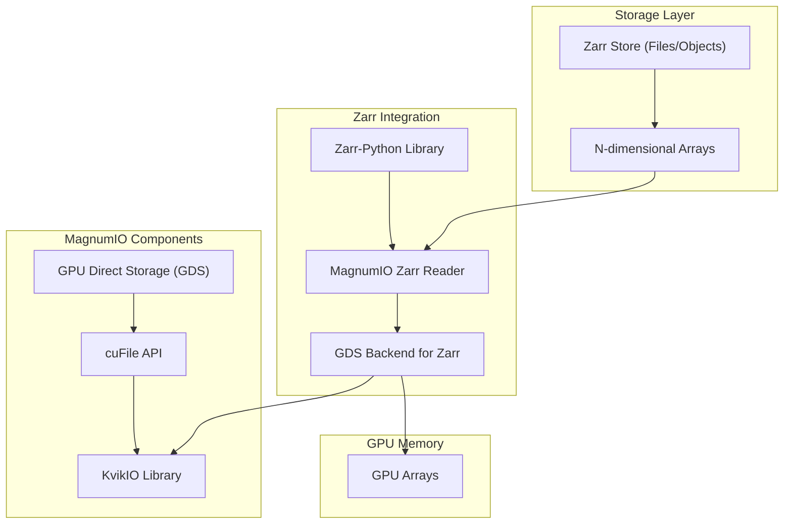
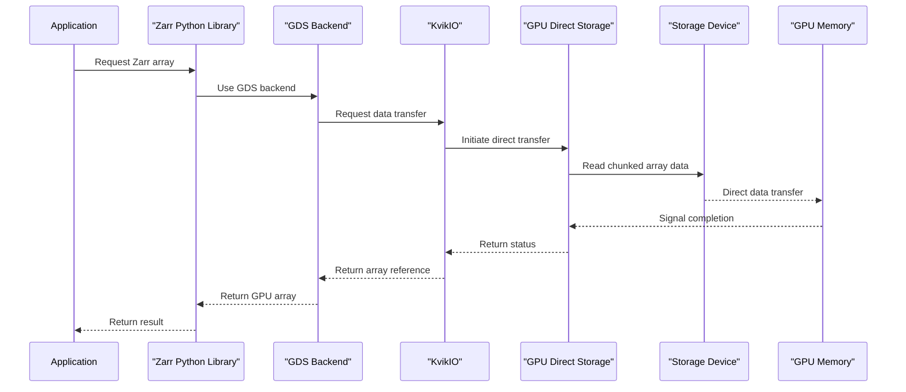
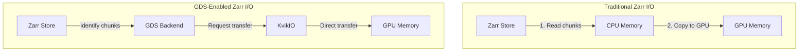

<!-- source: DeepWiki mcp.deepwiki.com · repo NVIDIA/MagnumIO · page 6.2 Zarr Reader · fetched 2026-10-26 -->

# Zarr Reader

Relevant source files

The following files were used as context for generating this wiki page:

- [gds/readers/zarr/README.md](gds/readers/zarr/README.md)

## Purpose and Scope

The Zarr Reader is a specialized GPU Direct Storage (GDS) component for efficiently reading [Zarr](https://zarr.readthedocs.io) formatted N-dimensional array data directly into GPU memory. This reader leverages the KvikIO library to provide GDS-enabled access to Zarr arrays, eliminating the traditional CPU memory copy step in the I/O path. For information about other domain-specific readers, see [Domain-Specific GDS Readers](#6), [cuCIM GDS Reader](#6.1), or [PyTorch-NumPy Reader](#6.3).

Sources: [gds/readers/zarr/README.md:1-3]()

## Architecture Overview

The Zarr Reader is integrated into the MagnumIO ecosystem as a specialized domain reader that builds upon the core GDS functionality. It provides a bridge between the Zarr array format and NVIDIA GPU technology.

Sources: [gds/readers/zarr/README.md:1-3]()

## Integration with Zarr Ecosystem

The Zarr Reader extends the standard Zarr Python library to support GPU Direct Storage. It functions as a specialized backend that enables Zarr to read data directly into GPU memory without the traditional CPU staging step.

Sources: [gds/readers/zarr/README.md:1-3]()

## Installation Requirements

The Zarr Reader requires:

1. A proper installation of KvikIO following the [KvikIO Library](#5) installation guide
2. Two pull requests from the Zarr ecosystem:
   - numcodecs PR #305
   - zarr-python PR #934

These PRs are temporary requirements and are in the process of being merged into their respective projects.

Sources: [gds/readers/zarr/README.md:7-13]()

## How It Works

The Zarr Reader works by intercepting the I/O operations that would normally be performed by the Zarr library to read array chunks from storage. Instead of allowing these chunks to be read into CPU memory and then copied to the GPU, the reader redirects them through the following pathway:

1. Zarr array chunks are identified in storage
2. The GDS backend uses KvikIO to request direct transfer of these chunks
3. KvikIO leverages cuFile API to initiate direct storage-to-GPU transfers
4. The data arrives directly in GPU memory without CPU staging
5. The reader returns references to these GPU memory regions to the calling application

This approach significantly reduces I/O latency and eliminates redundant memory copies, which is particularly beneficial for large array operations common in scientific computing, machine learning, and data analytics.

Sources: [gds/readers/zarr/README.md:1-3]()

## Integration Benefits

The Zarr Reader provides several key benefits for applications working with Zarr data:

1. **Reduced Latency**: Eliminates the CPU memory staging step, reducing overall I/O time
2. **Lower CPU Overhead**: Frees CPU resources by offloading data transfer operations
3. **Bandwidth Optimization**: Makes more efficient use of storage bandwidth by avoiding redundant copies
4. **Simplified Programming Model**: Maintains compatibility with existing Zarr APIs while providing GDS benefits

This integration is particularly valuable for applications processing large volumes of scientific, geospatial, or medical imaging data stored in the Zarr format, where I/O performance can be a significant bottleneck.

## Current Status

As indicated in the README, the Zarr Reader's GDS backend implementation is still evolving, with some components currently residing in pull requests that have not yet been merged into the main Zarr ecosystem projects. Users should be aware of this transitional state when planning to use this feature.

Sources: [gds/readers/zarr/README.md:13-13]()

## Related Components

The Zarr Reader is part of a family of domain-specific GDS readers in MagnumIO:

| Reader | Purpose | Target Format |
|--------|---------|---------------|
| [Zarr Reader](#6.2) | Read N-dimensional arrays | Zarr arrays |
| [cuCIM GDS Reader](#6.1) | GPU-accelerated image processing | Image formats |
| [PyTorch-NumPy Reader](#6.3) | NumPy file integration | NumPy arrays for PyTorch |

Each reader leverages the same underlying GDS technology but is optimized for specific data formats and usage patterns.

Sources: [gds/readers/zarr/README.md:1-3]()

---

