# Page: Home

# Home

<details>
<summary>Relevant source files</summary>

The following files were used as context for generating this wiki page:

- [.gitmodules](.gitmodules)
- [dev-env/.gitignore](dev-env/.gitignore)
- [dev-env/README.md](dev-env/README.md)
- [dev-env/installer.sh](dev-env/installer.sh)
- [dev-env/magnum-io-hpccm.py](dev-env/magnum-io-hpccm.py)
- [dev-env/magnum-io.Dockerfile](dev-env/magnum-io.Dockerfile)
- [gds/readers/cucim-gds/README.md](gds/readers/cucim-gds/README.md)
- [gds/readers/cucim-gds/test_gds.py](gds/readers/cucim-gds/test_gds.py)
- [gds/samples/README.md](gds/samples/README.md)

</details>


## Introduction to NVIDIA MagnumIO

NVIDIA MagnumIO is a collection of I/O technologies and tools designed to accelerate data movement between storage and NVIDIA GPUs. The primary focus is on GPU Direct Storage (GDS), which enables direct data transfer between storage devices and GPU memory without CPU involvement, significantly reducing latency and increasing throughput for data-intensive applications.

This repository provides:
- Development environment setup tools
- GPU Direct Storage (GDS) implementation and samples
- cuFile API for direct GPU storage access
- KvikIO library for Python-based GDS access
- Domain-specific readers for formats like Zarr and integration with frameworks like cuCIM and PyTorch

Sources: [dev-env/README.md:1-19](), [gds/readers/cucim-gds/README.md:1-20]()

## System Architecture Overview

The following diagram illustrates the high-level architecture of NVIDIA MagnumIO:

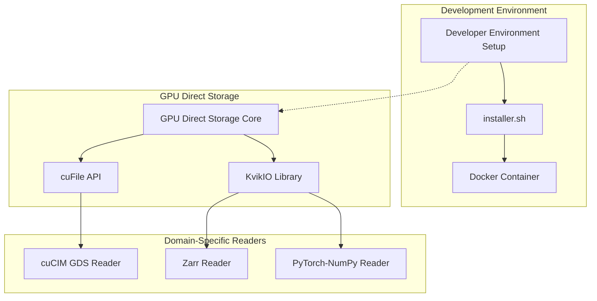

Sources: [.gitmodules:1-7](), [dev-env/README.md:20-27]()

## Data Flow Comparison

The key innovation in MagnumIO is the direct data path between storage and GPU memory:

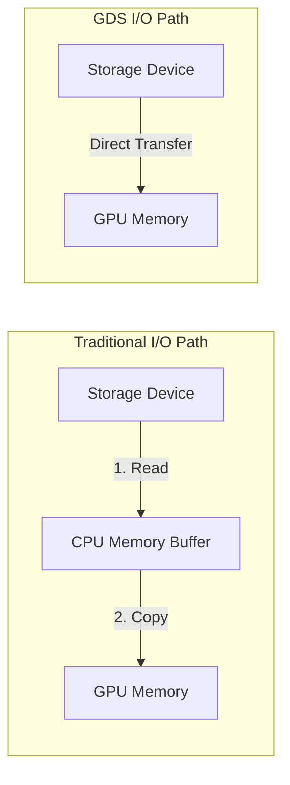

Sources: [gds/readers/cucim-gds/README.md:1-20](), [dev-env/README.md:164-175]()

## Development Environment

The MagnumIO repository provides a comprehensive development environment setup to help developers get started quickly. The setup includes:

1. **Installer Script**: A bash script (`installer.sh`) that automates the setup of necessary components:
   - NVIDIA GPU driver installation
   - CUDA toolkit installation
   - Docker and NVIDIA Container Toolkit setup
   - User configuration for Docker access

2. **Docker Container**: A pre-configured container with all necessary libraries and tools:
   - CUDA Toolkit
   - NVIDIA Nsight Systems for performance analysis
   - Mellanox OFED for networking
   - GDRCOPY for GPU Direct RDMA
   - UCX for unified communication
   - NVSHMEM for GPU-initiated operations
   - NCCL for collective communication

### Setup Process


Sources: [dev-env/installer.sh:1-30](), [dev-env/installer.sh:513-594](), [dev-env/README.md:30-70]()

### Quick Start

The development environment can be set up using the installer script:

```
git clone https://github.com/NVIDIA/MagnumIO.git
cd MagnumIO/dev-env
./installer.sh setup-system
./installer.sh build-container
./installer.sh run-container
```

For more detailed options and commands, refer to [Developer Environment Setup](#2).

Sources: [dev-env/README.md:30-70](), [dev-env/installer.sh:451-509]()

## GPU Direct Storage (GDS)

GPU Direct Storage is the core technology in MagnumIO that enables a direct data path between storage and GPU memory, bypassing the CPU and system memory. This significantly reduces latency and increases throughput for data-intensive applications.

### GDS Architecture

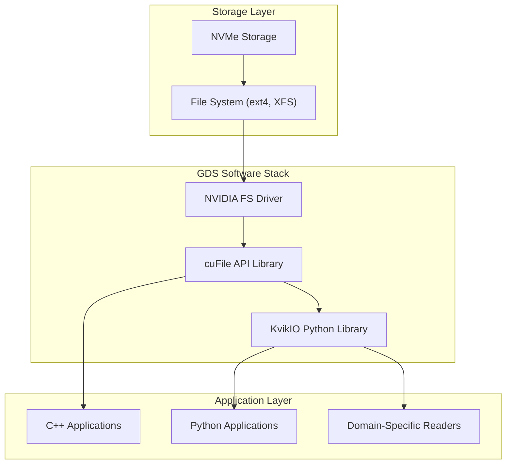

Sources: [gds/readers/cucim-gds/README.md:15-110](), [dev-env/README.md:162-175]()

### Key Components

#### 1. cuFile API

The cuFile API provides low-level access to GDS functionality, allowing direct data transfers between storage and GPU memory. It includes functions for:

- File operations (open, close)
- Direct data transfer (read, write)
- Memory management (buffer registration)
- Batch I/O operations
- Asynchronous I/O

The repository includes numerous samples demonstrating various aspects of the cuFile API usage.

Sources: [gds/samples/README.md:1-15](), [gds/samples/README.md:30-221]()

#### 2. KvikIO Library

KvikIO is a high-level Python interface for GDS, making it easier to use GDS functionality in Python applications. It integrates with popular Python libraries like CuPy and PyTorch for GPU computing.

Sources: [gds/readers/cucim-gds/test_gds.py:1-32](), [.gitmodules:1-3]()

#### 3. Domain-Specific Readers

MagnumIO includes specialized readers for specific data formats:

- **cuCIM GDS Reader**: Provides GDS implementation for GPU-accelerated image processing with cuCIM
- **Zarr Reader**: GDS-based reader for N-dimensional array data stored in Zarr format
- **PyTorch-NumPy Reader**: GDS reader for NumPy files in PyTorch workflows

For more information on these readers, see [Domain-Specific GDS Readers](#6).

Sources: [gds/readers/cucim-gds/README.md:1-10](), [.gitmodules:1-7]()

## Sample Applications

MagnumIO includes a comprehensive set of sample applications demonstrating various aspects of GDS functionality:

### C++ Samples

The repository contains numerous C++ samples demonstrating different aspects of the cuFile API:

| Sample | Description |
|--------|-------------|
| Basic I/O | Demonstrates basic file read/write operations using cuFile API |
| Data Integrity | Tests for ensuring data integrity during transfers |
| Batch I/O | Shows how to use batch I/O operations for improved performance |
| Asynchronous I/O | Demonstrates asynchronous read/write operations |
| Memory Mapping | Shows usage of memory mapping with cuFile API |
| Fcntl Locking | Demonstrates file locking for concurrent access |

Sources: [gds/samples/README.md:32-221]()

### Python Samples

The Python samples demonstrate KvikIO usage:

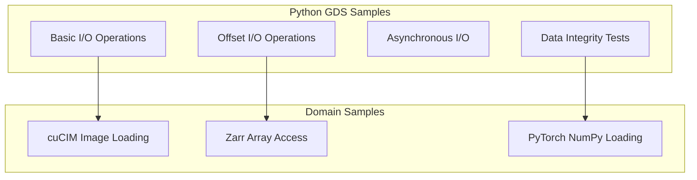

Sources: [gds/readers/cucim-gds/test_gds.py:1-32]()

## Getting Started

To get started with NVIDIA MagnumIO:

1. **Set up the development environment**:
   ```
   git clone https://github.com/NVIDIA/MagnumIO.git
   cd MagnumIO/dev-env
   ./installer.sh setup-system
   ./installer.sh build-container
   ./installer.sh run-container
   ```

2. **Explore the samples**:
   ```
   cd MagnumIO/gds/samples
   export CUFILE_PATH=/usr/local/cuda/targets/x86_64-linux/lib/
   make
   ./cufile_sample_001 <file-path> <gpu-id>
   ```

3. **Try domain-specific readers**:
   - For cuCIM GDS Reader, see [cuCIM GDS Reader](#6.1)
   - For Zarr Reader, see [Zarr Reader](#6.2)
   - For PyTorch-NumPy Reader, see [PyTorch-NumPy Reader](#6.3)

For more detailed documentation on specific components:
- [Developer Environment Setup](#2)
- [GPU Direct Storage (GDS)](#3)
- [cuFile API](#4)
- [KvikIO Library](#5)
- [Domain-Specific GDS Readers](#6)
- [Building and Running Samples](#7)
- [Docker Integration](#8)

Sources: [dev-env/README.md:30-70](), [gds/samples/README.md:15-30]()

---

# Page: Developer Environment Setup

# Developer Environment Setup

<details>
<summary>Relevant source files</summary>

The following files were used as context for generating this wiki page:

- [dev-env/.gitignore](dev-env/.gitignore)
- [dev-env/README.md](dev-env/README.md)
- [dev-env/installer.sh](dev-env/installer.sh)
- [dev-env/magnum-io-hpccm.py](dev-env/magnum-io-hpccm.py)
- [dev-env/magnum-io.Dockerfile](dev-env/magnum-io.Dockerfile)

</details>


## Overview and Purpose

This document provides detailed instructions for setting up the NVIDIA MagnumIO development environment. It covers the installation of required dependencies, container setup, and usage of the development tools included in the MagnumIO ecosystem. For information about GPU Direct Storage (GDS) itself, see [GPU Direct Storage (GDS)](#3).

The MagnumIO development environment provides a consistent, reproducible platform for developing and testing GPU-accelerated I/O applications, with all necessary components pre-installed and configured.

Sources: [dev-env/README.md:1-18](), [dev-env/installer.sh:5-10]()

## System Requirements

### Hardware Requirements

The basic development environment will run on any system with:
- An NVIDIA GPU supported by CUDA
- Sufficient storage space for container images and development files

For full functionality, especially for GDS features, you'll need:
- Tesla, Volta, or Ampere series NVIDIA GPUs
- NVMe storage devices
- Properly configured ext4 filesystem with specific mounting options

### Software Requirements

- Operating Systems:
  - Ubuntu 18.04 LTS or 20.04 LTS
  - Red Hat Enterprise Linux 7.x or 8.x
- Minimum component versions:
  - NVIDIA Driver: 470.42 or newer
  - CUDA Toolkit: 11.4.0 or newer
  - Docker: 20.10.3 or newer

Sources: [dev-env/installer.sh:7-9](), [dev-env/README.md:100-113](), [dev-env/README.md:214-224]()

## Components of the Development Environment

The MagnumIO development environment consists of several key components:

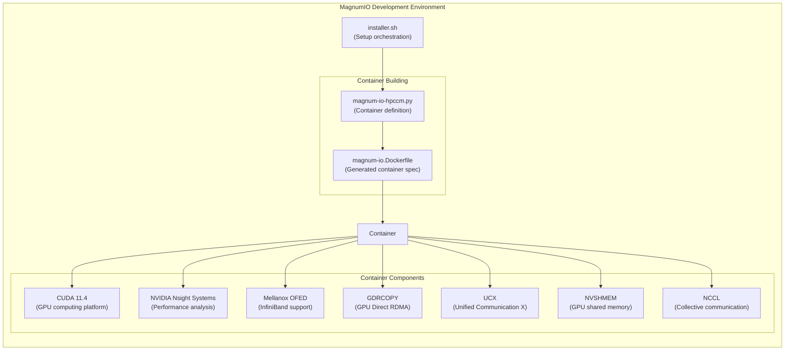

Sources: [dev-env/magnum-io-hpccm.py:1-25](), [dev-env/magnum-io.Dockerfile:1-126](), [dev-env/README.md:118-211]()

## Setup Workflow

The installer script (`installer.sh`) provides a streamlined process for setting up the development environment:

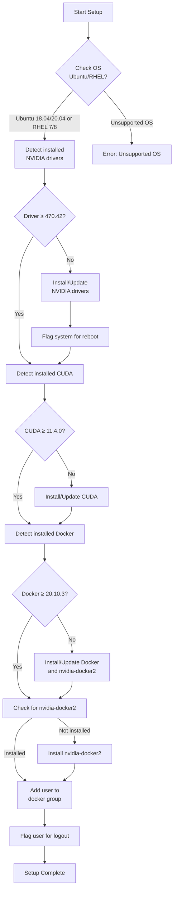

Sources: [dev-env/installer.sh:38-446](), [dev-env/installer.sh:512-604]()

## Setting Up the Development Environment

### Quick Start

For a standard setup, follow these steps:

1. Clone the MagnumIO repository:
```bash
git clone https://github.com/NVIDIA/MagnumIO.git
cd MagnumIO/dev-env
```

2. Run the system setup:
```bash
./installer.sh setup-system
```

3. If prompted, reboot your system or log out and back in to apply changes.

4. Build or pull the container:
   
   **Option 1: Pull from NGC (recommended)**
   ```bash
   docker pull nvcr.io/nvidia/magnum-io/magnum-io:21.07
   ```
   
   **Option 2: Build locally**
   ```bash
   ./installer.sh build-container
   ```

5. Run the container:
```bash
./installer.sh run-container
```

Sources: [dev-env/README.md:29-98](), [dev-env/installer.sh:451-510]()

### Detailed Setup Process

#### System Setup

The `setup-system` command performs several key tasks:

1. Detects and installs/updates NVIDIA drivers if needed
2. Installs or updates CUDA to version 11.4 or newer
3. Installs Docker CE and NVIDIA Container Toolkit
4. Configures user permissions for Docker

```bash
./installer.sh setup-system
```

If a component requires updates, you may need to reboot or log out and back in for changes to take effect.

Sources: [dev-env/installer.sh:527-537](), [dev-env/installer.sh:73-119](), [dev-env/installer.sh:176-230](), [dev-env/installer.sh:241-327](), [dev-env/installer.sh:330-348]()

#### Individual Component Installation

You can also install or update components individually:

- Install NVIDIA drivers: `./installer.sh install-driver`
- Purge existing drivers (Ubuntu only): `./installer.sh purge-driver`
- Install CUDA: `./installer.sh install-driver`
- Install Docker and NVIDIA Container Toolkit: `./installer.sh install-docker`
- Configure Docker user permissions: `./installer.sh setup-docker-user`

Sources: [dev-env/installer.sh:538-556]()

#### Container Management

The installer provides commands for managing the MagnumIO container:

- Generate Dockerfile from HPCCM script: `./installer.sh build-dockerfile`
- Build the container: `./installer.sh build-container`
- Run the container: `./installer.sh run-container`
- Remove the container: `./installer.sh purge-container`

Sources: [dev-env/installer.sh:557-585](), [dev-env/installer.sh:351-375]()

## Container Architecture

The MagnumIO container is built with a layered architecture, providing all necessary components for GPU-accelerated I/O development:

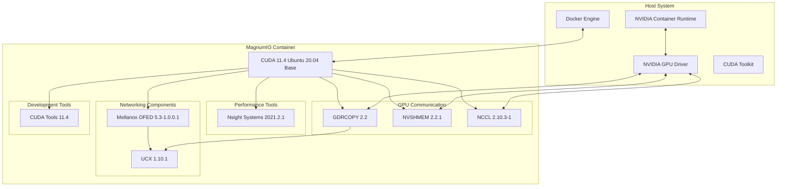

Sources: [dev-env/magnum-io.Dockerfile:3-108](), [dev-env/magnum-io-hpccm.py:5-15]()

## Using the Container

### Running the Container

The most straightforward way to run the container is using the installer script:

```bash
./installer.sh run-container
```

This command launches the container with:
- All GPUs accessible
- Your home directory mounted inside the container
- User permissions matching your host user
- `/run/udev` mounted for device access

Sources: [dev-env/installer.sh:570-585]()

### Manual Container Execution

You can also run the container manually with Docker:

```bash
docker run --gpus all --rm -it \
  --user "$(id -u):$(id -g)" \
  --volume $HOME:$HOME \
  --volume /run/udev:/run/udev:ro \
  --workdir $HOME \
  magnum-io:21.07
```

This is equivalent to the `run-container` command but gives you more control over container options if needed.

Sources: [dev-env/README.md:63-70](), [dev-env/installer.sh:579-584]()

### Using NGC Pre-Built Containers

NVIDIA provides pre-built containers on NGC that can be used instead of building locally:

1. Visit the [Magnum IO Container on NGC](https://ngc.nvidia.com/catalog/containers/nvidia:magnum-io:magnum-io)
2. Pull the container:
   ```bash
   docker pull nvcr.io/nvidia/magnum-io/magnum-io:21.07
   ```
3. Run the container using the same commands as above, but with the NGC image name.

Sources: [dev-env/README.md:41-70]()

## Key Components In The Container

The MagnumIO container includes several key components for GPU-accelerated I/O development:

| Component | Version | Purpose |
|-----------|---------|---------|
| CUDA | 11.4 | GPU computing platform and programming model |
| NVIDIA Nsight Systems | 2021.2.1 | Performance analysis tool for CUDA applications |
| Mellanox OFED | 5.3-1.0.0.1 | InfiniBand drivers and utilities |
| GDRCOPY | 2.2 | Low-latency GPU memory copy library |
| UCX | 1.10.1 | Unified communication framework |
| NVSHMEM | 2.2.1 | GPU-integrated shared memory library |
| NCCL | 2.10.3-1 | Collective communications library for multi-GPU/multi-node |

Sources: [dev-env/magnum-io-hpccm.py:5-15](), [dev-env/magnum-io.Dockerfile:1-126](), [dev-env/README.md:118-211]()

## Troubleshooting

### Driver Installation Issues

If you encounter issues with NVIDIA driver installation:

1. For Ubuntu systems, try purging the drivers and reinstalling:
   ```bash
   ./installer.sh purge-driver
   # Reboot when prompted
   ./installer.sh install-driver
   ```

2. For Red Hat systems, manual driver installation is required:
   - Download drivers from the [NVIDIA website](https://www.nvidia.com/Download/index.aspx)
   - Install following the NVIDIA documentation

Sources: [dev-env/installer.sh:122-161](), [dev-env/README.md:231-244]()

### Docker Permission Issues

If you encounter "permission denied" errors when using Docker:

1. Ensure your user is in the docker group:
   ```bash
   ./installer.sh setup-docker-user
   ```

2. Log out and log back in to apply the group changes.

3. Verify with:
   ```bash
   groups | grep docker
   ```

Sources: [dev-env/installer.sh:330-348]()

### Container Build Failures

If the container build fails:

1. Verify internet connectivity:
   ```bash
   ping -c 3 8.8.8.8
   ```

2. Check for sufficient disk space:
   ```bash
   df -h
   ```

3. Try rebuilding the Dockerfile from the HPCCM script:
   ```bash
   ./installer.sh build-dockerfile
   ./installer.sh build-container
   ```

4. As an alternative, pull the pre-built container from NGC.

Sources: [dev-env/installer.sh:558-563](), [dev-env/README.md:41-70]()

## Customizing the Environment

### Modifying the Container Definition

The container is defined using HPC Container Maker (HPCCM), which provides a higher-level interface for container creation:

1. Install HPCCM:
   ```bash
   pip install hpccm
   ```

2. Modify the `magnum-io-hpccm.py` script according to your needs.

3. Regenerate the Dockerfile:
   ```bash
   ./installer.sh build-dockerfile
   ```

4. Build the updated container:
   ```bash
   ./installer.sh build-container
   ```

Sources: [dev-env/installer.sh:558-563](), [dev-env/magnum-io-hpccm.py:1-25]()

### Building on Top of the MagnumIO Container

You can use the MagnumIO container as a base for your own containers:

```dockerfile
FROM magnum-io:21.07

# Add your custom packages and configurations
RUN apt-get update && apt-get install -y your-packages

# Add your application code
COPY your-app /app

# Set working directory
WORKDIR /app

# Define command to run
CMD ["./your-app"]
```

This allows you to extend the MagnumIO environment with your specific requirements.

Sources: [dev-env/magnum-io.Dockerfile:1-126]()

## Diagnostic Information

The installer includes a diagnostic command to help troubleshoot issues:

```bash
./installer.sh diagnostics
```

This command displays:
- OS information
- Storage devices and space
- Network connectivity
- NVIDIA driver version and status
- CUDA and Docker versions
- NVIDIA-related shared libraries

Sources: [dev-env/installer.sh:386-422](), [dev-env/installer.sh:523-526]()

## Conclusion

The MagnumIO Developer Environment provides a complete ecosystem for developing, testing, and optimizing GPU-accelerated I/O applications. By following the setup instructions in this document, you can quickly establish a consistent, reproducible environment that includes all necessary components for NVIDIA Magnum IO development.

For more information about using the specific components within MagnumIO, refer to their respective documentation pages in this wiki.

---

# Page: GPU Direct Storage (GDS)

# GPU Direct Storage (GDS)

<details>
<summary>Relevant source files</summary>

The following files were used as context for generating this wiki page:

- [gds/docker/README.md](gds/docker/README.md)
- [gds/docker/gds-run-container](gds/docker/gds-run-container)
- [gds/samples/README.md](gds/samples/README.md)

</details>


## Introduction and Purpose

GPU Direct Storage (GDS) is a key technology that enables direct data transfers between GPU memory and storage devices, bypassing CPU memory. This documentation covers the GDS system within NVIDIA MagnumIO, detailing its architecture, components, and use cases. GDS is designed to significantly improve I/O performance for GPU-accelerated applications by eliminating unnecessary data copies through the CPU.

For information about the specific API that GDS provides, see [cuFile API](#4). For the high-level Python interface to GDS, see [KvikIO Library](#5).

Sources: gds/samples/README.md

## GDS Architecture and Data Flow

### Traditional vs GDS I/O Path

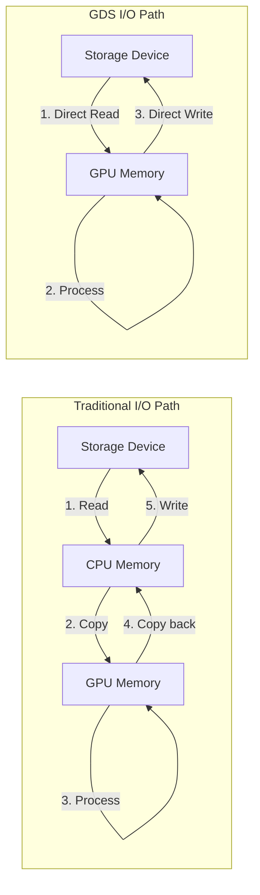

GDS establishes a direct data path between storage and GPU memory, eliminating the CPU memory as an intermediary. This reduces latency, increases bandwidth, and frees CPU resources.

Sources: gds/samples/README.md

### GDS Component Stack

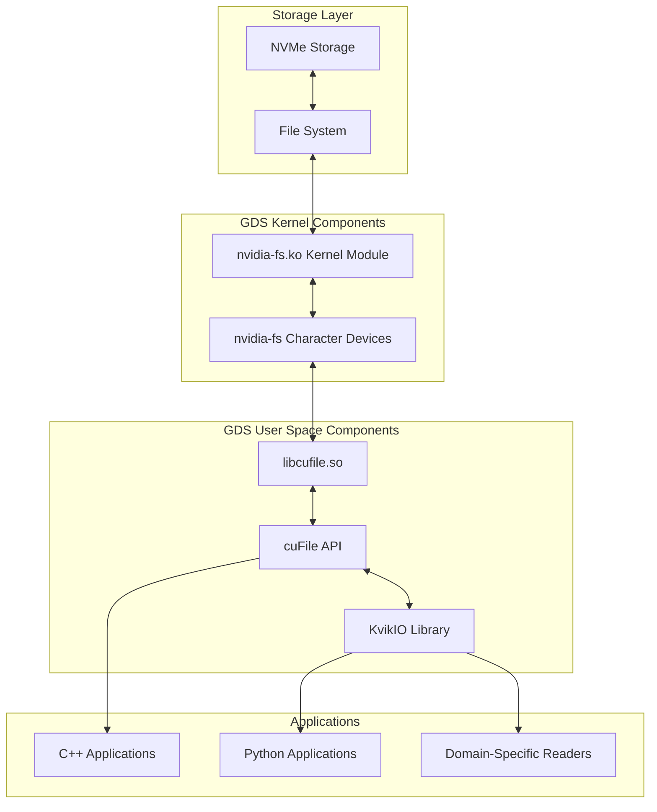

The GDS stack consists of kernel components (nvidia-fs kernel module), user space libraries (libcufile.so), and APIs (cuFile and KvikIO) that applications use to access the direct data path.

Sources: gds/docker/README.md

## Core GDS Components

### cuFile API

The cuFile API provides low-level C/C++ functions for direct data transfer between storage and GPU memory. Key functions include:

- `cuFileHandleRegister()` - Registers a file handle for GDS operations
- `cuFileBufRegister()` - Registers a GPU buffer for GDS operations
- `cuFileRead()`/`cuFileWrite()` - Performs direct I/O between storage and GPU memory
- `cuFileBufDeregister()`/`cuFileHandleDeregister()` - Deregisters resources

The API also offers batch operations, asynchronous I/O, and memory mapping capabilities.

For comprehensive documentation of the cuFile API, see [cuFile API](#4).

Sources: gds/samples/README.md

### KvikIO Library

KvikIO is a high-level Python interface for GDS, built on top of the cuFile API. It simplifies GDS usage in Python applications and integrates with NumPy, PyTorch, and other data science frameworks.

For detailed documentation of KvikIO, see [KvikIO Library](#5).

Sources: gds/samples/README.md

### Domain-Specific GDS Readers

MagnumIO includes specialized GDS-enabled readers for various data formats:

- cuCIM GDS Reader - Optimized for medical and scientific imaging
- Zarr Reader - For N-dimensional array data
- PyTorch-NumPy Reader - Integrated with PyTorch for ML workflows

These readers are built on KvikIO and provide format-specific optimizations.

For more information on these readers, see [Domain-Specific GDS Readers](#6).

## Docker Integration

GDS can be used in containerized environments through the `gds-run-container` script, which extends Docker to support GDS capabilities.

### Docker Integration Architecture

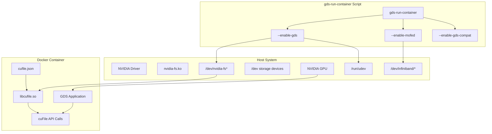

The `gds-run-container` script exposes the necessary devices and flags to enable GDS functionality within Docker containers.

Sources: gds/docker/README.md, gds/docker/gds-run-container

### Container Configuration Options

| Option | Description |
|--------|-------------|
| `--enable-gds` | Passes nvidia-fs character devices and required flags for full GDS support |
| `--enable-gds-compat` | Enables GDS in compatibility mode only |
| `--enable-mofed` | Passes Mellanox devices and flags for RDMA support |

Example usage:

```bash
gds-run-container run --rm --gpus=all --enable-gds \
                     --volume /data_mount:/data:rw \
                     --workdir /opt/app \
                     -it gds-container bash
```

Sources: gds/docker/README.md:56-163

## Configuration

GDS uses a configuration file (`cufile.json`) to specify parameters like buffer sizes, properties, and mount points. By default, the library searches for this file at `/etc/cufile.json`, but this location can be changed with the `CUFILE_ENV_PATH_JSON` environment variable.

In Docker environments, the configuration file can be provided via:

```bash
gds-run-container run --rm --gpus=all --enable-gds \
                     -e CUFILE_ENV_PATH_JSON=/path/to/cufile.json \
                     -it gds-container bash
```

Sources: gds/docker/README.md:146-164

## Sample Applications

MagnumIO includes extensive samples demonstrating GDS functionality, located in the `gds/samples` directory.

### Sample Categories

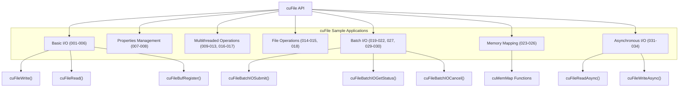

The samples cover a wide range of GDS capabilities from basic operations to advanced features.

Sources: gds/samples/README.md:32-221

### Key Sample Demonstrations

| Sample Category | Examples | Key Functionality |
|-----------------|----------|-------------------|
| Basic I/O | 001-006 | File read/write, buffer registration |
| Properties | 007-008 | Set/get properties, error handling |
| Multithreaded | 009-013, 016-017 | Thread safety, sharing handles |
| Batch I/O | 019-022, 027, 029-030 | Submitting multiple operations, status checking |
| Memory Mapping | 023-026 | Using cuMemMap with GDS |
| Async I/O | 031-034 | Non-blocking operations with CUDA streams |

Sources: gds/samples/README.md:32-221

## System Requirements

GDS requires specific hardware and software components:

- NVIDIA GPU with compute capability 6.0 or later
- NVMe storage device
- CUDA Toolkit 11.4 or later
- NVIDIA driver supporting GDS
- For RDMA support: Mellanox OFED stack

Sources: gds/samples/README.md:8-12

## Related Documentation

- [cuFile API](#4) - Detailed documentation of the C/C++ interface
- [KvikIO Library](#5) - Documentation of the Python interface
- [Domain-Specific GDS Readers](#6) - Information on specialized data format readers
- [Building and Running Samples](#7) - Guidelines for using the sample applications
- [Docker Integration](#8) - Detailed documentation on using GDS with Docker

---

# Page: cuFile API

# cuFile API

<details>
<summary>Relevant source files</summary>

The following files were used as context for generating this wiki page:

- [gds/samples/README.md](gds/samples/README.md)
- [gds/samples/cufile_sample_001.cc](gds/samples/cufile_sample_001.cc)
- [gds/samples/cufile_sample_002.cc](gds/samples/cufile_sample_002.cc)
- [gds/samples/cufile_sample_003.cc](gds/samples/cufile_sample_003.cc)
- [gds/samples/cufile_sample_004.cc](gds/samples/cufile_sample_004.cc)
- [gds/samples/cufile_sample_006.cc](gds/samples/cufile_sample_006.cc)
- [gds/samples/cufile_sample_014.cc](gds/samples/cufile_sample_014.cc)
- [gds/samples/cufile_sample_015.cc](gds/samples/cufile_sample_015.cc)
- [gds/samples/cufile_sample_utils.h](gds/samples/cufile_sample_utils.h)

</details>


The cuFile API is a core component of NVIDIA's GPUDirect Storage (GDS) system that enables direct data transfers between storage devices and GPU memory, bypassing CPU memory. This page documents the cuFile API functionality, its core operations, and usage patterns. For information about higher-level interfaces to GDS, see [KvikIO Library](#5), and for specialized data format readers built on GDS, see [Domain-Specific GDS Readers](#6).

## Overview

The cuFile API provides low-level functions to directly read from and write to files from GPU memory without requiring intermediate copies through CPU memory, significantly improving I/O performance for GPU-accelerated applications.

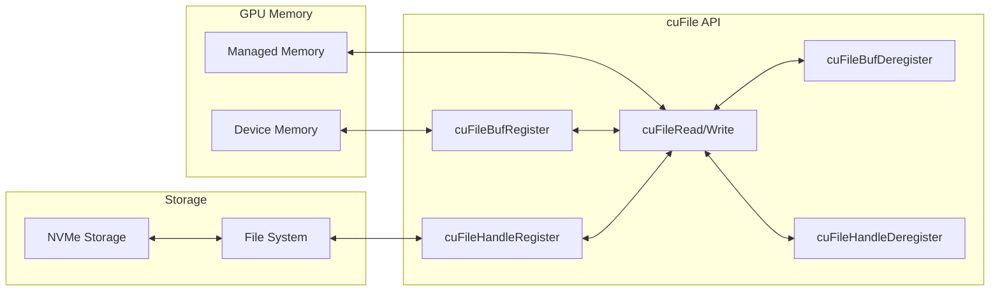

Sources: [gds/samples/README.md:1-31](), [gds/samples/cufile_sample_003.cc:11-28]()

## Key Concepts

### Direct I/O Path

The primary benefit of cuFile is the elimination of the CPU memory copy step in traditional I/O paths.

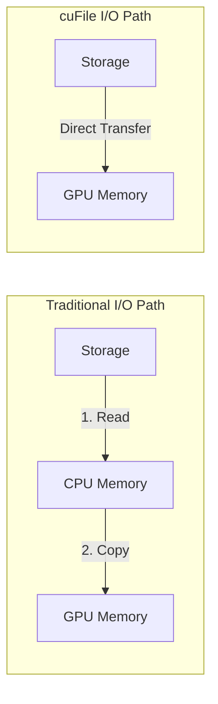

Sources: [gds/samples/cufile_sample_001.cc:11-19](), [gds/samples/cufile_sample_003.cc:11-28]()

### Core Components

The cuFile API consists of several key functions and structures:

| Component | Description |
|-----------|-------------|
| `CUfileHandle_t` | Opaque handle to a file |
| `CUfileDescr_t` | File descriptor structure |
| `cuFileHandleRegister` | Registers a file handle with cuFile |
| `cuFileHandleDeregister` | Deregisters a file handle |
| `cuFileBufRegister` | Registers GPU memory for I/O operations |
| `cuFileBufDeregister` | Deregisters GPU memory |
| `cuFileRead` | Reads data from a file to GPU memory |
| `cuFileWrite` | Writes data from GPU memory to a file |

Sources: [gds/samples/cufile_sample_001.cc:30-47](), [gds/samples/cufile_sample_utils.h:95-112]()

## Basic Usage

### Initialization and Cleanup

Before using cuFile API functions, the driver must be initialized with `cuFileDriverOpen()`. When finished, clean up with `cuFileDriverClose()`.

Sources: [gds/samples/cufile_sample_001.cc:57-62](), [gds/samples/cufile_sample_001.cc:137-142]()

### File Handle Registration

Files must be registered with cuFile using the `cuFileHandleRegister` function:

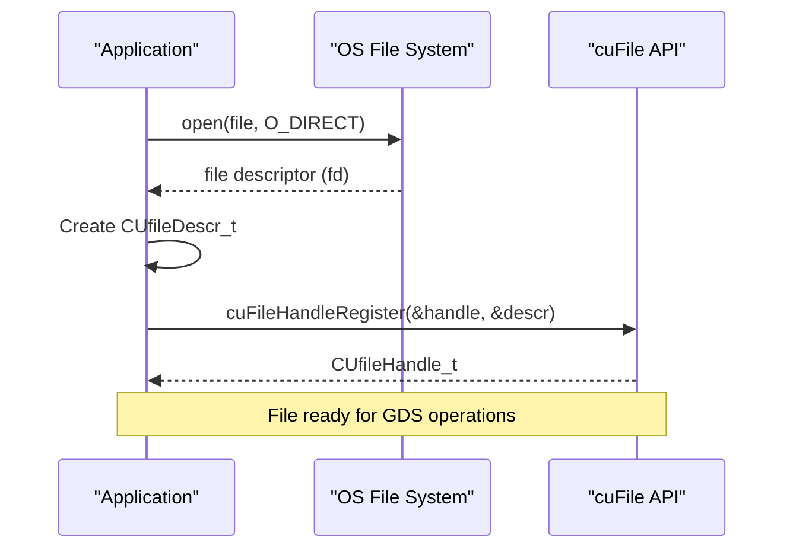

Sources: [gds/samples/cufile_sample_001.cc:65-85](), [gds/samples/cufile_sample_002.cc:54-74]()

### Memory Registration

For optimal performance, GPU memory should be registered using `cuFileBufRegister` before I/O operations:

Sources: [gds/samples/cufile_sample_001.cc:87-100](), [gds/samples/cufile_sample_014.cc:87-98]()

### Reading and Writing

The core I/O operations are performed using `cuFileRead` and `cuFileWrite`:

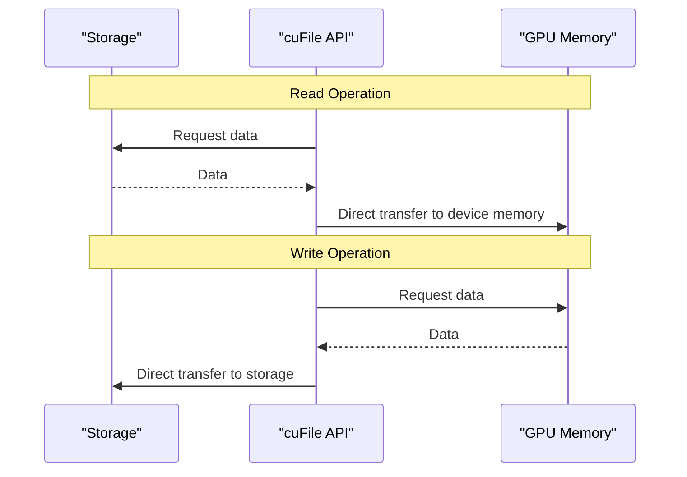

Sources: [gds/samples/cufile_sample_001.cc:102-116](), [gds/samples/cufile_sample_003.cc:132-144](), [gds/samples/cufile_sample_003.cc:171-180]()

### Example Workflow

A typical cuFile workflow consists of:

1. Opening a file with O_DIRECT flag
2. Registering the file handle
3. Allocating GPU memory
4. Registering the GPU memory (optional)
5. Performing I/O operations
6. Deregistering GPU memory
7. Deregistering file handle
8. Closing the file

Sources: [gds/samples/cufile_sample_001.cc:39-144](), [gds/samples/cufile_sample_003.cc:54-212]()

## Memory Types Support

The cuFile API supports different types of memory:

| Memory Type | Description | Registration Needed |
|-------------|-------------|---------------------|
| Device Memory | Standard GPU memory allocated with `cudaMalloc` | Optional, but recommended |
| Managed Memory | Memory allocated with `cudaMallocManaged` | Not required |
| Host Memory | Memory allocated with `cudaMallocHost` | Not required |

Sources: [gds/samples/cufile_sample_015.cc:52-91](), [gds/samples/cufile_sample_002.cc:81-89]()

## Advanced Features

### Buffer and File Offsets

The cuFile API supports reading and writing with specific offsets in both files and memory buffers:

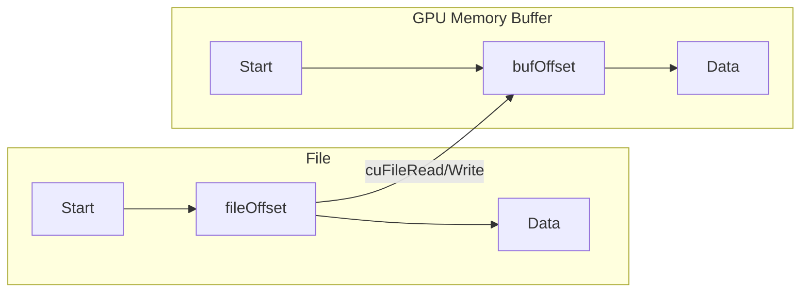

Sources: [gds/samples/cufile_sample_014.cc:99-119](), [gds/samples/cufile_sample_006.cc:96-110]()

### Error Handling

cuFile API functions return detailed error information that can be processed with helper functions:

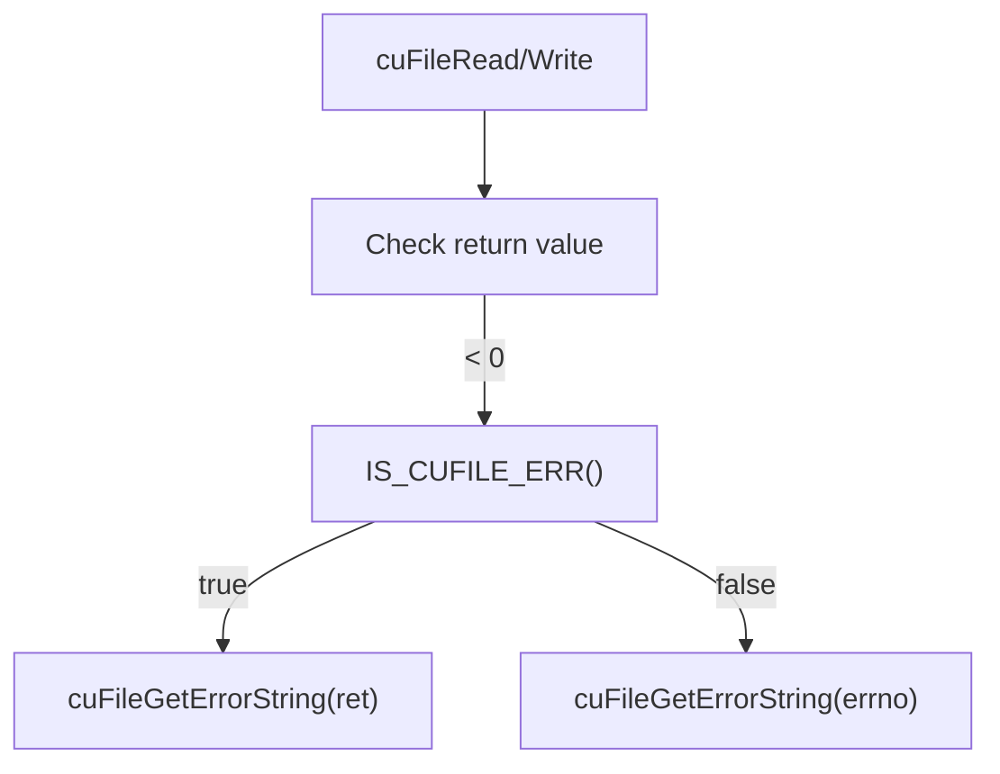

Sources: [gds/samples/cufile_sample_utils.h:95-112](), [gds/samples/cufile_sample_001.cc:105-112]()

### Batch I/O Operations

For advanced use cases, cuFile provides batch I/O operations:

- `cuFileBatchIOSubmit`: Submit multiple I/O operations as a batch
- `cuFileBatchIOGetStatus`: Check the status of batch operations
- `cuFileBatchIOCancel`: Cancel submitted batch operations

Sources: [gds/samples/README.md:135-153]()

### Asynchronous I/O

cuFile supports asynchronous I/O operations through:

- `cuFileReadAsync`: Asynchronous read operation
- `cuFileWriteAsync`: Asynchronous write operation

Sources: [gds/samples/README.md:201-221]()

### Memory Mapping

For applications requiring memory mapping, cuFile provides integration with CUDA's memory management:

Sources: [gds/samples/README.md:155-173]()

### File Locking (fcntl)

cuFile supports file locking mechanisms for concurrent access:

Sources: [gds/samples/README.md:127-131]()

## Performance Considerations

For optimal performance with cuFile:

1. Use O_DIRECT flag when opening files
2. Register GPU memory with `cuFileBufRegister` when possible
3. Align I/O operations to storage device block boundaries
4. Use batch operations for multiple small I/O operations
5. Consider memory type choices based on access patterns

Sources: [gds/samples/cufile_sample_001.cc:67](), [gds/samples/cufile_sample_003.cc:107]()

## Data Integrity

Many of the cuFile samples demonstrate data integrity verification using SHA-256 checksums:

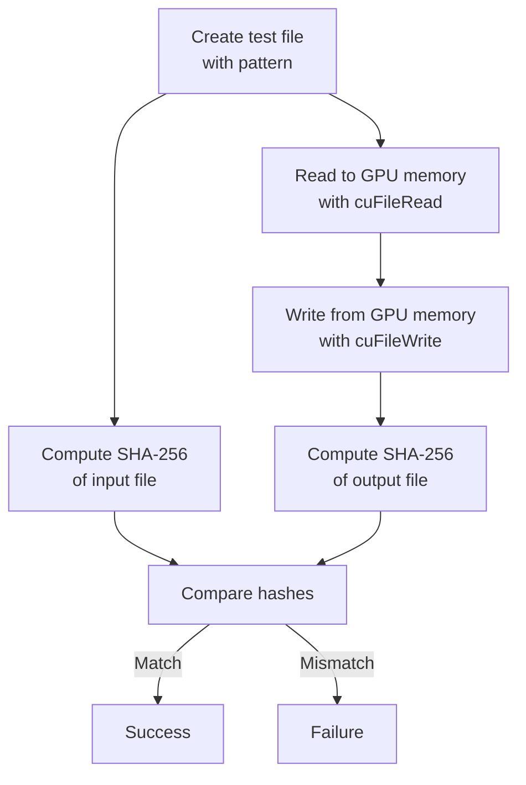

Sources: [gds/samples/cufile_sample_003.cc:182-195](), [gds/samples/cufile_sample_004.cc:200-223]()

## Sample Applications

The NVIDIA MagnumIO repository contains numerous sample applications demonstrating different aspects of the cuFile API. These samples provide practical examples for:

- Basic file reading and writing
- Data integrity verification
- Using different memory types
- Buffer and file offset handling
- Multithreaded operations
- Batch I/O operations
- Asynchronous I/O
- Memory mapping
- File locking

Sources: [gds/samples/README.md:32-221]()

## Related Pages

- For a higher-level Python interface to GDS, see [KvikIO Library](#5)
- For batch operations details, see [Batch I/O Operations](#4.1)
- For memory mapping, fcntl locking, and other advanced features, see [Advanced cuFile Features](#4.2)

---

# Page: Batch I/O Operations

# Batch I/O Operations

<details>
<summary>Relevant source files</summary>

The following files were used as context for generating this wiki page:

- [gds/samples/cufile_sample_019.cc](gds/samples/cufile_sample_019.cc)
- [gds/samples/cufile_sample_020.cc](gds/samples/cufile_sample_020.cc)
- [gds/samples/cufile_sample_021.cc](gds/samples/cufile_sample_021.cc)
- [gds/samples/cufile_sample_022.cc](gds/samples/cufile_sample_022.cc)

</details>


## Purpose and Scope

This document describes the batch I/O capabilities of the cuFile API in NVIDIA MagnumIO. Batch I/O operations allow multiple file read or write operations to be submitted, monitored, and managed as a single unit, providing improved performance and simplified management for high-throughput I/O workloads.

For information about other cuFile API features, see [Advanced cuFile Features](#4.2). For high-level Python interfaces to GDS functionality, see [KvikIO Library](#5).

## Batch I/O Overview

Batch I/O operations in cuFile enable applications to:

1. Submit multiple I/O operations in a single batch
2. Monitor completion status of operations
3. Cancel pending operations when needed
4. Efficiently manage resources for high-throughput workloads

The batch API provides significant performance advantages by reducing system call overhead and allowing the underlying implementation to optimize I/O scheduling.

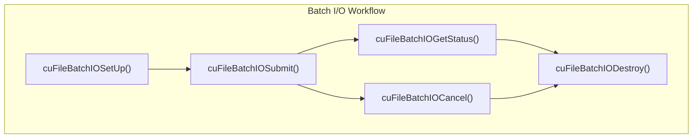

Sources: [gds/samples/cufile_sample_019.cc:154-188](), [gds/samples/cufile_sample_020.cc:154-186](), [gds/samples/cufile_sample_021.cc:141-166]()

## Key Data Structures

### Batch I/O Handles and Parameters

The cuFile batch I/O API uses these key data structures:

| Data Structure | Description |
|----------------|-------------|
| `CUfileBatchHandle_t` | Handle representing a batch of I/O operations |
| `CUfileIOParams_t` | Parameters for individual I/O operations in a batch |
| `CUfileIOEvents_t` | Status and results of completed I/O operations |

Example parameter setup for a write operation:

```mermaid
classDiagram
    class CUfileIOParams_t {
        mode: CUFILE_BATCH
        fh: CUfileHandle_t
        opcode: CUFILE_WRITE/CUFILE_READ
        u.batch.devPtr_base: void*
        u.batch.file_offset: off_t
        u.batch.devPtr_offset: size_t
        u.batch.size: size_t
    }
```

Sources: [gds/samples/cufile_sample_019.cc:51-52](), [gds/samples/cufile_sample_019.cc:143-150]()

## Batch I/O Workflow

The complete workflow for batch I/O operations follows these steps:

```mermaid
sequenceDiagram
    participant App as "Application"
    participant Driver as "cuFile Driver"
    participant GPU as "GPU Memory"
    participant Storage as "Storage Device"
    
    App->>Driver: cuFileDriverOpen()
    App->>App: Register file handles with cuFileHandleRegister()
    App->>App: Allocate & register GPU memory with cuFileBufRegister()
    App->>Driver: cuFileBatchIOSetUp(&batch_id, batch_size)
    
    loop For each I/O operation
        App->>App: Configure io_batch_params[i]
    end
    
    App->>Driver: cuFileBatchIOSubmit(batch_id, batch_size, io_batch_params, flags)
    
    alt Reading data
        Driver->>Storage: Read requests
        Storage->>GPU: Direct data transfer
    else Writing data
        GPU->>Storage: Direct data transfer
    end
    
    App->>Driver: cuFileBatchIOGetStatus(batch_id, ...)
    Driver->>App: Return completion status
    
    App->>Driver: cuFileBatchIODestroy(batch_id)
    App->>Driver: Deregister resources and close
```

Sources: [gds/samples/cufile_sample_019.cc:40-226](), [gds/samples/cufile_sample_020.cc:40-224]()

## Setting Up Batch I/O Operations

To set up batch I/O operations, follow these steps:

1. Open the cuFile driver with `cuFileDriverOpen()`
2. Open files and register file handles
3. Allocate and register GPU memory
4. Initialize a batch handle with `cuFileBatchIOSetUp()`

Example code structure:

```
// Initialize batch handle
CUfileBatchHandle_t batch_id;
CUfileError_t errorBatch = cuFileBatchIOSetUp(&batch_id, batch_size);
```

Sources: [gds/samples/cufile_sample_019.cc:69-156](), [gds/samples/cufile_sample_020.cc:70-154]()

## Submitting Batch I/O Operations

After setting up the batch, configure each I/O operation's parameters and submit the batch:

1. Configure `CUfileIOParams_t` for each operation
2. Submit with `cuFileBatchIOSubmit()`

```mermaid
flowchart TD
    subgraph "I/O Parameters Setup"
        p1["io_params[0]:
        Read/Write GPU memory
        at specific file offset"]
        
        p2["io_params[1]:
        Read/Write GPU memory
        at specific file offset"]
        
        p3["io_params[2...N]:
        Additional operations"]
    end
    
    subgraph "Batch Submit"
        submit["cuFileBatchIOSubmit(
        batch_id,
        batch_size,
        io_params,
        flags)"]
    end
    
    p1 --> submit
    p2 --> submit
    p3 --> submit
```

Sources: [gds/samples/cufile_sample_019.cc:143-163](), [gds/samples/cufile_sample_020.cc:142-166]()

## Monitoring Batch Operation Status

To monitor the status of submitted batch operations:

1. Prepare a buffer of `CUfileIOEvents_t` to receive completion events
2. Call `cuFileBatchIOGetStatus()` to check for completed operations
3. Process the completed operations based on the returned events

```
// Get status of batch operations
unsigned nr = batch_size; // in/out parameter
CUfileIOEvents_t io_batch_events[MAX_BATCH_IOS];
CUfileError_t errorBatch = cuFileBatchIOGetStatus(batch_id, batch_size, &nr, io_batch_events, NULL);
```

The `nr` parameter is both an input and output value. As input, it specifies the maximum number of events to retrieve. As output, it indicates how many events were actually retrieved.

Sources: [gds/samples/cufile_sample_019.cc:171-185](), [gds/samples/cufile_sample_022.cc:158-170]()

## Handling Partial Completions

When dealing with large batches, you may need to handle partial completions by repeatedly calling `cuFileBatchIOGetStatus()` until all operations complete:

```mermaid
flowchart LR
    start["Begin"] --> setup["Set num_completed = 0"]
    setup --> loop["While num_completed < batch_size"]
    loop --> status["Call cuFileBatchIOGetStatus()"]
    status --> process["Process completed operations"]
    process --> update["num_completed += nr"]
    update --> check["Check if all complete"]
    check -->|"No"| loop
    check -->|"Yes"| finish["Finish"]
```

The sample in [gds/samples/cufile_sample_022.cc:155-170]() demonstrates this approach using a limited buffer size for status events.

Sources: [gds/samples/cufile_sample_019.cc:171-185](), [gds/samples/cufile_sample_022.cc:155-170]()

## Cancelling Batch Operations

To cancel pending batch operations:

1. Submit the batch with `cuFileBatchIOSubmit()`
2. Call `cuFileBatchIOCancel()` to cancel pending operations
3. Call `cuFileBatchIOGetStatus()` to get status of operations (which may include cancellation status)

```
// Cancel batch operations
CUfileError_t errorBatch = cuFileBatchIOCancel(batch_id);
```

After cancellation, you should still retrieve operation status to ensure proper cleanup.

Sources: [gds/samples/cufile_sample_021.cc:151-164]()

## Cleaning Up Batch Resources

After batch operations complete (or are cancelled), clean up resources:

1. Call `cuFileBatchIODestroy()` to release the batch handle
2. Deregister buffer memory with `cuFileBufDeregister()`
3. Free GPU memory
4. Deregister file handles and close files
5. Close the cuFile driver

```
// Clean up batch resources
cuFileBatchIODestroy(batch_id);
```

Sources: [gds/samples/cufile_sample_019.cc:188-219](), [gds/samples/cufile_sample_020.cc:186-216]()

## Batch I/O Use Cases

### Batch Writes

Batch write operations allow efficient transfer of data from GPU memory to storage:

```mermaid
flowchart LR
    subgraph "GPU Memory"
        buf1["devPtr[0]"]
        buf2["devPtr[1]"]
        buf3["devPtr[2]"]
    end
    
    subgraph "File"
        offset1["offset 0"]
        offset2["offset size"]
        offset3["offset size*2"]
    end
    
    buf1 -->|"Write Operation 1"| offset1
    buf2 -->|"Write Operation 2"| offset2
    buf3 -->|"Write Operation 3"| offset3
```

Sources: [gds/samples/cufile_sample_019.cc:40-226]()

### Batch Reads

Batch read operations efficiently load data from storage directly into GPU memory:

```mermaid
flowchart LR
    subgraph "File"
        offset1["offset 0"]
        offset2["offset size"]
        offset3["offset size*2"]
    end
    
    subgraph "GPU Memory"
        buf1["devPtr[0]"]
        buf2["devPtr[1]"]
        buf3["devPtr[2]"]
    end
    
    offset1 -->|"Read Operation 1"| buf1
    offset2 -->|"Read Operation 2"| buf2
    offset3 -->|"Read Operation 3"| buf3
```

Sources: [gds/samples/cufile_sample_020.cc:40-224]()

## Best Practices

1. **Error Handling**: Always check return values from batch API functions
2. **Resource Management**: Ensure proper cleanup in all code paths, including error cases
3. **Buffer Size Considerations**: When using large batches, consider limiting the number of status entries retrieved at once
4. **Memory Alignment**: For best performance, align GPU memory and file offsets appropriately
5. **Cancellation**: Use cancellation to abort long-running operations when needed

Sources: [gds/samples/cufile_sample_019.cc:100-115](), [gds/samples/cufile_sample_022.cc:155-170]()

---

# Page: Advanced cuFile Features

# Advanced cuFile Features

<details>
<summary>Relevant source files</summary>

The following files were used as context for generating this wiki page:

- [gds/samples/cufile_sample_018.cc](gds/samples/cufile_sample_018.cc)
- [gds/samples/cufile_sample_023.cc](gds/samples/cufile_sample_023.cc)
- [gds/samples/cufile_sample_026.cc](gds/samples/cufile_sample_026.cc)

</details>


This page documents the advanced features of the cuFile API that extend beyond basic file I/O operations. These features include file locking for atomic operations, memory mapping capabilities, and virtual address management, designed to maximize the performance and reliability of GPU Direct Storage (GDS) operations.

For information about basic cuFile operations, see [cuFile API](#4), and for batch I/O capabilities, see [Batch I/O Operations](#4.1).

## File Locking for Atomic Operations

The cuFile API supports file locking through the standard POSIX `fcntl` mechanism. This feature is essential when coordinating access to shared files across multiple threads or processes, particularly for unaligned data access that requires read-modify-write operations.

### Understanding Unaligned Access and Read-Modify-Write

When performing I/O operations that are not aligned to 4K boundaries (the typical page size), GDS needs to perform read-modify-write operations to maintain data integrity. Without proper locking, these operations can lead to race conditions and data corruption when multiple threads access overlapping regions.

```mermaid
sequenceDiagram
    participant "Thread 1" as T1
    participant "File" as F
    participant "Thread 2" as T2
    
    Note over T1, T2: Without locking
    T1->>F: Read 4K block containing offset 100
    T2->>F: Read same 4K block for offset 200
    T1->>T1: Modify bytes at offset 100-300
    T2->>T2: Modify bytes at offset 200-400
    T1->>F: Write back 4K block
    T2->>F: Write back 4K block (overwrites T1's changes)
    
    Note over T1, T2: With fcntl locking
    T1->>F: Acquire write lock on 4K block
    T1->>F: Read 4K block
    T1->>T1: Modify bytes
    T1->>F: Write back 4K block
    T1->>F: Release lock
    T2->>F: Acquire write lock on 4K block (waits)
    Note right of F: Lock released by T1
    T2->>F: Read 4K block (with T1's changes)
    T2->>T2: Modify bytes
    T2->>F: Write back 4K block
    T2->>F: Release lock
```

**Diagram: Unaligned Access with and without File Locking**

Sources: [gds/samples/cufile_sample_018.cc:27-41](), [gds/samples/cufile_sample_018.cc:236-244]()

### Implementing File Locking with cuFile

The implementation of file locking with cuFile involves:

1. Setting up a `struct flock` with the appropriate lock type (read or write)
2. Aligning the lock boundaries to 4K (page size)
3. Acquiring the lock using `fcntl` before cuFile operations
4. Releasing the lock after operations complete

```mermaid
flowchart TD
    A["Initialize flock struct"] --> B["Set lock type (F_RDLCK or F_WRLCK)"]
    B --> C["Align lock range to 4K boundaries"]
    C --> D["Acquire lock with fcntl(F_SETLKW)"]
    D --> E["Perform cuFileRead/cuFileWrite"]
    E --> F["Release lock (F_UNLCK)"]
    
    subgraph "Lock Alignment"
        C1["l_start = ALIGN_DOWN(offset, PAGE_SIZE)"]
        C2["l_len = ALIGN_UP(size, PAGE_SIZE)"]
    end
    
    C -.-> C1
    C -.-> C2
```

**Diagram: File Locking Process with cuFile**

Sources: [gds/samples/cufile_sample_018.cc:57-80](), [gds/samples/cufile_sample_018.cc:119-142]()

### Example: Multi-threaded File Access with Locking

A typical use case involves multiple threads accessing potentially overlapping regions of a file:

1. Thread 1: Writing to offset 10 for 100 bytes (unaligned)
2. Thread 2: Writing to offset 50 for 200 bytes (unaligned, overlapping with Thread 1)
3. Thread 3: Reading from offset 1000 for 100 bytes (different region)

Even though Thread 3 is reading from a different logical region, if these operations use the same 4K block, proper locking is required since GDS performs operations at 4K page boundaries.

The sample code demonstrates proper locking implementation for both read and write operations:

- For read operations: [gds/samples/cufile_sample_018.cc:49-103]()
- For write operations: [gds/samples/cufile_sample_018.cc:105-165]()

Sources: [gds/samples/cufile_sample_018.cc:214-247]()

## Memory Mapping with cuFile

The cuFile API integrates with CUDA's memory management capabilities, including virtual address management and multi-device memory mapping. These features enable advanced memory configurations for optimal GPU I/O performance.

### Virtual Address Management

CUDA's virtual address management API (`cuMemMap` and related functions) allows applications to:

1. Reserve contiguous virtual address ranges
2. Map physical memory from multiple devices to these ranges
3. Control access permissions for different devices
4. Optimize memory layouts for GDS operations

```mermaid
flowchart TD
    A["cuMemAddressReserve"] --> B["Reserve VA space"]
    B --> C["cuMemCreate"]
    C --> D["Create physical memory allocations"]
    D --> E["cuMemMap"]
    E --> F["Map physical memory to VA range"]
    F --> G["cuMemSetAccess"]
    G --> H["Set access permissions"]
    H --> I["cuFileBufRegister"]
    I --> J["Register mapped memory with cuFile"]
    
    subgraph "Memory Layout"
        ML["Virtual Address Space"]
        ML1["Device 1 Memory"]
        ML2["Device 2 Memory"]
        ML3["Device 3 Memory"]
        
        ML --> ML1
        ML --> ML2
        ML --> ML3
    end
```

**Diagram: CUDA Memory Mapping Process for cuFile**

Sources: [gds/samples/cufile_sample_026.cc:98-116](), [gds/samples/cufile_sample_026.cc:267-406]()

### Multi-Device Memory Allocation

The cuFile API supports operations on memory that spans multiple GPUs, providing:

1. Striped memory allocations across devices
2. Proper handling of allocation granularity requirements
3. Seamless read/write operations using a single virtual address range

The allocation process follows these steps:

1. Determine the minimum granularity required across all devices
2. Round up allocation sizes to match granularity requirements
3. Create and map memory on each device
4. Set up access permissions for all devices that need to access the memory
5. Register the memory with cuFile for I/O operations

```mermaid
flowchart LR
    subgraph "Traditional Memory Model"
        TM1["GPU 1 Memory"] --"Separate Allocations"--> TM2["GPU 2 Memory"]
    end
    
    subgraph "Mapped Memory Model"
        VM["Contiguous Virtual Address Range"]
        VM --> MM1["Physical Memory on GPU 1"]
        VM --> MM2["Physical Memory on GPU 2"]
    end
    
    subgraph "cuFile Operations"
        VM --"Single I/O Operation"--> FO["Storage Device"]
    end
```

**Diagram: Multi-Device Memory Model with cuFile**

Sources: [gds/samples/cufile_sample_026.cc:80-97](), [gds/samples/cufile_sample_023.cc:80-97]()

### Dynamic Memory Resizing

Advanced applications can dynamically resize memory allocations while maintaining cuFile registrations:

1. Deregister existing memory from cuFile
2. Expand the virtual address mapping with new physical allocations
3. Re-register the expanded memory with cuFile

This enables applications to adapt to changing memory requirements without completely rebuilding their memory structures.

```mermaid
sequenceDiagram
    participant App as "Application"
    participant cuFile as "cuFile API"
    participant CUDA as "CUDA Memory Manager"
    
    App->>cuFile: cuFileBufDeregister(ptr)
    App->>CUDA: Allocate additional memory
    CUDA-->>App: New memory mapped to VA range
    App->>cuFile: cuFileBufRegister(ptr, new_size)
    App->>cuFile: Resume I/O operations
```

**Diagram: Dynamic Memory Resizing Process**

Sources: [gds/samples/cufile_sample_026.cc:118-264](), [gds/samples/cufile_sample_023.cc:702-735]()

## Integration with Memory-Mapped I/O

The cuFile API supports operations on memory-mapped files, combining the benefits of GDS with memory mapping:

### Memory-Mapped cuFile Workflow

1. Reserve virtual address space using `cuMemAddressReserve`
2. Create and map physical memory using `cuMemCreate` and `cuMemMap`
3. Register the memory with cuFile using `cuFileBufRegister`
4. Perform file I/O using `cuFileRead` and `cuFileWrite`
5. Access/manipulate data directly through the virtual address

This approach provides several advantages:
- Simplified memory management for large datasets
- Efficient handling of sparse access patterns
- Reduced CPU overhead for data manipulation

```mermaid
flowchart TD
    A["Open file with O_DIRECT"] --> B["Register file handle with cuFileHandleRegister"]
    B --> C["Reserve VA space with cuMemAddressReserve"]
    C --> D["Set up multi-device memory with cuMemMap"]
    D --> E["Register memory with cuFileBufRegister"]
    E --> F["Perform I/O with cuFileRead/cuFileWrite"]
    F --> G["Access data directly through mapped memory"]
    G --> H["Deregister when done"]
    
    subgraph "Memory Operations"
        G1["GPU Kernels"]
        G2["Host Access"]
        G3["File I/O"]
        
        G --> G1
        G --> G2
        G --> G3
    end
```

**Diagram: Memory-Mapped I/O Workflow with cuFile**

Sources: [gds/samples/cufile_sample_026.cc:575-580](), [gds/samples/cufile_sample_026.cc:659-680]()

## Best Practices and Considerations

When using advanced cuFile features, consider the following best practices:

### For File Locking

1. Always lock at 4K (page size) boundaries for both aligned and unaligned operations
2. Use appropriate retry logic for lock acquisition in high-contention scenarios
3. Keep lock duration as short as possible to minimize contention
4. Use read locks when possible to allow concurrent reads

```
struct flock fl = { F_RDLCK, SEEK_SET, 0, 0, 0 };
fl.l_pid = getpid();
fl.l_start = ALIGN_DOWN(offset, PAGE_SIZE);
fl.l_len = ALIGN_UP(size, PAGE_SIZE);
```

### For Memory Mapping

1. Consider memory allocation granularity requirements when designing data structures
2. Properly handle memory deregistration before resizing or freeing memory
3. Use appropriate error handling and cleanup for mapped memory
4. Understand the relationship between virtual address management and cuFile operations

### General Considerations

1. Test operations with various alignments and offsets to ensure proper handling
2. Implement appropriate error handling for all cuFile and memory management operations
3. Consider the impact of these features on overall application architecture

Sources: [gds/samples/cufile_sample_018.cc:65-80](), [gds/samples/cufile_sample_026.cc:842-858]()

## Summary

Advanced cuFile features enable sophisticated I/O patterns for GDS operations. File locking provides atomicity for multi-threaded access, while integration with CUDA's memory management capabilities offers flexible memory configurations. These features are essential for building high-performance, reliable applications that leverage GPU Direct Storage for data-intensive workloads.

Understanding these advanced features allows developers to fully utilize the capabilities of the cuFile API and optimize their applications for specific use cases and hardware configurations.

---

# Page: KvikIO Library

# KvikIO Library

<details>
<summary>Relevant source files</summary>

The following files were used as context for generating this wiki page:

- [gds/samples/python/sample_001.py](gds/samples/python/sample_001.py)
- [gds/samples/python/sample_002.py](gds/samples/python/sample_002.py)
- [gds/samples/python/sample_003.py](gds/samples/python/sample_003.py)

</details>


## Purpose and Scope

The KvikIO library is a high-level Python interface for NVIDIA GPU Direct Storage (GDS) that enables direct data transfer between storage devices and GPU memory. It serves as a bridge between the low-level cuFile API and Python applications, providing convenient methods for performing GPU-accelerated I/O operations without needing intermediate CPU memory copies. For information about the underlying cuFile API, see [cuFile API](#4).

## Architecture Overview

KvikIO sits at a strategic position within the MagnumIO architecture, providing Python applications with access to the performance benefits of GPU Direct Storage.

```mermaid
flowchart TD
    subgraph "Storage Layer"
        Storage["Storage Devices"]
        FileSystem["File System"]
    end
    
    subgraph "GDS Stack"
        GDS["GPU Direct Storage"]
        cuFile["cuFile API"]
        KvikIO["KvikIO Library"]
    end
    
    subgraph "GPU Memory"
        CuPy["CuPy Arrays"]
    end
    
    subgraph "Application Layer"
        PythonApps["Python Applications"]
        DomainReaders["Domain-Specific Readers"]
    end
    
    Storage <--> FileSystem
    FileSystem <--> GDS
    GDS <--> cuFile
    cuFile <--> KvikIO
    
    KvikIO <--> CuPy
    
    KvikIO <--> PythonApps
    KvikIO <--> DomainReaders
```

Sources: [gds/samples/python/sample_001.py:1-70](), [gds/samples/python/sample_003.py:1-79]()

## Core Components and API

KvikIO's primary interface is through the `CuFile` class, which provides methods for reading from and writing to files directly from/to GPU memory.

```mermaid
classDiagram
    class CuFile {
        +__init__(path, mode)
        +close()
        +__enter__()
        +__exit__()
        +read(buffer)
        +write(buffer)
        +raw_write(buffer, size, offset)
    }
    
    class Buffer {
        CuPy array
    }
    
    CuFile --> Buffer : operates on
```

Sources: [gds/samples/python/sample_001.py:43-62](), [gds/samples/python/sample_002.py:46-61](), [gds/samples/python/sample_003.py:50-63]()

## Basic Usage

### File Operations

KvikIO provides a simple interface for file operations, similar to Python's built-in file I/O but optimized for GPU memory.

#### Opening and Closing Files

Files can be opened using the `CuFile` constructor:

```python
file_writer = kvikio.CuFile(path, "w")  # Open for writing
file_reader = kvikio.CuFile(path, "r")  # Open for reading
```

Files should be closed when done:

```python
file_writer.close()
```

Alternatively, the context manager pattern ensures files are properly closed:

```python
with kvikio.CuFile(path, "w") as file_writer:
    # File operations here
# File is automatically closed when exiting the block
```

Sources: [gds/samples/python/sample_001.py:43-62](), [gds/samples/python/sample_002.py:46-61]()

### Reading and Writing

KvikIO provides several methods for reading and writing data:

#### Write Methods

- `write(buffer)`: Writes data from a CuPy array to the file. This is a blocking call that uses an internal threadpool on top of the cuFile library. It supports both host and device memory.
- `raw_write(buffer, size, offset)`: A lower-level write method that doesn't use an internal threadpool. It allows specifying the size and offset for writing.

#### Read Methods

- `read(buffer)`: Reads data from the file into a CuPy array. This is a blocking call that waits for the I/O to complete before returning.

Sources: [gds/samples/python/sample_001.py:44-58](), [gds/samples/python/sample_003.py:52-61]()

## Data Flow

KvikIO enables a streamlined data flow between storage and GPU memory, eliminating the CPU memory copy that traditional I/O requires.

```mermaid
flowchart LR
    subgraph "Traditional I/O Path"
        Storage1["Storage"]
        CPUMem["CPU Memory"]
        GPUMem1["GPU Memory"]
        
        Storage1 -->|"1. Read"| CPUMem
        CPUMem -->|"2. Copy"| GPUMem1
    end
    
    subgraph "KvikIO I/O Path"
        Storage2["Storage"]
        GPUMem2["GPU Memory/CuPy Arrays"]
        
        Storage2 <-->|"Direct Transfer"| GPUMem2
    end
    
    KvikIO["KvikIO.CuFile"]
    
    KvikIO -->|"Enables"| Storage2
    KvikIO -->|"Enables"| GPUMem2
```

Sources: [gds/samples/python/sample_003.py:10-18]()

## Integration with CuPy

KvikIO is designed to work seamlessly with CuPy, a NumPy-compatible array library for GPU-accelerated computing in Python. CuPy arrays serve as the primary buffer type for KvikIO operations.

### Creating GPU Buffers for I/O

```python
# Create a filled array
buf = cupy.full((FILE_SIZE_BYTES,), int("ab", 16), dtype=cupy.uint8)

# Create an empty array to read into
buf = cupy.empty(DATA_SIZE_BYTES, dtype=cupy.uint8)
```

Sources: [gds/samples/python/sample_001.py:45](), [gds/samples/python/sample_003.py:47]()

## Common Usage Patterns

### Basic Write Operation

```python
import cupy
import kvikio

# Create data on GPU
buf = cupy.full((128 * 1024,), int("ab", 16), dtype=cupy.uint8)

# Write to file
with kvikio.CuFile("output.bin", "w") as file_writer:
    bytes_written = file_writer.write(buf)
```

Sources: [gds/samples/python/sample_002.py:44-53]()

### Basic Read Operation

```python
import cupy
import kvikio

# Create empty buffer on GPU
buf = cupy.empty(128 * 1024, dtype=cupy.uint8)

# Read from file
with kvikio.CuFile("input.bin", "r") as file_reader:
    bytes_read = file_reader.read(buf)
```

Sources: [gds/samples/python/sample_003.py:47-55]()

### Writing with Offset

```python
import cupy
import kvikio

# Create data on GPU
buf = cupy.full((128 * 1024,), int("ab", 16), dtype=cupy.uint8)

# Write to file with offset
with kvikio.CuFile("output.bin", "w") as file_writer:
    # Regular write at the beginning of the file
    file_writer.write(buf)
    
    # Write with offset (4KB from the end of previous write)
    file_writer.raw_write(buf, buf.size, buf.size + 4 * 1024)
```

Sources: [gds/samples/python/sample_001.py:54-59](), [gds/samples/python/sample_002.py:56-60]()

## Data Integrity Verification

KvikIO can be used in workflows that require data integrity verification, as demonstrated in the sample code:

```mermaid
flowchart TD
    CreateData["Create Random Data"]
    WriteStandard["Write using Standard I/O"]
    ReadKvikIO["Read using KvikIO to GPU Memory"]
    WriteKvikIO["Write from GPU Memory using KvikIO"]
    VerifyData["Verify Data Integrity"]
    
    CreateData --> WriteStandard
    WriteStandard --> ReadKvikIO
    ReadKvikIO --> WriteKvikIO
    WriteKvikIO --> VerifyData
```

Sources: [gds/samples/python/sample_003.py:39-69]()

## Performance Benefits

KvikIO offers significant performance benefits compared to traditional I/O paths:

1. **Elimination of CPU Memory Copies**: Data transfers directly between storage and GPU memory, avoiding the overhead of CPU memory copies.
   
2. **Reduced Host Memory Consumption**: Since data doesn't need to be staged in host memory, applications can work with larger datasets than would otherwise fit in CPU RAM.

3. **Lower Latency**: Direct data transfer paths reduce overall I/O latency.

4. **Higher Throughput**: By eliminating bottlenecks in the I/O path, applications can achieve higher throughput.

Sources: [gds/samples/python/sample_003.py:10-18]()

## Integration with Domain-Specific Readers

KvikIO serves as the foundation for several domain-specific readers that provide optimized I/O for particular data formats:

- **cuCIM GDS Reader**: For GPU-accelerated image processing. See [cuCIM GDS Reader](#6.1).
- **Zarr Reader**: For N-dimensional arrays. See [Zarr Reader](#6.2).
- **PyTorch-NumPy Reader**: For NumPy files in PyTorch workflows. See [PyTorch-NumPy Reader](#6.3).

For more advanced features including asynchronous I/O and additional offset operations, see [Data Integrity and Advanced Features](#5.2).

---

# Page: Basic I/O Operations

# Basic I/O Operations

<details>
<summary>Relevant source files</summary>

The following files were used as context for generating this wiki page:

- [gds/samples/python/sample_001.py](gds/samples/python/sample_001.py)
- [gds/samples/python/sample_002.py](gds/samples/python/sample_002.py)

</details>


This page documents the fundamental input/output operations provided by KvikIO, NVIDIA's high-level Python interface for GPU Direct Storage (GDS). The focus is on reading and writing data between files and GPU memory using KvikIO's core functionality.

For information about data integrity verification and advanced features such as offsets and asynchronous I/O, see [Data Integrity and Advanced Features](#5.2).

## KvikIO Overview

KvikIO provides a Python interface to the cuFile API, enabling direct data transfers between storage and GPU memory without CPU memory copies. It integrates seamlessly with data science libraries like CuPy, making it ideal for GPU-accelerated data processing pipelines.

```mermaid
flowchart TD
    subgraph "KvikIO Basic I/O Architecture"
        storage["Storage Device"]
        fs["File System"]
        cufile["cuFile API"]
        kvikio["KvikIO Python Interface"]
        gpu_mem["GPU Memory"]
        app["Python Application"]
        
        storage <--> fs
        fs <--> cufile
        cufile <--> kvikio
        kvikio <--> gpu_mem
        kvikio <--> app
        app <--> gpu_mem
    end
```

Sources: [gds/samples/python/sample_001.py:1-70](), [gds/samples/python/sample_002.py:1-69]()

## The CuFile Class

The primary interface for file operations in KvikIO is the `CuFile` class. This class wraps the lower-level cuFile API calls and provides methods for file operations directly to and from GPU memory.

```mermaid
classDiagram
    class CuFile {
        +__init__(path, mode)
        +write(buffer)
        +raw_write(buffer, size, offset)
        +read(buffer)
        +raw_read(buffer, size, offset)
        +close()
        +__enter__()
        +__exit__()
    }
    
    CuFile --> "cuFile API" : wraps
    CuFile --> "GPU Memory" : transfers data to/from
```

Sources: [gds/samples/python/sample_001.py:42-62](), [gds/samples/python/sample_002.py:44-61]()

## Opening and Closing Files

KvikIO offers two patterns for opening and closing files:

### Direct Open/Close Method

```python
# Open a file for writing
file_writer = kvikio.CuFile(path, "w")

# Perform operations
# ...

# Close the file when done
file_writer.close()
```

Sources: [gds/samples/python/sample_001.py:42-62]()

### Context Manager (Recommended)

```python
# Using a context manager (automatically handles close)
with kvikio.CuFile(path, "w") as file_writer:
    # Perform operations
    # ...
```

The context manager approach is recommended as it automatically handles closing the file, even if exceptions occur.

Sources: [gds/samples/python/sample_002.py:46-61]()

## Write Operations

KvikIO provides two primary methods for writing data:

| Method | Description | Use Case |
|--------|-------------|----------|
| `write(buffer)` | Higher-level API that uses an internal threadpool on top of cuFile. Supports both host and device memory. | General-purpose writing, when maximum performance is not critical. |
| `raw_write(buffer, size, offset)` | Lower-level API without the internal threadpool. Offers better performance but less flexibility. | Performance-critical code paths with direct control over offset. |

Both methods are blocking calls, meaning they complete the I/O operation before returning to the caller.

```mermaid
sequenceDiagram
    participant App as "Python Application"
    participant CuFile as "kvikio.CuFile"
    participant cuFileLib as "cuFile Library"
    participant FS as "File System"
    
    App->>App: Create CuPy buffer in GPU memory
    App->>CuFile: Open file
    
    Note over App,CuFile: write() method
    App->>CuFile: write(buffer)
    CuFile->>cuFileLib: pwrite() with threadpool
    cuFileLib->>FS: Direct transfer from GPU
    FS-->>cuFileLib: Complete
    cuFileLib-->>CuFile: Return bytes written
    CuFile-->>App: Return bytes written
    
    Note over App,CuFile: raw_write() method
    App->>CuFile: raw_write(buffer, size, offset)
    CuFile->>cuFileLib: Direct cuFile API call
    cuFileLib->>FS: Direct transfer from GPU
    FS-->>cuFileLib: Complete
    cuFileLib-->>CuFile: Return bytes written
    CuFile-->>App: Return bytes written
    
    App->>CuFile: Close file
```

Sources: [gds/samples/python/sample_001.py:47-59](), [gds/samples/python/sample_002.py:48-60]()

## Example: Writing to a File

The following example demonstrates writing a CuPy array to a file and then writing the same data at a different offset:

```python
import cupy
import kvikio

# Create data in GPU memory
file_size = 128 * 1024  # 128 KB
offset = 4 * 1024  # 4 KB
data = cupy.full((file_size,), 0xAB, dtype=cupy.uint8)

# Write using context manager
with kvikio.CuFile("output.bin", "w") as file_writer:
    # Write data to the beginning of the file
    bytes_written = file_writer.write(data)
    
    # Write data again at an offset
    bytes_written = file_writer.raw_write(data, file_size, file_size + offset)
```

This example creates a CuPy array filled with the value 0xAB, writes it to the beginning of the file, and then writes it again after an offset of 132KB (file_size + offset).

Sources: [gds/samples/python/sample_002.py:35-61]()

## Memory and Data Considerations

KvikIO works with GPU memory, typically in the form of CuPy arrays. When creating data buffers for I/O operations, keep in mind:

1. The data must be in contiguous memory (e.g., CuPy arrays)
2. For write operations, the data must be allocated before writing
3. When specifying sizes and offsets, they are in bytes

```mermaid
flowchart LR
    subgraph "Memory and I/O Flow"
        cupy["CuPy Array<br>(GPU Memory)"]
        kvikio["KvikIO CuFile"]
        file["File on Storage"]
        
        cupy -->|"write()/raw_write()"| kvikio
        kvikio -->|"Direct Transfer"| file
        file -->|"read()/raw_read()"| kvikio
        kvikio -->|"Direct Transfer"| cupy
    end
```

Sources: [gds/samples/python/sample_001.py:44-59](), [gds/samples/python/sample_002.py:43-61]()

## Usage Patterns

The following diagram illustrates the typical usage patterns for KvikIO basic I/O operations:

```mermaid
flowchart TD
    subgraph "KvikIO Basic I/O Usage Patterns"
        init["Import kvikio and cupy"]
        create["Create GPU memory buffer<br>(CuPy array)"]
        
        subgraph "Open File Patterns"
            direct["Direct: file = kvikio.CuFile(path, mode)"]
            ctx["Context Manager: with kvikio.CuFile(path, mode) as file:"]
        end
        
        subgraph "Write Operations"
            write["file.write(buffer)"]
            raw_write["file.raw_write(buffer, size, offset)"]
        end
        
        subgraph "Read Operations"
            read["file.read(buffer)"]
            raw_read["file.raw_read(buffer, size, offset)"]
        end
        
        close["file.close() if direct pattern"]
        
        init --> create
        create --> direct
        create --> ctx
        direct --> write
        direct --> raw_write
        ctx --> write
        ctx --> raw_write
        direct --> read
        direct --> raw_read
        ctx --> read
        ctx --> raw_read
        write --> close
        raw_write --> close
        read --> close
        raw_read --> close
    end
```

Sources: [gds/samples/python/sample_001.py:26-70](), [gds/samples/python/sample_002.py:27-69]()

## Summary

KvikIO provides a straightforward Python interface for GPU Direct Storage operations:

1. Create GPU memory buffers using CuPy
2. Open files using the `CuFile` class (preferably with a context manager)
3. Write data using `write()` or `raw_write()` methods
4. Close the file (automatically handled with context manager)

These operations enable direct data transfer between storage and GPU memory, eliminating the need for CPU memory as an intermediate buffer and improving I/O performance for GPU-accelerated applications.

Sources: [gds/samples/python/sample_001.py:1-70](), [gds/samples/python/sample_002.py:1-69]()

---

# Page: Data Integrity and Advanced Features

# Data Integrity and Advanced Features

<details>
<summary>Relevant source files</summary>

The following files were used as context for generating this wiki page:

- [gds/samples/python/sample_003.py](gds/samples/python/sample_003.py)
- [gds/samples/python/sample_004.py](gds/samples/python/sample_004.py)
- [gds/samples/python/sample_005.py](gds/samples/python/sample_005.py)
- [gds/samples/python/sample_006.py](gds/samples/python/sample_006.py)
- [gds/samples/python/sample_007.py](gds/samples/python/sample_007.py)
- [gds/samples/python/sample_008.py](gds/samples/python/sample_008.py)
- [gds/samples/python/sample_009.py](gds/samples/python/sample_009.py)
- [gds/samples/python/sample_010.py](gds/samples/python/sample_010.py)

</details>


## Purpose and Scope

This document describes the data integrity verification mechanisms and advanced features available in KvikIO, NVIDIA MagnumIO's high-level Python interface for GPU Direct Storage (GDS). It covers techniques for ensuring data consistency when transferring data between storage and GPU memory, as well as advanced I/O capabilities like offset operations, chunked I/O, and asynchronous operations. For basic I/O operations, see [Basic I/O Operations](#5.1).

## Data Integrity Verification

KvikIO provides reliable methods to verify that data transferred directly between storage and GPU memory maintains its integrity throughout the I/O process. This is crucial for scientific computing, machine learning, and other applications where data corruption could lead to invalid results.

```mermaid
flowchart LR
    subgraph "Data Integrity Verification Flow"
        A["Create Test Data"]
        B["Write to File 1\n(Standard I/O)"]
        C["Read to GPU Memory\n(KvikIO)"]
        D["Write to File 2\n(KvikIO)"]
        E["Compare Files\n(filecmp)"]
        
        A --> B
        B --> C
        C --> D
        D --> E
    end
```

Sources: [gds/samples/python/sample_003.py:1-80](), [gds/samples/python/sample_004.py:1-74]()

The typical pattern for validating data integrity with KvikIO involves:

1. Creating test data (typically random bytes)
2. Writing the data to a file using standard Python I/O
3. Reading the data back using KvikIO into GPU memory
4. Writing the data from GPU memory to a new file using KvikIO
5. Comparing the original and new files to verify data integrity

### Basic Data Integrity Example

KvikIO makes it straightforward to implement data integrity checks. The example below demonstrates the standard pattern:

```python
# Create data on GPU
buf = cupy.empty(DATA_SIZE_BYTES, dtype=cupy.uint8)

# Read data from file to GPU memory
with kvikio.CuFile(read_path, "r") as file_reader:
    ret = file_reader.read(buf)
    
# Write data from GPU memory to another file
with kvikio.CuFile(write_path, "w") as file_writer:
    ret = file_writer.write(buf)
    
# Verify data integrity
if filecmp.cmp(read_path, write_path, shallow=False):
    print("Data integrity verified - files match")
```

Sources: [gds/samples/python/sample_004.py:39-64]()

### Context Managers for Resource Management

KvikIO supports Python's context manager pattern (`with` statement) for automatic resource management, ensuring proper file closure even when exceptions occur:

```mermaid
flowchart TD
    A["Start"]
    B["Open File with Context Manager"]
    C["Perform I/O Operations"]
    D["File Automatically Closed"]
    E["End"]
    
    A --> B
    B --> C
    C --> D
    D --> E
    
    C --"Exception Occurs"--> D
```

Sources: [gds/samples/python/sample_004.py:42-63]()

## Offset Operations

KvikIO offers powerful capabilities for operating with offsets, both in files and in GPU memory, enabling precise control over data placement and access.

### File Offsets

File offsets allow reading or writing at specific positions within a file. This is particularly useful for accessing specific sections of large files without reading the entire content.

```mermaid
flowchart LR
    subgraph "FileOffset"
        A["File\n(128 KB Total)"]
        B["64 KB Offset"]
        C["64 KB Read"]
        
        A --- B
        B --- C
        
        style B fill:white,stroke:black
        style C fill:white,stroke:black
    end
    
    subgraph "GPU Memory"
        D["CuPy Buffer"]
    end
    
    C --"KvikIO.raw_read()"--> D
```

Sources: [gds/samples/python/sample_007.py:29-71]()

Example usage:

```python
# Read 64KB from file at 64KB offset into device memory
with kvikio.CuFile(read_path, 'r') as file_reader:
    ret = file_reader.raw_read(buf, READ_SIZE_BYTES, FILE_OFFSET_BYTES, 0)
```

### Device Offsets

Device offsets allow reading into or writing from specific positions within GPU memory. This enables more efficient memory management by allowing different parts of a buffer to be used for different operations.

```mermaid
flowchart LR
    subgraph "File"
        A["File Data"]
    end
    
    subgraph "GPU Memory"
        B["Unused Space (16 KB)"]
        C["File Data (128 KB)"]
        D["Additional Unused/Used Space"]
        
        B --- C
        C --- D
    end
    
    A --"KvikIO.raw_read()\nwith device_offset=16KB"--> C
```

Sources: [gds/samples/python/sample_005.py:29-72](), [gds/samples/python/sample_008.py:29-73]()

Example usage:

```python
# Read file into GPU memory with a 16KB offset in the device buffer
with kvikio.CuFile(read_path, 'r') as file_reader:
    ret = file_reader.raw_read(buf, FILE_SIZE_BYTES, 0, DEV_READ_OFFSET_BYTES)
```

## Chunked I/O

For handling large files efficiently, KvikIO supports reading and writing data in chunks, which helps manage memory usage and can improve performance for certain workloads.

```mermaid
flowchart TD
    subgraph "Chunked Reading Process"
        A["Large File (16 MB)"]
        B["Chunk 1 (64 KB)"]
        C["Chunk 2 (64 KB)"]
        D["..."]
        E["Chunk N (64 KB)"]
        F["Complete GPU Buffer"]
        
        A --> B
        A --> C
        A --> D
        A --> E
        B --> F
        C --> F
        D --> F
        E --> F
    end
```

Sources: [gds/samples/python/sample_006.py:30-79]()

Example implementation:

```python
# Read a large file in 64KB chunks
with kvikio.CuFile(read_path, "r") as file_reader:
    bytes_read = 0
    file_offset = 0
    device_offset = 0
    
    while bytes_read < DATA_SIZE_BYTES:
        read_size = min(DATA_SIZE_BYTES-bytes_read, CHUNK_SIZE_BYTES)
        ret = file_reader.raw_read(buf, read_size, file_offset, device_offset)
        bytes_read += ret
        file_offset += ret
        device_offset += ret
```

This approach is particularly useful when:
- Working with files larger than available GPU memory
- Processing data incrementally
- Implementing parallel processing pipelines

## Asynchronous I/O

KvikIO provides asynchronous I/O operations that enable non-blocking reads and writes, allowing your application to continue processing while I/O operations complete in the background.

```mermaid
sequenceDiagram
    participant App as "Application"
    participant KvikIO as "KvikIO"
    participant Storage as "Storage Device"
    participant GPU as "GPU Memory"
    
    App->>KvikIO: pread(buf, size)
    KvikIO->>App: Return Future
    KvikIO->>Storage: Initiate read (non-blocking)
    App->>App: Continue processing
    Storage-->>GPU: Transfer data
    App->>KvikIO: future.get()
    KvikIO-->>App: Wait for completion
    KvikIO-->>App: Return bytes read
```

Sources: [gds/samples/python/sample_009.py:29-79](), [gds/samples/python/sample_010.py:30-79]()

### Asynchronous Read Operations

```python
# Asynchronous read
with kvikio.CuFile(read_path, "r") as file_reader:
    # Non-blocking call - returns a future
    read_future = file_reader.pread(buf, FILE_SIZE_BYTES)
    
    # ... do other work while read is in progress ...
    
    # Wait for completion and get result (blocks until I/O completes)
    bytes_read = read_future.get()
```

### Asynchronous Write Operations

```python
# Asynchronous write
with kvikio.CuFile(write_path, "w") as file_writer:
    # Non-blocking call - returns a future
    write_future = file_writer.pwrite(buf, FILE_SIZE_BYTES)
    
    # ... do other work while write is in progress ...
    
    # Wait for completion and get result (blocks until I/O completes)
    bytes_written = write_future.get()
```

Important considerations when using asynchronous I/O:
- Futures must be resolved (by calling `.get()`) before leaving the context manager scope
- The buffer used for asynchronous operations must not be modified until the operation completes
- Multiple asynchronous operations can be initiated in parallel for improved throughput

## KvikIO Components and Data Integrity Features

```mermaid
flowchart TD
    subgraph "KvikIO Library"
        CuFile["kvikio.CuFile Class"]
        SyncIO["Synchronous I/O\n(read/write)"]
        AsyncIO["Asynchronous I/O\n(pread/pwrite)"]
        RawIO["Raw I/O\n(raw_read/raw_write)"]
        
        CuFile --> SyncIO
        CuFile --> AsyncIO
        CuFile --> RawIO
    end
    
    subgraph "Data Integrity Features"
        Verify["Data Verification\n(filecmp)"]
        Offsets["File & Device\nOffsets"]
        Chunking["Chunked I/O"]
    end
    
    SyncIO --> Verify
    AsyncIO --> Verify
    RawIO --> Offsets
    RawIO --> Chunking
```

Sources: [gds/samples/python/sample_003.py:29-69](), [gds/samples/python/sample_007.py:29-71](), [gds/samples/python/sample_009.py:29-79]()

## Summary of Advanced KvikIO Operations

| Feature | Method | Description | Example File |
|---------|--------|-------------|-------------|
| Basic Read/Write | `read()`, `write()` | Simple I/O operations | [sample_003.py]() |
| Context Managers | `with` statement | Automatic resource management | [sample_004.py]() |
| Device Offsets | `raw_read()`, `raw_write()` | Specify position in GPU memory | [sample_005.py](), [sample_008.py]() |
| File Offsets | `raw_read()`, `raw_write()` | Specify position in file | [sample_007.py]() |
| Chunked I/O | `raw_read()` in loop | Read large files in pieces | [sample_006.py]() |
| Async Read | `pread()` | Non-blocking read operations | [sample_009.py]() |
| Async Write | `pwrite()` | Non-blocking write operations | [sample_010.py]() |

These advanced features enable efficient, high-performance data transfer between storage and GPU memory while maintaining data integrity, making KvikIO ideal for data-intensive applications that require both speed and reliability.

---

# Page: Domain-Specific GDS Readers

# Domain-Specific GDS Readers

<details>
<summary>Relevant source files</summary>

The following files were used as context for generating this wiki page:

- [.gitmodules](.gitmodules)
- [gds/readers/cucim-gds/README.md](gds/readers/cucim-gds/README.md)
- [gds/readers/cucim-gds/test_gds.py](gds/readers/cucim-gds/test_gds.py)
- [gds/readers/pytorch-numpy/README.md](gds/readers/pytorch-numpy/README.md)
- [gds/readers/zarr/README.md](gds/readers/zarr/README.md)

</details>


This page documents the specialized readers in the MagnumIO repository that leverage GPU Direct Storage (GDS) technology for specific data formats. These readers enable direct data transfer from storage to GPU memory, bypassing CPU memory copies, which significantly improves performance for data-intensive applications.

For information about the underlying GDS technology, see [GPU Direct Storage (GDS)](#3). For details about the KvikIO library that many of these readers build upon, see [KvikIO Library](#5).

## Overview

Domain-specific GDS readers extend the core GDS functionality to provide optimized I/O solutions for specific file formats and frameworks. The current implementations include:

- **cuCIM GDS Reader**: For GPU-accelerated image processing, particularly biomedical imaging
- **PyTorch-NumPy Reader**: For efficient loading of NumPy files in PyTorch workflows
- **Zarr Reader**: For high-performance access to chunked, N-dimensional arrays in the Zarr format

```mermaid
graph TD
    subgraph "Storage Layer"
        StorageDevice["Storage Device"]
        FileSystem["File System"]
    end
    
    subgraph "GDS Core Components"
        GDS["GPUDirect Storage"]
        cuFileAPI["cuFile API"]
        KvikIO["KvikIO Library"]
    end
    
    subgraph "Domain-Specific Readers"
        cuCIMReader["cucim.clara.filesystem"]
        PyTorchNumpy["PyTorch-NumPy Reader"]
        ZarrReader["Zarr Reader (KvikIO Backend)"]
    end
    
    StorageDevice --- FileSystem
    FileSystem --- GDS
    GDS --- cuFileAPI
    cuFileAPI --- KvikIO
    
    KvikIO --- cuCIMReader
    KvikIO --- ZarrReader
    cuFileAPI --- PyTorchNumpy
```

Sources: [.gitmodules:1-6](), [gds/readers/cucim-gds/README.md:1-19](), [gds/readers/pytorch-numpy/README.md:1-5](), [gds/readers/zarr/README.md:1-4]()

## Data Flow Comparison

The primary advantage of domain-specific GDS readers is the elimination of CPU memory copies in the I/O path:

```mermaid
flowchart LR
    subgraph "Traditional I/O Path"
        Storage1["Storage"]
        CPUMem["CPU Memory"]
        GPUMem1["GPU Memory"]
        
        Storage1 -->|"1. Read"| CPUMem
        CPUMem -->|"2. Copy"| GPUMem1
    end
    
    subgraph "GDS I/O Path"
        Storage2["Storage"]
        GDSReader["Domain-Specific GDS Reader"]
        GPUMem2["GPU Memory"]
        
        Storage2 -->|"Direct Transfer"| GDSReader
        GDSReader -->|"Direct Access"| GPUMem2
    end
```

Sources: [gds/readers/cucim-gds/README.md:3-12](), [gds/readers/pytorch-numpy/README.md:3-4]()

## cuCIM GDS Reader

The cuCIM GDS Reader integrates NVIDIA's GPUDirect Storage with cuCIM (CUDA Clara Image), a toolkit for GPU-accelerated image processing and computer vision, focusing on biomedical imaging.

### Features and Components

- Works with both CuPy arrays and PyTorch Tensor objects
- Supports JPEG-compressed TIFF images with GPU acceleration via nvJPEG
- Provides OpenSlide-like and scikit-image-compatible APIs
- Includes two main components:
  - `CuFileDriver`: For direct file access with low-level control
  - `fs.open`: High-level API for file operations

```mermaid
graph TD
    subgraph "cuCIM GDS Implementation"
        cuCIM["cuCIM Library"]
        claraFS["cucim.clara.filesystem"]
        CuFileDriver["CuFileDriver Class"]
        fsOpen["fs.open Function"]
    end
    
    subgraph "GPU Arrays"
        CuPy["CuPy Arrays"]
        PyTorch["PyTorch Tensors"]
    end
    
    cuCIM --> claraFS
    claraFS --> CuFileDriver
    claraFS --> fsOpen
    
    CuFileDriver --> CuPy
    CuFileDriver --> PyTorch
    fsOpen --> CuPy
    fsOpen --> PyTorch
```

Sources: [gds/readers/cucim-gds/README.md:1-19](), [gds/readers/cucim-gds/test_gds.py:1-31]()

### Usage Example

The cuCIM GDS Reader can be used with both CuPy arrays and PyTorch tensors:

```python
# Using CuFileDriver for direct file access
from cucim.clara.filesystem import CuFileDriver
import os
import cupy as cp

# Create a GPU array
cp_arr = cp.ones(10, dtype=cp.uint8)

# Open file with O_DIRECT flag (required for GDS)
fno = os.open("input.raw", os.O_RDONLY | os.O_DIRECT)
with CuFileDriver(fno) as fd:
    # Read 8 bytes from file offset 0 into buffer offset 2
    read_count = fd.pread(cp_arr, 8, 0, 2)
os.close(fno)

# Using high-level fs.open API
import cucim.clara.filesystem as fs
with fs.open("output.raw", "w") as fd:
    # Write from GPU array to file
    write_count = fd.pwrite(cp_arr, 10, 5)
```

Sources: [gds/readers/cucim-gds/test_gds.py:1-31](), [gds/readers/cucim-gds/README.md:114-148]()

### Prerequisites and Installation

To use the cuCIM GDS Reader, you need:
- NVIDIA GPUDirect Storage (GDS) installed
- CuPy for GPU array operations
- PyTorch (optional) for tensor operations
- cuCIM library

You can check if GDS is properly configured:
```python
import cucim
print(cucim.clara.filesystem.is_gds_available())  # Should return True
```

Sources: [gds/readers/cucim-gds/README.md:14-56](), [gds/readers/cucim-gds/README.md:60-66]()

## PyTorch-NumPy Reader

The PyTorch-NumPy Reader enables direct reading of NumPy (`.npy`) files into PyTorch tensors using GDS, eliminating the need for a CPU memory copy.

### Features and Integration

- Reads NumPy files directly into PyTorch tensors on the GPU
- Integrates with PyTorch's Dataset API
- Supports complex workflows like segmentation tasks with paired data/label files

```mermaid
graph TD
    subgraph "PyTorch-NumPy Reader Architecture"
        Reader["NumpyReader Class"]
        GDSBackend["GDS Backend"]
        PyTorchDataset["torch.utils.data.Dataset"]
    end
    
    subgraph "File Operations"
        SingleFile["Single File Reading"]
        PairedFiles["Paired Data/Label Files"]
    end
    
    subgraph "GPU Memory"
        PyTorchTensor["PyTorch Tensors (GPU)"]
    end
    
    Reader --> GDSBackend
    PyTorchDataset --> Reader
    
    Reader --> SingleFile
    Reader --> PairedFiles
    
    SingleFile --> PyTorchTensor
    PairedFiles --> PyTorchTensor
```

Sources: [gds/readers/pytorch-numpy/README.md:1-16]()

### Example Integration with PyTorch Dataset

```python
# Example in a PyTorch Dataset
class GDSDataset(torch.utils.data.Dataset):
    def __init__(self, data_dir):
        # Find all data and label files
        self.data_files = sorted(glob.glob(os.path.join(data_dir, "*_data.npy")))
        self.label_files = sorted(glob.glob(os.path.join(data_dir, "*_label.npy")))
        
        # Initialize NumPy readers
        self.data_reader = NumpyReader()
        self.label_reader = NumpyReader()
    
    def __getitem__(self, idx):
        # Read data directly to GPU using GDS
        data = self.data_reader.read(self.data_files[idx])
        label = self.label_reader.read(self.label_files[idx])
        
        # Process if needed (e.g., HWC to CHW conversion)
        data = data.permute(2, 0, 1)
        
        return data, label
```

Sources: [gds/readers/pytorch-numpy/README.md:9-16]()

### Implementation Considerations

- Requires PyTorch >= 1.6, CUDA 10.2 or newer, and GDS
- In multiprocessing environments (PyTorch DataLoader), process spawning or forkserver is recommended over forking
- Standard CUDA subprocess restrictions apply

Sources: [gds/readers/pytorch-numpy/README.md:5-8](), [gds/readers/pytorch-numpy/README.md:12-15]()

## Zarr Reader

The Zarr Reader leverages KvikIO's GDS backend to provide high-performance access to data in the Zarr format, which is designed for chunked, compressed, N-dimensional arrays.

### Features and Components

- Direct GPU access to Zarr-formatted data
- Support for chunked, compressed N-dimensional arrays
- Built on KvikIO's GDS backend for maximum performance

```mermaid
graph TD
    subgraph "Zarr GDS Integration"
        KvikIO["KvikIO Library"]
        ZarrBackend["Zarr GDS Backend"]
        Numcodecs["Numcodecs Integration"]
    end
    
    subgraph "Access Patterns"
        ChunkedAccess["Chunked Array Access"]
        ParallelIO["Parallel I/O"]
    end
    
    subgraph "GPU Memory"
        GPUArrays["GPU Arrays"]
    end
    
    KvikIO --> ZarrBackend
    ZarrBackend --> Numcodecs
    
    ZarrBackend --> ChunkedAccess
    ZarrBackend --> ParallelIO
    
    ChunkedAccess --> GPUArrays
    ParallelIO --> GPUArrays
```

Sources: [gds/readers/zarr/README.md:1-14]()

### Implementation Status

The Zarr Reader is currently under active development:
- KvikIO implements a GDS-backend for Zarr
- Some features are available through PRs that are being merged into the main projects:
  - https://github.com/zarr-developers/numcodecs/pull/305
  - https://github.com/zarr-developers/zarr-python/pull/934

Sources: [gds/readers/zarr/README.md:1-14]()

## Common Prerequisites and Requirements

All domain-specific GDS readers require:

1. **GPU Direct Storage (GDS)**: Must be properly installed and configured
   - For NVMe storage, ensure the NVMe driver is supported
   - Check that GDS is not running in compatible mode

2. **CUDA Toolkit**: Version requirements vary by reader (typically 10.2 or newer)

3. **Domain-Specific Libraries**:
   - cuCIM reader: cuCIM, CuPy, and optionally PyTorch
   - PyTorch-NumPy reader: PyTorch 1.6 or newer
   - Zarr reader: Zarr Python, Numcodecs, and KvikIO

Sources: [gds/readers/cucim-gds/README.md:14-110](), [gds/readers/pytorch-numpy/README.md:5-8](), [gds/readers/zarr/README.md:6-14]()

## Performance Considerations

For optimal performance with any of the domain-specific GDS readers:

1. **Storage Configuration**: NVMe storage offers the best performance with GDS
2. **File Access Flags**: Use `O_DIRECT` flag when opening files for GDS access
3. **System Configuration**: Ensure IOMMU is disabled for maximum performance
4. **Compatible Mode**: Verify GDS is not running in compatible mode, which limits performance

Sources: [gds/readers/cucim-gds/README.md:67-110]()

---

# Page: cuCIM GDS Reader

# cuCIM GDS Reader

<details>
<summary>Relevant source files</summary>

The following files were used as context for generating this wiki page:

- [.gitmodules](.gitmodules)
- [gds/readers/cucim-gds/README.md](gds/readers/cucim-gds/README.md)
- [gds/readers/cucim-gds/test_gds.py](gds/readers/cucim-gds/test_gds.py)

</details>


## Introduction

cuCIM GDS Reader is a domain-specific implementation that leverages NVIDIA's GPU Direct Storage (GDS) technology to accelerate image processing workflows in biomedical and scientific imaging. It integrates with cuCIM (CUDA Clara IMage), a toolkit under RAPIDS that provides GPU-accelerated I/O, image processing, and computer vision primitives for N-dimensional images.

This component enables direct data transfer between storage devices and GPU memory, bypassing CPU memory and reducing latency for large image datasets commonly used in medical imaging, microscopy, and other scientific applications.

For information about the overall GPU Direct Storage system, see [GPU Direct Storage (GDS)](#3). For details on other domain-specific readers, see [Domain-Specific GDS Readers](#6).

Sources: [gds/readers/cucim-gds/README.md:1-12]()

## Architecture and Integration

### cuCIM GDS Reader in the MagnumIO Ecosystem

```mermaid
flowchart TD
    subgraph "Storage"
        NVMe["NVMe Storage"]
        FS["File System"]
    end
    
    subgraph "GDS Stack"
        GDS["GPU Direct Storage"]
        cuFile["cuFile API"]
        KvikIO["KvikIO Library"]
    end
    
    subgraph "cuCIM GDS Components"
        CuFileDriver["CuFileDriver"]
        FileSystem["cucim.clara.filesystem"]
    end
    
    subgraph "GPU Memory"
        CuPy["CuPy Arrays"]
        PyTorch["PyTorch Tensors"]
    end
    
    subgraph "Application Layer"
        ImageProcessing["cuCIM Image Processing"]
    end
    
    NVMe --> FS
    FS --> GDS
    GDS --> cuFile
    cuFile --> KvikIO
    KvikIO --> CuFileDriver
    KvikIO --> FileSystem
    
    CuFileDriver --> CuPy
    CuFileDriver --> PyTorch
    FileSystem --> CuPy
    FileSystem --> PyTorch
    
    CuPy --> ImageProcessing
    PyTorch --> ImageProcessing
```

The cuCIM GDS Reader consists of two primary components:

1. `CuFileDriver` class - Provides direct file I/O operations
2. `cucim.clara.filesystem` module - Offers higher-level utility functions

These components integrate with the MagnumIO ecosystem by leveraging the KvikIO library, which provides a Python interface to the cuFile API (the core of GDS functionality). The reader supports both CuPy arrays and PyTorch tensors, offering flexibility for various GPU-accelerated image processing workflows.

Sources: [gds/readers/cucim-gds/README.md:1-12](), [.gitmodules:4-6]()

### Data Flow Comparison

```mermaid
flowchart LR
    subgraph "Traditional I/O Path"
        Storage1["Storage"]
        CPUMem["CPU Memory"]
        GPUMem1["GPU Memory"]
        ImgProc1["Image Processing"]
        
        Storage1 -->|"1. Read"| CPUMem
        CPUMem -->|"2. Copy to GPU"| GPUMem1
        GPUMem1 -->|"3. Process"| ImgProc1
    end
    
    subgraph "cuCIM GDS Path"
        Storage2["Storage"]
        GPUMem2["GPU Memory"]
        ImgProc2["Image Processing"]
        
        Storage2 -->|"1. Direct Read to GPU"| GPUMem2
        GPUMem2 -->|"2. Process"| ImgProc2
    end
```

The key benefit of using cuCIM GDS Reader is the elimination of CPU memory as an intermediary. In traditional I/O paths, data must first be read into CPU memory and then copied to GPU memory, introducing additional latency. With GDS, data flows directly from storage to GPU memory, significantly reducing I/O overhead.

Sources: [gds/readers/cucim-gds/README.md:14-19]()

## Installation and Prerequisites

### GDS Installation

NVIDIA GPU Direct Storage (GDS) must be installed to use the GDS features of cuCIM. Since CUDA Toolkit 11.4, the GDS client package has been available as part of the CUDA installation.

File access APIs will still work without GDS, but you won't see the performance benefits of direct GPU-storage transfers. To install GDS in your host system, follow the official GDS installation guide referenced in the cuCIM documentation.

Note: During GDS prerequisite installation, you'll need MOFED (Mellanox OpenFabrics Enterprise Distribution) installed if you're using RDMA-capable storage.

Sources: [gds/readers/cucim-gds/README.md:14-21]()

### Required Libraries

The cuCIM GDS Reader requires the following libraries:

| Library | Installation Command | Purpose |
|---------|---------------------|---------|
| CuPy | `python3 -m pip install cupy-cuda114` | GPU-accelerated array library |
| PyTorch | `python3 -m pip install torch torchvision torchaudio` | Deep learning framework with GPU tensor support |
| cuCIM | `python3 -m pip install cucim` | GPU-accelerated image processing |
| Additional (optional) | `python3 -m pip install scipy 'scikit-image<0.20.0'` | Required for cuCIM's scikit-image API |

Sources: [gds/readers/cucim-gds/README.md:24-56]()

### Verifying GDS Availability

You can verify GDS availability in your system:

```python
import cucim
print(cucim.clara.filesystem.is_gds_available())
# Should output: True
```

Even if this returns `True`, ensure GDS is not running in compatible mode by checking for `cufile.log` in your current directory. If GDS is running in compatible mode, you'll see:
```
NOTICE  cufio-drv:693 running in compatible mode
```

For optimal performance, also verify that your storage driver (e.g., NVMe) is supported:

```bash
/usr/local/cuda/gds/tools/gdscheck -p
```

Sources: [gds/readers/cucim-gds/README.md:60-110]()

## API Overview

### API Usage Patterns

```mermaid
flowchart TD
    subgraph "CuFileDriver Approach"
        fd1["os.open(..., O_DIRECT)"]
        cuda1["CuFileDriver(fd)"]
        gpu1["GPU Array (CuPy/PyTorch)"]
        op1["fd.pread/pwrite(gpu_array, ...)"]
        close1["os.close(fd)"]
        
        fd1 --> cuda1
        cuda1 --> op1
        gpu1 --> op1
        op1 --> close1
    end
    
    subgraph "filesystem Module Approach"
        fs_open["fs.open(file_path, mode)"]
        gpu2["GPU Array (CuPy/PyTorch)"]
        op2["fd.pread/pwrite(gpu_array, ...)"]
        close2["Context manager auto-closes"]
        
        fs_open --> op2
        gpu2 --> op2
        op2 --> close2
    end
```

The cuCIM GDS Reader provides two interfaces for working with files using GDS:

1. **CuFileDriver (Low-level API)**:
   - Works directly with file descriptors
   - Requires opening files with `O_DIRECT` flag
   - Manual management of file descriptors
   
2. **cucim.clara.filesystem (High-level API)**:
   - More convenient file operations with context manager
   - Automatic file closing
   - Similar method signatures to CuFileDriver

Sources: [gds/readers/cucim-gds/test_gds.py:1-32]()

### Key API Methods

#### CuFileDriver

| Method | Description |
|--------|-------------|
| `pread(gpu_buffer, size, file_offset, buffer_offset=0)` | Read from file at specified offset into GPU memory |
| `pwrite(gpu_buffer, size, file_offset, buffer_offset=0)` | Write from GPU memory to file at specified offset |

#### cucim.clara.filesystem

| Function | Description |
|----------|-------------|
| `open(file_path, mode)` | Open a file for GDS operations with context manager interface |
| `is_gds_available()` | Check if GDS is available on the system |

Sources: [gds/readers/cucim-gds/test_gds.py:1-32]()

## Usage Examples

### Basic Example

```python
from cucim.clara.filesystem import CuFileDriver
import cucim.clara.filesystem as fs
import os
import cupy as cp
import torch

# Create test data
with open("input.raw", "wb") as input_file:
    input_file.write(
        bytearray([101, 102, 103, 104, 105, 106, 107, 108, 109, 110]))

# Create GPU arrays
cp_arr = cp.ones(10, dtype=cp.uint8)
cuda0 = torch.device('cuda:0')
torch_arr = torch.ones(10, dtype=torch.uint8, device=cuda0)

# Using CuFileDriver with a CuPy array
fno = os.open("input.raw", os.O_RDONLY | os.O_DIRECT)
with CuFileDriver(fno) as fd:
    # Read 8 bytes starting from file offset 0 into buffer offset 2
    read_count = fd.pread(cp_arr, 8, 0, 2)
os.close(fno)

# Using fs.open with a file path
with fs.open("output.raw", "w") as fd:
    # Write data from the array to the file
    write_count = fd.pwrite(cp_arr, 10, 5)
```

Sources: [gds/readers/cucim-gds/test_gds.py:1-32]()

### Key Operations

The cuCIM GDS Reader API supports several important operations:

1. **Reading with offset into the file and buffer**:
   ```python
   # Read 8 bytes starting from file offset 0 into buffer offset 2
   read_count = fd.pread(cp_arr, 8, 0, 2)
   ```

2. **Reading with only file offset**:
   ```python
   # Read 10 bytes starting from file offset 3
   read_count = fd.pread(torch_arr, 10, 3)
   ```

3. **Writing with file offset**:
   ```python
   # Write 10 bytes from cp_array to file starting from offset 5
   write_count = fd.pwrite(cp_arr, 10, 5)
   ```

Sources: [gds/readers/cucim-gds/test_gds.py:18-31]()

## Performance Considerations

cuCIM GDS Reader achieves optimal performance under these conditions:

1. Files stored on GDS-compatible storage systems (preferably NVMe SSDs)
2. System properly configured for GDS (verify with `gdscheck -p`)
3. Files opened with the `O_DIRECT` flag
4. Operations using aligned buffers and access patterns

cuCIM provides benchmark utilities to evaluate performance:

```bash
# Create test data
python3 cucim/benchmarks/gds/gen_testdata.py

# Benchmark sequential reads
python3 cucim/benchmarks/gds/gds_performance.py

# Benchmark random reads
python3 cucim/benchmarks/gds/gds_random_access_performance.py
```

A notable feature of cuCIM GDS is its ability to read JPEG-compressed TIFF images with GDS+nvJPEG, allowing compressed images to be decoded directly on the GPU without CPU intervention. This can provide significant performance improvements for medical and scientific imaging workflows.

Sources: [gds/readers/cucim-gds/README.md:157-170]()

## Future Development

The cuCIM GDS Reader roadmap includes:

- Support for additional image formats used in CT/MRI/Microscopy imaging
- Further storage system-specific optimizations
- Enhanced integration with GPU-accelerated image processing pipelines

Sources: [gds/readers/cucim-gds/README.md:12]()

## Additional Resources

For more detailed examples and tutorials, refer to the Jupyter notebook `Accessing_File_with_GDS.ipynb` in the cuCIM repository, which demonstrates comprehensive usage patterns of the cuFile (GDS) API in cuCIM.

Sources: [gds/readers/cucim-gds/README.md:172-174]()

---

# Page: Zarr Reader

# Zarr Reader

<details>
<summary>Relevant source files</summary>

The following files were used as context for generating this wiki page:

- [gds/readers/zarr/README.md](gds/readers/zarr/README.md)

</details>


## Purpose and Scope

The Zarr Reader is a specialized GPU Direct Storage (GDS) component for efficiently reading [Zarr](https://zarr.readthedocs.io) formatted N-dimensional array data directly into GPU memory. This reader leverages the KvikIO library to provide GDS-enabled access to Zarr arrays, eliminating the traditional CPU memory copy step in the I/O path. For information about other domain-specific readers, see [Domain-Specific GDS Readers](#6), [cuCIM GDS Reader](#6.1), or [PyTorch-NumPy Reader](#6.3).

Sources: [gds/readers/zarr/README.md:1-3]()

## Architecture Overview

The Zarr Reader is integrated into the MagnumIO ecosystem as a specialized domain reader that builds upon the core GDS functionality. It provides a bridge between the Zarr array format and NVIDIA GPU technology.

```mermaid
flowchart TB
    subgraph "Storage Layer"
        Store["Zarr Store (Files/Objects)"]
        Arrays["N-dimensional Arrays"]
        Store --> Arrays
    end
    
    subgraph "MagnumIO Components"
        GDS["GPU Direct Storage (GDS)"]
        cuFile["cuFile API"]
        KvikIO["KvikIO Library"]
        
        GDS --> cuFile
        cuFile --> KvikIO
    end
    
    subgraph "Zarr Integration"
        ZarrPython["Zarr-Python Library"]
        ZarrReader["MagnumIO Zarr Reader"]
        GDSBackend["GDS Backend for Zarr"]
        
        ZarrPython --> ZarrReader
        ZarrReader --> GDSBackend
        GDSBackend --> KvikIO
    end
    
    subgraph "GPU Memory"
        GPUArrays["GPU Arrays"]
    end
    
    Arrays --> ZarrReader
    GDSBackend --> GPUArrays
```

Sources: [gds/readers/zarr/README.md:1-3]()

## Integration with Zarr Ecosystem

The Zarr Reader extends the standard Zarr Python library to support GPU Direct Storage. It functions as a specialized backend that enables Zarr to read data directly into GPU memory without the traditional CPU staging step.

```mermaid
sequenceDiagram
    participant Application
    participant ZarrLibrary as "Zarr Python Library"
    participant GDSBackend as "GDS Backend"
    participant KvikIO as "KvikIO"
    participant GDS as "GPU Direct Storage"
    participant Storage as "Storage Device"
    participant GPU as "GPU Memory"
    
    Application->>ZarrLibrary: Request Zarr array
    ZarrLibrary->>GDSBackend: Use GDS backend
    GDSBackend->>KvikIO: Request data transfer
    KvikIO->>GDS: Initiate direct transfer
    GDS->>Storage: Read chunked array data
    Storage-->>GPU: Direct data transfer
    GPU-->>GDS: Signal completion
    GDS-->>KvikIO: Return status
    KvikIO-->>GDSBackend: Return array reference
    GDSBackend-->>ZarrLibrary: Return GPU array
    ZarrLibrary-->>Application: Return result
```

Sources: [gds/readers/zarr/README.md:1-3]()

## Installation Requirements

The Zarr Reader requires:

1. A proper installation of KvikIO following the [KvikIO Library](#5) installation guide
2. Two pull requests from the Zarr ecosystem:
   - numcodecs PR #305
   - zarr-python PR #934

These PRs are temporary requirements and are in the process of being merged into their respective projects.

Sources: [gds/readers/zarr/README.md:7-13]()

## How It Works

The Zarr Reader works by intercepting the I/O operations that would normally be performed by the Zarr library to read array chunks from storage. Instead of allowing these chunks to be read into CPU memory and then copied to the GPU, the reader redirects them through the following pathway:

1. Zarr array chunks are identified in storage
2. The GDS backend uses KvikIO to request direct transfer of these chunks
3. KvikIO leverages cuFile API to initiate direct storage-to-GPU transfers
4. The data arrives directly in GPU memory without CPU staging
5. The reader returns references to these GPU memory regions to the calling application

This approach significantly reduces I/O latency and eliminates redundant memory copies, which is particularly beneficial for large array operations common in scientific computing, machine learning, and data analytics.

```mermaid
graph TD
    subgraph "Traditional Zarr I/O"
        ZarrStore1["Zarr Store"]
        CPUMem["CPU Memory"]
        GPUMem1["GPU Memory"]
        
        ZarrStore1 -->|"1. Read chunks"| CPUMem
        CPUMem -->|"2. Copy to GPU"| GPUMem1
    end
    
    subgraph "GDS-Enabled Zarr I/O"
        ZarrStore2["Zarr Store"]
        GDSBackend["GDS Backend"]
        KvikIO["KvikIO"]
        GPUMem2["GPU Memory"]
        
        ZarrStore2 -->|"Identify chunks"| GDSBackend
        GDSBackend -->|"Request transfer"| KvikIO
        KvikIO -->|"Direct transfer"| GPUMem2
    end
```

Sources: [gds/readers/zarr/README.md:1-3]()

## Integration Benefits

The Zarr Reader provides several key benefits for applications working with Zarr data:

1. **Reduced Latency**: Eliminates the CPU memory staging step, reducing overall I/O time
2. **Lower CPU Overhead**: Frees CPU resources by offloading data transfer operations
3. **Bandwidth Optimization**: Makes more efficient use of storage bandwidth by avoiding redundant copies
4. **Simplified Programming Model**: Maintains compatibility with existing Zarr APIs while providing GDS benefits

This integration is particularly valuable for applications processing large volumes of scientific, geospatial, or medical imaging data stored in the Zarr format, where I/O performance can be a significant bottleneck.

## Current Status

As indicated in the README, the Zarr Reader's GDS backend implementation is still evolving, with some components currently residing in pull requests that have not yet been merged into the main Zarr ecosystem projects. Users should be aware of this transitional state when planning to use this feature.

Sources: [gds/readers/zarr/README.md:13-13]()

## Related Components

The Zarr Reader is part of a family of domain-specific GDS readers in MagnumIO:

| Reader | Purpose | Target Format |
|--------|---------|---------------|
| [Zarr Reader](#6.2) | Read N-dimensional arrays | Zarr arrays |
| [cuCIM GDS Reader](#6.1) | GPU-accelerated image processing | Image formats |
| [PyTorch-NumPy Reader](#6.3) | NumPy file integration | NumPy arrays for PyTorch |

Each reader leverages the same underlying GDS technology but is optimized for specific data formats and usage patterns.

Sources: [gds/readers/zarr/README.md:1-3]()

---

# Page: PyTorch-NumPy Reader

# PyTorch-NumPy Reader

<details>
<summary>Relevant source files</summary>

The following files were used as context for generating this wiki page:

- [gds/readers/pytorch-numpy/README.md](gds/readers/pytorch-numpy/README.md)

</details>


## Purpose and Scope

The PyTorch-NumPy Reader is a specialized GPU Direct Storage (GDS) implementation for reading NumPy (.npy) files directly into PyTorch tensors. It enables direct data transfer between storage devices and GPU memory, bypassing CPU memory copies, which significantly accelerates data loading pipelines in PyTorch workflows. This component is part of the Domain-Specific GDS Readers in the NVIDIA MagnumIO suite.

For information about other GDS readers, see [Domain-Specific GDS Readers](#6) or [Zarr Reader](#6.2).

Sources: [gds/readers/pytorch-numpy/README.md:1-3]()

## Architecture

The PyTorch-NumPy Reader integrates into the GDS stack, extending PyTorch's data loading capabilities with GDS performance benefits:

```mermaid
graph TD
    Storage["Storage (.npy files)"]
    GDS["GPU Direct Storage (GDS)"]
    cuFile["cuFile API"]
    KvikIO["KvikIO Library"]
    PyTorchNumpy["PyTorch-NumPy Reader"]
    PyTorch["PyTorch Framework"]
    Dataset["PyTorch Dataset"]
    DataLoader["PyTorch DataLoader"]
    GPU["GPU Memory (Tensors)"]
    
    Storage --> GDS
    GDS --> cuFile
    cuFile --> KvikIO
    KvikIO --> PyTorchNumpy
    PyTorchNumpy --> Dataset
    Dataset --> DataLoader
    PyTorchNumpy --> GPU
```

Sources: [gds/readers/pytorch-numpy/README.md:1-16]()

## Installation Requirements

The PyTorch-NumPy Reader has the following prerequisites:

| Requirement | Minimum Version |
|-------------|-----------------|
| PyTorch     | >= 1.6          |
| CUDA        | >= 10.2         |
| GDS         | Installed       |
| cuFile      | Libraries and headers in system search locations |

Installation is performed via Python's setup utility:

```bash
python setup.py install
```

Sources: [gds/readers/pytorch-numpy/README.md:5-7]()

## Data Flow Comparison

The key performance advantage of the PyTorch-NumPy Reader comes from eliminating CPU memory as an intermediary:

```mermaid
graph LR
    Storage1["NumPy File (Traditional)"]
    CPUMem["CPU Memory"]
    GPUMem1["GPU Memory (Traditional)"]
    Storage2["NumPy File (GDS)"]
    GPUMem2["GPU Memory (GDS)"]
    
    Storage1 -->|"1. Read"| CPUMem
    CPUMem -->|"2. Copy"| GPUMem1
    Storage2 -->|"Direct Transfer"| GPUMem2
```

Sources: [gds/readers/pytorch-numpy/README.md:1-3]()

## Usage Pattern

The PyTorch-NumPy Reader is designed to be integrated within PyTorch's `Dataset` class. A typical implementation for a segmentation task would involve:

```mermaid
graph LR
    DataFiles["Data Files (<tag>_data.npy)"]
    LabelFiles["Label Files (<tag>_label.npy)"]
    DataReader["NumPy Reader (data instance)"]
    LabelReader["NumPy Reader (label instance)"]
    DataTensor["Data Tensor (CHW format)"]
    LabelTensor["Label Tensor"]
    
    DataFiles --> DataReader
    LabelFiles --> LabelReader
    DataReader --> |"Format conversion: HWC→CHW"| DataTensor
    LabelReader --> LabelTensor
```

Key implementation aspects include:
1. Creating separate NumPy reader instances for data and label files
2. Ensuring synchronization between data and label files during shuffling
3. Converting image format from HWC (Height, Width, Channel) to CHW (Channel, Height, Width) for PyTorch compatibility

Sources: [gds/readers/pytorch-numpy/README.md:9-14]()

## Example Implementation

The repository includes an example in `python/example.py` that demonstrates using the reader within a PyTorch Dataset. The example:

1. Expects a directory with paired files:
   - `<some-tag>_data.npy` - input data files
   - `<some-tag>_label.npy` - corresponding label files
2. Loads and processes the data with format conversion (HWC to CHW)
3. Maintains synchronization between data and label files

Sources: [gds/readers/pytorch-numpy/README.md:9-12]()

## Multiprocessing Considerations

When using the PyTorch-NumPy Reader with PyTorch's DataLoader in multiprocessing mode, standard CUDA subprocess restrictions apply:

| Method | Support Status | Notes |
|--------|---------------|-------|
| Process forking | Not supported | CUDA restriction |
| Process spawning | Supported | Compatible with GDS reader |
| Forkserver | Supported | Preferred method |

These restrictions are important when configuring PyTorch's DataLoader with `num_workers` greater than 0.

Sources: [gds/readers/pytorch-numpy/README.md:13-14]()

## Performance Benefits

The primary advantage of the PyTorch-NumPy Reader is the elimination of CPU memory copies in the data loading pipeline. This direct GPU-to-storage path is particularly beneficial for:

1. Large-scale datasets where I/O can become a bottleneck
2. High-resolution image data used in segmentation tasks
3. Training workflows where data loading speed is critical to overall throughput

Sources: [gds/readers/pytorch-numpy/README.md:1-3]()

---

# Page: Building and Running Samples

# Building and Running Samples

<details>
<summary>Relevant source files</summary>

The following files were used as context for generating this wiki page:

- [gds/samples/Makefile](gds/samples/Makefile)
- [gds/samples/README.md](gds/samples/README.md)

</details>


This document provides comprehensive guidelines for building and running the sample applications included in the NVIDIA MagnumIO repository. These samples demonstrate the functionality of both cuFile API (C++) and KvikIO library (Python), allowing users to understand how to leverage GPU Direct Storage (GDS) for direct data transfers between storage and GPU memory.

For information about the cuFile API itself, see [cuFile API](#4). For details about the KvikIO library, see [KvikIO Library](#5).

## Overview of Sample Programs

MagnumIO includes two main categories of sample programs:

```mermaid
flowchart TD
    subgraph "MagnumIO Samples"
        CPPSamples["C++ Samples (cuFile API)"]
        PythonSamples["Python Samples (KvikIO)"]
    end
    
    subgraph "C++ Sample Categories"
        BasicIO["Basic I/O Operations"]
        DataIntegrity["Data Integrity Verification"]
        BatchIO["Batch I/O Operations"]
        AsyncIO["Asynchronous I/O"]
        MemMap["Memory Mapping"]
        Fcntl["fcntl Locking"]
        MultiThread["Multithreaded Operations"]
    end
    
    subgraph "Python Sample Categories"
        PyBasicIO["Basic I/O Operations"]
        PyDataIntegrity["Data Integrity Tests"]
        PyAsyncIO["Async I/O Samples"]
        PyOffsetIO["Offset I/O Samples"]
    end
    
    CPPSamples --> BasicIO
    CPPSamples --> DataIntegrity
    CPPSamples --> BatchIO
    CPPSamples --> AsyncIO
    CPPSamples --> MemMap
    CPPSamples --> Fcntl
    CPPSamples --> MultiThread
    
    PythonSamples --> PyBasicIO
    PythonSamples --> PyDataIntegrity
    PythonSamples --> PyAsyncIO
    PythonSamples --> PyOffsetIO
```

Sources: [gds/samples/README.md:1-221]()

## Prerequisites

Before building and running the samples, ensure your system meets the following requirements:

1. **Hardware Requirements**:
   - NVIDIA GPU with compute capability 6.0 or higher
   - NVMe storage device with GDS support

2. **Software Requirements**:
   - CUDA Toolkit 11.4 or above
   - GPU Direct Storage (GDS) installed and configured
   - For Python samples: Python 3.6+ with KvikIO installed

Sources: [gds/samples/README.md:8-12]()

## Building C++ Samples

The C++ samples demonstrate various aspects of the cuFile API, including basic I/O operations, batch processing, asynchronous I/O, memory mapping, and more.

### Compilation Process

```mermaid
flowchart LR
    subgraph "Dependencies"
        CUDA["CUDA Toolkit"]
        GDS["GDS Installation"]
        CUFILE["cuFile Library"]
    end
    
    subgraph "Build Process"
        Makefile["gds/samples/Makefile"]
        Sources["Sample Source Files (.cc/.cu)"]
        Objects["Object Files (.o)"]
        Executables["Sample Executables"]
    end
    
    CUDA --> Makefile
    GDS --> Makefile
    CUFILE --> Makefile
    
    Sources --> Objects
    Makefile --> Objects
    Objects --> Executables
```

Sources: [gds/samples/Makefile:36-62]()

### Step-by-Step Build Instructions

1. **Set up environment variables**:
   ```bash
   export CUFILE_PATH=/usr/local/cuda/targets/x86_64-linux/lib/
   ```
   
   Note: For ARM architecture (aarch64), use:
   ```bash
   export CUFILE_PATH=/usr/local/cuda/targets/sbsa-linux/lib/
   ```

2. **Build the samples**:
   ```bash
   cd gds/samples
   make
   ```

3. **Build options**:
   - Build all samples: `make build`
   - Clean the build: `make clean`
   - Build in Docker container: `make release_samples`

Sources: [gds/samples/README.md:22-28](), [gds/samples/Makefile:70-83](), [gds/samples/Makefile:126-130]()

### Build System Details

The Makefile in the samples directory handles compilation of both C++ (.cc) and CUDA (.cu) files. It automatically detects the NVCC version and sets appropriate CUDA architecture flags based on the version.

Key Makefile variables:
- `CUDA_PATH`: Path to CUDA installation
- `CUFILE_PATH`: Path to cuFile library
- `CXXFLAGS`: C++ compiler flags
- `LDFLAGS`: Linker flags for dynamic linking
- `LDFLAGS_STATIC`: Linker flags for static linking

The build system compiles each sample twice: once with dynamic linking and once with static linking to the cuFile library.

Sources: [gds/samples/Makefile:36-62](), [gds/samples/Makefile:84-107](), [gds/samples/Makefile:114-121]()

## Running C++ Samples

The C++ samples are organized by functionality, demonstrating various aspects of the cuFile API.

### Sample Categories

```mermaid
flowchart TD
    subgraph "cuFile Samples Organization"
        Basic["Basic I/O Operations
        (samples 001-008)"]
        
        MultiThread["Multithreaded Operations
        (samples 009-013, 016-017)"]
        
        AdvancedIO["Advanced I/O Operations
        (samples 014-015)"]
        
        Fcntl["File Locking (fcntl)
        (sample 018)"]
        
        BatchIO["Batch I/O Operations
        (samples 019-022, 027, 029-030)"]
        
        MemMap["Memory Mapping
        (samples 023-026)"]
        
        AsyncIO["Asynchronous I/O
        (samples 031-034)"]
        
        NonDirect["Non-O_DIRECT Mode
        (samples 027-030)"]
    end
```

Sources: [gds/samples/README.md:32-221]()

### Basic Sample Usage

Each sample follows a similar pattern for execution, with specific command-line arguments based on functionality:

| Sample Category | Example Command | Description |
|-----------------|----------------|-------------|
| Basic I/O | `./cufile_sample_001 <file-path> <gpu-id>` | File write with buffer registration |
| Data Integrity | `./cufile_sample_003 <file-path-1> <file-path-2> <gpu-id>` | Verifies data integrity between files |
| Multithreaded | `./cufile_sample_009 <file-path-1> <file-path-2>` | Thread-specific file handles |
| Batch I/O | `./cufile_sample_019 <file-path> <gpu-id> <num-batch-entries>` | Batch write operations |
| Async I/O | `./cufile_sample_031 <read-file> <write-file> <gpu-id>` | Async read/write with default stream |
| Memory Mapping | `./cufile_sample_023 <file-path-A> <file-path-B>` | cuMemMap allocations |

**Important Note**: The sample tests expect data files to be at least 128 MiB in size with read/write permissions in GDS-enabled mounts.

Sources: [gds/samples/README.md:32-221]()

### Sample Program Details

Here's a breakdown of key sample programs by functionality:

#### Basic I/O Operations
- `cufile_sample_001` to `cufile_sample_008`: Demonstrate basic read/write operations, buffer management, and error handling
- Notes: These samples form the foundation for understanding cuFile API usage

#### Data Integrity Verification
- `cufile_sample_003`, `cufile_sample_004`, `cufile_sample_015`: Verify data consistency between files
- Support different memory types (Device, Managed, and Host memory)

#### Batch I/O Operations
- `cufile_sample_019` to `cufile_sample_022`, `cufile_sample_027`, `cufile_sample_029`, `cufile_sample_030`
- Demonstrate submitting, monitoring, and canceling batched operations
- Note: Requires cuFile library version 11.6 or above

#### Asynchronous I/O
- `cufile_sample_031` to `cufile_sample_034`: Show asynchronous read/write operations
- Demonstrate stream handling and batch asynchronous operations
- Note: Requires cuFile library version 12.2 or above

#### Memory Mapping
- `cufile_sample_023` to `cufile_sample_026`: Show cuFile API with cuMemMap allocations
- Demonstrate resize operations with mapped memory

#### File Locking (fcntl)
- `cufile_sample_018`: Shows usage of fcntl locks with GDS for unaligned writes

Sources: [gds/samples/README.md:32-221]()

## Building and Running Python Samples

Python samples in the MagnumIO repository demonstrate the KvikIO library, which provides a high-level Python interface to GDS functionality.

### Python Sample Structure

```mermaid
flowchart TD
    subgraph "Python Sample Categories"
        BasicIO["Basic I/O
        (read/write operations)"]
        
        DataIntegrity["Data Integrity
        (verification tests)"]
        
        AsyncIO["Asynchronous I/O
        (non-blocking operations)"]
        
        OffsetIO["Offset I/O
        (partial file access)"]
    end
    
    subgraph "Domain-Specific Readers"
        CuCIM["cuCIM GDS Reader"]
        Zarr["Zarr Reader"]
        PyTorchNumpy["PyTorch-NumPy Reader"]
    end
    
    BasicIO --> CuCIM
    DataIntegrity --> PyTorchNumpy
    OffsetIO --> Zarr
```

Sources: [gds/samples/README.md:1-5]()

### Running Python Samples

To run Python samples:

1. Navigate to the Python samples directory:
   ```bash
   cd gds/samples/python
   ```

2. Run a sample with appropriate arguments:
   ```bash
   python sample_name.py [arguments]
   ```

## Integration with Domain-Specific Readers

MagnumIO's sample programs demonstrate the integration with domain-specific readers that leverage GDS for specific data formats:

1. **cuCIM GDS Reader**: For GPU-accelerated image processing
2. **Zarr Reader**: For N-dimensional arrays
3. **PyTorch-NumPy Reader**: For NumPy files in PyTorch workflows

For more detailed information on these readers, refer to the [Domain-Specific GDS Readers](#6) page.

## Troubleshooting

### Common Issues

1. **Missing cuFile Library**:
   - Ensure GDS is properly installed
   - Verify the CUFILE_PATH is correctly set

2. **Compilation Errors**:
   - Ensure CUDA Toolkit is installed (version 11.4+)
   - Check compiler compatibility

3. **Runtime Errors**:
   - Verify data files are at least 128 MiB
   - Check file permissions in GDS-enabled mounts
   - Ensure GPU has compute capability 6.0 or higher

4. **Performance Issues**:
   - Verify GDS is properly configured
   - Check for storage device compatibility with GDS

Sources: [gds/samples/README.md:5-6](), [gds/samples/README.md:8-12]()

## Conclusion

The sample programs provided in the MagnumIO repository serve as practical examples for leveraging GPU Direct Storage for high-performance I/O operations. By working through these samples, users can understand how to implement GDS in their own applications, whether using the low-level cuFile API in C++ or the higher-level KvikIO library in Python.

For more information about specific GDS components, refer to:
- [cuFile API](#4)
- [KvikIO Library](#5)
- [Domain-Specific GDS Readers](#6)
- [Docker Integration](#8)

---

# Page: Docker Integration

# Docker Integration

<details>
<summary>Relevant source files</summary>

The following files were used as context for generating this wiki page:

- [gds/docker/README.md](gds/docker/README.md)
- [gds/docker/gds-run-container](gds/docker/gds-run-container)

</details>


## Purpose and Overview

This document describes how to integrate NVIDIA GPUDirect Storage (GDS) with Docker containers using the provided utilities in MagnumIO. GDS requires access to specific system resources and character devices, which need special configuration when running in containerized environments. The tools and methods covered here enable developers to easily deploy GDS-enabled applications in Docker containers.

For information on the general GDS architecture and capabilities, see [GPU Direct Storage (GDS)](#3).

## Architecture of GDS in Docker

When running GDS in Docker containers, specific system resources must be exposed to the container for proper operation. The following diagram illustrates how GDS works within a containerized environment:

```mermaid
flowchart TD
    subgraph "Host_System"
        NVDriver["NVIDIA Driver"]
        NVGPUs["NVIDIA GPUs"]
        NVFSKernel["nvidia-fs.ko Kernel Module"]
        MOFEDStack["MLNX_OFED Stack (Optional)"]
        Storage["Storage Devices"]
    end
    
    subgraph "Docker_Container"
        AppGDS["Application with GDS"]
        libcufile["libcufile.so"]
        cufileJSON["cufile.json Configuration"]
    end
    
    AppGDS --> libcufile
    libcufile --> cufileJSON
    libcufile -- "Character Device Access" --> NVFSKernel
    NVFSKernel --> NVDriver
    NVDriver --> NVGPUs
    AppGDS -- "RDMA Access (Optional)" --> MOFEDStack
    MOFEDStack -- "Direct Access" --> Storage
    NVFSKernel -- "Direct Access" --> Storage
```

Sources: [gds/docker/README.md:1-3]()

## The gds-run-container Script

MagnumIO provides a wrapper script `gds-run-container` that simplifies running Docker containers with GDS support. This script automatically adds all the necessary Docker flags and device mounts required for GDS to function properly.

### Workflow of the Script

The following diagram illustrates how the `gds-run-container` script processes options and builds the Docker command:

```mermaid
flowchart TD
    User["User"] -- "Executes" --> Script["gds-run-container"]
    
    Script -- "Parses Arguments" --> Options{"Process Options"}
    
    Options -- "--enable-gds" --> GDSFlags["Add nvidia-fs devices
    --ipc host
    --volume /run/udev:/run/udev:ro
    --device=/dev/nvidia-fs*"]
    
    Options -- "--enable-gds-compat" --> CompatFlags["Add compatibility flags
    --ipc host
    --volume /run/udev:/run/udev:ro"]
    
    Options -- "--enable-mofed" --> MOFEDFlags["Add MOFED devices
    --net host --cap-add=IPC_LOCK
    --device=/dev/infiniband/rdma_cm
    --device=/dev/infiniband/uverbs*"]
    
    GDSFlags --> FinalCommand["Build Final Docker Command"]
    CompatFlags --> FinalCommand
    MOFEDFlags --> FinalCommand
    
    FinalCommand --> ExecuteDocker["Execute Docker Command"]
```

Sources: [gds/docker/gds-run-container:1-90]()

### Script Options

The script supports the following GDS-specific options:

| Option | Purpose |
|--------|---------|
| `--enable-gds` | Enables full GDS support by adding necessary flags and devices |
| `--enable-gds-compat` | Enables GDS in compatibility mode only (CPU fallback) |
| `--enable-mofed` | Adds flags for MLNX_OFED support with RDMA |

All other Docker options are passed through directly to the Docker command.

Sources: [gds/docker/gds-run-container:10-42](), [gds/docker/README.md:64-67]()

## Security Considerations

When running GDS in Docker containers, the container requires specific permissions and access to system resources. The following table outlines these requirements:

| Docker Option | Purpose |
|---------------|---------|
| `--gpus=all` | Enable NVIDIA GPUs |
| `--ipc host` | For GDS stats using shared memory |
| `--volume /run/udev:/run/udev:ro` | To allow detection of block devices and GPUs |
| `/dev/nvidia*`, `/dev/nvidia-caps*` | Access to GPU character devices (provided by `--gpus`) |
| `/proc/driver/` | Access to nvidia-fs stats (exposed by default) |
| `/sys/class/` | sysfs paths for udev devices (exposed by default) |
| `--net host --cap-add=IPC_LOCK --device=/dev/infiniband/rdma_cm` | For MOFED stack using RDMA connection manager |
| `--device=/dev/infiniband/uverbs*` | Access to uverbs API from userspace for WekaFS and GPFS |
| `--device=/dev/nvidia-fs*` | Access to nvidia-fs kernel module character devices |

Sources: [gds/docker/README.md:6-55]()

## Usage Examples

### Running a GDS Test Container with MLNX_OFED Support

```bash
WORK_DIR=/opt/gds
GDS_VOLUME=/GDS_MOUNT
IMAGE="gds-partner:1.0.0-cuda-11.2-mlnx-5.1-2.5.8.0"

$ gds-run-container run --rm --gpus=all --enable-mofed --enable-gds \
                      --volume ${GDS_VOLUME}:/data:rw \
                      --workdir ${WORK_DIR} \
                      -it ${IMAGE} /usr/local/gds/tools/gdscheck -p
```

Sources: [gds/docker/README.md:99-110]()

### Running a GDS Test Container without MLNX_OFED Support

```bash
WORK_DIR=/opt/gds
GDS_VOLUME=/GDS_MOUNT
IMAGE="gds-partner:1.0.0-cuda-11.2-mlnx-5.1-2.5.8.0"

$ gds-run-container run --rm --gpus=all --enable-gds \
                      --volume ${GDS_VOLUME}:/data:rw \
                      --workdir ${WORK_DIR} \
                      -it ${IMAGE} /usr/local/gds/tools/gdscheck -p
```

Sources: [gds/docker/README.md:112-122]()

### Running a GDS Test Container in Compatibility Mode

```bash
WORK_DIR=/opt/gds
GDS_VOLUME=/GDS_MOUNT
IMAGE="gds-partner:1.0.0-cuda-11.2-mlnx-5.1-2.5.8.0"

$ gds-run-container run --rm --gpus=all --enable-gds-compat \
                      --volume ${GDS_VOLUME}:/data:rw \
                      --workdir ${WORK_DIR} \
                      -it ${IMAGE} /usr/local/gds/tools/gdscheck -p
```

Sources: [gds/docker/README.md:123-133]()

### Running a PyTorch GDS Container

```bash
WORK_DIR=/opt/gds
GDS_VOLUME=/GDS_MOUNT
IMAGE="pytorch-gds"

$ gds-run-container run --rm --gpus=all --enable-mofed --enable-gds \
                      --volume ${GDS_VOLUME}:/data:rw \
                      --workdir ${WORK_DIR} \
                      -it ${IMAGE} bash
```

Sources: [gds/docker/README.md:135-145]()

### Using Other Docker Commands

Since `gds-run-container` is a wrapper around the Docker command, it can be used for any Docker commands, not just `run`:

```bash
$ gds-run-container image ls

REPOSITORY            TAG                          IMAGE ID       CREATED        SIZE
gds-partner           1.0.0-cuda-11.2              e8319f254587   39 hours ago   5.36GB
nvcr.io/nvidia/cuda   11.2.1-devel-ubuntu20.04     6f43d7321de0   8 weeks ago    4.2GB
```

Sources: [gds/docker/README.md:88-97]()

## Configuration

### cufile.json Configuration

Each container using GDS needs a `cufile.json` configuration file. By default, `libcufile.so` looks for this file at `/etc/cufile.json`. You can specify a different path using the `CUFILE_ENV_PATH_JSON` environment variable:

```bash
WORK_DIR=/opt/gds
GDS_VOLUME=/GDS_MOUNT
IMAGE="pytorch-gds"

$ gds-run-container run --rm --gpus=all --enable-mofed --enable-gds \
                      -e CUFILE_ENV_PATH_JSON=/opt/gds/cufile.json \
                      --volume ${GDS_VOLUME}:/data:rw \
                      --workdir ${WORK_DIR} \
                      -it ${IMAGE} bash
```

For details on the configuration file contents, refer to the GPUDirect Storage documentation.

Sources: [gds/docker/README.md:147-164]()

## Implementation Details

The script implementation detects available devices on the host system and dynamically builds the appropriate Docker command with the required flags. For MOFED support, it looks for `/dev/infiniband/uverbs*` devices, and for GDS support, it checks for `/dev/nvidia-fs*` devices.

If the required devices are not found, the script will print an appropriate message and exit.

```mermaid
flowchart LR
    subgraph "gds-run-container_internals"
        Parse["Parse Command Line"]
        CheckMOFED["Check for MOFED Devices"]
        CheckGDS["Check for nvidia-fs Devices"]
        BuildOpts["Build Docker Options"]
        Exec["Execute Docker Command"]
    end
    
    Parse --> CheckMOFED
    Parse --> CheckGDS
    CheckMOFED --> BuildOpts
    CheckGDS --> BuildOpts
    BuildOpts --> Exec
```

Sources: [gds/docker/gds-run-container:44-72]()

## Limitations and Requirements

- GDS Docker integration requires that the host system has the NVIDIA driver and GDS driver (`nvidia-fs.ko`) installed and loaded
- For MOFED support, the host must have the Mellanox OFED drivers installed
- The `--gpus=all` flag requires the NVIDIA Container Runtime to be installed on the host system
- The script must be run with sufficient permissions to access the required devices

Sources: [gds/docker/README.md:5-55]()