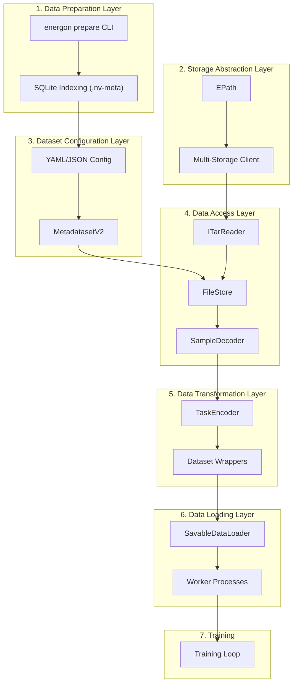
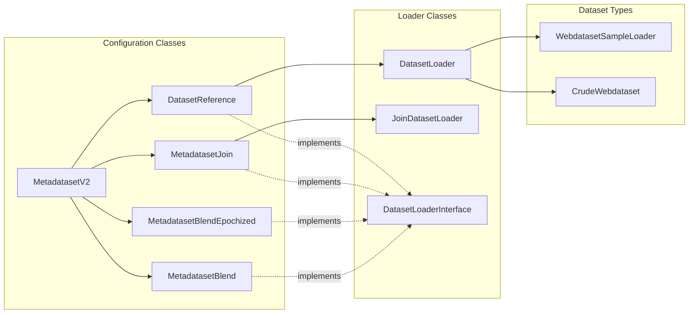
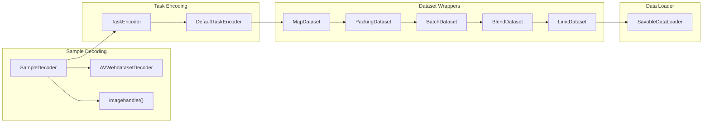
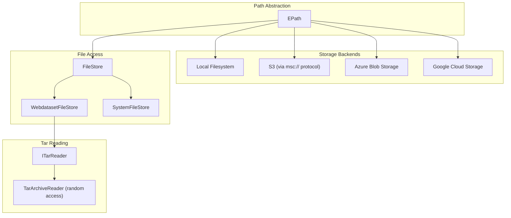
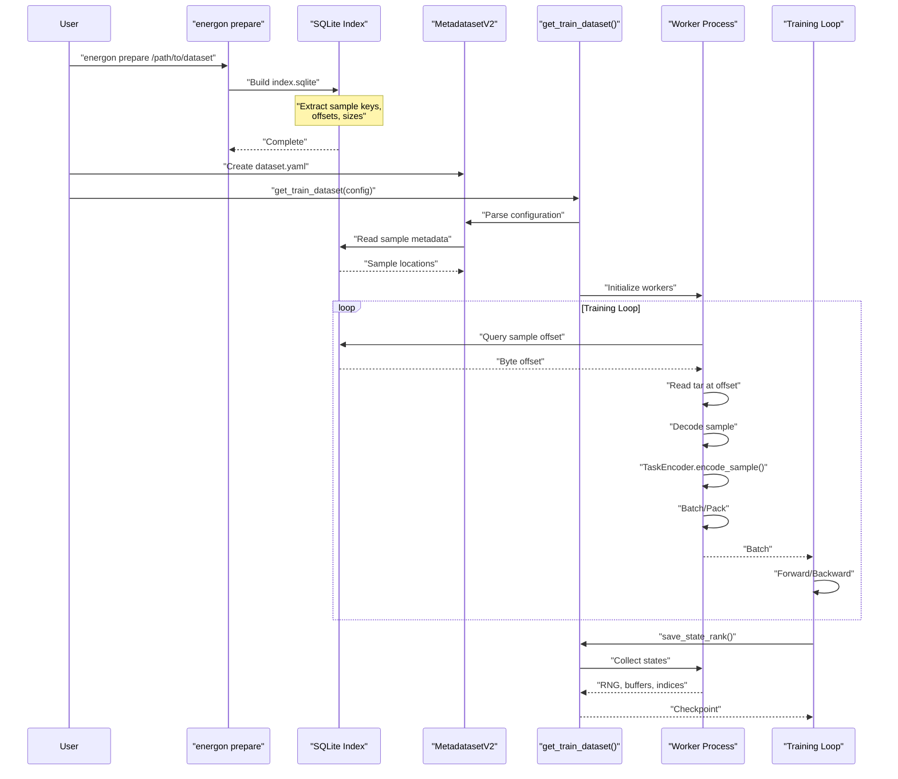
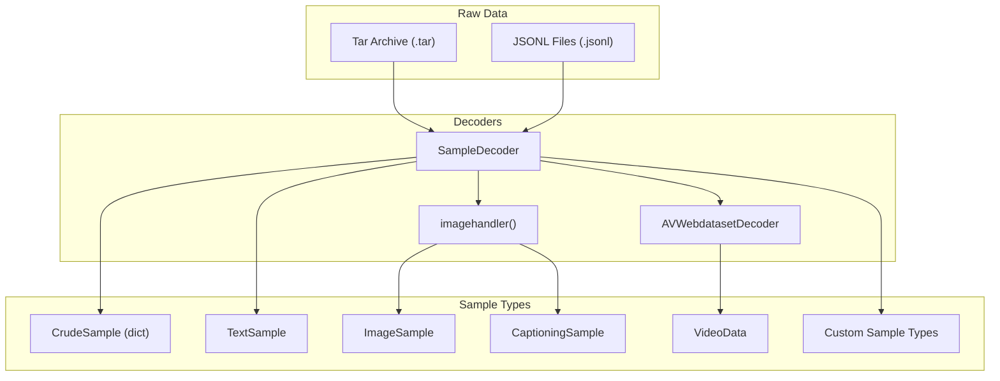

<!-- source: DeepWiki mcp.deepwiki.com · repo NVIDIA/Megatron-Energon · page 1 Overview · fetched 2026-10-26 -->

# Overview

<details>
<summary>Relevant source files</summary>

The following files were used as context for generating this wiki page:

- [pyproject.toml](pyproject.toml)
- [src/megatron/energon/flavors/crude.py](src/megatron/energon/flavors/crude.py)
- [src/megatron/energon/flavors/webdataset/sample_decoder.py](src/megatron/energon/flavors/webdataset/sample_decoder.py)
- [src/megatron/energon/metadataset/metadataset_v2.py](src/megatron/energon/metadataset/metadataset_v2.py)
- [src/megatron/energon/typed_converter.py](src/megatron/energon/typed_converter.py)
- [tests/test_metadataset_v2.py](tests/test_metadataset_v2.py)
- [uv.lock](uv.lock)

</details>


Megatron-Energon is a high-performance, multi-modal data loader designed for large-scale distributed training. It provides efficient random access to datasets stored in tar archives, flexible dataset composition, checkpointable data loading, and comprehensive support for images, text, audio, and video.

This document provides an architectural overview of the system. For installation instructions, see [Installation and Setup](#1.1). For detailed information about specific subsystems, refer to the sections on [Core Concepts](#2), [Dataset Preparation](#3), [Data Loading](#4), [Task Encoders](#5), [Audio/Video Processing](#6), [Storage Access](#7), [CLI Tools](#8), and [Advanced Topics](#9).

## Purpose and Scope

Megatron-Energon addresses key challenges in training large-scale models:

- **Efficient Data Access**: Random access to samples in tar archives without decompression overhead
- **Dataset Composition**: Flexible blending, joining, and concatenation of heterogeneous datasets
- **Fault Tolerance**: Exact checkpointing and restoration of data loader state for long-running training jobs
- **Multi-Modal Support**: Unified handling of text, images, audio, and video data
- **Storage Flexibility**: Transparent access to data on local filesystems, S3, Azure Blob Storage, GCS, and other backends
- **Distributed Training**: Deterministic sample partitioning across multiple GPUs and nodes

**Sources:** [pyproject.toml:12](), [pyproject.toml:23-36]()

## Key Features

| Feature | Description |
|---------|-------------|
| **WebDataset Format** | Uses tar archives with SQLite indices for efficient random access |
| **MetadatasetV2** | Declarative YAML configuration for dataset composition (blending, joining) |
| **SavableDataLoader** | Checkpointable data loader with exact state restoration |
| **TaskEncoder Pipeline** | User-defined transformation pipeline with hooks for pre/post-encoding |
| **AVDecoder** | Efficient audio/video decoding with keyframe indexing (Fastseek) |
| **EPath Abstraction** | Uniform API for local and cloud storage access |
| **CLI Tools** | `energon prepare` for indexing, `energon mount` for FUSE filesystem |

**Sources:** [src/megatron/energon/metadataset/metadataset_v2.py:1-611]()

## System Architecture

Megatron-Energon is organized into seven functional layers that transform raw data files into training batches:



**Architecture Overview:**

1. **Data Preparation**: Index tar files and generate metadata for efficient access
2. **Storage Abstraction**: Provide uniform access across storage backends
3. **Dataset Configuration**: Define dataset composition (blending, splitting, joining)
4. **Data Access**: Read samples from tar archives at specific byte offsets
5. **Data Transformation**: Apply user-defined transformations via TaskEncoder
6. **Data Loading**: Batch, pack, and deliver samples to training with checkpointing
7. **Training**: Consume batches in the training loop

**Sources:** [src/megatron/energon/metadataset/metadataset_v2.py:1-611]()

## Core Components

### Configuration and Dataset Composition



**Key Classes:**

| Class | Purpose | Location |
|-------|---------|----------|
| `MetadatasetV2` | Root configuration object for dataset composition | [src/megatron/energon/metadataset/metadataset_v2.py:559-611]() |
| `MetadatasetBlend` | Weighted sampling from multiple datasets | [src/megatron/energon/metadataset/metadataset_v2.py:415-476]() |
| `MetadatasetBlendEpochized` | Fixed repetitions per epoch | [src/megatron/energon/metadataset/metadataset_v2.py:494-556]() |
| `MetadatasetJoin` | Key-based joining of datasets | [src/megatron/energon/metadataset/metadataset_v2.py:324-397]() |
| `DatasetReference` | Reference to a base dataset | [src/megatron/energon/metadataset/metadataset_v2.py:176-284]() |
| `DatasetLoader` | Loads samples from prepared datasets | Referenced in [src/megatron/energon/metadataset/metadataset_v2.py:209]() |
| `JoinDatasetLoader` | Implements joining logic | Referenced in [src/megatron/energon/metadataset/metadataset_v2.py:361]() |

**Sources:** [src/megatron/energon/metadataset/metadataset_v2.py:34-611]()

### Data Processing Pipeline



**Key Classes:**

| Class | Purpose | Location |
|-------|---------|----------|
| `SampleDecoder` | Decodes raw bytes into typed objects (images, video, etc.) | [src/megatron/energon/flavors/webdataset/sample_decoder.py:80-143]() |
| `AVWebdatasetDecoder` | Handles audio/video decoding with multiple modes | Referenced in [src/megatron/energon/flavors/webdataset/sample_decoder.py:110-113]() |
| `TaskEncoder` | User-defined transformation pipeline | Referenced throughout |
| `DefaultTaskEncoder` | Default no-op task encoder | Referenced in [tests/test_metadataset_v2.py:35]() |
| `SavableDataLoader` | Checkpointable PyTorch DataLoader | Referenced in [tests/test_metadataset_v2.py:26]() |

**Sources:** [src/megatron/energon/flavors/webdataset/sample_decoder.py:1-143]()

### Storage and Access



**Key Classes:**

| Class | Purpose | Location |
|-------|---------|----------|
| `EPath` | Multi-storage path abstraction | [src/megatron/energon/typed_converter.py:521-532]() |
| `FileStore` | Abstract interface for file storage | Referenced in [src/megatron/energon/metadataset/metadataset_v2.py:8]() |
| `WebdatasetFileStore` | FileStore for prepared datasets | [src/megatron/energon/metadataset/metadataset_v2.py:52]() |
| `SystemFileStore` | FileStore for regular filesystems | [src/megatron/energon/metadataset/metadataset_v2.py:66]() |
| `ITarReader` | Random access to tar archives | Referenced in architecture diagrams |

**Sources:** [src/megatron/energon/metadataset/metadataset_v2.py:8-66](), [src/megatron/energon/typed_converter.py:521-532]()

## Data Flow Overview

The following diagram illustrates how data flows from preparation through to the training loop:



**Data Flow Stages:**

1. **Preparation**: `energon prepare` scans tar files and builds SQLite indices mapping sample keys to byte offsets
2. **Configuration**: User creates YAML configuration defining dataset composition
3. **Initialization**: `get_train_dataset()` parses configuration and initializes worker processes
4. **Sample Loading**: Workers query indices, read tar files at specific offsets, decode samples
5. **Transformation**: TaskEncoder applies user-defined transformations
6. **Batching**: Samples are packed/batched according to configuration
7. **Training**: Batches are consumed by the training loop
8. **Checkpointing**: Data loader state (RNG, buffers, indices) is saved for resumption

**Sources:** [tests/test_metadataset_v2.py:230-259]()

## Sample Types and Decoding

Megatron-Energon supports multiple sample types through a flexible decoding system:



**Decoder Configuration:**

| Parameter | Options | Description |
|-----------|---------|-------------|
| `image_decode` | `torchrgb`, `pil`, `l8`, `rgb8`, etc. | Image decoding format | 
| `av_decode` | `AVDecoder`, `torch`, `pyav` | Video/audio decoding mode |
| `video_decode_audio` | `True`, `False` | Whether to decode audio from video |
| `guess_content` | `True`, `False` | Auto-detect file type using content |

**Sources:** [src/megatron/energon/flavors/webdataset/sample_decoder.py:80-143](), [src/megatron/energon/flavors/crude.py:10-52]()

## Typical Usage Pattern

A typical workflow with Megatron-Energon follows these steps:

1. **Prepare datasets**: Run `energon prepare` on raw tar files to build indices
2. **Create configuration**: Define `metadataset.yaml` specifying dataset composition
3. **Define TaskEncoder**: Implement custom `TaskEncoder` for data transformations
4. **Initialize loader**: Call `get_train_dataset()` with configuration and worker config
5. **Training loop**: Iterate over batches, save checkpoints periodically
6. **Resume training**: Restore data loader state from checkpoint

**Example Configuration Structure:**

```yaml
__module__: megatron.energon
__class__: MetadatasetV2
splits:
  train:
    blend:
      - weight: 0.7
        path: dataset1
      - weight: 0.3
        path: dataset2
  val:
    path: validation_dataset
```

For detailed installation and setup instructions, see [Installation and Setup](#1.1). For core concepts like TaskEncoder and Metadataset, see [Core Concepts](#2).

**Sources:** [tests/test_metadataset_v2.py:118-151](), [src/megatron/energon/metadataset/metadataset_v2.py:559-611]()

## Configuration System

Megatron-Energon uses a typed configuration system based on YAML/JSON with support for:

- **Type Resolution**: Automatic instantiation of classes from `__module__` and `__class__` fields
- **Type Validation**: Runtime validation of configuration against Python type annotations
- **Nested Composition**: Recursive composition of dataset configurations
- **Auxiliary Data**: Attachment of secondary data sources to primary datasets

The configuration system is implemented in `JsonParser` which converts raw dictionaries to typed objects:

**Sources:** [src/megatron/energon/typed_converter.py:64-196](), [src/megatron/energon/metadataset/metadataset_v2.py:192-234]()

## Next Steps

- **Installation**: See [Installation and Setup](#1.1) for dependency installation and configuration
- **Core Concepts**: See [Core Concepts](#2) for detailed explanation of TaskEncoder, Metadataset, and SavableDataset
- **Dataset Preparation**: See [Dataset Preparation](#3) for indexing raw datasets with `energon prepare`
- **Data Loading**: See [Data Loading System](#4) for understanding metadataset composition and loading
- **Task Encoders**: See [Task Encoders & Data Processing](#5) for implementing custom data transformations
- **Media Processing**: See [Audio/Video Processing](#6) for AVDecoder and Fastseek optimization
- **Storage**: See [Storage Access with EPath](#7) for multi-cloud storage configuration
- **CLI Tools**: See [CLI Tools and Utilities](#8) for command-line interface reference
- **Advanced Topics**: See [Advanced Topics](#9) for checkpointing, distributed training, and custom extensions

---

