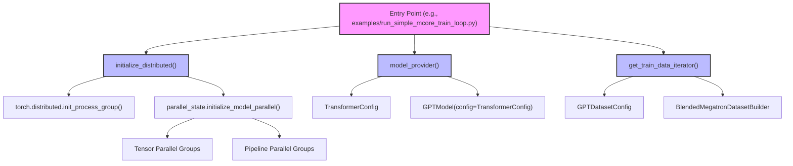

<!-- source: DeepWiki mcp.deepwiki.com · repo NVIDIA/Megatron-LM · page 1 Overview · fetched 2026-10-26 -->

# Overview

<details>
<summary>Relevant source files</summary>

The following files were used as context for generating this wiki page:

- [.gitignore](.gitignore)
- [MANIFEST.in](MANIFEST.in)
- [README.md](README.md)
- [docs/api-guide/core/index.md](docs/api-guide/core/index.md)
- [docs/index.md](docs/index.md)
- [docs/user-guide/features/context_parallel.md](docs/user-guide/features/context_parallel.md)
- [docs/user-guide/features/dist_optimizer.md](docs/user-guide/features/dist_optimizer.md)
- [docs/user-guide/features/index.md](docs/user-guide/features/index.md)
- [docs/user-guide/features/megatron_energon.md](docs/user-guide/features/megatron_energon.md)
- [docs/user-guide/features/megatron_rl.md](docs/user-guide/features/megatron_rl.md)
- [docs/user-guide/features/multi_latent_attention.md](docs/user-guide/features/multi_latent_attention.md)
- [docs/user-guide/features/multi_token_prediction.md](docs/user-guide/features/multi_token_prediction.md)
- [docs/user-guide/features/pipeline_parallel_layout.md](docs/user-guide/features/pipeline_parallel_layout.md)
- [docs/user-guide/features/tokenizers.md](docs/user-guide/features/tokenizers.md)
- [docs/user-guide/hybrid-model-migration.md](docs/user-guide/hybrid-model-migration.md)
- [docs/user-guide/index.md](docs/user-guide/index.md)
- [docs/user-guide/parallelism-guide.md](docs/user-guide/parallelism-guide.md)
- [examples/run_simple_mcore_train_loop.py](examples/run_simple_mcore_train_loop.py)
- [megatron/core/QuickStart.md](megatron/core/QuickStart.md)
- [megatron/core/README.md](megatron/core/README.md)
- [megatron/core/__init__.py](megatron/core/__init__.py)
- [megatron/core/dist_checkpointing/gpt_checkpoint_interop.py](megatron/core/dist_checkpointing/gpt_checkpoint_interop.py)
- [megatron/core/distributed/fsdp/src/megatron_fsdp/package_info.py](megatron/core/distributed/fsdp/src/megatron_fsdp/package_info.py)
- [megatron/core/models/common/__init__.py](megatron/core/models/common/__init__.py)
- [megatron/core/num_microbatches_calculator.py](megatron/core/num_microbatches_calculator.py)
- [megatron/core/package_info.py](megatron/core/package_info.py)
- [megatron/core/requirements.txt](megatron/core/requirements.txt)
- [megatron/core/safe_globals.py](megatron/core/safe_globals.py)
- [megatron/core/transformer/custom_layers/__init__.py](megatron/core/transformer/custom_layers/__init__.py)
- [megatron/training/global_vars.py](megatron/training/global_vars.py)
- [setup.py](setup.py)
- [skills/mcore-migrate-gpt-to-hybrid/SKILL.md](skills/mcore-migrate-gpt-to-hybrid/SKILL.md)
- [tests/unit_tests/data/test_multimodal_dataset.py](tests/unit_tests/data/test_multimodal_dataset.py)
- [tests/unit_tests/dist_checkpointing/test_safe_globals.py](tests/unit_tests/dist_checkpointing/test_safe_globals.py)
- [tests/unit_tests/test_num_microbatches_calculator.py](tests/unit_tests/test_num_microbatches_calculator.py)

</details>


This repository contains two primary components: **Megatron-LM** and **Megatron Core**.

**Megatron Core** is a GPU-optimized PyTorch library providing composable building blocks for training large transformer models. It contains transformer components, advanced parallelism strategies (TP, PP, DP, EP, CP), mixed precision support (FP16, BF16, FP8, and FP4), and model architectures [README.md:20-21]().

**Megatron-LM** is a reference training framework that demonstrates how to use Megatron Core. It includes pre-configured training scripts, argument parsing, distributed initialization, and examples for GPT, BERT, T5, Mamba, and Mixture-of-Experts models [README.md:18-19]().

Together, they enable training models from 2B to 462B parameters across thousands of GPUs, achieving up to 47% Model FLOP Utilization (MFU) on H100 clusters [README.md:95-98]().

## When to Use What

| Use Case | Recommended Component |
|----------|----------------------|
| Building custom training frameworks | **Megatron Core** - composable library with modular APIs [README.md:21](), [megatron/core/README.md:21]() |
| Training standard models (GPT, LLaMA, etc.) | **Megatron-LM** - reference scripts and pre-configured recipes [README.md:18-19]() |
| Research on new architectures | **Megatron Core** - flexible building blocks for attention, MLP, and MoE [megatron/core/README.md:25-28]() |
| Production training pipelines | **Megatron-LM** + **Megatron Core** - complete high-performance framework [README.md:16-17]() |
| Framework development (like NeMo) | **Megatron Core** - integrate as a library dependency via PyPI [README.md:29](), [megatron/core/package_info.py:34]() |

**Key subsystems documented in detail:**
- Getting started and installation: [Getting Started](#1.1)
- High-level system architecture: [Architecture Overview](#1.2)
- Package structure and external integrations: [Package Structure and Ecosystem](#1.3)

**Sources:** [README.md:14-23](), [README.md:95-113](), [megatron/core/package_info.py:34-42](), [megatron/core/README.md:21-36]()

---

## Repository Structure

The codebase follows a hierarchical organization that separates library code (Megatron Core) from application code (Megatron-LM training scripts) [README.md:69-89]():

```
Megatron-LM/
├── megatron/
│   ├── core/                      # Megatron Core library (kernels, parallelism)
│   │   ├── models/                # Model implementations (GPT, BERT, T5, Mamba)
│   │   ├── transformer/           # Transformer building blocks (attention, MLP, layers)
│   │   ├── tensor_parallel/       # Tensor parallelism layers and communication
│   │   ├── pipeline_parallel/     # Pipeline parallelism schedules (1F1B, interleaving)
│   │   ├── distributed/           # Data parallelism (DDP, FSDP, gradient buffers)
│   │   ├── optimizer/             # Optimizers
│   │   ├── datasets/              # Dataset loaders
│   │   ├── inference/             # Inference engines and server
│   │   └── export/                # Model export (example: TensorRT-LLM)
│   ├── training/                  # Training scripts
│   ├── legacy/                    # Legacy components
│   ├── post_training/             # Post-training (quantization, distillation, pruning, etc.)
│   └── rl/                        # Reinforcement learning (including RLHF)
├── examples/                      # Ready-to-use training examples
├── tools/                         # Utility tools
├── tests/                         # Comprehensive test suite
└── docs/                          # Documentation
```

**Sources:** [README.md:69-89](), [megatron/core/package_info.py:38]()

---

## System Architecture: Core Components

### Two-Layer Architecture

**Diagram: Megatron Core vs Megatron-LM**

```mermaid
graph TD
    subgraph ApplicationLayer["Application Layer: Megatron-LM"]
        Training["megatron/training/"]
        Examples["examples/"]
        GlobalVars["megatron.training.global_vars"]
        RunSimpleTrainLoop["examples/run_simple_mcore_train_loop.py"]
    end
    
    subgraph LibraryLayer["Library Layer: Megatron Core (megatron/core)"]
        Models["megatron/core/models/"]
        GPTModel["megatron.core.models.gpt.GPTModel"]
        
        Transformer["megatron/core/transformer/"]
        TransformerConfig["megatron.core.transformer.transformer_config.TransformerConfig"]
        
        ParallelState["megatron.core.parallel_state"]
        
        DistributedModule["megatron.core.distributed/"]
        DDP["megatron.core.distributed.DistributedDataParallel"]
        
        OptimizerModule["megatron.core.optimizer/"]
        
        DatasetsModule["megatron.core.datasets/"]
        BlendedBuilder["megatron.core.datasets.blended_megatron_dataset_builder.BlendedMegatronDatasetBuilder"]
        
        InferenceModule["megatron.core.inference/"]
        MicrobatchCalc["megatron.core.num_microbatches_calculator"]
    end
    
    subgraph ExternalDeps["External Dependencies"]
        PyTorch["PyTorch"]
        TE["Transformer Engine"]
    end
    
    GlobalVars --> MicrobatchCalc
    GlobalVars --> ParallelState
    
    RunSimpleTrainLoop --> GPTModel
    RunSimpleTrainLoop --> ParallelState
    RunSimpleTrainLoop --> TransformerConfig
    RunSimpleTrainLoop --> DDP
    RunSimpleTrainLoop --> BlendedBuilder

    GPTModel --> Transformer
    
    Transformer --> TE
    Transformer --> DistributedModule
```


**Sources:** [README.md:18-21](), [megatron/training/global_vars.py:137-166](), [examples/run_simple_mcore_train_loop.py:10-25](), [examples/run_simple_mcore_train_loop.py:72-77](), [megatron/core/README.md:25-34](), [megatron/core/num_microbatches_calculator.py:64-73]()

### Megatron Core: Composable Library

Megatron Core (`megatron/core/`) is a standalone PyTorch library providing GPU-optimized building blocks. It abstracts complex parallelism and optimization techniques into modular APIs [README.md:20-21](), [megatron/core/README.md:21]().

**Core modules:**

| Module | Key Classes/Functions | Purpose |
|--------|----------------------|---------|
| `transformer/` | `TransformerConfig` [examples/run_simple_mcore_train_loop.py:64]() | Model configuration and transformer architecture parameters |
| `models/gpt/` | `GPTModel` [examples/run_simple_mcore_train_loop.py:72]() | Reference GPT implementation using Core components |
| `distributed/` | `DistributedDataParallel` [examples/run_simple_mcore_train_loop.py:22]() | Core DDP implementation for gradient management |
| `parallel_state` | `initialize_model_parallel` [examples/run_simple_mcore_train_loop.py:52]() | Initialization of TP and PP process groups |
| `num_microbatches_calculator` | `init_num_microbatches_calculator` [megatron/core/num_microbatches_calculator.py:64]() | Logic for calculating microbatches and ramp-up schedules |

**Installation:**
```bash
uv pip install megatron-core
```
[README.md:29]()

**Sources:** [README.md:29](), [megatron/core/README.md:21](), [examples/run_simple_mcore_train_loop.py:10-25](), [megatron/core/num_microbatches_calculator.py:64-114]()

### Megatron-LM: Reference Training Framework

Megatron-LM provides pre-configured training scripts and orchestration logic. It handles the high-level loop and global state management required to use the Core library [README.md:18-19]().

**Key components:**

| Component | File/Module | Purpose |
|-----------|-------------|---------|
| Training Scripts | `megatron/training/` | Scripts for pre-training and fine-tuning [README.md:81]() |
| Global Variables | `megatron/training/global_vars.py` | Centralized access to `args`, `tokenizer`, and `timers` [megatron/training/global_vars.py:31-83]() |
| Simple Example | `examples/run_simple_mcore_train_loop.py` | A minimal end-to-end training script for learning [examples/run_simple_mcore_train_loop.py:1-10]() |
| Tokenizer Setup | `build_tokenizer` | Orchestrates tokenizer instantiation based on arguments [megatron/training/global_vars.py:17]() |

**Sources:** [README.md:18-19](), [README.md:81](), [megatron/training/global_vars.py:31-83](), [examples/run_simple_mcore_train_loop.py:1-10]()

---

## Configuration and Initialization

Megatron-LM uses a centralized configuration approach where model architecture and parallelism settings are defined in `TransformerConfig`. The system initialization involves setting up the distributed environment and process groups.

**Diagram: Configuration and Initialization Flow**



**Sources:** [examples/run_simple_mcore_train_loop.py:29-54](), [examples/run_simple_mcore_train_loop.py:57-79](), [examples/run_simple_mcore_train_loop.py:82-121]()

### Key Architecture Components

| Component | Location | Purpose |
|----------|----------|---------|
| `TransformerConfig` | `megatron/core/transformer/transformer_config.py` | Defines model dimensions and parallelism settings [examples/run_simple_mcore_train_loop.py:64-70]() |
| `parallel_state` | `megatron/core/parallel_state.py` | Manages distributed process groups for all parallelism types [examples/run_simple_mcore_train_loop.py:52]() |
| `dist_checkpointing` | `megatron/core/dist_checkpointing/` | Provides sharded model saving and loading utilities [examples/run_simple_mcore_train_loop.py:169-182]() |
| `finalize_model_grads` | `megatron/core/distributed/finalize_model_grads.py` | Orchestrates gradient reduction and clipping across parallel groups [examples/run_simple_mcore_train_loop.py:24]() |
| `ModelParallelConfig` | `megatron/core/model_parallel_config.py` | Base configuration for model parallelism settings [megatron/core/__init__.py:10]() |

**Sources:** [examples/run_simple_mcore_train_loop.py:10-25](), [examples/run_simple_mcore_train_loop.py:169-182](), [megatron/core/__init__.py:10-24]()

---

## Summary

Megatron-LM and Megatron Core provide a tiered approach to LLM development:

- **Megatron Core** serves as the foundational library for high-performance, distributed transformer components.
- **Megatron-LM** provides the reference implementation and training orchestration required for massive-scale pre-training.

For more details on specific subsystems, please refer to the following child pages:
- [Getting Started](#1.1) — Installation and first training run.
- [Architecture Overview](#1.2) — Deep dive into the system components.
- [Package Structure and Ecosystem](#1.3) — Integration with TE, NeMo, and external tools.

**Sources:** [README.md:14-23](), [megatron/core/README.md:19-21]()

---

