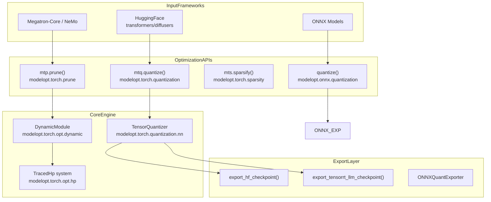
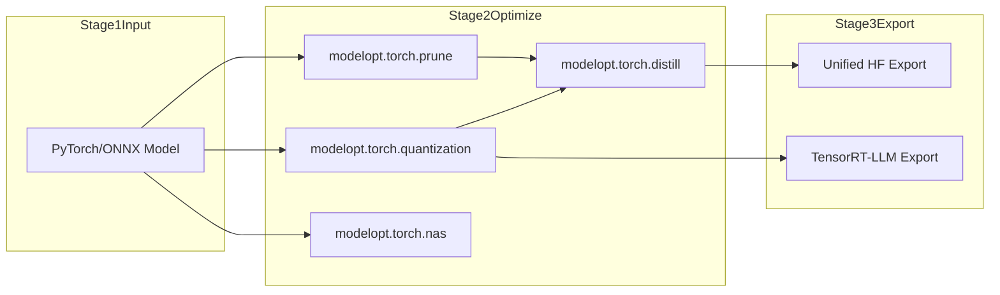

<!-- source: DeepWiki mcp.deepwiki.com · repo NVIDIA/Model-Optimizer · page 1 Overview · fetched 2026-10-26 -->

# Overview

Relevant source files

The following files were used as context for generating this wiki page:

- [.agents/TOOLING.md](.agents/TOOLING.md)
- [.coderabbit.yaml](.coderabbit.yaml)
- [.github/PULL_REQUEST_TEMPLATE.md](.github/PULL_REQUEST_TEMPLATE.md)
- [.github/actions/cache-extensions/action.yml](.github/actions/cache-extensions/action.yml)
- [.github/actions/pr-merge-base/action.yml](.github/actions/pr-merge-base/action.yml)
- [.github/codecov.yml](.github/codecov.yml)
- [.github/workflows/_example_tests_runner.yml](.github/workflows/_example_tests_runner.yml)
- [.github/workflows/_pr_gate.yml](.github/workflows/_pr_gate.yml)
- [.github/workflows/claude.yml](.github/workflows/claude.yml)
- [.github/workflows/claude_review.yml](.github/workflows/claude_review.yml)
- [.github/workflows/code_quality.yml](.github/workflows/code_quality.yml)
- [.github/workflows/example_tests.yml](.github/workflows/example_tests.yml)
- [.github/workflows/gpu_tests.yml](.github/workflows/gpu_tests.yml)
- [.github/workflows/pages.yml](.github/workflows/pages.yml)
- [.github/workflows/regression_tests.yml](.github/workflows/regression_tests.yml)
- [.github/workflows/release.yml](.github/workflows/release.yml)
- [.github/workflows/unit_tests.yml](.github/workflows/unit_tests.yml)
- [AGENTS.md](AGENTS.md)
- [CLAUDE.md](CLAUDE.md)
- [CONTRIBUTING.md](CONTRIBUTING.md)
- [README.md](README.md)
- [examples/diffusers/requirements.txt](examples/diffusers/requirements.txt)
- [examples/gpt-oss/requirements.txt](examples/gpt-oss/requirements.txt)
- [modelopt/torch/__init__.py](modelopt/torch/__init__.py)
- [noxfile.py](noxfile.py)
- [pyproject.toml](pyproject.toml)
- [tests/examples/diffusers/test_cache_diffusion.py](tests/examples/diffusers/test_cache_diffusion.py)
- [tests/examples/gpt-oss/test_gpt_oss_qat.py](tests/examples/gpt-oss/test_gpt_oss_qat.py)

## Purpose and Scope

This page provides a high-level introduction to NVIDIA Model Optimizer (**ModelOpt**), its architecture, supported optimization techniques, and ecosystem integration. It explains how Model Optimizer fits into the AI inference optimization workflow by bridging the gap between training frameworks and high-performance inference engines.

NVIDIA Model Optimizer is a unified model optimization and deployment toolkit designed to accelerate deep learning models using state-of-the-art techniques [pyproject.toml:18](). It supports inputs from [Hugging Face](https://huggingface.co), [PyTorch](https://github.com/pytorch/pytorch), and [ONNX](https://github.com/onnx/onnx) [README.md:20]().

Sources: [README.md:20](), [pyproject.toml:18]()

---

## What is Model Optimizer

**NVIDIA Model Optimizer** (referred to as **Model Optimizer**, or **ModelOpt**) is a library comprising state-of-the-art model optimization techniques including quantization, pruning, Neural Architecture Search (NAS), distillation, speculative decoding, and sparsity to accelerate models [README.md:18-19]().

Model Optimizer provides Python APIs to easily compose these techniques and export optimized quantized checkpoints [README.md:22-23](). It is integrated with training ecosystems such as [NVIDIA Megatron-Bridge](https://github.com/NVIDIA-NeMo/Megatron-Bridge), [Megatron-LM](https://github.com/NVIDIA/Megatron-LM), and [Hugging Face Accelerate](https://github.com/huggingface/accelerate) [README.md:23-24]().

**Key Capabilities Overview:**

| Technique | Description | Key Code Entities / Subpackages |
|-----------|-------------|---------------------------------|
| **Quantization (PTQ/QAT)** | Post-training and training-aware compression using NVFP4, FP8, INT8, INT4. | `modelopt.torch.quantization` [modelopt/torch/__init__.py:36]() |
| **Pruning** | Width/depth pruning (Minitron) and heterogeneous pruning (Puzzletron). | `modelopt.torch.prune` [modelopt/torch/__init__.py:35](), `modelopt.torch.puzzletron` [pyproject.toml:89]() |
| **Distillation** | Knowledge transfer from teacher to student models. | `modelopt.torch.distill` [modelopt/torch/__init__.py:32]() |
| **Speculative Decoding** | Acceleration via draft modules (EAGLE, Medusa, DFlash). | `modelopt.torch.speculative` [modelopt/torch/__init__.py:38]() |
| **Sparsity** | Structured 2:4 sparsity and attention sparsity. | `modelopt.torch.sparsity` [modelopt/torch/__init__.py:37]() |
| **NAS** | Neural Architecture Search for optimal model structure. | `modelopt.torch.nas` [modelopt/torch/__init__.py:33]() |

Sources: [README.md:18-25](), [modelopt/torch/__init__.py:30-40](), [pyproject.toml:18](), [pyproject.toml:89]()

---

## System Architecture

Model Optimizer acts as an optimization middleware layer. It consumes models from high-level frameworks and produces optimized artifacts for deployment engines.

### Natural Language to Code Entity Mapping (Architecture)

Title: System Architecture and Code Entity Mapping

Sources: [README.md:18-26](), [modelopt/torch/__init__.py:30-40](), [pyproject.toml:55-74]()

---

## Optimization Workflow

Model Optimizer follows a structured three-stage workflow: **Input → Optimize → Export**.

1. **Input**: Load a model from Hugging Face, PyTorch, or ONNX [README.md:20]().
2. **Optimize**: Apply Post-Training Quantization (PTQ), Pruning, Distillation, or NAS via Python APIs [README.md:22]().
3. **Export**: Generate an optimized checkpoint ready for deployment in downstream inference engines like SGLang, TensorRT-LLM, or vLLM [README.md:25]().

### Data Flow and Code Entity Association

Title: Optimization Pipeline Data Flow

Sources: [README.md:18-26](), [modelopt/torch/__init__.py:30-40]()

---

## Supported Techniques

### Quantization
Model Optimizer supports Post-Training Quantization (PTQ) and Quantization-Aware Training (QAT) [README.md:38]().
* **Formats**: NVFP4, FP8, INT8, INT4, and MXFP8 [README.md:37]().
* **Algorithms**: SmoothQuant, AWQ, and SVDQuant.
* **Recipes**: Declarative YAML specifications for reproducible optimization workflows.

### Pruning and NAS
* **Minitron**: Support for width and depth pruning for Megatron-Core models, including GPT, Mamba, and MoE architectures [README.md:33]().
* **Puzzletron**: A specialized subpackage for advanced heterogeneous pruning and Neural Architecture Search (NAS) [README.md:34](), [pyproject.toml:89]().

### Speculative Decoding
Model Optimizer accelerates inference via draft modules using architectures like:
* **EAGLE**: Including EAGLE-1 and EAGLE-3 with Training-Time-Testing (TTT).
* **Medusa**: Parallel draft heads for reduced latency.

### Sparsity
* **Structured Sparsity**: Support for 2:4 structured sparsity.
* **Attention Sparsity**: Techniques to optimize attention mechanisms in Transformers.

Sources: [README.md:33-40](), [pyproject.toml:89]()

---

## Ecosystem Integration

Model Optimizer is integrated into the NVIDIA AI software stack and the broader open-source community:

* **Training Frameworks**: Native integration with Megatron-Core, NeMo 2.0, and Hugging Face Accelerate [README.md:24]().
* **Inference Engines**: Optimized checkpoints deploy directly into:
    * **TensorRT-LLM**: High-performance LLM inference [README.md:26]().
    * **vLLM & SGLang**: Popular open-source serving frameworks [README.md:26]().
    * **ONNX Runtime**: Deployment on Windows and other platforms [pyproject.toml:64-70]().
* **Model Types**: Supports Large Language Models (LLMs), Vision-Language Models (VLMs), and Diffusion models (Stable Diffusion, Flux) [README.md:26]().

Sources: [README.md:24-26](), [pyproject.toml:55-87]()

---

## Implementation Details

The `modelopt.torch` package organizes its features into specialized sub-modules initialized in a precise order to prevent circular dependencies [modelopt/torch/__init__.py:30-40](). Dependency management is handled modularly via `pyproject.toml` extras (`[onnx]`, `[hf]`, `[puzzletron]`, `[all]`) [pyproject.toml:54-138]().

For installation instructions, quickstart examples, and basic usage patterns, see [Getting Started](#1.1).
For details on top-level directory layouts, packaging, and configuration files, see [Repository Layout and Packaging](#1.2).

Sources: [modelopt/torch/__init__.py:30-40](), [pyproject.toml:54-138]()

---

