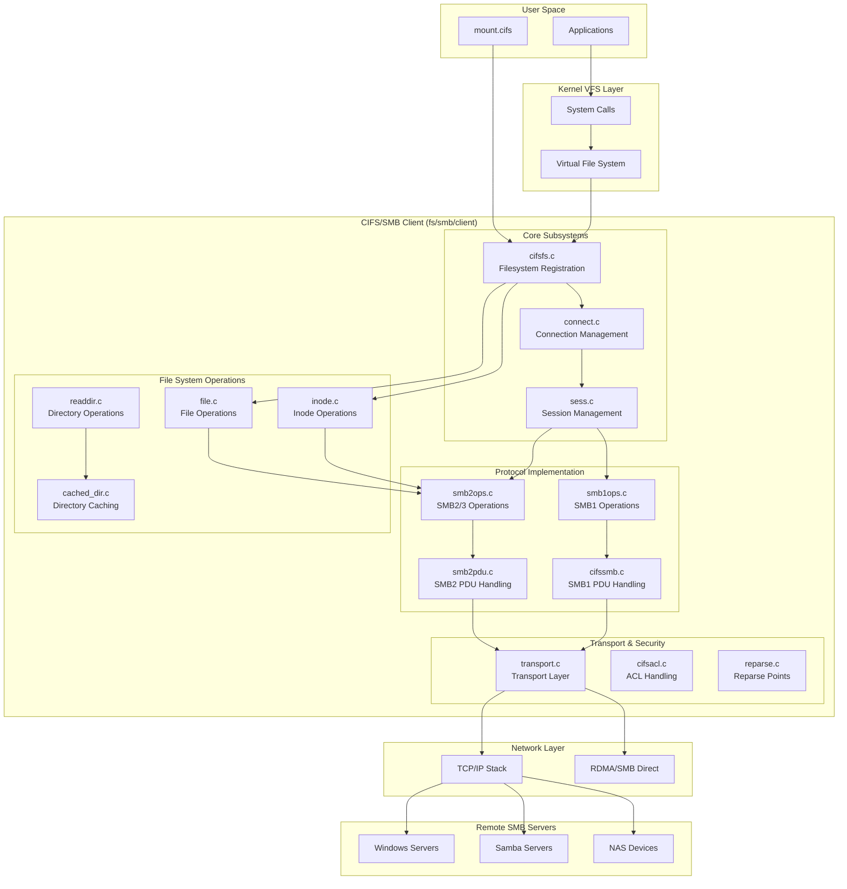
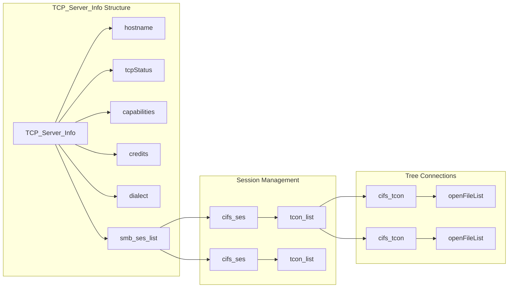
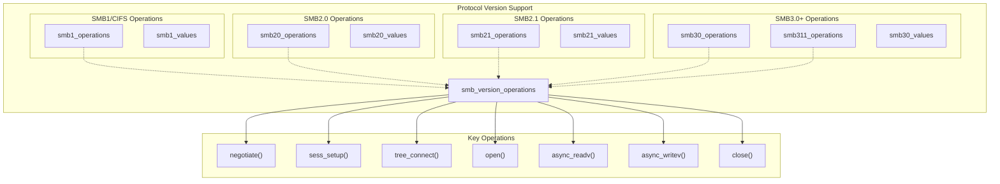
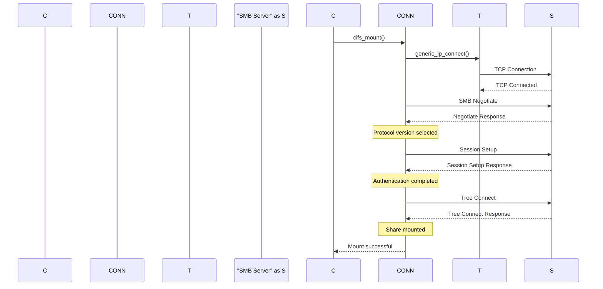
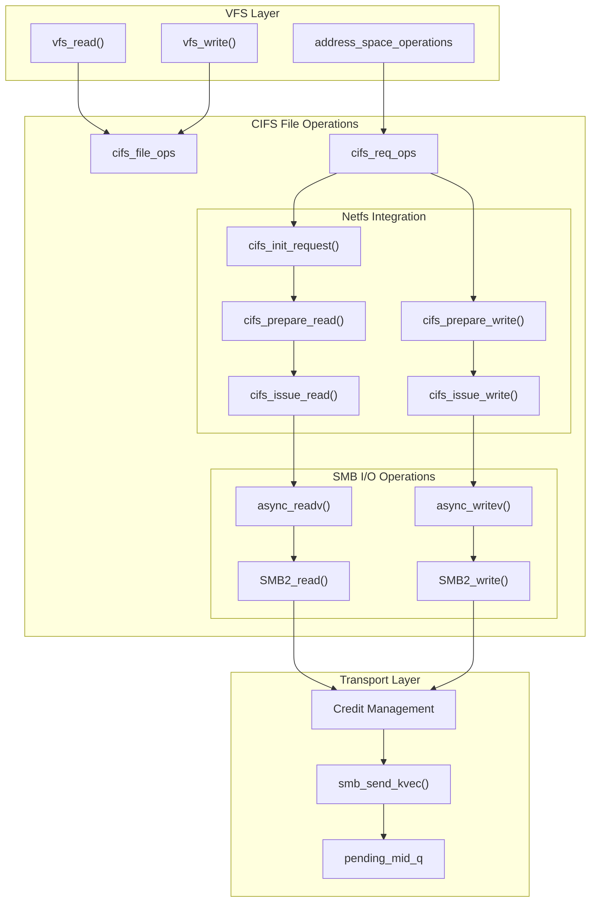
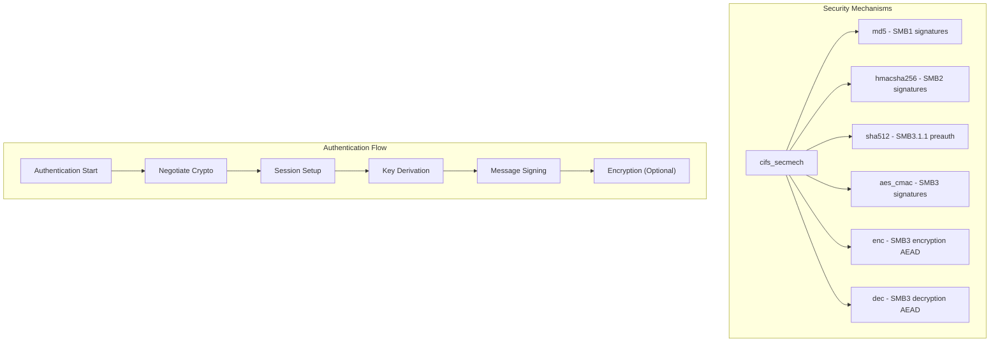
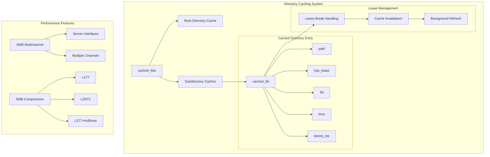
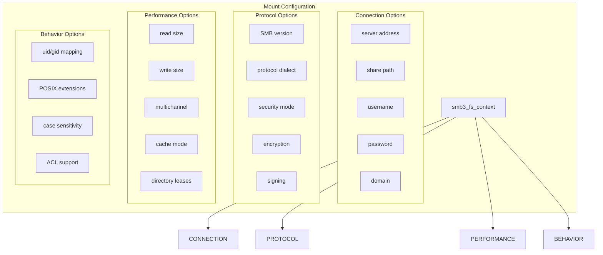

<!-- source: DeepWiki mcp.deepwiki.com · repo NVIDIA/NV-Kernels · page 6.3 CIFS/SMB Client · fetched 2026-10-26 -->

# CIFS/SMB Client

Relevant source files

The following files were used as context for generating this wiki page:

- [fs/smb/client/cached_dir.c](fs/smb/client/cached_dir.c)
- [fs/smb/client/cached_dir.h](fs/smb/client/cached_dir.h)
- [fs/smb/client/cifs_ioctl.h](fs/smb/client/cifs_ioctl.h)
- [fs/smb/client/cifsacl.c](fs/smb/client/cifsacl.c)
- [fs/smb/client/cifsacl.h](fs/smb/client/cifsacl.h)
- [fs/smb/client/cifsencrypt.c](fs/smb/client/cifsencrypt.c)
- [fs/smb/client/cifsfs.c](fs/smb/client/cifsfs.c)
- [fs/smb/client/cifsfs.h](fs/smb/client/cifsfs.h)
- [fs/smb/client/cifsglob.h](fs/smb/client/cifsglob.h)
- [fs/smb/client/cifspdu.h](fs/smb/client/cifspdu.h)
- [fs/smb/client/cifsproto.h](fs/smb/client/cifsproto.h)
- [fs/smb/client/cifssmb.c](fs/smb/client/cifssmb.c)
- [fs/smb/client/connect.c](fs/smb/client/connect.c)
- [fs/smb/client/dfs.c](fs/smb/client/dfs.c)
- [fs/smb/client/dfs.h](fs/smb/client/dfs.h)
- [fs/smb/client/dfs_cache.c](fs/smb/client/dfs_cache.c)
- [fs/smb/client/dns_resolve.c](fs/smb/client/dns_resolve.c)
- [fs/smb/client/dns_resolve.h](fs/smb/client/dns_resolve.h)
- [fs/smb/client/file.c](fs/smb/client/file.c)
- [fs/smb/client/fs_context.c](fs/smb/client/fs_context.c)
- [fs/smb/client/fs_context.h](fs/smb/client/fs_context.h)
- [fs/smb/client/inode.c](fs/smb/client/inode.c)
- [fs/smb/client/ioctl.c](fs/smb/client/ioctl.c)
- [fs/smb/client/link.c](fs/smb/client/link.c)
- [fs/smb/client/misc.c](fs/smb/client/misc.c)
- [fs/smb/client/namespace.c](fs/smb/client/namespace.c)
- [fs/smb/client/readdir.c](fs/smb/client/readdir.c)
- [fs/smb/client/reparse.c](fs/smb/client/reparse.c)
- [fs/smb/client/reparse.h](fs/smb/client/reparse.h)
- [fs/smb/client/sess.c](fs/smb/client/sess.c)
- [fs/smb/client/smb1ops.c](fs/smb/client/smb1ops.c)
- [fs/smb/client/smb2file.c](fs/smb/client/smb2file.c)
- [fs/smb/client/smb2glob.h](fs/smb/client/smb2glob.h)
- [fs/smb/client/smb2inode.c](fs/smb/client/smb2inode.c)
- [fs/smb/client/smb2misc.c](fs/smb/client/smb2misc.c)
- [fs/smb/client/smb2ops.c](fs/smb/client/smb2ops.c)
- [fs/smb/client/smb2pdu.c](fs/smb/client/smb2pdu.c)
- [fs/smb/client/smb2pdu.h](fs/smb/client/smb2pdu.h)
- [fs/smb/client/smb2proto.h](fs/smb/client/smb2proto.h)
- [fs/smb/client/smb2transport.c](fs/smb/client/smb2transport.c)
- [fs/smb/client/trace.h](fs/smb/client/trace.h)
- [fs/smb/client/transport.c](fs/smb/client/transport.c)
- [fs/smb/client/xattr.c](fs/smb/client/xattr.c)
- [fs/smb/common/smb2pdu.h](fs/smb/common/smb2pdu.h)
- [fs/smb/common/smbacl.h](fs/smb/common/smbacl.h)
- [fs/smb/server/smbacl.c](fs/smb/server/smbacl.c)
- [fs/smb/server/smbacl.h](fs/smb/server/smbacl.h)

## Purpose and Scope

The CIFS/SMB Client provides Linux kernel support for mounting and accessing remote filesystems using the SMB (Server Message Block) and CIFS (Common Internet File System) protocols. This client implementation enables Linux systems to connect to Windows file shares, Samba servers, and other SMB-compatible network storage devices.

For information about other filesystems, see [F2FS Flash Filesystem](#6.1) and [Btrfs Filesystem](#6.2).

## Architecture Overview

The CIFS/SMB client integrates with the Linux VFS (Virtual File System) layer and implements the complete SMB protocol stack, from transport-level connections to high-level file operations.

Sources: fs/smb/client/cifsfs.c, fs/smb/client/cifsglob.h, fs/smb/client/connect.c

## Core Data Structures

The CIFS client uses several key data structures to manage connections, sessions, and file operations:

| Structure | Purpose | Location |
|-----------|---------|----------|
| `TCP_Server_Info` | Server connection state | [fs/smb/client/cifsglob.h:709-858]() |
| `cifs_ses` | SMB session information | [fs/smb/client/cifsglob.h:1067-1189]() |
| `cifs_tcon` | Tree connection (share) | [fs/smb/client/cifsglob.h:1191-1346]() |
| `cifsFileInfo` | Open file handle | [fs/smb/client/cifsglob.h:1348-1418]() |
| `smb_version_operations` | Protocol version operations | [fs/smb/client/cifsglob.h:314-636]() |

The `TCP_Server_Info` structure maintains server connection state including protocol capabilities, credits, and session information:

Sources: fs/smb/client/cifsglob.h:709-858, fs/smb/client/cifsglob.h:1067-1189

## Protocol Support and Version Operations

The client supports multiple SMB protocol versions through a pluggable operations interface defined in `smb_version_operations`:

Protocol negotiation determines which operations structure to use based on server capabilities:

Sources: fs/smb/client/cifsglob.h:314-636, fs/smb/client/smb2ops.c:456-468, fs/smb/client/smb1ops.c

## Connection and Session Management

Connection establishment follows a multi-stage process involving TCP connection, protocol negotiation, session setup, and tree connection:

The connection process is handled by several key functions:

- `generic_ip_connect()` - Establishes TCP connection [fs/smb/client/connect.c:2956-3029]()
- `cifs_negotiate_protocol()` - Protocol negotiation [fs/smb/client/connect.c]()
- `cifs_setup_session()` - Session authentication [fs/smb/client/sess.c]()
- `cifs_tree_connect()` - Tree connection to share [fs/smb/client/connect.c]()

Sources: fs/smb/client/connect.c:62-63, fs/smb/client/sess.c, fs/smb/client/smb2pdu.c

## File Operations and I/O

The CIFS client integrates with the Linux netfs library for efficient I/O operations:

The client uses a credit-based flow control system to manage the number of outstanding requests:

Sources: fs/smb/client/file.c:338-351, fs/smb/client/file.c:47-98, fs/smb/client/smb2ops.c:235-297

## Authentication and Security

The CIFS client supports multiple authentication mechanisms:

| Authentication Type | Description | Support Level |
|-------------------|-------------|---------------|
| NTLMv2 | Legacy NTLM with NTLMv2 hash | Full |
| Kerberos | Kerberos via SPNEGO | Full |
| Raw NTLMSSP | NTLMSSP without SPNEGO | Full |
| Anonymous | Guest/anonymous access | Limited |

Security mechanisms are implemented through the `cifs_secmech` structure:

Sources: fs/smb/client/cifsglob.h:223-231, fs/smb/client/sess.c, fs/smb/client/smb2pdu.c:588-769

## Directory Caching and Performance

The client implements sophisticated caching mechanisms for improved performance:

The caching system provides significant performance improvements for directory operations, especially for frequently accessed directories:

Sources: fs/smb/client/cached_dir.c:25-59, fs/smb/client/sess.c:147-456, fs/smb/client/smb2pdu.c:600-610

## Mount Options and Configuration

The CIFS client supports extensive mount options through the `smb3_fs_context` structure:

Key mount options include:

- `vers=` - SMB protocol version (1.0, 2.0, 2.1, 3.0, 3.02, 3.1.1)
- `sec=` - Security/authentication method
- `cache=` - Caching behavior (strict, loose, none, ro, rw)
- `multichannel` - Enable SMB multichannel support
- `compress=` - Enable SMB compression

Sources: fs/smb/client/fs_context.c:76-227, fs/smb/client/fs_context.h, fs/smb/client/cifsglob.h:691-695

---

