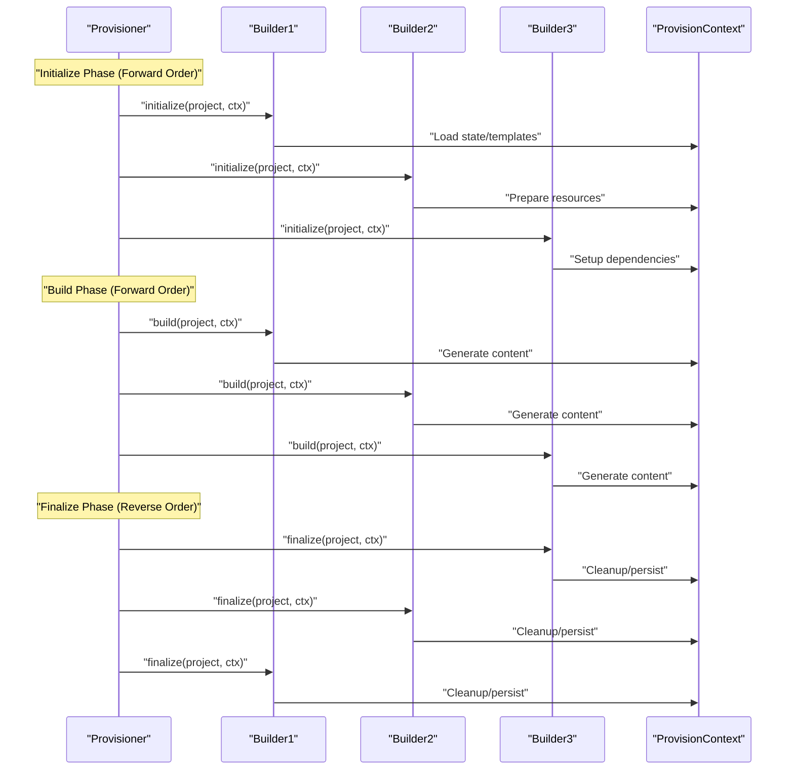
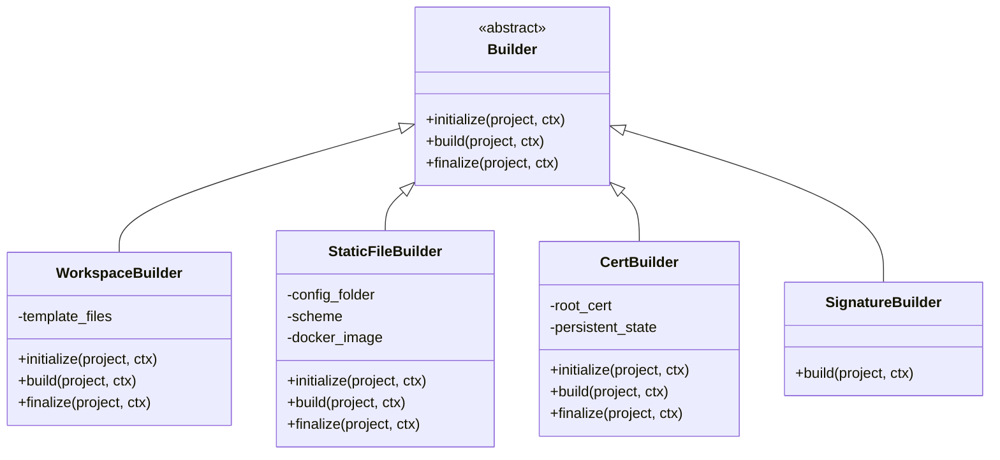
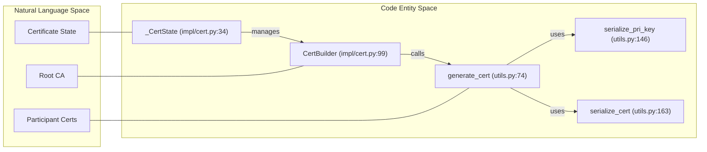
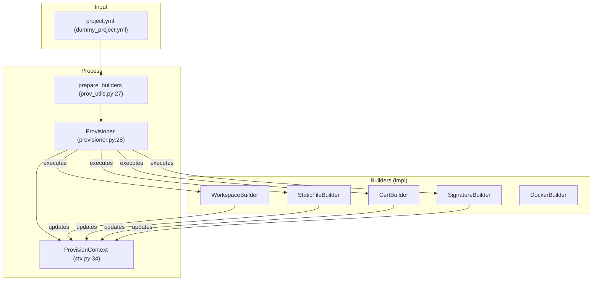

<!-- source: DeepWiki mcp.deepwiki.com · repo NVIDIA/NVFlare · page 10.2 Builder Pattern and Components · fetched 2026-10-26 -->

# Builder Pattern and Components

Relevant source files

The following files were used as context for generating this wiki page:

- [docs/user_guide/admin_guide/security/unsafe_component_detection.rst](docs/user_guide/admin_guide/security/unsafe_component_detection.rst)
- [docs/user_guide/nvflare_cli/provision_command.rst](docs/user_guide/nvflare_cli/provision_command.rst)
- [nvflare/apis/utils/format_check.py](nvflare/apis/utils/format_check.py)
- [nvflare/app_common/default_component_policy.py](nvflare/app_common/default_component_policy.py)
- [nvflare/app_common/widgets/component_path_authorizer.py](nvflare/app_common/widgets/component_path_authorizer.py)
- [nvflare/edge/simulation/README.md](nvflare/edge/simulation/README.md)
- [nvflare/fuel/f3/cellnet/cell_cipher.py](nvflare/fuel/f3/cellnet/cell_cipher.py)
- [nvflare/fuel/f3/cellnet/credential_manager.py](nvflare/fuel/f3/cellnet/credential_manager.py)
- [nvflare/fuel/hci/server/authz.py](nvflare/fuel/hci/server/authz.py)
- [nvflare/fuel/sec/admin_cert.py](nvflare/fuel/sec/admin_cert.py)
- [nvflare/fuel/sec/authz.py](nvflare/fuel/sec/authz.py)
- [nvflare/lighter/constants.py](nvflare/lighter/constants.py)
- [nvflare/lighter/ctx.py](nvflare/lighter/ctx.py)
- [nvflare/lighter/dummy_project.yml](nvflare/lighter/dummy_project.yml)
- [nvflare/lighter/edge_project.yml](nvflare/lighter/edge_project.yml)
- [nvflare/lighter/entity.py](nvflare/lighter/entity.py)
- [nvflare/lighter/impl/cert.py](nvflare/lighter/impl/cert.py)
- [nvflare/lighter/impl/docker.py](nvflare/lighter/impl/docker.py)
- [nvflare/lighter/impl/he.py](nvflare/lighter/impl/he.py)
- [nvflare/lighter/impl/signature.py](nvflare/lighter/impl/signature.py)
- [nvflare/lighter/impl/static_file.py](nvflare/lighter/impl/static_file.py)
- [nvflare/lighter/impl/workspace.py](nvflare/lighter/impl/workspace.py)
- [nvflare/lighter/provision.py](nvflare/lighter/provision.py)
- [nvflare/lighter/provisioner.py](nvflare/lighter/provisioner.py)
- [nvflare/lighter/spec.py](nvflare/lighter/spec.py)
- [nvflare/lighter/templates/master_template.yml](nvflare/lighter/templates/master_template.yml)
- [nvflare/lighter/tree_prov.py](nvflare/lighter/tree_prov.py)
- [nvflare/lighter/utils.py](nvflare/lighter/utils.py)
- [nvflare/private/fed/utils/app_authz.py](nvflare/private/fed/utils/app_authz.py)
- [nvflare/private/fed/utils/app_deployer.py](nvflare/private/fed/utils/app_deployer.py)
- [nvflare/private/fed/utils/site_config.py](nvflare/private/fed/utils/site_config.py)
- [nvflare/tool/verify_startup_kits.py](nvflare/tool/verify_startup_kits.py)
- [tests/unit_test/app_common/widgets/component_path_authorizer_test.py](tests/unit_test/app_common/widgets/component_path_authorizer_test.py)
- [tests/unit_test/fuel/flare_api_test.py](tests/unit_test/fuel/flare_api_test.py)
- [tests/unit_test/fuel/hci/server/authz_filter_test.py](tests/unit_test/fuel/hci/server/authz_filter_test.py)
- [tests/unit_test/fuel/sec/admin_cert_test.py](tests/unit_test/fuel/sec/admin_cert_test.py)
- [tests/unit_test/lighter/__init__.py](tests/unit_test/lighter/__init__.py)
- [tests/unit_test/lighter/cert_builder_test.py](tests/unit_test/lighter/cert_builder_test.py)
- [tests/unit_test/lighter/participant_test.py](tests/unit_test/lighter/participant_test.py)
- [tests/unit_test/lighter/project_test.py](tests/unit_test/lighter/project_test.py)
- [tests/unit_test/lighter/static_file_builder_test.py](tests/unit_test/lighter/static_file_builder_test.py)
- [tests/unit_test/lighter/utils_test.py](tests/unit_test/lighter/utils_test.py)
- [tests/unit_test/private/fed/utils/app_deployer_test.py](tests/unit_test/private/fed/utils/app_deployer_test.py)
- [tests/unit_test/private/fed/utils/site_config_test.py](tests/unit_test/private/fed/utils/site_config_test.py)

## Purpose and Scope

This page documents the Builder pattern used in the NVIDIA FLARE provisioning system and describes the core builder implementations that generate startup kits for federated learning participants. Builders are modular, pluggable components that each handle a specific aspect of provisioning, such as workspace structure, configuration files, certificates, and signatures.

For information about the overall provisioning workflow, see [10.1 Provisioning Overview and Workflow](). For details on certificate generation, see [10.3 Certificate and PKI Management](). For workspace directory structure, see [10.6 Workspace Structure]().

**Sources:** [nvflare/lighter/spec.py:21-37](), [nvflare/lighter/provisioner.py:28-148]()

---

## Builder Abstract Base Class

The `Builder` abstract base class defined in [nvflare/lighter/spec.py:21-64]() establishes the interface that all provisioning builders must implement. It establishes a three-phase lifecycle pattern that allows builders to coordinate their activities during the provisioning process.

### Three-Phase Lifecycle

All builders participate in a three-phase execution model:

1.  **Initialize Phase** - Prepare resources, load state, and perform pre-processing.
2.  **Build Phase** - Execute the main build logic and generate content.
3.  **Finalize Phase** - Clean up, validate outputs, and persist state.

The `Provisioner` orchestrates builder execution by calling each phase sequentially across all registered builders [nvflare/lighter/provisioner.py:123-132](). Importantly, the finalize phase executes **in reverse order** to allow proper cleanup when multiple builders have dependencies [nvflare/lighter/spec.py:34-37]().

**Diagram: Builder Three-Phase Lifecycle**

**Sources:** [nvflare/lighter/spec.py:21-64](), [nvflare/lighter/provisioner.py:123-132]()

### Builder Interface

The `Builder` interface methods are defined as follows:

| Method | Phase | Purpose | Required |
| :--- | :--- | :--- | :--- |
| `initialize(project, ctx)` | 1 | Prepare resources, load templates/state | Optional |
| `build(project, ctx)` | 2 | Generate content and write files | Optional |
| `finalize(project, ctx)` | 3 | Validate, cleanup, persist state | Optional |

Each method receives two arguments:
*   `project` - A `Project` object containing participant definitions and metadata [nvflare/lighter/spec.py:18]().
*   `ctx` - A `ProvisionContext` object for shared state and workspace navigation [nvflare/lighter/spec.py:17]().

**Sources:** [nvflare/lighter/spec.py:39-64]()

---

## Core Builders

The provisioning system includes core builders that are essential for generating functional startup kits. These are typically specified in the `builders` section of the `project.yml` [nvflare/lighter/dummy_project.yml:38-62]().

**Diagram: Core Builder Class Hierarchy**

**Sources:** [nvflare/lighter/spec.py:21-64](), [nvflare/lighter/impl/workspace.py:23](), [nvflare/lighter/impl/static_file.py:38](), [nvflare/lighter/impl/cert.py:99](), [nvflare/lighter/impl/signature.py:22]()

### WorkspaceBuilder

The `WorkspaceBuilder` manages the folder structure for provisioned projects. It handles production versioning (`prod_00`, `prod_01`, etc.) and sets up participant-specific directories [nvflare/lighter/impl/workspace.py:23-48]().

**Key Responsibilities:**
*   **Initialize**: Loads template files into the context [nvflare/lighter/impl/workspace.py:53]() and determines the next production version number [nvflare/lighter/impl/workspace.py:62]().
*   **Build**: Creates `startup`, `transfer`, and `local` directories for all participants [nvflare/lighter/impl/workspace.py:64-74]().
*   **Finalize**: Moves the work-in-progress (`wip`) directory to the final `prod_NN` folder [nvflare/lighter/impl/workspace.py:82]().

**Sources:** [nvflare/lighter/impl/workspace.py:23-86](), [nvflare/lighter/constants.py:17-22]()

### StaticFileBuilder

The `StaticFileBuilder` generates configuration files and shell scripts from templates. It supports various communication schemes like `grpc`, `tcp`, and `http` [nvflare/lighter/impl/static_file.py:74-87]().

**Key Actions:**
*   **Scheme Determination**: Resolves the protocol to use (e.g., `atcp`, `agrpc` for AIO enabled sites) [nvflare/lighter/impl/static_file.py:130-140]().
*   **Identity Mapping**: Builds authentication identity maps for relays and clients in hierarchical topologies [nvflare/lighter/impl/static_file.py:161-176]().
*   **Connection Security**: Validates and copies custom CA certificates if specified [nvflare/lighter/impl/static_file.py:113-129]().
*   **Signed Jobs Config**: Renders the `require_signed_jobs` setting into `fed_server.json` and `fed_client.json` [nvflare/lighter/impl/static_file.py:94-111]().

**Sources:** [nvflare/lighter/impl/static_file.py:38-188](), [nvflare/lighter/constants.py:122-159]()

### CertBuilder

The `CertBuilder` generates and manages the PKI (Public Key Infrastructure). It creates a root CA and signs participant certificates.

**Key Features:**
*   **State Management**: Uses `_CertState` to persist and reuse certificates in `cert.json` within the state directory [nvflare/lighter/impl/cert.py:34-97]().
*   **Root CA**: Generates a self-signed root CA if not provided by the project [nvflare/lighter/impl/cert.py:181-205]().
*   **CN Truncation**: Automatically truncates server names to 64 characters to comply with X.509 CN limits, while preserving the original name for the default host property [nvflare/lighter/impl/cert.py:127-164]().

**Diagram: CertBuilder State and Entity Association**

**Sources:** [nvflare/lighter/impl/cert.py:34-164](), [nvflare/lighter/utils.py:74-170]()

### SignatureBuilder

The `SignatureBuilder` creates cryptographic signatures for files to ensure integrity.

**Logic:**
*   **Conditional Signing**: Generates `signature.json` only for Confidential Computing (CC) kits or Homomorphic Encryption (HE) kits to protect the attestation chain or TenSEAL context [nvflare/lighter/impl/signature.py:44-58]().
*   **Plain Kits**: For standard non-CC, non-HE kits, no signature is generated as mTLS serves as the trust anchor and allows for local configuration customization [nvflare/lighter/impl/signature.py:59-62]().
*   **Root Key**: Uses the `ROOT_PRI_KEY` from the `ProvisionContext` to perform signing via `sign_folders` [nvflare/lighter/impl/signature.py:39-48]().

**Sources:** [nvflare/lighter/impl/signature.py:22-62](), [nvflare/lighter/constants.py:178](), [nvflare/lighter/utils.py:39]()

---

## Deployment-Specific Builders

### DockerBuilder

The `DockerBuilder` generates a `compose.yaml` file and `Dockerfile` for containerized deployments [nvflare/lighter/impl/docker.py:25]().

**Key Actions:**
*   **compose.yaml**: Configures services for the server and all clients based on templates [nvflare/lighter/impl/docker.py:64-78]().
*   **Environment**: Creates a `.env` file defining `WORKSPACE`, `PYTHON_EXECUTABLE`, and `IMAGE_NAME` [nvflare/lighter/impl/docker.py:79-83]().
*   **Dockerfile**: Generates a `Dockerfile` using a configurable `base_image` (default `python:3.10`) and appends content from the `DOCKERFILE` template section [nvflare/lighter/impl/docker.py:86-88]().

**Sources:** [nvflare/lighter/impl/docker.py:25-94]()

### HelmChartBuilder

The `HelmChartBuilder` extends the builder pattern to Kubernetes deployments, generating charts for server and client components to be deployed in cloud environments. It typically leverages the `CLOUD_SCRIPT_HEADER` and provider-specific headers like `AZURE_START_SVR_HEADER_SH` or `AWS_START_SH` defined in the templates [nvflare/lighter/constants.py:152-156]().

---

## Builder Registration and Execution

Builders are instantiated by the provisioning system based on the `builders` list in `project.yml`.

**Diagram: Provisioning Data Flow**

**Sources:** [nvflare/lighter/provision.py:28-31](), [nvflare/lighter/prov_utils.py:27-28](), [nvflare/lighter/dummy_project.yml:38-62](), [nvflare/lighter/ctx.py:34]()

---

