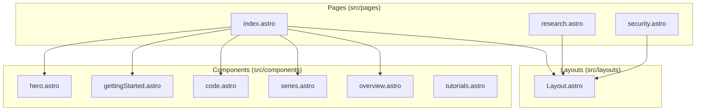
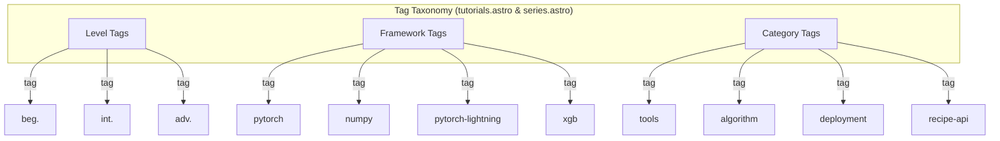

<!-- source: DeepWiki mcp.deepwiki.com · repo NVIDIA/NVFlare · page 12 Documentation Portal · fetched 2026-10-26 -->

# Documentation Portal

<details>
<summary>Relevant source files</summary>

The following files were used as context for generating this wiki page:

- [.github/workflows/deploy.yml](.github/workflows/deploy.yml)
- [examples/tutorials/self-paced-training/part-5_federated_learning_applications_in_industries/chapter-11_federated_learning_in_healthcare_lifescience/11.3_medical_devices/code/visualization/frontend/analytics-dashboard/next.config.mjs](examples/tutorials/self-paced-training/part-5_federated_learning_applications_in_industries/chapter-11_federated_learning_in_healthcare_lifescience/11.3_medical_devices/code/visualization/frontend/analytics-dashboard/next.config.mjs)
- [examples/tutorials/self-paced-training/part-5_federated_learning_applications_in_industries/chapter-11_federated_learning_in_healthcare_lifescience/11.3_medical_devices/code/visualization/frontend/analytics-dashboard/package.json](examples/tutorials/self-paced-training/part-5_federated_learning_applications_in_industries/chapter-11_federated_learning_in_healthcare_lifescience/11.3_medical_devices/code/visualization/frontend/analytics-dashboard/package.json)
- [examples/tutorials/self-paced-training/part-5_federated_learning_applications_in_industries/chapter-11_federated_learning_in_healthcare_lifescience/11.3_medical_devices/code/visualization/frontend/analytics-dashboard/pnpm-lock.yaml](examples/tutorials/self-paced-training/part-5_federated_learning_applications_in_industries/chapter-11_federated_learning_in_healthcare_lifescience/11.3_medical_devices/code/visualization/frontend/analytics-dashboard/pnpm-lock.yaml)
- [examples/tutorials/self-paced-training/part-5_federated_learning_applications_in_industries/chapter-11_federated_learning_in_healthcare_lifescience/11.3_medical_devices/code/visualization/frontend/analytics-dashboard/pnpm-workspace.yaml](examples/tutorials/self-paced-training/part-5_federated_learning_applications_in_industries/chapter-11_federated_learning_in_healthcare_lifescience/11.3_medical_devices/code/visualization/frontend/analytics-dashboard/pnpm-workspace.yaml)
- [examples/tutorials/self-paced-training/part-5_federated_learning_applications_in_industries/chapter-11_federated_learning_in_healthcare_lifescience/11.3_medical_devices/code/visualization/frontend/analytics-dashboard/src/app/components/AppCard.tsx](examples/tutorials/self-paced-training/part-5_federated_learning_applications_in_industries/chapter-11_federated_learning_in_healthcare_lifescience/11.3_medical_devices/code/visualization/frontend/analytics-dashboard/src/app/components/AppCard.tsx)
- [examples/tutorials/self-paced-training/part-5_federated_learning_applications_in_industries/chapter-11_federated_learning_in_healthcare_lifescience/11.3_medical_devices/code/visualization/frontend/analytics-dashboard/src/app/stats/[app_name]/page.tsx](examples/tutorials/self-paced-training/part-5_federated_learning_applications_in_industries/chapter-11_federated_learning_in_healthcare_lifescience/11.3_medical_devices/code/visualization/frontend/analytics-dashboard/src/app/stats/[app_name]/page.tsx)
- [examples/tutorials/self-paced-training/part-5_federated_learning_applications_in_industries/chapter-11_federated_learning_in_healthcare_lifescience/11.3_medical_devices/code/visualization/frontend/analytics-dashboard/tsconfig.json](examples/tutorials/self-paced-training/part-5_federated_learning_applications_in_industries/chapter-11_federated_learning_in_healthcare_lifescience/11.3_medical_devices/code/visualization/frontend/analytics-dashboard/tsconfig.json)
- [web/astro.config.mjs](web/astro.config.mjs)
- [web/package-lock.json](web/package-lock.json)
- [web/package.json](web/package.json)
- [web/src/components/code.astro](web/src/components/code.astro)
- [web/src/components/footer.astro](web/src/components/footer.astro)
- [web/src/components/gettingStarted.astro](web/src/components/gettingStarted.astro)
- [web/src/components/hero.astro](web/src/components/hero.astro)
- [web/src/components/learnMore.astro](web/src/components/learnMore.astro)
- [web/src/components/overview.astro](web/src/components/overview.astro)
- [web/src/components/series.astro](web/src/components/series.astro)
- [web/src/components/tutorials.astro](web/src/components/tutorials.astro)
- [web/src/layouts/Layout.astro](web/src/layouts/Layout.astro)
- [web/src/pages/404.astro](web/src/pages/404.astro)
- [web/src/pages/index.astro](web/src/pages/index.astro)
- [web/src/pages/research.astro](web/src/pages/research.astro)
- [web/src/pages/security.astro](web/src/pages/security.astro)

</details>


## Purpose and Scope

The Documentation Portal is the web-based user interface for NVIDIA FLARE documentation, hosted at `https://nvidia.github.io/NVFlare`. It provides an interactive catalog of tutorials, getting started guides, code examples, and research case studies. The portal is built as a static site using the **Astro** framework and deployed to GitHub Pages with multi-version support.

For information about the Dashboard (web-based project management and provisioning), see [Dashboard](#11). For the ReadTheDocs documentation site (comprehensive API and user guide), external links throughout the portal point to `nvflare.readthedocs.io`.

**Sources:** [web/src/pages/index.astro:1-21](), [web/package.json:1-5]()

---

## Portal Architecture

The Documentation Portal is a static site generator application built on Astro. The architecture follows a component-based design where reusable UI sections are composed into pages, styled with **Tailwind CSS** and enhanced with **Flowbite** UI components.

### Technology Stack

| Technology | Version | Purpose |
|------------|---------|---------|
| Astro | ^6.1.10 | Static site generator and framework [web/package.json:23]() |
| Tailwind CSS | ^3.3.5 | Utility-first CSS framework [web/package.json:29]() |
| Flowbite | ^2.3.0 | Component library for UI elements [web/package.json:27]() |
| Prism.js | ^1.30.0 | Code syntax highlighting [web/package.json:28]() |
| Glide.js | ^3.6.1 | Carousel/slider component for walkthroughs [web/package.json:21]() |
| MDX | ^5.0.6 | Markdown with JSX support [web/package.json:17]() |

**Sources:** [web/package.json:16-30](), [web/package-lock.json:10-24]()

### Directory Structure

The codebase is organized into a `web/` directory containing the Astro project.

```
web/
├── src/
│   ├── components/      # Reusable UI sections (hero, tutorials, code, etc.)
│   ├── layouts/         # Page layouts (Layout.astro)
│   ├── pages/           # Route pages (index, research, security, 404)
│   └── images/          # Static image assets and logos
├── astro.config.mjs     # Astro configuration
└── package.json         # Node dependencies and build scripts
```

**Sources:** [web/src/pages/index.astro:1-9](), [web/package.json:9-15]()

### Component Architecture Diagram

This diagram maps the high-level UI sections to their corresponding Astro component files.



**Sources:** [web/src/pages/index.astro:1-21](), [web/src/components/hero.astro:1-5]()

For details on the component organization and build pipeline, see [Portal Architecture](#12.1).

---

## Version Management

The portal supports multi-version documentation deployment. The version is determined by the Git branch and exposed via the `VITE_PUBLIC_GH_BRANCH` environment variable [web/src/components/hero.astro:6]().

### Version Selection

The `hero.astro` component implements a version dropdown that allows users to switch between `main`, `2.5`, and `2.6`. It uses the `gh_branch` variable to highlight the active version and construct links [web/src/components/hero.astro:19-41]().

```html
<button id="dropdownVersionButton" data-dropdown-toggle="version-dropdown">
    <span>v: {gh_branch}</span>
</button>
```

**Sources:** [web/src/components/hero.astro:6-41]()

### Deployment Pipeline

The site is built and deployed via GitHub Actions defined in `deploy.yml`. For non-main branches, the `version_path` is dynamically updated to deploy into versioned subdirectories [.github/workflows/deploy.yml:28-30]().

| Branch | Deployment Path |
|--------|-----------------|
| `main` | `/` |
| `2.5`  | `/version/2.5/` |
| `2.6`  | `/version/2.6/` |

**Sources:** [.github/workflows/deploy.yml:5-9](), [.github/workflows/deploy.yml:28-30](), [.github/workflows/deploy.yml:52-59]()

For details on multi-version deployment and the version dropdown, see [Version Management](#12.2).

---

## Tutorial Catalog System

The Tutorial Catalog is an interactive system for discovering NVIDIA FLARE resources. It is primarily driven by the `tutorials.astro` and `series.astro` components which contain registries of tutorial metadata.

### Catalog Metadata

Tutorials are defined with titles, descriptions, and tags used for filtering.

| Field | Description |
|-------|-------------|
| `title` | The display name of the tutorial [web/src/components/tutorials.astro:10]() |
| `tags` | Array of strings for filtering (e.g., `beg.`, `tools`) [web/src/components/tutorials.astro:11]() |
| `link` | URL to the source on GitHub [web/src/components/tutorials.astro:13]() |
| `colab_link` | Optional link to launch in Google Colab [web/src/components/tutorials.astro:14]() |

**Sources:** [web/src/components/tutorials.astro:8-35]()

### Filtering and Taxonomy

The system uses a tag-based taxonomy to categorize tutorials by experience level, framework, and application type.



**Sources:** [web/src/components/tutorials.astro:135-145](), [web/src/components/series.astro:18-26](), [web/src/components/series.astro:119]()

For details on filtering, search functionality, and the tag taxonomy, see [Tutorial Catalog System](#12.3).

---

## Getting Started Walkthroughs

The landing page features structured walkthroughs in `gettingStarted.astro` to guide new users through core concepts like the Client API and Job (Recipe) definitions.

### Walkthrough Steps

1.  **Introduction:** Core concepts and fundamentals [web/src/components/gettingStarted.astro:8-17]().
2.  **Job (Recipe):** Defining jobs in Python using `FedAvgRecipe` [web/src/components/gettingStarted.astro:19-28]().
3.  **Client Code:** Converting training scripts using the Client API [web/src/components/gettingStarted.astro:30-38]().
4.  **Model & Run:** Running with the Simulator or Colab [web/src/components/gettingStarted.astro:40-48]().

### Code Snippet Integration

The `code.astro` component provides tabbed code views for different frameworks (PyTorch, Lightning, etc.), showcasing `flare.init()` [web/src/components/code.astro:75](), `flare.receive()` [web/src/components/code.astro:80](), and `flare.send()` [web/src/components/code.astro:112]() patterns.

**Sources:** [web/src/components/code.astro:26-116](), [web/src/components/gettingStarted.astro:7-58]()

---

