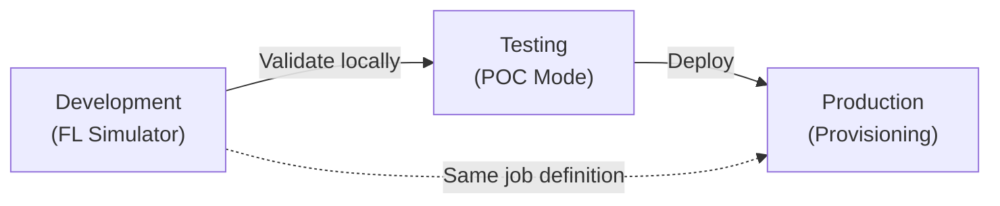
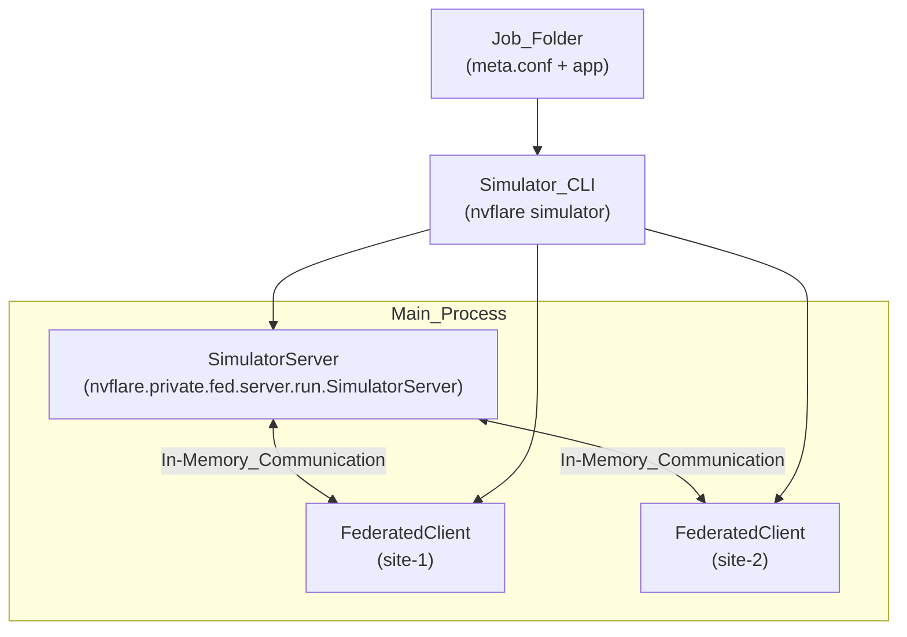
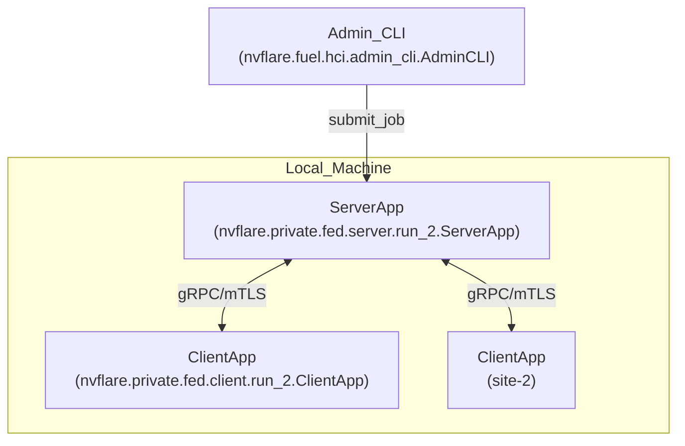
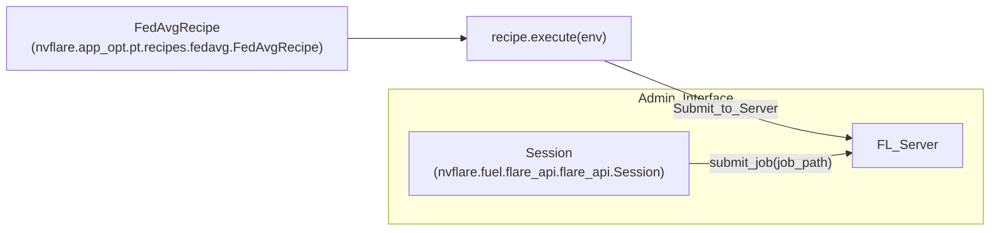

<!-- source: DeepWiki mcp.deepwiki.com · repo NVIDIA/NVFlare · page 2 Getting Started · fetched 2026-10-26 -->

# Getting Started

<details>
<summary>Relevant source files</summary>

The following files were used as context for generating this wiki page:

- [docs/example_applications_algorithms.rst](docs/example_applications_algorithms.rst)
- [docs/examples/federated_statistics_overview.rst](docs/examples/federated_statistics_overview.rst)
- [docs/examples/fl_algorithms.rst](docs/examples/fl_algorithms.rst)
- [docs/examples/hello_world_examples.rst](docs/examples/hello_world_examples.rst)
- [docs/examples/medical_image_analysis.rst](docs/examples/medical_image_analysis.rst)
- [docs/examples/tutorial_notebooks.rst](docs/examples/tutorial_notebooks.rst)
- [docs/programming_guide/controllers/cross_site_model_evaluation.rst](docs/programming_guide/controllers/cross_site_model_evaluation.rst)
- [docs/programming_guide/controllers/cyclic_workflow.rst](docs/programming_guide/controllers/cyclic_workflow.rst)
- [docs/programming_guide/controllers/scatter_and_gather_workflow.rst](docs/programming_guide/controllers/scatter_and_gather_workflow.rst)
- [docs/release_notes/flare_220.rst](docs/release_notes/flare_220.rst)
- [docs/release_notes/flare_240.rst](docs/release_notes/flare_240.rst)
- [docs/release_notes/flare_250.rst](docs/release_notes/flare_250.rst)
- [docs/whats_new.rst](docs/whats_new.rst)
- [examples/README.md](examples/README.md)
- [examples/advanced/README.md](examples/advanced/README.md)
- [examples/advanced/finance/README.md](examples/advanced/finance/README.md)
- [examples/advanced/job_api/tf/README.md](examples/advanced/job_api/tf/README.md)
- [examples/advanced/job_api/tf/run_jobs.sh](examples/advanced/job_api/tf/run_jobs.sh)
- [examples/advanced/monitoring/README.md](examples/advanced/monitoring/README.md)
- [examples/advanced/monitoring/jobs/README.md](examples/advanced/monitoring/jobs/README.md)
- [examples/advanced/sklearn-kmeans/sklearn_kmeans_iris.ipynb](examples/advanced/sklearn-kmeans/sklearn_kmeans_iris.ipynb)
- [examples/advanced/sklearn-linear/sklearn_linear_higgs.ipynb](examples/advanced/sklearn-linear/sklearn_linear_higgs.ipynb)
- [examples/advanced/sklearn-svm/sklearn_svm_cancer.ipynb](examples/advanced/sklearn-svm/sklearn_svm_cancer.ipynb)
- [examples/hello-world/README.md](examples/hello-world/README.md)
- [examples/hello-world/hello-lightning/hello_lightning.ipynb](examples/hello-world/hello-lightning/hello_lightning.ipynb)
- [examples/hello-world/hello-pt/requirements.txt](examples/hello-world/hello-pt/requirements.txt)
- [examples/hello-world/hello_world.ipynb](examples/hello-world/hello_world.ipynb)
- [examples/hello-world/hw_pre_start.sh](examples/hello-world/hw_pre_start.sh)
- [examples/tutorials/README.md](examples/tutorials/README.md)
- [examples/tutorials/flare_api.ipynb](examples/tutorials/flare_api.ipynb)
- [examples/tutorials/flare_simulator.ipynb](examples/tutorials/flare_simulator.ipynb)
- [examples/tutorials/setup_poc.ipynb](examples/tutorials/setup_poc.ipynb)

</details>


## Purpose and Scope

This page provides practical quick-start guides for new users to begin using NVIDIA FLARE (NVFLARE). It covers the primary entry points for running federated learning jobs: the **FL Simulator** for local testing, **POC mode** for multi-process simulation, the **Job CLI** for job management, and the **Client API** for federating existing training code. NVIDIA FLARE is a domain-agnostic, open-source Python SDK designed to adapt existing ML/DL workflows to a federated paradigm [examples/README.md:3-9]().

For comprehensive system architecture and deployment details, see [Overview](#1). For production deployment with provisioning and startup kits, see [Provisioning System](#10).

**Sources:** [examples/README.md:1-18](), [docs/example_applications_algorithms.rst:1-8]()

---

## Three Deployment Modes

NVIDIA FLARE supports three modes corresponding to different stages of your workflow [examples/tutorials/setup_poc.ipynb:10-14]():

| Mode | Purpose | Process Model | Use Case |
|------|---------|---------------|----------|
| **Simulator** | Algorithm development & debugging | Single system, simulates multiple clients | Rapid prototyping without complex networking [examples/tutorials/flare_simulator.ipynb:8-11]() |
| **POC** | Local validation | Multi-process (separate server & clients) | Validate deployment on one host before production [examples/tutorials/setup_poc.ipynb:12-14]() |
| **Production** | Real deployment | Distributed across sites | Live FL system with provisioned startup kits [docs/example_applications_algorithms.rst:38-40]() |

### Deployment Evolution


**Workflow:** Start with the **Simulator** for fast iteration [examples/tutorials/flare_simulator.ipynb:10-11](). Move to **POC mode** (`nvflare poc`) to test multi-process behavior and established distinct server and client "systems" [examples/tutorials/setup_poc.ipynb:12-14](). Deploy to **Production** using provisioned startup kits generated via the `Provisioner` [docs/release_notes/flare_250.rst:107-113]().

**Sources:** [examples/tutorials/setup_poc.ipynb:10-14](), [examples/tutorials/flare_simulator.ipynb:8-11](), [docs/release_notes/flare_250.rst:107-113]()

---

## Converting ML Code to Federated Learning

Converting existing training code typically involves using the **Client API** (`nvflare.client`). This transition requires minimal code changes to adapt ML/DL workflows to a federated paradigm [docs/release_notes/flare_240.rst:10-15]().

### The Job Recipe API
The modern way to define federated jobs is through **Job Recipes**, which encapsulate the workflow (e.g., `FedAvgRecipe`) and training script in a high-level Python API [examples/hello-world/hello_world.ipynb:28-32](). Recipes expose key arguments like `min_clients`, `num_rounds`, and `train_script` [examples/hello-world/hello_world.ipynb:54-60]().

```python
from nvflare.app_opt.pt.recipes.fedavg import FedAvgRecipe # [examples/hello-world/hello_world.ipynb:51]()
from nvflare.recipe import SimEnv # [examples/hello-world/hello_world.ipynb:52]()

recipe = FedAvgRecipe(
    name="hello-pt",
    min_clients=2,
    num_rounds=2,
    model=SimpleNetwork(), # [examples/hello-world/hello_world.ipynb:58]()
    train_script="client.py", # [examples/hello-world/hello_world.ipynb:59]()
)

env = SimEnv(num_clients=2) # [examples/hello-world/hello_world.ipynb:62]()
run = recipe.execute(env) # [examples/hello-world/hello_world.ipynb:63]()
```

### Client-Side Logic
The training script uses the Client API to interact with the FLARE runtime [docs/release_notes/flare_240.rst:21-24]().

```python
import nvflare.client as flare # [docs/release_notes/flare_240.rst:21]()

flare.init() # Initialize runtime [docs/release_notes/flare_240.rst:24]()

while flare.is_running(): # [docs/release_notes/flare_240.rst:27]()
    input_model = flare.receive() # Receive global model [docs/release_notes/flare_240.rst:30]()
    # ... training ...
    flare.send(output_model) # Send updated model back [docs/release_notes/flare_240.rst:46]()
```

**Sources:** [examples/hello-world/hello_world.ipynb:28-70](), [docs/release_notes/flare_240.rst:8-48]()

---

## Quick Start Path 1: FL Simulator

The **FL Simulator** runs a local simulation of an NVFLARE deployment. It is useful for local development and batch jobs that should start, run, and exit without provisioned daemons [examples/tutorials/flare_simulator.ipynb:8-10](). For details, see [Simulator Usage](#2.3).

### Simulator Architecture


**Usage:**
The simulator can be invoked via the CLI to run a specific job folder [examples/tutorials/flare_simulator.ipynb:23](). For Recipe API based jobs, you can run the script directly as it uses `SimEnv` internally [examples/tutorials/flare_simulator.ipynb:65-67]().

**Sources:** [examples/tutorials/flare_simulator.ipynb:8-23, 65-67](), [docs/example_applications_algorithms.rst:38-39]()

---

## Quick Start Path 2: POC Mode

**POC (Proof of Concept) mode** establishes distinct server and client "systems" on a single machine using separate processes, allowing users to experiment with multi-process separation and administrative tools [examples/tutorials/setup_poc.ipynb:12-14](). For details, see [POC Mode Quick Start](#2.2).

### POC Process Structure


**Setup Commands:**
```bash
# Configure the POC workspace location
nvflare config -pw /tmp/nvflare/poc

# Prepare workspace and start system
nvflare poc prepare -n 2
nvflare poc start
```
Configuration is managed via the `nvflare poc` command group which handles local setup and service control [examples/tutorials/setup_poc.ipynb:17, 152-156]().

**Sources:** [examples/tutorials/setup_poc.ipynb:12-101, 152-169](), [docs/example_applications_algorithms.rst:40-41]()

---

## Quick Start Path 3: Job CLI / FLARE API

The **Job CLI** and **FLARE API** provide high-level interfaces for creating, customizing, and submitting federated learning jobs. For details, see [Job CLI Quick Start](#2.4) and [Client API Quick Start](#2.5).

### Job Lifecycle via API


**Common Components:**
- `FedAvgRecipe`: Simplifies job creation by defining the workflow programmatically [examples/hello-world/hello_world.ipynb:50-60]().
- `nvflare job`: CLI command group to create, list, and submit jobs [docs/release_notes/flare_240.rst:64]().
- `flare_api`: Provides a Pythonic way to interact with the FL Server [examples/tutorials/flare_api.ipynb:42-44]().

**Sources:** [docs/release_notes/flare_240.rst:58-68](), [examples/hello-world/hello_world.ipynb:46-66](), [examples/tutorials/flare_api.ipynb:42-66]()

---

## Hello World Examples

NVFLARE includes several "Hello World" examples to demonstrate core functionality across different frameworks [examples/README.md:75-78](). These examples demonstrate how to use NVIDIA FLARE's high-level **Job Recipe** and **Collab** APIs [examples/hello-world/README.md:1-4](). For details, see [Hello World Examples](#2.1).

| Example | Framework | Summary |
|---------|-----------|---------|
| **Hello PyTorch** | PyTorch | Federated averaging with PyTorch models and CIFAR-10 [examples/hello-world/README.md:102-103](). |
| **Hello NumPy** | NumPy | Basic FedAvg demonstration with a NumPy trainer [examples/README.md:79](). |
| **Hello TensorFlow**| TensorFlow| Federated averaging using TensorFlow models [examples/hello-world/README.md:149-150](). |
| **Hello JAX** | JAX/Flax | MNIST classification using JAX and Flax [examples/hello-world/README.md:164-165](). |
| **Hello Lightning** | PyTorch Lightning | Streamlined training using the Lightning integration [examples/hello-world/README.md:117-118](). |
| **Hello Flower** | Flower | Running Flower apps in FLARE infrastructure [examples/hello-world/README.md:230-231](). |
| **Hello Cyclic** | PyTorch | Cyclic weight transfer workflow [examples/README.md:82](). |
| **Hello Tabular Stats** | Pandas | Federated statistics computation [examples/hello-world/hello_world.ipynb:83](). |

**Sources:** [examples/README.md:75-85](), [examples/hello-world/README.md:1-243](), [examples/hello-world/hello_world.ipynb:10-85]()

---

## Next Steps
- For details on basic examples, see [Hello World Examples](#2.1).
- To test multi-process execution locally, see [POC Mode Quick Start](#2.2).
- To iterate quickly on algorithms, see [Simulator Usage](#2.3).
- To learn how to build jobs from templates, see [Job CLI Quick Start](#2.4).
- To federate your own code, see [Client API Quick Start](#2.5).

**Sources:** [examples/hello-world/hello_world.ipynb:70-76](), [examples/README.md:14-17]()

---

