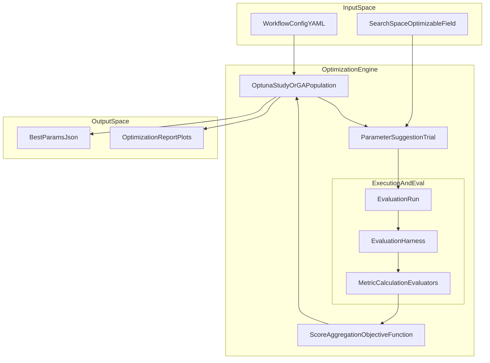
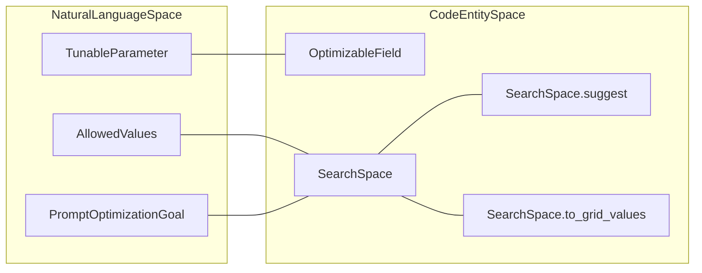
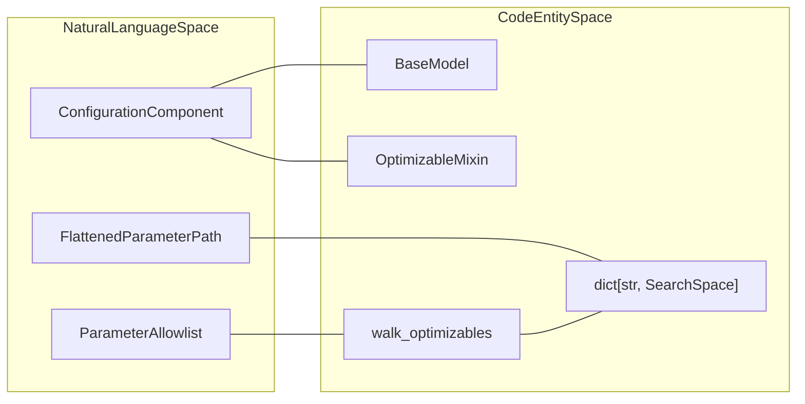
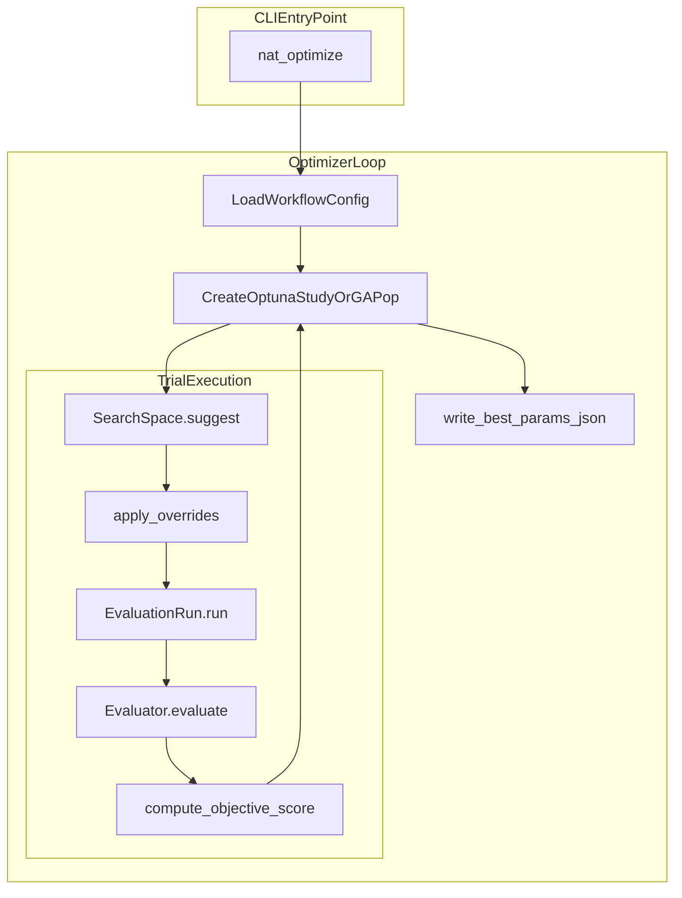

<!-- source: DeepWiki mcp.deepwiki.com · repo NVIDIA/NeMo-Agent-Toolkit · page 10.3 Optimizer · fetched 2026-10-26 -->

# Optimizer

Relevant source files

The following files were used as context for generating this wiki page:

- [docs/source/build-workflows/workflow-configuration.md](docs/source/build-workflows/workflow-configuration.md)
- [docs/source/improve-workflows/optimizer.md](docs/source/improve-workflows/optimizer.md)
- [examples/prompt_from_file/README.md](examples/prompt_from_file/README.md)
- [examples/prompt_from_file/configs/config.yml](examples/prompt_from_file/configs/config.yml)
- [examples/prompt_from_file/prompts/system_prompt.txt](examples/prompt_from_file/prompts/system_prompt.txt)
- [examples/prompt_from_file/pyproject.toml](examples/prompt_from_file/pyproject.toml)
- [packages/nvidia_nat_config_optimizer/src/nat/plugins/config_optimizer/optimizable_utils.py](packages/nvidia_nat_config_optimizer/src/nat/plugins/config_optimizer/optimizable_utils.py)
- [packages/nvidia_nat_core/src/nat/data_models/optimizable.py](packages/nvidia_nat_core/src/nat/data_models/optimizable.py)
- [packages/nvidia_nat_core/src/nat/utils/io/yaml_tools.py](packages/nvidia_nat_core/src/nat/utils/io/yaml_tools.py)
- [packages/nvidia_nat_core/tests/nat/data_models/test_optimizable.py](packages/nvidia_nat_core/tests/nat/data_models/test_optimizable.py)
- [packages/nvidia_nat_core/tests/nat/utils/test_yaml_tools.py](packages/nvidia_nat_core/tests/nat/utils/test_yaml_tools.py)

## Purpose and Scope

The Optimizer is a hyperparameter and prompt optimization system that automatically searches for workflow configurations to improve agent quality, accuracy, and performance. It uses evaluation feedback to guide iterative searches through configuration spaces, employing genetic algorithms (GA) for prompts and Optuna-based optimization for numerical parameters. 

The optimizer is an optional package, installed via `pip install nvidia-nat[config-optimizer]` or `pip install nvidia-nat-config-optimizer` [docs/source/improve-workflows/optimizer.md:23](). It addresses the challenge of manual tuning by automating search processes across hyperparameters (`temperature`, `top_p`, `max_tokens`), system prompts, and model choices [docs/source/improve-workflows/optimizer.md:27-35]().

Sources: [docs/source/improve-workflows/optimizer.md:17-35](), [packages/nvidia_nat_core/src/nat/data_models/optimizable.py:49-106]()

## Architecture Overview

The Optimizer integrates with the evaluation harness to execute workflows against datasets while systematically varying configuration parameters via `SearchSpace` and `OptimizableField` definitions [packages/nvidia_nat_core/src/nat/data_models/optimizable.py:49-106]().

### Optimizer System Flow

Sources: [packages/nvidia_nat_core/src/nat/data_models/optimizable.py:49-106](), [docs/source/improve-workflows/optimizer.md:72-103]()

## Core Concepts: `OptimizableField` and `SearchSpace`

The optimizer requires metadata defining tunable parameters and their valid domains:
1. **`OptimizableField`**: A Pydantic field helper that injects `optimizable=True` and an optional `SearchSpace` into the model field's `json_schema_extra` metadata [packages/nvidia_nat_core/src/nat/data_models/optimizable.py:72-83]().
2. **`SearchSpace`**: A Pydantic model (`SearchSpace[T]`) representing the search boundaries for a parameter, supporting categorical choices, numerical ranges (`low`, `high`, `log`, `step`), and prompt optimization flags (`is_prompt=True`) [packages/nvidia_nat_core/src/nat/data_models/optimizable.py:49-59]().

### SearchSpace Methods
- `SearchSpace.suggest(trial: _TrialLike, name: str)`: Interfaces with an Optuna trial object to suggest categorical or numerical values [packages/nvidia_nat_core/src/nat/data_models/optimizable.py:97-105]().
- `SearchSpace.to_grid_values()`: Discretizes numerical ranges or categorical lists into explicit values for `GridSampler` [packages/nvidia_nat_core/src/nat/data_models/optimizable.py:107-155]().

### Natural Language to Code Entity Mapping (Part 1)

Sources: [packages/nvidia_nat_core/src/nat/data_models/optimizable.py:34-155](), [packages/nvidia_nat_core/tests/nat/data_models/test_optimizable.py:72-109]()

## Configuration Structure and `walk_optimizables`

Component configurations inherit or mix in parameters. The `walk_optimizables(obj: BaseModel, path: str = "")` utility function recursively traverses a Pydantic configuration tree, inspecting `optimizable_params`, `search_space` overrides, and `json_schema_extra` metadata to compile a dictionary mapping flattened parameter paths to `SearchSpace` instances [packages/nvidia_nat_config_optimizer/src/nat/plugins/config_optimizer/optimizable_utils.py:27-96]().

### Natural Language to Code Entity Mapping (Parameter Traversal)

Sources: [packages/nvidia_nat_config_optimizer/src/nat/plugins/config_optimizer/optimizable_utils.py:27-96](), [packages/nvidia_nat_core/src/nat/data_models/optimizable.py:22-26]()

## Optimization Strategies

| Strategy | Engine | Target Parameters | Method |
| :--- | :--- | :--- | :--- |
| **Numerical** | [Optuna](https://optuna.org) | `temperature`, `top_p`, `max_tokens`, `model_name` | Bayesian optimization or random search via `SearchSpace.suggest()` [packages/nvidia_nat_core/src/nat/data_models/optimizable.py:97-105](). |
| **Prompt** | Genetic Algorithm | System prompts, tool descriptions | LLM-powered mutation and recombination over generations [docs/source/improve-workflows/optimizer.md:77-79](). |

Sources: [packages/nvidia_nat_core/src/nat/data_models/optimizable.py:49-105](), [docs/source/improve-workflows/optimizer.md:75-79]()

## Execution and Output Artifacts

Optimization is initiated via the CLI command `nat optimize --config_file path/to/config.yml` [docs/source/improve-workflows/optimizer.md:23](). 

### Optimization Process Logic

Sources: [packages/nvidia_nat_core/src/nat/data_models/optimizable.py:49-105](), [packages/nvidia_nat_config_optimizer/src/nat/plugins/config_optimizer/optimizable_utils.py:27-96](), [docs/source/improve-workflows/optimizer.md:80-103]()

---

