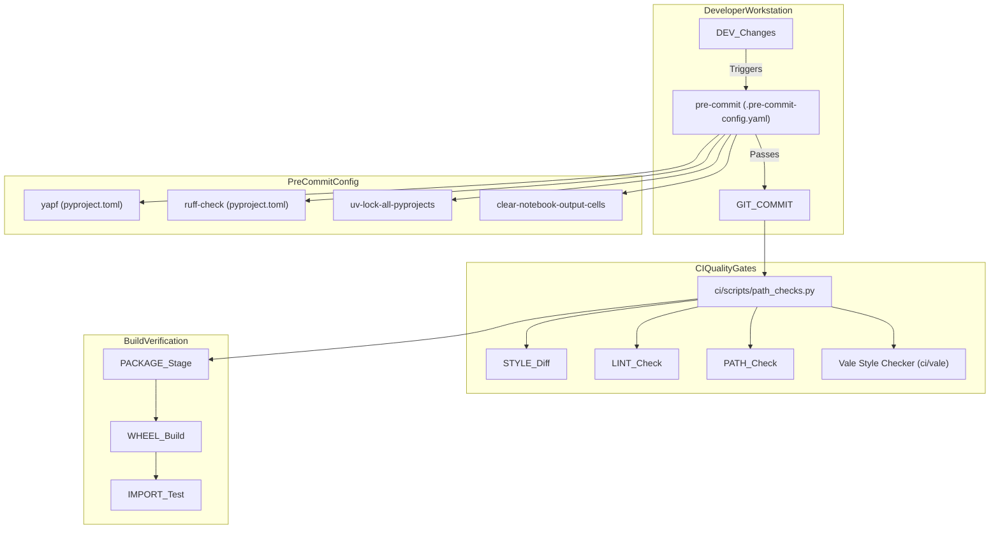
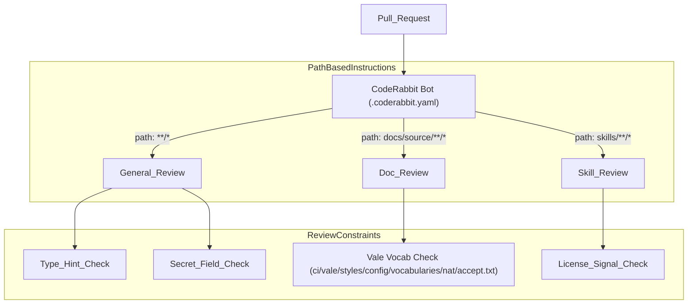

<!-- source: DeepWiki mcp.deepwiki.com · repo NVIDIA/NeMo-Agent-Toolkit · page 15.4 Code Quality · fetched 2026-10-26 -->

# Code Quality

Relevant source files

The following files were used as context for generating this wiki page:

- [.coderabbit.yaml](.coderabbit.yaml)
- [.cursor/rules/documentation/capitalization.mdc](.cursor/rules/documentation/capitalization.mdc)
- [.cursor/rules/documentation/general.mdc](.cursor/rules/documentation/general.mdc)
- [.cursor/rules/documentation/latinisms.mdc](.cursor/rules/documentation/latinisms.mdc)
- [.cursor/rules/documentation/punctuation.mdc](.cursor/rules/documentation/punctuation.mdc)
- [.cursor/rules/general.mdc](.cursor/rules/general.mdc)
- [.cursor/rules/nat-tests/general.mdc](.cursor/rules/nat-tests/general.mdc)
- [.cursor/rules/nat-tests/integration-tests.mdc](.cursor/rules/nat-tests/integration-tests.mdc)
- [.cursor/rules/nat-tests/nat-test-llm.mdc](.cursor/rules/nat-tests/nat-test-llm.mdc)
- [README.md](README.md)
- [ci/markdown-link-check-config.json](ci/markdown-link-check-config.json)
- [ci/scripts/path_checks.py](ci/scripts/path_checks.py)
- [ci/vale/styles/config/vocabularies/nat/accept.txt](ci/vale/styles/config/vocabularies/nat/accept.txt)
- [docs/Makefile](docs/Makefile)
- [docs/source/build-workflows/memory.md](docs/source/build-workflows/memory.md)
- [docs/source/components/agents/auto-memory-wrapper/auto-memory-wrapper.md](docs/source/components/agents/auto-memory-wrapper/auto-memory-wrapper.md)
- [docs/source/components/integrations/index.md](docs/source/components/integrations/index.md)
- [docs/source/components/integrations/integrating-oci-generative-ai-models.md](docs/source/components/integrations/integrating-oci-generative-ai-models.md)
- [docs/source/conf.py](docs/source/conf.py)
- [docs/source/get-started/tutorials/build-a-demo-agent-workflow-using-cursor-rules.md](docs/source/get-started/tutorials/build-a-demo-agent-workflow-using-cursor-rules.md)
- [docs/source/index.md](docs/source/index.md)
- [examples/README.md](examples/README.md)
- [examples/agents/auto_memory_wrapper/README.md](examples/agents/auto_memory_wrapper/README.md)
- [examples/memory/memanto/README.md](examples/memory/memanto/README.md)
- [packages/nvidia_nat_langchain/src/nat/plugins/langchain/agent/auto_memory_wrapper/agent.py](packages/nvidia_nat_langchain/src/nat/plugins/langchain/agent/auto_memory_wrapper/agent.py)

This page documents the comprehensive code quality enforcement systems in the NVIDIA NeMo Agent Toolkit codebase, including pre-commit hooks, linting, style checking, path validation (`ci/scripts/path_checks.py`), and coding guidelines (`.cursor/rules/general.mdc`). These systems ensure consistent code formatting, documentation quality, and correctness across all contributions.

For information about testing infrastructure and test execution, see [Testing](#14). For information about the CI/CD pipeline stages and artifact publishing, see [CI/CD Pipeline](#15.1).

---

## Code Quality Architecture

The toolkit employs a multi-layered code quality enforcement strategy that operates at three key checkpoints: local development hooks, CI verification scripts (`ci/scripts/path_checks.py`), and automated review rules (`.coderabbit.yaml`).

### Code Quality Enforcement Flow
Title: "CodeQualityEnforcementFlow"

Sources: [.coderabbit.yaml:18-34](), [ci/scripts/path_checks.py:16-142]()

---

## Pre-commit Hooks System

Pre-commit hooks automatically enforce code quality standards before changes are committed to version control. The hooks run locally on the developer's machine to catch issues early in the development cycle. The configuration is managed in `.pre-commit-config.yaml`.

### Hook Categories

The pre-commit system executes the following tool categories:

| **Tool** | **Purpose** | **Source** |
|----------|-------------|------------|
| `yapf` | Python code formatting using the style defined in `pyproject.toml`. | [.cursor/rules/general.mdc:63-64]() |
| `ruff-check` | Fast Python linter used for static analysis and auto-fixing violations. | [.cursor/rules/general.mdc:69-71]() |
| `uv-lock-all-pyprojects` | Ensures `uv lock` is run for all `pyproject.toml` files in the repository. | [docs/source/index.md:29-35]() |
| `clear-notebook-output-cells` | Strips output cells from Jupyter Notebooks (`.ipynb`) before commit. | [docs/source/get-started/tutorials/build-a-demo-agent-workflow-using-cursor-rules.md:73-77]() |
| `markdown-link-check` | Verifies that all links in Markdown files are valid. | [.cursor/rules/general.mdc:99]() |

Sources: [.cursor/rules/general.mdc:63-71](), [docs/source/index.md:29-35](), [docs/source/get-started/tutorials/build-a-demo-agent-workflow-using-cursor-rules.md:73-77]()

---

## Linting and Formatting Tools

### yapf Code Formatter
The codebase uses `yapf` with arguments `["-i", "--style", "./pyproject.toml"]` to ensure consistent style across the repository. The project requires following PEP 8 for style guidelines [.cursor/rules/general.mdc:63-64]().

### ruff Linter
The `ruff-check` hook provides fast, comprehensive Python code analysis with the `--fix` flag enabled for automatic correction of common issues. `ruff` is used only as a linter, not for formatting [.cursor/rules/general.mdc:69-71]().

**Coding Guidelines enforced via CodeRabbit:**
- **Python Style**: Follow [PEP 20](https://peps.python.org/pep-0020) and [PEP 8](https://peps.python.org/pep-0008) [.coderabbit.yaml:45-47]().
- **Type Hinting**: Python methods must use type hints for all parameters and return values (except for `None` returns) [.coderabbit.yaml:49-55]().
- **License Headers**: All code files must contain the Apache License 2.0 header [.coderabbit.yaml:77-78]().

Sources: [.coderabbit.yaml:45-78](), [.cursor/rules/general.mdc:63-71]()

---

## Path Validation

The toolkit includes a specialized path validation script, `ci/scripts/path_checks.py`, which ensures that file references within the repository are correct and follow strict organization rules.

### Path Check Logic
- **Allowlisting**: Specific file-path pairs are allowlisted in `ALLOWLISTED_FILE_PATH_PAIRS` to permit cross-references, such as evaluation configs referencing example data or documentation referencing static assets [ci/scripts/path_checks.py:29-142]().
- **Term Validation**: The system validates specific words and patterns (e.g., `application/json`, `CI/CD`, `I/O`) against the `ALLOWLISTED_WORDS` set [ci/scripts/path_checks.py:144-196]().

Sources: [ci/scripts/path_checks.py:16-196]()

---

## Documentation Quality and Vale

The toolkit uses the Vale style checker to enforce prose standards. It relies on custom vocabularies to allow toolkit-specific terminology and reject forbidden terms.

### Documentation Standards
- **Toolkit Naming**: Documentation must not use "NAT" or "nat" as an abbreviation; always spell out "NeMo Agent Toolkit" [.cursor/rules/general.mdc:27-28]().
- **Exceptions**: Code identifiers like `nvidia-nat` are permitted when wrapped in backticks [.coderabbit.yaml:72-73]().
- **Voice/Grammar**: Avoid possessive 's with inanimate objects (e.g., use "the performance of the system" instead of "the system's performance") [.coderabbit.yaml:69-70]().
- **Content**: Must be free of "lorem ipsum", TODOs, or FIXMEs [.coderabbit.yaml:64-65]().

### Vocabulary Management
Documentation is checked against specific word lists:
- **Accept List**: Case-sensitive regex for accepted terms like `Agentic`, `cuDF`, `LangChain`, `NIM(s?)`, `nvext`, and `uv` [ci/vale/styles/config/vocabularies/nat/accept.txt:1-225]().
- **Reject List**: Forbidden words that trigger Vale errors are listed in `reject.txt` and checked during the documentation review process [.coderabbit.yaml:67-68]().

Sources: [.coderabbit.yaml:62-80](), [ci/vale/styles/config/vocabularies/nat/accept.txt:1-225](), [.cursor/rules/general.mdc:27-28]()

---

## Coding Standards, Guidelines, and Cursor Rules

### Exception Handling
- **Re-raising**: Use bare `raise` statements to maintain the original stack trace. Use `logger.error()` instead of `logger.exception()` to avoid duplicate stack traces [.coderabbit.yaml:57-58]().
- **Logging**: When catching and logging without re-raising, always use `logger.exception()` to capture full stack trace information [.coderabbit.yaml:59-60]().

### Pydantic Secret Management
- **Initialization Bug**: Using `default=""` with `SecretStr`, `SerializableSecretStr`, or `OptionalSecretStr` causes the field to initialize as a raw `str` [.coderabbit.yaml:82-84]().
- **Correct Pattern**: Use `default=None` for optional fields or `default_factory=lambda: SerializableSecretStr("")` for non-optional fields [.coderabbit.yaml:84-88]().

### AI Coding Guidelines (.cursor/rules)
Specialized rules for AI assistants are defined in `.cursor/rules/general.mdc`. These rules guide AI agents in generating code that adheres to NAT's specific architectural patterns.

Key guidelines include:
- **Terminology and Naming**: Strict adherence to "NVIDIA NeMo Agent Toolkit" for full name, "NeMo Agent Toolkit" for short name, and specific capitalization rules. The abbreviation "NAT" is only allowed in code comments, never in documentation [.cursor/rules/general.mdc:13-33]().
- **Project Structure**: Guidelines for `src/` and `packages/<pkg>/src/` for Python code, `examples/` directory structure, `packages/` directory requirements (e.g., `pyproject.toml`, `nvidia-nat` dependency, `tests/`), and placement of documentation, configuration, and large assets [.cursor/rules/general.mdc:38-60]().
- **Code Formatting & Imports**: Adherence to PEP 20 and PEP 8, `yapf` for formatting, 4-space indentation, and single newline at EOF [.cursor/rules/general.mdc:63-67]().
- **Linting**: `ruff` is used for linting, respecting naming schemes (`snake_case`, `PascalCase`, `UPPER_CASE`) [.cursor/rules/general.mdc:69-72]().
- **Type Hints**: Python 3.11+ type hints for public APIs, preference for `collections.abc`/`typing` abstractions, and `pyright` warnings treated as errors [.cursor/rules/general.mdc:75-79]().
- **Documentation**: Google-style docstrings, concise first lines, backticks for code entities, and strict quality requirements (no TODOs, no offensive terms, correct spelling, adherence to vocabularies) [.cursor/rules/general.mdc:94-106]().

### Quality Enforcement Logic for Code Review
Title: "CodeReviewInstructionRouting"

Sources: [.coderabbit.yaml:18-135](), [.cursor/rules/general.mdc:1-107]()

---

