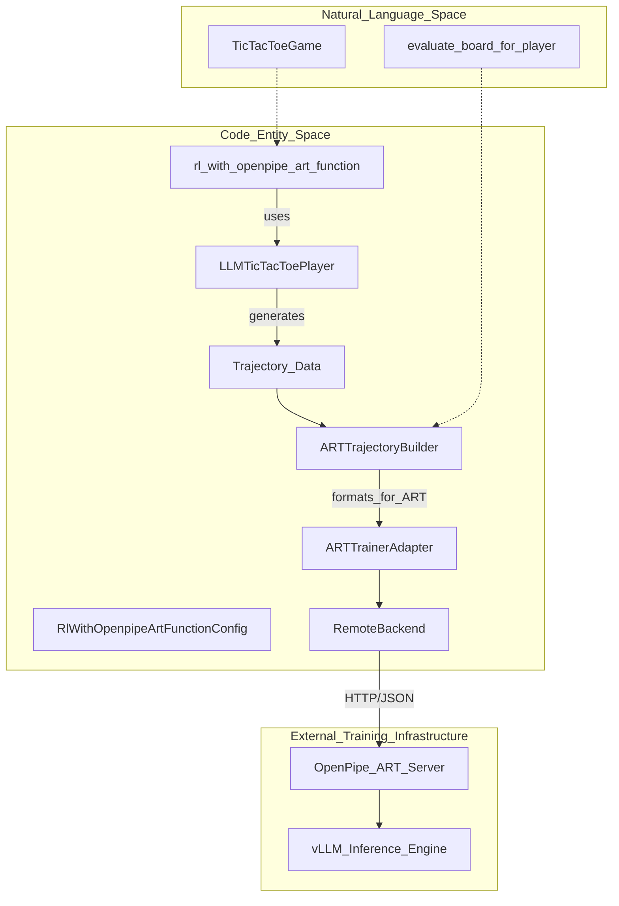
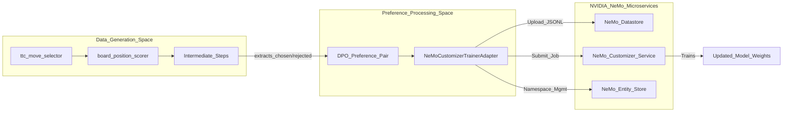

<!-- source: DeepWiki mcp.deepwiki.com · repo NVIDIA/NeMo-Agent-Toolkit · page 17.5 Finetuning Examples · fetched 2026-10-26 -->

# Finetuning Examples

Relevant source files

The following files were used as context for generating this wiki page:

- [docs/source/build-workflows/embedders.md](docs/source/build-workflows/embedders.md)
- [docs/source/improve-workflows/finetuning/concepts.md](docs/source/improve-workflows/finetuning/concepts.md)
- [docs/source/improve-workflows/finetuning/dpo_with_nemo_customizer.md](docs/source/improve-workflows/finetuning/dpo_with_nemo_customizer.md)
- [docs/source/resources/migration-guide.md](docs/source/resources/migration-guide.md)
- [examples/finetuning/dpo_tic_tac_toe/README.md](examples/finetuning/dpo_tic_tac_toe/README.md)
- [examples/finetuning/rl_with_openpipe_art/README.md](examples/finetuning/rl_with_openpipe_art/README.md)
- [examples/finetuning/rl_with_openpipe_art/pyproject.toml](examples/finetuning/rl_with_openpipe_art/pyproject.toml)
- [examples/finetuning/rl_with_openpipe_art/src/rl_with_openpipe_art/configs/config.yml](examples/finetuning/rl_with_openpipe_art/src/rl_with_openpipe_art/configs/config.yml)
- [examples/finetuning/rl_with_openpipe_art/src/rl_with_openpipe_art/configs/config_post_train.yml](examples/finetuning/rl_with_openpipe_art/src/rl_with_openpipe_art/configs/config_post_train.yml)
- [examples/finetuning/rl_with_openpipe_art/src/rl_with_openpipe_art/llm_agents.py](examples/finetuning/rl_with_openpipe_art/src/rl_with_openpipe_art/llm_agents.py)
- [examples/finetuning/rl_with_openpipe_art/src/rl_with_openpipe_art/rl_with_openpipe_art.py](examples/finetuning/rl_with_openpipe_art/src/rl_with_openpipe_art/rl_with_openpipe_art.py)
- [packages/nvidia_nat_core/src/nat/builder/framework_enum.py](packages/nvidia_nat_core/src/nat/builder/framework_enum.py)
- [packages/nvidia_nat_core/src/nat/data_models/discovery_metadata.py](packages/nvidia_nat_core/src/nat/data_models/discovery_metadata.py)
- [packages/nvidia_nat_core/src/nat/data_models/finetuning.py](packages/nvidia_nat_core/src/nat/data_models/finetuning.py)
- [packages/nvidia_nat_core/src/nat/data_models/llm.py](packages/nvidia_nat_core/src/nat/data_models/llm.py)
- [packages/nvidia_nat_nemo_customizer/src/nat/plugins/customizer/dpo/config.py](packages/nvidia_nat_nemo_customizer/src/nat/plugins/customizer/dpo/config.py)
- [packages/nvidia_nat_nemo_customizer/src/nat/plugins/customizer/dpo/trainer_adapter.py](packages/nvidia_nat_nemo_customizer/src/nat/plugins/customizer/dpo/trainer_adapter.py)
- [packages/nvidia_nat_nemo_customizer/tests/test_nemo_customizer.py](packages/nvidia_nat_nemo_customizer/tests/test_nemo_customizer.py)
- [packages/nvidia_nat_openpipe_art/pyproject.toml](packages/nvidia_nat_openpipe_art/pyproject.toml)
- [packages/nvidia_nat_openpipe_art/src/nat/plugins/openpipe/config.py](packages/nvidia_nat_openpipe_art/src/nat/plugins/openpipe/config.py)
- [packages/nvidia_nat_openpipe_art/src/nat/plugins/openpipe/remote_backend.py](packages/nvidia_nat_openpipe_art/src/nat/plugins/openpipe/remote_backend.py)
- [packages/nvidia_nat_openpipe_art/src/nat/plugins/openpipe/trainer_adapter.py](packages/nvidia_nat_openpipe_art/src/nat/plugins/openpipe/trainer_adapter.py)
- [packages/nvidia_nat_openpipe_art/tests/conftest.py](packages/nvidia_nat_openpipe_art/tests/conftest.py)
- [packages/nvidia_nat_openpipe_art/tests/test_trainer_adapter.py](packages/nvidia_nat_openpipe_art/tests/test_trainer_adapter.py)

The purpose and scope of this page is to provide a comprehensive walkthrough of the finetuning examples available in the NeMo Agent Toolkit. It covers in-situ reinforcement learning (RL) using OpenPipe ART and preference learning via Direct Preference Optimization (DPO) with NVIDIA NeMo Customizer, detailing their runtime orchestration, data flow, and architectural components.

The NeMo Agent Toolkit provides a comprehensive finetuning harness designed for **in-situ reinforcement learning** and **preference learning** of agentic LLM workflows [docs/source/improve-workflows/finetuning/concepts.md:21-27](). This system allows agents to improve their decision-making policies by interacting with environments and receiving rewards or by learning from preferred versus rejected action pairs [docs/source/improve-workflows/finetuning/concepts.md:32-41]().

## Overview of Finetuning Methods

The toolkit supports multiple finetuning paradigms to adapt pre-trained models for specific agentic tasks:

| Method | Description | Implementation Example |
| :--- | :--- | :--- |
| **Reinforcement Learning (RL)** | Training based on reward signals from outcomes. Uses GRPO (Group Relative Policy Optimization) or PPO via OpenPipe ART. | Tic-Tac-Toe with OpenPipe ART |
| **Direct Preference Optimization (DPO)** | Training on pairs of preferred vs. rejected outputs without a separate reward model. | Tic-Tac-Toe with NeMo Customizer |

Sources: [docs/source/improve-workflows/finetuning/concepts.md:32-41](), [examples/finetuning/dpo_tic_tac_toe/README.md:22-24](), [examples/finetuning/rl_with_openpipe_art/README.md:22-26]()

---

## RL with OpenPipe ART: Tic-Tac-Toe

This example demonstrates using the toolkit's finetuning harness with [OpenPipe ART](https://art.openpipe.ai) (Agent Reinforcement Trainer) to improve an LLM's performance at playing Tic-Tac-Toe against a random opponent [examples/finetuning/rl_with_openpipe_art/README.md:20-26](). It utilizes the toolkit's `openpipe_art_trainer` to manage the training lifecycle [examples/finetuning/rl_with_openpipe_art/src/rl_with_openpipe_art/configs/config.yml:81-83]().

### Implementation and Data Flow

The model learns to play as either 'X' or 'O'. The reward signal is derived from game-theoretic position evaluation [examples/finetuning/rl_with_openpipe_art/README.md:26-27]().

**Key Components:**
- **Workflow Function**: `rl_with_openpipe_art_function` registers the game logic as a NAT function using `RlWithOpenpipeArtFunctionConfig` [examples/finetuning/rl_with_openpipe_art/src/rl_with_openpipe_art/rl_with_openpipe_art.py:162-170]().
- **Trajectory Builder**: `ARTTrajectoryBuilder` (type: `openpipe_art_traj_builder`) collects game steps into training trajectories, supporting `num_generations` for policy optimization [examples/finetuning/rl_with_openpipe_art/src/rl_with_openpipe_art/configs/config.yml:50-53]().
- **Trainer Adapter**: `ARTTrainerAdapter` manages the connection to the OpenPipe ART backend using a `RemoteBackend` client [packages/nvidia_nat_openpipe_art/src/nat/plugins/openpipe/trainer_adapter.py:52-53]().
- **Game Engine**: `TicTacToeGame` handles the turn-based loop, move validation, and emits intermediate steps for reward shaping [examples/finetuning/rl_with_openpipe_art/src/rl_with_openpipe_art/rl_with_openpipe_art.py:58-160]().

### RL Finetuning Architecture

The diagram below illustrates the flow from the Python environment to the OpenPipe ART training components, bridging Natural Language Space concepts to Code Entity Space implementations.

Tic-Tac-Toe RL System Map

Sources: [examples/finetuning/rl_with_openpipe_art/src/rl_with_openpipe_art/rl_with_openpipe_art.py:162-170](), [packages/nvidia_nat_openpipe_art/src/nat/plugins/openpipe/trainer_adapter.py:42-65](), [examples/finetuning/rl_with_openpipe_art/src/rl_with_openpipe_art/configs/config.yml:50-57](), [examples/finetuning/rl_with_openpipe_art/src/rl_with_openpipe_art/rl_with_openpipe_art.py:58-160]()

---

## DPO with NeMo Customizer: Tic-Tac-Toe

This example uses the **Test-Time Compute (TTC)** pipeline to generate preference data for Direct Preference Optimization (DPO) and submits training jobs to the **NVIDIA NeMo Customizer** microservice [examples/finetuning/dpo_tic_tac_toe/README.md:20-24]().

### Implementation and Data Flow

The DPO pipeline operates in two distinct phases:
1. **Data Collection**: The agent plays games using a TTC pipeline. For every turn, the `ttc_move_selector` generates multiple candidate moves, scores them using alpha-beta pruning (via `board_position_scorer`), and records them as intermediate steps [examples/finetuning/dpo_tic_tac_toe/README.md:142-162]().
2. **Training Submission**: The collected preference data (chosen vs. rejected responses) is submitted to NeMo Customizer for DPO training [examples/finetuning/dpo_tic_tac_toe/README.md:41-43](). The Customizer service handles the training jobs via the `/v1/customization/jobs` API [examples/finetuning/dpo_tic_tac_toe/README.md:67-72]().

### DPO Pipeline Architecture

This diagram bridges the conceptual DPO data generation space to the specific NeMo Microservices and toolkit components.

DPO Preference Learning Map

Sources: [examples/finetuning/dpo_tic_tac_toe/README.md:38-52](), [examples/finetuning/dpo_tic_tac_toe/README.md:136-165](), [examples/finetuning/dpo_tic_tac_toe/README.md:67-87]()

### Key Classes and Functions

| Entity | Role | Source |
| :--- | :--- | :--- |
| `ttc_move_selector` | Generates and scores move candidates during data collection using a search-score-select pipeline. | [examples/finetuning/dpo_tic_tac_toe/README.md:149-161]() |
| `board_position_scorer` | Implementation of alpha-beta minimax to provide ground-truth preference for move evaluation. | [examples/finetuning/dpo_tic_tac_toe/README.md:155-156]() |
| `ARTTrainerAdapter` | Orchestrates training with OpenPipe ART backend; handles trajectory conversion and validation. | [packages/nvidia_nat_openpipe_art/src/nat/plugins/openpipe/trainer_adapter.py:42-70]() |
| `RemoteBackend` | Client class for proxying `LocalBackend` methods to a remote `art run` server via HTTP. | [packages/nvidia_nat_openpipe_art/src/nat/plugins/openpipe/remote_backend.py]() |
| `rl_with_openpipe_art_function` | Entry point for the RL Tic-Tac-Toe game workflow, managing the `TicTacToeGame` loop. | [examples/finetuning/rl_with_openpipe_art/src/rl_with_openpipe_art/rl_with_openpipe_art.py:162-170]() |
| `LLMTicTacToePlayer` | Wrapper for the LLM player that uses LangChain chains to generate and parse XML moves. | [examples/finetuning/rl_with_openpipe_art/src/rl_with_openpipe_art/llm_agents.py]() |

Sources: [examples/finetuning/dpo_tic_tac_toe/README.md:142-165](), [packages/nvidia_nat_openpipe_art/src/nat/plugins/openpipe/trainer_adapter.py:42-70](), [packages/nvidia_nat_openpipe_art/src/nat/plugins/openpipe/remote_backend.py](), [examples/finetuning/rl_with_openpipe_art/src/rl_with_openpipe_art/rl_with_openpipe_art.py:162-170](), [examples/finetuning/rl_with_openpipe_art/src/rl_with_openpipe_art/llm_agents.py]()

---

