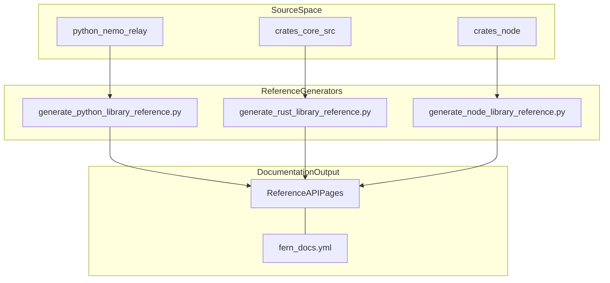
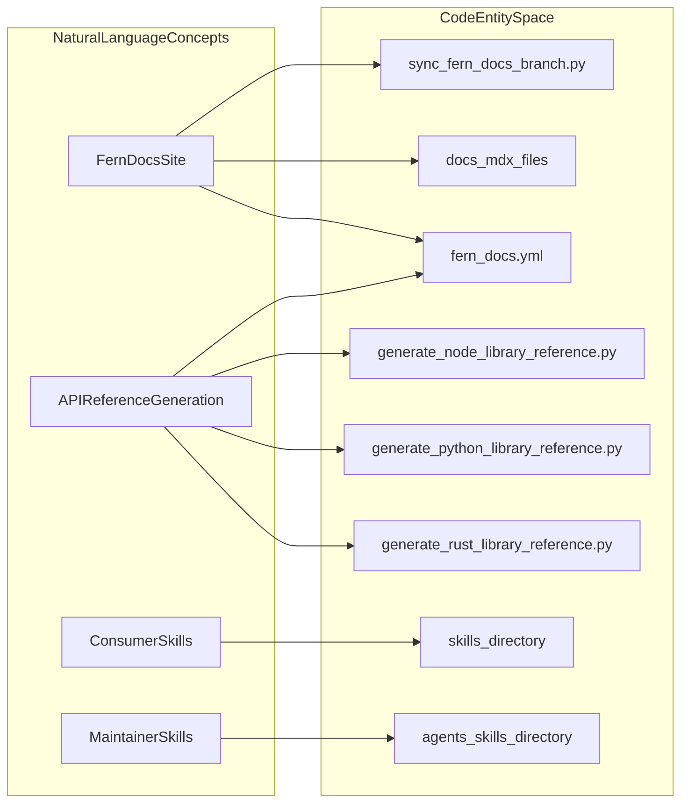

<!-- source: DeepWiki mcp.deepwiki.com · repo NVIDIA/NeMo-Relay · page 9 Documentation and Skills · fetched 2026-10-26 -->

# Documentation and Skills

Relevant source files

The following files were used as context for generating this wiki page:

- [docs/about-nemo-relay/release-notes/index.mdx](docs/about-nemo-relay/release-notes/index.mdx)
- [docs/instrument-applications/instrument-tool-call.mdx](docs/instrument-applications/instrument-tool-call.mdx)
- [docs/integrate-into-frameworks/wrap-tool-calls.mdx](docs/integrate-into-frameworks/wrap-tool-calls.mdx)
- [docs/reference/migration-guides.mdx](docs/reference/migration-guides.mdx)
- [docs/reference/tool-execution-intercept-outcomes.mdx](docs/reference/tool-execution-intercept-outcomes.mdx)
- [fern/docs.yml](fern/docs.yml)
- [skills/README.md](skills/README.md)
- [skills/nemo-relay-get-started/BENCHMARK.md](skills/nemo-relay-get-started/BENCHMARK.md)
- [skills/nemo-relay-get-started/SKILL.md](skills/nemo-relay-get-started/SKILL.md)
- [skills/nemo-relay-get-started/evals/evals.json](skills/nemo-relay-get-started/evals/evals.json)
- [skills/nemo-relay-get-started/references/cli-try-now.md](skills/nemo-relay-get-started/references/cli-try-now.md)
- [skills/nemo-relay-get-started/skill-card.md](skills/nemo-relay-get-started/skill-card.md)
- [skills/nemo-relay-get-started/skill.oms.sig](skills/nemo-relay-get-started/skill.oms.sig)
- [skills/nemo-relay-plugin-observability/references/atof.md](skills/nemo-relay-plugin-observability/references/atof.md)

The purpose of this page is to provide a high-level overview of the NeMo Relay documentation system published via Fern, the generated API reference tooling across polyglot bindings, and the two distinct skill directories (`skills/` and `.agents/skills/`) used by developers and AI agents. 

For deep technical details, see the child pages:
- [Fern Docs Site and API Reference Generation](#9.1)
- [Consumer Skills (skills)](#9.2)
- [Maintainer Skills and Contribution Workflow](#9.3)

---

## Documentation Architecture

The documentation is authored within the `docs/` and `fern/` directories. The system uses specialized generators to extract metadata and documentation directly from source code to build a comprehensive API reference [scripts/docs/generate_rust_library_reference.py:4-13]().

| Component | Purpose |
| :--- | :--- |
| `docs/` | Contains Markdown and MDX page source for high-level concepts and guides [docs/about-nemo-relay/release-notes/index.mdx:1-7](). |
| `fern/` | Stores Fern configuration (`docs.yml`), navigation, and global theme settings [fern/docs.yml:9-15](). |
| `scripts/docs/` | Contains generators for Rust, Python, and Node.js API references [scripts/docs/generate_rust_library_reference.py:23-36](). |
| `skills/` | Task-oriented guides for common user workflows [skills/README.md:6-11](). |

### API Reference Generation Pipeline

The system generates reference pages by extracting docstrings and type definitions directly from the polyglot codebase.

**Documentation Data Flow**

Sources: [scripts/docs/generate_rust_library_reference.py:23-36](), [scripts/docs/generate_python_library_reference.py:28-42](), [scripts/docs/generate_node_library_reference.py:42-59]()

For details on the Fern configuration, MDX layout, and generation scripts, see [Fern Docs Site and API Reference Generation](#9.1).

---

## Consumer Skills (skills)

User-facing skills inside the `skills/` directory provide executable and readable guidance for installing, trying, integrating, configuring, and troubleshooting NeMo Relay [skills/README.md:6-11](). These are intended for application developers, framework integrators, and operators applying Relay to their own agents [skills/README.md:9-11]().

Key consumer skills include:
- `nemo-relay-install`: Choosing and installing the CLI, language packages, or framework integrations [skills/README.md:53]().
- `nemo-relay-get-started`: Reaching a first observable Relay result [skills/README.md:54]().
- `nemo-relay-instrument-calls`: Wrapping tool or LLM calls with scopes and managed execution [skills/README.md:62]().
- `nemo-relay-plugin-observability`: Inspecting or exporting Relay activity through subscribers and OTLP [skills/README.md:73]().

For details, see [Consumer Skills (skills)](#9.2).

---

## Maintainer Skills and Contribution Workflow

Located in `.agents/skills/`, maintainer instructions help AI coding agents perform repository maintenance, version updates, and PR preparation [skills/README.md:13-18](). These skills are intended for those developing NeMo Relay itself, changing core or binding APIs, maintaining repository infrastructure, or preparing contributions [skills/README.md:13-16]().

For details, see [Maintainer Skills and Contribution Workflow](#9.3).

---

## Documentation Hierarchy and Code Mapping

The following diagram bridges high-level documentation concepts to the underlying code entities in the repository.

**Concept to Code Entity Mapping**

Sources: [fern/docs.yml:1-119](), [scripts/docs/sync_fern_docs_branch.py:1-100](), [scripts/docs/generate_rust_library_reference.py:1-100](), [scripts/docs/generate_python_library_reference.py:1-100](), [scripts/docs/generate_node_library_reference.py:1-100](), [skills/README.md:1-11]()

---

## Versioning and Publishing

NeMo Relay uses `fern/docs.yml` to manage versioned instances, custom domains, and documentation redirects [fern/docs.yml:4-6]().
* **Redirects**: A comprehensive redirect list handles concept relocations and API path changes across versions [fern/docs.yml:20-36]().
* **Versioning**: Release-specific API references are explicitly mapped to versioned paths (e.g., `/v0.5.0/`) to ensure documentation aligns with installed package releases [fern/docs.yml:38-81]().

Sources:
* `scripts/docs/generate_rust_library_reference.py` [23-37]()
* `scripts/docs/generate_python_library_reference.py` [28-42]()
* `scripts/docs/generate_node_library_reference.py` [42-60]()
* `fern/docs.yml` [4-119]()
* `skills/README.md` [1-11]()

---

